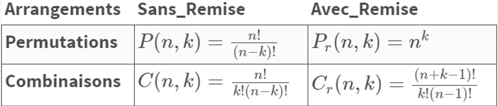

```{r}
#| echo: false
#| message: false
#| warning: false
#| error: false

source("global.R")
```

# Calcul combinatoire  

Dans le chapitre précédent, une probabilité a été définie comme le rapport entre le nombre d'événements favorables ($nE$) et le nombre total de résultats possibles d'une expérience aléatoire ($nS$). Le problème à résoudre est donc essentiellement de déterminer ces deux valeurs. Pour y parvenir, il est souvent nécessaire d'obtenir le nombre de combinaisons ou le nombre de permutations de $n$ objets pris $r$ à la fois. Cette section résume ces concepts et leur mise en oeuvre.

## Permutations de *n* objets:

Une permutation est une séquence de *n* items prix *k* à la fois, sans
remise. C'est dire que l'ordre de la sélection est pris en compte. Par
exemple, la séquence {A,B,C} est différente de la séquence {B,A,C} ou de
{C,B,A} même si elles sont composées des mêmes éléments.

La fonction **permute()** (@lst-permute) permet de
dresser une liste complète de toutes les permutations qu'il est possible
de former à partir de *n* objets. On obtient donc une liste de
l'ensemble des éléments qui se trouvent dans l'espace échantillonnal.
Pour l'utiliser, il suffit de définir un vecteur contenant les éléments
à permuter. Ce vecteur est le seul argument nécessaire. Par exemple, dressons la liste des permutations de la séquence 1 à 5 (on n'affiche ici que les 6 premières et les 6 dernières):

```{r}
#| code-fold: false

x <- permute(1:5)  # Permutations des nombres 1 à 5
```

```{r}
#| echo: false

df <- as.data.frame(x)
top <- slice(df, 1:6)
bottom <- slice(df, (n() - 5):n())
dots <- matrix(rep(".", 3 * ncol(df)), nrow = 3) 
tbl <- rbind(top, dots, bottom)
tbl %>%
  kbl(booktabs=TRUE) %>%
  kable_styling(bootstrap_options = c("striped", "hover", "condensed"), 
                full_width=FALSE) %>%
  column_spec(1, bold=FALSE)

```
  
  
De la même manière, on obtient la liste des permutations des lettres $a$ à $d$:

```{r echo=1}

x <- permute(letters[1:4]) # Permutations des lettres a, b, c, d

df <- as.data.frame(x)
top <- slice(df, 1:6)
bottom <- slice(df, (n() - 5):n())
dots <- matrix(rep(".", 3 * ncol(df)), nrow = 3) 
tbl <- rbind(top, dots, bottom)
tbl %>%
  kbl(booktabs=TRUE) %>%
  kable_styling(bootstrap_options = c("striped", "hover", "condensed"), 
                full_width=FALSE) %>%
  column_spec(1, bold=FALSE)

```

  
  
ATTENTION: la liste des permutations peut être TRÈS longue: avec 5
éléments, 120 permutations sont possibles; avec 6 éléments, cette liste
grimpe à 720; avec 8 éléments, on a 40,420 permutations! Je vous laisse
tenter votre chance avec des nombres plus élevés d'éléments!

Le nombre de permutations de *n* objets est obtenu en appliquant
l'@eq-perm1

$$P(n,n)=n! = n\cdot(n-1)\cdot(n-2)\cdot...\cdot1$$ {#eq-perm1}

par exemple:

$$P(5,5)=5! = 5\cdot4\cdot3\cdot2\cdot1=120$$

Sous R, la fonction **factorial()** permet d'obtenir cette quantité:

```{r }
#| code-fold: false
factorial(5)
```

## Permutations de n objets pris k à la fois, **sans remise**

Il est très fréquent que l'on doive considérer le nombre de permutations
de *n* éléments, mais pris *k* à la fois et **sans remise**, pour *k* \<
*n*. La fonction **permut()** de la librairie **randtests** permet d'obtenir la liste de ces permutations.
Spécifiquement, après avoir installé cette librairie, on obtiendra la liste des permutations de 6 objets (les nombres 1 à 6), pris deux à la fois et sans remise:  
  

```{r}
#| code-fold: false

library(randtests)
x <- permut(1:6,2)
```

```{r}
#| echo: false

df <- as.data.frame(x)
top <- slice(df, 1:6)
bottom <- slice(df, (n() - 5):n())
dots <- matrix(rep(".", 3 * ncol(df)), nrow = 3) 
tbl <- rbind(top, dots, bottom)
tbl %>%
  kbl(booktabs=TRUE) %>%
  kable_styling(bootstrap_options = c("striped", "hover", "condensed"), 
                full_width=FALSE) %>%
  column_spec(1, bold=FALSE)

```
  
  
De la même manière, obtenons la liste des permutations de 4 objets (les lettres a-d), pris 2 à la fois:
  
  
```{r echo=1}
#| code-fold: false
x <- permut(letters[1:4],2)
```

```{r}
#| echo: false

df <- as.data.frame(x)
top <- slice(df, 1:6)
bottom <- slice(df, (n() - 5):n())
dots <- matrix(rep(".", 3 * ncol(df)), nrow = 3) 
tbl <- rbind(top, dots, bottom)
tbl %>%
  kbl(booktabs=TRUE) %>%
  kable_styling(bootstrap_options = c("striped", "hover", "condensed"), 
                full_width=FALSE) %>%
  column_spec(1, bold=FALSE)
```


Obtenir une telle liste peut être intéressant dans certaines situations,
mais pour nos besoins, l'ingrédient qui est souvent nécessaire pour les
calculs de probabilité, c'est davantage le NOMBRE de permutations, et
non pas la liste de ces dernières.

Formellement, le nombre de permutations de n items pris k à la fois,
**sans remise**, s'obtient en appliquant l'@eq-perm2.

$$P(n,k) =  \frac{n!}{(n-k)!} = n\cdot(n-1)\cdot...\cdot(n-k+1)$$ {#eq-perm2}

Sous R, cette donnée peut s'obtenir simplement par la commande suivante:

```{r}
#| code-fold: false

# perm.n.k  <-  factorial(n)/factorial(n-k)
# Exemple: Nombre de permutations de 6 objets pris 2 à la fois

perm.n.k  <-  factorial(6)/factorial(6-2)
perm.n.k

```
  
  
On obtient un résultat identique en utilisant la fonction **prod()**. Cette fonction fournit le produit des valeurs contenues dans ses arguments. Pour obtenir le nombre de permutations de $n$ objets pris $r$ à la fois, on n'aura qu'à obtenir le produit des valeurs entières comprises entre $n$ et $n-r+1$. Pour $n=6$ et $r=2$, on trouve:  
  
```{r}
#| code-fold: false

perm.n.k  <-  prod(6:(6-2+1))
perm.n.k
```

### Exemple 2:

Supposons qu'un vendeur de fruits dispose de 6 paniers, chacun contenant
un fruit particulier: fraises, framboises, bleuets, raisins, clémentine
et banane. Dans son commerce, une tablette est résevée à ces fruits,
mais ne peut supporter que trois paniers à la fois. A des fins
publicitaires, un rabais de 5% est offert pour les fruits du panier de
gauche, de 10% les fruits du panier du centre, et 15% pour ceux du
panier de droite. Combien de présentoires sont possibles dans ce cas?
Notons que les rabais offerts imposent un ordre particulier, de sorte
que [Fraises, Framboises, Bleuets] est une présentation différente de
[Bleuets, Fraises, Framboises]. On recherche donc les permutations de 6
objets pris 3 à la fois. Quelques-unes de ces permutations sont
affichées ci-dessous:

```{r}
#| code-fold: false

library(randtests)
res <- permut(c("fraises", "framboises", "bleuets", "raisins", "clémentine", "banane"), 3)
```

```{r}
datatable(res, width = "32%",
          colnames=c("Gauche", "Centre", "Droite"),
          caption = "Permutations de 6 fruits pris 3 à la fois, sans remise",
          class = "cell-border stripe",
          options = list(
                    dom = "t",
                    scrollY = "400px",
                    pageLength = nrow(res),
                    info = TRUE,
                    paging = TRUE,
                    searching = FALSE,
                    autoWidth = TRUE,
                    columnDefs = list(list(width = '20%', targets = "_all"))
                    )
                  ) 

```

Le nombre total de ces permutations est:

```{r}
#| code-fold: false
perm.n.k  <-  factorial(6)/factorial(6-3)
perm.n.k
```

## Permutations de n objets pris k à la fois, **avec remise**

Imaginons maintenant que les items à permuter peuvent être répétés dans
une permutation donnée: un item donné peut apparaître plus d'une fois
dans une permutation. Dans ce cas, le nombre de permutations sera donné
par l'@eq-permre.

$$P_r(n,k) =  n^k$$ {#eq-permre}

### Exemple 3:

Supposons que les mots de passe donnant droit à un site WEB se composent
de 6 caractères choisis parmi les 10 nombres et les 26 lettres de
l'alphabet, et que ces lettres peuvent être minuscules ou majuscules.
Dans ces conditions:

a)  combien de mots de passe sont possibles?

    Solution:

    1.  Le nombre de caractères disponibles est 10 + 26 x 2 = 62
    2.  Chaque caractère composant un mot de passe est l'une de ces 62
        possibilités...
    3.  Donc le nombre total de mots de passe de 6 caractères que l'on
        peut produire est:

$$62^6 = 62 \times 62 \times 62 \times 62 \times 62 \times 62 = 56,800,235,584$$

    Sous R:

```{r}
#| code-fold: false

62^6
```

b)  Quelle est la proportion des mots de passe composés de 6 caractères
    différents?


    Solution:

- **Par simulation**: le code suivant est approprié dans ce cas. En sélectionnant au hasard 6 caractères parmi les 62 permis pour les mots de passe 100,000 fois, et en comptabilisant le nombre de ces sélections qui sont formées de caractères différents, on obtient:

```{r}
#| code-fold: false

nrep  <-  100000  # Nombre de réplications
ncar  <-  6       # Nombre de caractères pour mots de passe
caract  <-  c(LETTERS[1:26],letters[1:26],as.character(0:9))

x  <-  replicate(nrep, sample(caract, ncar, replace=TRUE))
succes <- apply(x, MARGIN=2, function(x)length(unique(x))) == 6 # nE
cat("Probabilité = ", sum(succes)/nrep)

```

- **Par calcul combinatoire**: le nombre de succès (nombre de mots de passe formés de caractères différents) est égal au produit des valeurs entières comprises entre $n$ et $n-r+1$. On trouve donc:
      

$$P(62,6) = 62 \times 61 \times ... \times (62 - 6 + 1) / 62^6=0.7793$$

        Sous R:

```{r }
#| code-fold: false

prod(62:57)/62^6
```

### Exemple 4:

Dans une file d'attente se trouvent 6 personnes. En supposant qu'aucune
d'elles ne porte un nom de famille commençant par la même lettre, quelle
est la probabilité que leur position dans la file d'attente corresponde
à l'ordre alphabétique de leur nom de famille?

Solution:

1.  Désignons ces personnes par les numéros 1 à 6: **pers = 1:6**
2.  De combien de façon 6 personnes dont les noms de famille débutent
    par des lettres différentes peuvent-elles être alignées dans un
    ordre alphabétique? **Rep: une seule**
3.  Quel est le nombre de permutations de 6 personnes prises 6 à la
    fois?

$$P(6,6)=6\cdot5\cdot4\cdot3\cdot2\cdot1=6!=720$$  

4. Donc la probabilité recherchée est: 1/720 = **0.00139**

### Exercice 3

1.  Un comité de 3 personnes doit être formé à partir d'un groupe de 12
    employés d'un grand commerce. Une des 3 personnes sélectionnées sera
    présidente du comité, une autre sera secrétaire, et l'autre agira
    comme conseillère.\

-   Combien de comités différents sont possibles?
-   En supposant que les 12 employés du commerce portent des noms
    différents, combien de comités seraient composés de 'Marie-Lune',
    'Pierre', et 'Harold'?
-   Quelle est la probabilité que ce dernier événement se produise?
-   Si 'Pierre' doit nécessairement être Président en raison de son
    ancienneté dans l'entreprise, dans combien de comités lui
    associerait-on 'Marie-Lune' et 'Harold'?
-   Quelle est la probabilité que ce dernier événement se produise?

## Combinaisons de *n* objets pris *k* à la fois, **sans remise**

Les permutations tiennent compte de l'ordre des différents éléments. Par
exemple, une permutation formée des éléments (A, B, C) est différente de
(B, A, C).

Une combinaison est une séquence d'objets dans laquelle l'ordre **n'est
pas** pris en compte. Ainsi, les séquences {A,B,C}, {A,C,B}, {C,A,B},
{C,B,A} sont équivalentes, alors qu'elles sont des permutations
distinctes.

Le nombre de combinaisons de *n* objets pris *k* à la fois est obtenu en
appliquant l'@eq-comb1.

$$C_r(n,k) =  \frac{n!}{k!(n-k)!}$$ {#eq-comb1} 

Par exemple, le nombre de combinaisons de 5 objets pris 3 à la fois est:

$$C(5,3) = \frac{5!}{3!(5-3)!} = \frac{P(5,3)}{P(3,3)} = 10$$

Reprenant l'exemple 1, le nombre de combinaisons des 26 lettres de
l'alphabet prises 3 à la fois est:

$$C(26,3) =     \frac{26!}{3!(26-3)!} = \frac{26\cdot(26-1)\cdot...\cdot(26-3+1)}{3\cdot2\cdot1} = 2,600$$  

Notons que le nombre de permutations de *n* objets pris *k* à la fois,
$P(n,k)$, peut se définir en termes de combinaisons, tel qu'exprimé par
l'@eq-comb2.

$$P(n,k)=\frac{n!}{(n-k)!} = \frac{k!n!}{k!(n-k)!}=k!C(n,k)$$ {#eq-comb2}

### Exemple 5:

Le nombre de séquences de 6 lettres distinctes formées à partir des
lettres A-J (10 lettres) est égal à  

$$C(n,k)=\frac{n!}{k!(n-k)!} = \frac{P(n,k)}{P(k,k)}=\frac{P(n,k)}{k!}$$ {#eq-comb1}

$$C(10,6) =\frac{10!}{6!(10-6)!} = \frac{10\cdot9\cdot8\cdot7}{4\cdot3\cdot2\cdot1}  = 210$$

Sous R, on obtient le nombre de combinaisons de *n* objets pris *k* à la
fois à l'aide de la fonction **choose()**:

```{r}
#| code-fold: false

choose(10,6)
```

et le nombre de permutations serait:

```{r }
#| code-fold: false

choose(10,6) * factorial(6)
```

### Exercice 4

1.  De combien de manières peut-on former un jury de 3 hommes et 2
    femmes parmi 7 hommes et 5 femmes ?

2.  À l'occasion d'un examen, un étudiant doit répondre à 8 questions
    sur un total de 10.

-   Combien de choix de questions sont possibles ?
-   Combien de choix y a-t-il s'il doit répondre aux 3 premières
    questions ?
-   Combien de choix y a---t-il s'il doit répondre au moins à 4 des 5
    premières questions ?

3.  Combien de plaques d'immatriculation de véhicules peut-on former si
    chaque plaque contient 2 lettres différentes suivies de 3 chiffres
    différents ?

## Combinaisons de *n* objets pris *k* à la fois, **avec remise**

Dans certaines situation, une combinaison peut inclure un élément plus
d'une fois: cet élément est remis dans l'ensemble des éléments avant la
sélection suivante. Lorsque les combinaisons de *n* objets sont formées
alors que les éléments choisis sont replacés dans l'ensemble original
(un élément particulier peut apparaître plus d'une fois dans une
combinaison donnée), le nombre de combinaisons possibles s'en trouve
augmenté. Par exemple, les combinaisons de 5 objets (nombres de 1 à 5)
pris 2 à la fois, avec remise sont les suivantes:

```{r}
#| code-fold: false

arrangements::combinations(5, 2, replace = TRUE)
```

En comparaison, le nombre de combinaisons de 5 objets pris 2 à la fois,
**sans remise**, serait:

$$C_2^5= `r choose(5, 2)`$$ Le nombre de telles combinaisons est fourni
par l'@eq-combre:

$$C_r(n,k)=\frac{(n+k-1)!}{k![(n+k-1)-k]!}=\frac{(n+k-1)!}{k!(n-1)!} $$ {#eq-combre}

### Exemple 6

Revenons à ce vendeur de fruits disposant de 6 paniers, chacun contenant
un fruit particulier: pomme, poire, orange, banane, kiwi et pêche. Dans
une campagne de promotion, il offre à ses clients de choisir exactement
3 fruits pour \$1.00. Un client peut choisir plus d'un fruit par type,
si tel est son désir. Dans ce cas, une portion des combinaisons
(sélections de trois fruits) susceptibles d'apparaître seraient:

```{r}
#| echo: false
#| 
fruits <- c("pomme", "poire", "orange", "banane", "kiwi", "pêche")
cmb <- arrangements::combinations(6, 3, replace = TRUE)
res <- matrix(NA, nrow=56, ncol=3)
for(i in 1:56){
  for(j in 1:3){
    res[i, j] <- fruits[cmb[i, j]]
  }
}

datatable(res, width = "32%",
          colnames=c("Premier", "Second", "Troisième"),
          caption = "Combinasons de 6 fruits pris 3 à la fois, avec remise",
              class = "cell-border stripe",
              options = list(
                dom = "t",
                scrollY = "400px",
                pageLength = nrow(res),
                info = TRUE,
                paging = TRUE,
                searching = FALSE,
                autoWidth = TRUE,
                columnDefs = list(list(width = '20%', targets = "_all"))
              )

    ) 
          
```

Le nombre de telles combinaisons est:

$$C_r(6, 3)=C(8, 3) = \frac{(6+3-1)!}{3!(6-1)!}=56$$ 
  
Il existe donc 56 sélections de 3 fruits parmi les 6 fruits disponibles, chacune des
sélections étant offerte pour 1.00.

## Tableau récapitulatif...
  
Le tableau suivant résume les définitions utilisées dans cette section:
  
```{r}
#| echo: false
#| eval: false

tbl <- data.frame(
  Arrangements = c("Permutations", "Combinaisons"),
  Sans_Remise = c("$P(n,k) =  \\frac{n!}{(n-k)!}$", "$C(n,k)=\\frac{n!}{k!(n-k)!}$"),
  Avec_Remise = c("$P_r(n,k) =  n^k$", "$C_r(n,k)=\\frac{(n+k-1)!}{k!(n-1)!}$")
)

tbl %>%
  kbl("html") %>%
  kable_styling(bootstrap_options = c("striped", "hover", "condensed"), 
                full_width=TRUE, font_size=30) %>%
  column_spec(1:3, bold=TRUE, border_left=TRUE) %>%
  column_spec(1:3, border_right=TRUE) %>%
  row_spec(1, bold = TRUE)  %>%
  row_spec(0:2, bold = TRUE, extra_css = "border-bottom: 2px solid black;") 

```
  
```{r }
#| label: fig-CombPermTbl
#| fig-cap: "Définitions des Permutations et Combinaisons, avec et sans remise"
#| echo: false


```


::: {.warning style="background-color:#E9D8FD; color: #69337A; border-left: solid #805AD5 4px; border-radius: 4px; padding:0.7em;"}
<span>

<p style="margin-top:1em; text-align:left">

<b>Note: Application PermCombCalc</b>

</p>

<p style="margin-left:1em;">

L'application [PermCombCalc](https://daniel-coulombe.shinyapps.io/PermCombCalc/) permet le calcul des permutations et des combinaisons, avec et sans remise. En option, on peut en obtenir la liste. 


</p>

<p style="margin-bottom:1em; margin-right:1em; text-align:right; font-family:Georgia">

<b>(Connexion Internet requise)</i></b>
</p>


</span>
:::

## Appendice: Fonctions R


```{#lst-permute .sql lst-cap="permute()"} 

#' Permutations of n objects
#'
#' Generate a full list of permutations of n objects
#' @param x A vector containing n items (numeric/alphanumeric)
#' @return Array of permuted objects, one permutation per line
#' @examples
#' p1 <- permute(1:4)
#' p2 <- permute(letters[1:5])
#' @export
permute <- function(x) {
    if (length(x) == 1) {
        return(x)
    } else {
        res <- matrix(nrow = 0, ncol = length(x))
        for (i in seq_along(x)) {
            res <- rbind(res, cbind(x[i], Recall(x[-i])))
        }
        return(res)
    }
}
```