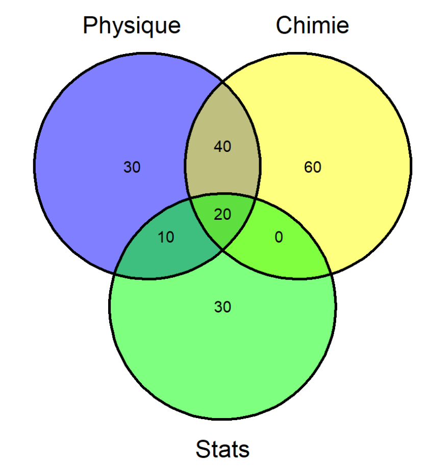

```{r}
#| echo: false
#| message: false
#| warning: false
#| error: false

source("global.R")
```

# Calcul de probabilités

Dans le chapitre précédent, il a été question de dénombrement du nombre d'événements favorables et du nombre d'éléments composant l'espace échantillonnal. Ces deux quantités sont requis pour tout calcul de probabilités. Dans le présent chapitre, nous introduisons les principales règles de calcul.

## Calcul de probabilités: Quelques règles élémentaires

Il existe un petit nombre de règles élémentaires que l'on doit connaître
pour obtenir des estimations justes de probabilités. Certaines d'entre
elles ont déjà été utilisées intuitivement dans les exemples antérieurs.

### Règle d'addition - Événements mutuellement exclusifs (ou disjoints):

Lorsque deux événements sont indépendants et mutuellement exclusifs (ou
disjoints), n'ayant aucun élément en commun, la probabilité qu'un **ou**
l'autre de ces événements survienne est donnée par la somme des
probabilités de chacun d'eux. Par exemple, si on note le lieu de
résidence de 100 individus et que 30 d'entre eux sont du département du
Centre (C), 50 d'Artibonite (A) et 20 de l'Ouest (O), quelle est la
probabilité qu'une personne choisie au hasard provienne d'Artibonite ou
du Centre?

$$P(A \cup C)=P(A)+P(C)=\frac{50}{100}+\frac{30}{100}=\frac{80}{100}=0.80$$

### Règle d'addition générale - Événements non-mutuellement exclusifs (ou compatibles)

Lorsque deux événements peuvent survenir simultanément, n'étant pas
mutuellement exclusifs, la règle d'addition doit être modifiée pour
tenir compte du nombre de cas faisant partie des deux événements.

Par exemple, supposons 100 étudiants de l'ISTEAH devant s'inscrire à au
moins un de deux cours: Physique et/ou Chimie. Sur les 100 étudiants, 50
se sont inscrits au cours de Physique, 40 se sont inscrits au cours de
Chimie, et 10 se sont inscrits aux deux cours. Finalement, 20 étudiants
n'ont pas encore fait leur choix. La situation peut se résumer à l'aide
d'un diagramme de Venn, produit avec la fonction
**draw.pairwise.venn()** se trouvant dans la librairie **VennDiagram**,
et reproduit dans la @fig-Venn1.

```{r}
#| label: fig-Venn1
#| fig-cap: "Diagramme de Venn - 2 événements"
#| fig-width: 5
#| fig-height: 5

library(VennDiagram)
grid.newpage()  # Nettoyer la page graphique

venn.plot <- draw.pairwise.venn(  
  area1 = 50,  
  area2 = 40,  
  cross.area = 10,  
  category = c("Physique", "Chimie"),  
  fill = c("lightblue", "lightcoral"),  
  lwd = c(2,2),  
  col = rep("black",2),  
  cex = 2,  
  cat.cex = 2,  
  cat.pos = c(0,0),  
  cat.dist = rep(0.05,2),  
  cat.col = c("blue", "coral")  
)
```

Quelle serait la probabilité qu'un étudiant s'inscrive au cours de
Physique (P) **OU** au cours de Chimie (C)? En examinant le diagramme de
Venn, on peut voir que l'intersection est partie à la fois de P et de C.
Il est donc nécessaire d'en soustraire un exemplaire:

$$P(P \cup C)=P(P)+P(C)-P(P\cap C)=\frac{50}{100}+\frac{30}{100}-\frac{10}{100}=\frac{80}{100}=0.80$$
Supposons maintenant qu'un troisième cours s'ajoute à l'horaire. Cette
fois-ci, nous avons 200 étudiants devant choisir au moins un cours parmi
Statistiques, Physique et Chimie. Sur 200 étudiants,

    - 60 se sont inscrits au cours de Statistiques     (Événement A)
    - 100 se sont inscrits au cours de Physique        (Événement B)
    - 120 se sont inscrits au cours de Chimie          (Événement C)
    - 30 ont choisi les cours de Probabilité et de Physique
    - 20 ont choisi les cours de Probabilité et de Chimie
    - 40 ont choisi les cours de Physique et de Chimie
    - 20 étudiants ambitieux ont choisi les trois cours
    - 10 étudiants n'ont pas encore fait leur choix

Le diagramme de Venn résumant ces données est reproduit ci-dessous. Il
est créé à l'aide de la fonction **draw.triple.venn()** de la librairie
**VennDiagram** et reproduit dans la @fig-Venn2.

```{r}
#| label: fig-Venn2
#| fig-cap: "Diagramme de Venn - 3 événements"
#| fig-width: 5
#| fig-height: 5

library(VennDiagram)  
grid.newpage();  

venn.plot <- draw.triple.venn(  
  area1 = 100,  
  area2 = 120,  
  area3 = 60,  
  n12 = 60,  
  n23 = 20,  
  n13 = 30,  
  n123 = 20,  
  category = c("Physique", "Chimie", "Stats"),  
  fill = c("lightblue", "lightcoral", "lightgreen"),  
  lwd = rep(2,3),  
  col = rep("black",3),  
  cex = 2,  
  cat.cex = 2,  
  cat.dist = rep(0.08,3),  
  cat.pos = c(-25,25,0),  
  cat.col = c("blue", "red", "darkgreen")  
)  

```

L'espace échantillonnal correspond à l'ensemble des étudiants
susceptibles de s'inscrire à au moins un des 3 cours offerts, incluant
ceux qui n'ont pas encore fait leur choix (nS = 200).

### Exercice:

1.  Quelle est donc la probabilité qu'un étudiant s'inscrive à un cours
    de Physique (B), OU à un cours de Chimie (C)?

$$P(B \cup C)=P(B)+P(C)-P(B\cap C)=\frac{100}{200}+\frac{120}{200}-\frac{60}{200}=\frac{160}{200}=0.80$$

2.  Quelle est la probabilité qu'un étudiant s'inscrive à un cours de
    Physique ET de Chimie?

3.  Quelle est la probabilité qu'un étudiant ne s'inscrive pas à un
    cours de Stats?

4.  Quelle est la probabilité qu'un étudiant s'inscrive à un cours de
    Chimie, mais pas à un cours de Stats?

5.  Quelle est la probabilité qu'un étudiant s'inscrive à un cours de
    Physique et à un cours de Chimie, mais pas à un cours de Stats?

6.  Quelle est la probabilité qu'un étudiant s'inscrive à 2 cours
    seulement?

7.  Quelle est la probabilité qu'un étudiant ne s'inscrive qu'à un seul
    cours?

8.  Quelle est la probabilité qu'un étudiant s'inscrive aux trois cours?

9.  Quelle est la probabilité qu'un étudiant ne soit encore inscrit à
    aucun cours?

10. Quelle est la probabilité qu'un étudiant s'inscrive à un cours de
    Physique, OU à un cours de chimie, mais pas les deux à la fois?

11. Quelle est la probabilité qu'un étudiant s'inscrive soit au cours de
    Stats uniquement, soit au cours de Physique ET au cours de Chimie
    (mais pas au cours de Stats)?

### Règle de multiplication: événements indépendants

Lorsque deux événements sont indépendants, la probabilité qu'ils se
produisent en même temps est donnée par:

$$P(A \cap B)=P(A)\times P(B)$$ Par exemple, quelle est la probabilité
qu'un étudiant s'inscrive au cours de Physique (A) **ET** au cours de
Chimie (B)?

$$P(A \cap B)=P(A)\times P(B)=\frac{100}{200}\times\frac{120}{200}=0.30$$
En effet, 60/200 étudiants se sont inscrits aux deux cours (Physique et
Chimie), ce qui représente 30% de l'effectif. Un examen du diagramme de
Venn illustre clairement cette donnée.

### Règle de multiplication générale: Événements dépendants

De la même manière que la règle d'addition énoncée ci-dessus doit
refléter la nature mutuellement/non mutuellement exclusive des
événements, la règle de multiplication doit tenir compte de la
dépendance des événements en cause, si cette dépendance existe. Ceci
requiert la notion de **probabilité conditionnelle**, définie comme la
probabilité qu'un événement survienne, **étant donné** qu'un autre
événement est déjà survenu.

Reprenons le diagramme de Venn représentant les inscriptions de 100
étudiants de l'ISTEAH aux cours de Physique et de Chimie, reproduit à la
@fig-Venn3.

```{r}
#| label: fig-Venn3
#| fig-cap: "Diagramme de Venn - 2 événements"
#| fig-width: 5
#| fig-height: 5

library(VennDiagram)

venn.plot <- draw.pairwise.venn(  
  area1 = 50,  
  area2 = 40,  
  cross.area = 10,  
  category = c("Physique", "Chimie"),  
  fill = c("lightblue", "lightcoral"),  
  lwd = c(2,2),  
  col = rep("black",2),  
  cex = 2,  
  cat.cex = 2,  
  cat.pos = c(0,0),  
  cat.dist = rep(0.05,2),  
  cat.col = c("blue", "coral")  
)  
```

De ce diagramme, on constate que la probabilité qu'un étudiant
s'inscrive au cours de Physique est P(A) = 50/100 = 0.5. De même, on
constate que 10 étudiants se sont inscrits aux 2 cours:
$P(A\cap B) = 10/100=0.10$. Finalement, sachant qu'un étudiant s'est
inscrit au cours de Physique, quelle est la probabilité qu'il s'inscrive
aussi au cours de Chimie? Ici, l'espace échantillonnal se rétrécit! Il
s'agit maintenant non pas de l'ensemble des étudiants, mais seulement
des étudiants inscrits en Physique et en conséquence, il est nécessaire
de tenir compte de ce fait dans le calcul de la probabilité. On trouve
10 étudiants inscrits au cours de Chimie, sur les 50 qui sont déjà
inscrits au cours de Physique. En conséquence, la probabilité recherchée
est:

$$P(B|A)=\frac{P(A \cap B)}{P(A)}=\frac{10}{50}=0.20$$

On lit: la probabilité que B survienne, étant donné que A s'est produit,
et égale à la probabilité que A et B surviennent, divisé par la
probabilité **marginale** de A. Il s'agit ici de la **probabilité
conditionnelle**.

De la même manière, on pourrait obtenir la probabilité que A survienne,
étant donné que B s'est déjà produit:

$$P(A|B)=\frac{P(A \cap B)}{P(B)}=\frac{10}{40}=0.25$$

On note ici que $P(A|B)\neq P(B|A)$.

De ces considérations, on peut donc énoncer la règle de multiplication
générale, résumée par l'@eq-pcond.

$$P(A|B)=\frac{P(A \cap B)}{P(B)}~~~~\to ~~~~P(A \cap B)=P(B)\times P(A|B) $$ {#eq-pcond}

Cette définition suggère également une stratégie pour vérifier
l'indépendance de deux événements:

$$A~et~B~Independants:~~~~~~ P(A \cap B)=P(A)\times P(B)$$ {#eq-INDtest1}
$$A~et~B~dependants:~~~~~~~~~~~ P(A \cap B)=P(A)\times P(A|B)$$ {#eq-INDtest2}

Si les événements sont indépendants, alors $P(B)=P(A|B)$. Il suffit donc
de vérifier cette égalité pour déterminer cette indépendance. De manière
alternative, on peut simplement vérifier: $P(A \cap B)=P(A)\times P(B)$.
Si ces deux termes sont égaux, les événements sont indépendants. Sinon,
ils sont dépendants.

Par exemple, supposons une urne contenant 6 balles numérotées de 1 à 6,
et définissons les événements suivants:\
- A = nombre pair = {2, 4, 6}\
- B = Nombre impair = {1, 3, 5}\
- C = Multiple de 3 = {3, 6}

Le diagramme de Venn, cette fois-ci créé à l'aide de la fonction
**ggvenn()** de la librairie du même nom et reproduit dans la
@fig-Venn4, illustre cette situation:

```{r }
#| label: fig-Venn4
#| fig-cap: "Diagramme de Venn - 3 événements"
#| echo: TRUE

library(ggvenn)

x=list("A" = c(2,4,6),
  "B" = c(1,3,5),
  "C" = c(3,6))
ggvenn(x,
       show_elements=TRUE,
       text_size=6)  # Création du diagramme
```

1.  Dans ce contexte, peut-on affirmer que les événements A et B sont
    dépendants? Pour répondre à cette question, vérifions l'égalité
    suivante:

    $$ P(A\cap B)=P(A)\times P(B)$$
    $$ P(A \cap B)=0~~~~~~~P(A)=3/6~~~~~~~~P(B)=3/6~~~~~~~~P(A) \times P(B)=0.25$$

    Puisque l'égalité n'est pas réalisée, on doit conclure que les
    événements A et B sont dépendants.

2.  Dans ce contexte, peut-on affirmer que les événements A et C sont
    dépendants? Pour répondre à cette question, vérifions l'égalité
    suivante:

    $$ P(A\cap C)=P(A)\times P(C)$$
    $$ P(A \cap C)=1/6~~~~P(A)=3/6~~~~~P(C)=2/6~~~~~P(A) \times P(C)=3/6\times 2/6=1/6 $$

    Puisque l'égalité se réalise, on peut affirmer que les événements A
    et C sont indépendants.

### Exercice:

1.  Donnez suite à l'exemple précédent: est-ce que les événements B et C
    sont indépendants?

2.  Reprenons l'exemple portant sur les inscriptions aux cours de Stats,
    de Chimie et de Physique, à l'ISTEAH. Le diagramme de Venn est
    reproduit dans la @fig-Venn5:

```{r}
#| label: fig-Venn5
#| fig-cap: "Diagramme de Venn - 3 événements"
#| fig-width: 5
#| fig-height: 5

library(VennDiagram)

venn.plot <- draw.triple.venn(  
  area1 = 100,  
  area2 = 120,  
  area3 = 60,  
  n12 = 60,  
  n23 = 20,  
  n13 = 30,  
  n123 = 20,  
  category = c("Physique", "Chimie", "Stats"),  
  fill = c("lightblue", "lightcoral", "lightgreen"),  
  lwd = rep(2,3),  
  col = rep("black",3),  
  cex = 2,  
  cat.cex = 2,  
  cat.dist = rep(0.08,3),  
  cat.pos = c(-25,25,0),  
  cat.col = c("blue", "red", "darkgreen")  
)  
```

a.  Est-ce que l'inscription à un cours de Physique est indépendante
    d'une inscription à un cours de Chimie?

b.  Est-ce que l'inscription à un cours de Physique est indépendante
    d'une inscription à un cours de Stats?

c.  Est-ce que l'inscription à un cours de Chimie est indépendante d'une
    inscription à un cours de Stats?

## Tableaux de contingence

L'ensemble des notions qui ont été présentées dans cette section peuvent
aisément se refléter dans un tableau de contingence. Par exemple, le tableau @tbl-tcont1 résume les
inscriptions des étudiants aux cours de Physique et de Chimie:

```{r}
#| label: tbl-tcont1
#| echo: false

B.1 <- c(40, 30, 70)
B.0 <- c(20, 10, 30)
TotR <- c(60, 40, 100)

x <- data.frame(B.1, B.0, TotR)
row.names(x) <- c("A.1", "A.0", "TotC")

x %>%
  kbl(booktabs = TRUE, 
      caption = "Répartition des Effectifs") %>%
  kable_styling(full_width = FALSE)

```

Dans ce tableau, A représente l'inscription au cours de Physique (A.1 =
Oui, A.0 = Non), B l'inscription au cours de Chimie (B.1 = Oui, B.0 =
Non).

D'un tel tableau, il est facile d'obtenir les différentes probabilités
qui pourraient nous intéresser:

**Probabilités marginales**: $$P(A)=\frac{TotR}{N}=\frac{60}{100}$$
$$P(B)=\frac{TotC}{N}=\frac{70}{100}$$ **Probabilités conjointes**:

$$P(A_{1} \cap B_{1})=\frac{f_{11}}{N}=\frac{40}{100}$$
$$P(A_{1} \cap B_{0})=\frac{f_{10}}{N}=\frac{20}{100}$$
$$P(A_{0} \cap B_{1})=\frac{f_{01}}{N}=\frac{30}{100}$$
$$P(A_{0} \cap B_{0})=\frac{f_{00}}{N}=\frac{10}{100}$$

**Probabilités conditionnelles**:

$$P(A_{1}|B_1)=\frac{f_{11}}{Tot_{B_1}}=\frac{40}{70}$$
$$P(A_{0}|B_1)=\frac{f_{01}}{Tot_{B_1}}=\frac{30}{70}$$
$$P(A_{1}|B_0)=\frac{f_{10}}{Tot_{B_0}}=\frac{20}{30}$$
$$P(A_{0}|B_0)=\frac{f_{00}}{Tot_{B_0}}=\frac{10}{30}$$
$$P(B_{1}|A_1)=\frac{f_{11}}{Tot_{A1}}=\frac{40}{60}$$
$$P(B_{0}|A_1)=\frac{f_{01}}{Tot_{A1}}=\frac{20}{60}$$
$$P(B_{1}|A_0)=\frac{f_{10}}{Tot_{A0}}=\frac{30}{40}$$
$$P(B_{0}|A_0)=\frac{f_{00}}{Tot_{A0}}=\frac{10}{40}$$

Notons ici qu'en aucun cas nous nous sommes éloignés de la définition
formelle d'une probabilité: rapport entre le nombre de 'succès' et la
taille de l'espace échantillonnal...

Pour résumer le tout, considérons le tableau de contingence reproduit
dans le tableau @tbl-tcont2, composé de deux rangées et trois
colonnes. Le premier tableau contient simplement les fréquences
observées dans chacune des cellules ($f_{rc}$), ainsi que les totaux
marginaux ($T_R$ et $T_C$). Le nombre total d'observations se trouve
dans la case inférieure droite.

```{r }
#| label: tbl-tcont2
#| tbl-cap: "Répartition des Effectifs"
#| echo: false

x=matrix(c(20,30,40,10,20,30),nrow=2,byrow=TRUE)
tbl <- cbind(x,rowSums(x))
tbl <- rbind(tbl,c(colSums(x),sum(x)))
rownames(tbl) <- c("A1","A2","Tc")
colnames(tbl) <- c("B1","B2","B3","Tr")
tbl %>%
  kbl(booktabs=TRUE) %>%
  kable_styling(full_width = FALSE)
```

Les probabilités marginales $[P(R),P(C)]$ sont les rapports entre les
totaux marginaux $[T_R,T_C]$ et le nombre total d'observations ($N$),
tel qu'illustré dans le tableau @tbl-tcont3.

```{r results='asis'}
#| label: tbl-tcont3
#| tbl-cap: "Probabilités Marginales"
#| echo: false

df <- tbl
df[1:2, 4] <- tbl[1:2,4]/tbl[3,4]
df[3, 1:3 ] <- tbl[3,1:3]/tbl[3,4]
df <- as.data.frame(round(df,3))
df[1:2, 4] <- cell_spec(df[1:2, 4], "html", color = "red", bold = TRUE)
df[3, 1:3] <- cell_spec(df[3, 1:3], "html", color = "red", bold = TRUE)
df %>% 
  kbl( 'html',
       booktabs =TRUE,
       escape = FALSE) %>%
  kable_styling(latex_options = c('hold_position')) 
```

On obtient les probabilités conjointes $P(R_i\cap C_j)$ en divisant
chacune des fréquences observées dans les cellules par le nombre total
d'observations. Le tableau @tbl-tcont4 reproduit le résultat.

```{r}
#| label: tbl-tcont4
#| tbl-cap: "Probabilités conjointes"
#| echo: false

df <- tbl
df[1:2, 1:3] <- round(tbl[1:2,1:3]/tbl[3,4], 3)
df[1:2, 1:3] <- cell_spec(df[1:2, 1:3], "html", color = "red", bold = TRUE)
df %>% 
  kbl( 'html',
       booktabs =TRUE,
       escape = FALSE) %>%
  kable_styling(latex_options = c('hold_position')) 
```

Finalement, on obtient les probabilités conditionnelles en divisant les
fréquences observées dans les différentes cellules par le total marginal
des rangées, ou des colonnes. Le résultat est reproduit dans la
@tbl-tcont5 dans le cas de $P(R|C)$ et dans la @tbl-tcont6 dans le cas de $P(C|R)$. On obtient évidemment le même résultat en calculant
le rapport entre les probabilités conjointes et la probabilité marginale appropriée.

```{r}
#| label: tbl-tcont5
#| tbl-cap: "Probabilités conditionnelles (R|C)"
#| echo: false

df <- tbl
dfr <- round(df[1:2,1:3]/df[1:2,4], 3)
dfr[1:2, 1:3] <- cell_spec(dfr[1:2, 1:3], "html", color = "red", bold = TRUE)
dfr %>% 
  kbl( 'html',
       booktabs =TRUE,
       escape = FALSE) %>%
  kable_styling(latex_options = c('hold_position')) 

```

```{r}
#| label: tbl-tcont6
#| tbl-cap: "Probabilités conditionnelles (C|R)"
#| echo: false

df <- tbl
m <- df[1:2,1:3]
v <- df[3,1:3]
dfc <- round(m / v[col(m)], 3)
dfc[1:2, 1:3] <- cell_spec(dfc[1:2, 1:3], "html", color = "red", bold = TRUE)
dfc %>% 
  kbl('html',
      booktabs =TRUE,
      escape = FALSE) %>%
  kable_styling(latex_options = c('hold_position')) 

```


## L'arbre de probabilités

À partir d'un tableau de contingence tel que le précédent, il est
possible de produire une représentation prenant la forme d'une
arborescence fournissant l'ensemble des probabilités discutées
jusqu'ici. Pour produire une telle arborescence, on utilisera
avantageusement la fonction **treeDiag()** de la librairie
**openintro**. Les principaux arguments de cette fonction sont:\
- main : un vecteur alphanumérique contenant l'étiquette permettant
d'identifier les deux variables. Exemple: main = c("A","B")\
- p1 : vecteur des probabilités associées à la branche principale\
- p2 : vecteur des probabilités associées à la branche secondaire\
- out1 : vecteur alphanumérique contenant les étiquettes identifiant les
événements survenant sous la branche principale\
- out2 : vecteur alphanumérique contenant les étiquettes identifiant les
événements survenant sous la branche secondaire\
- ShoSol : valeur booléenne indiquant si une solution est désirée
(calcul des probabilités conjointes)\
- digits : nombre de décimales à afficher

Afin d'illustrer l'utilisation de cette fonction, considérons les
données résumées dans le tableau @tbl-arbr1:

```{r arbr1, echo=FALSE }
#| label: tbl-arbr1
#| tbl-cap: "Répartition des Effectifs"
#| echo: false

x=matrix(c(20,30,40,10,20,30),
         nrow=2,
         byrow=TRUE)
tbl <- cbind(x,rowSums(x))
tbl <- rbind(tbl,c(colSums(x),sum(x)))
rownames(tbl) <- c("A1","A2","Tc")
colnames(tbl) <- c("B1","B2","B3","Tr")

tbl %>%
  kbl(booktabs=TRUE) %>%
  kable_styling(full_width = FALSE)

```

et pour lequel on a calculé les probabilités marginales P(R) et P(C), de
même que les probabilités conditionnelles P(R\|C) (Tableau
@tbl-arbr2).

```{r arbr2, echo=FALSE }
#| label: tbl-arbr2
#| tbl-cap: "P(R|C)"
#| echo: false

pconj <- tbl[1:2,1:3]/tbl[3,4]
pmargr <- rowSums(tbl[1:2,1:3])/tbl[3,4]
pmargc <- colSums(tbl[1:2,1:3])/tbl[3,4]
pcond <- pconj / pmargc[col(pconj)]
pcond <- rbind(pcond,pmargc)
pcond <- cbind(pcond,c(pmargr,1))
rownames(pcond) <- c("A1","A2","P(C)")
colnames(pcond) <- c("B1","B2","B3","P(R)")
round(pcond, 4) %>%
  kbl(booktabs=TRUE) %>%
  kable_styling(full_width = FALSE)
```

À partir de ce dernier tableau, on obtient l'arbre des probabilités
affiché dans la @fig-arbr3.

```{r}
#| label: fig-arbr3
#| fig-cap: "Arbre des Probabilités"

library(openintro)
p1 <- round(pcond[1,1:3],3)
p2 <- round(pcond[2,1:3 ],3)
treeDiag(c("Événement A","Événement B"), c(.6,.4),
         list(p1,p2), c("A1","A2"),c("B1", "B2","B3"),
         showWork = FALSE,col.main="darkblue")
```

Les probabilités affichées dans les deux premiers noeuds sont les
probabilités marginales [P(A1)=0.6, P(A2)=0.4]. Les noeuds suivants
contiennent les probabilités conditionnelles, et les résultats affichés
à la droite sont les probabilités conjointes, produits des probabilités
marginales et des probabilités conditionnelles.

## Le théorème de Bayes

Un tableau de contingence contient toute l'information nécessaire pour calculer les probabilités marginales, conjointes et conditionnelles, que l'on peut représenter dans un arbre de probabilités. Le théorème de Bayes est une formalisation de ces notions et est à la base de l'approche Bayésienne à l'analyse de données. 

On sait déjà que:

$$P(A|B)=\frac{P(A \cap B)}{P(B)}~~~~\to ~~~~P(A \cap B)=P(B)\times P(A|B) $$ {#eq-bayes1}
et que:

$$P(B|A)=\frac{P(A \cap B)}{P(A)}~~~~\to ~~~~P(A \cap B)=P(A)\times P(B|A) $$ {#eq-bayes2}

Ainsi, il est vrai que:

$$P(A \cap B)=\color{red}{P(A)\times P(B|A)} = \color{red}{P(B)\times P(A|B)}  $$ {#eq-bayes3}
d'où 

$$P(A|B) = \frac{P(B|A) \times P(A) }{P(B)} $$  {#eq-bayes4}
et

$$P(B|A) = \frac{P(A|B) \times P(B) }{P(A)} $$ {#eq-bayes5}
  
Il existe donc un lien direct entre $P(A|B)$ et $P(B|A)$, de sorte que connaissant les probabilités marginales et l'une de ces quantités, on peut déterminer l'autre: c'est le **théorème de Bayes**. 

Pour illustrer l'application de ce théorème, reconsidérons les données du tableau @tbl-tcont3b, reproduisant les probabilités conjointes et marginales:


```{r}
#| label: tbl-tcont3b
#| tbl-cap: "Probabilités Marginales & Conjointes"
#| echo: false

x=matrix(c(20,30,40,10,20,30),
         nrow=2,
         byrow=TRUE)
tbl <- cbind(x,rowSums(x))
tbl <- rbind(tbl,
             c(colSums(x),
               sum(x)))
rownames(tbl) <- c("A1","A2","Tc")
colnames(tbl) <- c("B1","B2","B3","Tr")
df <- tbl
df[1:3,1:4] <- round(tbl[1:3,1:4]/tbl[3,4], 3)
df <- as.data.frame(round(df,3))
df %>% 
  kbl() %>%
  kable_styling(bootstrap_options = c("striped", "hover", "condensed"), 
                full_width=FALSE)  
```

Si une observation se trouve dans la catégorie A1, quelle est la probabilité qu'elle appartienne aussi à la catégorie B3? En d'autres termes, quelle est la probabilité qu'une observation se trouve sous B3, étant donné qu'elle se trouve sous A1? Pour répondre à cette question, il suffirait de diviser $P(A_1\cap B_3)$ par $P(A_1)$:

$$P(B_3|A_1)=\frac{P(A_1 \cap B_3) }{P(A_1)}=\frac{0.267}{0.6}=0.445$$
  
Une procédure alternative qui trouvera toute son utilité dans le contexte d'inférences statistiques, fait appel au théorème de Bayes de la manière suivante:

$$
\begin{align}
P(B_3|A_1)&=\frac{P(B_3)P(A_1|B_3)}{P(A_1)} \\
&=\frac{0.467 \times \frac{0.267}{0.467}}{0.6}=0.445
\end{align}$$
Puisque $P(A_1)=\sum_{i=1}^{n_r}P(A_1 \cap B_i)$, on peut écrire:

$$
\begin{align}
P(B_3|A_1)&=\frac{P(B_3)P(A_1|B_3)}{P(A_1 \cap B_1)+P(A_1 \cap B_2)+P(A_1 \cap B_3)} \\
&=\frac{0.467 \times \frac{0.267}{0.467}}{0.133+0.200+0.267}=0.445
\end{align}$$
Finalement, puisque $P(A \cap B)=P(B)P(A|B)$, on trouve:

$$
\begin{align}
P(B_3|A_1) &=\frac{P(B_3)P(A_1|B_3)}{P(B_1)P(A_1|B_1)+P(B_2)P(A_1|B_2)+P(B_3)P(A_1|B_3)} \\
&=\frac{0.467 \times \frac{0.267}{0.467}}{0.200 \times \frac{0.133}{0.200}+0.333 \times \frac{0.200}{0.333}+0.467 \times \frac{0.267}{0.467}}=0.445
\end{align}
$$
Toutes ces expression du théorème de Bayes sont évidemment équivalentes. Ce n'est que dans la mise en oeuvre de ce théorème dans un contexte défini que l'on saisira la nécessité des différentes formulations.

Un exemple plus concret aidera à saisir l'intérêt du théorème de Bayes dans la solution de problèmes de ce type.
Supposons que la clientèle étudiante de l'ISTEAH est partagée entre l'ingéniérie (45.5%) et les Sciences Sociales(54.5%). Les statistiques compilées au cours de la dernière décennie indiquent que le taux de diplômation est de 32.7% en ingéniérie, alors que 30% des étudiants en Sciences Sociales ne complètent pas leur programme et de ce fait, n'obtiennent pas leur diplôme. Quelle est la probabilité qu'un individu ait étudié les Sciences Sociales, étant donné qu'il a reçu son diplôme?

Pour répondre à cette question, il sera utile de résumer les probabilités connues dans un tableau de contingence:

```{r}
#| echo: false

x <- matrix(c(0.327,0.128,0.245, 0.300), 
            nrow=2, 
            byrow=TRUE)
tbl <- cbind(x,
             rowSums(x))
tbl <- rbind(tbl,
             c(colSums(x),
               sum(x)))
rownames(tbl) <- c("Ingén","ScSoc","Tc")
colnames(tbl) <- c("Dip","NDip","Tr")
df <- tbl
df[1:3,1:3] <- round(tbl[1:3,1:3]/tbl[3,3], 3)
df <- as.data.frame(round(df,3))
df[2, 2] <- cell_spec(df[2, 2], 'html', color = "red", bold = TRUE)
df[1, 1] <- cell_spec(df[1, 1], 'html', color = "red", bold = TRUE)
df[1:2, 3] <- cell_spec(df[1:2, 3], 'html', color = "red", bold = TRUE)
df %>% 
  kbl('html',
      booktabs =TRUE,
      escape = FALSE) %>%
  kable_styling(latex_options = c('hold_position')) 
```

Dans ce tableau, les caractères gras identifient les probabilités connues, à partir desquelles on trouve les autres. Dans ce cas,   
  
$P(Ingéniérie \cap Dipl)=0.327$,  
$P(ScSoc \cap NDipl)=0.3$,  
$P(Ingén) = 0.455$ et $P(ScSoc)=0.545$  

De ces valeurs connues, on trouve:

$P(ScSoc \cap Dip) = P(ScSoc)-P(ScSoc \cap NDip) = 0.545-0.3=0.245$
$P(Ingén \cap NDip) = P(Ingén)-P(Ingén \cap Dip) = 0.455-0.327=0.128$
$P(Dip)=P(Ingén \cap Dip)+P(ScSoc \cap Dip)=0.327+0.245=0.572$
$P(NDip)=P(Ingén \cap NDip)+P(ScSoc \cap NDip)=0.128+0.300=0.428$

À ce stade, nous disposons de toute l'information nécessaire pour répondre à la question. Il suffit alors d'appliquer le théorème de Bayes:

$$P(ScSoc | Dip)=\frac{P(ScSoc)P(Dip|ScSoc)}{P(Dipl \cap Ingén)+P(Dipl \cap ScSoc)}=\frac{0.545 \times \frac{0.245}{0.545}}{0.327+0.245}=0.428$$

De cette manière, le théorème de Bayes est un outil permettant le calcul de probabilités conditionnelles. Mais son utilité ne se limite pas à cette fonction. Implicitement, la dernière formulation présentée ci-dessus permet de modifier une probabilité subjective (croyance) en fonction d'observations, ce qui est l'objectif de l'inférence bayésienne. Dansl'équation définissant le théorème de Bayes:

$$P(A_1|B_1)=\frac{P(A_1)P(B_1|A_1)}{P(A_1)P(B_1|A_1)+P(A_2)P(B_1|A_2)}$$

on peut considérer $P(A)$ comme étant ce que l'on connait, ou ce que l'on croit connaître, de l'événement $A$. 
  
Par exemple, une pièce de monnaie n'est pas truquée ($P(FACE)=0.5$) ou elle l'est ($P(FACE)\ne 0.5$). Considérons l'événement A, la pièce est truquée, et l'événement B, elle tombe du côté FACE lors d'un lancer. On croit que la pièce n'est pas truquée, de sorte que $P(A)$ est la **probabilité *a priori* ** ou **antérieure**.   

Pour sa part, $P(B|A)$ représente la *vraisemblance* de l'observation $B$, étant donné l'occurrence de l'événement $A$: si $A$ survient, ou est vrai, quelle est la probabilité que $B$ le soit? Quelle est la probabilité que la pièce ne soit pas truquée, si en la lançant, elle tombe du côté FACE?  

Les termes du dénominateur sont les vraisemblances des observations $B$, étant donné l'occurrence de chacun des événements $A$. On y retrouve la probabilité que la pièce ne soit pas truquée, si en la lançant, elle tombe du côté FACE, et la probabilité qu'elle soit truquée dans les mêmes conditions. On note que ces termes incluent le numérateur, de sorte que le résultat est une probabilité que l'on qualifiera de  **postérieure**.


::: {.warning style="background-color:#E9D8FD; color: #69337A; border-left: solid #805AD5 4px; border-radius: 4px; padding:0.7em;"}
<span>

<p style="margin-top:1em; text-align:left">

<b>Note: Application BayesCoins </b>

</p>

<p style="margin-left:1em;">

L'application [BayesCoins](https://daniel-coulombe.shinyapps.io/BayesCoins/) illustre cette situation et permet de simuler le processus visant à déterminer la probabilité d'obtenir FACE en lançant une pièce de monnaie susceptible d'être trafiquée, sur la base d'observations.


</p>

<p style="margin-bottom:1em; margin-right:1em; text-align:right; font-family:Georgia">

<b>(Connexion Internet requise)</i></b>
</p>


</span>
:::
  
  
Dans un contexte inférentiel, où une hypothèse de recherche ($H$) est examinée à l'aide d'un ensemble de données ($D$), le théorème de Bayes prendra la forme:

$$\underbrace{P(H|D)}_\textrm{Probabilité postérieure} = \underbrace{P(H)}_\textrm{Probabilité antérieure} \times \underbrace{\frac{P(D|H)}{P(D)}}_\textrm{Facteur de correction}$$
$$\overbrace{p(\theta \mid \textrm{data})}^{\textrm{postérieure}} =
  \frac{\color{red}{\overbrace{p(\textrm{data} \mid \theta)}^{\textrm{vraisemblance}}} \times
   \color{blue}{\overbrace{p(\theta)}^{\textrm{antérieure}}}}
   {\color{darkgreen}{\underbrace{p(\textrm{data})}_{\textrm{évidence}}}} $$


```{r echo=FALSE}
#https://www.probabilisticworld.com/frequentist-bayesian-approaches-inferential-statistics/
```

Exprimé de cette manière, on pose que la probabilité que l'hypothèse de recherche soit vraie, étant donné les observations (ce que l'on cherche ultimement!), est égale à la croyance que l'on a la concernant au départ (probabilité antérieure à l'examen des données), corrigée en fonction du rapport entre la probabilité des observations si l'hypothèse est vraie, et la probabilité des observations indépendamment de l'hypothèse.

Plus généralement, on est amené à comparer deux hypothèses (ou plus), symbolisées par $H_0$ et $H_1$. On trouvera alors:

$$\frac{P(H_1|D)}{P(H_0|D)}=\frac{P(H_1)}{P(H_0)}\times \frac{P(D|H_1)}{P(D|H_0)}=BF_{10}$$ {#eq-bayesFact}
  
Ce rapport est le Facteur de Bayes, qui indique jusqu'à quel point $H_1$ prédit les observations, par rapport à $H_0$.  Par exemple, un $BF_{10}=9.4$ indique que les observations sont 9.4 fois plus vraisemblables sous $H_1$ que sous $H_0$: les évidences vont dans le sens de $H_1$. 

Ces notions seront développées dans un chapitre ultérieur.


```{r echo=FALSE }
# https://bayesplay.colling.net.nz/
# https://www.probabilisticworld.com/calculating-coin-bias-bayes-theorem/
# https://medium.com/code-chalet/bayesian-coin-flips-d195f23500cb
# https://tinyheero.github.io/2016/04/21/bayes-rule.html
# https://tinyheero.github.io/2016/03/20/basic-prob.html
# https://tinyheero.github.io/2018/12/14/crux-of-bayes-statistics.html
# https://tinyheero.github.io/2017/03/08/how-to-bayesian-infer-101.html
# https://terpconnect.umd.edu/~egurarie/teaching/Biol709/Topic4/BayesianBasics.html
# http://allthiswasfield.blogspot.com/2019/04/understanding-bayesian-inference-with.html
# https://bookdown.org/kevin_davisross/bayesian-reasoning-and-methods/bayes-rule.html  ********
```


## Distribution de fréquences et probabilités

En recherche scientifique, il est fréquent de condenser un ensemble
d'observations (événements) dans un tableau affichant chaque valeur
possible et le nombre d'occurrences correspondant. Par exemple,
considérons le tableau @tbl-tabex1, résumant l'âge d'un groupe
d'élèves du Lycée.

```{r}
#| label: tbl-tabex1
#| tbl-cap: "Répartition des Effectifs/Age"

agef <- data.frame(age = 12:17,freq = c(6,3,10,4,2,5))
kable(agef, booktabs=TRUE) %>%
  kable_styling(full_width = FALSE)
```

Dès à présent, vous devriez être en mesure de répondre aux questions
suivantes:

1.  Quelle est la probabilité, en choisissant au hasard un de ces
    élèves, qu'il soit âgé

<!-- -->

a.  de 13 ans?\
    -   Le nombre total d'observations est nS = 30.\
    -   Le nombre d'observations correspondant à âge = 13 est nE = 3.\
    -   Donc P(âge=13)= 3/30 = 0.10\
b.  de 15 ans ou moins?
    -   Le nombre total d'observations est toujours nS = 30.\
    -   Le nombre d'observations correspondant à âge $\leq$ 15 est nE =
        (4 + 10 + 3 + 6) = 23.\
    -   Donc P(âge $\leq$ 15)= 23/30 = 0.767

À vous de jouer...

c.  d'au moins 16 ans?
d.  d'au plus 13 ans?
e.  de 12 ou de 17 ans?

Ce type d'exercice sera récurrent à chacune des étapes de votre
formation!

### En bref...

L'ensemble des sections précédentes résume l'essentiel de l'approche
classique de l'évaluation de probabilités. Nous avons présenté les
principales méthodes nous permettant d'obtenir la taille de l'espace
échantillonnal afin de pouvoir calculer les probabilités associées à
différents sous-ensembles de cet espace. Dans les sections suivantes,
l'approche fréquentiste sera mise à profit pour obtenir de telles
probabilités par simulation informatique.

## Simulation d'un lancer de pièces de monnaie

::: {.warning style="background-color:#E9D8FD; color: #69337A; border-left: solid #805AD5 4px; border-radius: 4px; padding:0.7em;"}
<span>

<p style="margin-top:1em; text-align:left">

<b>Note: Application SimBin </b>

</p>

<p style="margin-left:1em;">

L'application
[SimBin](https://daniel-coulombe.shinyapps.io/SimBin/?_ga=2.162396156.1778658360.1661260162-1231406792.1649678695)
permet l'examen empirique et théorique de la distribution des résultats
de lancers de pièces de monnaie. Elle accompagne cette section, qui
concerne spécifiquement des expériences aléatoires produisant des
résultats binaires, dans un environnement graphique ne nécessitant
aucune programmation.

</p>

<p style="margin-bottom:1em; margin-right:1em; text-align:right; font-family:Georgia">

<b>(Connexion Internet requise)</i></b>
</p>


</span>
:::

Dans la section précédente, nous avons solutionné quelques problèmes de
calcul de probabilités en établissant le rapport entre le nombre de fois
qu'un événement survient et le nombre total d'expériences aléatoires
effectuées. On se souviendra qu'une probabilité obtenue de cette manière
représente le résultat que l'on s'attend à obtenir en effectuant
l'expérience aléatoire un nombre infini de fois. Dire qu'on a une
probabilité de 0.25 d'obtenir 2 FACEs en lançant 2 pièces de monnaie
signifie que si on lance les 2 pièces de monnaie un nombre infini de
fois, à la limite, on obtiendra deux faces une fois sur 4 lancers.

Évidemment qu'il serait fastidieux d'effectuer une expérience aléatoire
un nombre infini de fois, mais si on remplace le terme **infini** par
les termes **un très grand nombre** de fois, on se retrouve dans un
contexte réalisable... si on a accès à un ordinateur pour se charger du
travail!

La fonction **CoinToss()** (@lst-CoinToss) permet de simuler le lancer d'une pièce de
monnaie.  Ses arguments sont *n* = Nombre de pièces à lancer, et *p* = la
probabilité d'obtenir un des deux résultats possibles ('PILE' ou
'FACE'). Par défaut, une seule pièce est lancée et la probabilité du
résultat désiré est 0.5. On peut changer ces arguments selon le besoin:

```{r }
#| code-fold: false

CoinToss()      # n=1, p=0.5

CoinToss(10)    # n=10, p=0.5

CoinToss(5,0.7) # n=5, p=0.7 

```

Pour simuler le lancer d'un certain nombre de pièces un grand nombre de
fois, il suffira d'introduire les arguments appropriés dans la fonction
CoinToss(), et d'examiner les événements qui en résultent sur le nombre
d'essais désirés.

### Exercice 4

1.  Avant d'exécuter CoinToss() pour simuler le lancer d'une seule pièce
    de monnaie, écrivez sur une feuille de papier votre prédiction quant
    au résultat: Pile, ou Face. Activez la fonction, et inscrivez à
    droite de votre prédiction '1' si votre prédiction est correcte, et
    '0' si elle ne s'est pas réalisée. Répétez l'exercice 20 fois!
2.  Combien de vos prédictions se sont avérées correctes? Combien de
    prédictions justes faudrait-il pour que vous puissiez vous
    considérer comme 'devin' ?
3.  Simulez le lancer de 20 pièces de monnaie, en supposant que la
    probabilité associée au résultat est 0.5. 
    
4. Comparez les résultats avec ceux que vous avez obtenus en (2). 
   Est-ce que les résultats sont différents? Comment expliquez-vous 
   cette différence, si elle existe?

5.  Combien de côtés 'PILE' avez-vous obtenus? Combien de côtés 'FACE'
    sont apparus? Est-ce que ces résultats sont compatibles avec l'idée
    que les probabilités P(PILE) et P(FACE) sont égales?

6.  Relancez la simulation: est-ce que les résultats sont différents du
    premier essai?

7.  S'il y a différence, comment l'expliqueriez-vous?

8.  Répétez l'exercice en simulant le lancer de 5, 10, 15, 50 et 100
    pièces. Obtenez le diagramme en secteurs pour chaque simulation.
    Quelle conclusion tirez-vous concernant l'impact de l'augmentation
    de la taille de l'échantillon (nombre de pièces de monnaie))?


## Solutionnaire des exercices

### Exercice 1

Pour chacune des situations suivantes, définissez l'expérience
aléatoire, l'espace échantillonnal, ce que pourrait être un événement,
et calculez nE et nS:

1.  Dans un jeu de hasard, on lance 3 pièces de monnaie et on gagne si
    on obtient 3 FACES ou 3 PILES.

-   Solution:

    -   L'expérience aléatoire est le **lancer de 3 pièces**
    -   L'espace échantillonnal se compose de tous les événements
        possibles lorsque 3 pièces de monnaie sont lancées: chaque pièce
        peut tomber sur PILE ou FACE. Donc le nombre d'éléments
        composant l'espace échantillonnal est égal à
        $nS=2\times 2\times 2 = 2^3 = 8$
    -   Les événements d'intérêt sont: PPP et FFF, et ces deux
        événements sont uniques à l'intérieur de **S**. Donc nE = 2.

2.  Dans une usine, on fabrique 12 instruments par heure. Ces 12
    instruments sont ensuite mis en boîte, à la condition qu'il n'y ait
    pas plus de 2 instruments présentant des défauts de fabrication.

-   Solution:

    -   L'expérience aléatoire est la constitution d'un ensemble de 12
        instruments, chacun d'eux pouvant être défectueux ou non.
    -   L'espace échantillonnal se compose de tous les ensembles de 12
        instruments qu'il est possible de former, chacun d'eux pouvant
        être défectueux ou non. Le nombre d'éléments composant cet
        espace est égal à $nS=2^12^=4096$.
    -   Les événements d'intérêt sont les ensembles de 12 instruments
        comptant 0, 1 ou 2 instruments défectueux. Nous verrons plus
        loin que nE serait égal au nombre de combinaisons de 12 objets
        pris 0, puis 1, puis 2 à la fois:
        $nE=\binom{12}{0}+\binom{12}{1}+\binom{12}{2}=1+12+66=79$

3.  Dans une classe de mathématiques, 35 étudiants sont inscrits. Le
    professeur espère qu'il n'y aura pas plus de 5 étudiants qui
    échoueront le cours. On suppose ici que pour chacun des étudiants,
    les chances d'échouer sont de 1/2 (ce qui n'est pas réaliste, mais
    supposons-le pour les besoins de l'exemple!)

-   Solution:

    -   L'expérience aléatoire est 'être inscrit à un cours de
        mathématiques'.
    -   L'espace échantillonnal se compose de nS = 35 étudiants, chacun
        pouvant échouer ou réussir le cours. Dans ce cas,
        $nS = 2^35^=34,359,738,370$
    -   Les événements d'intérêt sont: observer soit 0, 1, 2, 3, 4 ou 5
        échecs. Dans ce cas,
        $nE = \binom{35}{0}+\binom{35}{1}+\binom{35}{2}+\binom{35}{3}+\binom{35}{4}+\binom{35}{5} =1+35+595+6545+52360+324632=384,168$

4.  En période de pandémie, un restaurant ne peut accueillir plus de 5
    clients à la fois. À l'extérieur, 15 personnes attendent pour y
    entrer et on choisit au hasard celles qui sont admises.

-   Solution:

    -   L'expérience aléatoire est 'sélectionner 5 personnes attendant à
        l'extérieur'.
    -   L'espace échantillonnal se compose des 15 personnes attendant à
        l'extérieur. Donc nE = 15.
    -   L'événement d'intérêt correspond aux 5 personnes sélectionnées.
        Dans ce cas, $nE = \binom{15}{5}=3,003$

5.  En période de pandémie, un restaurant ne peut accueillir plus de 5
    clients à la fois. À l'extérieur, 15 personnes attendent pour y
    entrer et on choisit au hasard celles qui sont admises Ces 15
    personnes portent toutes des noms différents. Désignons-les par les
    numéros 1 à 15.

-   Quelle est la valeur de nE, si on veut admettre les personnes 1 à 5?

    -   Solution:

        -   Parmi l'ensemble des sélections possibles , il n'y a qu'une
            manière de sélectionner les clients 1 à 5. nE = 1

-   Quelle est la valeur de nS dans cette situation?

    -   Solution:

        -   De l'exercice 4, on a trouvé nS = 3,003

-   Quelle est la probabilité que les personnes 1 à 5 soient admises?

    -   Solution:

        -   $P(E)=\frac{nE}{nS}=\frac{1}{3003}=0.000333$

6.  De combien de façons différentes peut---on répartir un groupe de 7
    personnes sur une rangée de 7 chaises ?

-   Solution:

    -   7 personnes peuvent prendre la première chaise; il reste 6
        personnes pour la deuxième, 5 pour la troisième, etc. Donc il y
        a 7! = 5040 manières d'assoir 7 personnes dans une rangée de 7
        chaises.

7.  Trois garçons et deux filles prennent place sur un banc public de 5
    places:

-   De combien de façons différentes, 3 garçons et 2 filles peuvent-ils
    prendre place sur ce banc?

    -   Solution:

        -   Cinq personnes peuvent prendre place de 5! = 120 manières,
            sur un banc de 5 places.

-   De combien de façons peuvent-ils s'asseoir si les garçons s'assoient
    les uns à côté des autres et s'il en est de même pour les filles ?

    -   Solution:

        -   Si les garçons et les filles sont groupés, on obtient soit
            'GGGFF' ou 'FFGGG'. Donc il y a 2 façons d'obtenir cet
            arrangement.

-   De combien de manières différentes peuvent---ils s'asseoir si
    seulement les filles s'assoient l'une à côté de l'autre?

    -   Solution:

        -   Dans ce cas, les arrangements possibles sont: 'GFFGG',
            'GGFFG'. Donc deux arrangements possibles.

### Exercice 2

1.  Un comité de 3 personnes doit être formé à partir d'un groupe de 12
    employés d'un grand commerce. Une des 3 personnes sélectionnées sera
    présidente du comité, une autre sera secrétaire, et l'autre agira
    comme conseillère.

<!-- -->

a.  Combien de comités différents sont possibles?

<!-- -->

    - Solution:
      - Puisqu'un rôle particulier est donné à chaque personne composant un comité, on doit tenir compte de l'ordre. Le nombre de PERMUTATIONS de 12 personnes prises 3 à la fois est donc:
      $$P(12,3) =   \frac{12!}{(12-3)!} = 12\cdot11\cdot10=1320$$
      

b.  En supposant que les 12 employés du commerce portent des noms
    différents, combien de comités seraient composés de 'Marie-Lune',
    'Pierre', et 'Harold'?\
    -   Solution:

    -   Ces trois personnes forment un comité, et chacune d'elles prend
        un des 3 rôles. Le nombre de permutations de trois personnes
        prises 3 à la fois est égal à 6: 3 personnes peuvent occuper le
        poste de président. Une fois ce poste comblé, il reste 2
        personnes pour les postes de secrétaire et de conseiller. Et
        finalement, la troisième personne prend le dernier poste:
        P(3,3)=6
c.  Quelle est la probabilité que ce dernier événement se produise?\
    -   Solution:

    -   $P(E)=\frac{6}{1320}=0.004545$
d.  Si 'Pierre' doit nécessairement être Président en raison de son
    ancienneté dans l'entreprise, dans combien de comités lui
    associerait-on 'Marie-Lune' et 'Harold'?\
    -   Solution:

    -   Si Pierre est président, deux personnes sont sélectionnées parmi
        les 11 qui restent disponibles. Le nombre de permutations de 11
        personnes prises 2 à la fois est:
        $$P(11,2) =   \frac{11!}{(11-2)!} = 11\cdot10=110$$ De ces 110
        possibilités, les événements 'Marie-Lune est secrétaire' et
        'Harold est conseiller', et 'Marie-Lune est conseillère' et
        'Harold est secrétaire' sont les deux seuls événements
        d'intérêt.

e, Quelle est la probabilité que ce dernier événement se produise?\
- Solution: - $P(E)=\frac{2}{110}=0.01818$

### Exercice 3

1.  De combien de maniéré peut-on former un jury de 3 hommes et 2 femmes
    parmi 7 hommes et 5 femmes ?

-   Solution: $$C(7,3) = \frac{7!}{3!(7-3)!} = 35$$\
    $$C(5,2) = \frac{5!}{2!(5-2)!} = 10$$\
    Le nombre total est le produit: $35\times10=350$ Sous R:

```{r 02-Chap2-102 }
choose(7,3)*choose(5,2)
```

2.  À l'occasion d'un examen, un étudiant doit répondre à 8 questions
    sur un total de 10.

<!-- -->

a.  Combien de choix de questions sont possibles ?

-   Solution:

    -   Le nombre de combinaisons de 10 questions prises 8 à la fois:

    ```{r}
    choose(10,8)
    ```

b.  Combien de choix y a-t-il s'il doit répondre aux 3 premières
    questions ?

-   Solution:

    -   Si les 3 premières questions sont obligatoires, il reste 5
        questions à choisir parmi les 7 qui restent:

    ```{r}
    choose(7,5)
    ```

c.  Combien de choix y a---t-il s'il doit répondre au moins à 4 des 5
    premières questions ?

-   Solution:

    -   Ici, on doit considérer le choix de 4 questions parmi les 5
        premières. Une fois ces 4 questions sélectionnées, il en reste 6
        à partir desquelles on doit en choisir 4. Donc, le nombre
        d'examens différents est:

    ```{r}
    choose(5,4)*choose(6,4)
    ```

3.  Combien de plaques d'immatriculation de véhicules peut-on former si
    chaque plaque contient 2 lettres différentes suivies de 3 chiffres
    différents ?

-   Solution:

    -   On doit choisir 2 lettres parmi les 26 que contient l'alphabet,
        et 3 chiffres parmi les entiers de 0 à 9. Donc, le nombre de
        plaques d'immatriculation possible est:

    ```{r}
    choose(26,2)*choose(10,3)
    ```

### Exercice 4

Considérez le diagramme suivant pour les questions suivantes:

 a. Quelle est donc la
probabilité qu'un étudiant s'inscrive à un cours de Physique (B), OU à
un cours de Chimie (C)? - Solution: - Les événements ne sont pas
mutuellement exclusifs. Donc\
$$P(B\cup C)=P(B)+P(C)−P(B\cap C)=100/200+120/200−60/200=160/200=0.80$$

b.  Quelle est la probabilité qu'un étudiant s'inscrive à un cours de
    Physique ET de Chimie?\

-   Solution:

    -   60 étudiants s'inscrivent à ces 2 cours: 60/200 = 0.30

c.  Quelle est la probabilité qu'un étudiant ne s'inscrive pas à un
    cours de Stats?

-   Solution:

    -   70 étudiants s'inscrivent au cours de Physique, mais pas au
        cours de Stats; 100 étudiants s'inscrivent au cours de Chimie,
        mais pas au cours de Stats; et 40 étudiants s'inscrivent aux
        cours de Physique et de Chimie, mais pas au cours de Stats. Donc
        on a: $$70/200+100/200−40/200=130/200=0.65$$

d.  Quelle est la probabilité qu'un étudiant s'inscrive à un cours de
    Chimie, mais pas à un cours de Stats?

-   Solution:

    -   120 étudiants sont inscrits au cours de Chimie, mais 20 de
        ceux-ci sont aussi inscrits au cours de Stats. Donc la
        probabilité recherchée est 100/200 = 0.5

e.  Quelle est la probabilité qu'un étudiant s'inscrive à un cours de
    Physique et à un cours de Chimie, mais pas à un cours de Stats?

-   Solution:

    -   Cette question est une simple reformulation de la question (c)

f.  Quelle est la probabilité qu'un étudiant s'inscrive à 2 cours
    seulement?

-   Solution:

    -   30 étudiants sont inscrits aux cours de Physiques et de Stats,
        mais de ce nombre, 20 sont aussi inscrits au cours de Chimie
    -   20 étudiants sont inscrits aux cours de Chimie et de Stats, mais
        ces étudiants sont aussi inscrits au cours de Physique
    -   60 étudiants sont inscrits aux cours de Physique et Chimie, mais
        20 de ces étudiants sont aussi inscrits au cours de Stats.
    -   Donc la probabilité recherchée est
        (30-10)+(20-20)+(60-20)=50/200 = 0.25

g.  Quelle est la probabilité qu'un étudiant ne s'inscrive qu'à un seul
    cours?

-   Solution:

    -   Du diagramme on note: (30+60+30)/200 = 120/200 = 0.60

h.  Quelle est la probabilité qu'un étudiant s'inscrive aux trois cours?

-   Solution:

    -   20 étudiants sont inscrits aux trois cours: 20/200 = 0.10

i.  Quelle est la probabilité qu'un étudiant ne soit encore inscrit à
    aucun cours?

-   Solution:

    -   10 étudiants ne sont inscrits à aucun cours (énoncé du
        problème). Donc la probabilité recherchée est 10/200 = 0.05

j.  Quelle est la probabilité qu'un étudiant s'inscrive à un cours de
    Physique, OU à un cours de chimie, mais pas les deux à la fois?

-   Solution:

    -   40 étudiants sont inscrits au cours de Physique, mais pas au
        cours de Chimie;
    -   60 étudiants sont inscrits au cours de Chimie, mais pas au cours
        de Physique;
    -   Donc (40+60)/200 = 0.50

k.  Quelle est la probabilité qu'un étudiant s'inscrive soit au cours de
    Stats uniquement, soit au cours de Physique ET au cours de Chimie
    (mais pas au cours de Stats)?

-   Solution:

    -   P(Stats uniquement) = 30/200 = 0.15
    -   P(Physique et Chimie et pas Stats) = 40/200 = 0.20
    -   Probabilité recherchée = 0.15 + 0.20 = 0.35

l.  Est-ce que l'inscription à un cours de Physique est indépendante
    d'une inscription à un cours de Chimie?
    $$ P(P \cap C)=0.20~~~~P(P)=0.5~~~~P(C)=0.60~~~~~P(P) \times P(C)=0.30$$
    Ces deux événements ne sont pas indépendants!

m.  Est-ce que l'inscription à un cours de Physique est indépendante
    d'une inscription à un cours de Stats?
    $$ P(P \cap S)=0.15~~~~P(P)=0.50~~~~P(S)=0.30~~~~~P(P) \times P(C)=0.15$$
    Ces deux événements sont indépendants

n.  Est-ce que l'inscription à un cours de Chimie est indépendante d'une
    inscription à un cours de Stats?

$$ P(C \cap S)=0.10~~~~P(C)=0.60~~~~P(S)=0.30~~~~~P(C) \times P(S)=0.18$$
Ces deux événements ne sont pas indépendants

### Exercice 5

1.  Déterminez la distribution de fréquence des résultats (nombre de
    FACES), lorsque le nombre de pièces de monnaie est n = 100, et que
    les pièces ne sont pas trafiquées (soit p = 0.5).

-   Solution:

    -   Par simulation, créons la distribution de probabilités du lancer
        de 100 pièces de monnaie. Répétons l'échantillonnage 10,000
        fois:

```{r}
CoinToss = function(n=1,p=0.5){
  coin = c("Pile","Face")
  x = sample(coin,n,c(p,1-p),replace=TRUE)
  return(x)
}
```

```{r}
res = vector()    # Initialisation du vecteur des résultats
No_essais = 10000 # Spécification du nombre d'essais à effectuer
for(i in 1:No_essais){
  x = CoinToss(100,0.5)
  res[i] = sum(x=="Face")
}
fr = as.matrix(table(res))
pr = fr[,1] / No_essais
x = sort(unique(res))
tbl = data.frame(x,fr,pr)
espm=sum(x*pr)
colnames(tbl) = c("#Faces","Fréq","Prop")
hist(res+.001,xlab="Nombre de Faces",
     ylab="Fréquences",
     main="Distribution de probabilités: 5 pièces")
kable(tbl, booktabs=TRUE, 
      caption="Distribution du nombre de Faces",
      row.names=FALSE) %>%
  kable_styling(full_width = FALSE)
cat("Espérance mathématique = ",espm)
```

```{r }
kable(tbl, 
      booktabs=TRUE, 
      caption="Distribution du nombre de Faces",
      row.names=FALSE) %>%
  kable_styling(full_width = FALSE)
```

2.  Comment pourriez-vous qualifier la distribution obtenue?

-   Elle est symétrique
-   les valeurs inférieures à 30 et supérieures à 70 sont très
    improbables
-   Le centre de la distribution semble se trouver autour de 50 FACEs,
    et de fait, pour cette simulation, l'espérance mathématique est
    égale à:

```{r }
espm
```

3.  Obtenez la proportion des essais où on obtient plus de 65 FACES, en
    utilisant le tableau de fréquences.

-   Solution:

```{r }
sum(pr[(x>=65)])/length(x)
```

4.  Obtenez cette proportion en comptabilisant cette proportion
    directement des résultats de chaque essai.

-   Solution:

    -   La variable contenant l'ensemble des résultats obtenus à chaque
        essai est **res**. Le code R suivant cherche les valeurs de
        **res** supérieures à 65:

    ```{r}
    cat("La probabilité d'obtenir 65+ FACEs = ",sum(res>=65)/length(res))
    ```

5.  Pour quelle proportion des essais obtient-on entre 65 et 85 FACES?

-   Solution:

```{r }
cat("La probabilité d'obtenir entre 65 et 85 FACEs = ",
    sum((res>=65)&(res<=85))/length(res))

```

6.  Sous quelle valeur de x (nombre de FACES) trouve-t-on 75% de la
    distribution?\

-   Solution:

    -   La position de la valeur de x sous laquelle on trouve 75% de la
        distribution est:

    ```{r}
    rc75 = round(0.75*length(res),0)
    ```

    -   Donc, en ordonnant les scores en ordre croissant, et en trouvant
        le score occupant cette position, on trouve:

    ```{r}
    sort(res)[rc75]

    ```

7.  Au-dessus de quelle valeur de x trouve-t-on 10% de la distribution?

-   Solution:

    -   De la même manière, en inversant la requête, on cherche la
        valeur de X sous laquelle se trouve 90% de la distribution:

```{r 02-Chap2-109 }
sort(res)[length(res)*0.9]
```

8.  Quelles sont les limites à l'intérieur desquelles on retrouve les
    95% centraux des résultats de lancers de ces 100 pièces de monnaie?

```{r 02-Chap2-110 }
sx = sort(res)
liminf = length(res)*.025
limsup = length(res)*0.975
cat("[",sx[liminf]," < X < ",sx[limsup],"] = 95%")
```

### Exercice 6

1.  Déterminez la distribution de fréquence des résultats observés en
    lançant un dé à 100 reprises, supposant que le dé n'est pas truqué.

-   Solution:

    -   Le code R permettant la simulation du lancer d'un dé est
        reproduit ci-dessous:

```{r }
#| code-fold: false

DiceRoll = function(n=1,p=rep(1,6)){
  dice = 1:6
  x = sample(dice,n,p,replace=TRUE)
  return(x)
}
```

```{r 02-Chap2-112 }
res = vector()  # Initialisation du vecteur des résultats
No_essais = 100  # Spécification du nombre d'essais à effectuer
res = DiceRoll(No_essais)
ft = as.matrix(table(res))
fr = ft/sum(ft)
f = data.frame(sort(unique(res)), ft, fr)
colnames(f) = c("Face", "Freq", "Prop")

barplot(height = f$Freq, names = f$Face, xlab = "Observations", 
    ylab = "Fréquences", 
    main = "Répartition de résultats des lancers d'un dé non truqué")
```

2.  Comment pourriez-vous qualifier la distribution obtenue? A première
    vue, seriez-vous porté à croire que le dé est truqué?

-   Solution:

    -   À première vue, il semble que la probabilité d'obtenir un ou
        l'autre des résultats possibles (1-6) varie. S'il existe une
        différence suffisamment grande dans ces probabilités, on pourra
        peut-être croire que le dé est truqué. Mais le nombre de
        réplications est relativement faible!

3.  Répétez l'expérience en lançant le dé 300 fois, puis 1000 fois, et
    enfin 10,000 fois. Avez-vous des raisons de croire que le dé est
    truqué?

```{r 02-Chap2-113 }
for (i in c(300, 1000, 10000)) {
    res = vector()  # Initialisation du vecteur des résultats
    res = DiceRoll(i)
    Freq = as.matrix(table(res))
    Prop <- Freq / sum(Freq)
    Faces <- sort(unique(res))
    ft = data.frame(Faces, Freq, Prop)
    titl = paste("Répartition de résultats des lancers d'un dé\n (", 
        i, "lancers)")
    barplot(height = ft$Freq, names = ft$Faces, xlab = "Observations", 
        ylab = "Fréquences", main = titl)
}
```

-   Avec un grand nombre de réplications, les différences entre les
    probabilités d'obtenir une face particulière s'estompent. Il devient
    de plus en plus difficile de croire que le dé est truqué.

4.  Quelle conclusion générale pourriez-vous tirer de ces expériences?\

-   Solution:

    -   La précision des estimations de probabilités augmente avec le
        nombre de réplications.

5.  Exécutez le code R suivant afin de définir un dé trafiqué de manière
    à ce que la probabilité d'obtenir une des faces du dé (1-6) soit
    différente de celle typique d'un dé non truqué, et pour obtenir un
    échantillon initial de 30 lancers de ce dé.

```{r 02-Chap2-114 }
No_essais = 30
p6 = sample(c(rep(1.6667, 5), 1.6667 + runif(1, -0.7, 0.7)),6)
res = DiceRoll(No_essais, p = p6)
    Freq = as.matrix(table(res))
    Prop <- Freq / sum(Freq)
    Faces <- sort(unique(res))
    ft = data.frame(Faces, Freq, Prop)
titl = paste("Répartition de résultats des lancers d'un dé truqué\n pour ", 
    No_essais, "lancers")
barplot(height = ft$Freq, names = ft$Face, xlab = "Observations", 
    ylab = "Fréquences", main = titl)
```

6.  Êtes-vous en mesure de conclure sans doute raisonnable que le dé a
    été trafiqué, sur la base de ces données?\

-   Solution:

    -   Les probabilités semblent différer pour les différentes faces du
        dé. Mais le nombre d'essais est trop faible pour permettre une
        conclusion définitive...

7.  Répétez l'expérience en modifiant le nombre d'essais graduellement:
    60, 120, 300, 1,000, 3,000... À partir de quel moment auriez-vous
    confiance en affirmant que le dé est truqué, sur la base des
    observations?\

-   Solution:

    -   Le code R est modifié afin de permettre la simulation impliquant
        différents nombres d'essais. Au besoin, vous pouvez ajouter des
        nombres d'essais au départ de la boucle **for()**:

```{r 02-Chap2-115 }
p6 = sample(c(rep(1.6667, 5), 1.6667 + runif(1, -0.7, 0.7)),6)
res=vector()
for(No_essais in c(60,120,300,1000,3000)){
  res = DiceRoll(No_essais, p = p6)
    Freq = as.matrix(table(res))
    Prop <- Freq / sum(Freq)
    Faces <- sort(unique(res))
    ft = data.frame(Faces, Freq, Prop)
  titl = paste("Répartition de résultats des lancers d'un dé truqué\n pour ",
               No_essais, "lancers")
  barplot(height = ft$Freq, 
          names = ft$Face, 
          xlab = "Observations",
          ylab = "Fréquences", 
          main = titl)
}
```

8.  Pour quelle face le dé est-il trafiqué, et quelle est la probabilité
    d'obtenir ce résultat, à 5 décimales près? Il est possible que vous
    deviez utiliser un grand nombre d'essais pour le déterminer... Pour
    les données actuelles, le vecteur **p6** contient les valeurs:

```{r 02-Chap2-116 }
p6
```

Ces valeurs sont proportionnelles aux probabilités d'obtenir 1, 2, 3, 4,
5 ou 6, respectivement, en lançant le dé. En relançant l'exercice, vous
obtiendrez des résultats différents, la face truquée et les probabilités
varieront d'une fois à l'autre. Expérimentez!

### Exercice 7

1.  Pourriez-vous écrire un code R permettant de simuler le lancer de 10
    dés non truqués et de calculer la somme des valeurs observées?
    Inscrivez votre code dans l'espace ci-dessous. Puis appliquez ce
    code dans la console.

-   Solution:

    -   Le code R pourrait ressembler à ceci (plusieurs façons
        existent!)

    ```{r}
    dice.roll <- sample(1:6, size = 10, replace = TRUE)
    dice.roll
    sum(dice.roll)
    ```

2.  Pourriez-vous écrire un code R permettant de lancer un seul dé à 20
    reprises? Utilisez l'espace ci-dessous pour ce faire, puis appliquez
    ce code dans la console.

-   Solution:

    -   Votre code R pourrait ressembler à ceci:

    ```{r}
    replicate(20,sample(1:6,size=1,replace=TRUE))
    ```

### Exercice 8

Puisque les données varient aléatoirement d'une expérience à l'autre,
relançons la simulation nécessaire à cet exercice:

```{r 02-Chap2-117, echo=FALSE}
two.dice <- function(){
  dice <- sample(1:6, size = 2, replace = TRUE)
  return(sum(dice))
}
```

```{r 02-Chap2-118 }
No_essais = 500  # Définition du nombre d'essais
x = replicate(No_essais, two.dice())
ft = as.matrix(table(x))
ft = data.frame(sort(unique(x)), ft, ft/sum(ft))
colnames(ft) = c("Somme", "Fréq", "Prop")
kable(ft, booktabs = TRUE, caption = "Résultats du lancer de 2 dés", 
    row.names = FALSE) %>%
    kable_styling(full_width = FALSE)
```

**Les données à examiner se trouvent dans la variable x**

1.  En vous basant sur la dernière distribution obtenue suite à 500
    lancers de deux dés, quelle serait la probabilité d'obtenir une
    somme supérieure à 10?

```{r 02-Chap2-119 }
sum(x>10)/length(x)
```

2.  Toujours en vous basant sur la distribution obtenue, quelle serait
    la probabilité d'obtenir une somme supérieure à 10 ou inférieure à
    5?

```{r 02-Chap2-120 }
sum((x>10)|(x<5))/length(x)
```

3.  Quelle serait la probabilité d'obtenir une somme comprise entre 6 et
    8?

```{r 02-Chap2-121 }
sum((x<=8)&(x>=6))/length(x)
```

4.  Quelle est la probabilité d'obtenir au plus une somme égale à 6?

```{r 02-Chap2-122 }
sum(x<=6)/length(x)
```

5.  Quelle est la probabilité d'obtenir au moins une somme égale à 6?

```{r 02-Chap2-123 }
sum(x>=6)/length(x)
```

### Exercice 9

Relançons la simulation en utilisant 500,000 réplications (si vous avez
un peu plus de temps, essayez 1 million de réplications).

```{r 02-Chap2-124 }
No_essais = 500000  # Définition du nombre d'essais
x = replicate(No_essais, two.dice())
ft = as.matrix(table(x))
ft = data.frame(sort(unique(x)), ft, ft/sum(ft))
colnames(ft) = c("Somme", "Fréq", "Prop")
kable(ft, booktabs = TRUE, caption = "Résultats du lancer de deux dés", 
    row.names = FALSE) %>%
    kable_styling(full_width = FALSE)
```

1.  Dans cette distribution, quelle est la probabilité d'obtenir une
    somme supérieure à 10?

-   Solution:

```{r 02-Chap2-125 }
sum(x>10)/length(x)
```

2.  Quelle serait la probabilité d'obtenir une somme supérieure à 10 ou
    inférieure à 5?

-   Solution:

```{r 02-Chap2-126 }
sum((x>10)|(x<5))/length(x)
```

3.  Quelle serait la probabilité d'obtenir une somme comprise entre 6 et
    8?

-   Solution:

```{r 02-Chap2-127 }
sum((x>=6)&(x<=8))/length(x)
```

4.  Quelle est la probabilité d'obtenir une somme inférieure ou égale à
    6?

-   Solution:

```{r 02-Chap2-128 }
sum(x<=6)/length(x)
```

5.  Quelle est la probabilité d'obtenir une somme supérieure ou égale à
    6?

-   Solution:

```{r 02-Chap2-129 }
sum(x>=6)/length(x)
```

6.  Comparez ces trois probabilités à celles obtenues dans l'exercice 3.
    Quel ensemble de probabilités vous semble le plus précis?

-   Solution:

    -   La simulation impliquant le plus grand nombre de réplications
        sera toujours le plus précis.

7.  Considérez une modification de la fonction two.dice() qui retourne
    la valeur des deux dés, plutôt que leur somme:

```{r 02-Chap2-130 }
two.dice2 <- function(){
  dice <- sample(1:6, size = 2, replace = TRUE)
  return(dice)
}
```

-   En utilisant cette fonction et la fonction replicate(), obtenez la
    probabilité d'obtenir un double, soit (1,1), (2,2), ..., (6,6))?

    -   Solution:

    ```{r}
    nrep = 10000
    x = replicate(nrep,two.dice2())
    cat("La probabilité d'obtenir un double = ",sum(x[1,]==x[2,])/nrep)
    ```

8.  Quelle serait la probabilité qu'au moins un des deux dés soit un
    '6'?

-   Solution:

```{r 02-Chap2-131 }

cat("La probabilité d'obtenir au moins un 6 = ",
    sum((x[1,]==6)|(x[2,]==6)|((x[1,]==6)&(x[2,]==6)))/nrep)

```

9.  Il existe un vieux jeu de hasard italien appelé Passadieci, dans
    lequel le but est d'obtenir au moins 11 lorsque trois dés à six
    faces sont lancés. La fonction suivante vous permettra d'effectuer
    autant d'expériences aléatoires (lancers de 3 dés) que vous le
    désirez et d'obtenir la somme de ces trois dés:

```{r 02-Chap2-132 }
three.dice = function(){
  res = sample(1:6,3,replace = TRUE)
  return(sum(res))
}
```

a.  Utilisez cette fonction et la fonction replicate() pour simuler
    100,000 réplications de ce jeu et sauvegardez les résultats dans un
    vecteur appelé passadieci.

-   Solution:

```{r 02-Chap2-133 }
passadieci = replicate(100000,three.dice())
```

-   Utilisez ce vecteur pour répondre aux questions suivantes :

b.  Quelle est la probabilité de gagner à ce jeu (ie obtenir une somme
    supérieure ou égale à 11) ?

```{r 02-Chap2-134 }
sum(passadieci>=11)/length(passadieci)
```

c.  Qu'est-ce qui est le plus probable en lançant trois dés : obtenir 11
    ou obtenir 12 ?

```{r 02-Chap2-135 }
s11 = sum(passadieci==11)/length(passadieci)
s12 = sum(passadieci==12)/length(passadieci)
if(s11<s12){cat("Obtenir 12 est plus probable")
}else{cat("Obtenir 11 est plus probable")}
```

d.  Quelle est la probabilité d'obtenir une somme inférieure ou égale à
    7 ou supérieure ou égale à 15, toujours en lançant nos 3 dés?

```{r 02-Chap2-136 }
  sum((passadieci<=7)|(passadieci>=15))/length(passadieci)
```

e.  Tracez un graphique pour illustrer l'ensemble de la distribution des
    probabilités.

```{r 02-Chap2-137 }
hist(passadieci)
```

10. Parmi les deux situations suivantes, laquelle est la plus probable?

    1.  obtenir au moins un 6 en lançant 4 fois un seul dé à six faces.
    2.  obtenir au moins une paire de 6 en lançant 24 fois deux dés à
        six faces.

    -   Vous devez donc effectuer deux simulations de manière à
        déterminer la probabilité d'obtenir au moins un '6' en lançant 4
        dés. La fonction suivante pourrait s'avérer utile:

```{r 02-Chap2-138 }
SituationA <- function(){
  rolls <- sample(1:6, size = 4, replace = TRUE)
  res1 <- sum(rolls == 6) > 0
  return(res1)
}
```

-   la probabilité d'obtenir au moins une paire de 6 en lançant 24 fois
    deux dés. La fonction suivante devrait pouvoir faire le travail:

```{r 02-Chap2-139 }
SituationB <- function(){
  d1 <- sample(1:6, size = 24, replace = TRUE)  # Deux dés sont lancés 
  d2 <- sample(1:6, size = 24, replace = TRUE)  # 24 fois
  res2 <- sum((d1 == d2) & (d1 == 6)) > 0       # Condition recherchée
  return(res2)
}
```

-   Pour répondre à la question, il suffira d'utiliser la fonction
    **replicate()** pour chacune de ces deux fonctions pour établir la
    distribution de probabilités correspondant aux deux situations. On
    pourra alors déterminer laquelle des situations est la plus
    probable!

-   Solution:

```{r 02-Chap2-140 }
x = replicate(10000,SituationA())
p1 = sum(x)/length(x)
y = replicate(10000,SituationB())
p2 = sum(y)/length(y)
cat("Probabilité de la situation A = ",p1)
cat("Probabilité de la situation B = ",p2)
if(p1<p2){cat("La situation B est plus probable!")
  }else{cat("La situation A est plus probable!")}
```

### Exercice 10

Pour les exercices suivants, utilisez l'approche classique et la
simulation pour obtenir les réponses:

1.  Sous le balcon de Juliette, Roméo cueille des fleurs pour lui lancer
    un bouquet. Le parterre de roses (la fleur) comporte 4 fleurs
    rouges, 3 fleurs jaunes et 5 fleurs roses. Roméo procédant dans
    l'obscurité, il ne peut pas contrôler la couleur des fleurs qui est
    donc considérée comme aléatoire.

<!-- -->

a.  Si Roméo cueille trois fleurs, quelle est la probabilité qu'il
    obtienne trois fleurs de couleur rose ?

-   Solution:

    -   Classique: $$nS = \binom{12}{3}=\frac{12!}{3!(12-3)!}=220$$
        $$nE = \binom{5}{3}=\frac{5!}{3!(5-3)!}=10$$
        $$P(3 Roses)=\frac{10}{220}=0.045$$

    -   Simulation:

        -   Utilisons la fonction PolyUrn(), modifié pour un contexte
            bucolique:

        ```{r}
        polyUrn = function(n=20, R=5, j=7, r=10, repl=FALSE){
          # n: size of draws
          # R: Nombre de fleurs rouges
          # j: Nombre de fleurs jaunes
          # r: Nombre de fleurs roses
          urn = c(rep("Rouge", R), rep("Jaune", j), rep("Rose", r))
          draw = sample(urn, size=n, replace=repl)
          x = c(sum(draw=="Rouge"), sum(draw == "Jaune"), sum(draw == "Rose"))
          return(x)
        }
        ```

        Le code R suivant procède en échantillonnant à 10,000 reprises
        l'espace échantillonnal:

```{r 02-Chap2-141 }
ndraw=100000  # Nombre d'expériences aléatoires (tirage de balles)
n = 3         # Nombre de fleurs formant le bouquet
R = 4         # Nombre de fleurs rouges
j = 3         # Nombre de fleurs jaunes
r = 5         # Nombre de fleurs roses
E = c(0,0,3)  # Événement recherché (R = 0, j = 0, r = 3)
repl = FALSE
succes = 0    # Initialisation des variables servant au comptage
i = 0         #
repeat{
  draw = polyUrn(n,R,j,r,repl)    # Exécution d'une expérience
  i = i + 1
  if(sum(draw==E)==3){succes=succes+1}    # Est-ce un 'succès'?
  if (i == ndraw){break}                  # Exercice complété?
}
cat("Probabilité = ",succes/ndraw)
```

b.  Si Roméo cueille trois fleurs, quelle est la probabilité qu'il
    obtienne une fleur de chaque couleur ? - Solution:

    -   Classique: $$nS = 220$$
        $$nE = \binom{4}{1}+\binom{3}{1}+\binom{5}{3}=(3)(4)(5)=60$$
        $$P(E)=\frac{60}{220}=0.273$$

    -   Simulation:

    ```{r}
    ndraw=100000  # Nombre d'expériences aléatoires (tirage de balles)
    n = 3         # Nombre de fleurs formant le bouquet
    R = 4         # Nombre de fleurs rouges
    j = 3         # Nombre de fleurs jaunes
    r = 5         # Nombre de fleurs roses
    E = c(1,1,1)  # Événement recherché (R = 1, j = 1, r = 1)
    repl = FALSE
    succes = 0    # Initialisation des variables servant au comptage
    i = 0         #
    repeat{
      draw = polyUrn(n,R,j,r,repl)    # Exécution d'une expérience
      i = i + 1
      if(sum(draw==E)==3){succes=succes+1}    # Est-ce un 'succès'?
      if (i == ndraw){break}                  # Exercice complété?
    }
    cat("Probabilité = ",succes/ndraw)
    ```

c.  Si Roméo cueille quatre fleurs, quelle est la probabilité qu'il
    n'obtienne aucune fleur jaune ?

-   Solution:

    -   Classique: $$nS = \binom{12}{4}=\frac{12!}{4!(12-3)!}=495$$
        $$nE = \binom{9}{4}=126$$ $$P(E)=\frac{126}{495}=0.255$$
    -   Simulation:

    ```{r}
    ndraw=100000  # Nombre d'expériences aléatoires (tirage de balles)
    n = 4         # Nombre de fleurs formant le bouquet
    R = 4         # Nombre de fleurs rouges
    j = 3         # Nombre de fleurs jaunes
    r = 5         # Nombre de fleurs roses
    E = c(1,0,1)  # Événement recherché (R = 1, j = 1, r = 1)
    repl = FALSE
    succes = 0    # Initialisation des variables servant au comptage
    i = 0         #
    repeat{
      draw = polyUrn(n,R,j,r,repl)    # Exécution d'une expérience
      i = i + 1
      if(draw[2]==0){succes=succes+1}     # Est-ce un 'succès'?
      if (i == ndraw){break}              # Exercice complété?
    }
    cat("Probabilité = ",succes/ndraw)
    ```

d.  Si Roméo cueille deux fleurs, quelle est la probabilité qu'il
    obtienne des fleurs de couleurs différentes ?

-   Solution:

    -   Classique: $$nS = \binom{12}{2}=\frac{12!}{2!(12-2)!}=66$$
        $$nE = \binom{4}{1}\times\binom{3}{1}+ \binom{4}{1}\times\binom{5}{1}+\binom{3}{1}\times\binom{5}{1}=47$$
        $$P(E)=\frac{47}{66}=0.712$$

    -   Simulation:

    ```{r}
    ndraw=100000  # Nombre d'expériences aléatoires (tirage de balles)
    n = 2         # Nombre de fleurs formant le bouquet
    R = 4         # Nombre de fleurs rouges
    j = 3         # Nombre de fleurs jaunes
    r = 5         # Nombre de fleurs roses
    E = c(1,0,1)  # Événement recherché (R = 1, j = 1, r = 1)
    repl = FALSE
    succes = 0    # Initialisation des variables servant au comptage
    i = 0         #
    repeat{
      draw = polyUrn(n,R,j,r,repl)    # Exécution d'une expérience
      i = i + 1
      succes=succes+!is.element(2,draw)   # Est-ce un 'succès'?
      if (i == ndraw){break}              # Exercice complété?
    }
    cat("Probabilité = ",succes/ndraw)
    ```

2.  En utilisant la fonction polyUrn() et le code définis plus haut,
    étudiez une situation dans laquelle l'urne contient 15 balles
    rouges, 7 balles bleues et 20 balles vertes. Répétez les exercices
    en variant le nombre d'expériences aléatoires.

<!-- -->

a.  Quelle est la probabilité, en tirant 10 balles, que cet échantillon
    soit composé de 3 balles rouges, 4 balles bleues et 3 balles
    vertes? - Solution:

    -   Simulation: Le code R permettant de simuler cette situation est
        reproduit ci-dessous:

```{r 02-Chap2-142 }
ndraw=100000  # Nombre d'expériences aléatoires (tirage de balles)
n = 10        # Nombre de balles tirées lors d'une expérience
r = 15        # Nombre de balles rouges
b = 7         # Nombre de balles bleues
g = 20        # Nombre de balles vertes
E = c(3,4,3)  # Événement recherché (r = 3, b = 4, g = 3)
repl = FALSE
succes = 0    # Initialisation des variables servant au comptage
i = 0         #
repeat{
  draw = polyUrn(n,r,b,g,repl)    # Exécution d'une expérience
  i = i + 1
  if(sum(draw==E)==3){succes=succes+1}    # Est-ce un 'succès'?
  if (i == ndraw){break}                  # Exercice complété?
}
cat("Probabilité = ",succes/ndraw)
```

      - Approche classique:  

      $$nS = \binom{42}{10}=\frac{42!}{10!(42-10)!}=$$

```{r 02-Chap2-143 }
nS = choose(42,10)
cat("nS = ",nS)
```

      $$nE = \binom{15}{3}\times\binom{7}{4}\times \binom{20}{3}=$$

```{r 02-Chap2-144 }
nE = choose(15,3)*choose(7,4)*choose(20,3)
cat("nE = ",nE)

cat("P(E) = nE/nS =",nE/nS)
```

b.  Quelle est la probabilité, en tirant 10 balles, que cet échantillon
    soit composé de 2 balles rouges, d'aucune balle bleue et de 8 balles
    vertes?

    -   Solution:
    -   Simulation: Le code R permettant de simuler cette situation est
        reproduit ci-dessous:

```{r 02-Chap2-145 }
ndraw=100000  # Nombre d'expériences aléatoires (tirage de balles)
n = 10        # Nombre de balles tirées lors d'une expérience
r = 15        # Nombre de balles rouges
b = 7         # Nombre de balles bleues
g = 20        # Nombre de balles vertes
E = c(2,0,8)  # Événement recherché (r = 8, b = 2, g = 0)
repl = FALSE
succes = 0    # Initialisation des variables servant au comptage
i = 0         #
repeat{
  draw = polyUrn(n,r,b,g,repl)    # Exécution d'une expérience
  i = i + 1
  if(sum(draw==E)==3){succes=succes+1}    # Est-ce un 'succès'?
  if (i == ndraw){break}                  # Exercice complété?
}
cat("Probabilité = ",succes/ndraw)
```

    - Solution: Approche classique:  

      $$nS = \binom{42}{10}=\frac{42!}{10!(42-10)!}=$$

```{r 02-Chap2-146 }
nS = choose(42,10)
cat("nS = ",nS)
```

      $$nE = \binom{15}{2}\times \binom{20}{8}=$$

```{r 02-Chap2-147 }
nE = choose(15,2)*choose(20,8)
cat("nE = ",nE)

cat("P(E) = nE/nS =",nE/nS)
```

      $$P(E)=\frac{47}{66}=0.712$$
       

c.  Quelle est la probabilité qu'un échantillon de 12 balles ne soit
    composé que de balles vertes?

    -   Solution:
    -   Simulation: Le code R permettant de simuler cette situation est
        reproduit ci-dessous:

```{r 02-Chap2-148 }
ndraw=100000  # Nombre d'expériences aléatoires (tirage de balles)
n = 12        # Nombre de balles tirées lors d'une expérience
r = 15        # Nombre de balles rouges
b = 7         # Nombre de balles bleues
g = 20        # Nombre de balles vertes
E = c(0,0,12)  # Événement recherché (r = 8, b = 2, g = 0)
repl = FALSE
succes = 0    # Initialisation des variables servant au comptage
i = 0         #
repeat{
  draw = polyUrn(n,r,b,g,repl)    # Exécution d'une expérience
  i = i + 1
  if(sum(draw==E)==3){succes=succes+1}    # Est-ce un 'succès'?
  if (i == ndraw){break}                  # Exercice complété?
}
cat("Probabilité = ",succes/ndraw)
```

    - Solution: Approche classique:  

      $$nS = \binom{42}{12}=\frac{42!}{12!(42-12)!}=$$

```{r 02-Chap2-149 }
nS = choose(42,12)
cat("nS = ",nS)
```

      $$nE = \binom{20}{12}=$$

```{r 02-Chap2-150 }
nE = choose(20,12)
cat("nE = ",nE) 

cat("P(E) = nE/nS =",nE/nS)
```


## Appendice: Fonctions R

```{#lst-DiceRoll .sql lst-cap="DiceRoll()"} 
#' Dice Roll
#'
#'@param n number of Dice to roll (integer value, default = 1)
#'@param p vector of probabilities of a 'success' (6 probs), default = 6X(1/6)
#'       if it is a single value, the probabilities are equals
#'@return Value of each die
#'@export
DiceRoll <- function(n = 1, p = rep(1, 6)) {
    if (!testInt(n)) {
        stop("n must be an integer!")
    }
    if (length(p) == 1) {
        p <- rep(p, 6)
    }
    if (!is.numeric(p)) {
        stop("p must be between numeric!")
    }
    x <- sample(1:6, n, p, replace = TRUE)
    return(x)
}
```

```{#lst-polyUrn .sql lst-cap="polyUrn()"} 
#' Urn
#'
#'@param n number of balls to draw from urn (integer value, default = 20)
#'@param r number of RED balls in urn (default = 5)
#'@param b number of BLUE balls in urn (default = 7)
#'@param g number of GREEN balls in urn (default = 10)
#'@param repl: with replacement (TRUE/FALSE)
#'@return vector of 3 elements: numbers of balls drawn from each color
#'@export
polyUrn <- function(n = 20, r = 5, b = 7, g = 10, repl = FALSE) {
    if (!testInt(n)) {
        stop("n must be an integer!")
    }
    if (!testInt(r)) {
        stop("r must be an integer!")
    }
    if (!testInt(b)) {
        stop("b must be an integer!")
    }
    if (!testInt(g)) {
        stop("g must be an integer!")
    }
    if (n > (r + b + g)) {
        stop("Trying to draw more balls that urn content!")
    }
    urn <- c(rep("R", r), rep("B", b), rep("G", g))
    draw <- sample(urn, size = n, replace = repl)
    x <- c(sum(draw == "R"), sum(draw == "B"), sum(draw == "G"))
    return(x)
}
```


```{#lst-CoinToss .sql lst-cap="CoinToss()"} 
#' Tossing a coin
#'
#'@param n number of coins to toss (integer value, default = 1)
#'@param p probability of a 'success' (Tail/Head), default = 0.5
#'@return either 'Pile' or 'Face'
#'@export
CoinToss <- function(n = 1, p = 0.5) {
    if (!testInt(n)) {
        stop("n must be an integer!")
    }
    if (p < 0 | p > 1) {
        stop("p must be between 0 and 1!")
    }
    coin <- c("Pile", "Face")
    x <- sample(coin, n, c(p, 1 - p), replace = TRUE)
    return(x)
}
```

```{#lst-testInt .sql lst-cap="testInt()"} 
#'
#' Verify that x is an integer value
#'
#'@param x integer value to check: Must be numeric
#'@return TRUE if integer, FALSE if not
#'@export
testInt <- function(x) {
    if (!is.numeric(x)) {
        stop("Argument must be numeric")
    }
    t <- all.equal(x, as.integer(x))
    if (t == TRUE) {
        return(TRUE)
    } else {
        return(FALSE)
    }
}
```