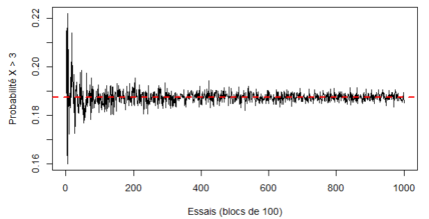
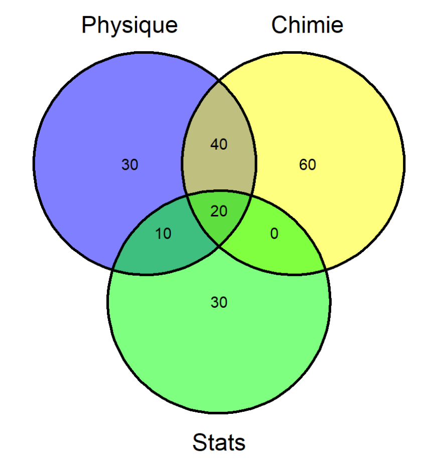

```{r}
#| echo: false
#| message: false
#| warning: false
#| error: false

source("global.R")
```

# Distributions de probabilités 

## Introduction

Dans les chapitres précédents, nous avons examiné de quelle manière on pouvait calculer la probabilité d'occurrence de différents événements faisant partie d'un espace échantillonnal. L'étape suivante consiste à obtenir la probabilité d'occurrence de chacun des événements possible lors d'une expérience aléatoire. Le résultat de cet exercice est une **distribution de probabilités**, le sujet du présent chapitre.

## La distribution des probabilités {#sec-distprob1}

Si une pièce de monnaie n'est pas trafiquée ($p=0.5$), on peut accepter
le fait que la probabilité d'obtenir le côté 'FACE' lors d'un lancer de
cette pièce soit égale à 0.5. On a une chance sur deux d'obtenir ce
côté. Si on lance plusieurs pièces, n = 5 par exemple, chaque pièce a
une chance égale de tomber du côté 'FACE', et les résultats possibles
pour une telle expérience sont l'un ou l'autre de 0, 1, 2,3, 4 ou 5
FACES... Vérifions cela. Le code suivant répète 100 fois le lancer de 5
pièces de monnaie, et on comptabilise à chaque essai le nombre de FACES
apparaissant, et la @tbl-monnaie1 (onglet libellé *Distribution*) résume les résultats
obtenus, qui sont affichés dans la @fig-monnaie2 (onglet libellé *Diagramme*)

::: {.panel-tabset}

## Distribution

```{r}
#| label: tbl-monnaie1
#| tbl-cap: "Distribution du nombre de FACEs observé pour le lancer de 5 pièces de monnaie"

# Simulation du lancer de n pièces de monnaie
# Compilation de la distribution de probabilités
#
set.seed(150752)   
nt <- 100           # Nombre d'essais
No_Pieces <- 5      # Nombre de pièces
res <- replicate(nt,
                 sum(CoinToss(No_Pieces, 0.5) == "Face"))
Freq  <-  as.matrix(table(res))# Fréquences
Prop <- Freq / sum(Freq)       # Proportions
Faces <- sort(unique(res))
tbl  <-  data.frame(Faces, Freq, Prop)

tbl %>%
  kbl(booktabs=TRUE,
      row.names=FALSE) %>%
  kable_styling(bootstrap_options = c("striped", "hover", "condensed"), 
                full_width=FALSE) 
```

## Diagramme

```{r }
#| label: fig-monnaie2
#| echo: false
#| fig-cap: "Distribution de Probabilités (lancer de 5 pièces de monnaie)" 

barplot(tbl$Prop,
        main="Distribution de Probabilités",
        xlab="Nombre de FACEs",
        ylab="Probabilité",
        names.arg=0:5)
```

:::

Du diagramme et du tableau obtenus, on note qu'on a plus de chance
d'obtenir 2-3 FACEs en lançant 5 pièces de monnaie, qu'un nombre plus
élevé ou inférieur. Mais les événements plus extrêmes ne sont pas
exclus: il peut arriver que l'on n'obtienne aucune FACE, ou qu'on en
obtienne 5. De tels résultats sont simplement plus rares, ou moins
probables.

Reprenons l'expérience, mais en la répétant 100,000 fois! Pour permettre
le changement rapide du nombre d'essais, la variable **No_essais** a été
créée. Il vous suffira de changer sa valeur pour spécifier le nombre
d'essais à effectuer. Les résultats de cette expérience sont résumés
dans le @tbl-monnaie3 et la @fig-monnaie3.

::: {.panel-tabset}

## Distribution

```{r }
#| label: tbl-monnaie3
#| tbl-cap: "Distribution du nombre de FACEs"

set.seed(150752)
No_essais <- 100000  # Spécification du nombre d'essais à effectuer
No_Pieces <- 5       # Nombre de Pièces
res <- replicate(No_essais,
                 sum(CoinToss(No_Pieces, 0.5) == "Face"))
Freq <- as.matrix(table(res))   # Production du tableau de fréquences
Prop <- Freq[, 1]/No_essais     # Fréquence relative (Probabilités)
x <- sort(unique(res))

tbl <- data.frame(x,Freq,Prop)
espm <- sum(x*Prop)             # Calcul de l'expérance mathématique 
tbl %>%
  kbl(booktabs=TRUE, 
      row.names=FALSE,
      digits=3) %>%  
  kable_styling(full_width = FALSE)
```

## Diagramme

```{r}
#| label: fig-monnaie3
#| echo: false
#| fig-cap: "Distribution de Probabilités (lancer de 5 pièces de monnaie)" 

barplot(tbl$Prop,  
        main="Distribution de Probabilités",  
        xlab="Nombre de FACEs",  
        ylab="Probabilité",  
        names.arg=c(0:5))  
```

:::

Pour répondre à une question telle que: '**Combien de fois obtenons-nous
4 FACES ou PLUS, en lançant 5 pièces de monnaie non trafiquées**?', on
pourrait simplement additionner les fréquences correspondant à x = 4 et
x = 5. Ou on pourrait directement obtenir ce nombre à partir de
l'ensemble des résultats obtenus. On utilisera ici l'opérateur logique
'**>=**' , qui accorde une valeur '1' ou 'TRUE' si x (le nombre de
FACES) est supérieur ou égal à l'argument de droite (4):

```{r }
#| code-fold: false
sum(res >= 4 ) 

```

Connaissant le nombre de FACEs qui nous intéresse (x = 4 ou x = 5), on
peut aisément calculer la probabilité recherchée. Puisque 100,000
expériences aléatoires ont été effectuées, il suffira de diviser ce
nombre par le nombre total de résultats obtenus [**length(res)**], qui
est égal à 100,000:

```{r}
#| code-fold: false

sum(res >= 4) / length(res)
```

On obtiendra évidemment le même résultat en utilisant la fonction
**mean()**, puisque la moyenne d'une variable binaire est une proportion
(probabilité):

```{r}
#| code-fold: false
mean(res>=4)
```

La distribution de probabilités que nous sommes maintenant en mesure de
définir possède certaines caractéristiques importantes. D'une part, elle
a une forme: les différents événements (axe horizontal) ne sont pas tous
équiprobables. La forme peut être symétrique ou non, selon le cas.

D'autre part, elle a une certaine étendue ou dispersion: dans le cas
présent, les résultats s'étendent de 0 jusqu'à 5.

Et finalement, elle a un centre, situé entre les deux valeurs extrêmes.
Ce centre nous permettrait de répondre à une question telle que: 'En
lançant 5 pièces de monnaie, combien de **FACEs** puis-je m'attendre à
obtenir, si je répétais l'expérience un nombre infini de fois?'. La forme nous indique que les résultats
(nombre de FACEs) ne sont pas équiprobables. Quel serait, alors, le
résultat le plus probable? Le terme désignant cette caractéristique est:
**espérance mathématique**. Mathématiquement, combien de FACEs peut-on
espérer obtenir en lançant 5 pièces de monnaie? On sait que ce nombre
est compris entre 0 et 5. On peut obtenir la probabilité de chacun de
ces résultats. L'espérance mathématique est alors la somme du produit de
la probabilité d'obtenir un résultat particulier et la valeur de ce
résultat. En termes plus formels:

$$E(X)=\sum_{X=0}^{n} XP(X)$$ {#eq-espmath}

Si on considère la distribution de probabilités obtenue par simulation
et reproduite dans le @tbl-monnaie3, on trouve:

$$E(X)=`r round(espm, 4)`$$

L'espérance mathématique de cette distribution, indiquée ci-dessus, est
obtenue par:

$$(0\times `r tbl$Prop[1]`)+(1\times `r tbl$Prop[2]`)+(2\times `r tbl$Prop[3]`)+(3\times `r tbl$Prop[4]`)+(4\times `r tbl$Prop[5]`)+(5\times `r tbl$Prop[6]`)= `r espm`$$  

Essentiellement, on peut s'attendre, en lançant 5 pièces de monnaie un
nombre infini de fois, à obtenir `r espm` faces en moyenne. En examinant
le graphique correspondant à cette simulation, on note en effet que les
deux valeurs les plus fréquentes (probables) sont 2 et 3 FACEs. Par contre, un tel résultat suppose une distribution symétrique. Lorsque la distribution est asymétrique, l'espérance mathématique ne correspond pas nécessairement à l'événement le plus fréquent.

## La Loi des Grands Nombres

Pour fins d'illustration, le code R suivant répète la simulation pour un
nombre de lancers de 5 pièces de monnaie variant entre 100 et 50,000,
par étape de 100. Le temps d'exécution de l'exercice est un peu long
(quelques minutes), mais permet d'illustrer la Loi des Grands Nombres.
L'événement d'intérêt est 'Nombre de FACEs supérieur à 3'. La 
@fig-loign reproduit les résultats.

```{r }
#| eval: false

n_trials <- 100 * c(1:500) 
pr <- numeric(length(n_trials)) 

for (i in seq_along(n_trials)) {
  successes <- sum(replicate(n_trials[i], sum(rbinom(5, 1, 0.5)) > 3))
  pr[i] <- successes / n_trials[i]  # Empirical probabilities
}

plot(pr,
     type="l",
     xlab="Essais (blocs de 100)",  
     ylab="Probabilité X > 3")
abline(h=0.1875, 
       lty = 2, 
       lwd = 2, 
       col="red")

```


```{r out.width = "60%"}
#| label: fig-loign
#| fig-cap: "Loi des Grands Nombres: P(X>3), pour le lancer de 5 pièces"
#| echo: false
#| fig-width: 8
#| fig-height: 5


```

Dans cette figure, on note manifestement l'augmentation de la précision en fonction du nombre d'essais. Plus le nombre d'essais est élevé, plus l'estimation de la probabilité recherchée est précise. L'estimation de $P(X>3)$ converge vers la probabilité théorique de cet
événement, qui théoriquement est $P(X > 3)=0.1875$ (ligne horizontale rouge). Mais une question
importante demeure: **comment peut-on obtenir cette valeur théorique?**  Comment peut-on obtenir cette valeur sans avoir à simuler le processus?

## Approche analytique: la distribution binomiale

Jusqu'à maintenant, nous avons considéré des expériences aléatoires dont
les résultats étaient des événements discrets: un certain nombre de
pièces de monnaie tombant sur le côté FACE, une valeur comprise entre 1
et 6 observée en lançant un dé, etc. Dans plusieurs cas, il était facile
d'obtenir la probabilité qu'un événement survienne: la probabilité
d'obtenir FACE en lançant une pièce de monnaie est 0.5, en lançant 2
pièces de monnaie, la probabilité d'obtenir 2 FACES est 0.5x0.5 = 0.25
(on applique ici la règle de multiplication des probabilités
d'événements indépendants); en lançant un dé, la probabilité d'obtenir
un 6 est 1/6, et la probabilité d'obtenir un 5 OU un 6 est 1/6+1/6 = 2/6
(on applique ici la règle d'addition des probabilités d'événements
mutuellement exclusifs). Nous avons aussi utilisé la simulation afin
d'obtenir des distributions de probabilités à partir desquelles on
pouvait sans trop de difficultés obtenir les probabilités recherchées. Le
résultat de telles simulations nous fournit une approximation de la
probabilité réelle d'un événement, la précision de cette approximation
étant déterminée par le nombre d'essais. C'est ce que la Loi des Grands
Nombres démontre.

Dans le cas des situations impliquant des événements se traduisant par
l'un de deux états (PILE/FACE, SUCCÈS/ÉCHEC, etc.) et dont les
probabilités d'occurrence sont invariantes d'un essai à l'autre, la
distribution de probabilités théorique appropriée est la distribution
**binomiale**. Cette distribution permet d'obtenir les probabilités de
tout événement de ce type, de manière analytique. Sous condition que
certains postulats sont respectés, les probabilités sont en effet
données par l'équation @eq-binom1.

$$f(x|n,p) = \frac{n!}{x!(n-x)!} p^x  (1-p)^{n-x} = {{n}\choose{x}}  p^x  (1-p)^{n-x}$$ {#eq-binom1}

Croyez-le ou non, cette expression est simplement un rapport entre le
nombre de 'succès' ($\frac{n!}{x!(n-x)!}$) divisé par le nombre total d'événements possibles ($p^x(1-p)^{n-x}$). Donc aucune différence notable par rapport aux définitions présentées
antérieurement n'existe.

### Lancers de pièces de monnaie et distribution binomiale

En reprenant l'exemple du lancer de 5 pièces de monnaie, le résultat des
opérations décrites par cette équation se lit: 'En lançant un nombre
infini de fois $n= 5$ pièces de monnaie non truquées ($p = 0.5$), la
probabilité d'obtenir *x* FACEs est égale à...'. En appliquant cette
équation à chacun des résultats possibles au lancer de 5 pièces, on
obtient:

$$f(0|5,0.5) = \frac{5!}{0!(5-0)!}\times 0.5^0 \times (1-0.5)^{5-0} = 0.03125 $$
$$f(1|5,0.5) = \frac{5!}{1!(5-1)!}\times 0.5^1 \times (1-0.5)^{5-1} = 0.15625 $$
$$f(2|5,0.5) = \frac{5!}{2!(5-2)!}\times 0.5^2 \times (1-0.5)^{5-2} = 0.31250 $$
$$f(3|5,0.5) = \frac{5!}{3!(5-3)!}\times 0.5^3 \times (1-0.5)^{5-3} = 0.31250 $$
$$f(4|5,0.5) = \frac{5!}{4!(5-4)!}\times 0.5^4 \times (1-0.5)^{5-4} = 0.15625 $$
$$f(5|5,0.5) = \frac{5!}{5!(5-5)!}\times 0.5^5 \times (1-0.5)^{5-5} = 0.03125 $$
De ces calculs, on trouve que la probabilité théorique de l'événement X
\> 3 est:

$$P(X>3) = P(X=4)+P(X=5) = 0.15625 + 0.03125 = 0.1875$$

une valeur qui ne contredit en rien le point de convergence observé par
simulation. De plus, on note que les probabilités calculées pour chaque
valeur possible de X sont presque identiques à celles obtenues par
simulation dans la section @sec-distprob1, tel qu'illustré dans la
@tbl-binomcomp.

```{r}
#| label: tbl-binomcomp
#| tbl-cap: "Distribution du nombre de Faces"
#| echo: false

set.seed(150752)
No_essais <- 100000  # Spécification du nombre d'essais à effectuer
No_Pieces <- 5       # Nombre de Pièces
res <- replicate(No_essais,
                 sum(CoinToss(No_Pieces, 0.5) == "Face"))
fr <- as.matrix(table(res))   # Production du tableau de fréquences
pr <- fr[, 1]/No_essais       # Fréquence relative (Probabilités)
x <- sort(unique(res))
tbl <- data.frame(x,
                  fr,
                  pr,
                  dbinom(0:5,5,.5))
colnames(tbl) <- c("#Faces","Fréq","Prop","Pr Théor")

tbl %>%
  kbl(booktabs=TRUE, 
      row.names=FALSE) %>%
  kable_styling(full_width = FALSE)
```

Il suffirait d'augmenter le nombre d'essais pour augmenter la précision
des estimations et réduire l'écart existant entre les probabilités
empiriques et les probabilités théoriques.

Notons que sous R, on peut obtenir ces probabilités en utilisant la
fonction **dbinom(x, size, prob)**. Les arguments de cette fonction
sont:

-   **x** : un nombre ou un vecteur de nombre représentant les résultats
    d'une expérience binomiale (eg lancer de pièces)\
-   **size** : nombre d'items (eg pièces)\
-   **prob** : probabilité d'un succès

Par exemple, on obtiendra l'ensemble de la distribution en lançant la
commade:

```{r 02-Chap2-49 }
dbinom(x=c(0:5), size=5, prob=0.5) # P(0-5 FACES en 5 lancers, p=0.5)

```

La fonction **pbinom(q, size, prob, lower.tail=TRUE)** s'ajoute à la
précédente en permettant de déterminer les quantiles de la distribution.
Les arguments additionnels sont:

-   **q** : résultat ou vecteur de résultats représentant des quantiles
-   **size** : nombre d'items (eg pièces)\
-   **prob** : probabilité d'un succès
-   **lower.tail** : valeur booléenne. TRUE (par défaut) = distribution
    cumulative partant de l'extrémité inférieure; FALSE = distribution
    cumulative partant de l'extrémité supérieure

Par exemple, on obtiendra la distribution cumulative en lançant la
commande:

```{r}
#| code-fold: false
pbinom(0:5, 5, 0.5, lower.tail = TRUE)
```

La fonction **qbinom(p, size, lower.tail=TRUE)** permet l'opération
inverse. On détermine la valeur de X sous laquelle on retrouve une
certaine proportion de la distribution. L'argument **p** est une
probabilité ou un vecteur de probabilités pour lesquelles on recherche
une valeur de X. Par exemple, sous quel nombre de FACEs retrouve-t-on
50% et 75% de la distribution:

```{r}
#| code-fold: false

qbinom(c(0.5,0.75), 5, 0.5, lower.tail = TRUE)
```

50% de la distribution se trouve donc sous X = 2, alors que 75% de cette
distribution se trouve sous X = 3.

Finalement, la fonction **rbinom(n,size,prob)** est également disponible
pour générer des données binomiales aléatoires. Par exemple, simulons le
lancer de 25 pièces de monnaie non truquées, 5000 fois. Le résultat de
cette opération est représenté dans la @fig-rbinom1).

```{r  }
#| label: fig-rbinom1
#| fig-cap: "Distribution de valeurs binomiales aléatoires"
#| code-fold: false

x <- rbinom(5000, 25, 0.5)
hist(x, 
     breaks="FD"
     ,main="Distribution Binômiale")
```

### Que se passe-t-il lorsque le nombre de pièces augmente?

Nous sommes donc en mesure de construire une distribution de
probabilités lorsque l'expérience aléatoire consiste à lancer 5 pièces
de monnaie, comptabilisant le nombre de pièces tombant du côté FACE. Il
serait intéressant de voir à quoi ressemble une distribution similaire,
mais lorsque l'expérience aléatoire consiste à lancer 100 pièces! Le
code R suivant se charge du travail, et le résultat est affiché dans la
@fig-binomdist3, @fig-binomdist4, et @fig-binomdist5.

::: {.panel-tabset}

## 100 Pièces

```{r}
#| label: fig-binomdist3
#| fig-cap: "Distribution du lancer de 100 pièces"

res = vector()      # Initialisation du vecteur des résultats
No_essais  <-  100000  # Spécification du nombre d'essais à effectuer
No_Pieces  <-  100     # Nombre de Pièces
set.seed(150752)
res <- replicate(No_essais,sum(CoinToss(No_Pieces, 0.5) == "Face"))
hist(res+.001,breaks="FD",   
     xlab="Nombre de Faces",   
     ylab="Fréquences",
     main=paste("Distribution de probabilités: ",No_Pieces," pièces"))

```


## 1000 Pièces

```{r}
#| label: fig-binomdist4
#| fig-cap: "Distribution du lancer de 1000 pièces"
#| echo: false

res = vector()      # Initialisation du vecteur des résultats
No_essais  <-  100000  # Spécification du nombre d'essais à effectuer
No_Pieces  <-  1000     # Nombre de Pièces
set.seed(150752)
res <- replicate(No_essais,sum(CoinToss(No_Pieces, 0.5) == "Face"))
hist(res+.001,breaks="FD", 
     xlab="Nombre de Faces",   
     ylab="Fréquences",
     main=paste("Distribution de probabilités: ",No_Pieces," pièces"))

```

## 10,000 Pièces

```{r}
#| label: fig-binomdist5
#| fig-cap: "Distribution du lancer de 10000 pièces"
#| echo: false

res = vector()      # Initialisation du vecteur des résultats
No_essais  <-  100000  # Spécification du nombre d'essais à effectuer
No_Pieces  <-  10000     # Nombre de Pièces
set.seed(150752)
res <- replicate(No_essais,sum(CoinToss(No_Pieces, 0.5) == "Face"))
hist(res+.001,breaks="FD", 
     xlab="Nombre de Faces",   
     ylab="Fréquences",
     main=paste("Distribution de probabilités: ",No_Pieces," pièces"))

```

:::

La forme de la distribution que l'on obtient dans ce cas est très
caractéristique. Il s'agit d'une forme omniprésente dans l'univers
statistique, et elle reviendra dans notre champ visuel fréquemment dans
les chapitres suivants. La distribution est visiblement symétrique et
s'étend en théorie de 0 au nombre de pièces lancées (100, 1000 et 10,000
FACES dans les trois derniers cas). Cependant, les probabilités
associées aux nombres faibles et aux nombres élevés de FACEs sont très
faibles de sorte que même après 100,000 lancers, aucun de ces événements
n'est apparu. En conséquence, l'étendue effective de la distribution est
plus restreinte que ce à quoi on peut s'attendre en théorie.

Il est à noter que lorsque le nombre d'événements possibles devient très
grand, comme c'est le cas dans les derniers exemples impliquant le
lancer de 1000 ou même 10,000 pièces de monnaie, à la limite on obtient
une distribution **continue**. De telles distributions seront à l'étude
au chapitre 4.

Dans les exemples précédents, la probabilité associée aux événements
PILE/FACE était égale à 0.5. Mais dans la réalité, pour différentes
variables, cette probabilité peut prendre n'importe quelle valeur
comprise entre 0 et 1. Par exemple, supposons qu'un traitement contre
une certaine maladie est efficace à 90%. C'est dire que la probabilité
pour un patient souffrant de cette maladie de guérir suite à
l'application de ce traitement est $p=0.90$. En supposant que 1000
patients sont soumis à ce traitement, la distribution des probabilités
des nombres de guérisons serait telle qu'affichée à la 
@fig-binomdist6.

```{r}
#| label: fig-binomdist6
#| fig-cap: "DistributionnBinomiale"
#| echo: false

res = vector()          # Initialisation du vecteur des résultats
No_essais  <-  100000   # Spécification du nombre d'essais à effectuer
No_Pieces  <-  1000     # Nombre de patients
prob <- 0.90            # Probabilité de guérison
set.seed(150752)
res <- replicate(No_essais,sum(CoinToss(No_Pieces, prob) == "Pile"))
fr  <-  as.matrix(table(res))
pr  <-  fr[,1] / No_essais
x  <-  sort(unique(res))
tbl  <-  data.frame(x,fr,pr)
espm <- sum(x*pr)

colnames(tbl) = c("#Guérisons","Fréq","Prop")
hist(res+.001,breaks="FD", 
     xlab="Nombre de Guérisons",   
     ylab="Fréquences",
     main=paste("Distribution de probabilités: ",No_Pieces," patients"))
text(860, 3000, 
     paste("E(X) = ", round(espm, 3)),
     pos = 4)
abline(v = espm, 
       lty = 2,
       lwd = 2,
       col = "red")

```

On note que l'espérance mathématique de cette distribution est
$E(Guérisons)=n\times p=1000\times 0.90\approx 900$.

Dans le monde réel, il existe de multiples exemples de variables ne
possédant que deux attributs, analogue au lancer d'une pièce de monnaie.
Nous avons mentionné la guérison ou non suite à un traitement. On peut
ajouter le succès ou l'échec à un examen, l'admission ou non à un
programme d'étude, etc. Dans ces cas, il est fréquent que la
distribution de probabilités correspondante épouse les caractéristiques
de celles présentées ci-dessus, et en conséquence, elles seront
utilisées dans le processus de prise de décision dans un contexte de
recherche, comme nous le verrons dans un chapitre ultérieur.

### Exercice 5

1.  Déterminez la distribution de fréquence des résultats (nombre de
    FACES), lorsque le nombre de pièces de monnaie est n = 100, et que
    les pièces ne sont pas trafiquées (soit p = 0.5)\
2.  Comment pourriez-vous qualifier la distribution obtenue?
3.  Quelle est la probabilité d'obtenir 43 faces ou moins?
4.  Quelle est la probabilité d'obtenir entre 45 et 65 faces?
5.  Obtenez la proportion des essais où on obtient plus de 65 FACES, en
    utilisant le tableau de fréquences.
6.  Obtenez cette proportion en comptabilisant cette proportion
    directement des résultats de chaque essai.
7.  Pour quelle proportion des essais obtient-on entre 65 et 85 FACES?
8.  Sous quelle valeur de x (nombre de FACES) trouve-t-on 75% de la
    distribution?\
9.  Au-dessus de quelle valeur de x trouve-t-on 10% de la distribution?
10. Quelles sont les limites à l'intérieur desquelles on retrouve les
    95% centraux des résultats de lancers de ces 100 pièces de monnaie?

## Lancer de dés et distribution multinomiale

Le même cheminement que nous avons parcouru avec des pièces de monnaie
peut être répété en considérant le lancer de dés, trafiqués ou non... La
fonction **@lst-DiceRoll** permet de simuler le lancer d'un dé. Par défaut, le dé est lancé 1 seule fois
(n=1) et il n'est pas trafiqué (chacune des 6 faces a une chance égale
d'apparaître: **p=rep(1,6)**). Essayons cette fonction une première
fois, en simulant le lancer de 5 dés non trafiqués:

```{r }
#| code-fold: false

DiceRoll(5)

```

Comme dans le cas du lancer d'une pièce de monnaie, la probabilité qu'un
événement ou l'autre survienne ne change pas d'un essai à l'autre. Ce
qu'il y a de différent, c'est simplement le nombre d'événements
possibles au lancer d'un objet: la pièce de monnaie possède deux côtés,
alors que le dé régulier en possède 6. Il est toujours possible
d'utiliser la distribution binomiale pour le lancer de dés, si on ne
considère qu'un seul résultat: succès = 'obtenir un 6', échec = 'ne pas
obtenir un 6'. Mais l'objectif ici est de considérer l'ensemble des
résultats possibles: {1, 2, 3, 4, 5, 6}. La distribution binomiale ne
suffit plus, et la distribution **multinomiale** entre en scène.

Comme nous l'avons fait dans le cas de pièces de monnaie, nous pouvons
examiner comment les résultats varient d'une expérience à l'autre. Le
code suivant nous permettra d'effectuer autant de lancers d'un dé que
nécessaire, de manière à établir la distribution de fréquences des
valeurs possibles dans cette situation. En lançant le dé 60 fois, on
devrait s'attendre à obtenir 10 fois chacune des valeurs de 1 à 6, en
supposant que le dé n'est pas truqué. Les résultats de cette expérience
sont résumés dans la @fig-dice1 et le tableau
@tbl-dice1.


::: {.panel-tabset}

## Diagramme

```{r}
#| label: fig-dice1
#| fig-cap: "Résultat du lancer d'un dé"

res = vector()       # Initialisation du vecteur des résultats
No_essais = 60       # Spécification du nombre d'essais à effectuer
res= DiceRoll(No_essais)
nam <- sort(unique(res))
ft = as.matrix(table(res))
fr = ft/sum(ft)
f = data.frame(nam, ft, fr)
colnames(f)=c("Face","Freq","Prop")

barplot(height=f$Freq,
        names=nam,
        xlab="Observations",
        ylab="Fréquences",
        main="Répartition de résultats des lancers d'un dé non truqué")

```

## Répartition

```{r}
#| label: tbl-dice1
#| tbl-cap: "Répartition de résultats des lancers d'un dé non truqué"
#| echo: false

f %>%
  kbl(booktabs=TRUE, 
                  caption="Résultats du lancer d'un dé",  
                  row.names=FALSE) %>%  
  kable_styling(full_width = FALSE)  
```

:::


En examinant la distribution obtenue, peut-on affirmer que
l'équiprobabilité des six résultats possibles est vérifiée? À première
vue, on pourrait en douter, puisque les fréquences observées pour chacun
des résultats ne sont pas toutes égales à ce à quoi on s'attend!
Examinons plus en détail la distribution de probabilités associée au
lancer d'un dé...

### Exercice 6

1.  Déterminez la distribution de fréquence des résultats observés en
    lançant un dé à 100 reprises, supposant que le dé n'est pas truqué.

2.  Comment pourriez-vous qualifier la distribution obtenue? A première
    vue, seriez-vous porté à croire que le dé est truqué?

3.  Répétez l'expérience en lançant le dé 60, 300, 600, 1,000, 10,000 et 60,000 fois. Avez-vous des raisons de croire que le dé est
    truqué?

    -   Pour cette portion de l'exercice, vous pouvez indiquer les
        nombres d'essais désirés dans la première ligne du code suivant:

```{r }
for (i in c(60,300,600,1000,6000,60000)){
  res= DiceRoll(i)
  ft = as.matrix(table(res))
  ft = data.frame(sort(unique(res)),ft,ft/sum(ft))
  colnames(ft)=c("Face","Freq","Prop")
  titl = paste("Résultats de lancers d'un dé\n (",i,"lancers)")
  barplot(height=ft$Freq,names=ft$Face,  
          xlab="Observations",  
          ylab="Fréquences",main=titl)
cat("\n")
cat("\n")
}

```

4.  Quelle conclusion générale pourriez-vous tirer de ces expériences?
5.  Exécutez le code R suivant afin de définir un dé trafiqué de manière
    à ce que la probabilité d'obtenir une des faces du dé (1-6) soit
    différente de celle typique d'un dé non truqué, et pour obtenir un
    échantillon initial de 30 lancers de ce dé. La définition de la
    variable **p6** (seconde ligne) attribue une probabilité égale pour
    5 des 6 (résultat de **rep(1.6667,5)**), et une probabilité altérée
    aléatoirement en y ajoutant ou en y retranchant un nombre compris
    entre -0.7 et 0.7 (résultat de **1.6667+runif(1,-.7,.7)**), pour
    l'autre face, sélectionnée au hasard.

::: {.panel-tabset}

## Diagramme

```{r}
No_essais  <-  30
p6 <- sample(c(rep(1.6667,5),1.6667+runif(1,-.7,.7)),6)
res  <-  DiceRoll(No_essais,p=p6)
ft  <-  as.matrix(table(res))
ft  <-  data.frame(sort(unique(res)),ft,ft/sum(ft))
colnames(ft) <- c("Face","Freq","Prop")
titl  <-  paste("Résultats de lancers d'un dé truqué\n pour ",No_essais,"lancers") 
barplot(height=ft$Freq,names=ft$Face,  
        xlab="Observations",  
        ylab="Fréquences",  
        main=titl)
```

## Répartition

```{r}
kableExtra::kable(ft, booktabs=TRUE,  
                  caption="Résultats du lancer d'un dé truqué",  
                  row.names=FALSE) %>%  
  kableExtra::kable_styling(full_width = FALSE)
```

:::
-   Êtes-vous en mesure de conclure sans doute raisonnable que le dé a
    été trafiqué, sur la base de ces données?
-   Répétez l'expérience en modifiant le nombre d'essais graduellement:
    60, 120, 300, 1,000, 3,000... À partir de quel moment auriez-vous
    confiance en affirmant que le dé est truqué, sur la base des
    observations?
-   Pour quelle face le dé est-il trafiqué, et quelle est la probabilité
    d'obtenir ce résultat, à 5 décimales près?

## La distribution multinomiale

La distribution binomiale, présentée dans la section précédente,
s'applique à des situations où les données sont binaires: elles se
présentent en deux catégories mutuellement exclusives. Dans beaucoup de
situations, par contre, on est en présence de données réparties en
plusieurs catégories, et comme c'était le cas pour des données
binomiales, il est utile d'en connaître la distribution.

Le lancer de dés est un exemple d'expérience aléatoire donnant lieu à
des données multinomiales. En effet, en lançant un dé, six résultats
sont possibles. Et en lançant un certain nombre de dés, on pourra
s'intéresser à la probabilité d'obtenir une certaine configuration de
valeurs observée sur ces dés.

Supposons un dé truqué de manière à ce que les probabilités d'obtenir
{1, 2, 3, 4, 5, 6} soient respectivement {0.3, 0.2, 0.1, 0.1, 0.1, 0.2}.
Considérons une expérience aléatoire consistant à lancer ce dé 10 fois.
Pour cette séquence de 10 lancers, on note la fréquence d'apparition de
chacune des valeurs affichées sur le dé. Quelle est la probabilité
d'obtenir, sur 10 lancers, 2x1, 2x2, 2x3, 1x4, 1x5, 2x6?

Dans les paragraphes précédents, nous avons déjà eu l'occasion de
simuler des distributions de probabilités pour des données multinomiales
(lancers de dés). De ces distributions, nous avons pu obtenir les
probabilités de différents événements en comptabilisant le nombre
d'occurrences de ces événements, divisé par le nombre d'essais. Elles
sont obtenues de manière empirique, et en accord avec la Loi des Grands
Nombres, pour un nombre infini d'essais, on obtient une valeur égale à
la probabilité théorique. Et cette dernière s'obtient par la fonction
définie par l'équation @eq-multinom1.

$$P(X_1=x_1,...,X_k=x_k)=\left[\frac{n!}{x_1!...x_k!}\right]p_1^{x_1} ...p_k^{x_k}$$ {#eq-multinom1}

Si on applique cette fonction pour trouver réponse à la question posée,
on trouve:

```{r}
#| label: multinom2
#| fig-cap: "Loi Multinomiale"
#| echo: false


```

Sous R, la fonction **dmultinom()** permet d'obtenir ce résultat:

```{r}
#| code-fold: false

x <- c(2,2,2,1,1,2)                     # événement recherché
p <- c(0.3, 0.2, 0.1, 0.1, 0.1, 0.2)   # probabilités
dmultinom(x,size = 10,prob=p)
```

Vérifions ce résultat par simulation. :

```{r 02-Chap2-62 }
#| code-fold: false

ndraw <- 100000  # Nombre d'expériences aléatoires (lancers de dés)
p <- c(0.3, 0.2, 0.1, 0.1, 0.1, 0.2)
obj <- c(2,2,2,1,1,2)
draw <- t(replicate(ndraw,
                    sample(1:6,10,
                           prob=p,
                           replace=TRUE)))
rtbl <- Rfast::rowTabulate(draw)
succes <- 0      
for(i in 1:ndraw){
  succes <- succes + (sum(rtbl[i, ]==obj)==6)
}
cat("Probabilité = ",succes/ndraw)

```

La probabilité obtenue par simulation est raisonnablement rapprochée de
la probabilité théorique, comme on peut s'y attendre.

Sous R, la fonction **rmultinom()** permet de générer des données
suivant la distribution multinomiale. Les arguments sont:

-   b : le nombre de vecteurs aléatoires à générer. La longueur de ce
    vecteur sera égale au nombre de résultats possibles lors d'une
    expérience aléatoire.\
-   size : nombre d'items à répartir dans les *k* catégories de la
    variable multinomiale\
-   prob : vecteur des probabilités associées aux résultats possibles

Par exemple:

```{r 02-Chap2-63 }
#| code-fold: false

x <- rmultinom(20,50,prob=c(0.3,0.2,0.4,0.2))
t(x)
```

On note que le nombre de catégories est dicté par la longueur du vecteur
**prob**. La somme de chacun des vecteurs est égale à **size** (50 dans
le cas présent), et les fréquences observées reflètent les probabilités
suggérées dans **prob**.

Un exemple tiré du monde réel concerne la répartition des groupes
sanguins dans la population. Le tableau suivant résume cette
répartition:

```{r}

gs <- matrix(c(0.44, 0.42, 0.10, 0.04), nrow=1)
colnames(gs) <- c("O", "A", "B", "AB")

gs%>%
  kbl(booktabs=TRUE,
      caption="Répartition des groupes sanguins") %>%  
  kable_styling(full_width = FALSE)
```

Si on tire un échantillon de 10 sujets de la population, quelle est la
probabilité d'obtenir 6 sujets du groupe O, 2 du groupe A, 1 du groupe
B, et 1 du groupe AB?

En théorie, on peut s'attendre à obtenir un tel résultat avec une
probabilité de:

$$P(O=6,A=2,B=1,AB=1)=\left[\frac{10!}{6!2!1!1!}\right](0.44)^6(0.42)^2(0.10)^1(0.04)^1=0.0129$$

Par simulation, on obtient:

```{r 02-Chap2-64 }
#| code-fold: false

ndraw <- 100000  # Nombre d'expériences aléatoires (lancers de dés)
p <- c(0.44, 0.42, 0.10, 0.04)
obj <- c(6,2,1,1)

draw <- t(rmultinom(ndraw,
                    10,
                    prob=p))
succes <-sum(rowSums(t(apply(draw,
                             1,
                             function(x) x==obj)))==4)
cat("Probabilité = ", succes/ndraw)
```

Encore une fois, la probabilité obtenue empiriquement est très
rapprochée de celle obtenue de manière analytique.

## La somme de deux dés

Considérons maintenant le lancer de deux dés. On s'intéresse à la somme
des deux faces observées lors du lancer. On sait que la plus petite
somme est 1+1 = 2, et que la plus grande est 6+6 = 12. Donc l'ensemble
des résultats occupe l'étendue 2 à 12.

Le code R suivant permet de simuler le lancer de deux dés et de fournir
la somme des valeurs observées:

```{r 02-Chap2-65 }
#| code-fold: false

dice.roll <- sample(1:6, 
                    size = 2, 
                    replace = TRUE)
dice.roll
sum(dice.roll)

```

Tout ce que ce jeu de commandes fait, c'est de choisir 2 (**size=2**)
nombres parmi 1-6 (**1:6**), avec replacement (**replace=TRUE**), et de
calculer la somme des deux valeurs obtenues (**sum()**). On sait que
cette somme sera comprise entre 2 et 12. Notons que la remise
(**replace=TRUE**) est nécessaire afin de garantir l'équiprobabilité des
résultats au fil des essais, qui est la principale condition à
l'utilisation de la distribution multinomiale (et binomiale!).

Pour pouvoir répéter à volonté le code précédent sans que l'on ait à le
réinscrire dans la console, on pourra créer une fonction. Jusqu'à
maintenant, nous avons utilisé des fonctions prédéfinies, mais il est
bon de pouvoir écrire ses propres fonctions selon les besoins du moment.
La définition d'une fonction permettant de lancer deux dés non truqués
pourrait ressembler à ceci:

```{r }
#| code-fold: false

n.dice <- function(n = 2,
                   p = rep(1,6), 
                   sumdice = TRUE){
  dice <- sample(1:6, 
                 n, 
                 p, 
                 replace = TRUE)
  out <- if(sumdice){sum(dice)} else {dice}
  return(out)
}

```

Cette fonction, **n.dice()**, accepte trois arguments:

- *n* = nombre de dés (2 par défaut)\
- *p* = un vecteur déterminant la probabilité d'obtenir chacun des
résultats (1/6 par défaut)\
- *sumdice* = valeur logique indiquant si la somme des dés doit être
retournée (valeur par défaut). Dans le cas contraire (sumdice = FALSE),
la liste des valeurs observées sur les dés est retournée.

Mettons notre fonction au travail:

```{r }
#| code-fold: false
# lancer de 2 dés non truqués, somme calculée
n.dice() 
```

```{r }
#| code-fold: false
# lancer de 3 dés non truqués, somme calculée
n.dice(3)      
```

```{r }
#| code-fold: false
# lancer de 2 dés truqués de manière à favoriser le '6', somme calculée
n.dice(2,c(1,1,1,1,1,4))  
```

```{r }
#| code-fold: false
# lancer de 5 dés non truqués, valeurs des dés affichées
n.dice(5,sumdice=FALSE)
```

Tout semble fonctionner! Cette fonction nous permettra de simuler des
expériences aléatoires permettant un plus grand nombre de résultats que
dans les simulations précédentes.

Pour répéter le lancer des dés *n* fois, on peut simplement utiliser la
fonction **replicate**, qui nécessite deux arguments: le nombre de fois
que l'on veut répéter l'opération, et l'opération à répéter:

```{r }
#| code-fold: false

x <- replicate(20, 
               n.dice()) # 20 lancers de 2 dés et calcul de la somme

```

À présent, nous avons tout ce qui est nécessaire pour effectuer une
simulation du lancer de deux dés ou plus. Simulons le lancer de 60
paires de dés, calculant la somme des dés pour chaque paire.  La distribution de fréquences résumée dans la @tbl-DiceRoll nous informe sur la probabilité d'obtenir chacun des résultats possibles, de 2 à 12.La @fig-deuxdes1 illustre cette distribution. Les observations sont les suivantes:


```{r }
#| code-fold: false
#| 
No_essais <- 60
x  <-  replicate(No_essais, n.dice())
x
```

::: {.panel-tabset}

## Distribution

```{r }
#| label: tbl-DiceRoll
#| tbl-cap: "Résultats du lancer d'un dé truqué"
#| echo: false

ft  <-  as.matrix(table(x))
ft  <-  data.frame(sort(unique(x)),ft,ft/sum(ft))
colnames(ft)=c("Somme","Freq","Prop")
ft %>%
  kbl(booktabs=TRUE,
      caption=,  
      row.names=FALSE) %>%  
  kable_styling(full_width = FALSE)
```

## Diagramme

```{r}
#| label: fig-deuxdes1
#| fig-cap: "Somme de deux dés non-truqués (60 lancers)"
#| echo: false

barplot(height=ft$Freq,names=ft$Somme,  
        xlab="Observations",
        ylab="Fréquences",
        main=paste("Somme de deux dés (",No_essais, "lancers)"))

```
:::

De ce diagramme, on constate que l'ensemble des sommes de deux dés
couvre bien l'étendue 2 à 12. On note aussi que la probabilité ne semble
pas égale pour chacune des sommes possibles: il semble plus probable, en
lançant deux dés, d'obtenir des valeurs telles que 6, 7 ou 8 que des
valeurs plus élevées ou plus faibles.

Augmentons le nombre de lancers de nos dés. Pour n = 500, on obtient la
distribution résumée dans le tableau @tbl-deuxdes2 et illustrée par la @fig-deuxdes2.

::: {.panel-tabset}

## Distribution

```{r echo=1:2}
#| label: tbl-deuxdes2
#| tbl-cap: "Somme de deux dés non-truqués (500 lancers)"

No_essais  <-  500   # Définition du nombre d'essais
x  <-  replicate(No_essais, n.dice())
#
ft  <-  as.matrix(table(x))
ft  <-  data.frame(sort(unique(x)),ft,round(ft/sum(ft),4))
colnames(ft) <- c("Somme","Freq","Prop")
ft %>%
  kbl(booktabs=TRUE, 
      caption="Résultats du lancer de 2 dés",
      row.names=FALSE) %>%  
  kable_styling(full_width = FALSE)

```

## Diagramme

```{r}
#| label: fig-deuxdes2
#| fig-cap: "Somme de deux dés non-truqués (500 lancers)"

barplot(height=ft$Freq,names=ft$Face,
        xlab="Observations",
        ylab="Fréquences",
        ylim=c(0, max(ft$Freq)+10),
        main=paste("Résultats de lancers de deux dés\n (",No_essais,"lancers)"), 
        names.arg=ft$Somme)
```

:::

Il semble que plus on augmente la taille de l'échantillon, plus on
s'approche d'une distribution de forme triangulaire: les résultats ne
sont pas équiprobables. Les petites sommes, comme les grandes, sont
moins probables que les sommes intermédiaires.

À ce stade, vous devriez avoir saisi qu'une probabilité peut être
définie comme étant le nombre de 'succès' sur un très grand nombre
d'essais. En mathématiques, on dira que la probabilité d'un événement
est la proportion d'occurrences de cet événement pour un nombre
**infini** d'expériences aléatoires. Pour nos besoins, examinons la
distribution des sommes de deux dés pour 1,000,000 d'essais. Les
résultats sont illustrés dans le @tbl-deuxdes3b et par la
@fig-deuxdes3.

::: {.panel-tabset}

## Distribution

```{r echo=1:3}
#| label: tbl-deuxdes3b
#| tbl-cap: "Somme de deux dés non-truqués (1 million de lancers)"

set.seed(1234567)
No_essais  <-  1000000   # Définition du nombre d'essais
x  <-  replicate(No_essais, n.dice())
#
ft  <-  as.matrix(table(x))
ft  <-  data.frame(sort(unique(x)),ft,round(ft/sum(ft),4))
colnames(ft) <- c("Somme","Freq","Prop")
kableExtra::kable(ft, booktabs=TRUE, 
                  caption="Lancer de deux dés",  
                  row.names=FALSE) %>%  
  kableExtra::kable_styling(full_width = FALSE)

espm <- sum(ft$Somme*ft$Prop)
```

## Diagramme

```{r }
#| label: fig-deuxdes3
#| fig-cap: "Résultats de lancers de deux dés"
#| echo: false

titl  <-  paste("Résultats de lancers de deux dés\n  (",No_essais,"lancers)")
  barplot(height=ft$Freq,names=ft$Face,
          xlab="Observations",
          ylab="Fréquences",
          main=titl, 
          names.arg=ft$Somme)
  text(10, 150000, 
       pos = 4,
       paste("E(X) = ", round(espm, 3)))
```
:::

On s'attend donc, en lançant deux dés un nombre infini de fois, à
obtenir une somme égale à 7. La valeur de l'expérance mathématique affichée sur le diagramme s'en trouve pratiquement égale.

On note ici que la distribution est très clairement définie. Elle est
presque parfaitement symétrique, et les proportions observées pour
chaque somme possible correspondent presque parfaitement aux
probabilités que plus tard on pourra obtenir de manière analytique.

Comme on l'a fait dans l'exercice 4, on peut obtenir les probabilités
associées à différentes zones de cette distribution. On a déjà vu
qu'ayant un accès direct à l'ensemble des données, il suffit d'une
opération de comparaison, ou opération logique pour obtenir réponse à
nos questions. Par exemple, quelle est la probabilité d'obtenir une
somme inférieure à 5:

```{r 02-Chap2-74 }
#| code-fold: false
sum(x < 5) / length(x)

```

De manière alternative et parfaitement équivalente, on peut obtenir
cette probabilité en utilisant la fonction **mean()**. En effet, la
moyenne d'un ensemble de valeurs logiques ('TRUE'/'FALSE', ou '1'/'0')
est une proportion (ou probabilité!):

```{r 02-Chap2-75 }
#| code-fold: false
mean(x < 5)
```

De la simulation précédente, le million de résultats se trouve dans la
variable x. Le nombre d'essais est donné par la fonction **length(x)**,
et le rapport de la somme des x inférieurs à 5, divisé par le nombre
total d'essais nous donne la probabilité recherchée.

### Exercice 8

**NOTES**: - lorsqu'une question implique une condition **OU** une
autre, l'opérateur est la barre verticale '\|':

```{r 02-Chap2-76 }
#| code-fold: false
a = 5
b = 10
(a < 7) | (b > 12)  # condition 1 VRAIE, seconde FAUSSE. Ensemble VRAI
```

-   lorsqu'une question implique une condition **ET** une autre,
    l'opérateur est '&' :

```{r 02-Chap2-77 }
#| code-fold: false
a = 5
b = 10
(a < 7) & (b < 12)  # Les deux conditions sont VRAIES. Ensemble VRAI

```

-   La distribution utilisée ici est la suivante:

::: {.panel-tabset}

## Distribution

```{r }
No_essais  <-  500   # Définition du nombre d'essais
x  <-  replicate(No_essais, n.dice())
#
ft  <-  as.matrix(table(x))
ft  <-  data.frame(sort(unique(x)),ft,ft/sum(ft))
colnames(ft)=c("Somme","Freq","Prop")
kable(ft, booktabs=TRUE, 
      caption="Résultats du lancer de 2 dés",  
      row.names=FALSE) %>%  
  kable_styling(full_width = FALSE)
```

## Diagramme

```{r}

titl  <-  paste("Résultats de lancers de deux dés\n  (",No_essais,"lancers)")
  barplot(height=ft$Freq,names=ft$Face,
          xlab="Observations",
          ylab="Fréquences",
          main=titl, 
          names.arg=ft$Somme)

```

:::

1.  En vous basant sur la dernière distribution obtenue suite à 500
    lancers de deux dés, quelle serait la probabilité d'obtenir une
    somme supérieure à 10?

2.  Toujours en vous basant sur la distribution obtenue, quelle serait
    la probabilité d'obtenir une somme supérieure à 10 ou inférieure à
    5?

3.  Quelle serait la probabilité d'obtenir une somme comprise entre 6 et
    8?

4.  Quelle est la probabilité d'obtenir au plus une somme égale à 6?

5.  Quelle est la probabilité d'obtenir au moins une somme égale à 6?

### Exercice 9

1.  En utilisant la dernière distribution obtenue (1,000,000 d'essais),
    quelle serait la probabilité d'obtenir une somme supérieure à 10?

2.  Toujours en vous basant sur cette distribution, quelle serait la
    probabilité d'obtenir une somme supérieure à 10 ou inférieure à 5?

3.  Quelle serait la probabilité d'obtenir une somme comprise entre 6 et
    8?

4.  Quelle est la probabilité d'obtenir une somme inférieure ou égale à
    6?

5.  Quelle est la probabilité d'obtenir une somme supérieure ou égale à
    6?

6.  Comparez ces trois probabilités à celles obtenues dans l'exercice 3.
    Quel ensemble de probabilités vous semble le plus précis?

7.  En utilisant l'argument **sumdice=FALSE** dans l'appel de la
    fonction **n.dice()** pour obtenir la valeur des dés plutôt que leur
    somme, calculez la probabilité que survienne un double, soit (1,1),
    (2,2), ..., (6,6))?

8.  Quelle serait la probabilité qu'au moins un des deux dés soit un
    '6'?

9.  Il existe un vieux jeu de hasard italien appelé **Passadieci**, dans
    lequel le but est d'obtenir au moins 11 lorsque trois dés à six
    faces sont lancés.

<!-- -->

a.  Utilisez la fonction **n.dice()** et la fonction **replicate()** que
    nous avons utilisé plus haut pour simuler 100,000 réplications de ce
    jeu et sauvegardez les résultats dans un vecteur appelé
    **passadieci**.

-   Utilisez ce vecteur pour répondre aux questions suivantes :

    b.  Quelle est la probabilité de gagner à ce jeu (ie obtenir une
        somme supérieure ou égale à 11) ?
    c.  Qu'est-ce qui est le plus probable en lançant trois dés :
        obtenir 11 ou obtenir 12 ?
    d.  Quelle est la probabilité d'obtenir une somme inférieure ou
        égale à 7 ou supérieure ou égale à 15, toujours en lançant nos 3
        dés?
    e.  Tracez un graphique pour illustrer l'ensemble de la distribution
        des probabilités.

10. Parmi les deux situations suivantes, laquelle est la plus probable?

    1.  obtenir au moins un 6 en lançant 4 fois un seul dé à six faces.\
    2.  obtenir au moins une paire de 6 en lançant 24 fois deux dés à
        six faces.

<!-- -->

a.  Vous devez donc effectuer deux simulations de manière à déterminer

b.  la probabilité d'obtenir au moins un '6' en lançant 4 dés. La
    fonction suivante pourrait s'avérer utile, indiquant s'il est vrai
    qu'on obtient au moins un '6' en lançant 4 dés:

```{r}
#| echo: false

SituationA <- function(){
  res <- n.dice(4,sumdice=FALSE)
  out1 <- sum(res == 6) > 0
  return(out1)
}

```

c.  La probabilité d'obtenir au moins une paire de 6 en lançant 24 fois
    deux dés. La fonction suivante devrait pouvoir faire le travail,
    indiquant s'il est vrai qu'une expérience aléatoire de ce type
    produit l'événement recherché:

```{r}
#| echo: false

SituationB <- function(){ 
  x <- replicate(24,n.dice(2,sumdice=TRUE))   # Deux dés lancés 24 fois
  res2 <- sum(x) > 0                          # Condition recherchée
  return(res2)
}

```

d.  Pour répondre à la question, il suffira d'utiliser la fonction
    **replicate()** pour chacune de ces deux fonctions pour établir la
    distribution de probabilités correspondant aux deux situations. On
    pourra alors déterminer laquelle des situations est la plus
    probable! Vous prenez la relève?

## Distribution hypergéométrique: Urnes contenant 2 catégories d'objets

Les lois binomiale et multinomiale exigent que la probabilité d'un
'succès' soit constante d'un essai à l'autre. Elle ne peut donc pas
s'appliquer si cette condition n'est pas respectée! La distribution
hypergéométrique, pour sa part, comble le vide laissé par ces dernières
distributions.

Par exemple, la condition d'équiprobabilité des événements au fil des
essais ne serait pas respectée dans une situation où on tire une carte
d'un jeu de cartes standard, **sans remise**, le résultat recherché
étant une carte de couleur ROUGE. La probabilité d'un 'succès' est 26/52
au départ, puisqu'il y a 26 cartes rouges dans un jeu de 52 cartes. Si
on replace la carte avant d'en tirer une autre, la probabilité demeure
inchangée... et la loi binomiale peut être utilisée. Mais si la carte
n'est pas replacée dans le jeu, la probabilité d'obtenir une carte rouge
devient 26/51 si la première carte est NOIRE, et 25/51 si elle est
ROUGE. La probabilité d'un 'succès' (tirer une carte rouge) change d'un
essai à l'autre, et nous avons besoin de la distribution
hypergéométrique pour résoudre nos problèmes de calcul de probabilités.

Dans les paragraphes suivants, il sera question d'abord de l'approche
empirique, puis de l'approche théorique dans la solution de problèmes
impliquant des événements se présentant sous deux catégories, et étant
dépendants.

Considérons, dans un premier temps, une urne contenant des balles de
deux couleurs: 12 rouges et 8 vertes. Ajoutons au protocole de sélection
d'un certain nombre de balles, qu'elle s'effectue **sans remise**, ce
qui créera une dépendance entre les événements. Ces conditions sont
satisfaites à l'utilisation de la fonction **rhyper()** qui permet de
générer des données aléatoires tirées d'une distribution
hypergéométrique, appropriée dans cette situation. Les arguments de
cette fonction sont:

-   **nn** : nombre d'observations à générer
-   **m** : nombre de balles rouges
-   **n** : nombre de balles vertes
-   **k** : nombre de balles extraites de l'urne

Par exemple, à partir d'une urne contenant 12 balles rouges et 8 balles
vertes, procédons à l'extraction de 10 échantillons de 5 balles en
calculant le nombre de balles rouges obtenues dans chacun des
échantillons:

```{r 02-Chap2-81 }
#| code-fold: false

rhyper(10,12,8,5)
```

Ce contexte nous permet de poser des questions telles que:

1.  Quelle est la probabilité en tirant 5 balles de l'urne, d'obtenir 3
    balles rouges et 2 vertes?

-   **Par simulation**:

```{r 02-Chap2-82 }
#| code-fold: false

nrep <- 100000
res <- rhyper(nrep,12,8,5)
cat("P(R = 3) = ", mean(res == 3))
```

```{r}
#| label: fig-hyper1
#| fig-cap: "Distribution hypergéométrique: nombre de balles rouges tirées d'une urne"
#| echo: false

tbl <- table(res)
pr <- tbl/nrep
barplot(pr,main="Distribution du nombre de balles rouges", 
        ylab="Probabilités",xlab="# balles rouges")
```
  
Les probabilités obtenues tiennent compte du fait que les événements
sont dépendants. Dans le cas contraire, on pourrait utiliser la Loi
Binômiale. La probabilité d'obtenir 3 balles rouges dans un échantillon
de 5 balles, alors que les balles rouges représentent 60% du contenu de
l'urne, serait:

$$P(3|5,0.6) = \frac{20!}{3!(20-3)!}\times 0.6^3 \times (1-0.6)^{20-3} = 0.0000423$$
On constate immédiatement l'impact de la dépendance entre les événements
sur leur probabilité d'occurrence!

**Par calcul de la probabilité théorique**:

On sait déjà que la solution repose sur le nombre de combinaisons de 12
balles rouges prises 3 à la fois, et sur le nombre de combinaisons de 8
balles vertes prises 2 à la fois. Le produit de ces nombres, divisé par
le nombre total de combinaisons de 20 balles prises 5 à la fois nous
fournira la probabilité recherchée. Donc formellement,

$$P(X = 3)=\frac{C_3^{12}\times C_2^8}{C_5^{20}}=0.3973$$

```{r 02-Chap2-83 }
#| code-fold: false

choose(12,3)*choose(8,2)/choose(20,5)
```

Formellement, la Loi hypergéométrique est définie par:

$$P(X)=\frac{{C_X^S}{C_{n-X}^{N-S}}}{C_n^N}$$ {#eq-hypergeom}

Dans cette équation, **N** représente la taille de la population, ou le
nombre total d'éléments parmi lesquels on sera amené à effectuer une
sélection aléatoire; **X** représente ne nombre de 'succès' observés au
niveau de l'échantillon (il s'agit d'un nombre entier); **S** représente
le nombre de 'succès' au niveau de la population; et **n** représente la
taille de l'échantillon (nombre d'essais). Un exemple concret permettra
de mieux comprendre la situation.

Supposons un cabinet d'aide juridique regroupant 50 avocats dont 40
détiennent une maîtrise en Droit, et 10 détiennent un Doctorat. On doit
former un groupe de travail de 5 individus qui a pour tâche de
conseiller le gouvernement sur la constitutionnalité d'un projet de loi.
Quelle est la probabilité que 4 des 5 avocats sélectionnés détiennent
une maîtrise?

Ici, on pose:  

- **N** = 50 (nombre total d'avocats parmi lesquels la sélection du
comité se fera)  
- **S** = 40 (nombre d'avocats détenant une maîtrise en Droit)  
- **n** = 5 (taille du comité que l'on doit former)  
- **X** = 4 (nombre d'avocats choisis qui détiennent une maîtrise)  

La probabilité recherchée, utilisant la fonction hypergéométrique, est:

$$P(4)=\frac{{C_4^{40}}{C_{5-4}^{50-{40}}}}{C_5^{50}}=\frac{{C_4^{40}}{C_{1}^{10}}}{C_5^{50}}=0.4313$$
Sous R, on obtient:

```{r 02-Chap2-84 }
#| code-fold: false

cat("P(4) = ",(choose(40,4)*choose(10,1))/choose(50,5))
```

Pour simplifier le travail, nous disposons d'un ensemble de fonctions
permettant non seulement la détermination de probabilités, mais aussi la
détermination de quantiles, de la densité et de la génération de nombres
aléatoires. En utilisant le contexte d'une urne contenant des balles
rouges et des balles vertes, ces fonctions et leurs arguments sont les
suivants:

-   **dhyper(x, m, n, k)** : densité - Probabilité de X

-   **phyper(q, m, n, k, lower.tail = TRUE)** : probabilités cumulatives

-   **qhyper(p, m, n, k, lower.tail = TRUE)** : quantiles

-   **rhyper(nn, m, n, k)** : génération de nombres aléatoires

    -   x, q : valeur ou vecteur de quantiles: nombre de balles rouges
        tirées sans remise d'une urne  
    -   m : nombre de balles rouges dans l'urne  
    -   n : nombre de balles vertes dans l'urne  
    -   k : nombre de balles extraites de l'urne  
    -   p : probabilité d'obtenir une valeur inférieure (ou supérieure)
        à X  
    -   nn: nombre d'observations à générer  
    -   lower.tail : valeur logique indiquant si on considère les
        probabilités cumulatives inférieures (défaut) ou supérieures à
        X.  

Reprenant l'exemple précédent avec:

-   x = 4 : nombre d'avocats sélectionnés détenant une maîtrise  
-   m = 40: nombre d'avocats détenant une maîtrise au niveau du cabinet  
-   n = 10: nombre d'avocats détenant un doctorat au niveau du cabinet  
-   k = 5 : taille du comité à former  

on obtient:

```{r 02-Chap2-85 }
#| code-fold: false

cat("P(4) = ", dhyper(4, 40, 10, 5))
```

La probabilité d'obtenir 4 avocats détenant une maîtrise ou moins:

```{r 02-Chap2-86 }
#| code-fold: false

cat("P(X<=4) = ", phyper(4, 40, 10, 5))
```

La probabilité d'obtenir 4 avocats détenant une maîtrise ou plus:

```{r 02-Chap2-87 }
#| code-fold: false

cat("P(X>=3) = ",phyper(4, 40, 10, 5, lower.tail = FALSE))
```

Finalement, on peut générer des nombres aléatoires suivant la
distribution hypergéométrique à l'aide de la fonction **rhyper()**:

```{r 02-Chap2-88 }
#| code-fold: false

x <- rhyper(2000,40,10,5)
head(x,20)
hist(x+0.01,
     main="Distribution Hypergéométrique",
     xlab="X")
```

Cette dernière fonction nous permet d'obtenir par simulation la
probabilité recherchée:

```{r 02-Chap2-89 }
#| code-fold: false

x <-  rhyper(1000000,40,10,5)
cat("P(X = 4) = ", mean(x == 4))
```

## Urne contenant plusieurs catégories d'objets

Supposons une urne contenant 12 balles rouges, 18 balles bleues et 10
balles vertes, pour un total de 40 balles. On peut dès lors définir
plusieurs problèmes dont les solutions ne seront jamais en contradiction
avec la définition que nous avons donnée d'une probabilité.

-   Quelle est la probabilité, en tirant de l'urne 5 balles, d'obtenir
    uniquement des balles rouges?

    -   Solution:

        -   Puisqu'il y a 12 balles rouges dans l'urne, le nombre de
            combinaisons résultant en 5 balles rouges sera:

$$C(12,5) =   \frac{12!}{5!(12-5)!} = \frac{12\cdot...\cdot8}{5\cdot4\cdot3\cdot2\cdot1} = nE =792$$

        -   Le nombre total de combinaisons de 5 balles tirées de
            l'ensemble des 40 balles que contient l'urne est:

$$C(40,5) =     \frac{40!}{5!(40-5)!} = nS = 658,008$$

        -   La probabilité recherchée est donc:

$$\frac{nE}{nS} = \frac{792}{658,008} = 0.0012$$

Sous R, on peut définir des fonctions susceptibles de nous fournir une
visualisation de ce type de problème. Par exemple, supposons une urne
avec une boule de chacune des couleurs rouge, bleue et noire. Si vous
choisissez deux boules **avec remise**, il y a $3^2$ permutations :

    {rouge, rouge}, {rouge, bleu}, {rouge, noir}, 
    {bleu, rouge},  {bleu, bleu},  {bleu, noir}, 
    {noir, rouge},  {noir, bleu},  {noir, noir}. 

Sous R, on peut obtenir ce résultat en utilisant la fonction
**permutations()**, incluse dans la librairie **arrangements**. Cette
fonction accepte 3 arguments: le vecteur contenant les éléments à
permuter, le nombre d'éléments à sélectionner, et un indicateur logique
indiquant la remise ou non:

```{r 02-Chap2-90 }
#| code-fold: false

  x <- c("rouge", "bleu", "vert")   # Définition de l'urne
  # Choisir 2 boules avec remise, et dresser la liste des permutations
  arrangements::permutations(x, 
                             2, 
                             replace=TRUE)
```

À partir de cette liste, il suffit de définir l'événement recherché, en
déterminer la fréquence, pour ensuite obtenir sa probabilité. Par
exemple, quelle est la probabilité d'obtenir une boule rouge et une
boule verte?

```{r }
#| code-fold: false

x <- c('rouge', 'bleu', 'vert')

res  <-  arrangements::permutations(x,
                                    2,
                                    replace=TRUE)
prob  <-  sum((res[,1]=="rouge" & res[,2]=="vert")|
                (res[,1]=="vert" & res[,2]=="rouge")) / length(x)^2
cat("Probabilité = ",prob)
```

La fonction **polyurn()** (@lst-polyUrn) permet d'effectuer ce type de calculs de manière plus générale, par simulation.
Les arguments sont:   
- *n* = nombre de balles à sélectionner,  
- *r* = nombre de balles rouges,  
- *b* = nombre de balles bleues,  
- *g* = nombre de balles vertes,   
- *repl* = valeur logique déterminant si l'échantillonnage se fait avec ou sans remise.  

La valeur retournée est un vecteur composé des nombres de balles rouges,
vertes et bleues, respectivement, dans un échantillon de *n* balles.

Pour illustrer, exécutons cette fonction en utilisant l'exemple
précédent, pour tirer 5 balles rouges en sélectionnant 5 balles au
hasard, d'une urne contenant 10R, 18B et 10G balles:

```{r 02-Chap2-92 }
#| code-fold: false

x = polyUrn(5, r=12, b=18, g=10)
x

```

Le premier élément du vecteur sortant est le nombre de balles rouges; le
second élément est le nombre de balles bleues; et le dernier élément est
le nombre de balles vertes. On peut utiliser cette fonction de manière
répétitive un grand nombre de fois pour permettre une estimation des
probabilités recherchées.

```{r}
#| code-fold: false

ndraw <- 100000  # Nombre d'expériences aléatoires 
n <- 5         # Nombre de balles tirées lors d'une expérience
r <- 12        # Nombre de balles rouges
b <- 18        # Nombre de balles bleues
g <- 10        # Nombre de balles vertes
E <- c(5,0,0)  # Événement recherché (r = 5, b = 0, g = 0)
repl <- FALSE
succes <- 0    
i <- 0         
repeat{
  draw <- polyUrn(n,r,b,g,repl) # Exécution d'une expérience
  i <- i + 1
  if(sum(draw==E)==3){succes=succes+1}    # Est-ce un 'succès'?
  if (i == ndraw){break}                  # Exercice complété?
}
cat("Probabilité = ",succes/ndraw)
```

Ce résultat n'est pas très éloigné de ce qu'on a obtenu en utilisant une
approche classique!

Relancez le code R précédent en variant le nombre d'expériences. Quelle
probabilité obtenez-vous en effectuant 1000, 1,0000, 100,000, 1 million,
ou même 10 millions d'expériences, si vous en avez le temps! Quelle
conclusion tirez-vous de cet exercice?

### Exercice 10

Pour les exercices suivants, utilisez l'approche classique et la
simulation pour obtenir les réponses:

1.  Sous le balcon de Juliette, Roméo cueille des fleurs pour lui lancer
    un bouquet. Le parterre de roses (la fleur) comporte 4 fleurs
    rouges, 3 fleurs jaunes et 5 fleurs roses. Roméo procédant dans
    l'obscurité, il ne peut pas contrôler la couleur des fleurs qui est
    donc considérée comme aléatoire.

-   Si Roméo cueille trois fleurs, quelle est la probabilité qu'il
    obtienne trois fleurs de couleur rose ?

-   Si Roméo cueille trois fleurs, quelle est la probabilité qu'il
    obtienne une fleur de chaque couleur ?

-   Si Roméo cueille quatre fleurs, quelle est la probabilité qu'il
    n'obtienne aucune fleur jaune ?

-   Si Roméo cueille deux fleurs, quelle est la probabilité qu'il
    obtienne des fleurs de couleurs différentes ?

2.  En utilisant la fonction polyUrn() et le code définis plus haut,
    étudiez une situation dans laquelle l'urne contient 15 balles
    rouges, 7 balles bleues et 20 balles vertes. Répétez les exercices
    en variant le nombre d'expériences aléatoires.

**NOTE**: Pour ces exercices, il vous sera nécessaire d'éditer le code R
de manière à définir le contexte de l'expérience (nombre de balles à
échantillonner, nombre d'expériences, nombres de balles pour chaque
couleur), et l'événement recherché. Cela se fait aux lignes suivantes:

```{r}
#| code-fold: false
#| eval: false

ndraw=100000  # Nombre d'expériences aléatoires (tirage de balles)
n <- 5         # Nombre de balles tirées lors d'une expérience
r <- 12        # Nombre de balles rouges
b <- 18        # Nombre de balles bleues
g <- 10        # Nombre de balles vertes
E <- c(5,0,0)  # Événement recherché (r = 5, b = 0, g = 0)

```

-   Quelle est la probabilité, en tirant 10 balles, que cet échantillon
    soit composé de 3 balles rouges, 4 balles bleues et 3 balles vertes?
-   Quelle est la probabilité, en tirant 10 balles, que cet échantillon
    soit composé de 2 balles rouges, d'aucune balle bleue et de 8 balles
    vertes?
-   Quelle est la probabilité qu'un échantillon de 12 balles ne soit
    composé que de balles vertes?

3.  De la même manière qu'en (2), refaites l'examen des probabilités
    obtenues en (1), sous le balcon de Juliette...

## La distribution hypergéométrique multivariée

La distribution **hypergéométrique** ne peut s'appliquer que lorsque
deux catégories sont présentes au niveau de la population (eg une urne
contenant des balles rouges et des balles bleues; un cabinet composé
d'avocats détenant une maîtrise ou un doctorat). Pour couvrir les
situations décrites dans le paragraphe précédent, c'est-à-dire lorsque
le nombre de catégories est supérieur à 2, une simple expansion de la
fonction hypergéométrique peut s'appliquer. On obtient alors la
distribution **hypergéométrique multivariée**:

$$P(X_1=x_1,...,X_k=x_k) = \frac{\prod_{i=1}^m {C_{x_i}^{n_i}}} {C_k^N}$$ {#eq-hypergeommult}

On note que par rapport à la distribution hypergéométrique, le seul
ajout consiste à tenir compte de chacune des *k* catégories qui se
trouvent dans la population.

Pour illustrer, considérons une urne contenant 8 billes rouges, 3 jaunes
et 9 blanches. On sélectionne au hasard 6 billes, sans remise. Quelle
est la probabilité de choisir 2 billes rouges, une jaune et 3 blanches?

Puisque la sélection des billes s'effectue dans remise, les résultats
observés à chaque sélection de billes dépendent des sélections
précédentes. Et puisqu'il y a 3 catégories de billes dans l'urne, la
distribution hypergéométrique multivariée est appropriée.

La probabilité recherchée est donc:

$$P(R=2, J=1, B=3) = \frac{{C_2^8}{C_1^3}{C_3^9}}{C_6^{20}}=0.182$$

La librairie **extraDistr** contient une fonction, **dmvhyper()**, 
permettant ce type de calcul. Les arguments de cette fonction sont:

-   x : vecteur contenant les nombres cibles pour chaque catégorie  
-   n : vecteur contenant l'effectif de chacune des catégories  
-   k : taille de la sélection  

Pour l'exemple précédent, on obtient:

```{r 02-Chap2-95 }
#| code-fold: false

library(extraDistr)
x <- c(2,1,3) # nombres ciblés: 2 billes rouges, une jaune et 3 bleues
n <- c(8,3,9) # nombres de billes: 8 rouges, 3 jaunes et 9 bleues
k <- 6        # on tire 6 billes de l'urne
cat("P(R=2, J=1, B=3) = ", dmvhyper(x,n,k))
```

Dans la même librairie, on trouve la fonction **rmvhyper()** qui permet
de générer de données suivant la distribution hypergéométrique
multivariée. On ajoute alors le paramètre **nn** représentant le nombre
d'observations à générer:

```{r 02-Chap2-96 }
#| code-fold: false

nn <- 20
n <- c(8,3,9)
k <- 6
x <- rmvhyper(nn,n,k)
head(x, 20)

```

Cette dernière fonction permet de simplifier la programmation d'une
simulation. Pour l'exemple précédent, il suffirait d'écrire:

```{r 02-Chap2-97 }
#| code-fold: false

ndraw <- 100000
obj <- c(2,1,3) # nombres ciblés: 2 rouges, une jaune et 3 bleues
n <- c(8,3,9) # nombres de billes: 8 rouges, 3 jaunes et 9 bleues
k <- 6        # on tire 6 billes de l'urne
draw <- extraDistr::rmvhyper(ndraw,n,k) 
succes <-sum(rowSums(t(apply(draw,1,function(x) x==obj)))==3)   
cat("P(R=2, J=1, B=3) = ",succes/ndraw)
```

Ce résultat confirme celui obtenu en utilisant l'approche analytique
classique.

## La distribution de Poisson

On ne pourrait conclure ce chapitre sans faire mention de la
distribution de Poisson qui, comme les distributions binomiale,
multinomiale, hypergéométrique et hypergéométrique multivariée, concerne
un ensemble de données discrètes.

Cette distribution peut s'appliquer lorsque l'on s'intéresse au nombre
d'événements se produisant durant une certaine période de temps, ou sur
une certaine distance, ou à l'intérieur d'une certaine zone, etc. Par
exemple:

-   Nombre de crimes survenus à Port-au-Prince durant la première
    semaine du mois
-   Nombre de condamnations prononcées par un juge donné, par mois
-   Nombre de buts comptés par l'équipe de Soccer Haïtienne, durant une
    partie de la Coupe des Amériques
-   Nombre de fautes grammaticales par page d'un rapport...

La distribution de probabilités de tels événements n'implique qu'un seul
paramètre: le nombre moyen d'événements survenant par intervalle, que
l'on identifiera par $\mu$. Formellement, cette distribution est définie
par:

$$P(X)=\frac{\mu^X e^{-\mu}}{X!} $$ {#eq-poisson}

Afin d'illustrer l'utilisation d'une telle fonction, transportons-nous à
l'aéroport Toussaint-Louverture de Port-au-Prince, où on estime que le
nombre moyen de valises égarées par vol est de 0.3. Quelle est alors la
probabilité qu'aucune valise ne soit perdue?

Pour X = 0 et $\mu$= 0.3, on obtient:

$$P(0)=\frac{0.3^0 e^{-0.3}}{0!} = 0.7408$$ Et pour X = 1:

$$P(1)=\frac{0.3^1 e^{-0.3}}{1!} = 0.2222$$ La probabilité qu'il y ait
au plus une valise perdue à l'arrivée d'un vol est
$0.7408 + 0.2222 = 0.963$

Sous R, les fonctions suivantes sont pertinentes dans ce contexte:

-   dpois(x, mu) : Probabilité de l'événement x (scalaire ou vecteur)  
-   ppois(q, mu, lower.tail = TRUE) : quantile ou vecteur de quantiles
    pour lesquels on cherche la probabilité cumulative inférieure (ou
    supérieure)  
-   qpois(p, mu, lower.tail = TRUE) : Valeur de X sous (ou au-dessus de)
    laquelle on trouve la probabilité cumulative **p**  
-   rpois(n, mu) : génération de nombres aléatoires suivant la
    distribution de Poisson  

Pour l'exemple précédent, en utilisant la fonction **dpois()**, on
obtient:

```{r 02-Chap2-98 }
#| code-fold: false

x <- 0
mu <- 0.3
cat("P(X=0) = ",
    dpois(0, 0.3))
```

On peut également fournir une liste d'événements. Ainsi, quelles sont
les probabilités que 0, 1, 2 ou 3 valises soient égarées dans un vol?

```{r 02-Chap2-99 }
#| code-fold: false

x <- c(0,1,2,3)
mu <- 0.3
cat("P(X=0:3) = ",dpois(x, 0.3))
```

Comme pour les distributions précédentes, le générateur de nombres
aléatoires **rpois(n, mu)** permettra de simplifier grandement les
simulations qu'on sera amené à réaliser:

```{r 02-Chap2-100 }
#| code-fold: false

x <- rpois(2000, 0.9)
head(x, 20)
barplot(height = table(factor(x, levels=min(x):max(x)))/length(x),  
        ylab = "Probabilités",  
        xlab = "X",  
        main = "Distribution de Poisson (mu = 0.9)")
```

Le code suivant permettra d'obtenir la probabilité qu'aucune valise ne
soit égarée, par voie de simulation:

```{r 02-Chap2-101 }
#| code-fold: false

nrep = 1000000
x <- 0
mu <- 0.3
cat("P(X=0) = ", mean(rpois(nrep, mu)==x))

```

L'application shiny
[POISSON](https://daniel-coulombe.shinyapps.io/Poisson/) permet de
manipuler les concepts relatifs à la distribution de Poisson.

## Deux Définitions d'une Probabilité..., et une troisième

Dans ce document, deux définitions distinctes du terme PROBABILITÉ ont
été mises de l'avant:

1.  **Définition classique**, ou **théorique**: Nombre d'événements
    favorables (résultats d'une épreuve dont on veut déterminer la
    fréquence relative), **nE** sur le nombre total d'événements
    possibles (nombre d'éléments dans l'espace échantillonnal), **nS**

2.  **Définition fréquentiste**: En répétant une épreuve un GRAND nombre
    de fois (N) et en notant le résultat de l'épreuve à chaque occasion,
    on obtient une approximation de P(E) en divisant le nombre de
    résultats favorables (nE) par le nombre d'épreuves (N). Cette
    définition se fonde sur la loi des Grands Nombres:

    $$P(E)=\displaystyle \lim_{N \to \infty} \frac{nE}{N}$$

    Lorsque le nombre d'expériences aléatoires tend vers l'infini, la
    probabilité d'un événement donné est égale au nombre d'occurrences
    d'un événement particulier, divisé par le nombre d'expérience.

Cette dernière définition nous conviendra dans un très grand nombre de
situations qu'on examinera dans le futur. Mais il faut aussi mentionner
une troisième définition qui réfère à une approche distincte de l'étude
des probabilités et de l'inférence statistique...

3.  **Probabilité subjective**: Lorsqu'on ne dispose que peu ou pas de
    données concernant les résultats d'une expérience aléatoire, on
    pourra proposer une probabilité subjective, sur la base d'intuition,
    d'informations partielles ou de toute autre information. On obtient
    une probabilité exprimant notre de degré de croyance qu'un événement
    particulier va se produire. Cette probabilité peut varier d'un
    individu à l'autre, selon les informations dont chacun dispose. Par
    exemple, d'après la pression atmosphérique présente, le degré
    d'humidité présent, et la présence de cumulo-nimbus dans le ciel, il
    y a 60% de chance qu'il y ait de la pluie avant la fin de la
    journée... La probabilité n'est plus basée sur le nombre
    d'événements possibles, mais sur l'information dont on dispose pour
    l'évaluer. Et cette évaluation change en fonction de nouvelles
    informations s'ajoutant aux anciennes. Cette définition de la
    probabilité est propre aux méthodes inférentielles Bayesiennes.

## CONCLUSION

Dans ce document, nous avons introduit les concepts fondamentaux des
probabilités et de leurs distributions. Dans ce contexte, deux approches
ont été mises en relief: une approche classique, pertinente lorsque
l'espace échantillonnal est fini, de sorte que le nombre d'événements
possibles puisse être formellement obtenu; et une approche fréquentiste
nécessitant des algorithmes de simulation informatique. Tout au long des
documents à suivre, ces notions seront mises en application afin
d'étudier une vaste gamme de situations.

Dans un dernier temps, nous avons introduit la version 'analytique' ou
'théorique' de la distribution de probabilités applicable dans diverses
situations impliquant des observations qualitatives ou discrètes:

1.  Événements équiprobables:

-   la **distribution BINOMIALE**, qui est appropriée pour représenter
    des données discrètes obtenues lors d'expériences aléatoires dans
    lesquelles les résultats se présentent sous deux formes: '**SUCCÈS**
    ou **ÉCHEC**: en lançant un dé, on obtient un '6' ou on obtient
    'autre chose'; en lançant une pièce de monnaie, on obtient **PILE**
    ou **FACE**. En écrivant un examen, on le réussit, ou on l'échoue.
    Cette distribution peut servir de prélude à plusieurs autres
    distributions de probabilité qui deviendront nécessaires pour
    traiter des situations plus complexes.

-   La **distribution MULTINOMIALE**, appropriée pour représenter des
    données discrètes obtenues lors d'expériences aléatoires dans
    lesquelles les résultats se présentent sous plusieurs formes: en
    lançant un dé régulier, six valeurs différentes peuvent apparaître.
    Si l'intérêt se porte sur le patron d'observations obtenu en lançant
    un dé à plusieurs reprises, ou en lançant un certain nombre de dés,
    alors la Loi Multinômiale s'applique. Ce serait le cas également si
    le résultat à un examen se traduisait par:

    a.  une admission à un programme d'études supérieures
    b.  exigence d'une année propédeutique préalable à l'admission à un
        programme d'études supérieures
    c.  mise sur une liste d'attente (admission possible, mais non
        assurée)
    d.  refus d'admission

2.  Événements dépendants:

-   La **distribution hypergéométrique**, qui s'applique lorsque les
    résultats d'une expérience aléatoire peuvent prendre deux formes
    (deux catégories) et sont dépendants des expériences antérieures.

-   La **distribution hypergéométrique multivariée**, qui s'applique
    lorsque les résultats d'une expérience aléatoire peuvent prendre
    plusieurs formes (plusieurs catégories) et sont dépendants des
    expériences antérieures.

3.  Événements comptabilisés par 'intervalle':

-   La **distribution de Poisson**, qui s'applique lorsqu'un événement
    survient à l'intérieur d'une période fixe, ou dans une zone
    géographique donnée, ou toute autre construit impliquant l'idée
    d'intervalle (de temps, d'espace, etc.).

Toutes ces distributions permettent le calcul de probabilités
'théoriques', par voie analytique. Ces probabilités sont celles que l'on
s'attend à obtenir pour un nombre infini d'expériences aléatoires. On
peut en obtenir une approximation par voie de simulation informatique.

Un ensemble de distributions de probabilités permettant le même type de
calcul, mais pour des événements quantitatifs continus sera présenté
dans un chapitre ultérieur.

## Solutionnaire des exercices

### Exercice 1

Pour chacune des situations suivantes, définissez l'expérience
aléatoire, l'espace échantillonnal, ce que pourrait être un événement,
et calculez nE et nS:

1.  Dans un jeu de hasard, on lance 3 pièces de monnaie et on gagne si
    on obtient 3 FACES ou 3 PILES.

-   Solution:

    -   L'expérience aléatoire est le **lancer de 3 pièces**
    -   L'espace échantillonnal se compose de tous les événements
        possibles lorsque 3 pièces de monnaie sont lancées: chaque pièce
        peut tomber sur PILE ou FACE. Donc le nombre d'éléments
        composant l'espace échantillonnal est égal à
        $nS=2\times 2\times 2 = 2^3 = 8$
    -   Les événements d'intérêt sont: PPP et FFF, et ces deux
        événements sont uniques à l'intérieur de **S**. Donc nE = 2.

2.  Dans une usine, on fabrique 12 instruments par heure. Ces 12
    instruments sont ensuite mis en boîte, à la condition qu'il n'y ait
    pas plus de 2 instruments présentant des défauts de fabrication.

-   Solution:

    -   L'expérience aléatoire est la constitution d'un ensemble de 12
        instruments, chacun d'eux pouvant être défectueux ou non.
    -   L'espace échantillonnal se compose de tous les ensembles de 12
        instruments qu'il est possible de former, chacun d'eux pouvant
        être défectueux ou non. Le nombre d'éléments composant cet
        espace est égal à $nS=2^12^=4096$.
    -   Les événements d'intérêt sont les ensembles de 12 instruments
        comptant 0, 1 ou 2 instruments défectueux. Nous verrons plus
        loin que nE serait égal au nombre de combinaisons de 12 objets
        pris 0, puis 1, puis 2 à la fois:
        $nE=\binom{12}{0}+\binom{12}{1}+\binom{12}{2}=1+12+66=79$

3.  Dans une classe de mathématiques, 35 étudiants sont inscrits. Le
    professeur espère qu'il n'y aura pas plus de 5 étudiants qui
    échoueront le cours. On suppose ici que pour chacun des étudiants,
    les chances d'échouer sont de 1/2 (ce qui n'est pas réaliste, mais
    supposons-le pour les besoins de l'exemple!)

-   Solution:

    -   L'expérience aléatoire est 'être inscrit à un cours de
        mathématiques'.
    -   L'espace échantillonnal se compose de nS = 35 étudiants, chacun
        pouvant échouer ou réussir le cours. Dans ce cas,
        $nS = 2^35^=34,359,738,370$
    -   Les événements d'intérêt sont: observer soit 0, 1, 2, 3, 4 ou 5
        échecs. Dans ce cas,
        $nE = \binom{35}{0}+\binom{35}{1}+\binom{35}{2}+\binom{35}{3}+\binom{35}{4}+\binom{35}{5} =1+35+595+6545+52360+324632=384,168$

4.  En période de pandémie, un restaurant ne peut accueillir plus de 5
    clients à la fois. À l'extérieur, 15 personnes attendent pour y
    entrer et on choisit au hasard celles qui sont admises.

-   Solution:

    -   L'expérience aléatoire est 'sélectionner 5 personnes attendant à
        l'extérieur'.
    -   L'espace échantillonnal se compose des 15 personnes attendant à
        l'extérieur. Donc nE = 15.
    -   L'événement d'intérêt correspond aux 5 personnes sélectionnées.
        Dans ce cas, $nE = \binom{15}{5}=3,003$

5.  En période de pandémie, un restaurant ne peut accueillir plus de 5
    clients à la fois. À l'extérieur, 15 personnes attendent pour y
    entrer et on choisit au hasard celles qui sont admises Ces 15
    personnes portent toutes des noms différents. Désignons-les par les
    numéros 1 à 15.

-   Quelle est la valeur de nE, si on veut admettre les personnes 1 à 5?

    -   Solution:

        -   Parmi l'ensemble des sélections possibles , il n'y a qu'une
            manière de sélectionner les clients 1 à 5. nE = 1

-   Quelle est la valeur de nS dans cette situation?

    -   Solution:

        -   De l'exercice 4, on a trouvé nS = 3,003

-   Quelle est la probabilité que les personnes 1 à 5 soient admises?

    -   Solution:

        -   $P(E)=\frac{nE}{nS}=\frac{1}{3003}=0.000333$

6.  De combien de façons différentes peut---on répartir un groupe de 7
    personnes sur une rangée de 7 chaises ?

-   Solution:

    -   7 personnes peuvent prendre la première chaise; il reste 6
        personnes pour la deuxième, 5 pour la troisième, etc. Donc il y
        a 7! = 5040 manières d'assoir 7 personnes dans une rangée de 7
        chaises.

7.  Trois garçons et deux filles prennent place sur un banc public de 5
    places:

-   De combien de façons différentes, 3 garçons et 2 filles peuvent-ils
    prendre place sur ce banc?

    -   Solution:

        -   Cinq personnes peuvent prendre place de 5! = 120 manières,
            sur un banc de 5 places.

-   De combien de façons peuvent-ils s'asseoir si les garçons s'assoient
    les uns à côté des autres et s'il en est de même pour les filles ?

    -   Solution:

        -   Si les garçons et les filles sont groupés, on obtient soit
            'GGGFF' ou 'FFGGG'. Donc il y a 2 façons d'obtenir cet
            arrangement.

-   De combien de manières différentes peuvent---ils s'asseoir si
    seulement les filles s'assoient l'une à côté de l'autre?

    -   Solution:

        -   Dans ce cas, les arrangements possibles sont: 'GFFGG',
            'GGFFG'. Donc deux arrangements possibles.

### Exercice 2

1.  Un comité de 3 personnes doit être formé à partir d'un groupe de 12
    employés d'un grand commerce. Une des 3 personnes sélectionnées sera
    présidente du comité, une autre sera secrétaire, et l'autre agira
    comme conseillère.

<!-- -->

a.  Combien de comités différents sont possibles?

<!-- -->

    - Solution:
      - Puisqu'un rôle particulier est donné à chaque personne composant un comité, on doit tenir compte de l'ordre. Le nombre de PERMUTATIONS de 12 personnes prises 3 à la fois est donc:
      $$P(12,3) =   \frac{12!}{(12-3)!} = 12\cdot11\cdot10=1320$$
      

b.  En supposant que les 12 employés du commerce portent des noms
    différents, combien de comités seraient composés de 'Marie-Lune',
    'Pierre', et 'Harold'?\
    -   Solution:

    -   Ces trois personnes forment un comité, et chacune d'elles prend
        un des 3 rôles. Le nombre de permutations de trois personnes
        prises 3 à la fois est égal à 6: 3 personnes peuvent occuper le
        poste de président. Une fois ce poste comblé, il reste 2
        personnes pour les postes de secrétaire et de conseiller. Et
        finalement, la troisième personne prend le dernier poste:
        P(3,3)=6
c.  Quelle est la probabilité que ce dernier événement se produise?\
    -   Solution:

    -   $P(E)=\frac{6}{1320}=0.004545$
d.  Si 'Pierre' doit nécessairement être Président en raison de son
    ancienneté dans l'entreprise, dans combien de comités lui
    associerait-on 'Marie-Lune' et 'Harold'?\
    -   Solution:

    -   Si Pierre est président, deux personnes sont sélectionnées parmi
        les 11 qui restent disponibles. Le nombre de permutations de 11
        personnes prises 2 à la fois est:
        $$P(11,2) =   \frac{11!}{(11-2)!} = 11\cdot10=110$$ De ces 110
        possibilités, les événements 'Marie-Lune est secrétaire' et
        'Harold est conseiller', et 'Marie-Lune est conseillère' et
        'Harold est secrétaire' sont les deux seuls événements
        d'intérêt.

e, Quelle est la probabilité que ce dernier événement se produise?\
- Solution: - $P(E)=\frac{2}{110}=0.01818$

### Exercice 3

1.  De combien de maniéré peut-on former un jury de 3 hommes et 2 femmes
    parmi 7 hommes et 5 femmes ?

-   Solution: $$C(7,3) = \frac{7!}{3!(7-3)!} = 35$$\
    $$C(5,2) = \frac{5!}{2!(5-2)!} = 10$$\
    Le nombre total est le produit: $35\times10=350$ Sous R:

```{r 02-Chap2-102 }
choose(7,3)*choose(5,2)
```

2.  À l'occasion d'un examen, un étudiant doit répondre à 8 questions
    sur un total de 10.

<!-- -->

a.  Combien de choix de questions sont possibles ?

-   Solution:

    -   Le nombre de combinaisons de 10 questions prises 8 à la fois:

    ```{r}
    choose(10,8)
    ```

b.  Combien de choix y a-t-il s'il doit répondre aux 3 premières
    questions ?

-   Solution:

    -   Si les 3 premières questions sont obligatoires, il reste 5
        questions à choisir parmi les 7 qui restent:

    ```{r}
    choose(7,5)
    ```

c.  Combien de choix y a---t-il s'il doit répondre au moins à 4 des 5
    premières questions ?

-   Solution:

    -   Ici, on doit considérer le choix de 4 questions parmi les 5
        premières. Une fois ces 4 questions sélectionnées, il en reste 6
        à partir desquelles on doit en choisir 4. Donc, le nombre
        d'examens différents est:

    ```{r}
    choose(5,4)*choose(6,4)
    ```

3.  Combien de plaques d'immatriculation de véhicules peut-on former si
    chaque plaque contient 2 lettres différentes suivies de 3 chiffres
    différents ?

-   Solution:

    -   On doit choisir 2 lettres parmi les 26 que contient l'alphabet,
        et 3 chiffres parmi les entiers de 0 à 9. Donc, le nombre de
        plaques d'immatriculation possible est:

    ```{r}
    choose(26,2)*choose(10,3)
    ```

### Exercice 4

Considérez le diagramme suivant pour les questions suivantes:

 a. Quelle est donc la
probabilité qu'un étudiant s'inscrive à un cours de Physique (B), OU à
un cours de Chimie (C)? - Solution: - Les événements ne sont pas
mutuellement exclusifs. Donc\
$$P(B\cup C)=P(B)+P(C)−P(B\cap C)=100/200+120/200−60/200=160/200=0.80$$

b.  Quelle est la probabilité qu'un étudiant s'inscrive à un cours de
    Physique ET de Chimie?\

-   Solution:

    -   60 étudiants s'inscrivent à ces 2 cours: 60/200 = 0.30

c.  Quelle est la probabilité qu'un étudiant ne s'inscrive pas à un
    cours de Stats?

-   Solution:

    -   70 étudiants s'inscrivent au cours de Physique, mais pas au
        cours de Stats; 100 étudiants s'inscrivent au cours de Chimie,
        mais pas au cours de Stats; et 40 étudiants s'inscrivent aux
        cours de Physique et de Chimie, mais pas au cours de Stats. Donc
        on a: $$70/200+100/200−40/200=130/200=0.65$$

d.  Quelle est la probabilité qu'un étudiant s'inscrive à un cours de
    Chimie, mais pas à un cours de Stats?

-   Solution:

    -   120 étudiants sont inscrits au cours de Chimie, mais 20 de
        ceux-ci sont aussi inscrits au cours de Stats. Donc la
        probabilité recherchée est 100/200 = 0.5

e.  Quelle est la probabilité qu'un étudiant s'inscrive à un cours de
    Physique et à un cours de Chimie, mais pas à un cours de Stats?

-   Solution:

    -   Cette question est une simple reformulation de la question (c)

f.  Quelle est la probabilité qu'un étudiant s'inscrive à 2 cours
    seulement?

-   Solution:

    -   30 étudiants sont inscrits aux cours de Physiques et de Stats,
        mais de ce nombre, 20 sont aussi inscrits au cours de Chimie
    -   20 étudiants sont inscrits aux cours de Chimie et de Stats, mais
        ces étudiants sont aussi inscrits au cours de Physique
    -   60 étudiants sont inscrits aux cours de Physique et Chimie, mais
        20 de ces étudiants sont aussi inscrits au cours de Stats.
    -   Donc la probabilité recherchée est
        (30-10)+(20-20)+(60-20)=50/200 = 0.25

g.  Quelle est la probabilité qu'un étudiant ne s'inscrive qu'à un seul
    cours?

-   Solution:

    -   Du diagramme on note: (30+60+30)/200 = 120/200 = 0.60

h.  Quelle est la probabilité qu'un étudiant s'inscrive aux trois cours?

-   Solution:

    -   20 étudiants sont inscrits aux trois cours: 20/200 = 0.10

i.  Quelle est la probabilité qu'un étudiant ne soit encore inscrit à
    aucun cours?

-   Solution:

    -   10 étudiants ne sont inscrits à aucun cours (énoncé du
        problème). Donc la probabilité recherchée est 10/200 = 0.05

j.  Quelle est la probabilité qu'un étudiant s'inscrive à un cours de
    Physique, OU à un cours de chimie, mais pas les deux à la fois?

-   Solution:

    -   40 étudiants sont inscrits au cours de Physique, mais pas au
        cours de Chimie;
    -   60 étudiants sont inscrits au cours de Chimie, mais pas au cours
        de Physique;
    -   Donc (40+60)/200 = 0.50

k.  Quelle est la probabilité qu'un étudiant s'inscrive soit au cours de
    Stats uniquement, soit au cours de Physique ET au cours de Chimie
    (mais pas au cours de Stats)?

-   Solution:

    -   P(Stats uniquement) = 30/200 = 0.15
    -   P(Physique et Chimie et pas Stats) = 40/200 = 0.20
    -   Probabilité recherchée = 0.15 + 0.20 = 0.35

l.  Est-ce que l'inscription à un cours de Physique est indépendante
    d'une inscription à un cours de Chimie?
    $$ P(P \cap C)=0.20~~~~P(P)=0.5~~~~P(C)=0.60~~~~~P(P) \times P(C)=0.30$$
    Ces deux événements ne sont pas indépendants!

m.  Est-ce que l'inscription à un cours de Physique est indépendante
    d'une inscription à un cours de Stats?
    $$ P(P \cap S)=0.15~~~~P(P)=0.50~~~~P(S)=0.30~~~~~P(P) \times P(C)=0.15$$
    Ces deux événements sont indépendants

n.  Est-ce que l'inscription à un cours de Chimie est indépendante d'une
    inscription à un cours de Stats?

$$ P(C \cap S)=0.10~~~~P(C)=0.60~~~~P(S)=0.30~~~~~P(C) \times P(S)=0.18$$
Ces deux événements ne sont pas indépendants

### Exercice 5

1.  Déterminez la distribution de fréquence des résultats (nombre de
    FACES), lorsque le nombre de pièces de monnaie est n = 100, et que
    les pièces ne sont pas trafiquées (soit p = 0.5).

-   Solution:

    -   Par simulation, créons la distribution de probabilités du lancer
        de 100 pièces de monnaie. Répétons l'échantillonnage 10,000
        fois:

```{r 02-Chap2-103, echo=FALSE,tidy=TRUE, tidy.opts=list(width.cutoff=50)}
CoinToss = function(n=1,p=0.5){
  coin = c("Pile","Face")
  x = sample(coin,n,c(p,1-p),replace=TRUE)
  return(x)
}
```

```{r 02-Chap2-104, tidy=FALSE, tidy.opts=list(width.cutoff=60)}
res = vector()    # Initialisation du vecteur des résultats
No_essais = 10000 # Spécification du nombre d'essais à effectuer
for(i in 1:No_essais){
  x = CoinToss(100,0.5)
  res[i] = sum(x=="Face")
}
fr = as.matrix(table(res))
pr = fr[,1] / No_essais
x = sort(unique(res))
tbl = data.frame(x,fr,pr)
espm=sum(x*pr)
colnames(tbl) = c("#Faces","Fréq","Prop")
hist(res+.001,xlab="Nombre de Faces",
     ylab="Fréquences",
     main="Distribution de probabilités: 5 pièces")
kable(tbl, booktabs=TRUE, 
      caption="Distribution du nombre de Faces",
      row.names=FALSE) %>%
  kable_styling(full_width = FALSE)
cat("Espérance mathématique = ",espm)
```

```{r 02-Chap2-105, echo=FALSE}
kable(tbl, booktabs=TRUE, caption="Distribution du nombre de Faces",row.names=FALSE) %>%
  kable_styling(full_width = FALSE)
```

2.  Comment pourriez-vous qualifier la distribution obtenue?

-   Elle est symétrique
-   les valeurs inférieures à 30 et supérieures à 70 sont très
    improbables
-   Le centre de la distribution semble se trouver autour de 50 FACEs,
    et de fait, pour cette simulation, l'espérance mathématique est
    égale à:

```{r 02-Chap2-106, edho=FALSE}
espm
```

3.  Obtenez la proportion des essais où on obtient plus de 65 FACES, en
    utilisant le tableau de fréquences.

-   Solution:

```{r 02-Chap2-107 }
sum(pr[(x>=65)])/length(x)
```

4.  Obtenez cette proportion en comptabilisant cette proportion
    directement des résultats de chaque essai.

-   Solution:

    -   La variable contenant l'ensemble des résultats obtenus à chaque
        essai est **res**. Le code R suivant cherche les valeurs de
        **res** supérieures à 65:

    ```{r}
    cat("La probabilité d'obtenir 65+ FACEs = ",sum(res>=65)/length(res))
    ```

5.  Pour quelle proportion des essais obtient-on entre 65 et 85 FACES?

-   Solution:

```{r 02-Chap2-108 }
cat("La probabilité d'obtenir entre 65 et 85 FACEs = ",
    sum((res>=65)&(res<=85))/length(res))

```

6.  Sous quelle valeur de x (nombre de FACES) trouve-t-on 75% de la
    distribution?\

-   Solution:

    -   La position de la valeur de x sous laquelle on trouve 75% de la
        distribution est:

    ```{r}
    rc75 = round(0.75*length(res),0)
    ```

    -   Donc, en ordonnant les scores en ordre croissant, et en trouvant
        le score occupant cette position, on trouve:

    ```{r}
    sort(res)[rc75]

    ```

7.  Au-dessus de quelle valeur de x trouve-t-on 10% de la distribution?

-   Solution:

    -   De la même manière, en inversant la requête, on cherche la
        valeur de X sous laquelle se trouve 90% de la distribution:

```{r 02-Chap2-109 }
sort(res)[length(res)*0.9]
```

8.  Quelles sont les limites à l'intérieur desquelles on retrouve les
    95% centraux des résultats de lancers de ces 100 pièces de monnaie?

```{r 02-Chap2-110 }
sx = sort(res)
liminf = length(res)*.025
limsup = length(res)*0.975
cat("[",sx[liminf]," < X < ",sx[limsup],"] = 95%")
```

### Exercice 6

1.  Déterminez la distribution de fréquence des résultats observés en
    lançant un dé à 100 reprises, supposant que le dé n'est pas truqué.

-   Solution:

    -   Le code R permettant la simulation du lancer d'un dé est
        reproduit ci-dessous:

```{r 02-Chap2-111, echo=FALSE}
DiceRoll = function(n=1,p=rep(1,6)){
  dice = 1:6
  x = sample(dice,n,p,replace=TRUE)
  return(x)
}
```

```{r 02-Chap2-112 }
res = vector()  # Initialisation du vecteur des résultats
No_essais = 100  # Spécification du nombre d'essais à effectuer
res = DiceRoll(No_essais)
ft = as.matrix(table(res))
fr = ft/sum(ft)
f = data.frame(sort(unique(res)), ft, fr)
colnames(f) = c("Face", "Freq", "Prop")

barplot(height = f$Freq, names = f$Face, xlab = "Observations", 
    ylab = "Fréquences", 
    main = "Répartition de résultats des lancers d'un dé non truqué")
```

2.  Comment pourriez-vous qualifier la distribution obtenue? A première
    vue, seriez-vous porté à croire que le dé est truqué?

-   Solution:

    -   À première vue, il semble que la probabilité d'obtenir un ou
        l'autre des résultats possibles (1-6) varie. S'il existe une
        différence suffisamment grande dans ces probabilités, on pourra
        peut-être croire que le dé est truqué. Mais le nombre de
        réplications est relativement faible!

3.  Répétez l'expérience en lançant le dé 300 fois, puis 1000 fois, et
    enfin 10,000 fois. Avez-vous des raisons de croire que le dé est
    truqué?

```{r 02-Chap2-113 }
for (i in c(300, 1000, 10000)) {
    res = vector()  # Initialisation du vecteur des résultats
    res = DiceRoll(i)
    Freq = as.matrix(table(res))
    Prop <- Freq / sum(Freq)
    Faces <- sort(unique(res))
    ft = data.frame(Faces, Freq, Prop)
    titl = paste("Répartition de résultats des lancers d'un dé\n (", 
        i, "lancers)")
    barplot(height = ft$Freq, names = ft$Faces, xlab = "Observations", 
        ylab = "Fréquences", main = titl)
}
```

-   Avec un grand nombre de réplications, les différences entre les
    probabilités d'obtenir une face particulière s'estompent. Il devient
    de plus en plus difficile de croire que le dé est truqué.

4.  Quelle conclusion générale pourriez-vous tirer de ces expériences?\

-   Solution:

    -   La précision des estimations de probabilités augmente avec le
        nombre de réplications.

5.  Exécutez le code R suivant afin de définir un dé trafiqué de manière
    à ce que la probabilité d'obtenir une des faces du dé (1-6) soit
    différente de celle typique d'un dé non truqué, et pour obtenir un
    échantillon initial de 30 lancers de ce dé.

```{r 02-Chap2-114 }
No_essais = 30
p6 = sample(c(rep(1.6667, 5), 1.6667 + runif(1, -0.7, 0.7)),6)
res = DiceRoll(No_essais, p = p6)
    Freq = as.matrix(table(res))
    Prop <- Freq / sum(Freq)
    Faces <- sort(unique(res))
    ft = data.frame(Faces, Freq, Prop)
titl = paste("Répartition de résultats des lancers d'un dé truqué\n pour ", 
    No_essais, "lancers")
barplot(height = ft$Freq, names = ft$Face, xlab = "Observations", 
    ylab = "Fréquences", main = titl)
```

6.  Êtes-vous en mesure de conclure sans doute raisonnable que le dé a
    été trafiqué, sur la base de ces données?\

-   Solution:

    -   Les probabilités semblent différer pour les différentes faces du
        dé. Mais le nombre d'essais est trop faible pour permettre une
        conclusion définitive...

7.  Répétez l'expérience en modifiant le nombre d'essais graduellement:
    60, 120, 300, 1,000, 3,000... À partir de quel moment auriez-vous
    confiance en affirmant que le dé est truqué, sur la base des
    observations?\

-   Solution:

    -   Le code R est modifié afin de permettre la simulation impliquant
        différents nombres d'essais. Au besoin, vous pouvez ajouter des
        nombres d'essais au départ de la boucle **for()**:

```{r 02-Chap2-115 }
p6 = sample(c(rep(1.6667, 5), 1.6667 + runif(1, -0.7, 0.7)),6)
res=vector()
for(No_essais in c(60,120,300,1000,3000)){
  res = DiceRoll(No_essais, p = p6)
    Freq = as.matrix(table(res))
    Prop <- Freq / sum(Freq)
    Faces <- sort(unique(res))
    ft = data.frame(Faces, Freq, Prop)
  titl = paste("Répartition de résultats des lancers d'un dé truqué\n pour ",
               No_essais, "lancers")
  barplot(height = ft$Freq, 
          names = ft$Face, 
          xlab = "Observations",
          ylab = "Fréquences", 
          main = titl)
}
```

8.  Pour quelle face le dé est-il trafiqué, et quelle est la probabilité
    d'obtenir ce résultat, à 5 décimales près? Il est possible que vous
    deviez utiliser un grand nombre d'essais pour le déterminer... Pour
    les données actuelles, le vecteur **p6** contient les valeurs:

```{r 02-Chap2-116 }
p6
```

Ces valeurs sont proportionnelles aux probabilités d'obtenir 1, 2, 3, 4,
5 ou 6, respectivement, en lançant le dé. En relançant l'exercice, vous
obtiendrez des résultats différents, la face truquée et les probabilités
varieront d'une fois à l'autre. Expérimentez!

### Exercice 7

1.  Pourriez-vous écrire un code R permettant de simuler le lancer de 10
    dés non truqués et de calculer la somme des valeurs observées?
    Inscrivez votre code dans l'espace ci-dessous. Puis appliquez ce
    code dans la console.

-   Solution:

    -   Le code R pourrait ressembler à ceci (plusieurs façons
        existent!)

    ```{r}
    dice.roll <- sample(1:6, size = 10, replace = TRUE)
    dice.roll
    sum(dice.roll)
    ```

2.  Pourriez-vous écrire un code R permettant de lancer un seul dé à 20
    reprises? Utilisez l'espace ci-dessous pour ce faire, puis appliquez
    ce code dans la console.

-   Solution:

    -   Votre code R pourrait ressembler à ceci:

    ```{r}
    replicate(20,sample(1:6,size=1,replace=TRUE))
    ```

### Exercice 8

Puisque les données varient aléatoirement d'une expérience à l'autre,
relançons la simulation nécessaire à cet exercice:

```{r 02-Chap2-117, echo=FALSE}
two.dice <- function(){
  dice <- sample(1:6, size = 2, replace = TRUE)
  return(sum(dice))
}
```

```{r 02-Chap2-118 }
No_essais = 500  # Définition du nombre d'essais
x = replicate(No_essais, two.dice())
ft = as.matrix(table(x))
ft = data.frame(sort(unique(x)), ft, ft/sum(ft))
colnames(ft) = c("Somme", "Fréq", "Prop")
kable(ft, booktabs = TRUE, caption = "Résultats du lancer de 2 dés", 
    row.names = FALSE) %>%
    kable_styling(full_width = FALSE)
```

**Les données à examiner se trouvent dans la variable x**

1.  En vous basant sur la dernière distribution obtenue suite à 500
    lancers de deux dés, quelle serait la probabilité d'obtenir une
    somme supérieure à 10?

```{r 02-Chap2-119 }
sum(x>10)/length(x)
```

2.  Toujours en vous basant sur la distribution obtenue, quelle serait
    la probabilité d'obtenir une somme supérieure à 10 ou inférieure à
    5?

```{r 02-Chap2-120 }
sum((x>10)|(x<5))/length(x)
```

3.  Quelle serait la probabilité d'obtenir une somme comprise entre 6 et
    8?

```{r 02-Chap2-121 }
sum((x<=8)&(x>=6))/length(x)
```

4.  Quelle est la probabilité d'obtenir au plus une somme égale à 6?

```{r 02-Chap2-122 }
sum(x<=6)/length(x)
```

5.  Quelle est la probabilité d'obtenir au moins une somme égale à 6?

```{r 02-Chap2-123 }
sum(x>=6)/length(x)
```

### Exercice 9

Relançons la simulation en utilisant 500,000 réplications (si vous avez
un peu plus de temps, essayez 1 million de réplications).

```{r 02-Chap2-124 }
No_essais = 500000  # Définition du nombre d'essais
x = replicate(No_essais, two.dice())
ft = as.matrix(table(x))
ft = data.frame(sort(unique(x)), ft, ft/sum(ft))
colnames(ft) = c("Somme", "Fréq", "Prop")
kable(ft, booktabs = TRUE, caption = "Résultats du lancer de deux dés", 
    row.names = FALSE) %>%
    kable_styling(full_width = FALSE)
```

1.  Dans cette distribution, quelle est la probabilité d'obtenir une
    somme supérieure à 10?

-   Solution:

```{r 02-Chap2-125 }
sum(x>10)/length(x)
```

2.  Quelle serait la probabilité d'obtenir une somme supérieure à 10 ou
    inférieure à 5?

-   Solution:

```{r 02-Chap2-126 }
sum((x>10)|(x<5))/length(x)
```

3.  Quelle serait la probabilité d'obtenir une somme comprise entre 6 et
    8?

-   Solution:

```{r 02-Chap2-127 }
sum((x>=6)&(x<=8))/length(x)
```

4.  Quelle est la probabilité d'obtenir une somme inférieure ou égale à
    6?

-   Solution:

```{r 02-Chap2-128 }
sum(x<=6)/length(x)
```

5.  Quelle est la probabilité d'obtenir une somme supérieure ou égale à
    6?

-   Solution:

```{r 02-Chap2-129 }
sum(x>=6)/length(x)
```

6.  Comparez ces trois probabilités à celles obtenues dans l'exercice 3.
    Quel ensemble de probabilités vous semble le plus précis?

-   Solution:

    -   La simulation impliquant le plus grand nombre de réplications
        sera toujours le plus précis.

7.  Considérez une modification de la fonction two.dice() qui retourne
    la valeur des deux dés, plutôt que leur somme:

```{r 02-Chap2-130 }
two.dice2 <- function(){
  dice <- sample(1:6, size = 2, replace = TRUE)
  return(dice)
}
```

-   En utilisant cette fonction et la fonction replicate(), obtenez la
    probabilité d'obtenir un double, soit (1,1), (2,2), ..., (6,6))?

    -   Solution:

    ```{r}
    nrep = 10000
    x = replicate(nrep,two.dice2())
    cat("La probabilité d'obtenir un double = ",sum(x[1,]==x[2,])/nrep)
    ```

8.  Quelle serait la probabilité qu'au moins un des deux dés soit un
    '6'?

-   Solution:

```{r 02-Chap2-131 }

cat("La probabilité d'obtenir au moins un 6 = ",
    sum((x[1,]==6)|(x[2,]==6)|((x[1,]==6)&(x[2,]==6)))/nrep)

```

9.  Il existe un vieux jeu de hasard italien appelé Passadieci, dans
    lequel le but est d'obtenir au moins 11 lorsque trois dés à six
    faces sont lancés. La fonction suivante vous permettra d'effectuer
    autant d'expériences aléatoires (lancers de 3 dés) que vous le
    désirez et d'obtenir la somme de ces trois dés:

```{r 02-Chap2-132 }
three.dice = function(){
  res = sample(1:6,3,replace = TRUE)
  return(sum(res))
}
```

a.  Utilisez cette fonction et la fonction replicate() pour simuler
    100,000 réplications de ce jeu et sauvegardez les résultats dans un
    vecteur appelé passadieci.

-   Solution:

```{r 02-Chap2-133 }
passadieci = replicate(100000,three.dice())
```

-   Utilisez ce vecteur pour répondre aux questions suivantes :

b.  Quelle est la probabilité de gagner à ce jeu (ie obtenir une somme
    supérieure ou égale à 11) ?

```{r 02-Chap2-134 }
sum(passadieci>=11)/length(passadieci)
```

c.  Qu'est-ce qui est le plus probable en lançant trois dés : obtenir 11
    ou obtenir 12 ?

```{r 02-Chap2-135 }
s11 = sum(passadieci==11)/length(passadieci)
s12 = sum(passadieci==12)/length(passadieci)
if(s11<s12){cat("Obtenir 12 est plus probable")
}else{cat("Obtenir 11 est plus probable")}
```

d.  Quelle est la probabilité d'obtenir une somme inférieure ou égale à
    7 ou supérieure ou égale à 15, toujours en lançant nos 3 dés?

```{r 02-Chap2-136 }
  sum((passadieci<=7)|(passadieci>=15))/length(passadieci)
```

e.  Tracez un graphique pour illustrer l'ensemble de la distribution des
    probabilités.

```{r 02-Chap2-137 }
hist(passadieci)
```

10. Parmi les deux situations suivantes, laquelle est la plus probable?

    1.  obtenir au moins un 6 en lançant 4 fois un seul dé à six faces.
    2.  obtenir au moins une paire de 6 en lançant 24 fois deux dés à
        six faces.

    -   Vous devez donc effectuer deux simulations de manière à
        déterminer la probabilité d'obtenir au moins un '6' en lançant 4
        dés. La fonction suivante pourrait s'avérer utile:

```{r 02-Chap2-138 }
SituationA <- function(){
  rolls <- sample(1:6, size = 4, replace = TRUE)
  res1 <- sum(rolls == 6) > 0
  return(res1)
}
```

-   la probabilité d'obtenir au moins une paire de 6 en lançant 24 fois
    deux dés. La fonction suivante devrait pouvoir faire le travail:

```{r 02-Chap2-139 }
SituationB <- function(){
  d1 <- sample(1:6, size = 24, replace = TRUE)  # Deux dés sont lancés 
  d2 <- sample(1:6, size = 24, replace = TRUE)  # 24 fois
  res2 <- sum((d1 == d2) & (d1 == 6)) > 0       # Condition recherchée
  return(res2)
}
```

-   Pour répondre à la question, il suffira d'utiliser la fonction
    **replicate()** pour chacune de ces deux fonctions pour établir la
    distribution de probabilités correspondant aux deux situations. On
    pourra alors déterminer laquelle des situations est la plus
    probable!

-   Solution:

```{r 02-Chap2-140 }
x = replicate(10000,SituationA())
p1 = sum(x)/length(x)
y = replicate(10000,SituationB())
p2 = sum(y)/length(y)
cat("Probabilité de la situation A = ",p1)
cat("Probabilité de la situation B = ",p2)
if(p1<p2){cat("La situation B est plus probable!")
  }else{cat("La situation A est plus probable!")}
```

### Exercice 10

Pour les exercices suivants, utilisez l'approche classique et la
simulation pour obtenir les réponses:

1.  Sous le balcon de Juliette, Roméo cueille des fleurs pour lui lancer
    un bouquet. Le parterre de roses (la fleur) comporte 4 fleurs
    rouges, 3 fleurs jaunes et 5 fleurs roses. Roméo procédant dans
    l'obscurité, il ne peut pas contrôler la couleur des fleurs qui est
    donc considérée comme aléatoire.

<!-- -->

a.  Si Roméo cueille trois fleurs, quelle est la probabilité qu'il
    obtienne trois fleurs de couleur rose ?

-   Solution:

    -   Classique: $$nS = \binom{12}{3}=\frac{12!}{3!(12-3)!}=220$$
        $$nE = \binom{5}{3}=\frac{5!}{3!(5-3)!}=10$$
        $$P(3 Roses)=\frac{10}{220}=0.045$$

    -   Simulation:

        -   Utilisons la fonction PolyUrn(), modifié pour un contexte
            bucolique:

        ```{r}
        polyUrn = function(n=20, R=5, j=7, r=10, repl=FALSE){
          # n: size of draws
          # R: Nombre de fleurs rouges
          # j: Nombre de fleurs jaunes
          # r: Nombre de fleurs roses
          urn = c(rep("Rouge", R), rep("Jaune", j), rep("Rose", r))
          draw = sample(urn, size=n, replace=repl)
          x = c(sum(draw=="Rouge"), sum(draw == "Jaune"), sum(draw == "Rose"))
          return(x)
        }
        ```

        Le code R suivant procède en échantillonnant à 10,000 reprises
        l'espace échantillonnal:

```{r 02-Chap2-141 }
ndraw=100000  # Nombre d'expériences aléatoires (tirage de balles)
n = 3         # Nombre de fleurs formant le bouquet
R = 4         # Nombre de fleurs rouges
j = 3         # Nombre de fleurs jaunes
r = 5         # Nombre de fleurs roses
E = c(0,0,3)  # Événement recherché (R = 0, j = 0, r = 3)
repl = FALSE
succes = 0    # Initialisation des variables servant au comptage
i = 0         #
repeat{
  draw = polyUrn(n,R,j,r,repl)    # Exécution d'une expérience
  i = i + 1
  if(sum(draw==E)==3){succes=succes+1}    # Est-ce un 'succès'?
  if (i == ndraw){break}                  # Exercice complété?
}
cat("Probabilité = ",succes/ndraw)
```

b.  Si Roméo cueille trois fleurs, quelle est la probabilité qu'il
    obtienne une fleur de chaque couleur ? - Solution:

    -   Classique: $$nS = 220$$
        $$nE = \binom{4}{1}+\binom{3}{1}+\binom{5}{3}=(3)(4)(5)=60$$
        $$P(E)=\frac{60}{220}=0.273$$

    -   Simulation:

    ```{r}
    ndraw=100000  # Nombre d'expériences aléatoires (tirage de balles)
    n = 3         # Nombre de fleurs formant le bouquet
    R = 4         # Nombre de fleurs rouges
    j = 3         # Nombre de fleurs jaunes
    r = 5         # Nombre de fleurs roses
    E = c(1,1,1)  # Événement recherché (R = 1, j = 1, r = 1)
    repl = FALSE
    succes = 0    # Initialisation des variables servant au comptage
    i = 0         #
    repeat{
      draw = polyUrn(n,R,j,r,repl)    # Exécution d'une expérience
      i = i + 1
      if(sum(draw==E)==3){succes=succes+1}    # Est-ce un 'succès'?
      if (i == ndraw){break}                  # Exercice complété?
    }
    cat("Probabilité = ",succes/ndraw)
    ```

c.  Si Roméo cueille quatre fleurs, quelle est la probabilité qu'il
    n'obtienne aucune fleur jaune ?

-   Solution:

    -   Classique: $$nS = \binom{12}{4}=\frac{12!}{4!(12-3)!}=495$$
        $$nE = \binom{9}{4}=126$$ $$P(E)=\frac{126}{495}=0.255$$
    -   Simulation:

    ```{r}
    ndraw=100000  # Nombre d'expériences aléatoires (tirage de balles)
    n = 4         # Nombre de fleurs formant le bouquet
    R = 4         # Nombre de fleurs rouges
    j = 3         # Nombre de fleurs jaunes
    r = 5         # Nombre de fleurs roses
    E = c(1,0,1)  # Événement recherché (R = 1, j = 1, r = 1)
    repl = FALSE
    succes = 0    # Initialisation des variables servant au comptage
    i = 0         #
    repeat{
      draw = polyUrn(n,R,j,r,repl)    # Exécution d'une expérience
      i = i + 1
      if(draw[2]==0){succes=succes+1}     # Est-ce un 'succès'?
      if (i == ndraw){break}              # Exercice complété?
    }
    cat("Probabilité = ",succes/ndraw)
    ```

d.  Si Roméo cueille deux fleurs, quelle est la probabilité qu'il
    obtienne des fleurs de couleurs différentes ?

-   Solution:

    -   Classique: $$nS = \binom{12}{2}=\frac{12!}{2!(12-2)!}=66$$
        $$nE = \binom{4}{1}\times\binom{3}{1}+ \binom{4}{1}\times\binom{5}{1}+\binom{3}{1}\times\binom{5}{1}=47$$
        $$P(E)=\frac{47}{66}=0.712$$

    -   Simulation:

    ```{r}
    ndraw=100000  # Nombre d'expériences aléatoires (tirage de balles)
    n = 2         # Nombre de fleurs formant le bouquet
    R = 4         # Nombre de fleurs rouges
    j = 3         # Nombre de fleurs jaunes
    r = 5         # Nombre de fleurs roses
    E = c(1,0,1)  # Événement recherché (R = 1, j = 1, r = 1)
    repl = FALSE
    succes = 0    # Initialisation des variables servant au comptage
    i = 0         #
    repeat{
      draw = polyUrn(n,R,j,r,repl)    # Exécution d'une expérience
      i = i + 1
      succes=succes+!is.element(2,draw)   # Est-ce un 'succès'?
      if (i == ndraw){break}              # Exercice complété?
    }
    cat("Probabilité = ",succes/ndraw)
    ```

2.  En utilisant la fonction polyUrn() et le code définis plus haut,
    étudiez une situation dans laquelle l'urne contient 15 balles
    rouges, 7 balles bleues et 20 balles vertes. Répétez les exercices
    en variant le nombre d'expériences aléatoires.

<!-- -->

a.  Quelle est la probabilité, en tirant 10 balles, que cet échantillon
    soit composé de 3 balles rouges, 4 balles bleues et 3 balles
    vertes? - Solution:

    -   Simulation: Le code R permettant de simuler cette situation est
        reproduit ci-dessous:

```{r 02-Chap2-142 }
ndraw=100000  # Nombre d'expériences aléatoires (tirage de balles)
n = 10        # Nombre de balles tirées lors d'une expérience
r = 15        # Nombre de balles rouges
b = 7         # Nombre de balles bleues
g = 20        # Nombre de balles vertes
E = c(3,4,3)  # Événement recherché (r = 3, b = 4, g = 3)
repl = FALSE
succes = 0    # Initialisation des variables servant au comptage
i = 0         #
repeat{
  draw = polyUrn(n,r,b,g,repl)    # Exécution d'une expérience
  i = i + 1
  if(sum(draw==E)==3){succes=succes+1}    # Est-ce un 'succès'?
  if (i == ndraw){break}                  # Exercice complété?
}
cat("Probabilité = ",succes/ndraw)
```

      - Approche classique:  

      $$nS = \binom{42}{10}=\frac{42!}{10!(42-10)!}=$$

```{r 02-Chap2-143 }
nS = choose(42,10)
cat("nS = ",nS)
```

      $$nE = \binom{15}{3}\times\binom{7}{4}\times \binom{20}{3}=$$

```{r 02-Chap2-144 }
nE = choose(15,3)*choose(7,4)*choose(20,3)
cat("nE = ",nE)

cat("P(E) = nE/nS =",nE/nS)
```

b.  Quelle est la probabilité, en tirant 10 balles, que cet échantillon
    soit composé de 2 balles rouges, d'aucune balle bleue et d2 8 balles
    vertes?

    -   Solution:
    -   Simulation: Le code R permettant de simuler cette situation est
        reproduit ci-dessous:

```{r 02-Chap2-145 }
ndraw=100000  # Nombre d'expériences aléatoires (tirage de balles)
n = 10        # Nombre de balles tirées lors d'une expérience
r = 15        # Nombre de balles rouges
b = 7         # Nombre de balles bleues
g = 20        # Nombre de balles vertes
E = c(2,0,8)  # Événement recherché (r = 8, b = 2, g = 0)
repl = FALSE
succes = 0    # Initialisation des variables servant au comptage
i = 0         #
repeat{
  draw = polyUrn(n,r,b,g,repl)    # Exécution d'une expérience
  i = i + 1
  if(sum(draw==E)==3){succes=succes+1}    # Est-ce un 'succès'?
  if (i == ndraw){break}                  # Exercice complété?
}
cat("Probabilité = ",succes/ndraw)
```

    - Solution: Approche classique:  

      $$nS = \binom{42}{10}=\frac{42!}{10!(42-10)!}=$$

```{r 02-Chap2-146 }
nS = choose(42,10)
cat("nS = ",nS)
```

      $$nE = \binom{15}{2}\times \binom{20}{8}=$$

```{r 02-Chap2-147 }
nE = choose(15,2)*choose(20,8)
cat("nE = ",nE)

cat("P(E) = nE/nS =",nE/nS)
```

      $$P(E)=\frac{47}{66}=0.712$$
       

c.  Quelle est la probabilité qu'un échantillon de 12 balles ne soit
    composé que de balles vertes?

    -   Solution:
    -   Simulation: Le code R permettant de simuler cette situation est
        reproduit ci-dessous:

```{r 02-Chap2-148 }
ndraw=100000  # Nombre d'expériences aléatoires (tirage de balles)
n = 12        # Nombre de balles tirées lors d'une expérience
r = 15        # Nombre de balles rouges
b = 7         # Nombre de balles bleues
g = 20        # Nombre de balles vertes
E = c(0,0,12)  # Événement recherché (r = 8, b = 2, g = 0)
repl = FALSE
succes = 0    # Initialisation des variables servant au comptage
i = 0         #
repeat{
  draw = polyUrn(n,r,b,g,repl)    # Exécution d'une expérience
  i = i + 1
  if(sum(draw==E)==3){succes=succes+1}    # Est-ce un 'succès'?
  if (i == ndraw){break}                  # Exercice complété?
}
cat("Probabilité = ",succes/ndraw)
```

    - Solution: Approche classique:  

      $$nS = \binom{42}{12}=\frac{42!}{12!(42-12)!}=$$

```{r 02-Chap2-149 }
nS = choose(42,12)
cat("nS = ",nS)
```

      $$nE = \binom{20}{12}=$$

```{r 02-Chap2-150 }
nE = choose(20,12)
cat("nE = ",nE) 

cat("P(E) = nE/nS =",nE/nS)
```


## Appendice: Fonctions R

```{#lst-DiceRoll .sql lst-cap="DiceRoll()"} 
#' Dice Roll
#'
#'@param n number of Dice to roll (integer value, default = 1)
#'@param p vector of probabilities of a 'success' (6 probs), default = 6X(1/6)
#'       if it is a single value, the probabilities are equals
#'@return Value of each die
#'@export
DiceRoll <- function(n = 1, p = rep(1, 6)) {
    if (!testInt(n)) {
        stop("n must be an integer!")
    }
    if (length(p) == 1) {
        p <- rep(p, 6)
    }
    if (!is.numeric(p)) {
        stop("p must be between numeric!")
    }
    x <- sample(1:6, n, p, replace = TRUE)
    return(x)
}
```

```{#lst-polyUrn .sql lst-cap="polyUrn()"} 
#' Urn
#'
#'@param n number of balls to draw from urn (integer value, default = 20)
#'@param r number of RED balls in urn (default = 5)
#'@param b number of BLUE balls in urn (default = 7)
#'@param g number of GREEN balls in urn (default = 10)
#'@param repl: with replacement (TRUE/FALSE)
#'@return vector of 3 elements: numbers of balls drawn from each color
#'@export
polyUrn <- function(n = 20, r = 5, b = 7, g = 10, repl = FALSE) {
    if (!testInt(n)) {
        stop("n must be an integer!")
    }
    if (!testInt(r)) {
        stop("r must be an integer!")
    }
    if (!testInt(b)) {
        stop("b must be an integer!")
    }
    if (!testInt(g)) {
        stop("g must be an integer!")
    }
    if (n > (r + b + g)) {
        stop("Trying to draw more balls that urn content!")
    }
    urn <- c(rep("R", r), rep("B", b), rep("G", g))
    draw <- sample(urn, size = n, replace = repl)
    x <- c(sum(draw == "R"), sum(draw == "B"), sum(draw == "G"))
    return(x)
}
```


```{#lst-CoinToss .sql lst-cap="CoinToss()"} 
#' Tossing a coin
#'
#'@param n number of coins to toss (integer value, default = 1)
#'@param p probability of a 'success' (Tail/Head), default = 0.5
#'@return either 'Pile' or 'Face'
#'@export
CoinToss <- function(n = 1, p = 0.5) {
    if (!testInt(n)) {
        stop("n must be an integer!")
    }
    if (p < 0 | p > 1) {
        stop("p must be between 0 and 1!")
    }
    coin <- c("Pile", "Face")
    x <- sample(coin, n, c(p, 1 - p), replace = TRUE)
    return(x)
}
```

```{#lst-testInt .sql lst-cap="testInt()"} 
#'
#' Verify that x is an integer value
#'
#'@param x integer value to check: Must be numeric
#'@return TRUE if integer, FALSE if not
#'@export
testInt <- function(x) {
    if (!is.numeric(x)) {
        stop("Argument must be numeric")
    }
    t <- all.equal(x, as.integer(x))
    if (t == TRUE) {
        return(TRUE)
    } else {
        return(FALSE)
    }
}
```