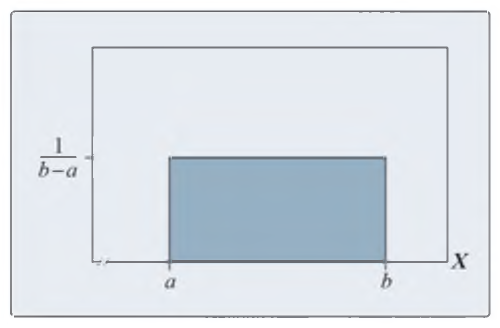
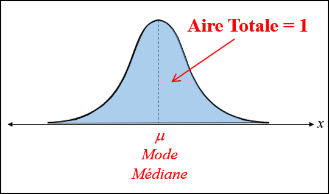
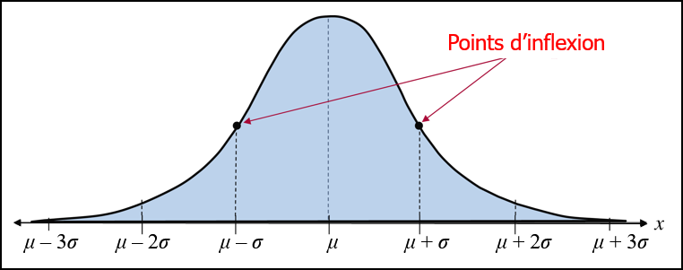

<!--
quarto_render("index.qmd", output_format = "epub")
quarto_render("index.qmd", output_format = "docx")
-->

```{r}
#| echo: false
#| message: false
#| warning: false
#| error: false

source("global.R")
```


# Statistiques Descriptives Univariées {#sec-Chap7}


## Objectifs d'apprentissage

À la fin de l'étude de ce chapitre, vous devriez être en mesure de:

-   pour chacun des types de données (qualitatives et quantitatives):

    -   Générer des ensembles de données aléatoires
    -   Produire des graphiques appropriés
    -   Obtenir les indices de tendance centrale appropriés
    -   Obtenir les indices de dispersion appropriés
    -   Décrire la forme de la distribution, qualitativement et numériquement

## Introduction

Dans le chapitre 2, nous avons rencontré des distributions de probabilités permettant de résumer le 'comportement' d'une variable donnée en indiquant pour chacune des valeurs possibles, la probabilité d'occurrence.

Dans un contexte de recherche, on obtient des observations pour plusieurs variables et il est d'usage, dans un premier temps suivant la collecte des données, d'étudier les principales caractéristiques de l'ensemble des informations recueillies. Cet exercice peut n'impliquer qu'une variable à la fois (analyse univariée), des paires de variables (analyse bivariée), ou un certain nombre de variables (analyse multivariée). Dans cette section, nous présenterons les différents indices permettant de quantifier ces caractéristiques.

On peut classifier les données statistiques en deux grandes catégories:  
  
  - Les données qualitatives: données indiquant l'appartenance à l'une ou l'autre d'un ensemble de catégories, que ces catégories soient ordonnées (données ordinales), ou non (données nominales). Par exemple, un individu peut occuper un emploi clérical plutôt que manuel (nominal), et sa performance au travail se situe au troisième rang dans une équipe de 20 employée (ordinal).  
  
  - Les données quantitatives: données indiquant le degré ou l'importance d'une caractéristique particulière. Par exemple, un individu obtient un score de 70.2 à l'échelle de dépression de Beck (donnée d'intervalle), et sa taille est de 1,83 mètre (échelle de rapport). 
  
Pour chacun des types de données, il existe des indices permettant de quantifier les principales caractéristiques d'une distribution. Ce sont ces indices qui seront présentés ici.

## Données qualitatives

Les données qualitatives peuvent prendre l'une ou l'autre de deux formes: nominales et ordinales. Dans le premier cas, les attributs de la variable sont des catégories mutuellement exclusives entre lesquelles aucun ordre n'existe. Tous les arrangements des différents attributs (différentes catégories) sont parfaitement équivalents. La seule opération qu'il est possible d'effectuer sur ce type de données est la comptabilisation des effectifs pour chacune des catégories.

Dans le second cas, la variable possède différents attributs, comme pour les variables nominales, mais ces attributs sont ordonnés: un attribut a quelque chose de plus que le précédent, et quelque chose de moins que le suivant. Par contre, la distance qui sépare ces attributs n'est pas spécifiée. La seule information dont on dispose est qu'une donnée est plus grande ou plus petite qu'une autre.

Ces deux types de données sont fréquents dans la littérature scientifique. Dans les paragraphes suivants, nous examinons diverses méthodes permettant d'en fournir une description.

### Données nominales: Génération

Dans un contexte de recherche, les données qualitatives (échelle nominale ou ordinale) sont très fréquentes. Leur examen est plus simple que dans le cas de données quantitatives, mais l'intérêt de cet examen demeure.

La génération de données nominales aléatoires est simple. Il suffit de définir les catégories de cette variable, de spécifier les probabilités d'occurrence de chacune d'elles, et d'utiliser la fonction **sample()** pour effectuer le travail. Supposons un ensemble de 500 observations nominales réparties en 5 catégories nommées A, B, C, D et E, dont les probabilités d'occurrence sont respectivement 0.3, 0.1, 0.2, 0.15 et 0.25. La commande suivante est tout ce dont nous avons besoin pour accomplir cette tâche:

```{r }
#| code-fold: false

x = sample(LETTERS[1:5], 
           500, 
           replace=TRUE,
           prob=c(.3,.1,.2,.15,.25))
head(x,10)
```

La fonction **sample()** possède toute la fonctionnalité permettant de générer des données tant qualitatives que quantitatives, et nous l'utiliserons abondamment dans les discussions futures. Pour des données nominales, il suffit de dresser une liste exhaustive des catégories utilisées, et d'en sélectionner le nombre nécessaire, **avec remise** (*replace=TRUE*). On peut également indiquer les probabilités d'occurrence (ou fréquence relative) de chaque catégorie à l'aide d'un vecteur approprié. Par exemple, générons des données concernant le niveau d'éducation observé pour un ensemble de 20 sujets:


```{r}
#| code-fold: false

# Liste des niveaux
EdLev <- c("Aucune", "Maternelle","Fondam1", "Fondam2",
           "Lycee", "Bac","Maitrise", "Doctorat")

# Probabilités associées au niveau d'éducation
pr <- c(0.013, 0.05, 0.261, 0.246, 0.165, 0.064, 0.09, 0.075)

ed <- sample(EdLev, 20, replace=TRUE, prob = pr)
ed
```


Il en va de même pour le statut marital, en supposant l'équiprobabilité des différentes catégories:

```{r}
#| code-fold: false

marital <- c("Marié", "Divorcé", "Veuf", "Séparé", "Célibataire")
mar = sample(marital, 20, replace=TRUE)
mar

```

La librairie **wakefield** offre des simulateurs de données pour près de 100 types de variables distincts. On en trouvera la liste en cliquant [ICI](https://rdrr.io/cran/wakefield/man/). Cependant, il est souvent plus simple d'utiliser la fonction **sample()** comme nous l'avons fait ci-dessus.

### Données nominales: Tableau et représentation graphique

Afin de résumer un ensemble de données nominales, la production d'un tableau affichant les effectifs de chaque catégorie est de mise. Sous R, on peut utiliser la fonction **table()** à cette fin:

```{r}
#| code-fold: false

tbl.ed <- table(ed)
tbl.ed
tbl.mar <- table(mar)
tbl.mar
```

Par la suite, on peut donner une forme plus efficace au tableau obtenu, pour les besoins de communication:

```{r echo=FALSE}

kable(tbl.ed, 
      booktabs=TRUE, 
      caption="Répartition du Niveau d'éducation") %>%
  kable_styling(full_width = FALSE)
```

```{r echo=FALSE}

kable(tbl.mar, 
      booktabs=TRUE, 
      caption="Répartition du Statut Marital") %>%
  kable_styling(full_width = FALSE, latex_options = c("scale_down", "half_width"))

```

Un diagramme en barres est une représentation graphique appropriée dans le cas d'une variable nominale. La fonction **barplot()** permet la production d'un tel diagramme:

```{r 03-Chap3-11, fig.align="center", out.width="60%", fig.cap="Diagramme en barres représentant la distribution du Niveau déducation. Les fréquences sont représentées par la hauteur des barres.", echo=TRUE, warning=FALSE, message=FALSE}

barplot(tbl.ed,
        main="Répartition du Niveau d'éducation",
        xlab="Niveaux d'éducation",
        ylab="Fréquences")
```

De manière alternative, un diagramme en secteurs peut représenter ce type de données.

```{r 03-Chap3-12, fig.align="center", out.width="60%", fig.cap='Diagramme en secteurs représentant la distribution du Statut Marital', echo=TRUE, warning=FALSE, message=FALSE}

lbls <- marital
pie(tbl.mar, 
    labels = paste(lbls," (",tbl.mar,")"), 
    main="Diagramme en secteurs\n (Données brutes)")
```

Pour ce type de graphique, par contre, on a souvent avantage à utiliser les proportions ou les pourcentages occupés par chaque secteur, plutôt que les fréquences absolues:

```{r 03-Chap3-13, fig.align="center",out.width="60%",fig.cap="Diagramme en secteurs représentant la distribution du Statut Marital, en pourcentage. Les proportions sont proportionnelles à l'angle des secteurs.",echo=TRUE, warning=FALSE, message=FALSE}

lbls <- marital
pct <- round(tbl.mar/sum(tbl.mar)*100)
lbls <- paste(lbls," (", pct,"%)",sep="") 
pie(tbl.mar, 
    labels = lbls, 
    main="Diagramme en secteurs\n (Pourcentages)")
```

### Données nominales: Tendance centrale

Dans le cas de données nominales, la seule mesure de tendance centrale qu'il est possible d'utiliser est le **mode**. Il s'agit simplement de la catégorie dont l'effectif est le plus élevé. On parlera alors de **catégorie modale**. L'examen du tableau de fréquence en permet la détermination rapide. 

La fonction suivante permet de déterminer le mode d'un ensemble de données nominales:

```{r 03-Chap3-14}
#| code-fold: false

ModeCat = function(x) {
   uniqx <- unique(x)
   m = uniqx[which.max(tabulate(match(x, uniqx)))]
   fm = sum(x==m)
   return(c(m,fm))
}
```
Cette fonction retourne un vecteur composé de deux items: la catégorie et la fréquence modale. Par exemple:

```{r 03-Chap3-15}
#| code-fold: false

x <- round(sample(1:10,200,replace=TRUE))
mo <- ModeCat(x)
table(x)
cat("Catégorie modale = ",mo[1])
cat("Fréquence Modale = ",mo[2])
```
Il arrive parfois que la répartition d'un ensemble de données nominales présente plus qu'un mode. Dans un tel cas, une description des données ne peut omettre la détermination de l'ensemble des modes. Certaines fonctions nous permettent d'examiner ces situations. Par exemple, la fonction **Mode()**, de la librairie **DescTools** pourrait s'avérer utile dans un tel cas.

Supposons une variable nominale comportant 7 catégories, numérotées de 1 à 7. Supposons également que la répartition des données est unimodale. Le code R suivant permet de générer une telle variable, pour un total de N = 50 observations. Par la suite, on peut établir la répartition des données:

```{r}
#| code-fold: false
x <- sample(1:7, 50, 
            replace = TRUE, 
            prob = c(1, 2, 3, 4, 3, 2, 1))
table(x)
```

De cette répartion, il est facile de distinguer le mode, qui correspond au score le plus fréquent. On peut obtenir cet indice à l'aide de la fonction **Mode()** de la librairie **DescTools**:  
```{r}
#| code-fold: false
 
modeX <- DescTools::Mode(x)
```

```{r}
#| echo: false

#nomode <- length(mode) + 1
distmode <- c("Uniforme (sans mode)", 
              "Unimodale", 
              "Bimodale", 
              "Multimodale")
if (is.na(modeX)) {
    nomode <- 1
} else if (length(modeX) > 2) {
    nomode <- 4
} else {nomode <- length(modeX)+1}
cat("Catégorie(s) Modale(s) = ", modeX)
cat("La distribution est ",distmode[nomode])
if(!is.na(modeX[1])){
  cat("Fréquence(s) Modales(s) = ", as.integer(attributes(modeX)))}
```


```{r }
#| label: fig-distUnimod
#| fig-cap: "Diagramme en barres illustrant la catégorie modale, indiquée en rouge."
#| #| echo: false

tbl <- table(x)
# Représentation graphique
clrs <- c(rep("grey", 7))
clrs[modeX] <- "red"
barplot(tbl, col = clrs)
legend("topright", "Mode", fill = "red")

```

Une répartition sera bimodale, ou multimodale, si l'effectif le plus élevé apparait dans 2+ catégories. Par exemple:

```{r 03-Chap3-17}
#| label: fig-distBimod
#| fig-cap: "Diagramme en barres illustrant une distribution bimodale. Les deux modes sont indiqués en rouge."

x <- c(rep(1, 2), rep(2, 8), rep(3, 3), 
       rep(4, 4), rep(5, 8), rep(6, 2), rep(7, 5))
tbl <- table(x)
tbl
mode <- DescTools::Mode(x)
distmode <- c("Uniforme (sans mode)", 
              "Unimodale", 
              "Bimodale", 
              "Multimodale")
if (is.na(mode[1])) {
    nomode <- 1
} else if (length(mode) > 2) {
    nomode <- 4
} else {nomode <- length(mode)+1}
cat("Catégorie(s) Modale(s) = ", mode)
cat("La distribution est ",distmode[nomode])
if(!is.na(mode[1])){
  cat("Fréquence(s) Modales(s) = ", as.integer(attributes(mode)))}
```

```{r}
# Représentation graphique
clrs <- c(rep("grey", 7))
clrs[mode] <- "red"
barplot(tbl, col = clrs)
legend("topright", "Mode", fill = "red")
```

La fonction **Mode()** utilisée ci-dessus permet donc de mettre en évidence la présence de plusieurs modes dans une distribution. Par contre, ne seront considérées comme modes uniquement les valeurs dont les fréquences sont identiques, comme c'était le cas dans le dernier exemple. En pratique, une distribution telle que la suivante serait très probablement considérée comme **bimodale**, même si les fréquences modales ne sont pas identiques. :

```{r }
#| echo: false
x  <-  c(rep(1,2),rep(2,8),rep(3,3),rep(4,4),
         rep(5,10),rep(6,2),rep(7,4))
tbl  <-  table(x)
tbl
barplot(tbl)
```

La fonction **modes()**, de la librairie **agrmt** déterminera l'existence de catégories modales dont les fréquences diffèrent. L'argument **tolerance** permet d'ajuster le degré de 'ressemblance' à partir duquel on considère que les fréquences sont égales. Pour les données que nous venons de générer,supposant qu'on considère qu'une différence de 2 unités n'est pas suffisamment grande pour qu'elles soient jugées différentes (tolerance=2), on obtient:

```{r}

md <- agrmt::modes(tbl,tolerance=2)
md
cat("Fréquence(s) Modale(s) = ",tbl[md$mode])
```

```{r out.width="60%"}
#| label: fig-DistrBimod1
#| fig-cap: "Diagramme en barres illustrant la présence de deux modes dont les fréquences modales sont inégales."
#| warning: false
#| message: false
#| echo: false

clrs <- c(rep("grey",7))
clrs[md$mode]  <-  "red"
barplot(tbl, col = clrs)
legend("topright", "Mode", fill = "red")
nm <- length(md$mode)
mpos <- length(md$positions)
fm <- tbl[md$positions]
```

On détecte 2 modes, respectivement aux positions 2 et 5, et ces modes ne sont pas adjacents. Les fréquences modales sont respectivement 8 et 10.


Finalement, la fonction **secondModes()**, toujours de la librairie **agrmt**, permet de mettre en évidence les deux principaux modes. Pour l'exemple précédent, on a:

```{r out.width="60%"}
#| label: fig-DistrBimod1b
#| fig-cap: "Diagramme en barres représentant une distribution bimodale (fréquences inégales)."
#| warning: false
#| message: false
#| echo: true

md <- secondModes(tbl)
paste("Premier mode: Catégorie ",md$positions[[1]])
paste("Second  mode: Catégorie ",md$positions[[2]])
clrs  <- c(rep("grey",7))
clrs[md$positions[[1]]]  <-  "red"
clrs[md$positions[[2]]]  <-  "red"
barplot(tbl, col = clrs)
legend("topright", "Mode", fill = "red")
```

#### Exercice 1

1.  Chargez la librairie **wakefield**:

```{r 03-Chap3-21}
library(wakefield)
```

2.  Utilisez la fonction **employment()** pour générer le statut d'emploi de 500 personnes. Les proportions pour chaque catégories sont estimées à 50%, 15%, 10%, 15% et 10%, respectivement. La variable qui sera générée portera le nom: EMPLOI. Éditez le code R ci-dessous pour obtenir ce résultat

```{r }
n  <-  500
x  <-  employment(n,x = c("Plein Temps", "Temps Partiel", 
                          "Sans Emploi", "Retrait", "Étude"), 
                  prob = c(0.6, 0.1, 0.1, 0.1, 0.1), 
                  name = "Variable")
```

3.  Obtenez un diagramme en barres pour représenter ces données. Notez que vous devez obtenir le tableau de fréquences au préalable.

4.  Construisez un diagramme en secteur pour représenter les proportions des différents statuts d'emploi.

5.  Déterminez le mode de cette distribution, en utilisant la fonction **Mode()** de la librairie **DescTools**. Dans ce cas, le mode est déterminé à partir des données originales (**x**). Puis, refaites le travail en utilisant la fonction **modes()** de la librairie **agrmt**. Dans ce cas, le mode est calculé à partir du tableau de fréquences.

### Données **ordinales**: Génération et tendance centrale

Dans le cas de données ordinales, la tendance centrale peut être évaluée à l'aide du mode, tel que défini dans la section précédente, ou en obtenant la médiane, qui est située exactement au centre de la séquence ordonnée des scores. Elle correspond à la donnée au-dessous de laquelle on retrouve 50% de la distribution. Elle coupe la distribution en deux parties égales.

Sous R, la fonction **median()** retourne la médiane du vecteur correspondant à son argument. Le code R suivant permettra d'illustrer la procédure. La fonction **r_sample_ordered()** de la librairie **wakefield** permet de générer des données ordinales: un ensemble de réponses à un item de type Likert (1 = Tout-à-fait pour, ... , 7 = Tout-à-fait contre). On obtient ensuite la médiane, après s'être assuré que les données sont perçues comme étant numériques par la fonction median()::

```{r 03-Chap3-23}
#| code-fold: false

library(wakefield)
ord  <-  r_sample_ordered(n=50, c(1:7), 
                          prob = NULL, 
                          name = "Réponse")
head(ord,10)
ord  <-  as.numeric(ord)
cat("La médiane est égale à ",median(ord))
```

Rappelons que la médiane n'a de sens que pour les données dont le niveau de mesure est ordinal ou supérieur (d'intervalle ou de rapport).

La médiane correspond au second quartile de la distribution: le score sous lequel on retrouve 50% de la distribution. Le premier et le troisième quartile sont les scores sous lesquels on retrouve 25% et 75% de la distribution, respectivement. Sous R, on peut obtenir ces valeurs à l'aide de la fonction **quantile()**. Les arguments sont d'abord la variable à étudier, et la ou les proportions se trouvant sous le ou les scores recherchés:

```{r 03-Chap3-24}
#| code-fold: false

quantile(ord,c(0.25,0.5,0.75))
```

De manière alternative, la fonction **summary** retourne tant les quartiles que le minimum et le maximum d'une ensemble de données:

```{r 03-Chap3-25}
#| code-fold: false

summary(ord)
```

Ces différents indices sont les ingrédients d'un diagramme en boîte:

```{r 03-Chap3-26}
#| code-fold: false

boxplot(ord, horizontal=TRUE)
```

En effet, la ligne centrale représente la médiane, la bordure inférieure de la boîte représente le premier quartile, la bordure supérieur représente le troisième quartile, et les valeurs extrêmes se trouvent à chacune des extrémités du graphique.

NOTE: Il est fréquent que des données nominales prennent la forme de catégories telles que "totalement d'accord", "d'accord", "sans avis", "désaccord", et "totalement en désaccord". Les fonctions présentées ci-dessus ne peuvent fonctionner pour de telles données. Il faudra d'abord attribuer une valeur numérique à chacune des catégories: 1 à 5, pour cet exemple. Ces valeurs numériques réflètent l'ordre des différentes catégories. La fonction **mapvalues()**, qui se trouve dans la librairie **plyr** permet d'effectuer ce recodage:

```{r }
#| code-fold: false
#| eval: false

xr = plyr::mapvalues(x,from = c("Cat1","Cat2",...,"Catk"), to = c(1:k))
```

Un exemple sera donné plus loin.

#### Différentes options pour obtenir la médiane

Sous R, on dispose très fréquemment de différentes alternatives pour arriver au même résultat. Les codes R suivants illustrent ce point en affichant quelques manières d'obtenir la médiane d'un ensemble de données (ordinales, ou quantitatives).

```{r 03-Chap3-28}
#| code-fold: false

x = sort(round(rnorm(20,50,10),2))        # Données
pos = (length(x)+1)/2                     # Position de la médiane
md = 0.5*(x[floor(pos)]+x[ceiling(pos)])  # Calcul de la médiane

# ... ou...

if((length(x)%%2)==0){                    # n pair?
  md = 0.5*(x[floor(pos)]+x[ceiling(pos)])
  } else{
    md = x[pos]}
cat("Médiane =",md)
```
Ce code détermine si le nombre de données est pair ou impair. S'il est impair, la médiane correspond au score occupent la position $(n+1)/2$; s'il est pair, elle correspond à la somme des deux scores occupant les positions *plancher* et *plafond* de $(n+1)/2$, divisée par 2.

- Alternative 1:  median()

```{r}
#| code-fold: false

# Alternative 1: fonction median()...
md = median(x)
cat("Médiane =",md)
```

La fonction **median()** retourne la médiane

- Alternative 2:  summary()

```{r}
#| code-fold: false

# Alternative 2: fonction summary()...
summary(x)

```

La fonction **summary()** retourne le minimum, le maximum, la moyenne (inutile dans le cas de données ordinales!), et les trois quartiles, dont la médiane.

- Alternative 3:  quantile()

```{r}

# Alternative 3: fonction quantile()...
md = quantile(0.5)
cat("Médiane =",md)

```

La médiane étant le second quartile ($Q_1$ ou $P_{50}$), la fonction **quantile()** avec l'argument 0.5, produit la médiane.  
  
- Alternative 4:  osych::describe()

```{r}

round(t(psych::describe(x)),3)  # t(): transposition du tableau
```

La fonction **describe()** de la librairie **psych** produit une liste des principaux indices descriptifs, dont la médiane.
  
#### Exercice 2

1.  Utilisez la fonction **likert_7()** de la librairie **wakefield** afin de générer 500 données ordinales dont les attributs sont les 7 points suivants:

-   "Parfaitement d'accord"
-   "D'accord"
-   "Un peu d'accord"
-   "Neutre"
-   "Un peu en désaccord"
-   "En désaccord"
-   "Parfaitement en désaccord"

Faites en sorte que les proportions des "accords" soient plus élevées que les proportions de "désaccord" Le nom de la variable générée sera: OPINION

La syntaxe générale de cette fonction est:

```{r}
#| code-fold: false
#| eval: false

x = likert_7(n,
             x = c("Strongly Agree", "Agree", "Somewhat Agree", 
                   "Neutral", "Somewhat Disagree","Disagree", 
                   "Strongly Disagree"),
             prob = c(rep(1,7)),
name = "Likert")

```

Lorsque les catégories ordonnées sont alphanumériques, il est nécessaire de les recoder pour qu'elles soient identifiées par des valeurs numériques. La fonction **mapvalues()** de la librairie **plyr** permet ce recodage. Par exemple, un code R tel que le suivant permettra d'effectuer cette opération. La fonction **as.numeric()** assure que le résultat sera numérique et approprié pour les opérations suivantes.

```{r }
#| code-fold: false

categor = c("Strongly Agree", "Agree", "Somewhat Agree", 
            "Neutral", "Somewhat Disagree","Disagree", 
            "Strongly Disagree")
xrec = as.numeric(plyr::mapvalues(x, from = categor, to = c(1:7)))
```

2.  Obtenez des représentations graphiques de cet ensemble de données: diagramme en barres et diagramme en boîte.

3.  Calculez la médiane de cet ensemble de données (essayez plusieurs méthodes)

### Mesure de dispersion: données nominales

Un indice de variation que l'on peut obtenir dans le cas d'une variable nominale est le **rapport de variation (RV)**. Il s'agit simplement du rapport entre le nombre de cas occupant la catégorie modale et le nombre de cas qui se trouvent hors de cette catégorie. Formellement, 

$$RV=1-\frac{f_{mode}}{N}$$ {#eq-rv1}

Lorsque le mode n'est pas unique dans la distribution, RV tient compte de l'ensemble des effectifs des catégories modales (supposées égales):

$$RV=1-\frac{n_{mode}\times f_{mode}}{N}$$ {#eq-rv2}

La définition du rapport de variation (RV) se traduit par une probabilité, celle qu'en choisissant une observation au hasard, cette dernière n'**appartienne pas** à la catégorie modale.

Si la distribution est bi- ou multimodale, le calcul du rapport de variation impliquera la somme des fréquences de chacune des catégories modales.

Considérons à nouveau une variable telle que celle définie plus haut.

```{r 03-Chap3-31}
#| code-fold: false

set.seed(150752)  # S'assurer de reproduire les résultats
categ = c("Cat 1","Cat 2","Cat 3","Cat 4","Cat 5","Cat 6","Cat 7")
x = sample(categ,
           50,
           replace=TRUE,
           prob=c(1,2,3,4,3,2,1))
tbl = table(x)
N = sum(tbl)
tbl
```

 Le rapport de variation dans ce cas serait:

```{r}
#| code-fold: false

mode <- DescTools::Mode(x)

if (is.na(mode[1])) {
    nomode <- 0
} else {nomode <- length(mode)}

VarRat = 1-nomode*max(tbl)/N           # Rapport de Variation
cat("Rapport de Variation = ",VarRat)

```

On interprète le rapport de variation de la manière suivante:

1.  S'il n'y a pas de catégorie modale, alors la variation est maximale: RV = 1.0\
2.  Plus la fréquence modale est élevée, moins il y a de dispersion entre les autres catégories. À la limite, si tous les cas se trouvaient dans la catégorie modale, il n'y aurait aucune dispersion, et RV = 0.

NOTE: Cet indice n'est pas vraiment présenté dans un rapport de recherche. Il est présenté ici simplement pour illustrer que même dans le cas d'une variable nominale, les trois caractéristiques fondamentales d'un ensemble de données sont présentes!

Quelques autres mesures de dispersion pour données nominales se fondent sur les écarts des fréquences non modales par rapport à la fréquence modale. Parmi ces mesures, on retrouve:

1.  Déviation Modale Moyenne (DMM):\  

$$DMM=1-\sum_{i = 1}^{k}\frac{{f_{mode}-f_i}}{N(k-1)}$$ {#eq-dmm}

2.  Indice de Variation Qualitative (IVQ):\  

$$IVQ=\left(\frac{k}{k-1}\right)\left[1-\sum_{i = 1}^{k}p_i^2\right]$$ {#eq-ivq}

3.  Indice d'Entropie Relative (IER):\  

$$IER=-\sum_{i = 1}^{k}\frac{\left[ p_i \times log(p_i)\right]} {log(k)}$$ {#eq-ier}

4.  Écart-Type du Mode (ETM): 

$$ETM=1-\sqrt{\frac{\sum\limits_{i=1}^{k}(f_{mode}-f_i)^2}{N^2(k-1)}}$$ {#eq-etm}


Pour les données nominales générées ci-dessus, on obtient:

```{r 03-Chap3-32}
#| code-fold: false

k = length(tbl)
N = sum(tbl)
xs = sort(tbl,descending=FALSE)
DMM = 1-(sum(xs[k]-xs[1:k-1]))/(N*(k-1)) 
cat("DMM = ",DMM)
```

```{r}
#| code-fold: false

IVQ = (k/(k-1))*(1-sum((tbl/N)**2))
cat("IQV = ",IVQ)
```

```{r}
#| code-fold: false

IER = -sum((tbl/sum(tbl))*log(tbl/sum(tbl)))/log(k)
cat("IER = ",IER)
```

```{r}
#| code-fold: false

ETM = 1-sqrt(1/((k-1)*N^2)*sum((xs[k]-xs)^2))
cat("ETM = ",ETM)
```

En sélectionnant une observation au hasard, le rapport de variation indique qu'on a 70% des chances d'obtenir une donnée ne provenant pas de la catégorie modale: une grande proportion des données se répartissent dans les autres catégories. Cette grande dispersion est confirmée par les indices fondés sur les écarts par rapport au mode, pour lesquels on obtient des valeurs se rapprochant de 1.0.

Pour fins de comparaison, considérons des ensembles de données de niveaux de dispersion très élevés et très faibles.

#### Dispersion élevée (distribution presque uniforme)

Lorsqu'une distribution tend vers l'uniformité, la dispersion est élevée. Le code R suivant illustre cette situation:

```{r }
#| code-fold: false

x=c(rep("Cat 1",8),rep("Cat 2",8),rep("Cat 3",8),
    rep("Cat 4",9),  rep("Cat 5",8),rep("Cat 6",8),
    rep("Cat 7",8))

tbl = table(x)
N = sum(tbl)
tbl
```

Dans un tel cas, on calcule: 

```{r}
#| code-fold: false

mode = Mode(x)            

VarRat = 1-length(mode)*max(tbl)/N           # Rapport de Variation
cat("Rapport de Variation = ", VarRat)
```

```{r}
#| code-fold: false

k = length(tbl)
N = sum(tbl)
xs = sort(tbl,descending=FALSE)
DMM = 1-(sum(xs[k]-xs[1:k-1]))/(N*(k-1)) 
cat("DMM = ", DMM)
```

```{r}
#| code-fold: false

IVQ = (k/(k-1))*(1-sum((tbl/N)**2))
cat("IQV = ", IVQ)
```

```{r}
#| code-fold: false

IER = -sum((tbl/sum(tbl))*log(tbl/sum(tbl)))/log(k)
cat("IER = ", IER)
```

```{r}
#| code-fold: false

ETM = 1-sqrt(1/((k-1)*N^2)*sum((xs[k]-xs)^2))
cat("ETM = ", ETM)

```

Le Rapport de Variation indique qu'en choisissant une observation au hasard, la probabilité que cette dernière n'appartienne pas à la catégorie modale est élevée: 0.842. On peut donc conclure à une dispersion élevée des observations: elles ne sont pas concentrées dans un petit nombre de catégories. Ce niveau de dispersion est confirmé par l'ensemble des mesures de dispersion fondées sur l'écart par rapport au mode.

#### Dispersion 'presque' nulle (distribution presque constante)

Examinons un cas où un mode existe, mais les fréquences observées pour toutes les autres catégories non modales sont très faibles: la catégorie modale englobe la presque totalité des effectifs, ce qui se traduit par une dispersion presque nulle:

```{r }
#| code-fold: false

# Unimodale, dispersion 'presque' nulle
x=c(rep("Cat 1",1),rep("Cat 2",1),rep("Cat 3",1),
    rep("Cat 4",40),  rep("Cat 5",1),rep("Cat 6",1),
    rep("Cat 7",1))
tbl = table(x)
N = sum(tbl)
tbl
```

```{r}
#| code-fold: false

mode = Mode(x)            # Détermination du/des mode(s)

VarRat = 1-length(mode)*max(tbl)/N           # Rapport de Variation
cat("Rapport de Variation = ", VarRat)
```

```{r}
#| code-fold: false

k = length(tbl)
N = sum(tbl)
xs = sort(tbl,descending=FALSE)
DMM = 1-(sum(xs[k]-xs[1:k-1]))/(N*(k-1)) 
cat("DMM = ", DMM)
```

```{r}
#| code-fold: false

IVQ = (k/(k-1))*(1-sum((tbl/N)**2))
cat("IQV = ", IVQ)
```

```{r}
#| code-fold: false

IER = -sum((tbl/sum(tbl))*log(tbl/sum(tbl)))/log(k)
cat("IER = ", IER)
```

```{r}
#| code-fold: false

ETM = 1-sqrt(1/((k-1)*N^2)*sum((xs[k]-xs)^2))
cat("ETM = ", ETM)
```

Le rapport de variation indique que la probabilité, en sélectionnant une observation au hasard, d'obtenir une donnée qui ne se trouve pas dans la catégorie modale est faible: 0.13. Les autres indices de dispersion confirment un niveau de dispersion très faible.

#### Librairie **qualvar** (Optionnel)

La librairie **qualvar** offre plusieurs fonctions permettant de quantifier la variation dans les variables qualitatives, incluant la Déviation Modale Moyenne (DMM), et l'Indice d'Entropie Relative (IER ou *HREL*). D'autres sont disponibles, et sont mentionnées ci-dessous par souci d'une présentation exhaustive des indices qui pourraient être utiles dans différents contextes. On pourra consulter la [documentation de cette librairie](https://cran.r-project.org/web/packages/qualvar/index.html) pour les détails.  En plus des indices présentés dans les paragraphes précédents, on note:

* Déviation Analogue Moyenne (*ADA*):

$$ADA=1-\sum\limits_{i=1}^{k}{\frac{\left|f_i-\frac{n}{k}\right| }{2\left[\frac{n}{k}(k-1)\right] }}$$ {#eq-ada}

* B (Moyenne géométrique modifiée):

$$B=\sqrt{1-\left(\sqrt[k]{\prod\limits_{i=1}^{k}{\frac{f_ik}{n}} } \right)^2 } $$ {#eq-b}


* MDA (Différence moyenne analogue):

$$MDA=1-\sum\limits_{i=1}^{k-1}{\sum\limits_{j=i+1}^{k}{\frac{\left|f_i-f_j\right| }{n(k-1)}}}$$ {#eq-mda}  


* VA (Variance Analogue):

$$VA=1-\sum\limits_{i=1}^{k}{\frac{\left(f_i-\frac{n}{k}\right)^2 }{\frac{n^2(k-1)}{k}}}$$ {#eq-va}


#### Exercice 3

1.  Reprenez la variable EMPLOI générée antérieurement:

```{r}
#| code-fold: false

n = 500
x = employment(n,x = c("Plein Temps", "Temps Partiel", 
                       "Sans Emploi", "Retraite", "Etude"), 
               prob = c(0.5, 0.15, 0.1, 0.15, 0.1), 
               name = "Variable")
```

2.  Examinez les indices de dispersion pour cette variable nominale. Comment qualifieriez-vous cette distribution? (NOTE: la librairie **DescTools** est nécessaire ici!)

### Mesure de dispersion: données ordinales

#### Mesures fondées sur les fractiles

Dans le cas de données ordinales (les catégories d'une variable sont ordonnées), l'**écart inter-quartile** (EIQ) est un indicateur du degré de dispersion. Cet indice n'est que la différence entre le troisième et le premier quartile d'une distribution. On l'obtient en utilisant la fonction **IQR()**:

```{r 03-Chap3-34}
#| code-fold: false

IQR(ord)
```

ou en utilisant la fonction **quantile()**, ou la fonction **summary()**:

```{r 03-Chap3-35}
#| code-fold: false

cat("EIQ = ", quantile(ord,0.75)-quantile(ord,0.25))
```

```{r}
#| code-fold: false

st <- summary(ord)
st
cat("EIQ = ",summary(ord)[5]-summary(ord)[2])
  
```

Essentiellement, cet indice correspond à l'étendue des 50% centraux de la distribution.

Il est également possible d'obtenir des indices de dispersion fondés sur d'autres fractiles. Par exemple, on pourrait calculer l'écart inter-décile, en évaluant la distance séparant le premier décile du neuvième; ou celle séparant le 2e décile du 8e:

```{r 03-Chap3-36}
#| code-fold: false
deciles <- quantile(ord, c(0.1,0.2,0.8,0.9))
cat("Écart Inter-Déciles (d9-d1)",deciles[4]-deciles[1])
cat("Écart Inter-Déciles (d8-d2)",deciles[3]-deciles[2])
```

Ces options seraient aussi défendables que l'écart inter-quartile, qui demeure malgré tout plus souvent utilisé.

#### Mesure du consensus (ou de dissension)

Un angle sous lequel on peut examiner la dispersion d'une variable ordinale consiste à considérer le degré de consensus se traduisant par des fréquences élevées dans une catégorie particulière. On pourrait également considérer le degré de dissension se traduisant par des fréquences élevées dans les catégories opposées. Cette conceptualisation n'est pas très éloignée de ce qui a été fait dans le cas de variables nominales dans la section précédente. Mais étant donné que les attributs de la variable sont ordonnés, on a avantage à tenir compte des informations portées par cet ordre.

Une variable obtenue à l'aide d'une échelle de Likert représente un exemple idéal pour illustrer la procédure. Une échelle de Likert est très souvent utilisée dans les questionnaires, dans un contexte de sondage, par exemple. Les attributs des variables qui en résultent sont de nature ordinale. Par exemple, à une question telle que : "Concernant le projet de loi XYZ, je suis...", on offre les choix de réponse suivants:

    1 = Très défavorable
    2 = Défavorable
    3 = Neutre
    4 = Favorable
    5 = Très favorable 

Si une très grande majorité des répondants optent pour les choix 4 et 5, on dira que le degré de consensus est élevé. Sinon, si les réponses se répartissent à peu près également dans toutes les catégories, on pourra conclure que le degré de consensus est faible. Si les deux extrémités de l'échelle présentent des fréquences élevées, on pourra parler de dissension. L'objectif, ici, est de quantifier le consensus.

Une mesure développée à cette fin (Tastle & Wierman, 2007) est définie par l'équation suivante:

\begin{eqnarray}
Cns(x)&=&1+\sum\limits_{i=1}^{k}p_i log_2 \left(1-\frac{\left| f_i-\mu_x\right|}{d_x}\right) \\ d_x&=&X_{max}-X_{min} \\
\mu_x&=&\sum\limits_{i=1}^{k}p_iX_i
\end{eqnarray} 

Cns(x) prend une valeur comprise entre 0, lorsque les données se répartissent également dans les deux extrémités (dissension), et 1, lorsque toutes les réponses se trouvent dans une catégorie particulière (consensus). Si les données se répartissent également dans les différentes catégories, Cns(x) est approximativement égal à 0.5. Le code R suivant simule une telle variable et en calcule le degré de consensus:

```{r Consensus}
#| code-fold: false

set.seed(150752)
categ <- 1:5         # Échelle ordinale, 5 points
x <- sample(categ,80,replace=TRUE)
tbl <- table(x)
tbl
```

```{r}
#| code-fold: false

prop  <- tbl/sum(tbl)  # Proportions de réponses dans chaque catégorie
mu <- sum(categ * prop)# 'Moyenne' de la distribution
tbl
cns <- 1 + sum(prop*log2(1-(abs(categ - mu) / (max(categ)-min(categ)))))
cat("Consensus = ",cns)
```

Se rapprochant de 0.5, ce résultat indique un niveau de consensus faible.

La fonction **consensus()** de la librairie **agrmt** permet également ce calcul. Son argument est le vecteur des fréquences observées dans chacune des catégories ordonnées:

```{r 03-Chap3-37}
#| code-fold: false

agrmt::consensus(table(x))
```

Lorsqu'il y a consensus, une grande majorité des réponses se trouvent dans une catégorie particulière, et on obtient, par exemple:

```{r 03-Chap3-38}
#| code-fold: false

fx = c(1,1,20,1,1)
consensus(fx)
```

Lorsque le consensus est 'parfait', on obtient:

```{r 03-Chap3-39}
#| code-fold: false

fx = c(0,0,20,0,0)
consensus(fx)
```

Il y a également consensus lorsque les catégories contenant une forte proportion des réponses sont adjacentes l'une à l'autre:

```{r 03-Chap3-40}
#| code-fold: false

fx = c(0,0,0,20,20)
consensus(fx)
```

Mais lorsque les réponses se concentrent dans les deux extrémités de l'échelle, on obtient:

```{r 03-Chap3-41}
#| code-fold: false

fx = c(20,0,0,0,20)
consensus(fx)
```

Le consensus est donc une mesure sensible aux polarisations. Dans ce dernier cas, on pourra parler de 'dissension'.

#### Exercice 4

1.  Reprenez la variable **ord** générée antérieurement:

```{r 03-Chap3-42}
#| code-fold: false

library(wakefield)
ord = r_sample_ordered(n=50, c(1:7), 
                       prob = NULL, 
                       name = "Réponse")
ord = as.numeric(ord)

```

2.  Obtenez un diagramme en barres pour cette variable. Quelle est votre perception initiale concernant la dispersion de cette variable?

3.  Obtenez un diagramme en boîte pour ces données. Votre appréciation de la dispersion change-t-elle?

4.  Calculez l'intervalle inter-quartile et prenez-en note pour les exercices suivants.

5.  Obtenez la mesure de consensus pour cette variable, et qualifiez la dispersion à partir du résultat obtenu. Prenez-en note pour les exercices suivants.

6.  Générez une nouvelle variable ordinale en utilisant le même processus générateur, mais en altérant les probabilités associées à chaque attribut possible:

```{r Ex_6}
#| code-fold: false

ord = wakefield::r_sample_ordered(n=50, c(1:7), 
                                  prob = c(10,8,2,0,2,8,10), 
                                  name = "Réponse")
ord = as.numeric(ord)

```

a.  Obtenez la médiane de cette variable
b.  Calculez l'écart inter-quartile pour ces données
c.  Obtenez un diagramme en barres pour cette variable
d.  Quelle est votre perception de la dispersion de cette variable?
e.  Obtenez la mesure de consensus pour cette variable, et qualifiez la dispersion à partir du résultat obtenu.

<!-- -->

7.  Générez une nouvelle variable ordinale en utilisant le même processus générateur, mais en altérant les probabilités associées à chaque attribut possible:

```{r Ex_7}
#| code-fold: false

ord = wakefield::r_sample_ordered(n=50, c(1:7), 
                                  prob = c(1,0,1,0,4,8,10), 
                                  name = "Réponse")
ord = as.numeric(ord)

```

a.  Obtenez la médiane de cette variable
b.  Calculez l'écart inter-quartile pour ces données
c.  Obtenez un diagramme en barres pour cette variable
d.  Obtenez un diagramme en boîte pour cette variable
e.  Quelle est votre perception de la dispersion de cette variable?
f.  Obtenez la mesure de consensus pour cette variable, et qualifiez la dispersion à partir du résultat obtenu.

<!-- -->

8.  Faites l'expérience de différentes distributions en modifiant, dans le code R utilisé ci-dessus, les probabilités des différents attributs. Le vecteur définissant **prob=** correspond aux poids accordés aux attributs 1 à 7. Les probabilités sont simplement les poids relatifs: **prob/sum(prob)**. Expérimentez différentes configurations pour apprécier le fonctionnement de l'indice de consensus. Comparez les intervalles inter-quartiles obtenus dans chaque cas, avec celui obtenu en (4). Comparez de la même manière les indices de consensus.

## Variables quantitatives

Dans le cas d'une variable quantitative, les attributs sont non seulement ordonnés, mais l'intervalle qui les sépare est constant et connu. Par exemple, l'année de la naissance d'un individu représente une période de temps couvrant 365 jours (oublions les années bissextiles pour l'instant!), une période fixe, connue. La distance qui sépare deux individus de 20 et 25 ans est la même que la distance qui sépare des individus de 65 et 70 ans. Par contre, deux situations se présentent:
  
1. La valeur nulle ('0') est un attribut comme toutes les autres valeurs que peut prendre une variable, mais n'indique pas l'absence de cet attribut. L'An 0 dans l'histoire de l'Humanité n'indique pas le début des temps! Une température de 0 degré Celsius n'indique pas l'absence de température! On dira de cette situation qu'il n'y a pas de zéro absolu. Les variables de ce type sont dites d'**intervalle**.  
  
2. La valeur nulle ('0') est absolue et indique l'absence de l'attribut. S'il n'a pas plu au cours du mois de juin au Cap-Haïtien, le nombre de millimètres de pluie est égal à 0. Une valeur négative n'est pas possible. Si une balance indique un poids nul, c'est qu'il n'y a rien sur le plateau de cette balance. Dans ce cas, on dira d'une telle variable qu'elle est **de rapport**.  

Dans ces deux cas, les données peuvent être discrètes ou continues, et un très grand nombre de valeurs sont généralement possibles, en pratique ou en théorie. Dans plusieurs cas, le nombre de valeurs qu'il est possible d'observer pour ce type de variables est infini. Un calcul de probabilités tel que présenté dans les chapitres précédents ne serait donc difficilement, ou pas applicable.

### Génération de données

Sous R, plusieurs fonctions permettent la génération de données aléatoires. Quelques-unes ont déjà été présentées dans le chapitre 2: **rbinom()**, **rpoisson()**, etc. Nous en utiliserons maintenant quelques-unes pour illustrer les procédures descriptives que l'on peut appliquer sur un ensemble de données quantitatives.

#### Distribution Uniforme

Dans une distribution uniforme, les valeurs comprises entre un minimum et un maximum sont équiprobables: à la limite, lorsqu'un nombre infini de valeurs sont tirées d'une telle distribution, la distribution prend une forme rectangulaire.

Sous R, la fonction **runif()** permet de générer des données aléatoires provenant d'une distribution de ce type. Un seul argument est requis: le nombre de données à générer. Pour spécifier une valeur minimale et une valeur maximale, les deux derniers arguments sont disponibles. Par défaut, les données générées sont comprises entre 0 et 1:

```{r 03-Chap3-43}
#| code-fold: false

n = 5000
linf = 10
lsup = 20
x = runif(n,linf,lsup)
head(x,10)
```

```{r}

hist(x,
     main="Distribution Uniforme")
```

#### Distribution gaussienne

En Sciences, il est fréquent de rencontrer des données quantitatives dont la distribution prend une forme rappelant une cloche. Plusieurs exemples suivront dans la suite de nos présentations. Des données de ce type peuvent être générées à l'aide de la fonction **rnorm()**, qui nécessite au moins un argument: le nombre de données à générer. Si aucun autre argument n'est fourni, le centre de la distribution (sa moyenne) se trouvera aux environs de **0**, et son indice de dispersion (son écart-type) avoisinera **1.0**. Pour spécifier d'autres combinaisons de moyenne et d'écart-type il suffit de spécifier ces arguments. On obtient alors:

```{r 03-Chap3-44}
#| code-fold: false

n = 5000
moyenne = 100
ecart.type = 15
x = rnorm(n,
          moyenne,
          ecart.type)
head(round(x, 3),10)
```

```{r}

hist(x,main="Distribution gaussienne")
```

Le résultat est une variable quantitative mesurée sur 5000 sujets. La moyenne arithmétique de cette variable se situe autour de 100, et son écart-type se trouve autour de 15.

#### Distribution Exponentielle {#sec-exponent}

Il semble que la durée d'un appel au Service à la Clientèle de Apple est d'en moyenne, 17 minutes. On note également qu'un très grand nombre d'appels ont une durée inférieure à 17 minutes et très peu ont des durées supérieures. Ce type d'observations suit souvent la distribution exponentielle.

On peut simuler ce type de données à l'aide de la fonction **rexp()**. Cette fonction nécessite un argument obligatoire, n = nombre de données à générer. Un second argument correspond à la réciproque du taux moyen de la variable générée. Par défaut, ce taux est égal à 1. Dans le cas de l'exemple ci-dessus, le taux moyen est 17, de sorte que le second argument de la fonction sera 1/17 = 0.0588. Le code R suivant produira un ensemble de 500 données suivant la distribution exponentielle, avec un taux moyen de 17:

```{r 03-Chap3-45}
#| code-fold: false

x = rexp(5000,0.0588)
head(x)
```

```{r}

hist(x,
     main="Distribution Exponentielle")
```

### Données quantitatives: Forme de la distribution

La forme d'une distribution est probablement la première caractéristique que l'on saisit en examinant un diagramme résumant un ensemble de données. Dans une analyse descriptive de données, différents types de graphiques et/ou des tableaux de fréquences sont généralement efficaces pour nous permettre de qualifier cette forme.

#### Tableaux de fréquences

Un premier exercice qu'il est généralement utile de compléter sur un ensemble de données consiste à condenser, ou organiser les données de manière à pouvoir en déceler les principales caractéristiques. Lorsque les données sont de nature quantitatives, on doit fréquemment les regrouper dans des intervalles de classe. Cette opération implique nécessairement une perte d'information dont l'ampleur est inversement proportionnelle au nombre de classes utilisées. Plusieurs 'règles' permettent de déterminer ce nombre, pour que l'efficacité de la représentation soit maximale. Une telle règle, due à Freedman & Diaconis (1981) propose:  
  
$$N_{classes}=\left\lceil \frac{n^{1/3}(max-min)}{2(Q_3-Q_1)}\right\rceil $$ {nclasse}

  
De cette formulation, on constate que le nombre de classes doit tenir compte de l'étendue de la variable [max(x)-min(x), et écart inter-quartile], et du nombre d'observations. La fonction **n_classes()** (@lst-n_classes) effectue cette opération. Son unique argument est la variable que l'on veut examiner:

```{r 03-Chap3-46}
#| code-fold: false

n_classes(rnorm(1000, 100, 15))
```

La fonction **hist()** permet également l'argument **breaks="FD"** pour accomplir cette tâche.

Plusieurs méthodes alternatives ont été proposées pour déterminer le nombre optimal de classes. On trouvera une discussion intéressante à ce sujet sur Wikipedia, au lien suivant: [Calcul de N_Classes](https://en.wikipedia.org/wiki/Histogram#Number_of_bins_and_width "Wikipedia").

La fonction **TblFreq()** (@lst-TblFreq) permet de produire un tableau de fréquence en regroupant des observations en intervalles de classe. Par la suite, les fréquences absolues, relatives, cumulatives, et cumulatives-relatives sont reproduites. La variable contenant les données est le seul argument qu'il est nécessaire d'utiliser. Un second argument (**bins**) permet de spécifier le nombre approximatif d'intervalles composant la distribution. Par défaut, ce nombre est 20. La @fig-expon1 et la @tbl-expon1 (16 premières classes) illustrent l'application de cette fonction sur les données générées à la section @sec-exponent.

```{r}
#| label: fig-expon1
#| tbl-fig: "distribution exponentielle"
#| code-fold: false

TF <-  TblFreq(x, bins=n_classes(x))
```

```{r}
#| label: tbl-expon1
#| tbl-expon1: "Tableau de fréquences (distribution exponentielle)"

TF[1:16, ] %>%
  kbl(caption="Tableau de Fréquences", digits=3) %>%
  kable_styling(bootstrap_options = c("striped", "hover", "condensed"), 
                full_width=FALSE)
```

Dans un premier temps, on obtient un histogramme représentant la distribution des données. On peut ainsi visualiser le centre, la dispersion, et la forme de cette distribution.

Le tableau qui fait suite à l'histogramme présente les limites inférieures et supérieures exactes des intervalles de classe. Dans le cas présent, le nombre d'intervalles n'est pas nécessairement 20, valeur qui est implicite dans la commande. Ceci est dû au fait que nous voulons des limites entières, ce qui facilite la lecture. La fonction ajuste le nombre d'intervalles de manière à ce que cette contrainte soit respectée. Pour chacun des intervalles, les quatre colonnes de droite reproduisent les fréquences absolues, les fréquences relatives, puis cumulatives et cumulatives-relatives.

La fonction **TblFreq2()** (@lst-TblFreq2) reprend la fonction TblFreq() (@lst-TblFreq) en y ajoutant différents types de représentation graphique, incluant un polygone de fréquence et une ogive:

```{r 03-Chap3-48}
#| code-fold: false

TF = TblFreq2(x)
TF[1:16, ] %>%
  kbl(caption="Tableau de Fréquences", digits=3) %>%
  kable_styling(bootstrap_options = c("striped", "hover", "condensed"), 
                full_width=FALSE)

```

#### Symétrie et Voussure
  
L'histogramme et le polygone de fréquences nous offrent un aperçu de la forme de la distribution. Il existe cependant des indices numériques quantifiant deux aspects particuliers relatifs à cette forme: le degré de symétrie, et le degré de voussure.  Ces indices font appel aux troisième (symétrie) et quatrième (voussure) moments de la distribution. On définit ainsi $Sk$ par l'équation @eq-symet.

$$Sk=\frac{\sum\limits_{i=1}^{n}{(X_i-\bar X)^3} }{s_X^3}\times\frac{n}{(n-1)(n-2)}$$ {#eq-symet}


$Sk$ prend une valeur comprise entre -3 (asymétrie négative extrême) et +3
(asymétrie positive extrême), en passant par $Sk=0$ (symétrie parfaite). 

Pour sa part, l'indice de voussure ($Ku$) s'obtient à partir du quatrième moment de la distribution, et se présente sous deux formes:
  
- $Ku$ non-centré:

$$Ku=\frac{\sum\limits_{i=1}^{n}{(X_i-\bar X)^4} }{s_X^4}$$ {#eq-kurt2}


Sa valeur est comprise entre 0 (distribution platykurtique) et $+\infty$ (distribution leptokurtique), en passant par $Ku=3.0$ (distribution mésokurtique).

- $Ku$ centré:

$$Ku=\frac{\sum\limits_{i=1}^{n}{(X_i-\bar X)^4} }{s_X^4}\times\frac{n(n+1)}{(n-1)(n-2)(n-3)}-\frac{3(n-1)^2}{(n-2)(n-3)}$$ {#eq-kurt}

  
Dans ce cas, $Ku$ prend une valeur comprise entre -3 et +3, suggérant une distribution platykurtique pour $(-3.0 \le Ku < 0)$, une distribution mésokurtique correspondant à $Ku=0$, et une distribution leptokurtique pour $(0 < Ku \le 3)$.

On peut obtenir ces indices à l'aide des fonctions **skewness()** et **kurtosis()** contenues dans la librairie **moments**:

```{r 03-Chap3-49}
#| code-fold: false

cat("Indice de symétrie = ", moments::skewness(x))
cat("Indice de voussure = ", moments::kurtosis(x))
```

Un indice de symétrie nul indique que la distribution est symétrique autour de son centre. Un indice positif indique que l'extrémité droite de la distribution est allongée, alors qu'un indice négatif indique un allongement de l'extrémité gauche. La @fig-skew1) illustre cette caractéristique.


```{r}
#| label: fig-skew1
#| fig-cap: "Symétrie d'une distribution"
#| echo: false
#| message: false
#| warnings: false

x <- seq(0, 1, length.out = 1000)
left_skewed <- dbeta(x, shape1 = 5, shape2 = 2.5)  
symmetric <- dbeta(x, shape1 = 5, shape2 = 5)  
right_skewed <- dbeta(x, shape1 = 2.5, shape2 = 5) 

data <- data.frame(
  Category = c(rep("Left-skewed", length(x)), 
               rep("Symmetric", length(x)), 
               rep("Right-skewed", length(x))),
  Y = c(left_skewed, symmetric, right_skewed),
  X = rep(x, 3))

colors <- c("red", "blue", "green")

ggplot(data, aes(x = X, y = Y, color = Category)) +
  geom_line(linewidth = 1) +
  labs(title = "Distributions de différentes symétries",
       x = "X",
       y = "Densité",
       color = "Type de Distribution") +
  scale_color_manual(values = colors,
                     labels = c("Sk < 0: Asymétrie négative", "Sk > 0: Asymétrie positive", "Sk = 0: Symétrie (Normale)"),
                     guide = guide_legend(override.aes = list(color = colors))) +
  theme_minimal() +
  
  theme(legend.position = c(0.5, 0.8),          
        axis.text.x = element_text(size = 12),  
        axis.title.x = element_text(size = 16), 
        axis.text.y = element_text(size = 12),
        axis.title.y = element_text(size = 16), 
        legend.text = element_text(size = 14),  
        legend.key.height = unit(1.5, "lines"), 
        legend.title = element_text(size = 16),
        legend.box.background = element_rect(color = "black", linewidth = 0.5),
        panel.border = element_rect(color = "black", fill = NA, linewidth = 1),
        plot.title = element_text(hjust = 0.5, size = 20),
        plot.margin = unit(c(.5, .5, .5, .5), "cm")) +
  coord_cartesian(xlim = c(0, 1), ylim = c(0, 4)) 
```

Pour sa part, la voussure réfère à la *lourdeur* des extrémités. On distinguera une distribution dont les extrémités sont légères (*leptokurtique*), intermédiaire (*mésokurtique*) ou lourdes (*platykurtique*). La @fig-voussure1 illustre cette caractéristique.

```{r }
#| label: fig-voussure1
#| fig-cap: "Voussure d'une distribution"
#| echo: false
#| message: false
#| warnings: false

x <- seq(-5, 5, length.out = 1000)
leptokurtic <- dnorm(x, mean = 0, sd = 2)
mesokurtic <- dnorm(x, mean = 0, sd = 1)
platykurtic <- dnorm(x, mean = 0, sd = 0.5)

data <- data.frame(
  Category = c(rep("Leptokurtique", length(x)), 
               rep("Mésokurtique", length(x)), 
               rep("Platykurtique", length(x))),
  Y = c(leptokurtic, mesokurtic, platykurtic),
  X = rep(x, 3))

colors <- c("blue", "green", "red")

ggplot(data, aes(x = X, y = Y, color = Category)) +
  geom_line(linewidth = 1) +
  labs(title = "Distributions de différentes Voussures",
       x = "X",
       y = "Densité",
       color = "Type de Distribution") +
  scale_color_manual(values = colors,
                     labels = c("Ku > 0: Leptokurtique", "Ku = 0: Mésokurtique", "Ku < 0: Platykurtique"),
                     guide = guide_legend(override.aes = list(color = colors))) +
  theme_minimal() +
 
  theme(legend.position = c(0.8, 0.7),          
        axis.text.x = element_text(size = 12),  
        axis.title.x = element_text(size = 16), 
        axis.text.y = element_text(size = 12),
        axis.title.y = element_text(size = 16), 
        legend.text = element_text(size = 14),  
        legend.key.height = unit(1.5, "lines"), 
        legend.title = element_text(size = 16),
        legend.box.background = element_rect(color = "black", linewidth = 0.5),
        panel.border = element_rect(color = "black", fill = NA, linewidth = 1),
        plot.title = element_text(hjust = 0.5, size = 20),
        plot.margin = unit(c(.5, .5, .5, .5), "cm")) +
  coord_cartesian(xlim = c(-5, 5)) 

```

Le code R suivant génère trois distributions: une asymétrique négative (@fig-sym1), une symétrique (@fig-sym2), et une asymétrique positive (@fig-sym3):

```{r}
#| code-fold: false

x <- mnonr::unonr(10000, 
                  rep(0,3), 
                  diag(3), 
                  skewness = c(-.7,0,.7), 
                  kurtosis = c(0, 0, 0),
                  empirical = TRUE)
```

```{r}
#| label: fig-sym1
#| fig-cap: "Distribution asymétrique négative"
#| echo: false


hist(x[,1],
     main="Distribution asymétrique négative",
     breaks="FD")
text(-3, 300, paste("Sk = ", round(skewness(x[,1]), 3)), cex=1.2)

```

```{r}
#| label: fig-sym2
#| fig-cap: "Distribution symétrique"
#| echo: false

hist(x[,2],
     main="Distribution symétrique",
     breaks="FD")
text(-3, 300, paste("Sk = ", round(skewness(x[,2]), 3)), cex=1.2)

```

```{r}
#| label: fig-sym3
#| fig-cap: "Distribution positive"
#| echo: false

hist(x[,3],
     main="Distribution asymétrique positive",
     breaks="FD")
text(3, 300, paste("Sk = ", round(skewness(x[,3]), 3)), cex=1.2)

```


Le code R suivant génère des données dont la distribution est platykurtique (@fig-kurt1), mésokurtique (@fig-kurt2), ou leptokurtique (@fig-kurt3):

```{r}
#| code-fold: false

x = mnonr::unonr(10000, 
          rep(100,3), 
          diag(3)*15, 
          skewness = c(0,0,0), 
          kurtosis = c(-0.8, 0, 2))
```


```{r}
#| label: fig-kurt1
#| fig-cap: "Distribution platykurtique"
#| echo: false

hist(x[,1],
     main="Distribution platykurtique",
     breaks="FD",
     xlab="X")
text(94, 400, paste("Ku = ", round(e1071::kurtosis(x[,1]), 3)), cex=1.2)

```

```{r}
#| label: fig-kurt2
#| fig-cap: "Distribution mésokurtique"
#| echo: false

hist(x[,2],
     main="Distribution mésokurtique",
     breaks="FD",
     xlab="X")
text(89, 400, paste("Ku = ", round(e1071::kurtosis(x[,2]), 3)), cex=1.2)

```

```{r}
#| label: fig-kurt3
#| fig-cap: "Distribution leptokurtique"
#| echo: false

hist(x[,3],
     main="Distribution leptokurtique",
     breaks="FD",
     xlab="X")
text(83, 400, paste("Ku = ", round(e1071::kurtosis(x[,3]), 3)), cex=1.2)

```

#### Courbe de densité

Pour une variable quantitative et continue, il est souvent intéressant d'afficher la distribution des densités. Il s'agit d'une évaluation de la densité de la distribution pour différents intervalles tout au long de l'étendue de la variable. 

Dans une distribution continue, la probabilité d'une valeur X particulière est **toujours** nulle. En effet, le nombre de valeurs possibles que peut prendre cette variable est infini. En conséquence la probabilité d'obtenir une valeur spécifique est égale à $1/\infty=0$ . Une autre manière d'exprimer ce fait est:

$$P(X=a)=\int_{a}^{a}{f(x)} dx=0$$ {#eq-densit1}

Par contre, si on considère un intervalle, aussi petit que nécessaire autour d'une valeur spécifique, la probabilité sera supérieure à 0:

$$P(X=a)=\int_{a-\delta}^{a+\delta}{f(x)} dx>0$$ {#eq-densit2}

C'est ce qui définit une **densité**, que l'on peut représenter graphiquement. 

Sous R, la fonction **density()** permet d'obtenir les densités correspondant à chacune des valeurs d'une distribution. Considérons les données représentées dans la @fig-dens1.

```{r}
#| label: fig-dens1
#| fig-cap: "Distribution bimodale"

n <- 1e4
set.seed(1)
betas<-rbeta(n,2,3)
x <- c(betas[1:(n/2)]*2+1,betas[(n/2+1):n]*2+2)
hist(x, breaks="FD")
```
  
Les densités qu'il est possible de calculer dépendent d'une quantité appelée **bandwidth**. Plus cette quantité est petite, plus les détails de la distribution ressortiront; inversement, plus la bandwidth est grande, plus nous perdrons de détails sur la distribution. La 'bandwidth' est un argument de la fonction **density()**. Examinons la distribution de densité des données à la source de la @fig-dens1, représentée dans la @fig-dens2. La sortie de la fonction density() inclut chaque valeur de la variable étudiée (X), leur densité respective, et la *bandwidth* par défaut.

```{r}
#| label: fig-dens2
#| fig-cap: "Fonction de densité"
#| code-fold: false

d = density(x)
cat("Par défaut:  bw = ",d$bw)

head(cbind(d$x,d$y),15)
plot(d)
```
  
En fixant bw = 0.01, on obtient la @fig-dens3.

```{r }
#| label: fig-dens3
#| fig-cap: "Courbe de densité (BW = 0.01)"

d = density(x, bw=0.01)
plot(d)
```
  
Et en la fixant à 0.3, on obtient la @fig-dens4.
  

```{r dens4, fig.cap="Fonction de densité (BW=0.3)"}
#| label: fig-dens4
#| fig-cap: "Courbe de densité (BW = 0.3)"

d = density(x, bw=0.3)
plot(d)
```
  
On constate donc que la *bandwidth* doit être sélectionnée de manière à cacher le bruit autant que possible, tout en maintenant les principales caractéristiques de la distribution.  Ce serait un travail difficile, si nous ne disposions pas d'outils pour le faire. Et ces outils existent:

  1. La valeur utilisée par défaut (**bw = nrd0**) est calculée en fonction des données elles-mêmes, et fonctionne bien généralement.
  2. Plusieurs fonctions intégrées dans l'environnement R font l'estimation de bw. Pour les données à la source de la @fig-dens1, on obtient les valeurs suivantes:
    
    
```{r }
#| warning: false

method <- c("bw.nrd",
                    "bw.nrd0",
                    "bw.ucv",
                    "bw.bcv",
                    "bw.SJ")
val <- c(bw.nrd(x),
                    bw.nrd0(x),
                    bw.ucv(x),
                    bw.bcv(x),
                    bw.SJ(x))
tbl <- data.frame("Méthode" = method, "BW" = val)
tbl %>%
  kbl(digits = 3,
      caption = "Bande passante selon la méthode de calcul") %>%
  kable_styling(bootstrap_options = c("striped", "hover", "condensed"), 
                full_width=FALSE,
                latex_options = c("scale_down", "half_width"))
```

Pour utiliser l'une ou l'autre de ces valeurs, il suffit d'inclure l'argument **bw=** au lancement de la fonction **density()**:

```{r}
#| code-fold: false

d = density(x, bw="SJ")
plot(d)
```

En bref, pour nos besoins immédiats, on peut se fier à l'un ou l'autre de ces modes de sélection. Mais on conserve toujours la liberté de moduler le résultat en fonction des objectifs visés.


### Données quantitatives: Tendance centrale

Dans le cas de données quantitatives, il est possible d'obtenir non seulement le mode et la médiane, mais aussi la moyenne arithmétique de l'ensemble des données.

#### Le mode

Une variable quantitative peut être formée de données discrètes ou continues. Dans le cas de données discrètes, on peut obtenir le mode de la même manière que pour les données qualitatives: il s'agit simplement de la valeur dont la fréquence est la plus élevée. Dans le cas de données continues, par contre, il est fréquent que les valeurs observées soient uniques et qu'il n'y ait que peu de valeurs égales. Par exemple, examinons un ensemble de 20 données choisies suivant une distribution Gaussienne dont la moyenne est 50 et l'écart-type est 8:

```{r 03-Chap3-56}
#| code-fold: false

x = round(rnorm(20,50,8), 2)
cat("Valeurs uniques:")
unique(x)
cat("Nombre de valeurs uniques = ", length(unique(x)))

```

On constate que chaque valeur est unique ce qui, selon la définition que nous avons donnée du mode, correspond à une distribution **amodale**. Cependant, on pourra considérer le mode sous l'angle de la densité: le mode sera la valeur pour laquelle on retrouve la plus grande densité, cette densité représentant la probabilité qu'un score se retrouve à l'intérieur d'un intervalle étroit autour de ce score. Par exemple, dans une distribution continue, la probabilité d'obtenir un score donné est nulle: $p(x)=1/\infty=0$. Par contre, la probabilité d'obtenir un score compris entre $x\pm0.001 \neq 0$ et on peut la déterminer,

Par exemple, considérons la distribution d'un ensemble de 1000 données, illustrée à la @fig-dens5.

```{r }
#| label: fig-dens5
#| fig-cap: "Distribution de 1000 données"

x = rnorm(1000,50,8)
cat("Nombre de valeurs uniques = ", length(unique(x)))
hist(x, breaks="FD")
```

Formellement, puisque chaque valeur de la distribution est unique,  la distribution est amodale. Par contre, en obtenant la fonction de densité, on obtient le diagramme affiché à la @fig-dens6, et le mode correspond au score pour lequel la densité est la plus élevée, identifié par la ligne verticale rouge dans la figure  @fig-dens6.

```{r}
#| label: fig-dens6
#| fig-cap: "Fonction de densité"

dx = density(x, bw = "nrd0")
mo <- dx$x[which.max(density(x)$y)] 
plot(dx, 
     frame = TRUE, 
     col = "steelblue", 
     main = "Diagramme de Densité", 
     cex.lab = 1.5,
     cex.main = 1.75, 
     lwd = 2)
abline(v=mo, lty=2, lwd=2, col="red")
text(70, 0.03,paste("Mode = ", round(mo, 3)), cex=1.2)

```
  

À ce stade, on peut aisément développer une fonction pour déterminer le mode d'une variable quantitative continue. La fonction **DensMode()** (@lst-DensMode) en est un exemple.

Pour les données à l'étude, on trouve:

```{r}
#| code-fold: false

mo <-  DensMode(x)
cat("Mode = ", mo)
```
  

Alternativement, la fonction **mlv()** de la librairie **modeest**  fait le travail avec davantage de versatilité:

```{r }
#| warning: false
#| message: false
#| code-fold: false

m = modeest::mlv(x,method="meanshift")
cat("Mode = ",m)
```

```{r}
hist(x, freq = FALSE,breaks="FD")
abline(v = m, col = 4, lty = 2, lwd = 3)

dx <- density(x)
lines(dx$x, dx$y, col = 2, lwd = 2)

```
  
Cette fonction offre différents algorithmes pour obtenir le mode d'une distribution (Lientz, Chernoff, Venter, Grenander, etc.). On pourra consulter la [documentation](https://www.rdocumentation.org/packages/modeest/versions/2.4.0) la concernant pour approfondir le sujet.


La librairie **multimode** est particulièrement intéressante pour l'examen du ou des modes dans une distribution continue. 

Considérons une distribution bi-modale, créée à l'aide du code R suivant, et l'estimation des modes à partir de la courbe de densités:

```{r}
set.seed(23474567)
n <- 1000
bin <- rbinom(n, 1, 0.6)
y2 <- rnorm(n, mean = 80, sd = 11) * bin + 
      rnorm(n, mean = 40, sd = 8) * (1 - bin)

modes <- multimode::locmodes(y2, 
                             mod0 = 2,
                             lowsup=min(y2),
                             uppsup=max(y2))
modes
```

La @fig-bimod1 représente la distribution de ces données sous forme d'histogramme. La courbe de densité correspondante est illustrée à la @fig-bimod2 :

```{r}
#| label: fig-bimod1
#| fig-cap: "Histogramme: Distribution bimodale"
#| echo: false

hist(y2,breaks=30)
abline(v = modes$locations[c(1,3)], col = 2, lwd = 2)
abline(v = modes$locations[2], col = "green", lwd = 2)
```

```{r}
#| label: fig-bimod2
#| fig-cap: "Courbe de densité: Distribution bimodale"
#| echo: false

plot(modes)

```

De la fonction de densité, on estime l'existence de deux modes dont les valeurs sont respectivement 40.28 et 79.99 et sont associés à des densités similaires (0.018 et 0.021). L'antimode se trouve à x = 57.31, avec une densité très faible (0.005).  L'histogramme et la courbe de densité illustrent la situation. Les deux modes sont affichés, de même que l'**antimode**, la valeur dont la densité est la plus faible, entre deux modes, lorsque la distribution est bi- ou multimodale. Les droites verticales libellées **support** représentent les limites (inférieure et supérieure) entre lesquelles un mode est recherché (dans le cas présent, il s'agit simplement du minimum et du maximum de la distribution).

#### La médiane

Pour la médiane et les quartiles, on peut utiliser à nouveau les fonctions **quantile()** et **summary()** comme on l'a fait pour des données ordinales. Par exemple,

```{r Median}
#| code-fold: false
#| 
x = runif(500,1,50)
cat("La médiane est ",median(x))
cat("Les quartiles sont :\n ",quantile(x,c(0.25,0.5,0.75)))
summary(x)

```
#### La moyenne
  
On peut obtenir la moyenne à l'aide de la fonction **mean()**:

```{r 03-Chap3-60}
#| code-fold: false

cat("La moyenne est égale à ",mean(x))
```

On se souviendra que la moyenne est le centre de gravité d'un ensemble de scores. De ce fait, la somme des écarts par rapport à sa valeur sera toujours nulle: $$\sum_{i = 1}^{n}(X - \overline{X})=0$$ Pour le vérifier:

```{r 03-Chap3-61}
#| code-fold: false

cat("La somme des écarts à la moyenne = ", round(sum(x-mean(x))), 5)
```

### Données quantitatives: Dispersion

L'écart inter-quartile permettant de quantifier la dispersion d'une variable ordinale peut s'obtenir de la même manière pour une variable quantitative. Par contre, on préférera un indice plus efficace dans le cas de variables de ce niveau (mesure d'intervalle ou de rapport). Il s'agit ici d'utiliser toute l'information disponible pour obtenir un indice fiable de l'éparpillement des données autour du centre de la distribution.

On peut facilement imaginer qu'un tel indice doit se fonder sur les distances qui séparent chaque donnée du centre de la distribution. Puisque la médiane et la moyenne représentent ce centre (quoique d'une manière conceptuellement distincte!), notre attention se portera soit sur $(X - Md)$, soit sur $(X - \bar X)$. Mais puisque $\sum (X - \bar X)=0$, il faudra trouver une manière de ne considérer que les distances **absolues** séparant les données du centre. Les candidats qui satisfont ce critère sont:\
1. La déviation médiane:
  
$$\sum_{i=1}^{n}\frac{\left | X_{i}-Md   \right|}{n}$$ {#eq-madmed}

  
Cette mesure est simplement la moyenne arithmétique des écarts par rapport à la médiane.

2.  La déviation moyenne: 
  
$$\sum_{i=1}^{n}\frac{\left | X_{i}-\bar{X} \right|}{n}$$ {#eq-madmoy}

  
Cette mesure est très similaire à la précédente: il s'agit de la moyenne arithmétique des écarts par rapport à la moyenne.

3.  La variance: 
  
$$s^{2} = \frac{\sum_{i=1}^{n}\left(X_{i} - \bar{X}\right)^{2}}{n-1}$$ {#eq-variance}

  
Cette mesure est analogue à la déviation moyenne, sauf que les écarts absolus par rapport à la moyenne sont remplacés par le carré de ces quantités. On note aussi qu'au niveau du dénominateur, une correction est apportée $(n-1)$. Ce point particulier sera explicité plus tard. On obtient de cette manière une moyenne arithmétique des carrés des écarts par rapport à la moyenne.

4.  L'écart-type: 
  
$$s = \sqrt{\frac{\sum\limits_{i=1}^{n} \left(X_{i} - \bar{X}\right)^{2}} {n-1}}$$ {#eq-ecarttype}

  
Cette mesure de dispersion, omniprésente dans les méthodes d'analyse de données quantitatives n'est que la racine carrée de la variance. Donc la racine carrée de la moyenne des carrés des écarts par rapport à la moyenne.

Ces différents indices sont aisément obtenus à l'aide des fonctions **mad()**, **var()**, et **sd()**:

```{r Quant_Dispersion}
#| code-fold: false

cat("La déviation moyenne = ",mad(x,center=mean(x)))
cat("La déviation médiane = ",mad(x,center=median(x)))
cat("La variance          = ",var(x))
cat("L'écart-type         = ",sd(x))
```

5.  Le Coefficient de Variation: ce coefficient est une mesure de dispersion **relative**. Il est défini par: 
  
$$CV = \frac {\sigma}{\bar X}\times 100$$ {#eq-coefvar}

  
6.  Le coefficient de variation robuste: Ce coefficient est analogue au coefficient de variation, sauf qu'il n'est pas affecté par les données extrêmes: il utilise la médiane et la déviation médiane absolue: 
  
$$CVR =\frac {Déviation Médiane}{Médiane}\times 100$$ {#eq-coefvarrob}

  

#### Exercice 5:

7.  Générez un ensemble de 500 observations gaussiennes avec une moyenne avoisinant 50 et un écart-type avoisinant 10.

8.  Obtenez les indices de tendance centrale: moyenne et médiane

9.  Obtenez les indices de dispersion

10. Obtenez les indices de symétrie et de voussure

11. Obtenez la distribution des fréquences et les représentations graphiques habituelles

12. Sous quel score trouve-t-on 67% de la distribution?

13. Quelle est la proportion des scores de la distribution sous X = 40?

14. Quelle est la probabilité, en choisissant une observation au hasard, d'obtenir un score inférieur à 35, ou supérieur à 65?

15. Déterminez les valeurs limitant les 95% centraux de la distribution.

16. Quelle est la proportion des scores compris entre 38 et 57?
  
## Distributions de probabilité: Variables quantitatives continues
  
### La distribution uniforme

La distribution des événements survenant au lancer d'un dé non truqué, on l'a vu, inclus six résultats équiprobables: la probabilité d'obtenir une face particulière du dé est égale à 1/6 pour chacune des faces possibles. On peut donc qualifier cette distribution discrète de **uniforme** ou **rectangulaire**. Lorsque le nombre d'événements possibles est infini (ou très grand), et que l'équiprobabilité est maintenue, les mêmes qualificatifs s'appliquent, pour une distribution **continue**. 

La distribution uniforme continue est délimitée par une valeur minimale, et une valeur maximale. Ce sont les deux seuls paramètres de cette distribution. Par exemple, considérons la durée du vol reliant Montréal à Port-au-Prince. Au cours des 5 dernières années, les statistiques indiquent que le temps de vol le plus court a été de 212 minutes, alors que le temps le plus long a été de 278 minutes. Tous les vols effectués durant cette période ont impliqué une durée comprise entre ces deux valeurs. La figure suivante illustre la situation:
  

  
  
Dans de graphique, *a* représente la limite inférieure de la distribution (temps de vol = 212 minutes), et *b* représente la limite supérieure (temps de vol = 278 minutes). Entre ces deux extrêmes, on trouve un nombre infini de valeurs dont les probabilités d'occurrence sont les mêmes, tel que défini dans l'équation @eq-distunif.
  
$$
P(x)=
\begin{cases}
 \frac{1}{b-a}\times(x_1-x_0)  & si~~a\le x \le b  \\
 0 & sinon
\end{cases} 
$$ {#eq-distunif}


Cette définition indique que pour une valeur donnée de *x* (c'est-à-dire pour un intervalle $[x_1-x_0]$ très petit), $P(x)=\frac{1}{b-a}$, pour autant que *x* se trouve à l'intérieur des limites de la distribution. La probabilité est nulle dans le cas contraire. On peut donc dire qu'un vol entre Montréal et Port-au-Prince a autant de chance de durer 212 minutes que 253 minutes.

Comme toute distribution de probabilité, la distribution uniforme possède une espérance mathématique et une certaine variabilité, lesquelles sont définies par les équations @eq-emunif et @eq-etunif, respectivement.

$$E(x)=\frac{a+b}{2}$$ {#eq-emunif}

  
$$\sigma (x)=\sqrt{\frac{{{(b-a)}^{2}}}{12}}$$ {#eq-etunif}

  
 
Pour la distribution des durées de vol entre Montréal et Port-au-Prince, on trouve:

$$E(x)=\frac{212+278}{2}=245$$
$$\sigma (x)=\sqrt{\frac{{{(278-212)}^{2}}}{12}}=19.053 $$

Ces notions nous permettent de répondre à des questions telles que:
  
- Quelle est la probabilité que la durée de vol entre Montréal et Port-au-Prince soit inférieure à 240 minutes?
  
$$P(x<240)= \frac{1}{278-212}\times {(240-212)}=0.424$$

- Quelle est la probabilité que la durée de vol entre Montréal et Port-au-Prince soit comprise entre 225 et 255 minutes?

$$P(235<x<255)= \frac{1}{278-212}\times {(255-235)}=0.303$$
  
Sous R, les fonctions suivantes permettent l'examen de la distribution uniforme:
  
  - **dunif(x, min, max)**: Calcul de la probabilité de *x*
  - **punif(q, min, max, lower.tail=TRUE)**: Calcul de la probabilité cumulative 
  - **qunif(p, min, max, lower.tail=TRUE)**: Calcul du percentile 
  - **runif(n, min, max)**: Génération de *n* nombres aléatoires 
  
Ainsi, reprenant les exemples précédents, on trouve:

```{r}
#| code-fold: false

x <- dunif(240, 212, 278) # Probabilité d'une durée de vol donnée
cat("P(x = 240) = ", x)
x <- punif(240, 212, 278, lower.tail=TRUE) # P(durée de vol < 240 minutes)
cat("P(x < 240) = ", x)
x <- qunif(0.75, 212, 278, lower.tail=TRUE) # Troisième quartile (Q3)
cat("Q3 = ", x)
x <- runif(5, 212, 278) # Séquence de durées de vol aléatoires
cat("Nombres aléatoires : ", x)
```
  
### La distribution gaussienne (Normale)

La distribution binomiale a été présentée dans le chapitre 6. On se rappellera que cette distribution concerne des événements discrets résultant d'expériences aléatoires dont les résultats sont binaires. Lorsque le nombre de ces événements est infini (ou très élevé), on obtient une distribution continue dont la forme, déjà, nous est familière. Cette distribution est qualifiée de **normale**, ou **gaussienne**.
  
Par exemple, considérons la taille des femmes de 20 ans, mesurée en centimètres (données de 2015), illustrée par la @fig-distNorm:

```{r}
#| label: fig-distNorm
#| fig-cap: "Distribution de la taille des femmes âgées de 20 ans. La distribution est qualifiée de normale, ou gaussienne."
#| code-fold: false

x <- rnorm(1000000,163.3,18)

hist(x,
     breaks="FD",
     main="Taille des femmes, à l'âge de 20 ans",
     xlab="Taille", 
     ylab="Densité",
     freq=FALSE)
text(200, 0.015, label = paste("Moyenne = ", round(mean(x), 2)), pos = 4)
text(200, 0.013, label = paste("É.T.         = ", round(sd(x),2)), pos = 4)
```

Dans une section précédente, il nous a été possible de calculer certaines probabilités en comptabilisant de manière empirique, le nombre de cas se trouvant à l'intérieur d'une certaine zone de la distribution. Sans surprise, on trouvera une manière analytique d'effectuer le même travail. Il suffit de considérer la définition mathématique de cette distribution (équation @eq-norm1).
  
$$f(x) = \frac{1}{\sigma  \sqrt{2\pi }} e^{-\frac{(X-\mu)^2}{2{\sigma }^2}}$$ {#eq-norm1}

  
La formulation peut paraître complexe, mais elle est constituée de plusieurs constantes (*e* = 2.71828, $\pi$ = 3.14159, 2), d'une variable (*X*), et de deux paramètres essentiels, qui la définissent: la **moyenne** ($\mu$) et l'**écart-type** ($\sigma$). Il s'agit d'une distribution théorique permettant la description de la distribution de plusieurs variables aléatoires continues. 

Reconsidérant l'équation @eq-norm1, il est utile de constater que $z=\frac{X - \mu}{\sigma}$ est au coeur de la définition formelle de la fonction de densité Normale :  

$$f(x) = \frac{1}{\sigma  \sqrt{2\pi }} e^{-\frac{1}{2} \left[ \color{red}{\frac{X-\mu}{\sigma} }\right] ^2} \quad , \, \forall \quad -\infty < x< \infty $$ {#eq-norm2}

En effet, elle détermine la forme de cloche, caractéristique de la distribution normale:"),

```{r basenorm, echo=FALSE, fig.cap="Fonction Gaussienne"}
    z <- seq(-3, 3, by=0.001)
    x <- exp(-.5*z^2)
    yl <- expression(e^z^2/2)
    plot(z, x,
         type = "l",
         ylab = "", 
         main=TeX(r"($f(x)=e^{-\frac{z^2}{2}}$)"),
         col = "darkgreen",
         lwd = 2,
         yaxt = "n",
         cex.lab = 1.5,
         cex.main = 1.5,
         cex.axis = 1.2,
         tck = 0.02)
    axis(2, labels = FALSE)
    title(ylab = TeX(r"($e^{-\frac{z^2}{2}}$)"),
          line = 1, 
          cex.lab = 2)
```

Le paramètre $\mu$ détermine la position de la courbe sur l'axe horizontal, alors que le paramètre $\sigma$ en détermine l'étalement, sur cet axe.  
On pourra démontrer que l'aire totale sous cette fonction est égale à:  

$$\int_{-\infty}^{\infty}e^{-\frac{1}{2}z^2}\,dz = \sqrt{2\pi}$$

de sorte qu'en calculant 

$$f(x) = \frac{1}{\sqrt{2\pi }} e^{-\frac{1}{2} z^2}$$ 

on obtient une proportion de l'aire sous la courbe, ou une probabilité. Ainsi, la probabilité que $z$ soit inférieur à 1.96, ou en d'autres termes, que $X$ soit situé à 1.96 $\sigma$ au-dessus de $\mu$, est:  

$$P(z>1.96)=\int_{-\infty}^{1.96}\frac{1}{\sqrt{2\pi }}e^{-\frac{1}{2}z^2} \,dz = 0.975$$

Sous R, la fonction **integrate()** permet cette opération:  

```{r}
#| code-fold: false

# Définition de la fonction
f <- function(x) {1/sqrt(2*pi)*exp(-x^2/2)}

# Integration de la fonction
## integrate(f, lower = -Inf, upper = Inf)
integrate(f, lower = -1.96, upper = 1.96)
```

De manière générale, la fonction de densité cumulative permettant le calcul de l'aire sous une courbe normale caractérisée par $\mu$ et $\sigma$, entre deux points $a$ et $b$, est définie par:  

$$\displaystyle cdf(a,b,\mu,\sigma) =  \int_a^b \frac{1}{ \sigma \sqrt{2 \pi}} e^{\left[-\frac{{\left(x - \mu\right)}^{2}}{2 \, \sigma^{2}}\right]} dx$$ {#eq-norm3}        

La fonction de densité cumulative, couvrant l'aire comprise entre $-\infty$ et $x$, sous la courbe, s'obtient à l'aide  de l'intégration:  

$$ \Phi(x)={\frac{1}{\sqrt{2\pi}}}\int_{-\infty}^{x}e^{-\frac{1}{2} \left[ \frac{X-\mu}{\sigma} \right] ^2}\,dx $$ {#eq-phi}
 
La @fig-norm1 illustre des distributions gaussiennes variant quant à la moyenne (position sur l'axe horizontal), et la @fig-norm2 montre des distributions variant quant à la dispersion.

```{r}
#| label: fig-norm1
#| fig-cap: "Distributions normales: moyennes différentes"

x <- seq(-6, 6, length=500)
plot(x,
     dnorm(x,mean=0,sd=1),
     type = "l",
     lty=1,
     lwd=3,
     col="blue",
     main="Distributions Gaussiennes: différentes moyennes",
     ylim=c(0,0.5),
     xlim=c(-6,6),
     ylab="Density")
curve(dnorm(x,-1,1),
      add=TRUE,
      lty=2,
      col="blue")
curve(dnorm(x,-2,1),
      add=TRUE,
      lty=3,
      col="blue")
curve(dnorm(x,1,1),
      add=TRUE,
      lty=2,
      col="red")
curve(dnorm(x,2,1),
      add=TRUE,
      lty=3,
      col="red")
legend(-6,.5,
       legend=c("N ~ (0, 1)","N ~ (-1, 1)","N ~ (-2, 1)","N ~ (1, 1)","N ~ (2, 1)"),
       lty=c(1:3,2, 3),
       cex=0.8,
       col=c("blue", "blue", "blue", "red", "red"))

```

```{r}
#| label: fig-norm2
#| fig-cap: "Distributions normales: variances différentes"

x <- seq(-6,6,length=500)
plot(x,
     dnorm(x,mean=0,sd=1),
     type = "l",
     lty=1,
     lwd=3,
     col="black",
     main="Distributions Gaussiennes: différentes variances",
     ylim=c(0,0.8),
     xlim=c(-6,6),
     ylab="Density")
curve(dnorm(x, 0, 0.5),
      add=TRUE,
      lty=2,
      col="red")
curve(dnorm(x,0, 2),
      add=TRUE,
      lty=2,
      col="blue")
curve(dnorm(x,0, 4),
      add=TRUE,
      lty=2,
      col="green")
legend(-6, .8,
       legend=c("N ~ (0, 1)","N ~ (0, 0.8)","N ~ (0, 2)", "N ~ (0, 4)"),
       lty=c(1, 2, 2, 2),
       cex=0.8,
       col=c("black","red", "blue", "green"))

```


Cette distribution possède, en théorie, les propriétés suivantes:
  
  - Elle est symétrique autour de son centre
  - Elle est unimodale
  - La moyenne, le mode et la médiane coïncidents, conséquence de la symétrie
  - Elle est mésokurtique, les extrémités ayant une 'lourdeur' intermédiaire
  - Elle est asymptotique par rapport à l'axe définissant la variable concernée
  - L'aire sous la courbe est égale à l'unité: 100% des observations se trouvent à l'intérieur des limites de la distribution.
  
Ces premières propriétés sont illustrées dans la @fig-normprop1:
  
  
```{r }
#| label: fig-normprop1
#| fig-cap: "Distribution normale: Propriétés I"


``` 

  - Entre $\mu - \sigma$ et $\mu + \sigma$, la courbe est **convexe**
  - À gauche de $\mu - \sigma$ et à droite de $\mu + \sigma$, la courbe est **concave**
  - En d'autres termes, les points d'inflexion se trouvent à $\mu - \sigma$ et à $\mu + \sigma$, tel qu'illustré dans la @fig-normprop2
  
  
```{r}
#| label: fig-normprop2
#| fig-cap: "Distribution normale: Propriétés II"


``` 

Rappelons que la distribution normale est caractérisée uniquement par sa moyenne (position du centre sur l'axe définissant la variable) et son écart-type (quantifiant la dispersion de la distribution). De ce fait, une distribution normale distincte existe pour chaque combinaison de valeurs possibles de moyennes et d'écarts-types: il existe un nombre infini de telles distributions! 

Une variable dont la distribution s'apparente à la distribution normale théorique sera qualifiée de **normalement distribuée**, avec une certaine moyenne et un certain écart-type. Utilisant une notation mathématique, on écrira:
  
$$Y\sim N(\mu,\sigma)$$

Pour la distribution de la taille des femmes âgées de 20 ans, on écrira:
  
$$Y\sim N(163.27, 18.01)$$

Dans une distribution normale, l'écart-type joue un rôle essentiel. Il représente en effet une unité métrique que l'on peut utiliser pour positionner un score donné sur l'axe définissant la variable. Puisque l'écart-type partage la même unité de mesure que la variable elle-même, on peut formuler la position d'un score en unité d'écart-type! Ainsi, on dira qu'un score donné se trouve à 1.5 écart-type de la moyenne. La figure précédente permet de visualiser ce fait: on y situe, sous la courbe, les points correspondant à des scores situés à -3$\sigma$,  -2$\sigma$, ..., +2$\sigma$, +3$\sigma$. Bref, on peut effectuer la conversion de tout score brut en **score standardisé** utilisant l'écart-type comme unité de mesure. Il suffira de calculer les scores Z, omniprésents dans la littérature statistique et définis par l'équation @eq-scrZ.
  
$$Z=\frac{X-\bar X}{\sigma}$$ {#eq-scrZ}

  
Le numérateur est simplement la distance séparant une donnée de la moyenne de la distribution, et en divisant cette distance par l'écart-type, on la standardise de manière à ce que l'écart-type lui-même en devienne l'unité de mesure.

Si chacune des données formant un ensemble est transformée en score Z, alors on obtient une distribution normale standardisée, dont la moyenne sera nulle (car les données sont centrées sur la moyenne), et l'écart-type est égal à 1. La forme de la distribution demeurera inchangée. Donc on peut écrire la relation décrite par l'équation @eq-scrZstd.

$$X \sim N(\mu,\sigma)\Rightarrow Z=\frac{X-\mu}{\sigma}\sim N(0,1)$$ {#eq-scrZstd}

Comme c'est le cas pour chaque distribution de probabilités étudiées jusqu'ici, R offre plusieurs fonctions nous permettant le calcul de probabilités relatives à des variables normalement distribuées:
  
  - **dnorm**(x, mean = 0, sd = 1): Calcul de la probabilité de x
  - **pnorm**(q, mean = 0, sd = 1, lower.tail = TRUE): Calcul de la probabilité cumulative inférieure (par défaut) ou supérieure
  - **qnorm**(p, mean = 0, sd = 1, lower.tail = TRUE): Calcul du score sous (par défaut) ou au-dessus duquel on trouve $(100\times p)\%$ de la distribution
  - **rnorm**(n, mean = 0, sd = 1): Génération de nombres aléatoires.
  
Examinons quelques exemples pour nous familiariser avec cette distribution.
  
#### Exemple 1

Quelle est la probabilité, en choisissant une femme de 20 ans au hasard, qu'elle mesure 175 centimètres? Rappelons que la moyenne de cette distribution est égale à 163.27, et que son écart-type est égal à 18.01. Notons également que dans le cas d'une distribution continue, la probabilité d'occurrence d'une valeur particulière est nulle ($P(X = x) = \frac{1}{\infty}=0$). En conséquence, la probabilité obtenue correspond à $P(174.5 < Taille < 175.5)$. 

```{r}
#| code-fold: false

x <- dnorm(175, 163.27, 18.01)
cat("P(X  =  175) = ", x)
```

#### Exemple 2
  
Quelle est la probabilité, en choisissant une femme de 20 ans au hasard, qu'elle mesure plus que 175 centimètres?
  
 
```{r}
#| code-fold: false

x <- pnorm(175, 163.27, 18.01, lower.tail=FALSE)
cat("P(X  >  175) = ", x)
```
Graphiquement, on peut représenter cette situation par une courbe de densité:
  
```{r echo=FALSE}

mean=163.27; sd=18.01
lb=175; ub=250

x <- seq(-4,4,length=100)*sd + mean
hx <- dnorm(x,mean,sd)

plot(x, hx, type="n", xlab="Taille (en Centimètres)", ylab="",
     main="Distribution Normale", axes=FALSE)

i <- x >= lb & x <= ub
lines(x, hx)
polygon(c(lb,x[i],ub), c(0,hx[i],0), col="red")

area <- pnorm(ub, mean, sd) - pnorm(lb, mean, sd)
result <- paste("P(Taille  > ",lb,") =", signif(area, digits=3))
mtext(result,3)
axis(1, at=seq(80, 230, 20), pos=0) 

```


#### Exemple 3
  
Quelle est la proportion des femmes de 20 ans qui mesurent moins de 140 centimètres?


```{r echo=FALSE}

mean=163.27; sd=18.01
lb=60; ub=140

x <- seq(-4,4,length=100)*sd + mean
hx <- dnorm(x,mean,sd)

plot(x, hx, type="n", xlab="Taille (en Centimètres)", ylab="",
     main="Distribution Normale", axes=FALSE)

i <- x >= lb & x <= ub
lines(x, hx)
polygon(c(lb,x[i],ub), c(0,hx[i],0), col="red")

area <- pnorm(ub, mean, sd) - pnorm(lb, mean, sd)
result <- paste("P(Taille  > ",lb,") =", signif(area, digits=3))
mtext(result,3)
axis(1, at=seq(80, 230, 20), pos=0) 
```

```{r}
#| code-fold: false

x <- pnorm(140, 163.27, 18.01, lower.tail=TRUE)
cat("P(X < 140) = ", x)
```
  
#### Exemple 4

Quelle est la proportion des femmes de 20 ans qui mesurent entre 180 et 200 centimètres?


```{r echo=FALSE}
mean=163.27; sd=18.01
lb=180; ub=200

x <- seq(-4,4,length=1000)*sd + mean
hx <- dnorm(x,mean,sd)

plot(x, hx, type="n", xlab="Taille (en centimètres",
  main="Distribution Normale", axes=FALSE)

i <- x >= lb & x <= ub
lines(x, hx)
polygon(c(lb,x[i],ub), c(0,hx[i],0), col="red")

area <- pnorm(ub, mean, sd) - pnorm(lb, mean, sd)
result <- paste("P(",lb,"< Taille <",ub,") =",
   signif(area, digits=3))
mtext(result,3)
axis(1, at=seq(80, 230, 10), pos=0)
```


```{r}
#| code-fold: false

x1 <- pnorm(200, 163.27, 18.01, lower.tail=TRUE)
x2 <- pnorm(180, 163.27, 18.01, lower.tail=TRUE)
cat("P(X > 150) = ", x1-x2)
```

#### Exemple 5
  
Quelle est la taille sous laquelle 75% des femmes de 20 ans se trouvent? En d'autres termes, quel est le 75ième percentile (ou le troisième quartile)?

```{r}
#| code-fold: false

x <- qnorm(0.75, 163.27, 18.01, lower.tail=TRUE)
cat("P75 (Q3) = ", x)
```

Le graphique suivant représente la distribution de probabilité cumulative, à partir de laquelle on obtient aisément tant les percentiles que les rangs centiles, On note ici que 75% des femmes de 20 ans mesurent moins de 175.42 centimètres. Le **Rang Centile (RC)** est égal à 75%, alors que le 75ième **percentile** (P75) est égal à 175.42.

```{r echo=FALSE}
x <- seq(76, 230, 0.15)
x1 <- qnorm(0.75, 163.27, 18.01, lower.tail=TRUE)
plot(x, pnorm(x, mean = 163.27, sd = 18.01), type = "l",
     ylim = c(0, 1), xlab="Taille (en Centimètres)", ylab = "P(X < x)", lwd = 2, cex=2,col = "red", main="Fonction de densité cumulative", cex.axis=.8)
segments(x1, 0, x1, 0.75, lwd = 2, lty = 2)
segments(70, 0.75, x1, 0.75, lwd = 2, lty = 2)
arrows(210, 0.15, x1, -.03, lwd = 2, length = 0.1)
text(210, 0.2,paste("P75 = ",round(x1,2)), cex = 1,col="red")
arrows(100, 0.4, 70, .75, lwd = 2, length = 0.1)
text(100, 0.35,paste("RC(175.42) = 75%"), cex = 1,col="red")
```

### La distribution exponentielle

Nous avons présenté une distribution discrète pertinente dans les cas où on s'intéresse à la fréquence d'un événement durant une période de temps déterminée, ou dans une zone géographique précise, ou à l'intérieur d'un intervalle de temps ou d'espace particulier. La distribution de Poisson s'était avérée particulièrement utile dans ces cas.

Lorsqu'une variable continue mesure l'importance d'un événement survenant dans un intervalle de temps donné, ou le passage du temps avant qu'un événement se produise, on pourra considérer la distribution exponentielle. En effet, une variable aléatoire exponentielle mesure souvent le passage du temps. Par exemple,   
  - quelle est la probabilité qu’un événement donné survienne entre minuit et 6:00 heures le matin?  
  - quelle est la probabilité qu’un événement prenne plus que 2 heures à se produire?  
  
En bref, X = le temps écoulé entre des événements, ou le passage du temps avant qu’un événement se produise.

Une variable aléatoire exponentielle  X reflète donc le fait que les valeurs faibles de X  sont plus fréquentes que les valeurs plus élevées.
  
- Exemple 1: la somme d’argent dépensée (X) par les consommateurs lors d’une visite dans un supermarché suit la loi exponentielle: il y a plus de gens qui dépensent de petits montants et moins de gens qui dépensent de grosses sommes.
- Exemple 2: Apple estime qu’un iPad a une durée de vie de 7 ans. Les appareils fonctionnels sont nombreux au cours des premières années d’utilisation, mais ce nombre décroit avec le temps.
- Exemple 3: Dans un commerce de vente au détail, le temps qu’un commis passe avec un client suit une distribution exponentielle avec une moyenne de 4 minutes. Pour la plupart des clients, la transaction se fait rapidement, et seulement à l’occasion, la durée de cette transaction est plus longue...

La définition mathématique de la distribution exponentielle ne dépend que d'un seul paramètre: le nombre d'occurrences moyen par unité de temps (ou d'espace). L'équation @eq-exponeq1 fournit une définition formelle de cette distribution. 

$$
P(x)=
\begin{cases}
 0  & si~~X<0  \\
 \lambda e^{-\lambda X} & si ~~ X\ge 0
\end{cases} 
$$ {#eq-exponeq1}

L'espérance mathématique de la distribution exponentielle est la réciproque du taux moyen,  $\lambda^{-1}$ et sa variance est la réciproque de son carré, $Var(x)=\frac{1}{\lambda^2}$. L'écart-type est donc égal à l'espérance mathématique, dans ce cas. La @fig-exponcrv illustre la forme de la distribution, en fonction de la valeur de $\lambda$.

```{r}
#| label: fig-exponcrv
#| fig-cap: "Distribution exponentielle, en fonction de \u03BB"

curve(dexp(x, rate = 0.1), from=0, to=30, col='blue')
curve(dexp(x, rate = 0.3), from=0, to=30, col='red', add=TRUE)
curve(dexp(x, rate = 0.5), from=0, to=30, col='green', add=TRUE)
curve(dexp(x, rate = 0.8), from=0, to=30, col='purple', add=TRUE)
curve(dexp(x, rate = 1.0), from=0, to=30, col='orange', add=TRUE)
curve(dexp(x, rate = 1.2), from=0, to=30, col='black', add=TRUE)

legend("topright", 
       legend=c("rate = 0.1", "rate = 0.3", "rate = 0.5", "rate = 0.8", "rate = 1.0", "rate = 1.2" ),
       col=c("blue", "red", "green", "purple", "orange", "black"), lty=1, cex=0.8)
```


Considérons la durée d'une transaction dans un commerce de Cap-Haïtien. On estime que le temps passé dans le commerce suit de près une distribution exponentielle avec une moyenne de $\lambda=5$ minutes par visite. Dans ces conditions,
  
$$E(X)=\frac{1}{\lambda}=\frac{1}{5}=0.2$$

Quelle serait la probabilité qu'un client passe au plus 7 minutes dans le commerce? Le graphique présenté à la @fig-exponex1 illustre la situation, utilisant la fonction @lst-exp_area.

```{r}
#| label: fig-exponex1
#| fig-cap: "Probabilité qu'une visite s'étale sur au plus 7 minutes"

exp_area(rate=0.2,ub=7, acolor="red")
x <- seq(0, 60, length = 100)
lines(x,rep(0,length(x)))
pr <- pexp(7, rate=0.2, lower.tail=TRUE)
tx <- paste("P(X < 7) = ",round((100*pr),3),"%")
text(25, 0.1, tx, col = "black", cex = 1.2)
arrows(25, 0.09, 5, 0.04, length=0.2, lwd=2)
lines(x,rep(0,length(x)))
```

La probabilité recherchée serait dans ce cas égale à:
  
$$P(X < 7)=1-e^{-0.2(7)}=0.753$$

Quelle est la probabilité que la durée d'une interaction entre un client et le commis soit comprise entre 7 et 12 minutes? La @fig-exponex2 en présente les détails.
  

```{r}
#| label: fig-exponex2
#| fig-cap: "Probabilité qu'une interaction dure entre 7 et 12 minutes"

exp_area(rate=0.2, lb=7, ub=12, acolor="red")
x <- seq(0, 60, length = 100)
lines(x,rep(0,length(x)))
pr1 <- pexp(12, rate=0.2, lower.tail=TRUE)
pr2 <- pexp(7, rate=0.2, lower.tail=TRUE)
tx <- paste("P(7 < X < 12) = ", round(100*(pr1-pr2),1.5),"%")
text(25, 0.1, tx, col = "black", cex = 1.2)
arrows(25, 0.09, 10, 0.015, length=0.2, lwd=2)
lines(x,rep(0,length(x)))
```  

Les fonctions disponibles pour étudier cette distribution, analogues à celles présentées pour les distributions précédentes, sont:
  
  - **dexp(x, rate=1)**: Fonction de densité de probabilité
  - **pexp(x, rate=1, lower.tail=TRUE)**: Fonction de distribution cumulative
  - **qexp(p, rate=1, lower.tail=TRUE)**: Fonction quantile de la distribution exponentielle
  - **rexp(n, rate=1)**: Génération de nombres aléatoires suivant la distribution exponentielle
  
Les quantités recherchées à l'aide des fonctions dexp(), pexp() et qexp() sont illustrées dans la @fig-expon3:

```{r}
#| label: fig-expon3
#| fig-cap: "Fonctions R relatives à la distribution Exponentielle: X=2, \u03BB = 1"

exp_area(rate=1, ub=2, acolor="red")
pr <- pexp(2, rate=1, lower.tail=TRUE)
tx <- paste("pexp(2) = ",round((100*pr),2),"%")
text(2, 0.6, tx, cex = 1.2)
arrows(2, 0.58, 1, 0.2, length=0.1, lwd=2)
arrows(4, 0.4, 2, 0.13, length=0.1, lwd=2)
segments(2, 0.13, 0, 0.13, col="white", lty=2, lwd=2)
text(4, 0.42, "dexp(2) = 0.13", col = "black", cex = 1.2, pos=4)
arrows(4, 0.27, 2, 0, length=0.1, lwd=2)
text(4, 0.29, "qexp(0.86) = 2", col = "black", cex = 1.2, pos=4)
```

Pour l'exemple précédent, on confirme la probabilité calculée:

```{r}
#| code-fold: false

pr <- pexp(7, 0.2)
cat("P(X < 7) = ", pr)
```

#### Exemple 1

Dans un commerce de vente au détail, le temps qu’un commis passe avec un client suit une distribution exponentielle avec une moyenne de 4 minutes.

  - Quelle est la probabilité qu’il passe entre 5 et 12 minutes avec un client?
  
    - Solution:
    
```{r}
#| code-fold: false

pr1 <- pexp(12, rate=0.25, lower.tail=TRUE)
cat("P(X < 12) = ", pr1)
```

```{r}
#| code-fold: false

pr2 <- pexp(5, rate=0.25, lower.tail=TRUE)
cat("P(X < 5)  = ", pr2)
```

```{r}
#| code-fold: false

pr <- pr1 - pr2
cat("P(5 < X < 12)  = ", pr)
```

La situation est illustrée dans la @fig-exponex3.
    
```{r}
#| label: fig-exponex3
#| fig-cap: "Distribution exponentielle"

exp_area(rate=0.25, lb=5, ub=12, acolor="red")

tx <- paste("P(5 < X < 12) = ",round(100*(pr1-pr2),3),"%")
text(20, 0.12, tx, col = "black", cex = 1.2)
arrows(20, 0.1, 8, 0.018, length=0.2, lwd=2)

```  


## Conclusion

Dans cette section, nous avons appris à générer des données qualitatives (nominales et ordinales) et quantitatives (d'intervalle et de rapport). Les distributions des scores générés ont été décrites à l'aide d'indices de tendance centrale, de dispersion et de symétrie et de voussure (forme de la distribution). L'ensemble de ces acquis sont à la base de tout ce qui suit.

Une étape importante a également été franchie. Comme ce fut le cas dans le chapitre 2, où plusieurs distributions de données discrètes ont été étudiées, d'abord de manière empirique, par simulation, et ensuite de manière analytique, les distributions continues uniforme, normale et exponentielle ont été mises à l'étude. L'ensemble constitue l'essentiel de ce dont nous aurons besoin dans les chapitres suivants.

## Références

1.  KVALSETH, TARALD O., Measuring variation for nominal data, Bulletin of the Psychonomic Society, 1988. 26 (5), 433-436\
2.  REYNOLDS, H. T. The analysis of cross-classifications. New York: Free Press, 1977
3.  TASTLE, William J. & Wierman, Mark J., Consensus and dissention: A measure of ordinal dispersion, International Journal of Approximate Reasoning 45 (2007) 531--545

\newpage

## Solutions aux exercices

### Exercice 1

1.  Chargez la librairie **wakefield**:

```{r 03-Chap3-62}
library(wakefield)
```

2.  Utilisez la fonction **employment()** pour générer le statut d'emploi de 500 personnes. Les proportions pour chaque catégories sont estimées à 50%, 15%, 10%, 15% et 10%, respectivement. La variable qui sera générée portera le nom: EMPLOI. Éditez le code R ci-dessous pour obtenir ce résultat

```{r 03-Chap3-63, tidy=TRUE, tidy.opts=list(width.cutoff=60)}
n = 500
empl = employment(500,x = c("Plein Temps", "Temps Partiel", 
                            "Sans Emploi", "Retraite", "Etude"), 
                  prob = c(0.6, 0.15, 0.1, 0.15, 0.1), 
                  name = "Emploi")
```

3.  Obtenez un diagramme en barres pour représenter ces données. Notez que vous devez obtenir le tableau de fréquences au préalable.

```{r 03-Chap3-64}
tbl = table(empl)
barplot(tbl)
```

4.  Construisez un diagramme en secteur pour représenter les proportions des différents statuts d'emploi.

```{r 03-Chap3-65}
slices <- tbl
lbls <- c("Plein Temps", "Temps Partiel", 
          "Sans Emploi", "Retraite", "Etude")
pct <- round(slices/sum(slices)*100)
lbls <- paste(lbls," (", pct)
lbls <- paste(lbls,"%)",sep="")
pie(slices, 
    labels = lbls, 
    main="Diagramme en secteurs\n (Pourcentages)")
```

5.  Déterminez le mode de cette distribution, en utilisant la fonction **Mode()**\* de la librairie **DescTools**. Dans ce cas, le mode est déterminé à partir des données originales (**x**). Puis, refaites le travail en utilisant la fonction **modes()** de la librairie **agrmt**. Dans ce cas, le mode est calculé à partir du tableau de fréquences.

```{r 03-Chap3-66}
library(DescTools)
library(agrmt)
Mode(empl)
tbl = table(empl)
modes(tbl)
```

### Exercice 2

1.  Utilisez la fonction **likert_7()** de la librairie **wakefield** afin de générer 500 données ordinales dont les attributs sont les 7 points suivants:

-   "Parfaitement d'accord"
-   "D'accord"
-   "Un peu d'accord"
-   "Neutre"
-   "Un peu en désaccord"
-   "En désaccord"
-   "Parfaitement en désaccord"

Faites en sorte que les proportions des "accords" soient plus élevées que les proportions de "désaccord". Le nom de la variable générée sera: OPINION

```{r 03-Chap3-67,tidy=TRUE, tidy.opts=list(width.cutoff=60)}
library(wakefield)
n = 500
x = likert_7(n,x = c("Parfaitement d'accord", "D'accord", 
                     "Un peu d'accord", "Neutre", 
                     "Un peu en désaccord","En désaccord", 
                     "Parfaitement en désaccord"),
             prob = c(6,8,3,2,3,3,2),
             name = "Opinion")
```

2.  Obtenez des représentations graphiques de cet ensemble de données: diagramme en barres et diagramme en boîte.

```{r 03-Chap3-68}
tbl = table(x)
barplot(tbl)
boxplot(x)
```

3.  Calculez la médiane de cet ensemble de données (essayez plusieurs méthodes)

```{r 03-Chap3-69, tidy=TRUE, tidy.opts=list(width.cutoff=60)}
library(plyr)
categor = c("Parfaitement d'accord", "D'accord", 
            "Un peu d'accord", "Neutre", "Un peu en désaccord",
            "En désaccord", "Parfaitement en désaccord")
xrec = as.numeric(mapvalues(x, from = categor, to = c(1:7)))

median(xrec)
summary(xrec)
quantile(xrec,0.5)

library(psych)
t(describe(xrec))

```

### Exercice 3

1.  Reprenez la variable EMPLOI générée antérieurement:

```{r 03-Chap3-70, tidy=TRUE, tidy.opts=list(width.cutoff=60)}
n = 500
x = employment(n,x = c("Plein Temps", "Temps Partiel", 
                       "Sans Emploi", "Retraite", "Etude"), 
               prob = c(0.5, 0.15, 0.1, 0.15, 0.1), 
               name = "Variable")
```

2.  Examinez les indices de dispersion pour cette variable nominale. Comment qualifieriez-vous cette distribution? (NOTE: la librairie **DescTools** est nécessaire ici!)

```{r 03-Chap3-71}
library(DescTools)

tbl = table(x)
N = sum(tbl)
tbl
mode = Mode(x)            # Détermination du/des mode(s)
nomode = length(mode)
distmode = c("Unimodale","Bimodale","Multimodale")
if(nomode>2){nomode = 3}
cat("Catégorie(s) Modale(s) = ",Mode(x))
cat("La distribution est ",distmode[nomode])
VarRat = 1-length(mode)*max(tbl)/N    # Rapport de Variation
cat("Rapport de Variation = ",VarRat)

k = length(tbl)
N = sum(tbl)
xs = sort(tbl,descending=FALSE)
DMM = 1-(sum(xs[k]-xs[1:k-1]))/(N*(k-1)) 
cat("DMM = ",DMM)

IVQ = (k/(k-1))*(1-sum((tbl/N)**2))
cat("IQV = ",IVQ)

IER = -sum((tbl/sum(tbl))*log(tbl/sum(tbl)))/log(k)
cat("IER = ",IER)

ETM = 1-sqrt(1/((k-1)*N^2)*sum((xs[k]-xs)^2))
cat("ETM = ",ETM)
```

### Exercice 4

1.  Reprenez la variable **ord** générée antérieurement:

```{r 03-Chap3-72}
library(wakefield)
ord = r_sample_ordered(n=50, c(1:7), 
                       prob = NULL, name = "Réponse")
head(ord,10)
ord = as.numeric(ord)
cat("La médiane est égale à ",median(ord))
```

2.  Obtenez un diagramme en barres pour cette variable. Quelle est votre perception initiale concernant la dispersion de cette variable?

```{r 03-Chap3-73}
barplot(table(ord))
```

3.  Obtenez un diagramme en boîte pour ces données. Votre appréciation de la dispersion change-t-elle?

```{r 03-Chap3-74}
boxplot(ord)
```

4.  Calculez l'intervalle inter-quartile et prenez-en note pour les exercices suivants.

```{r 03-Chap3-75}
IQR(ord)
```

5.  Obtenez la mesure de consensus pour cette variable, et qualifiez la dispersion à partir du résultat obtenu. Prenez-en note pour les exercices suivants.

```{r 03-Chap3-76}
library(agrmt)
consensus(table(ord))
```

6.  Générez une nouvelle variable ordinale en utilisant le même processus générateur, mais en altérant les probabilités associées à chaque attribut possible:

```{r 03-Chap3-77}
library(wakefield)
ord = r_sample_ordered(n=50, c(1:7), 
                       prob = c(10,8,2,0,2,8,10), 
                       name = "Réponse")
ord = as.numeric(ord)

```

a.  Obtenez la médiane de cette variable

```{r 03-Chap3-78}
cat("Médiane = ",median(ord))
```

b.  Calculez l'écart inter-quartile pour ces données

```{r 03-Chap3-79}
cat("EIQ = ",IQR(ord))
```

c.  Obtenez un diagramme en barres pour cette variable

```{r 03-Chap3-80}
barplot(table(ord))
```

d.  Quelle est votre perception de la dispersion de cette variable?

e.  Obtenez la mesure de consensus pour cette variable, et qualifiez la dispersion à partir du résultat obtenu.

```{r 03-Chap3-81}
library(agrmt)
consensus(table(ord))
```

7.  Générez une nouvelle variable ordinale en utilisant le même processus générateur, mais en altérant les probabilités associées à chaque attribut possible:

```{r 03-Chap3-82}
library(wakefield)
ord = r_sample_ordered(n=50, c(1:7), 
                       prob = c(1,0,1,0,4,8,10), 
                       name = "Réponse")
ord = as.numeric(ord)

```

a.  Obtenez la médiane de cette variable

```{r 03-Chap3-83}
cat("Médiane de ord = ",median(ord))
```

b.  Calculez l'écart inter-quartile pour ces données

```{r 03-Chap3-84}
cat("EIQ de ord = ",IQR(ord))
```

c.  Obtenez un diagramme en barres pour cette variable

```{r 03-Chap3-85}
barplot(table(ord))
```

d.  Obtenez un diagramme en boîte pour cette variable

```{r 03-Chap3-86}
boxplot(ord)
```

e.  Quelle est votre perception de la dispersion de cette variable?

f.  Obtenez la mesure de consensus pour cette variable, et qualifiez la dispersion à partir du résultat obtenu.

```{r 03-Chap3-87}
library(agrmt)
consensus(table(ord))
```

8.  Faites l'expérience de différentes distributions en modifiant, dans le code R utilisé ci-dessus, les probabilités des différents attributs. Le vecteur définissant **prob=** correspond aux poids accordés aux attributs 1 à 7. Les probabilités sont simplement les poids relatifs: **prob/sum(prob)**. Expérimentez différentes configurations pour apprécier le fonctionnement de l'indice de consensus. Comparez les intervalles inter-quartiles obtenus dans chaque cas, avec celui obtenu en (4). Comparez de la même manière les indices de consensus.

### Exercice 5:

1.  **Générez un ensemble de 500 observations gaussiennes avec une moyenne avoisinant 50 et un écart-type avoisinants 10.**

```{r 03-Chap3-88}
x = rnorm(500,50,10)
head(x,10)
```

2.  **Obtenez les indices de tendance centrale: moyenne et médiane**

```{r 03-Chap3-89}
cat("Moyenne = ",mean(x))
cat("Médiane = ",median(x))
```

3.  **Obtenez les indices de dispersion**

```{r 03-Chap3-90}
cat("Écart Inter-Quartile = ",IQR(x))
cat("Déviation Moyenne    = ",mad(x,center=median(x)))
cat("Déviation moyenne    = ",mad(x,center=mean(x)))
cat("Variance             = ",var(x))
cat("Écart-Type           = ",sd(x))
```

4.  **Obtenez les indices de symétrie et de voussure**

```{r 03-Chap3-91}
library(moments)
cat("Indice de symétrie  = ",skewness(x))
cat("Indice de voussure  = ",kurtosis(x))
```

5.  **Obtenez la distribution des fréquences et les représentations graphiques habituelles**

```{r 03-Chap3-92}
TF = TblFreq2(x)
kable(TF, booktabs=TRUE, caption="Distribution de Fréquences") %>%
kable_styling(full_width = TRUE)
```

6.  **Sous quel score trouve-t-on 67% de la distribution?**

```{r 03-Chap3-93}
cat("P67 = ",x[0.67*length(x)])
```

7.  **Quelle est la proportion des scores de la distribution sous X = 40?**

```{r 03-Chap3-94}
cat("RC40 = ",sum(x<=40)/length(x))
```

8.  **Quelle est la probabilité, en choisissant une observation au hasard, d'obtenir un score inférieur à 35, ou supérieur à 65?**

```{r 03-Chap3-95}
cat("P[(x<35) ou (x>57)] = ",sum((x<35)|(x>70))/length(x))
```

9.  **Déterminez les valeurs limitant les 95% centraux de la distribution.**

```{r 03-Chap3-96}
cat("P[",quantile(x,0.025),"< x < ",quantile(x,0.975),"] = 0.95")
```

10. **Quelle est la proportion des scores compris entre 38 et 57?**

```{r 03-Chap3-97}
cat("P[38 < x < 57] = ",sum((x>=38)&(x<=57))/length(x))
```


## Appendice: Fonctions utiles

```{#lst-TblFreq .sql lst-cap="TblFreq()"} 
#'
#'Generate a frequency table
#'@param x a numeric vector
#'@param bins number of intervals (bins)
#'@return data frame:
#'      Lower & Upper limits of intervals,
#'      Absolute frequencies,
#'      relative frequencies,
#'      cumulative frequencies,
#'      Cumulative/Relative frequencies
#'@examples
#'TblFreq(rnorm(200,50,8),n_classes(x))
#'@export
TblFreq <- function(x, bins = 20) {
    hg <- hist(x, bins)  # Obtenir les paramètres de l'histogramme
    FreqAbs <- hg$counts  # Fréquences absolues
    FreqRel <- prop.table(FreqAbs)  # Fréquences relatives
    FreqCum <- cumsum(FreqAbs)  # Fréquences cumulatives
    FreqRelCum <- cumsum(FreqRel)  # Fréquences Relatives et Cumulatives
    lim <- hg$breaks[1:(length(hg$breaks))] - 0.5  # Limites exactes des intervalles
    LimInf <- lim[1:(length(lim) - 1)]
    LimSup <- lim[2:(length(lim))]
    output <- data.frame(LimInf, LimSup, FreqAbs, FreqRel, FreqCum, FreqRelCum)
    return(output)
}
```


```{#lst-TblFreq2 .sql lst-cap="TblFreq2()"} 
#'
#'Generate a frequency table with various graphs
#'@param x a numeric vector
#'@param bins number of intervals (bins)
#'@return data frame:
#'      Lower & Upper limits of intervals,
#'      Absolute frequencies,
#'      relative frequencies,
#'      cumulative frequencies,
#'      Cumulative/Relative frequencies
#'      graphs (histogram, boxplot, cumulative, ogive, frequency polygon...)
#'@examples
#'TblFreq2(rnorm(200,50,8),n_classes(x))
#'@export
TblFreq2 <- function(x, bins = 20) {
  # Fonction TblFreq2: x = vecteur de données; bins = nombre d'intervalles
  hg <- hist(x, bins, main = "Histogramme", xlab = "X")  # Obtenir les paramètres de l'histogramme
  MidPt <- hg$mids
  FreqAbs <- hg$counts  # Fréquences absolues
  FreqRel <- prop.table(FreqAbs)  # Fréquences relatives
  FreqCum <- cumsum(FreqAbs)  # Fréquences cumulatives
  FreqRelCum <- cumsum(FreqRel)  # Fréquences Relatives et Cumulatives
  lim <- hg$breaks[1:(length(hg$breaks))] - 0.5  # Limites exactes des intervalles
  LimInf <- lim[1:(length(lim) - 1)]
  LimSup <- lim[2:(length(lim))]
  hist(x, bins, main = "Histogramme et Polygone de Fréquences", xlab = "X")
  par(new = TRUE)
  # Polygone de fréquences
  lines(MidPt, FreqAbs, col = "red", lwd = 3)
  par(new = FALSE)
  plot(MidPt, FreqAbs, type = "l", main = "Polygone de Fréquences", xlab = "X", ylab = "Fréquence",
       col = "red", lwd = 3)
  boxplot(x, main = "Diagramme en Boîte", xlab = "X", range = 1.5, horizontal = TRUE, boxwex = 0.25)
  # Distribution Cumulative
  barplot(FreqCum, main = "Distribution de Fréquences Cumulatives", xlab = "X", ylab = "Fréquences Cumulatives",
          space = FALSE, names.arg = MidPt)
  plot(MidPt, FreqRelCum, type = "l", main = "Distribution des fréquences Relatives Cumulatives",
       xlab = "X", ylab = "Proportion", col = "red", lwd = 3)
  output <- data.frame(LimInf, LimSup, FreqAbs, FreqRel, FreqCum, FreqRelCum)
  return(output)
}
```

```{#lst-n_classes .sql lst-cap="n_classes()"}

# Calcul du nombre d'intervalles de classe pour n données quantitatives
n_classes <- function(x){
  nc <- ceiling((length(x)^(1/3)*(max(x)-min(x)))/(2*IQR(x)))
  return(nc)
}
```

```{#lst-DensMode .sql lst-cap="DensMode()"}
# Calcul du mode à partir de la courbe de densité
DensMode <- function(x){
  d<-density(x)
  m = d$x[which.max(density(x)$y)]
  return(m)
}
```

```{#lst-normal_area .sql lst-cap="normal_area()"}
#' Function normal_area(): Tracé d'une distribution normale avez zone colorée
#'
#' Arguments:
#' mean: Moyenne de la distribution
#' sd: Écart-type de la distribution
#' lb: Borne inférieure de la zone à colorer
#' ub: Borne supérieure de la zone à colorer
#' acolor: Couleur de la zone
#' ...: Arguments additionnels à passer à la fonction lines()
#'
#' @exemple
#' normal_area(mean=100, sd=15, lb=100, ub=125, acolor="red")
#' @export
#'


normal_area <- function(mean = 0, sd = 1, lb, ub, acolor = "lightgray", ...) {

  x <- seq(mean - 3 * sd, mean + 3 * sd, length = 100)

  if (missing(lb)) {
    lb <- min(x)
  }
  if (missing(ub)) {
    ub <- max(x)
  }

  x2 <- seq(lb, ub, length = 100)
  plot(x, dnorm(x, mean, sd), type = "n", ylab = "")

  y <- dnorm(x2, mean, sd)
  polygon(c(lb, x2, ub), c(0, y, 0), col = acolor)
  lines(x, dnorm(x, mean, sd), type = "l", ...)
```


```{#lst-exp_area .sql lst-cap="exp_area()"}
# From: https://r-coder.com/exponential-distribution-r/
# rate: lambda parameter
# lb: lower bound of the area
# ub: upper bound of the area
# acolor: color of the area
# ...: additional arguments to be passed to the lines function
exp_area <- function(rate = 1, lb, ub, acolor = "lightgray", ...) {
  x <- seq(0, 12/rate, 0.01) 
  
  if (missing(lb)) {
    lb <- min(x)
  }
  if (missing(ub)) {
    ub <- max(x)
  }
  
  x2 <- seq(lb, ub, length = 100)    
 plot(x, dexp(x, rate = rate), type = "n", ylab = "Densité", xlim=c(0,qexp(0.999,rate)))
  
  y <- dexp(x2, rate = rate)
  polygon(c(lb, x2, ub), c(0, y, 0), col = acolor)
  lines(x, dexp(x, rate = rate), type = "l", ...)
}
```
