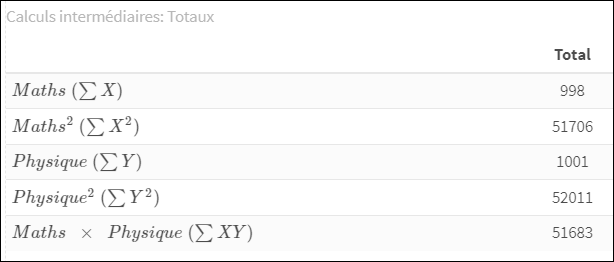

```{r echo=FALSE, warning=FALSE,message=FALSE}

source('global3.R')

```

# Statistiques Descriptives: données bivariées

## Objectifs d'apprentissage

À la fin de l'étude de ce chapitre, vous devriez être en mesure de:

-   pour un ensemble de données quantitatives,
    -   calculer et interpréter la covariance
    -   calculer et interpréter la corrélation de Pearson
-   pour un ensemble de données ordinales,
    -   calculer et interpréter la corrélation de Spearman
-   pour une variable quantitative vs une variable dichotomique,
    -   calculer et interpréter le Point Bisérial
    -   calculer et interpréter la corrélation bisériale

## Introduction

Dans le chapitre 7 (@sec-Chap7), nous avons discuté de différents indices statistiques relatifs à une variable donnée. Nous avons pu, à l'aide de ces indices, décrire le centre de la distribution des données, sa dispersion et sa forme.

L'objectif de la Science, rappelons-le, est d'établir la relation qui pourrait exister entre deux variables ou plus. A ce stade, nous avons tout ce qu'il nous faut pour discuter de chacune des variables individuelles, mais le besoin demeure de décrire et quantifier la relation qui les lie. Dans cette section, nous discuterons d'indices permettant une telle quantification de la relation entre deux variables, qu'elles soient quantitatives ou qualitatives.

## Nature d'une relation entre deux variables

Mais avant d'étudier les indices numériques permettant de quantifier l'intensité, l'ampleur, ou l'importance d'une relation, il convient de définir précisément ce terme, tel qu'utilisé dans la littérature scientifique.

Deux variables sont en relation si, au minimum, une variation de l'une est concomitante à une variation de l'autre.

On peut globalement décrire les relations entre deux variables comme étant:

-   nulle: les variables fonctionnent indépendamment l'une de l'autre; il n'y a pas d'évidence selon laquelle une variation de l'une est accompagnée d'une variation de l'autre; la connaissance de l'une ne nous informe aucunement sur l'autre. Par exemple, il serait difficile de croire qu'il pourrait y avoir une quelconque relation entre la position de la lune au moment de la naissance d'un individu, et la performance de ce dernier dans un examen de mathématiques à l'école Fondamentale...

-   covariante: les deux variables sont liées d'une manière ou d'une autre, mais sans que l'une influence l'autre. Il existe probablement une ou plusieurs autres variables qui sont la source de cette relation, mais il n'y a pas d'influence directe entre les deux variables considérées. Par exemple, il y a certainement une forte relation entre la longueur du bras gauche d'un individu, et la longueur de sa jambe droite. Mais on n'a aucune raison de croire que l'une de ces variables est la source, ou la cause, de la variation de l'autre. Par contre, d'autres variables telles les facteurs de croissance pourraient expliquer l'existence de cette relation.

-   influente: les deux variables sont liées et l'une d'elles a une influence sur l'autre; la variation de l'une est une source, ou une cause, de la variation de l'autre. Par exemple, les efforts déployés dans la préparation d'un examen peuvent probablement se traduire par un certain niveau de performance à cet examen: peu d'efforts risquent de conduire à une performance faible, et inversement, des efforts importants pourraient se traduire par une bonne performance. Les efforts déployés **influencent** la performance à l'examen. Généralement, les scientifiques sont à la recherche de telles relations.

Il existe plusieurs indices permettant d'évaluer le degré de relation entre deux variables, selon la nature de l'une et de l'autre, selon le contexte dans lequel elles sont mesurées, par exemple. Les indices les plus fréquemment utilisés en recherche sont présentés dans les paragraphes suivants.

## Relation entre deux variables qualitatives: Représentation tabulaire et graphique

Les données qualitatives (nominales ou ordinales), on l'a dit, ne permettent que la comptabilisation des effectifs dans les différentes catégories d'une variable. Lorsque deux variables sont considérées simultanément, les effectifs sont obtenus non seulement pour chacune des catégories de chaque variable, mais aussi pour chaque combinaison croisée de ces variables. Par exemple, considérons la répartition des 1500 étudiants fréquentant l'une des principales universités Haitiennes (ISTEAH, UEH, UFCH, UNDH, USFAH) dans les différents programmes offerts. Est-ce qu'il existe une association entre ces deux variables nominales? La fonction **table()** permet de construire un tableau de contingence contenant la répartition des étudiants dans chacune des combinaisons de catégories croisées (tableau @tbl-tbl1). La fonction **addmargins()** ajoute les totaux marginaux (*Sum*) pour les rangées et les colonnes (tableau @tbl-tbl2):

```{r}
#| label: tbl-tbl1
#| tbl-cap: "Tableau de contingence: Programme x Université" 
#| 
# Génération d'un tableau de contingence aléatoire

set.seed(9876543)
V1 = sample(c("Sciences", "Droit", "Éducation", "Maths"), 
            1500, replace=TRUE)
NumA = sum(V1 == "Sciences")
V2 = character(500)
V2[V1 == "Sciences"] = sample(c("ISTEAH", "UEH", "UFCH", "UNDH", "USFAH"), NumA, replace=TRUE)
V2[V1 != "Sciences"] = sample(c("ISTEAH", "UEH", "UFCH", "UNDH", "USFAH"), 1500-NumA, 
                              prob=c(0.1, 0.2,  0.15, 0.3, 0.25),  replace=TRUE)

# Création et affichage du tableau de contingence
tbl <- table(V1,V2)

tbl %>%
  kbl() %>%
  kable_styling(bootstrap_options = c("striped", "hover", "condensed"), 
                full_width=FALSE)
```

À ce tableau, il convient d'ajouter les totaux marginaux, c'est-à-dire les sommes des fréquences observées pour chaque rangée et chaque colonne. La fonction **addmargins()** réalise cette opération:

```{r}
#| label: tbl-tbl2
#| tbl-cap: "Tableau de contingence: Programme x Genre, incluant les totaux marginaux" 
#| 
tbl2 <- addmargins(tbl)
tbl2 %>%
  kbl() %>%
  kable_styling(bootstrap_options = c("striped", "hover", "condensed"), 
                full_width=FALSE)
```

On obtient ainsi un résumé de l'ensemble des données sous forme de fréquences absolues. Il est également possible d'obtenir les fréquences relatives en appliquant la fonction **prop.table()**, ce qui rend les comparaisons plus faciles (tableau @tbl-tbl3):

```{r}
#| label: tbl-tbl3
#| tbl-cap: Tableau de contingence affichant les fréquences relatives (proportions) 
#| 
tbl3 <- prop.table(tbl)
addmargins(tbl3) %>%
  kbl(digits = 3) %>%
  kable_styling(bootstrap_options = c("striped", "hover", "condensed"), 
                full_width=FALSE) 
```

Ce tableau contient les proportions des effectifs de chaque cellule en fonction du nombre total d'observations. Au chapitre 2, ces proportions étaient considérées comme des probabilités conjointes. Les probabilités conditionnelles, pour leur part, sont les proportions des effectifs dans chaque cellule en fonction d'un total marginal (rangée ou colonne) donné. Ces quantités s'obtiennent en ajoutant l'argument **margin={1 = Rangée, 2 = Colonne}** à la fonction **prop.table()**. Utilisant l'argument **margin = 1**, on obtient la @tbl-tbl4, reproduisant les **Probabilités conditionnelles P(C\|R)**. la somme de chaque **rangée** est égale à 1.0:

```{r}
#| label: tbl-tbl4
#| tbl-cap: "Tableau de Contingence: Probabilités conditionnelles P(C|R)"
#| 
tbl_r <- prop.table(tbl, margin = 1)
tbl_r %>%
  kbl(digits=3) %>%
  kable_styling(bootstrap_options = c("striped", "hover", "condensed"), 
                full_width=FALSE)
```

Utilisant l'argument **margin = 2**, on obtient la @tbl-tbl5, reproduisant les **Probabilités conditionnelles P(R\|C)**, et la somme de chaque **colonne** est égale à 1.0:

**Probabilités conditionnelles P(R\|C)** (la somme de chaque colonne est 1.0):

```{r}
#| label: tbl-tbl5
#| tbl-cap: "Tableau de Contingence: Probabilités conditionnelles P(R|C)"

tbl_r <- prop.table(tbl, margin = 2)
tbl_r %>%
  kbl(caption="Tableau de Contingence: Probabilités conditionnelles P(C|R)",
      digits=3) %>%
  kable_styling(bootstrap_options = c("striped", "hover", "condensed"), 
                full_width=FALSE)
```

Les données résumées dans des tableaux de contingence tels que ceux présentés ci-dessus peuvent être représentées graphiquement de différentes manières. Puisque les variables sont qualitatives, le diagramme en barres reviendra au-devant de la scène, sauf qu'on y représentera deux variables plutôt qu'une seule. Et cette représentation peut se faire de deux manières: en barres *groupées* (@fig-bg), ou en barres *superposées* (@fig-bs).

```{r}
#| label: fig-bs
#| fig-cap: Diagramme en barres superposées
#| 
barplot(tbl, 
        col=c("lightblue", "yellow", "lightgreen", "orange", "blue"),
        beside=FALSE,
        main="Programmes d'étude vs Genre\n (Diagramme en barres supeposées)")
legend("topleft", 
       legend = c("Sciences", "Droit", "Éducation", "Maths"), 
       fill = c("lightblue", "yellow", "lightgreen", "orange"))

```

```{r}
#| label: fig-bg
#| fig-cap: Diagramme en barres groupées
#| 

barplot(tbl, 
        col = c("lightblue", "yellow", "lightgreen", "orange"),
        beside = TRUE,
        main = "Programmes d'étude vs Genre\n (Diagramme en barres groupées)")
legend("topleft", 
       legend = c("Sciences", "Droit", "Éducation", "Maths"), 
       fill = c("lightblue", "yellow", "lightgreen", "orange"))

```

Alternativement, on peut représenter les données qualitatives à l'aide de diagrammes en mosaïque (@fig-mosaic):

```{r}
#| label: fig-mosaic
#| fig-cap: Diagramme en Mosaique, illustrant la relation entre deux variables qualitatives. La surface des rectangles est proportionnelle à l'effectif se trouvant dans un couple d'attributs.
#| 
mosaicplot(tbl,
           color="skyblue2",
             dir = c("h", "v"),
           main="Programmes d'étude vs Genre")
```

Dans un tel graphique, la fréquence observée dans une cellule est proportionnelle à l'aire du rectangle correspondant dans la mosaïque. Fréquemment, on utilise diverses couleur indiquant l'importance des valeurs résiduelles dans les différentes cellules, tel qu'illustré dans la @fig-mosaic2:

```{r}
#| label: fig-mosaic2
#| fig-cap: Diagramme en Mosaique, illustrant la relation entre deux variables qualitatives. La surface des rectangles est proportionnelle à l'effectif se trouvant dans un couple d'attributs, et les valeurs résiduelles standardisées sont représentées par des couleurs.
#| 
mosaicplot(tbl,
           main = "Diagramme en mosaique", 
           sub = "Les valeurs résiduelles sont représentées par des couleurs",
           xlab = "Genre",
           ylab = "Programme d'étude",
           color = FALSE, 
           shade = TRUE, 
           margin = NULL,
           cex.axis = 0.8, 
           las = par("las"),
           type = "pearson")
```

On trouvera une description détaillée de ce type de graphique [ICI](https://www.jmp.com/fr_ca/statistics-knowledge-portal/exploratory-data-analysis/mosaic-plot.html).

Ces différents types de graphiques permettent de visualiser la relation qui pourrait exister entre les deux variables qu'ils représentent.

## Relation entre une variable qualitative et une variable quantitative: Représentation graphique

En recherche, il est fréquent de devoir examiner la relation entre une variable qualitative et une ou plusieurs variables quantitatives. Par exemple, considérons l'ensemble des étudiants de l'ISTEAH, réparti dans les quatre programmes d'études offerts (variable qualitative): Sciences, Droit, Éducation, Mathématiques. Pour 800 étudiants du second cycle (données fictives!), on mesure l'intérêt à poursuivre des études de troisième cycle à l'aide d'une échelle psychométrique validée. Les données recueillies sont affichées dans le tableau suivant:

```{r}
#| label: tbl-dataset1
#| tbl-cap: "Motivation des étudiants de second cycle à poursuivre des études de troisième cycle, à l'ISTEAH"

mot <- c(rnorm(200, 50, 8), 
         rnorm(150, 54, 6), 
         rnorm(250, 47, 9), 
         rnorm(200, 50, 10))
Prog <- sample(c("Sciences", "Droit", "Education", "Maths"), 
               800, 
               prob=c(200, 150, 250, 200), 
               replace=TRUE)

motiv <- data.frame("mot" = round(mot, 1), Prog)
motiv <- motiv[order(motiv$Prog), ]

DT::datatable(motiv, width = "32%",
              colnames=c("Motivation", "Programme"),
              class = "cell-border stripe",
              options = list(
                        dom = "t",
                        scrollY = "400px",
                        pageLength = nrow(motiv),
                        info = TRUE,
                        paging = TRUE,
                        searching = FALSE,
                        autoWidth = TRUE,
                        columnDefs = list(list(width = '20%', targets = "_all"))
                    )
                  ) 

```

À ce stade, il serait intéressant d'obtenir une description de la variable MOTIV pour chacun des groupes, en une seule étape, et de produire un tableau résumant l'ensemble. Il existe plusieurs façons d'obtenir un tel tableau. La fonction **describeBy()**, de la librairie **psych** est parmi les favorites, produisant les résultats suivants:

```{r}
#| code-fold: false

psych::describeBy(x = motiv$mot, 
                  group = motiv$Prog, 
                  mat = TRUE,
                  digits = 2) 

```

D'un tel tableau, on peut examiner les différences qui pourraient exister entre les groupes, pour différentes statistiques.

Les représentations graphiques sont particulièrement efficaces pour visualiser les différences inter-groupes. Encore là, il existe plusieurs approches, toutes présentant une forme graphique appliquée à chacun des groupes. Par exemple, les différences inter-groupes peuvent être mises en évidence en superposant des histogrammes, tel qu'illustré dans la @fig-grpcomp1.

```{r }
#| label: fig-grpcomp1
#| fig-cap: Distribution des scores de motivation à poursuivre des études de troisième cycle chez les étudiants du deuxième cycle,en fonction du domaine d'étude (données fictives)

motiv %>%
    ggplot(aes(mot)) +
    geom_histogram(binwidth = 1.25, color = "black",fill = "lightblue") +
    labs(title = "Distribution des scores de motivation, par domaine d'étude",
         x = "Motivation",
         y = "Programme") +
    theme_minimal() +
    facet_grid(Prog~.)
```

Un ensemble de diagrammes en boîte est aussi particulièrement efficace pour illustrer les différences inter-groupes, comme on peut le constater à la @fig-grpcomp2.

```{r }
#| label: fig-grpcomp2
#| fig-cap: Diagrammes en boîte représentant les scores de motivation à poursuivre des études de troisième cycle chez les étudiants du deuxième cycle,en fonction du domaine d'étude (données fictives)

boxplot(mot ~ Prog, data = motiv,
        main = "Motivation par domaine d'étude",
        xlab = "Domaine d'étude",
        ylab = "Motivation",
        col=c("lightblue", "lightgreen", "orange", "lightcyan"))
```

Un diagramme en boîte est construit à partir de 5 indices descriptifs (minimum, maximum et les 3 quartiles), de sorte qu'une telle représentation permet de visualiser les éléments susceptibles de différer entre les groupes: tendance centrale, dispersion, présence de données extrêmes, symétrie, etc.

## Relation entre variables quantitatives: Représentation graphique

Supposons qu'un chercheur de l'ISTEAH s'intéresse à la relation qui pourrait exister entre la performance dans les cours de mathématiques, de physique, et de langues anciennes. Il compile les notes obtenues par un groupe de 20 étudiants lors d'examens finaux pour ces trois matières. Les données sont artificiellement créées en utilisant le code R suivant, et affichées dans la @tbl-diagdisp1.

```{r }

set.seed(150752)
rho12 <- 0.80       # Corrélation entre maths et physique
rho13 <- -0.80      # Corrélation entre maths et langues
maths <- rnorm(20)  # Génération aléatoire des données initiales en Maths

phys <- rho12 * maths + sqrt(1-rho12**2) * rnorm(20) # Génération de données en Physique
lang <- rho13 * maths + sqrt(1-rho13**2) * rnorm(20) # Génération de données en Langues

maths <- round(((maths-mean(maths))/sd(maths)) * 10 + 50) # Ré-échelonnage de Maths
phys <- round(((phys-mean(phys)) / sd(phys)) * 10 + 50)   # Ré-échelonnage de Physique
lang <- round(((lang-mean(lang)) / sd(lang)) * 10 + 50)   # Ré-échelonnage de Langues
ID <- 1:20
dat <- data.frame(ID, maths, phys, lang)

```

```{r}
#| label: tbl-diagdisp1
#| tbl-cap: Performance en Maths, Physique et Langues

DT::datatable(dat, width = "50%",
              colnames=c("ID", "Maths", "Physique", "Langues"),
              caption = "Performance en Maths, Physique et Langues",
              class = "cell-border stripe",
              options = list(
                        dom = "t",
                        scrollY = "400px",
                        pageLength = nrow(dat),
                        info = TRUE,
                        paging = TRUE,
                        searching = FALSE,
                        autoWidth = TRUE,
                        columnDefs = list(list(width = '20%', targets = "_all"))
                    )
                  ) 
```

Dans un premier temps, il produit un **diagramme de dispersion** afin d'examiner la relation entre les variables maths et physique. Par exemple, considérons les données affichées dans la @tbl-diagdisp1. Chaque couple de données ($X_{Maths}, X_{Physique}$) est représenté par un point dans une espace cartésien bidimensionnel, tel qu'illustré dans la @fig-diagdisp1f.

```{r }
#| label: fig-diagdisp1f
#| fig-cap: Diagramme de dispersion illustrant la relation entre les performances en Mathématiques et en Physique. Chaque point représente un couple de données. Par exemple, les points correspondant aux couples 10 (41, 39) et 11 (59, 61) sont identifiés sur le graphique.

plot(maths, phys,
     main="Relation entre Maths & Physique",
     xlab="Performance en Mathématiques",
     ylab= "Performance en Physique")
reg1 <- lm(phys ~ maths, data=dat)
abline(reg1, col="darkgreen")
text(maths[10], phys[10]-2, "10", col="red", cex=1)
text(maths[11], phys[11]+2, "11", col="red", cex=1)
```

On constate aisément qu'aux performances faibles en maths sont associées des performances faibles en physique, et qu'aux performances fortes en maths sont associées des performances fortes en physique. Il s'agit d'une relation **positive**: une augmentation de la valeur d'une variable est associée à une augmentation de l'autre. On peut donc affirmer qu'il y a une relation entre ces deux variables. Le problème qui subsiste est de quantifier l'importance de cette relation.

Pour bien saisir la nature des indices qui nous permettront de quantifier le degré de relation entre deux variables quantitatives, examinons un plan cartésien composé de quatre quadrants (@fig-PlCart). Supposons que les données pour les deux variables (X et Y) sont centrées sur leurs moyennes respectives ($X_{centré}=X-\mu_X$ et $Y_{centré}=Y-\mu_Y$):

```{r }
#| label: fig-PlCart
#| fig-cap: "Plan cartésien sur lequel les points seront déposés. Le quadrant dans lequel ils se retrouveront dépend du signe de chacun des écarts par rapport aux moyennes: une donnée supérieure à la moyenne donne un écart positif (+), et une donnée inférieure à la même moyenne donne un écart négatif (-)"

plot(NA, NA,
     type="l",
     xlim=c(-1, 1),
     ylim=c(-1, 1),
     xlab=TeX(r'($(X - \mu_X)$)'),
     ylab=TeX(r'($(Y - \mu_Y)$)'))

abline(h=0)
abline(v=0)

text(.5, .6, "I", cex=1.5)
text(.5, -.4, "II", cex=1.5)
text(-.5, -.4, "III", cex=1.5)
text(-.5, .6, "IV", cex=1.5)

text(.5, .3, "(+)(+)", cex=1.5)
text(.5, -.7, "(+)(-)", cex=1.5)
text(-.5, -.7, "(-)(-)", cex=1.5)
text(-.5, .3, "(-)(+)", cex=1.5)
```

Si les données pour X et pour Y sont toutes deux supérieures à leurs moyennes respectives $\left [(X-\mu_X)>0~~ et~~ (Y-\mu_Y)>0\right ]$, le point les représentant se trouvera dans le quadrant I; si elles sont toutes deux inférieures à leurs moyennes $\left [(X-\mu_X)<0~~ et~~ (Y-\mu_Y)<0 \right ]$, elles seront représentées dans le quadrant III. Une représentation prépondérante dans ces deux quadrants a de fortes chances de conduire à une relation positive.

Par contre, si $(X-\mu_X)$ est positif alors que $(Y-\mu_Y)$ est négatif $\left [(X-\mu_X)>0~~ et~~ (Y-\mu_Y)<0\right ]$, le point représentant ce couple de données se trouvera dans le quadrant II; et si $(X-\mu_X)$ est négatif alors que $(Y-\mu_Y)$ est positif $\left [(X-\mu_X)<0~~ et~~ (Y-\mu_Y)>0 \right ]$, ce point sera dans le quadrant IV. Une représentation prépondérante dans ces deux quadrants a de fortes chances de conduire à une relation négative.

Reprenons le diagramme illustrant la relation entre la performance en mathématiques et en physique, après avoir obtenu les écarts par rapport aux moyennes pour chacune des deux variables. Cette relation est illustrée dans la @fig-diagdisp2f, et les données pertinentes sont présentées dans la @tbl-diagdisp2.

```{r "Relation entre Maths & Physique"}
#| label: fig-diagdisp2f
#| fig-cap: "Relation entre Maths & Physique (données centrées)"

mathsC <- maths - mean(maths) #
physC <- phys - mean(phys)    # Écarts par rapport aux moyennes
langC <- lang - mean(lang)    #
plot(mathsC, physC,
     main="Relation entre Maths & Physique",
     xlab="Performance en Mathématiques",
     ylab="Performance en Physique")
abline(v=0)
abline(h=0)
```

```{r}
#| label: tbl-diagdisp2
#| tbl-cap: Performance en Maths, Physique, et Langues \n (données centrées)

dat1 <- data.frame(ID, 
                   round(mathsC, 2), 
                   round(physC, 2),
                   round(langC, 2))
DT::datatable(dat1, width = "50%",
              colnames=c("ID", "MathsC", "PhysC", "Langues"),
              class = "cell-border stripe",
              options = list(
                        dom = "t",
                        scrollY = "400px",
                        pageLength = nrow(dat1),
                        info = TRUE,
                        paging = TRUE,
                        searching = FALSE,
                        autoWidth = TRUE,
                        columnDefs = list(list(width = '20%', targets = "_all"))
                    )
                  ) 


```

On note ici que la majorité des points se trouvent dans les quadrants I et III, ce qui se traduit par une relation positive.

Examinons maintenant la relation entre la performance en mathématiques et en langues anciennes, illustrée dans la @fig-diagdisp3.

```{r }
#| label: fig-diagdisp3
#| fig-cap: Relation entre Maths & Langues

plot(mathsC, langC,
     main="Relation entre Maths & Langues \n (Données centrées)",
     xlab="Performance en Mathématiques",
     ylab="Performance en Langues")
abline(v=0)
abline(h=0)

```

Dans ce cas, on trouve une majorité de points dans les quadrants II et IV, ce qui résulte en une relation négative: une performance élevée en mathématiques est associée à une performance faible en langues anciennes.

## Relation entre variables quantitatives: méthodes numériques

Si la relation entre deux variables quantitatives est linéaire, comme cela semble être le cas dans les figures précédentes, on peut quantifier l'importance de cette relation à l'aide de deux indices: la covariance, et la corrélation de Bravais-Pearson. On pourra visualiser les différents aspects de telles relations à l'aide de l'application [Corrélation Linéaire](https://daniel-coulombe.shinyapps.io/Correlation/), qui permet d'examiner des données bivariées générées aléatoirement tout en manipulant la corrélation réelle au niveau de la population, la taille de l'échantillon, le type de corrélation et différents attributs graphiques.

### La covariance

On connait déjà la **variance**, une mesure de la dispersion des observations autour de la moyenne de ces dernières. La **covariance** est aussi une mesure de dispersion: celle de couples d'observations (x, y) dans un plan cartésien à deux dimensions, autour d'une droite 'imaginaire' traversant l'ensemble d'une certaine manière. Formellement, la covariance est définie par l'@eq-covar1.

$$\sigma_{xy}=\sum\limits_{i=1}^{N}\frac{(x_{i}-\mu_{x})(y_{i}-\mu_{y})}{N}$$ {#eq-covar1}

Si $x=y$, on obtient:

$$\sigma_{xx}=\sum\limits_{i=1}^{N}\frac{(x_{i}-\mu_{x})(x_{i}-\mu_{x})}{N}=\sum\limits_{i=1}^{n}\frac{(x_{i}-\mu_{x})^2}{N}=\sigma_x^2$$ {#eq-covar2}

On reconnaîtra ici la définition formelle de la variance, discutée au Chapitre 3. La variance est donc la covariance d'une variable avec elle-même. Les deux concepts sont de la même famille! La variance est en quelque sorte la moyenne des carrés des écarts par rapport à la moyenne $[(x-\mu_x)^2]$, alors que la covariance est la moyenne des produits croisés des écarts par rapport aux moyennes $[(x-\mu_x)(y-\mu_y)]$.

Pour des données obtenues auprès d'un échantillon, la covariance se définit par l'@eq-covar3.

$$s_{xy}=\sum\limits_{i=1}^{n}\frac{(x_{i}-\bar{x})(y_{i}-\bar{y})}{n-1}$$ {#eq-covar3}

Se référant au tableau @tbl-diagdisp2 contenant les données centrées, la covariance entre les performances en mathématiques et en physique est:

$$s_{XY}=\frac{(`r mathsC[1]`)(`r physC[1]`)+...+(`r mathsC[20]`)(`r physC[20]`)}{20-1}= `r round(cov(maths, phys), 3)`$$

Le degré de relation entre les variables X et Y est quantifié par la valeur absolue de la covariance: plus cette valeur est élevée, plus il y a indication d'une relation forte. La direction de cette relation, positive ou négative, est indiquée par le signe de la covariance. Par exemple, les covariances liant les performances en mathématiques, en physique et en langues anciennes sont affichées sous forme de matrice dans la @tbl-covmat1:

```{r }
#| label: tbl-covmat1
#| tbl-cap: Matrice de covariances entre les variables Maths, Physique et Langues.

c <- round(cov(dat[ ,2:4]), 3)
c %>%
  kbl(digits=3) %>%
  kable_styling(bootstrap_options = c("striped", "hover", "condensed"), 
                full_width=FALSE)  
```

Cette matrice est formée:

1.  de la covariance de chacune des variables avec elle-même: ce sont les variances, qui se trouvent sur la diagonale principale
2.  des covariances entre chaque paire de variables, qui sont les éléments hors-diagonaux de la matrice.

On note également que la matrice est symétrique, la portion triangulaire supérieure étant l'image au miroir de la portion triangulaire inférieure. Très souvent, dans la littérature scientifique, on ne reproduit qu'une ou l'autre de ces portions, tel qu'illustré dans la @tbl-covar5.

```{r }
#| label: tbl-covar5
#| tbl-cap: Portion triangulaire inférieure de la matrice de covariances. La matrice étant symétrique, aucune information n'est perdue

upper <- c
upper[upper.tri(c)] <- ""
upper <- as.data.frame(upper)
upper %>%
  kbl(digits=3,
      align=rep("r", 3)) %>%
    kable_styling(bootstrap_options = c("striped", "hover", "condensed"), 
                full_width=FALSE) 
```

De ces matrices, on peut noter les faits suivants à propos des covariances:

-   $\sigma_{XX}=\sigma_X^2$: La covariance d'une variable avec elle-même est la variance de cette variable, ce qu'on peut visualiser dans la diagonale principale de la matrice des covariances
-   $\sigma_{XY}=\sigma_{YX}$: La covariance entre X et Y est égale à la covariance entre Y et X, ce qui explique la symétrie de la matrice des covariances
-   $\sigma_{(X+c)Y}=\sigma_{XY}$: L'ajout d'une constante $c$ à X (ou à Y) n'affecte pas la covariance entre ces deux variables
-   $\sigma_{(cXY)}=c\sigma_{XY}$: La multiplication de X (ou de Y) par une constante $c$ a pour effet de multiplier la covariance entre X et Y par la valeur de la constante
-   $\sigma_{X+Y}^2=\sigma_{X}^2+\sigma_{Y}^2+2\sigma_{XY}$: La variance de la somme de deux variables est égale à la somme des variances de ces variables, plus deux fois la covariance entre elles
-   $\sigma_{X-Y}^2=\sigma_{X}^2+\sigma_{Y}^2-2\sigma_{XY}$: La variance de la différence entre deux variables est égale à la somme des variances de ces variables, moins deux fois la covariance entre elles

Ces propriétés trouveront des applications dans différents contextes qui seront à l'étude dans les chapitres suivants.

De la matrice des covariances, on note également que toutes les variances (éléments diagonaux) sont positives. En effet, une variance ne peut être que nulle ou positive. Par contre, les covariances peuvent prendre toute valeur comprise entre $-\infty$ et $+\infty$, le signe indiquant la direction de la relation.

Dans le cas présent, les trois variables se trouvent sur des échelles de mesure similaires, ce qui augmente ne niveau de comparabilité des valeurs observées: il semble que la covariance entre les performances en mathématiques et en physique ($s_{Maths,Phys}=91.216$) soit plus grande, en valeur absolue, que la covariance entre les performances en langues et en physique ($s_{Lang,Phys}=-84.521$). Mais dans le monde réel, les variables mises en relation utilisent généralement des échelles de mesure différentes, de sorte que les comparaisons sont plus difficiles, voire impossibles à formuler, à moins qu'il s'agisse de covariances obtenues pour les mêmes variables mesurées sur différents groupes de sujets: dans ce cas, on pourra peut-être dire que la relation entre X et Y est plus ou moins forte pour le groupe 1 versus le groupe 2, par exemple. Mais en dehors de situations semblables, ces comparaisons ne peuvent se faire.

Ce qui rend l'interprétation d'une covariance difficile, c'est bien sûr le fait qu'**aucune échelle de mesure** n'y soit associée: trouver que la covariance entre X et Y est égale à **91.216** ne nous informe que sur le fait que s'il y a réellement relation, cette relation est positive, mais on n'a aucun indice nous permettant de déterminer la force de la relation. Mais la difficulté d'interprétation est surtout due au fait que sa formulation **ne tient aucunement compte de la dispersion des deux variables impliquées**. On ne tient compte que des écarts par rapport aux moyennes et de leurs produits croisés, mais nulle part dans la définition ne voit-on $\sigma_X$ et $\sigma_Y$. Comme un simple écart par rapport à une moyenne ($X-\bar X$) ne véhicule que peu d'information concernant l'importance de cet écart, et que sa standardisation (son score Z) permet d'obtenir une interprétation claire et métrique de la même distance, on a besoin de standardiser la covariance pour la rendre interprétable. Cette standardisation se traduit par le coefficient de corrélation.

#### La fonction **cov()**

Sous R, la fonction **cov()** retourne la covariance entre chaque paire de variables composant ses arguments. Par exemple, la covariance entre les performances en mathématiques et en physique est:

```{r}
#| code-fold: false

c <- cov(maths, phys)
cat("Covariance = ", c)
```

On peut également utiliser un objet contenant en ensemble de variables pour obtenir une matrice de covariances présentant cette quantité pour chaque paire de variables:

```{r}
#| code-fold: false

cdat <- data.frame(maths, phys, lang)
cov(cdat)
```

### Le coefficient de corrélation (Bravais-Pearson) {#sec-correlation}

La seconde mesure du degré de relation entre deux variables quantitatives est le coefficient de corrélation de Bravais-Pearson. Il s'agit simplement du rapport entre la covariance et le produit des écarts-types des deux variables mises en relation, tel qu'exprimé dans l'@eq-corr1.

$$\rho_{XY}=\frac{\sigma_{XY}}{\sigma_X \sigma_Y}$$ {#eq-corr1}

Pour des données recueillies sur un échantillon tiré d'une population, $r_{XY}$ est obtenu par l'@eq-corr1b:

$$r_{XY}=\frac{s_{XY}}{s_X s_Y}$$ {#eq-corr1b}

Ce coefficient est une mesure standardisée de l'importance de la relation entre deux variables. Sa valeur est comprise dans l'intervalle $[-1\le \rho \le +1 ]$. Le signe indique la direction de la relation, comme celui de la covariance, et sa valeur mesure le degré d'association entre les variables: $\rho=1.0$ représente une relation parfaite, alors que $\rho=0.0$ représente l'absence de relation.

Par exemple, la corrélation entre les performances en mathématiques et en physique est:

```{r }
covarXY <- cov(maths, phys)
Sx <- sd(maths)
Sy <- sd(phys)
r <- covarXY / (Sx * Sy)
```

$$r_{XY}=\frac{`r round(covarXY, 3)`}{(`r round(Sx, 3)`)(`r round(Sy, 3)`)}=`r round(r, 4)` $$

#### Formulation alternative: en termes de scores centrés et réduits (Z)

Une formulation parfaitement équivalente à celle présentée au précédent paragraphe définit la corrélation en tant que moyenne des produits croisés des deux variables, centrées et réduites (scores Z), tel que résumé dans la @tbl-cor2.

```{r}
#| label: tbl-cor2
#| tbl-cap: Données centrées et réduites (Scores Z), et leurs produits croisés (MxP)
#| 
Zmath <- (maths - mean(maths)) / Sx
Zphys <- (phys - mean(phys)) / Sy
ZxZy <- Zmath * Zphys
d <- data.frame(Zmath, Zphys, ZxZy)
rownames(d) <- NULL
colnames(d) <- c("Maths", "Physique", "MxP")
d %>%
  DT::datatable(width = "50%",
              colnames=c("Maths", "Physique", "MxP"),
              class = "cell-border stripe",
              options = list(
                        dom = "t",
                        scrollY = "400px",
                        pageLength = nrow(d),
                        info = TRUE,
                        paging = TRUE,
                        searching = FALSE,
                        autoWidth = TRUE,
                        columnDefs = list(list(width = '20%', targets = "_all"))
                    )
                  ) %>%
  DT::formatRound(columns=c("Maths", "Physique", "MxP"), 
              digits=3)
  

```

De ces données transformées, on note que la très grande majorité des produits croisés (**MxP**) sont positifs, ce qui est une indication d'une relation positive. On obtient la corrélation en calculant la moyenne des produits croisés (@eq-correl2):

$$\rho_{XY}=\sum\limits_{i=1}^{N}{\frac{z_X z_Y}{N}}$$ {#eq-correl2}

Pour des données obtenues d'un échantillon tiré d'une population, la correction de Bessel est appliquée dans le calcul des écarts-types (nécessaires au calcul de Z) et la définition de $r$ devient l'@eq-correl2b:

$$r_{XY}=\sum\limits_{i=1}^{N}{\frac{z_X z_Y}{n-1}}$$ {#eq-correl2b}

Cette formulation est très similaire à celle que nous avons établie pour la covariance: les produits des écarts par rapport aux moyennes ont simplement été remplacés par les mêmes écarts, mais standardisés!

Par exemple, la corrélation entre les performances en mathématiques et en physiques est:

```{r echo=FALSE}
Zmath <- (maths - mean(maths)) / sd(maths)
Zphys <- (phys - mean(phys)) / sd(phys)
ZxZy <- Zmath * Zphys
n <- length(maths)
r <- sum(ZxZy) / (n - 1)
```

$$r_{XY}=\frac{(`r round(Zmath[1], 4)`)(`r round(Zphys[1], 4)`)+...+(`r round(Zmath[20], 4)`)(`r round(Zphys[20], 4)`)}{20-1}= `r round(r, 4)`$$

Sous R, l'ensemble de ces opérations se résumerait à la séquence suivante:

```{r eval=FALSE, echo=TRUE}
Zmath <- (maths - mean(maths)) / sd(maths)        # X -> Zx
Zphys <- (phys - mean(phys)) / sd(phys)           # Y -> Zy
ZxZy <- Zmath * Zphys                             # Produits croisés
n <- length(maths)
r <- sum(ZxZy) / (n - 1)                          # Corrélation
cat("Corrélation entre Maths & Physique = ", r)
```

#### Formulation alternative: en termes de scores centrés $(X-\mu_X)$

En remplaçant $z_X$ et $z_Y$ dans l'@eq-correl2 par la définition de ces scores, on obtient l'@eq-correl3:

$$\rho_{XY}=\sum\limits_{i=1}^{N}{\frac{\left (\frac{X-\mu_X}{\sigma_X}\right ) \left(\frac{Y-\mu_Y}{\sigma_Y} \right)}{N}}= \sum\limits_{i=1}^{N}\frac{{({X-\mu_X}) ({Y-\mu_Y} )}}{N\sigma_X \sigma_Y}$$ {#eq-correl3}

Pour des données obtenues d'un échantillon tiré d'une population, on obtient l'@eq-correl4:

$$r_{XY}= \sum\limits_{i=1}^{N}\frac{{({X-\bar X}) ({Y-\bar Y} )}}{(n-1)s_X s_Y}$$ {#eq-correl4}

la @tbl-devmoy reproduit les données centrées pour chacune des variables, de même que le produit croisés de ces valeurs.

```{r}
#| label: tbl-devmoy
#| tbl-cap: Données centrées (déviations par rapport à la moyenne), et leurs produits croisés (MxP)

Cmath <- maths - mean(maths)
Cphys <- phys - mean(phys)
CxCy <- Cmath * Cphys
d <- data.frame(Cmath, Cphys, CxCy)
colnames(d) <- c("MathsC", "PhysC", "MxP")
d %>%
  DT::datatable(width = "50%",
              colnames=c("MathsC", "PhysC", "MxP"),
              class = "cell-border stripe",
              options = list(
                        dom = "t",
                        scrollY = "400px",
                        pageLength = nrow(d),
                        info = TRUE,
                        paging = TRUE,
                        searching = FALSE,
                        autoWidth = TRUE,
                        columnDefs = list(list(width = '20%', targets = "_all"))
                    )
                  ) %>%
  DT::formatRound(columns=c("MathsC", "PhysC", "MxP"), 
              digits=3)
  

```

En ce qui concerne la relation entre les performances en mathématiques et en physiques, on obtient:

$$r_{XY}=\frac{(`r Cmath[1]`)(`r Cphys[1]`)+...+(`r Cmath[20]`)(`r Cphys[20]`)}{(20-1)(`r round(Sx, 4)`)(`r round(Sy, 4)`)}= `r round(r, 4)`$$

Sous R, cette procédure peut s'exprimer ainsi:

```{r}
#| code-fold: false

Cmath <- maths - mean(maths)
Cphys <- phys - mean(phys)
CxCy <- Cmath * Cphys
Sx <- sd(maths)
Sy <- sd(phys)
n <- length(maths)
r <- sum(CxCy) / ((n - 1)*Sx * Sy)
cat("Corrélation entre Maths & Physique = ", r)
```

#### Formulation alternative: en termes des scores bruts

Les formulations précédentes peuvent devenir laborieuses pour un calcul manuel. À défaut d'ordinateur, on aura intérêt à utiliser les données brutes, non transformées, pour obtenir le coefficient de corrélation. l'@eq-correl6 en résume les étapes:

$$\rho_{XY}=\frac{N\sum\limits_{i=1}^{N}XY-\sum\limits_{i=1}^{N}X\sum\limits_{i=1}^{N}Y}{N\sigma_X \sigma_Y}=\frac{N\sum\limits_{i=1}^{N}XY-\sum\limits_{i=1}^{N}X\sum\limits_{i=1}^{N}Y}{\sqrt{\left [N\sum\limits_{i=1}^{N}X^2-(\sum\limits_{i=1}^{N}X)^2 \right ]\left [N\sum\limits_{i=1}^{N}Y^2-(\sum\limits_{i=1}^{N}Y)^2 \right ]}}$$ {#eq-correl6}

Les données et les calculs intermédiaires sont affichés dans la @tbl-correl8, afin d'illustrer l'application de cette formulation pour le calcul de la corrélation entre les performances en mathématiques et en physique:

```{r }
#| label: tbl-correl8
#| tbl-cap: Données brutes et calculs intermédiaires
#| 
maths2 <- maths^2
phys2 <- phys^2
XY <- maths*phys
rdat <- data.frame(maths, maths2, phys, phys2, XY)
colnames(rdat) <- c("Maths (X)", "Maths_sq", "Phys (Y)", "Phys_sq", "XY")
rdat %>%
  DT::datatable(width = "50%",
              colnames=c("Maths (X)", "Maths_sq", "Phys (Y)", "Phys_sq", "XY"),
              class = "cell-border stripe",
              options = list(
                        dom = "t",
                        scrollY = "400px",
                        pageLength = nrow(rdat),
                        info = TRUE,
                        paging = TRUE,
                        searching = FALSE,
                        autoWidth = TRUE,
                        columnDefs = list(list(width = '20%', targets = "_all"))
                    )
                  )

      
```

De ces données, on obtient:

```{r}
#| code-fold: false

Totl <- colSums(rdat)
```

```{r}
#| echo: false
#| eval: false

Tot <- as.data.frame(colSums(rdat))
colnames(Tot) <- c("Total")
rownames(Tot) <- c("$Maths ~(\\sum{X})$", "$Maths^2~(\\sum{X^2})$ ", "$Physique~(\\sum{Y})$", "$Physique^2~(\\sum{Y^2})$", "$Maths~~ \\times ~~ Physique~(\\sum{XY})$")

kbl(Tot,
    caption = "Calculs intermédiaires: Totaux",
    align = "c") %>%
  kable_styling(bootstrap_options = c("striped", "hover", "condensed"), 
                full_width=FALSE) %>%
  column_spec(1, width = "20%")

```

```{r }
#| label: fig-CorTot
#| fig-cap: "Calculs intermédiaires pour le calcul du coefficient de corrélation"
#| echo: false


```

Appliquant l'@eq-correl6, on trouve:

$$r_{XY}=\frac{20(`r format(Totl[5], scientific=FALSE)`)-(`r Totl[1]`)(`r format(Totl[3], scientific=FALSE)`)}{\sqrt{\left [20(`r format(Totl[2], scientific=FALSE)`)-(`r Totl[1]`)^2 \right ]\left [20(`r format(Totl[4], scientific=FALSE)`)-(`r Totl[3]`)^2) \right ]}}= `r round(cor(maths, phys), 3)`$$

#### Fonction cor()

Les outils informatiques permettant d'obtenir rapidement et sans erreur les indices de relation entre un ensemble de variables sont nombreux. Sous R, la fonction **cor()** est un de ceux-là. Pour les données relatives aux performances en mathématiques, physique et langues, données qui sont sauvegardées dans les colonnes 2, 3 et 4 de l'objet **dat**, on obtient la matrice des corrélations affichée au tableau @tbl-correl7:

```{r}
#| label: tbl-correl7
#| tbl-cap: Matrice de corrélations entre les variables Maths, Physique et Langues
c <- cor(dat[ , -1])
corm <- as.data.frame(c)
round(corm, 4) %>%
  DT::datatable(width = "30%",
              class = "cell-border stripe",
              options = list(
                        dom = "t",
                        scrollY = "400px",
                        pageLength = nrow(corm),
                        info = TRUE,
                        paging = TRUE,
                        searching = FALSE,
                        autoWidth = TRUE,
                        columnDefs = list(list(width = '10%', targets = "_all"))
                    )
                  )

```

ou, pour simplifier la présentation, on peut limiter l'affichage à la portion supérieure ou inférieure de la matrice, puisque cette dernière est symétrique (tableau @tbl-correl7b):

```{r }
#| label: tbl-correl7b
#| tbl-cap: Portion triangulaire inférieure de la matrice de corrélations

upper <- round(cor(dat[, -1]), 4)
upper[upper.tri(c)] <- ""
upper <- as.data.frame(upper)
upper %>%
  DT::datatable(width = "30%",
              class = "cell-border stripe",
              options = list(
                        dom = "t",
                        scrollY = "400px",
                        pageLength = nrow(upper),
                        info = TRUE,
                        paging = TRUE,
                        searching = FALSE,
                        autoWidth = TRUE,
                        columnDefs = list(list(width = '10%', targets = "_all"))
                    )
                  )
```

De cette matrice, on note une diagonale principale composée de 1.0, qui n'est autre que la variance d'une variable centrée et réduite (scores z), toujours égale à cette valeur. La matrice est symétrique, comme l'était la matrice des covariances. Aucune corrélation (éléments hors diagonaux) ne dépasse 1.0 en valeur absolue, mais toutes s'en approchent. Les diagrammes de dispersion reproduits dans la @fig-correl9 représentent ces relations:

```{r}
#| label: fig-correl9
#| fig-cap: Relations entre chaque paire de variables
#| fig-width: 20
#| 
par(mfrow=c(1,3))
plot(maths, phys,
     main="Maths vs Physique",
     pch = 19,
     col = "red",
     cex = 2,
     cex.main = 2)
plot(maths, lang,
     main="Maths vs Langues",
     pch = 19,
     col = "red",
     cex = 2,
     cex.main = 2)
plot(phys, lang,
     main="Physique vs Langues",
     pch = 19,
     col = "red",
     cex = 2,
     cex.main = 2)
par(mfrow=c(1,1))
```

Ces diagrammes nous rassurent quant à la linéarité de la relation entre chaque paire de variables.

Une forme graphique fréquemment utilisée dans la littérature scientifique combine les représentations graphiques relatives aux relations entre chaque paire de variables, tout en affichant la distribution de chaque variable individuelle. La fonction **pairs.panels()** de la librairie **psych** permet ce travail en produisant la @fig-cormat1, par exemple.

```{r }
#| label: fig-cormat1
#| fig-cap: Matrice de diagrammes de dispersions

pairs.panels(dat[ , -1],
            method="pearson",
            hist.col="#00AFBB",
            density=TRUE,
            ellipses=FALSE,
            scale=FALSE,
            cex.cor=.8,
            smooth=FALSE,
            lm=TRUE)
```

La portion triangulaire supérieure affiche les coefficients de corrélation pour chaque paire de variables, chacune occupant une rangée/colonne de la matrice. La portion triangulaire inférieure contient les diagrammes de dispersion correspondant à chacune des corrélations. Finalement, la diagonale principale reproduit un histogramme permettant de visualiser la forme de la distribution de chaque variable individuelle. Des courbes de densité se superposent aux histogrammes afin d'en faire ressortir la forme générale.

Il est important de noter que ces indices, covariance et corrélation, supposent une relation linéaire uniquement. Toute curvilinéarité se traduirait par une sous-estimation de la relation entre X et Y. Les graphiques affichés dans la @fig-curvilin illustrent ce fait:

```{r }
#| label: fig-curvilin
#| fig-cap: Relations curvilinéaires
#| 

par(mfrow=c(1,3))
set.seed(520752)
x <- rnorm(100, 0, 15)
y <- 1.3 * x^2 - 5 * x + 380 + rnorm(100, 0, 50)
plot(x,y, main=" (A) Relation quadratique")
ra <- cor(x,y)
text(0, 1750, paste("r = ", round(ra, 3)), cex=1.2, col="red")

x <- seq(-10,10,0.1)
y <- 2.14-.33*x-.3*x^2 -.05*x^3+rnorm(length(x),0,0.5)
plot(x,y, main="(B) Relation cubique")
rb <- cor(x,y)
text(-4, -20, paste("r = ", round(rb, 3)), cex=1.2, col="red")

x <- seq(0,7.5,0.1)
y <- 60.57+37.335*x-53.24*x^2 +21.15*x^3-3.393*x^4+0.19*x^5+rnorm(length(x),0,)
plot(x,y, main="(C) Relation quintique")
rc <- cor(x,y)
text(4, 60, paste("r = ", round(rc, 3)), cex=1.2, col="red")

par(mfrow=c(1,1))

```

Le diagramme (A) représente une relation très forte entre X et Y. Or, le coefficient de corrélation est près de 0, indiquant une absence de relation **linéaire**. Dans le cas des diagrammes (B) et (C), une relation polynomiale très forte est manifeste, mais les coefficients observés, quoique s'approchant de 1.0, sous-estime l'importance de la relation. Dans les deux cas, les relations sont essentiellement parfaites, mais $r_B=`r round(rb, 2)`$, et $r_C=`r round(rc, 2)`$, respectivement. Ces relations sont nettement sous-estimées.

Affirmer que la corrélation est un indice de relation **linéaire** entre deux variables implique qu'une corrélation nulle n'indique pas nécessairement l'absence de relation: elle implique seulement l'absence de relation **linéaire**, mais ne peut exclure toute autre forme de relation. Dans le cadre d'une recherche impliquant l'examen de relations entre un ensemble de variables, il sera donc nécessaire de s'assurer de la linéarité de ces relations, sans quoi des conclusions erronées seront inévitables.

### La corrélation de Spearman {#sec-spearman}

Le coefficient de corrélation de Bravais-Pearson peut s'utiliser lorsque les deux variables impliquées sont de nature quantitative (échelles d'intervalle ou de rapport). Il est fréquent, en recherche, qu'on examine des relations entre mesures ordinales, et dans ces cas, le coefficient $r$ que nous venons d'étudier n'est plus approprié. Par exemple, il est fréquent que l'on ne considère que la **position** (ou le **rang**) d'un score dans une série ordonnée, avec le résultat que la variable n'est plus de niveau quantitatif, mais plutôt ordinal. Pour ces situations, il existe une alternative pour obtenir un indice de l'importance de la relation entre deux variables de ce type: le $\rho$ (ou **rho**) de Spearman. Sa valeur est toujours comprise entre -1.0 et +1.0, comme dans le cas précédent, et l'interprétation s'effectue de la même manière.

Notons qu'on peut obtenir ce coefficient pour des données quantitatives, lorsqu'elles sont contaminées par des données extrêmes, par exemple. En effet, le coefficient de Spearman n'est nullement affecté par ce type de problème.

#### Procédure

Formellement, le Rho de Spearman est défini par l'@eq-spearman:

$$\rho=1-\frac{6\sum\limits_{i=1}^{n}{d_i^2}}{n(n^2-1)}$$ {#eq-spearman}

L'élément déterminant dans cette définition est la somme des différences entre les rangs appariés ($d_i^2$). Plus ces différences sont faibles, plus le second terme de l'équation s'approche de 0 et par conséquent, $\rho$ s'approche de 1. À la limite, si toutes les différences sont nulles, $\rho=1$.

La préparation des données implique la mise en ordre de chacune des deux variables impliquées, en tenant compte des valeurs répétées (*ties*). Considérons une variable quantitative qui pour des raisons techniques (données aberrantes, distribution non normale, etc.) doit être convertie en une variable ordinale pour les fins d'une analyse particulière. Dans un premier temps, il convient d'attribuer un rang à chacune des données, de la plus petite à la plus grande, en tenant compte des valeurs répétées (**ties**). La @tbl-spearman illustre cette étape:

```{r}
#| label: tbl-spearman
#| tbl-cap: "Corrélation de Spearman: Mise en ordre des données"
#| 

x <- c(3,3,4,5,7,8,8,8,10)
Rg <- 1:9
Rx <- rank(x, ties.method="average")
dr <- data.frame(rbind(x, Rg, Rx))
dr %>%
  kbl(caption="Mise en ordre des données") %>%
    kable_styling(bootstrap_options = c("striped", "hover", "condensed"), 
                full_width=FALSE)
```

-   Les observations (**x**) sont mise en ordre croissant, produisant **Rg**
-   Certaines observations sont répétées: **3**: 2 fois, et **8**: 3 fois. Pour ces deux valeurs, on obtient la moyenne des rangs (Rg) qui leur seraient attribués, s'ils n'étaient pas répétés. Pour les **3**: (1+2)/2 = 1.5, et pour les **8**: (6+7+8)/3 = 7. Sous R, la fonction **rank()** permet cette opération. Par exemple:

```{r }
#| code-fold: false

x <- c(3,3,4,5,7,8,8,8,10)
Rx <- rank(x, ties.method="average")
Rx

```

-   Le résultat est une variable ordinale (**Rx**) qui pourra remplacer, au besoin, les données originales.

##### Calcul du Rho de Spearman: un exemple {#spearman}

Le code R suivant et le tableau qu'il produit (@tbl-spearmanex1) résument l'ensemble des opérations nécessaires pour le calcul de cet indice:

```{r}
#| label: tbl-spearmanex1
#| tbl-cap: Exemple de calcul du coefficient Rho de Spearman
#| 
x <- c(86, 71, 77, 68, 91, 72, 77, 91, 70, 71, 88, 87)
Rx <- rank(x, ties.method="average")  # Calcul de Rx
y <- c(88, 77, 76, 64, 96, 72, 65, 90, 65, 81, 81, 71)
Ry <- rank(y, ties.method="average")  # Calcul de Ry
d <- Rx - Ry                          # Différences
d2 <- d^2                             # Carrés des différences
sd2 <- sum(d2)                        # Somme des carrés de d
res <- data.frame(t(rbind(x, y, Rx, Ry, d, d2)))
colnames(res) <- c("X", "Y", "Rx", "Ry","d", "d_sq")
res %>%
  DT::datatable(width = "40%",
              class = "cell-border stripe",
              options = list(
                        dom = "t",
                        scrollY = "400px",
                        pageLength = nrow(res),
                        info = TRUE,
                        paging = TRUE,
                        searching = FALSE,
                        autoWidth = TRUE,
                        columnDefs = list(list(width = '10%', targets = "_all"))
                    )
                  )
```

-   Obtenir les données ordinales (Rx et Ry) pour les deux variables impliquées (X et Y), en tenant compte des données répétées, comme mentionné ci-dessus
-   Calculer les différences entre les rangs appariés ($d$)
-   Élever au carré les différences ($d^2$), et en calculer la somme
-   Calculer le coefficient de Spearman:

$$\rho=1-\frac{6\sum\limits_{i=1}^{n}{d_i^2}}{n(n^2-1)}= 1-\frac{6`r sd2`}{12(12^2-1)}=0.701$$

Cette valeur n'est cependant pas corrigée pour la présence de données répétées. La correction produit un effet négligeable lorsque le nombre de ces données est faible, ce qui pourrait ne pas être le cas lorsque ce nombre est élevé. Heureusement, la solution est simple, et de fait devrait être utilisée en tout temps lorsque le Rho de Spearman est nécessaire: il suffit de calculer le coefficient de corrélation de Bravais-Pearson sur les données ordinales, Rx et Ry:

```{r}
#| code-fold: false

rho <- cor(Rx, Ry)
cat("Rho de Spearman = ", rho)
```

On note une très légère différence par rapport à la version non corrigée, ce qui indique que la présence de données répétées n'a eu qu'un effet négligeable sur l'évaluation de la relation entre X et Y.

Et pour simplifier davantage la procédure, la fonction **cor()**, que l'on connait déjà pour l'avoir utilisée dans le calcul du coefficient de corrélation de Bravais-Pearson, offre l'option pour le rho de Spearman (**method = 'spearman'**):

```{r}
#| code-fold: false

rho <- cor(x, y, method="spearman")
cat("Rho de Spearman = ", rho)
```

Nul n'est besoin, dans ce cas, d'obtenir les rangs des observations originales.

### Corrélation de Kendall (Tau)

Le coefficient $\tau$ (Tau) de Kendall mesure le degré de relation entre deux variables ordinales, tout comme le Rho de Spearman. Par contre, plutôt que d'examiner les différences observées pour chaque paire de données, le Tau de Kendall examine les concordances et discordances dans la séquence ordonnée des scores. Un exemple permettra de bien saisir le processus.

#### $\tau_a$ de Kendall: Exemple 1

Supposons que pour l'engagement d'un nouveau professeur à l'ISTEAH, 12 candidats se sont présentés. Dans le processus de sélection, on demande à deux membres de la communauté universitaire de mettre ces candidats en ordre de préférence, de manière indépendante. Les rangs attribués à chaque candidat par chaque évaluateur sont présentés dans la @tbl-kendall1, par ordre croissant des rangs attribués par l'évaluateur 1:

```{r }
#| label: tbl-kendall1
#| tbl-cap: Mise en rang de 12 candidats par deux évaluateurs indépendants et calcul des concordances et discordances.
#| 

# Génération de données aléatoires
set.seed(150752)
n <- 12
r <- 0.75
x <- rnorm(n)
y <- r * x + sqrt(1-r**2) * rnorm(n)
x1 <- rank(x)
x2 <- rank(y)
dt <- data.frame(x1, x2)
dat2 <- dt[order(dt$x1), ]
ID <- LETTERS[1:n]
res <- ConDisPairs(x1, x2)
concord <- c(11,10,8,7,7,5,2,3,3,1,1,NA)
discord <- c( 0, 0,1,1,0,1,3,1,0,1,0,NA)
dat2 <- data.frame(ID, dat2, concord, discord)
colnames(dat2) <- c("ID", "Éval 1", "Éval 2", "Concord", "Discord")
rownames(dat2) <- NULL
dat2 %>%
  DT::datatable(width = "50%",
              class = "cell-border stripe",
              options = list(
                        dom = "t",
                        scrollY = "400px",
                        pageLength = nrow(dat2),
                        info = TRUE,
                        paging = TRUE,
                        searching = FALSE,
                        autoWidth = TRUE,
                        columnDefs = list(list(width = '10%', targets = "_all"))
                    )
                  )
#cat("Nombre de Concordances (nC) =", res[[1]])
#cat("Nombre de Discordances (nD) =", res[[2]])
```

De ce tableau, on peut dégager trois scénarios lorsqu'on examine les paires de données:

-   Égalité: pour une paire donnée, X = Y, Dans le tableau ci-dessus, c'est le cas pour les candidats (A), (B), (H) et (L). Ces égalités ne sont pas prises en compte.

-   Concordance: pour une paire donnée, les rangs peuvent être différents, mais par rapport à la paire précédente, elles augmentent ou diminuent également; les valeurs sont ordonnées dans la même direction. Par exemple, pour le candidat (C), le rang de X augmente par rapport au candidat (B), passant de 2 à 3, et le rang de Y va dans le même sens, passant de 2 à 4: il y a concordance!

-   Discordance: Pour une paire de données par rapport à la paire précédente, le rang de X augmente, alors que le rang de Y diminue. Par exemple, le candidat (H) obtient un rang supérieur par rapport au candidat (G) sur la variable X (passant de 7 à 8), alors que sur la variable Y, ce candidat obtient un rang inférieur (passant de 10 à 8): il y a discordance!

Pour obtenir l'indice de corrélation de Kendall, on doit calculer le nombre de paires concordantes et de paires discordantes. Une paire est concordante si la différence dans les rangs accordés pour deux candidats adjacents va dans le même sens pour les deux évaluateurs. Une paire est discordante si cette différence va dans des sens contraires. En d'autres termes:

-   Concordance: si $[(X_i > X_j) \& (Y_i > Y_j)] | [(X_i < X_j) \& (Y_i < Y_j)]$\
-   Discordance: si $[(X_i > X_j) \& (Y_i < Y_j)] | [(X_i < X_j) \& (Y_i > Y_j)]$\
-   Égalité : $T_X: X_i=X_j$, $T_Y: Y_i=Y_j$, $T_{XY}: X_i=Y_i$

Par exemple, considérons le premier candidat (A): les candidats sont ordonnés en fonction des préférences du premier évaluateur, et par conséquent, la comparaison de (A) et (B) va du 'plus préféré' vers le 'moins préféré'; il en va de même pour la comparaison de (B) et (C), et pour toutes les autres comparaisons, jusqu'à (K) vs (L).

Considérons alors le second évaluateur et examinons la direction des différences dans l'appréciation d'un candidat par rapport au suivant, et notons le nombre de différences allant dans le même sens que pour le premier évaluateur.

-   Pour le premier candidat, qui est au premier rang, combien trouve-t-on de rangs qui lui sont supérieurs? Les rangs attribués aux candidats (B)-(L) sont tous supérieurs, et de ce fait, on trouve 11 concordances.\
-   Il en va de même pour le candidat (B), ce qui nous permet d'ajouter 10 concordances\
-   Pour le candidat (C), à qui l'évaluateur 2 accorde le 4e rang, on trouve une discordance par rapport au candidat (E). On ajoute donc 8 concordances, et une discordance\
-   Pour le candidat (D), on se trouve dans la même situation, avec une discordance par rapport au candidat (E). On ajoute 7 concordances, et une discordance\
-   Et ainsi de suite pour tous les autres candidats. Les résultats de cette opération sont compilés dans le tableau, ci-dessus.

> Note technique: la fonction **ConcordPairs()** (@lst-ConDisPairs), permet le calcul rapide de $n_C$ et de $n_D$. Par exemple:

```{r}
#| code-fold: false

Ndc <- ConDisPairs(x1, x2) # x1 = Évaluateur 1, et x2 = Évaluateur 2
cat("Nombre de concordances = ", Ndc$Nc)
cat("Nombre de discordances = ", Ndc$Nd)
cat("Nombre d'égalités      = ", Ndc$Nt)

```

> De manière alternative, la fonction **concordance()** de la librairie **survival** fournit les mêmes résultats, en y ajoutant les nombres d'égalités dans les variables X et Y.

```{r}
#| code-fold: false

survival::concordance(x1~x2)

```

Les nombres totaux de concordances, $n_C$, et de discordances, $n_D$, sont tout ce qui est nécessaire pour obtenir une première version du coefficient de corrélation de Kendall, le $\tau_a$, tel que défini dans l'@eq-kendall1:

$$\tau_a=\frac{n_C-n_D}{0.5n(n-1)}= \frac{58-8}{0.5(12)(12-1)}=0.758$$ {#eq-kendall1}

Il faut noter que cette mesure ne tient compte que des nombres de concordances ($n_C$) et de discordances ($n_D$). Le dénominateur correspond simplement au nombre total d'appariements possibles des variables X et Y.

Sous R, la fonction **KendallTauA()** de la librairie **DescTools** permet de calculer cette valeur:

```{r}
#| code-fold: false

DescTools::KendallTauA(table(x1, x2))

```

#### $\tau_b$ de Kendall: Exemple 2

Une seconde version du Tau de Kendall est le $\tau_b$ qui, contrairement au $\tau_a$, tient compte des doublons. Pour illustrer la procédure, reprenons les données affichées dans la @tbl-spearmanex1, à la section @sec-spearman, pour illustrer une situation dans laquelle des égalités (doublons) existent entre certaines valeurs de X et de Y. Les données sont répétées dans la @tbl-kendallex2, après avoir ordonné la variable X de la plus petite valeur à la plus grande.

```{r }
#| label: tbl-kendallex2
#| tbl-cap: Calcul du Tau-b de Kendall
#| 
x <- c(86, 71, 77, 68, 91, 72, 77, 91, 70, 71, 88, 87)
Rx <- rank(x, ties.method="average")  # Calcul de Rx
y <- c(88, 77, 76, 64, 96, 72, 65, 90, 65, 81, 81, 71)
Ry <- rank(y, ties.method="average")  # Calcul de Ry
ID <- LETTERS[1:12]

res <- data.frame(t(rbind(x, y, Rx, Ry)))
colnames(res) <- c("X", "Y", "Rx", "Ry")
res <- cbind(ID, res[order(res$X), c(1:4)])
rownames(res) <- NULL
res %>%
  DT::datatable(width = "50%",
              class = "cell-border stripe",
              options = list(
                        dom = "t",
                        scrollY = "400px",
                        pageLength = nrow(res),
                        info = TRUE,
                        paging = TRUE,
                        searching = FALSE,
                        autoWidth = TRUE,
                        columnDefs = list(list(width = '10%', targets = "_all"))
                    )
                  )
```

On note la présence de doublons dans la variable X ({C, D}, {F, G}, {K, L}), et dans la variable Y ({B, G}, {D, J}).

Si des égalités existent tant à l'intérieur de X que de Y, il est préférable d'apporter une correction à la formulation. On obtient alors le $\tau_b$, défini par l'@eq-taub.

$$\tau_b=\frac{n_C-n_D}{\sqrt{\left [\frac{n(n-1)}{2}-T_x \right ]\left [\frac{n(n-1)}{2}-T_y \right ]}}$$ {#eq-taub}

où $T_x$ et $T_y$ réflètent les égalités dans la variable X et dans la variable Y respectivement, tel qu'exprimé dans les équations @eq-tx et @eq-ty.

$$T_X=\sum{\frac{t_x(t_x-1)}{2}}$$ {#eq-tx}

$$T_Y=\sum{\frac{t_y(t_y-1)}{2}}$$ {#eq-ty}

Dans les équations @eq-tx et @eq-ty, $t_x$ et $t_y$ représentent les groupes de valeurs identiques dans X et dans Y, respectivement.

Pour les données du tableau @tbl-kendallex2, on trouve:

$$T_X=\sum{\frac{t_x(t_x-1)}{2}}=\frac{2(2-1)+2(2-1)+2(2-1)}{2}=3 $$ et

$$T_Y=\sum{\frac{t_Y(t_y-1)}{2}}=\sum{\frac{2(2-1)+2(2-1)}{2}}=2 $$

Pour ces données, les nombres de concordances et de discordances sont obtenus à l'aide de la fonction **ConDisPairs()**:

```{r}
#| code-fold: false

nCnD <- ConDisPairs(res$Rx, res$Ry) 
cat("Nombre de Concordances = ", nCnD$Nc)
cat("Nombre de Discordances = ", nCnD$Nd)
```

Pour fins de comparaison, calculons le $\tau_a$:

$$\tau_a=\frac{n_C-n_D}{0.5n(n-1)}= \frac{48-13}{0.5(12)(12-1)}=0.5303$$

Calculons maintenant le $\tau_b$:

$$\tau_b=\frac{48-13}{\sqrt{\left [\frac{12(12-1)}{2}-3 \right ]\left [\frac{12(12-1)}{2}-2 \right ]}}=0.5512 $$

Sous R, la fonction **cor()**, que nous avons utilisée pour le calcul des coefficients de corrélation de Bravais-Pearson et de Spearman, offre une option pour obtenir le $Tau_b$ de Kendall:

```{r}
#| code-fold: false

r <- cor(res$X, res$Y, method="kendall")
cat("Tau de Kendall = ", r)
```

```{r eval=FALSE, echo=FALSE}
# Consulter:
# https://stackoverflow.com/questions/2557863/measures-of-association-in-r-kendalls-tau-b-and-tau-c
```

De manière alternative et équivalente, la fonction **KendallTauB()** de la librairie **DescTools** permet de d'obtenir ce résultat:

```{r}
#| code-fold: false

DescTools::KendallTauB(table(res$X, res$Y))

```

Une troisième variante tenant compte du nombre de valeurs distinctes dans les deux variables a aussi été proposée par Kendall: le $\tau_c$. Cette mesure est définie par l'@eq-tauc:

$$\tau_c=\frac{2m(n_C-n_D)}{n^2(m-1)}$$ {#eq-tauc}

où $m$ représente le plus petit nombre de valeurs distinctes dans X et dans Y, et $n$ représente le nombre total d'observations.

Pour les données du tableau @tbl-kendallex2, il existe 9 valeurs distinctes dans la variable X et 10 dans la variable Y. En conséquence, $m=9$. On trouve donc:

$$\tau_c=\frac{2m(n_C-n_D)}{n^2(m-1)}=\frac{2(9)(48-13)}{12^2(9-1)}=0.5469 $$

La fonction **StuartTauC()**, toujours de la librairie **DescTools** en permet le calcul:

```{r}
#| code-fold: false

DescTools::StuartTauC(table(res$X, res$Y))

```

Deux autres mesures de la relation entre deux variables ordinales se fondent sur les nombres de concordances et de discordances. Le premier est le coefficient $\gamma$ (gamma) de Goodman-Kruskal, qui ne tient compte que du nombre de concordances et de discordances, tel qu'exprimé dans l'@eq-gamma:

$$\gamma=\frac{n_C-n_D}{n_C+n_D}$$ {#eq-gamma}

Pour les données du tableau @tbl-kendallex2, on obtient:

$$\gamma=\frac{n_C-n_D}{n_C+n_D} = \frac{48-13}{48+13}=0.5738 $$

La fonction **GoodmanKruskalGamma()** de la librairie **DescTools** effectue les calculs nécessaires dans ce cas.

```{r}
#| code-fold: false

DescTools::GoodmanKruskalGamma(res$X, res$Y)
```

Finalement, le $d$ de Somers est analogue au $\gamma$ de Goodman-Kruskal, à la différence qu'il incorpore les égalités, tel qu'indiqué dans l'@eq-somers.

$$d=\frac{n_C-n_D}{n_C+n_D+ T_X}$$ {#eq-somers}

Pour les données du tableau @tbl-kendallex2, on trouve:

$$d=\frac{n_C-n_D}{n_C+n_D+ T_X}= \frac{48-13}{48+13+3}=0.5469$$

La fonction **SomersDelta()** en permet le calcul:

```{r}
#| code-fold: false

DescTools::SomersDelta(res$X, res$Y)
```

### Corrélation Bisériale et Point Bisérial

Les indices de corrélation Point Bisérial et Bisériale trouvent application dans les cas où une variable quantitative est liée à une variable dichotomique (0/1). Seule une correction distingue les deux indices.

#### Point bisérial {#sec-pbiser}

> Est-ce qu'il existe une relation entre la performance dans une formation professionnelle et le fait de trouver ou non un emploi au cours du premier mois suivant la fin de cette formation?

Une telle question implique une variable quantitative (par exemple, le score obtenu à un examen final, au terme de la formation), et une variable dichotomique: le fait de trouver (1) ou non (0) un emploi.

Considérons les données simulées, générées à l'aide du code R suivant: *n*= 100 étudiants complètent la formation et obtiennent une note à l'examen final (**Perfom**), et certains trouvent un emploi et d'autres n'ont pas cette chance (**Emploi**). Les 15 premières observations sont affichée dans la @tbl-biser1:

```{r }
#| label: tbl-biser1
#| tbl-cap: Relation entre performance et emploi

set.seed(150752)
n <- 100                # Nombre d'observations
ID <- 1:n
X <- round(rnorm(n, 60, 7), 1)
Y <- rep(NA, n)
idx <- which(X >= 60)
Y[idx] <- sample(0:1,
                 length(idx),
                 prob=c(0.3, 0.7),
                 replace=TRUE)
idx <- which(X < 60)
Y[idx] <- sample(0:1,
                 length(idx),
                 prob=c(0.8, 0.2),
                 replace=TRUE)
mat <- data.frame(ID, X, Y)
colnames(mat) <- c("ID", "Perform", "Emploi")
mat[1:15, ] %>%
  kbl() %>%
  kable_styling(bootstrap_options = c("striped", "hover", "condensed"), 
                full_width=FALSE)  

```

Une telle situation est caractérisée par le fait qu'une variable quantitative est mise en relation avec une variable dichotomique **réelle**, c'est-à-dire qu'un individu trouve un emploi ou n'en trouve pas, et on ne peut imaginer une distribution continue sous-jacente à cette dichotomie. Dans un tel cas, le coefficient de corrélation **point-bisérial** est l'indice à considérer pour examiner l'importance de la relation entre ces deux variables.

Le diagramme de dispersion reproduit dans la @fig-pbis1 illustre le problème:

```{r }
#| label: fig-pbis1
#| fig-cap: Diagramme de dispersion illustrant la relation entre la performance et le fait de trouver un emploi ou non. Une ligne horizontale liant les moyennes des deux groupes indiquerait l'absence de relation entre les deux variables.
#| 
plot(Y, X,
     xlab="Emploi",
     ylab="Performance",
     main="Relation entre Performance et Emploi",
     cex.lab=1.5)
abline(lm(X~Y),
       col="red",
       lwd=3,
       cex=1.5)
arrows(0.19, 70, 0.01, mean(X[which(Y==0)])+0.005,
       col="darkblue", length=.1, lwd=2)
arrows(0.82, 52, 0.99, mean(X[which(Y==1)]),
       col="darkblue", length=.1, lwd=2)
points(0, mean(X[which(Y==0)]), col="red", cex=2, pch=19)
points(1, mean(X[which(Y==1)]), col="red", cex=2, pch=19)
text(0.2, 72, TeX(r'($\bar{X}_0$)'), cex=1.2)
text(0.8, 50, TeX(r'($\bar{X}_1$)'), cex=1.2)
```

On note que la variable indépendante (**Emploi**) ne peut prendre que deux valeurs: 0 (sans emploi) ou 1 (emploi). S'il n'y a pas de relation entre les deux variables, les performances moyennes devraient être égales pour les deux groupes, et une droite liant ces moyennes serait horizontale. Tout angle de cette droite suggérerait la présence d'une relation, ce qui est le cas dans cet exemple. Comment peut-on quantifier cette relation?

Formellement, le point-bisérial est défini par l'@eq-pb:

$$r_{pb}=\frac{\bar X_1-\bar X_0}{s_X}\sqrt{\frac{n_1n_0}{N(N-1)}}$$ {#eq-pb}

où

$\bar X_1~~et~~ \bar X_0$ sont respectivement les moyennes des deux groupes (Emploi et Sans-Emploi) sur la variable dépendante (Performance);\
$s_X$ est l'écart-type de la variable dépendante (Performance);\
$n_1~~et~~n_0$ sont les nombres de cas dans chacun des deux groupes, respectivement;\
$N$ est le nombre total de cas ($n_1+n_0$)

Pour les données recueillies pour cet exemple, on obtient les résultats affichés dans le tablesu @tbl-biser2 :

```{r }
#| label: tbl-biser2
#| tbl-cap: Statistiques descriptives

options(knitr.kable.NA = '')
xb0 <- mean(X[which(Y==0)])
xb1 <- mean(X[which(Y==1)])
sx <- sd(X)
n <- sum(tbl <- table(Y))
n1 <- tbl[2]
n0 <- tbl[1]
st <- matrix(c(xb0, xb1, n0, n1, n, NA, sx, NA), nrow=4, byrow=TRUE)
colnames(st) <- c("Y=0", "Y=1")
rownames(st) <- c("Moyenne", "n", "N", "$s_y$")
st %>%
  kbl(digits=3) %>%
  kable_styling(bootstrap_options = c("striped", "hover", "condensed"), 
                full_width=FALSE) %>%
  column_spec(1, bold=TRUE, border_left=TRUE) %>%
  row_spec(3:4, bold=TRUE) 
```

$$r_{pb}=\frac{`r round(xb1, 3)`-`r round(xb0, 3)`}{`r round(sx, 3)`}\sqrt{\frac{(`r n1`)(`r n0`)}{(`r n`)(`r n-1`)}}=`r round(cor(X, Y), 3)`$$

Cependant, sous R, tout est beaucoup plus simple: il suffit d'obtenir la corrélation de Bravais-Pearson entre X et Y! Le résultat sera identique à ce que nous avons calculé ci-dessus. Le point bisérial est simplement un cas particulier du coefficient de corrélation $r$ :

```{r}
#| code-fold: false

rpb <- cor(X, Y)
cat("Point Bisérial = ", rpb)
```

#### Corrélation bisériale

La corrélation bisériale s'applique aussi lorsqu'une variable quantitative est liée à une variable dichotomique, sauf que cette dernière résulte d'un processus dans lequel deux catégories sont formées à partir d'une variable quantitative. On suppose que cette dernière est distribuée normalement.

Par exemple, supposons qu'une fois la formation complétée, les emplois sont attribués sur la base d'un test de compétence dont le résultat est une variable quantitative calibrée sur une échelle de 1 à 20, et que seuls les candidats obtenant un score supérieur à 15 obtiennent un emploi. Dans ce cas, la dichotomie n'est pas naturelle; elle est fondée sur une décision métrique dérivée d'une variable continue, **en théorie**.

> Quelle est la relation entre la performance à l'examen final de la formation professionnelle, et le fait d'obtenir un emploi ou non, dans ce cas?

La corrélation bisériale est définie par l'@eq-rbis:

$$r_b=\frac{r_{pb}\sqrt{p(1-p)}}{d_z}$$ {#eq-rbis}

où

-   $r_{pb}$ est le point bisérial tel qu'énoncé dans la section @sec-pbiser\
-   $p$ est la proportion de '1' dans la variable dichotomique\
-   $d_z$ est l'ordonnée, sous la distribution normale, du percentile servant de frontière entre 0 et 1 (sans emploi vs emploi)

Pour illustrer la procédure, reprenons l'exemple précédent pour lequel on détient déjà le point bisérial, égal à $r_{pb}=`r round(rpb, 3)`$. La @fig-corbis1 illustre la situation, La proportion de '1' (Emploi) est $p=`r prop.table(table(Y))[2]`$, et $d_z$ est:

```{r echo=FALSE}
#| label: fig-corbis1
#| fig-cap: Frontière entre les deux catégories d'une variable dichotomique, supposant une distribution normale sous-jacente.
#| 
p <- prop.table(table(Y))
normal_area(ub=qnorm(p[1]), acolor="lightblue")
text(-0.75, 0.1, paste(as.character(100*p[1]),"%"), cex=1.2)
text(1.0, 0.1, paste(as.character(100*p[2]),"%"), cex=1.2)
arrows(qnorm(p[1]), dnorm(qnorm(p[1])),
       -2.9, dnorm(qnorm(p[1])),
       length=0.15,
       col="red",
       lwd=2,lty=5)
text(-3.1, dnorm(qnorm(p[1])), TeX(r'($d_z$)'), cex=1)
text(1, 0.05, "Emploi", cex=1)
text(-1, 0.05, "Sans Emploi", cex=1)
```

La valeur de z, à la frontière entre les étudiants qui ont obtenu un emploi et ceux qui n'ont pas eu cette chance est le **59e percentile** de la distribution normale standardisée: $z=`r round(qnorm(p[1]), 3)`$. La valeur de $d_z$ est l'ordonnée, à ce point. Formellement, l'ordonnée au niveau d'un score $z$ donné est fourni par l'@eq-dnormal:

$$f(z)=\frac{1}{\sqrt{2\pi\sigma^2}}e^{\frac{-z^2}{2\sigma}}$$ {#eq-dnormal}

Sous R, on l'obtient simplement à l'aide de la fonction **dnorm()**. Par exemple:

```{r}
#| code-fold: false

ord <- dnorm(qnorm(0.59)) # Calcul du percentile (P59), puis de l'ordonnée
cat("Ordonnée pour z = ", qnorm(0.59), " : ", ord )
```

Finalement, la corrélation bisériale est:

```{r }
#| code-fold: false

rb <- rpb * sqrt(p[1] * p[2]) / dnorm(qnorm(p[1]))
```

$$r_b=\frac{`r round(rpb, 3)`\sqrt{(`r round(p[2], 3)`)(1-`r round(p[2], 3)`)}}{`r round(ord, 3)`} =`r round(rb, 3)`$$

Sous R, l'ensemble de ces opérations se résume dans les quelques lignes suivantes:

```{r}
#| code-fold: false

rpb <- cor(X, Y)          # Point bisérial
p <- prop.table(table(Y)) # Proportions pour chaque catégorie
rb <- rpb * sqrt(p[1] * p[2]) / dnorm(qnorm(p[1]))

cat("Point-Biserial        = ", rpb)
cat("Corrélation Bisériale = ", rb)
```

### Autres mesures de relation entre variables

Plusieurs dizaines d'indices permettent de quantifier la relation pouvant exister entre deux variables ou plus. Les indices présentés dans les paragraphes précédents couvrent cependant une vaste gamme de situations: deux variables quantitatives, une dichotomique vs une quantitative, deux variables ordinales, par exemple. Nous avons aussi présenté un indice quantifiant la relation entre une variable quantitative et une variable **latente, normalement distribuée**: la corrélation bisériale. Pour aller un peu plus loin dans ce contexte, il faut dire un mot concernant deux prolongements de cet indice.

#### Corrélation polysériale

La corrélation polysériale est un prolongement de la corrélation bisériale, pour couvrir les situations où la variable catégorielle prend une forme polytomique, comportant plus que deux catégories, en supposant qu'une distribution continue est sous-jacente à la catégorisation. Le calcul est complexe et devrait être laissé aux soins informatiques!

#### Corrélation tétrachorique

La corrélation tétrachorique est une estimation de la corrélation de Bravais-Pearson à partir d'un tableau de contingence 2x2, en supposant que les deux variables sont dichotomisées sur la base de variables continues, normalement distribuées. Par exemple, considérons les performances dans un examen de mathématiques et un autre en physique, et que l'on dichotomise ces deux variables sur la base de l'obtention ou non des notes de passage. On obtient alors un tableau de contingence tel que la @tbl-tetra1 :

```{r}
#| label: tbl-tetra1
#| tbl-cap: Tableau de contingence 2x2
a <- as.data.frame(matrix(letters[1:4], nrow=2, byrow=TRUE))
colnames(a) <- c("Maths: Échec", "Maths: Succès")
rownames(a) <- c("Physique: Échec", "Physique: Succès")
a %>%
  kbl() %>%
  kable_styling(bootstrap_options = c("striped", "hover", "condensed"), 
                full_width=FALSE) %>%
  column_spec(1, bold=TRUE, border_left=TRUE) 
```

Le calcul de la corrélation tétrachorique (comme les autres indices qui suivront) est laborieux et à défaut d'outils informatiques, on doit se contenter d'approximations qui donnent des résultats satisfaisants si le point de coupure est situé près de la médiane de la distribution continue latente, ce qui est difficilement vérifiable! Une approximation souvent utilisée définit la corrélation tétrachorique par l'@eq-tetra:

$$r_{Tétrachorique}=cos \left [\frac{\pi}{1+\sqrt{\frac{ad}{bc}}}  \right ]$$ {#eq-tetra}

Afin d'illustrer le concept, imaginons deux variables normalement distribuées et corrélées au niveau de la population. La corrélation entre ces variables est $\rho=0.75$. On tire un échantillon de *n*=100 sujets de cette population et on obtient:

```{r}
#| code-fold: false

set.seed(150752)
n <- 100      # Nombre d'observations
r <- 0.75     # Corrélation au niveau de la population
x <- rnorm(100)
y <- r * x + sqrt(1 - r**2) * rnorm(100) # Génération de données corrélées
cat("Corrélation de B-P = ", cor(x, y))

```

Supposons maintenant qu'il existe, pour chaque variable, un point de coupure dans l'échelle de mesure séparant les observations en deux catégories, et qu'on ne connaisse pas la valeur de ce point. Les données recueillies pour notre échantillon sont des 0/1 pour chacune des variables, et à partir de ces données, on veut estimer la corrélation entre les deux variables **latentes** à l'origine des données observées. Le point de coupure est un nombre aléatoire tiré d'une distribution uniforme, à l'intérieur de l'intervalle \[-1.5, 1.5\]. Les données sont ensuite compilées dans un tableau de contingence 2x2 (tableau @tbl-tetra2:

```{r}
#| label: tbl-tetra2
#| tbl-cap: Tableau de contingence 2x2

xc <- cut(x, c(-Inf, runif(1, -1.5, 1.5), Inf), labels=c("Échec", "Succès"))
yc <- cut(y, c(-Inf, runif(1, -1.5, 1.5), Inf), labels=c("Échec", "Succès"))
tbl <- table(xc, yc)
tbl %>%
  kbl(caption="Tableau de contingence 2x2") %>%
  kable_styling(bootstrap_options = c("striped", "hover", "condensed"), 
                full_width=FALSE) %>%
  column_spec(1, bold=TRUE, border_left=TRUE)   

```

Pour ces données, le coefficient de corrélation tétrachorique observé est:

$$r_{Tétrachorique}=cos \left [\frac{\pi}{1+\sqrt{\frac{ad}{bc}}}  \right ]=cos \left [\frac{3.14159}{1+\sqrt{\frac{15(72)}{7(6)}}}  \right ]=0.869   $$

```{r echo=TRUE}
rt <- cos(pi / (1+ sqrt((tbl[1,1] * tbl[2,2]) / (tbl[1,2] * tbl[2,1]))))
cat("Corrélation Tétrachorique estimée = ", rt)

```

En utilisant la fonction **polichor()** de la librairie **polycor**, on obtient :

```{r message=FALSE, warning=FALSE}
#| code-fold: false

rt <- polychor(tbl)
cat("Corrélation tétrachorique = ", rt)
```

Les deux résultats sont du même ordre de grandeur, et l'approximation est relativement bonne. Toutefois, lorsque les outils informatiques sont disponibles, il vaut mieux s'y fier: les résultats qu'ils fournissent ne sont pas des approximations, dans ce cas.

Il est possible d'utiliser les variables originales plutôt que le tableau de contingence, avec la fonction **hetcor()**. Rappelons que les variables originales sont composées de valeurs dichotomiques:

```{r}
#| code-fold: false

hetcor(xc, yc)
```

On trouvera plus d'information sur cet indice [**ICI**](https://www.john-uebersax.com/stat/tetra.htm)

#### Corrélation polychorique

La corrélation polychorique est une généralisation de la corrélation tétrachorique, couvrant les situations où une ou l'autre, ou les deux variables sont formées à partir de 3+ catégories, On obtient alors un tableau de contingence **m x n**. Il s'agit essentiellement d'une technique permettant d'estimer la corrélation entre deux variables **latentes**, normalement distribuées, à partir de catégorisation de ces variables.

Une excellente présentation de la mécanique de la corrélation polychorique se trouve [**ICI**](https://www.r-bloggers.com/2021/02/how-does-polychoric-correlation-work-aka-ordinal-to-ordinal-correlation/).

La @tbl-correlidx résume les situations correspondant aux divers indices de corrélation mentionnés dans les paragraphes précédents:

```{r correlidx, echo=FALSE}
#| label: tbl-correlidx
#| tbl-cap: Indices de corrélation selon la nature des données

coefs = matrix(c("Tétrachorique", "Polychorique", "Bisériale", "Polychorique", "Polychorique", "Polysériale", "Bisériale", "Polysériale", "Bravais-Pearson"), nrow=3 )
colnames(coefs) = c("Dichotomie", "Polytomie", "Continue")
rownames(coefs) = c("Dichotomie", "Polytomie", "Continue")
coefs %>%
  kbl() %>%
  kable_styling(bootstrap_options = c("striped", "hover", "condensed")) %>%
  column_spec(1, bold=TRUE)
```

```{r eval=FALSE, echo=FALSE}
https://www.r-bloggers.com/2021/02/how-does-polychoric-correlation-work-aka-ordinal-to-ordinal-correlation/

https://www.john-uebersax.com/stat/tetra.htm
https://search.r-project.org/CRAN/refmans/psych/html/tetrachor.html
```

#### Solutions informatiques

Sous R, plusieurs fonctions facilitent l'examen des corrélations tétra/polychoriques et bi/polysériales. On trouvera dans la librairie **psych** les fonctions **tetrachoric()**, **polychoric()**, **biserial()** et **polyserial()**. On trouvera les détails relatifs à l'utilisation de ces fonctions [**ICI**](https://search.r-project.org/CRAN/refmans/psych/html/tetrachor.html).

La librairie **polycor** contient aussi tout le nécessaire pour l'examen des relations polychoriques et polysériales. Les détails se trouvent [**ICI**](https://www.rdocumentation.org/packages/polycor/versions/0.7-10/topics/polychor). En particulier, la fonction **hetcor()** contenue dans cette librairie permet d'obtenir les corrélations appropriées pour chaque paire de variables contenues dans un ensemble de données, et ce, automatiquement. Par exemple, le code R suivant génère des données continues, ordinales, des polytomies et dichotomies. X1 et X2 sont des variables continues, normalement distribuées; Y1 est dichotomisée à partir d'une distribution continue, et Y2 est polytomisée également à partir d'une variable continue:

```{r message=FALSE}

set.seed(12345)
R <- matrix(0, 4, 4)
R[upper.tri(R)] <- runif(6)
diag(R) <- 1
R <- cov2cor(t(R) %*% R)
data <- mvrnorm(1000, rep(0, 4), R)

x1 <- data[,1]
x2 <- data[,2]
y1 <- cut(data[,3], c(-Inf, .75, Inf)) # Création de catégories
y2 <- cut(data[,4], c(-Inf, -1, .5, 1.5, Inf))
data <- data.frame(x1, x2, y1, y2)

hetcor(x1, x2, y1, y2, ML=TRUE) # Calcul des corrélations
```

La portion triangulaire supérieure de la matrice résultante indique la nature des coefficients de corrélation affichés dans la portioon triangulaire inférieure. Suivent la matrice des erreurs-standards et les tests de signification appropriés.

Finalement, la librairie **correlation** offre les fonctions permettant le calcul de tous les indices présentés dans ce chapitre. Son utilisation est détaillée [**ICI**](https://www.rdocumentation.org/packages/correlation/versions/0.6.1)

#### Mises en garde concernant les corrélations

L'évaluation de relations entre deux variables ou plus est une activité constante dans tous les champs d'investigation scientifique. Or, dans certains cas, l'utilisation des indices de corrélation est inappropriée, ou leur interprétation est erronée. Il faut donc prendre conscience des dangers reliés à cette activité.

Les indices de corrélation présentés dans ce chapitre requièrent des données indépendantes à l'intérieur de chaque variable. Par exemple, la valeur de X observée pour le sujet 6 ne doit pas être liée d'aucune façon avec toute autre valeur de X obtenue par les autres sujets. Ce postulat est commun à la plupart des méthodes d'analyse inférentielle de données quantitatives, sauf lorsque la dépendance entre les observations est prise en compte dans la procédure d'analyse (l'analyse de modèles multiniveaux, par exemple).

Comme c'est le cas pour toute statistique obtenue pour un échantillon, la représentativité de cet échantillon par rapport à la population d'où il est tiré est nécessaire si l'objectif est inférentiel. Par exemple, le coefficient de corrélation de Bravais-Pearson est sensible à la présence de données extrêmes ou aberrantes (tout comme la moyenne!) qui pourraient contaminer les données échantillonnales et miner la représentativité des données.

Rappelons également que des indices de corrélation faibles ou nuls n'indiquent pas nécessairement que la relation entre les deux variables est faible ou nulle. Ce ne sera le cas que si la relation est linéaire. Tout écart par rapport à la linéarité de la relation se traduira par une sous-estimation de l'importance de cette relation. Il ne faut jamais se contenter d'obtenir un indice numérique quantifiant une relation sans un examen attentif d'un diagramme de dispersion, ou l'utilisation de procédures formelles vérifiant le postulat de linéarité.

Finalement, il est important de se rappeler qu'une corrélation n'implique pas la causalité, quelle que soit sa valeur. Le fait de trouver une corrélation très forte entre les variables X et Y ne nous informe en rien sur les sources de cette corrélation. Rien dans la procédure ne nous permet de distinguer les possibilités suivantes:

-   X influence Y: $X \rightarrow Y$
-   Y influence X: $Y \rightarrow X$
-   X et Y s'influencent mutuellement: $X \rightleftharpoons Y$\
-   Z influence à la fois X et Y, illustré par la @fig-causecom:

```{r }
#| label: fig-causecom
#| fig-cap: "Corrélation due à une cause commune: la relation existant entre X et Y est le résultat de l'effet conjoint de Z sur X et Y. Si on contrôle Z en fixant sa valeur, la relation entre X et Y devient nulle."
#| 
plot(NA, NA,
     xlim=c(0,1),
     ylim=c(0,1),
     xaxt="n",
     yaxt="n",
     frame.plot=FALSE,
     xlab="",
     ylab="")

text(0.5, 0.75, "Z", cex=2)
text(0.25, 0.21, "X", cex=2)
text(0.75, 0.21, "Y", cex=2)
arrows(0.5, 0.67, 0.28, .3, lwd=2, length=0.1)
arrows(0.5, 0.67, 0.72, .3, lwd=2, length=0.1)
curvedarrow(c(0.25, 0.16), c(0.75, 0.16),
            lwd=2,
            lty=2,
            lcol="red",
            curve=0.25,
            arr.pos=1)

text(0.5, .1, "Corrélation", cex=1.2)
```

-   La relation observée est l'effet du hasard!

La tâche du chercheur est souvent de déterminer laquelle de ces possibilités est plausible, sur la base d'analyses approfondies.

```{r}
#| echo: false
#| eval: false

# Liste de concordances et de discordances
ConTabl <- function(x,y){
  Nc <- vector()
  Nd <- vector()
  Nt <- vector()
  n <- length(x)
  ix <- order(x)
  x <- x[ix]
  y <- y[ix]
  Nc <- append(Nc, (sapply(1:(n-1),function(i) sum(x[i]<x[(i+1):n] & y[i]<y[(i+1):n]))))
  Nd <- append(Nd, (sapply(1:(n-1),function(i) sum(x[i]<x[(i+1):n] & y[i]>y[(i+1):n]))))
  Nt <- append(Nt, (sapply(1:(n-1),function(i) sum(x[i]==x[(i+1):n] & y[i]==y[(i+1):n]))))
  return(list(Nc=Nc, Nd=Nd, Nt=Nt))
}

# set.seed(150752)
n <- 12
r <- 0.6
# x <- rnorm(n)
# y <- r * x + sqrt(1-r**2) * rnorm(n)
x <- rbinom(n, 30, 0.5)
y <- round(r * x + sqrt(1-r**2) * rbinom(n, 30, .5)) 
x1 <- rank(x)                 # Rank X
x2 <- rank(y)                 # Rank Y
res <- survival::concordance(x1~x2)
dt <- data.frame(x1, x2)
dat2 <- dt[order(dt$x1), ]    # Order X
ID <- LETTERS[1:n]            # Add case labels
res2 <- ConTabl(x1, x2)
dat2 <- data.frame(ID, dat2$x1, dat2$x2, c(res2[[1]], NA), c(res2[[2]], NA), c(res2[[3]], NA))
colnames(dat2) <- c("ID", "Évaluateur 1", "Évaluateur 2", "Concordances", "Discordances", "Égalité")
kable(dat2)
cat("Nombre de Concordances ($n_C$) =", res$count[1])
cat("Nombre de Discordances ($n_D$) =", res$count[2])
cat("Nombre d'égalités      ($n_T$) =", res$count[3])
cat("Tau de Kendall = ", cor(x1, x2, method="kendall"))

#
# Tau (Gamma)
Tau <- (res$count[1] - res$count[2] ) / (res$count[1] + res$count[2] )


TauA <- (res$count[1] - res$count[2] ) / (n*(n-1)/2)

TauB <- (res$count[1] - res$count[2] ) / sqrt((res$count[1] + res$count[2] + res$count[3]) * (res$count[1] + res$count[2] + res$count[4]) )

m <- min(length(unique(x1)), length(unique(x2)))
TauC <- (2*(res$count[1] - res$count[2])) / (n^2 * (m-1) / m )

cat("Tau   = ", Tau)
cat("TauA   = ", TauA)
cat("TauB   = ", TauB)
cat("TauC   = ", TauC)

# Autre manière
#dx <- diff(x1)
nc <- nd <- nt <- 0
for(i in 1:(n-1)){
  ncs <- sign(x2[i]-x2[(i+1):n]) 
  nc <- nc + sum(ncs == -1)
  nd <- nd + sum(ncs == +1)
  nt <- nt + sum(ncs == 0)
}
```

## Le coefficient de corrélation $\xi_{xy}$

Le coefficient de corrélation de Bravais-Pearson (@sec-correlation) ne peut s'appliquer que si la relation entre les deux variables étudiées est linéaire. Toute déviation de ce modèle se traduira par une sous-estimation de la vigueur de cette relation. Récemment, Sourav Chatterjee a proposé le coefficient $\xi$ (prononcer 'xi') pouvant tenir compte de toute curvilinéarité. Il s'agit d'un indice non-paramétrique qui, comme le coefficient $\rho_{xy}$ de Spearman, ne tient compte que des rangs attribués aux scores pour chacune des variables. Dans le cas du coefficient $\rho_{xy}$ de Spearman, on examine les différences entre les rangs observés pour X et pour Y, alors que le coefficient $|xi_{xy}$ s'intéresse à la différence entre les rangs adjacents de la variable Y, une fois Y ordonnée en fonction de X. On trouvera les détails relatifs à ce coefficient dans la [publication Originale](https://gwern.net/doc/statistics/order/2020-chatterjee.pdf) et dans une courte [présentation](https://souravchatterjee.su.domains/beam-correlation-trans.pdf) portant sur le sujet. Un article de \[Behnam Sadeghi (2022)\](https://www.sciencedirect.com/science/article/pii/S0169136822002621) en démontre l'application dans le cadre d'études en géochimie.

L'article original se trouve également [ici](https://par.nsf.gov/servlets/purl/10339804). Les vidéos suivantes peuvent s'avérer instructives également:

[Vidéo 1](https://www.youtube.com/watch?v=2OTHH8wz25c&ab_channel=science-space) [Vidéo 2](https://www.youtube.com/watch?v=rqT_eh8qbvw&ab_channel=BhaveshBhatt)

Le calcul du coefficient $\xi$ implique la mise en rang des données en fonction de la variable indépendante. Ainsi,

$$(x_1, y_1),...,(x_n, y_n) \rightarrow x_1 \le x_2\le...\le x_n$$

L'@eq-xi définit le coefficient $\xi_{xy}$:

$$\xi_{xy}=1-\frac{3 \sum\limits_{i=1}^{n-1}\left |r_{i+1}-r_i \right |}{n^2-1} $$ {#eq-xi}

Dans cette équation, $r_i$ et $r_{i+1}$ représentent les rangs de deux observations $y$ adjacentes.

Essentiellement, on obtient le coefficient $\xi$ en quatre étapes:

-   

    1.  Déterminer les rangs des observations Y, tenant compte des scores égaux: $r_i$\

-   

    2.  Ordonner les paires {X, $r_y$} en fonction de X\

-   

    3.  Calculer les différences entre $r_{i+1}$ et $r_i$\

-   

    4.  Calculer $\xi_{xy}$ en utilisant l'@eq-xi.

Un exemple numérique permettra de saisir la procédure:

-   

    1.  Les données:

```{r}
dat <- data.frame(x = c(11, 14, 13, 17, 15),
                  y = c(3, 5, 4, 7, 9))
dat 
```

-   

    2.  Rangs de y:

```{r}
dat$Ry <- rank(dat$y)
dat
```

-   

    3.  Mise en ordre de x:

```{r}
dat <- dat[order(dat$x), ]
dat
```

-   

    4.  Calcul des différences entre valeurs adjacentes de $y$:

```{r}
dat$dif <- c(NA, diff(dat$Ry))
dat
```

-   

    5.  Calcul de $\xi_{xy}$:

$$\xi_{xy}=1-\frac{3 \times 5}{5^2-1} = 1-\frac{15}{24}=0.375$$

Sous R, cette procédure n'implique donc que quelques fonctions. Regroupant les étapes énoncées aux lignes précédentes, on trouve:

```{r}
#| code-fold: false

dat <- data.frame(x = c(11, 14, 13, 17, 15),
                  y = c(3, 5, 4, 7, 9))

plot(dat$x, dat$y)  # Diagramme de dispersion

# Calcul de Xi

dat$r = rank(dat$y)           # Mise en rang de la variable Y (Ry)
dat = dat[order(dat$x), ]     # Réarrangement de Ry en fonction de Rx
dat$dif <- c(NA, diff(dat$r)) # Différences entre Ry adjacents

1 - 3 * sum(abs(dat$dif), na.rm = TRUE) / (nrow(dat)^2-1) # Calcul de Xi

```

La [Librairie XICOR](https://www.r-bloggers.com/2021/12/how-to-read-sourav-chatterjees-basic-xicor-definition/) offre deux fonctions principales relative au coefficient $\xi_{xy}$:

-   **calculateXI()**: Calcul de $\xi_{xy}$ uniquement. Il suffit de fournir les arguments **x** et **y**, deux vecteurs représentant les données à analyser;

-   **xicor()**: Calcul de $\xi_{xy}$ pour deux vecteurs (comme calculateXI()), ou pour une matrice. Pour chaque coefficient calculé, on obtient également l'erreur-standard (obtenue de manière analytique, ou empirique) et la probabilité du coefficient observé, supposant l'indépendance entre les variables.

Utilisant **calculateXI()** sur les données précédentes, on trouve:

```{r}
#| warning: false
#| message: false
#| code-fold: false

library(XICOR)
calculateXI(dat$x, dat$y)
```

Utilisant **xicor()**, on obtient:

```{r}
#| warning: false
#| message: false
#| code-fold: false

xicor(dat$x, dat$y,
      pvalue = TRUE,
      ties = TRUE,
      method = "asymptotic")
```

Pour déterminer les erreurs-standard empiriquement, il suffit d'indiquer **method = "permutation"** et de spécifier le nombre de ré-échantillonnage (**nperm = 1000**):

```{r}
#| warning: false
#| message: false
#| code-fold: false

xicor(dat$x, dat$y,
      pvalue = TRUE,
      ties = TRUE,
      method = "permutation",
      nperm = 1000)
```

Les résultats obtenus semblent très différents selon la méthode utilisée. Cependant, la taille de l'échantillon est très faible, et les données ne servent qu'à la présentation de la procédure.

#### Propriétés de $\xi$

-   $\xi$, contrairement au coefficient de corrélation de Bravais-Pearson et à celui de Spearman, n'est pas symétrique: $\xi_{xy} \ne \xi_{yx}$\
-   $\xi$ n'est pas affecté par une transformation linéaire de l'une ou de l'autre variable\
-   La distribution asymptotique de $\xi$ est, supposant l'indépendance et pour $n \rightarrow \infty$, normale.  

### Relation monotone

Lorsque la relation est linéaire, le coefficient de corrélation de Bravais-Pearson représente le meilleur choix pour la quantifier. Mais lorsque la relation est curvilinéaire mais monotone, le coefficient de Spearman donnera de bons résultats. Cependant, dans le cas d'une relation curvilinéaire non-monotone, le $\xi_{xy}$ sera préféré. Pour s'en convaincre, comparons ces trois coefficients sous diverses conditions.

#### Relation linéaire

Supposons une relation linéaire parfaite entre x et y:

```{r}
#| message: false
#| warning: false
#| code-fold: false

library(XICOR)
n <- 5
x <- runif(n, -5, 5)
y <- x 
plot(y ~ x) 

res <- calculateXI(x, y)
rbp <- cor(x, y)
Rho <- cor(x, y, method = "spearman")

```

Pour $n=5$, on trouve:

$$\xi = `r round(res, 3)` \qquad r = `r round(rbp, 3)` \qquad Rho = `r round(Rho, 3)` $$

On constate que $\xi$ n'est pas adéquat dans ce cas. Pour des échantillons de grandes tailles, sa performance s'améliore, mais sans égaler celle des coefficients de Bravais-Pearson et de Spearman, qui indiquent une relation parfaite. Par exemple, pour $n=1000$:

```{r}
#| message: false
#| warning: false
#| code-fold: false

library(XICOR)
n <- 1000
x <- runif(n, -5, 5)
y <- x 
plot(y ~ x) 

res <- calculateXI(x, y)
rbp <- cor(x, y)
Rho <- cor(x, y, method = "spearman")

```

$$\xi = `r round(res, 3)` \qquad r = `r round(rbp, 3)` \qquad Rho = `r round(Rho, 3)` $$

#### Relation curvilinéaire, monotone

Considérons une relation curvilinéaire parfaite, mais monotone:

```{r}
#| code-fold: false

x <- seq(-10, 10, length.out = 1000)  
y <- x + 0.1 * x^2 + 0.3 * x^3  
plot(y ~ x)

res <- calculateXI(x, y)
rbp <- cor(x, y)
Rho <- cor(x, y, method = "spearman")

```

$$\xi = `r round(res, 3)` \qquad r = `r round(rbp, 3)` \qquad Rho = `r round(Rho, 3)` $$

Lorsque la relation est monotone, le $\rho$ de Spearman indique une relation parfaite, alors que $\xi_{xy}\approx 1$. Comme on peut s'y attendre la corrélation de Bravais-Pearson sous-estime la relation, dans ce cas.

Pour une relation curvilinéaire imparfaite mais toujours monotone, on trouve:

```{r}
#| code-fold: false

x <- seq(-10, 10, length.out = 1000)  
y <- .57 + 37.35 * x  - 53.24 * x^2 + 21.15 * x^3 + rnorm(100, 0, 5000)
plot(y ~ x) 

res <- calculateXI(x, y)
rbp <- cor(x, y)
Rho <- cor(x, y, method = "spearman")
```

$$\xi = `r round(res, 3)` \qquad r = `r round(rbp, 3)` \qquad Rho = `r round(Rho, 3)` $$

Le coefficient de Spearman semble être le meilleur indicateur, dans ce cas.

#### Relation non-monotone

Supposons une relation quadratique entre $x$ et $y$, se traduisant pas une relation non-monotone:

$$y = x^2+\epsilon $$

Le code R suivant génère un ensemble de données en accord avec cette relation, et la fonction XICOR::calculateXI() quantifie cette dernière ($\xi_{xy}$). Supposons une relation quadratique parfaite:

```{r}
#| message: false
#| warning: false
#| code-fold: false

n <- 100
x <- runif(n, -5, 5)
y <- x^2 
plot(y ~ x) 

res <- calculateXI(x, y)
rbp <- cor(x, y)
Rho <- cor(x, y, method = "spearman")

```

$$\xi = `r round(res, 3)` \qquad r = `r round(rbp, 3)` \qquad Rho = `r round(Rho, 3)` $$   

Le coefficient $\xi$ est le seul à faire ressortir la vigueur de cette relation. Plus $n$ est grand, plus la valeur de $\xi$ s'approche de 1.0:

```{r}
#| message: false
#| warning: false
#| code-fold: false

n <- 1000000
x <- runif(n, -5, 5)
y <- x^2 
plot(y ~ x) 

res <- calculateXI(x, y)
rbp <- cor(x, y)
Rho <- cor(x, y, method = "spearman")

```

$$\xi = `r round(res, 3)` \qquad r = `r round(rbp, 3)` \qquad Rho = `r round(Rho, 3)` $$

#### Relation non-monotone: fonction quintique

```{r}
#| code-fold: false

x <- seq(-1, 8, length.out = 10000) 
y <- .57 + 37.35 * x  - 53.24 * x^2 + 21.15 * x^3 - 3.4 * x^4 + 0.19 * x^5   
plot(y ~ x)

res <- calculateXI(x, y)
rbp <- cor(x, y)
Rho <- cor(x, y, method = "spearman")
```

$$\xi = `r round(res, 3)` \qquad r = `r round(rbp, 3)` \qquad Rho = `r round(Rho, 3)` $$

Lorsque la relation est non-monotone, seul $\xi_{xy}$ permet de quantifier correctement le degré de relation.

#### Relation sinusoidale

Examinons, pour fins de comparaison, une relation de forme sinusoidale:

```{r}
#| code-fold: false

n <- 1000
x <- runif(n, -8, 5)
y <- sin(x)
plot(y ~ x) 

res <- calculateXI(x, y)
rbp <- cor(x, y)
Rho <- cor(x, y, method = "spearman")
```

$$\xi = `r round(res, 3)` \qquad r = `r round(rbp, 3)` \qquad Rho = `r round(Rho, 3)` $$

La supériorité du coefficient $\xi$ est encore une fois démontrée de manière sans équivoque, dans le cas d'une fonction non-monotone.

Considérons des relation moins 'parfaites':

```{r}
#| code-fold: false

x <- runif(100,-5, 5)
y <- x^2 + rnorm(100, 0, 5)
plot(y ~ x) 

res <- calculateXI(x, y)
rbp <- cor(x, y)
Rho <- cor(x, y, method = "spearman")


```

$$\xi = `r round(res, 3)` \qquad r = `r round(rbp, 3)` \qquad Rho = `r round(Rho, 3)` $$

[Résumé](https://win-vector.com/2021/12/29/exploring-the-xi-correlation-coefficient/)

[Impact de n sur Xi](https://win-vector.com/2021/12/29/exploring-the-xi-correlation-coefficient/)

```{r}
#| eval: false
#| echo: false

#### Test de permutation

cor.perm <- function (x, y, nperm = 499)
{
  r.obs <- calculateXI(x = x, y = y)
  P.par <- cor.test (x = x, y = y)$p.value
#  r.per <- replicate (nperm, expr = cor (x = x, y = sample (y)))
  r.per <- sapply (1:nperm, FUN = function (i) calculateXI(x = x, y = sample (y)))
  r.per <- c(r.per, r.obs)
  hist (r.per, xlim = c(-1,1))
  abline (v = r.obs, col = 'red')
  P.per <- sum (abs (r.per) >= abs (r.obs))/(nperm + 1) 
  return (list (r.obs = r.obs, P.par = P.par, P.per = P.per))
}

library(wPerm)
res <- perm.relation(x, y)

library(bootstrap)
data(law)

set.seed(1234)    # Make the results reproducible

nperm <- 1000
law.perm <- numeric(nperm)
n <- nrow(law)
for (i in 1:nperm) {
  ind <- sample(n, replace = TRUE)
  law.perm[i] <- cor(law[ind, "LSAT"], law[ind, "GPA"])
}

# ou 

dat <- data.frame(x, y)

theta <- function(x, xdata){ 
  calculateXI(xdata[x, 1], xdata[x, 2]) 
}

set.seed(1234)
res <- bootstrap(1:n, nperm, theta = theta, dat)

#Fonctions utiles:

XICOR::xicor()
bootstrap::bootstrap()
CarletonStats::bootCor()
CarletonStats::permTestCor()
wPerm::perm.relation()
jmuOutlier::perm.cor.test()
```

```{r}
#| eval: false
#| echo: false
#| 
n <- 144
nrep <- 10000
x <- rnorm(n)
y <- x 
dat <- data.frame(x, y)

res <- replicate(nrep, calculateXI(dat[sample(1:n, n, replace = TRUE), 1], y))
mean(res)
sd(res)
hist(res, breaks = "FD")
```

## Appendice: Fonctions utiles

``` {#lst-ConDisPairs .sql lst-cap="ConDisPairs()"}
# https://www.itl.nist.gov/div898/software/dataplot/refman2/auxillar/kendell.htm
# Calcul du nombre de concordances et de discordances
ConDisPairs <- function(x,y){
  n <- length(x)
  ix <- order(x)
  x <- x[ix]
  y <- y[ix]
  Ntx <- sum(which(table(x) > 1))
  Nty <- sum(which(table(y) > 1))           
  Nc <- sum(sapply(1:(n-1),function(i) sum(x[i]<x[(i+1):n] & y[i]<y[(i+1):n])))
  Nd <- sum(sapply(1:(n-1),function(i) sum(x[i]<x[(i+1):n] & y[i]>y[(i+1):n])))
  Nt <- sum(sapply(1:(n-1),function(i) sum(x[i]==x[(i+1):n] & y[i]==y[(i+1):n])))
  return(list(Nc=Nc, Nd=Nd, Nt=Nt, Ntx=Ntx, Nty=Nty))
}
```
