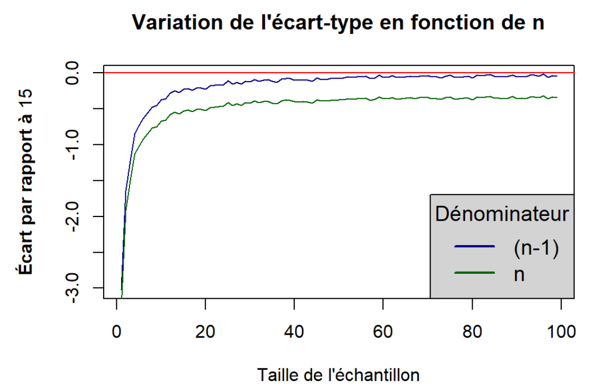

```{r}
#| echo: false
#| message: false
#| warning: false
#| error: false

source("global2.R")

library(webexercises)

```

# Distribution d'échantillonnage {#sec-chap9}


::: {.callout-tip style="color: blue;"}

<font size="5"> Que peut-on apprendre en tirant un nombre infini
d'échantillons d'une population dont les paramètres sont connus?
</font>

:::
  
Cette question nous conduit directement au coeur le l'inférence statistique. Tenter d'y répondre nous permettra de jeter les bases de l'ensemble des stratégies permettant d'en connaître un peu plus sur les paramètres d'une population donnée.  
  

## Le contexte

On s'intéresse à une population d'observations dont on connait les
caractéristiques essentielles: la forme de la distribution (uniforme,
Gaussienne, Exponentielle, etc), la moyenne et la variance/écart-type.
De cette population, on tire un grand nombre d'échantillons desquels on
obtient une statistique échantillonnale (moyenne, variance, proportion,
médiane, etc.). Notre attention se porte alors sur les caractéristiques
de l'ensemble des statistiques échantillonnales obtenues. Donc
essentiellement, on part d'une population dont on connait les
paramètres, et on étudie ce qui pourrait se produire si on tire des
échantillons de cette population.

Dans les démonstrations et exercices présentés dans la section
précédente, il devrait être acquis que les statistiques calculées pour
un échantillon seront très probablement différentes de celles calculées
pour un autre échantillon. Étant donné que la sélection des sujets
composant un échantillon se fait de manière aléatoire, différents
échantillons seront composés de sujets différents. Et puisque les
statistiques échantillonnales utilisent les informations fournies par
ces sujets, leur variation est un fait avéré.

Puisque les statistiques échantillonnales sont le résultat d'une
expérience aléatoire, on peut les considérer de la même manière qu'on
l'a fait pour des observations obtenues d'un sujet particulier. Donc, on
peut tracer la distribution d'une statistique donnée (moyenne, médiane,
écart-type, consensus, etc.) calculée pour un très grand nombre
d'échantillons. Cette distribution porte le nom de: **distribution
d'échantillonnage** de la statistique qui la compose.

Ces distributions sont en quelque sorte la substance vitale de
l'inférence statistique! Sans elles, aucune inférence concernant un
paramètre d'une population n'est possible. C'est donc sans surprise que
l'essentiel des procédures d'analyse inférentielle de données gravite
autour de la détermination de leurs caractéristiques.

Dans le présent chapitre, nous abordons l'étude de distributions
d'échantillonnage de deux manières:

1.  **par voie de simulation**: nous disposons de populations et de 
    la technologie nécessaire pour en extraire des
    échantillons. Les instruments informatiques nous permettront
    d'échantillonner une population autant de fois qu'il sera nécessaire
    de le faire pour nous permettre de spécifier différentes
    caractéristiques des distributions d'échantillonnage. Cette approche
    est privilégiée dans un premier temps, dans le présent document. Il
    s'agit d'une approche **empirique**.
2.  **par voie analytique**: en supposant que certaines conditions ou
    postulats sont respectés, il est possible, dans certains cas,
    d'obtenir la spécification de différentes caractéristiques des
    distributions d'échantillonnage en utilisant des énoncés
    mathématiques, ou équations définissant ces caractéristiques. Cette
    approche est privilégiée dans la plupart des exposés d'introduction
    aux méthodes quantitatives. Cette approche est dite **théorique**.

La  @fig-ajust1 illustre les deux approches à l'examen de
distributions de probabilités.

```{r}
#| label: fig-ajust1
#| fig-cap: "Distribution empirique (histogramme) versus distribution théorique (courbe en vert). La distribution empirique est obtenue à partir des données, alors que la distribution théorique est construite à partir de formulations mathématiques. Si les deux distributions s'ajustent bien, les probabilités obtenues de l'une seront comparables à celles obtenues de l'autre."
#| echo: false
#| message: false
#| warning: false


data <- data.frame(x = rf(100000, df1 = 10, df2 = 20))
breaks <- hist(data$x, breaks = "Scott", plot = FALSE)$breaks

ggplot(data, aes(x)) +
  geom_histogram(breaks = breaks, 
                 aes(y = after_stat(density)), 
                 fill = "lightblue", 
                 color = "black") +
  xlim(0, 4) +
  ylim(0, 1) +
  labs(x = "X", 
       y = "Densité", 
       title = TeX('Distribution $\\F$ avec $\\dl_1 = 10$ et $\\dl_2 = 20$')) +
  theme_minimal() +
  theme(plot.title = element_text(size = 20, 
                                  hjust = 0.5),
        axis.text = element_text(size = 16),
        axis.title = element_text(size = 20),
        axis.line = element_line(color = "black")) +
  stat_function(fun = stats::df, 
                args = list(df1 = 10, df2 = 20), 
                geom = "line", 
                color = "darkgreen", 
                size = 1) +
  annotate("text", x = 2.5, y = 0.5, label = "Ajustement: Excellent", size = 6, color = "red")

```

Dans cette figure, on représente les données observées pour un ensemble
d'entités. La hauteur des barres est proportionnelle à la fréquence
relative (proportion/probabilité) des valeurs possibles. On peut y
percevoir une forme générale présentant des irrégularités, toutes
résultantes de la nature aléatoire des données recueillies. À cet
histogramme, on superpose une courbe définie par une formulation
mathématique qui elle aussi, pour autant que l'ajustement par rapport
aux données empiriques est adéquat, peut permettre le calcul des
probabilités. Ces calculs seront au moins approximativement exacts si
vraiment l'ajustement entre la fonction théorique et les données
empiriques est bon. Ce ne serait pas le cas pour la distribution
illustrée dans la  @fig-ajust2:

```{r}
#| label: fig-ajust2
#| fig-cap: "Distribution empirique (histogramme) versus distribution théorique (courbe en rouge). La distribution théorique ne semble pas suivre les données empiriques de près. L'utilisation de la distribution théorique pour le calcul de probabilités fournirait des estimations erronées."
#| echo: false
#| message: false
#| warning: false

ggplot(data, aes(x)) +
  geom_histogram(breaks = breaks, 
                 aes(y = after_stat(density)), 
                 fill = "lightblue", 
                 color = "black") +
  xlim(0, 4) +
  ylim(0, 1) +
  labs(x = "X", 
       y = "Densité", 
       title = TeX('Distribution $\\F$ avec $\\dl_1 = 10$ et $\\dl_2 = 20$')) +
  theme_minimal() +
  theme(plot.title = element_text(size = 20, 
                                  hjust = 0.5),
        axis.text = element_text(size = 16),
        axis.title = element_text(size = 20),
        axis.line = element_line(color = "black")) +
  stat_function(fun = dnorm, 
                args = list(mean = 1, sd = 0.5), 
                geom = "line", 
                color = "red", 
                size = 1) +
  annotate("text", x = 2.5, y = 0.5, label = "Ajustement: Pauvre", size = 6, color = "red")

```

Le degré d'accord entre la distribution théorique et la distribution
empirique est relativement faible. Les caractéristiques du modèle
théorique ne correspondent pas aux caractéristiques des données
empiriques. En calculant des probabilités à partir de la distribution
empirique fournirait des réponses exactes, mais l'utilisation de la
distribution théorique fournirait des réponses erronées. Pour utiliser
cette dernière distribution, il faudra donc s'assurer de la qualité de
l'ajustement par rapport aux données empiriques. La précision des
probabilités obtenues sera donc **conditionnelle** au respect de
différents **postulats** qui dépendent du type de données analysées.

Une compréhension du matériel présenté ici est essentielle et préalable
à tout ce qui sera abordé non seulement dans les chapitres suivants,
mais aussi dans toutes les formations en méthodes quantitatives qu'on
sera amené à entreprendre à l'avenir. Il est donc important d'y apporter
une attention particulière!

## Distribution d'échantillonnage d'une moyenne: Grands échantillons {#sec-distrmoy0}

Supposons une population infinie, dont la distribution est uniforme avec
des valeurs comprises entre 0 et 10. On tire de cette population, un
échantillon de 25 observations (**x = runif(25,0,10)**). Finalement, on calcule la moyenne des données recueillies auprès de cet échantillon (**moy = mean(x) **):

```{r 04-Chap4-63}
#| code-fold: false

x <- runif(25,0,10)
moy <- mean(x)

```

$$\bar{X}=`r round(moy, 3)`$$

Tirons de cette même population, un second échantillon de même taille:

```{r 04-Chap4-64}
#| code-fold: false

x <-  runif(25,0,10)
moy <-  mean(x)

```

$$\bar{X}=`r round(moy, 3)`$$

La variation de la statistique échantillonnale (la moyenne) est
évidente. Répétons cette expérience 10,000 fois, en tirant à chaque
fois un nouvel échantillon de 25 sujets. La procédure implique quatre
étapes:

1.  Tirer un échantillon de *n* = 25 observations: **runif(n, 0, 10)**
2.  Calculer la moyenne de cet échantillon: **mean(runif(n, 0, 10))**
3.  Répéter *nrep* fois: **replicate(nrep, ...)**
4.  Affichage de la distribution des moyennes: **hist(dismoy, ...)**

Le code R suivant effectue ces opérations, générant 10,000 échantillons de taille $n=25$. Pour chaque échantillon, on calcule la moyenne, pour finalement calculer la moyenne et l'écart-type des moyennes.

```{r}
#| code-fold: false

nrep <- 10000 
n <- 25
dismoy <- replicate(nrep, mean(runif(n, 0, 10)))
mean_val <- mean(dismoy)
sd_val <- sd(dismoy)
```


La  @fig-dist1 illustre la **distribution d'échantillonnage des moyennes** obtenue de cette manière.

```{r}
#| label: fig-dist1
#| fig-cap: "Distribution d'échantillonnage des Moyennes. Les échantillons sont de taille n = 25, tirés d'une distribution uniforme ($U_{[0, 10]}$). Le nombre d'échantillons est égal à 10,000."
#| message: false
#| warning: false

h <- hist(dismoy, breaks = "FD", plot = FALSE)
breaks <- h$breaks
moydat <- data.frame(dismoy)

ggplot(moydat, aes(x = dismoy)) +
  geom_histogram(breaks = breaks, 
                 aes(y = after_stat(density)), 
                 fill = "lightblue", 
                 color = "black") +
  labs(x = TeX("$\\bar{X}$"), y = "Densité",
       title = 'Distribution d\'échantillonnage\n des moyennes') +
  theme_minimal() +
  theme(plot.title = element_text(size = 20, hjust = 0.5),
        axis.text = element_text(size = 16),
        axis.title = element_text(size = 20),
        axis.line = element_line(color = "black")) +
  annotate("text", 
           x = 6.3,
           y = 0.4, 
           label = TeX(paste("$\\mu_{\\bar{x}} =", round(mean_val, 3), "$")),
           hjust = 0, 
           vjust = 1, 
           size = 6, 
           fontface = "bold", 
           color = "red") +
  annotate("text", 
           x = 6.3,
           y = 0.3, 
           label = TeX(paste("$\\sigma_{\\bar{x}} =", round(sd_val, 3), "$")),
           hjust = 0, 
           vjust = 1, 
           size = 6, 
           fontface = "bold", 
           color = "red") 


```

Dans les sections précédentes, nous avons souvent rencontré ce type de
distribution, qualifiée de *Normale*. Et dans plusieurs cas, nous l'avons utilisée de manière à
obtenir certaines probabilités. Dans le contexte actuel, tout ce qui a
été dit demeure vrai! On peut donc répondre à certaines questions telles que:

1.  En tirant un échantillon de 25 sujets de cette population, quelle
    est la probabilité que sa moyenne soit supérieure
    à 6? (la fonction @lst-DistHist permet d'illustrer les situations à l'étude)
    
```{r}
#| code-fold: false

DistHist(moydat$dismoy, ub=6, col="red")
```


Toutes les moyennes composant la distribution d'échantillonnage des moyennes se trouvent dans l'objet **dismoy**, que l'on peut sonder directement en comptabilisant le nombre de moyennes supérieures à 6, et en divisant ce nombre par le nombre d'échantillons tirés de la population

```{r  }
#| code-fold: false

p <- sum(dismoy>6)/nrep

```

$$P(\bar{X}>6)=\frac{`r sum(dismoy>6)`}{10000}= `r round(p, 3)`$$

2.  En tirant un échantillon de 25 sujets de cette population, quelle
    est la probabilité que sa moyenne soit inférieure à 4.5?
    

```{r}
#| code-fold: false

DistHist(moydat$dismoy, lb=4.5, col="red")

```


```{r  }
#| code-fold: false

p <- sum(dismoy < 4.5) / nrep

```

$$P(\bar{X}<4.5)=\frac{`r sum(data$dismoy<4.5)`}{10000}= `r round(p, 3)`$$

3.  En tirant des échantillons de 25 sujets de cette population, à
    l'intérieur de quelles limites centrales retrouve-t-on 95% des
    moyennes?
    

```{r}
#| code-fold: false

DistHist(moydat$dismoy, 
         lb=quantile(dismoy, 0.025), 
         ub=quantile(dismoy, 0.975), 
         col="red") +
  annotate("text",
           x = 5,
           y = 300, 
           label = "95%",
           hjust = 0.5, 
           vjust = 1, 
           size = 8, 
           fontface = "bold", 
           color = "darkblue") 

```

    Pour répondre à cette question, on peut procéder de deux manières:

-   En utilisant la fonction **quantile()**: cette fonction permet
    d'obtenir directement les percentiles recherchés:

```{r 04-Chap4-68}
#| code-fold: false

intvl = round(quantile(dismoy,c(0.025,0.975)),3)

```

$$P( `r round(intvl[1], 3)` \le \bar{X} \le `r round(intvl[2], 3)` = 0.95 $$

-   En calculant directement les limites à partir de l'ensemble des moyennes: pour obtenir l'aire centrale comprenant 95% des $\bar X$, on doit essentiellement déterminer le $2.5^{ième}$ et le $97.5^{ième}$ percentiles. Ces valeurs s'obtiennent en trouvant les valeurs de $\bar X$ occupant les positions $nrep \times 0.025$ et $nrep \times 0.975$ dans la séquence ordonnée des moyennes:

```{r}
#| code-fold: false

li <- sort(dismoy)[nrep*(0.025)]
lu <- sort(dismoy)[nrep*(0.975)]

```
    
$$P( `r round(li, 3)` \le \bar{X} \le `r round(lu, 3)` = 0.95 $$

Suite à cette dernière question, on peut aisément imaginer des zones
particulières, sous cette distribution:

1.  une région où les moyennes ont des valeurs probables: elles sont
    localisées autour de la moyenne de la population. Cette zone
    pourrait correspondre à un intervalle tel que celui obtenu
    ci-dessus, où 95% des moyennes se trouvent compris entre `r round(li, 3)` et
    `r round(lu, 3)` . En d'autres termes, en tirant un échantillon de *n* = 25
    observations, la probabilité que sa moyenne soit comprise dans cet
    intervalle est égale à 0.95. Évidemment, on pourrait définir des
    intervalles correspondant à différents niveaux de probabilité. Pour
    le besoin des discussions futures, identifions cette probabilité par
    $(1-\alpha)$

2.  Deux régions où les moyennes ont des valeurs improbables: elles sont
    localisées dans chacune des extrémités de la distribution
    d'échantillonnage. Considérant toujours $(1-\alpha)=0.95$, en tirant
    un échantillon de *n* = 25 observations, la probabilité que sa
    moyenne soit comprise dans l'une ou l'autre de ces extrémités est
    égale à $1-0.95 = 0.05$. Évidemment, on pourrait définir des
    intervalles correspondant à différents niveaux de probabilité liée
    aux extrémités de la distribution. Pour les besoins des discussions
    futures, identifions cette probabilité par $\alpha$.
    

::: {.webex-check .webex-box} 
**MINI-QUIZ 1**  

**Vrai ou Faux**:
  
- Une distribution d'échantillonnage s'ajuste nécessairement à une distribution théorique `r torf(FALSE)`

- L'intérêt de connaître une distribution d'échantillonnage est qu'elle permet le calcul de probabilités utiles `r torf(TRUE)`  

- La distribution d'échantillonnage des moyennes est une distribution de probabilité des moyennes calculées à partir de plusieurs échantillons de la même taille `r torf(TRUE)`  

- La distribution d'échantillonnage des moyennes suit toujours une distribution normale, quelle que soit la distribution de la population sous-jacente `r torf(FALSE)`  

- Selon le théorème central limite, la distribution d'échantillonnage des moyennes devient plus étroite à mesure que la taille de l'échantillon augmente `r torf(TRUE)`  

- Une augmentation de la variabilité dans la population entraîne une réduction de la largeur de la distribution d'échantillonnage des moyennes `r torf(FALSE)` 

La distribution d'échantillonnage des moyennes est utilisée pour estimer les paramètres de la population sans erreur `r torf(FALSE)` 

**Choix multiples**:  

- Qu'est-ce que la distribution d'échantillonnage des moyennes ? `r longmcq(c("La distribution des moyennes calculées à partir d'un échantillon unique", answer = "La distribution des moyennes calculées à partir de plusieurs échantillons de mêmes tailles,  tirés de la même population", "La distribution des valeurs de la population entière", "La distribution des valeurs extrêmes de l'échantillon"))`  

- La distribution d'échantillonnage des moyennes suit de près la distribution: `r mcq(c("binomiale", answer = "normale", "exponentielle", "multinomiale"))`  

- Dans une distribution d'échantillonnage, les valeurs probables d'une statistique données se trouve généralement dans `r mcq(c("l'extrémité inférieure", "l'extrémité supérieure", "l'une ou l'autre des extrémités", answer = "le centre"))` de la distribution.  

- Si la taille de l'échantillon augmente, que se passe-t-il avec la distribution d'échantillonnage des moyennes ?  `r mcq(c(answer = "Elle devient plus étroite", "Elle devient plus large", "Elle reste la même", "Elle devient asymétrique"))`

- Quel théorème stipule que la distribution d'échantillonnage des moyennes suit une distribution normale, quelle que soit la distribution de la population sous-jacente, à condition que la taille de l'échantillon soit suffisamment grande ?  `r mcq(c("Théorème ou Loi des grands nombres", "Théorème de la variance", answer = "Théorème central limite", "Théorème de la moyenne"))`

- Quel est l'effet de l'augmentation de la variabilité dans la population sur la distribution d'échantillonnage des moyennes ?  `r mcq(c("Elle la rend plus étroite", "Elle la rend symétrique", answer = "Elle la rend plus large", "Elle ne change pas"))`

- Pour qu'une distribution de probabilité théorique puisse servir dans un contexte d'inférence statistique, il est nécessaire qu'elle `r longmcq(c("ait une même échelle que la variable étudiée", answer = "s'ajuste bien à la distribution d'échantillonnage considérée", "soit gaussienne (normale), ou au moins qu'elle s'en approche"))`.  

- Par simulation, on obtient 10,000 échantillons aléatoires de $n=15$ observations chacun, d'une population dont $\mu = 20$ et $\sigma=4$. Pour obtenir la probabilité que la moyenne d'un échantillon, $\bar{X}$, soit inférieure à 9.5, on devrait:  
`r longmcq(c(answer = "Comptabiliser le nombre de moyennes dont la valeur est inférieure à 9.5, et le diviser par 10,000",
"Comptabiliser le nombre de moyennes dont la valeur est inférieure à 9.5 et soustraire ce nombre de 10,000",
"Comptabiliser le nombre de moyennes dont la valeur est inférieure à 9.5 et le diviser par 15",
" Supposer que la distribution au niveau de la population est normale et utiliser cette distribution pour calculer la probabilité requise"))`  

- Quelle est la signification du terme "erreur standard de la moyenne" ?  `r longmcq(c(answer = "L'écart-type de la distribution d'échantillonnage des moyennes",
"L'erreur commise lors du calcul de la moyenne de l'échantillon",
"L'erreur due à la taille de l'échantillon",
"L'erreur due à la variabilité dans la population"))`  

- Pourquoi la distribution d'échantillonnage des moyennes est-elle importante en statistique ?  longmcq(c("Elle nous permet d'examiner la variabilité des échantillons",
"Elle nous aide à estimer les paramètres de la population",
"Elle facilite les comparaisons entre différentes populations",
answer = "Toutes les réponses ci-dessus"))`  

:::

### La moyenne de la DEM

La moyenne de la distribution d'échantillonnage des moyennes, on peut le
concevoir aisément, devrait être très rapprochée de la moyenne de la
population. La simulation suivante en fait la démonstration. Supposons
une population infinie, distribuée de manière uniforme entre 0 et 10. La
moyenne de cette population est **(10-0)/2 = 5.0**. En tirant trois
échantillons de taille 25, on obtient les moyennes suivantes:

```{r 04-Chap4-69}
#| code-fold: false

set.seed(1234567)
moys = replicate(3,
                 mean(runif(25,0,10)))

```

$$\bar{X}_1 = `r round(moys[1], 3)` \qquad \bar{X}_2 = `r round(moys[2], 3)` \qquad \bar{X}_3 = `r round(moys[3], 3)`$$

On note qu'aucune des trois moyennes n'est égale à la véritable moyenne
de la population. Par contre, elles n'en sont pas très éloignées. Si on
calcule la moyenne de ces trois moyennes, on obtient:

```{r 04-Chap4-70}
#| code-fold: false

mmoys <- mean(moys)
```

$$\mu_{\bar{X}}=`r round(mmoys, 3)`$$

On constate que la moyenne des trois moyennes se rapproche de la moyenne
de la population. Effectivement, puisque les échantillons sont tous de
la même taille, la moyenne des moyennes est la moyenne d'un échantillon
unique de taille $3\times n$ observations. Or, on sait que plus la taille d'un
échantillon est grande, plus les statistiques échantillonnales (la
moyenne par exemple) se rapprochent du paramètre correspondant de la
population. À la limite, en tirant un nombre infini d'échantillons, la
moyenne des moyennes est égale à la moyenne de la population. Répétons
l'expérience 10,000 fois pour se convaincre que cet énoncé est vrai:

```{r 04-Chap4-71}
#| code-fold: false

moys = replicate(10000,
                 mean(runif(25,0,10)))
mmoys <- mean(moys)

```

$$\mu_{\bar{X}}=`r round(mmoys, 3)`$$

Cette fois-ci, on est très près du but! Avec un nombre infini de
réplications, la moyenne de la distribution d'échantillonnage des
moyennes serait effectivement égale à la moyenne de la population.

### L'écart-type de la DEM

L'écart-type de la distribution d'échantillonnage des moyennes porte un
nom spécial: il s'agit de l'**erreur-standard des moyennes**. En effet,
l'écart-type de toute distribution d'échantillonnage est une
**erreur-standard** ou **erreur-type** d'une statistique donnée.

Devrait-on s'attendre à ce que, comme c'est le cas pour la moyenne,
l'écart-type de la distribution d'échantillonnage des moyennes soit égal
à l'écart-type de la population?

L'écart-type d'une distribution uniforme est donné par l'équation @eq-es1:

$$\sigma =\sqrt{\frac{(b-a)^2}{12} }$$ {#eq-es1}

Pour la population étudiée et pour laquelle $a=0$ et $b=10$, on obtient: 

$$\sigma =\sqrt{\frac{(10-0)^2}{12}}=2.8868   $$
  
Par simulation, en générant 1 million d'observations, on trouve effectivement:

```{r 04-Chap4-72}
#| code-fold: false

etpop <- sd(runif(1000000, 0, 10))

```

$$\sigma_X= `r round(etpop, 4)`$$

ce qui est une approximation très satisfaisante qui ne pourrait que s'améliorer avec une augmentation du nombre d'observations.

Pour la suite des choses, identifions l'erreur-standard des moyennes par
le symbole $\sigma_{\overline{x}}$. La question qu'il convient de se poser à ce stade est: '**quel est le rapport entre l'écart-type d'une population et l'erreur-standard des moyennes d'échantillons tirés de cette dernière?**'

Réfléchissons un peu: l'écart-type de la population ($\sigma$) mesure la
dispersion des **données** composant cette population. D'autre part,
l'**erreur-standard des moyennes** ($\sigma_{\overline{x}}$) mesure la
dispersion des **moyennes** d'échantillons tirés de cette population! Ces
deux quantités sont tout à fait différentes et ne peuvent pas être égales, à moins que la taille de l'échantillon soit égale à la taille de la population. Pour s'en convaincre,
revenons à notre population et cette fois, calculons l'écart-type de
l'ensemble des moyennes calculées pour un grand nombre d'échantillons de
25 sujets chacun:

```{r 04-Chap4-73}
#| code-fold: false

set.seed(1234567)
moys <- replicate(1000000,
                  mean(runif(25,0,10)))
mmoys <- mean(moys)
etmoys <- sd(moys)

```

$$\mu_{\bar{X}}=`r round(mmoys, 4)` \qquad \sigma_{\bar{X}}=`r round(etmoys, 4)`$$

L'erreur-standard des moyennes ($\sigma_{\bar {X}}=`r round(etmoys, 3)`$) se distingue donc de l'écart-type de la
population ($\sigma_X=`r round(etpop, 3)`$). Mais puisque les échantillons sont tirés d'une population
possédant une certaine dispersion, on pourrait parier qu'il existe un
lien entre l'écart-type et l'erreur standard. Examinons la possibilité
que ce lien en soit un de proportionnalité, en calculant le rapport entre
ces deux quantités:

```{r 04-Chap4-74}
#| code-fold: false

res <- etpop / etmoys
```

$$\frac{Écart.type}{Erreur.std} = \frac{`r round(etpop, 4)`}{`r round(etmoys, 4)`}=`r round(res, 4)`$$

Dans le cas présent, on obtient un rapport essentiellement égal à 5.
Rappelons que la taille de l'échantillon est *n* = 25. Or, la racine
carrée de 25 est justement 5.0! Se pourrait-il que l'erreur-standard
soit une fonction de la taille de l'échantillon? Intuitivement, on
pourrait aisément le penser: plus la taille de l'échantillon est grande,
plus on s'approche de la population entière, et par conséquent plus
l'erreur standard devrait être petite. Vérifions la possibilité que
l'erreur-standard des moyennes puisse se définir par l'équation @eq-esm:

$$\sigma_{\overline{x}}=\frac{\sigma}{\sqrt{n}}$$ {#eq-esm}

Répétons l'expérience en tirant 100,000 échantillons de chacune des tailles 25, 100,
144, 225 et 400. Les résultats de l'expérience sont résumés dans le tableau @tbl-tbles1.

```{r}
#| label: tbl-tbles1
#| tbl-cap: "Variations de l'erreur-standard des moyennes en fonction de la taille de l'échantillon"

set.seed(1234567)

ns <- c(9, 16, 25, 36, 49, 64, 81, 100, 225, 400)  # Tailles d'échantillons
n_samples <- 10000
mmoys <- numeric(length(ns))
smoys <- numeric(length(ns))
semoys <- 2.8868 / sqrt(ns)
for (i in seq_along(ns)) {
  means <- replicate(n_samples, mean(runif(ns[i], 0, 10)))
  mmoys[i] <- mean(means)
  smoys[i] <- sd(means)  # Corrected to calculate the standard deviation of means
}
res <- data.frame(ns, mmoys, smoys, semoys)
colnames(res) = c("n","Moyenne","E.S. Empir","E.S. Théor")
res %>%
  kbl(booktabs=TRUE, digits=3) %>%
  kable_styling(bootstrap_options = c("striped", "hover", "condensed"), 
                full_width=FALSE) %>%
  column_spec(1, bold=TRUE)


```
  
Il semble évident qu'un lien de proportionnalité existe entre la taille
de l'échantillon et la valeur de l'erreur-standard. Peu importe la taille de l'échantillon, la moyenne de la distribution des moyennes est égale à la moyenne de la population, mais son erreur-standard diminue lorsque $n$ augmente.

Pour renforcer notre conviction quant au lien entre la taille de l'échantillon et la précision des estimations (c'est-à-dire la diminution de l'erreur-standard), la  @fig-simulse résume le résultat d'une simulation dans laquelle on tire 1000 échantillons pour chacun des $n$=[1, ..., 500], d'une population dont $\mu=10$ et $\sigma=2$. On calcule ensuite la moyenne de la distribution des moyennes, ainsi que l'erreur standard correspondante. On note que plus $n$ est grand, plus la moyenne de la distribution s'approche de la vraie moyenne de la population. La précision de l'estimateur s'accroit. Cette augmentation de la précision est également manifeste en ce que l'erreur-standard diminue en fonction de $n$.

```{r}
#| label: fig-simulse
#| fig-cap: "Moyenne et erreur-standard en fonction de la taille de l'échantillon"
#| echo: false
#| warning: false

load("data/simuldat.rda")
plotdat_mean = data.frame(x = 2:500,
                          y = resul$mean)

plotdat_se = data.frame(x = 2:500,
                        y = resul$se)


ggplot(data = plotdat_mean, aes(x = x, y = y)) +
  geom_smooth(method = "gam", se = F, color = "black", 
              linetype = "dotted", size = 0.5) +
  geom_line(color = "gray39") +
  scale_color_grey() +
  theme_minimal() +
  theme(panel.background = element_rect(fill = "#FFFEFA",
                                        size = 0),
        plot.background = element_rect(fill = "#FFFEFA",
                                       size = 0)) +
  ylab("Moyenne") +
  xlab("Taille de l'échantillon") -> p1

ggplot(data = plotdat_se[2:499,], aes(x = x, y = y)) +
  geom_smooth(method = "gam", se = F, color = "black", 
              linetype = "dotted", size = 0.5) +
  geom_line(color = "gray39") +
  scale_color_grey() +
  theme_minimal() +
  theme(panel.background = element_rect(fill = "#FFFEFA",
                                        size = 0),
        plot.background = element_rect(fill = "#FFFEFA",
                                       size = 0)) +
  ylab("Erreur Standard") +
  xlab("Taille de l'échantillon") -> p2

grid.arrange(p1, p2, nrow=1)

```

Nous avons donc tous les éléments nécessaires pour spécifier les caractéristiques de la
distribution d'échantillonnage des moyennes:

-   Il s'agit d'une distribution gaussienne, ou normale
-   Sa moyenne est égale à la moyenne de la population ($\mu$)
-   Son erreur standard est défini par l'équation @eq-es2:
  
$$\sigma_{\overline{x}}=\frac{\sigma}{\sqrt{n}}$$ {#eq-es2}

Ces énoncés forment l'essentiel du **Théorème Central-Limite**
concernant la distribution d'échantillonnage d'une moyenne.

On peut visualiser l'adéquacité de la distribution Gaussienne pour représenter la distribution d'échantillonnage des moyennes affichée dans la  @fig-demnorm. La distribution théorique (courbe en rouge) est spécifiée par les résultats de la simulation effectuée à la section @sec-distrmoy0 et affichés dans la  @fig-dist1: $\mu_{\bar{X}}=5.0$ et $\sigma_{\bar{X}}=0.577$.

```{r}
#| label: fig-demnorm
#| fig-cap: "Normalité de la distribution des moyennes"
#| echo: false
#| message: false
#| warning: false

h <- hist(dismoy, breaks = "FD", plot = FALSE)
b <- cut(1, h$breaks)

ggplot(data.frame(x = dismoy), aes(x = x)) +
  geom_histogram(breaks = h$breaks, aes(y = ..density..), fill = "lightblue", color = "black") +
  labs(
    x = "Moyennes",
    y = "Densité",
    title = TeX("Distribution d'échantillonnage des moyennes")
  ) +
  theme_minimal() +
  theme(
    plot.title = element_text(size = 20, hjust = 0.5)
  ) +
  stat_function(
    fun = dnorm,
    args = list(mean = mean(dismoy), sd = sd(dismoy)),
    xlim = c(3, 7),
    color = "red",
    lwd = 1
  ) +
  annotate("text", 
           x = 6.3,
           y = 0.4, 
           label = TeX(paste("$\\mu_{\\bar{x}} =", round(mean_val, 3), "$")),
           hjust = 0, 
           vjust = 1, 
           size = 6, 
           fontface = "bold", 
           color = "red") +
  annotate("text", 
           x = 6.3,
           y = 0.3, 
           label = TeX(paste("$\\sigma_{\\bar{x}} =", round(sd_val, 3), "$")),
           hjust = 0, 
           vjust = 1, 
           size = 6, 
           fontface = "bold", 
           color = "red") 

```


On peut constater, au moins visuellement, que la distribution normale s'ajuste très bien à la distribution d'échantillonnage des moyennes. De manière plus formelle, la fonction **fitdist()** de la librairie **fitdistrplus** estime la moyenne et l'écart-type d'un ensemble de données, en supposant une distribution spécifique (normale dans le cas présent), et fournit des représentations graphiques permettant de juger de la normalité de la distribution. Il ne s'agit pas ici de calculer la moyenne et l'écart-type de la distribution, mais bien de déterminer si cette distribution pourrait être 'normale' et d'en spécifier les paramètres en supposant que c'est le cas. On constate que l'estimation obtenue est identique à ce que nous avons obtenu dans les calculs précédents:

```{r}
#| label: demadjust
#| fig-cap: "Ajustement de la loi normale à la distribution d'échantillonnage des moyennes, en utilisant la fonction **fitdist()** de la librairie **fitdistrplus**"
 FIT <- fitdistrplus::fitdist(dismoy, "norm")
 FIT
 plot(FIT)
 
```


Utilisant la fonction **fitdistr()** de la librairie **MASS** fournit des résultats identiques:

```{r}
#| code-fold: false

fit <- MASS::fitdistr(dismoy, "normal")
fit$estimate

```

On constate que les paramètres obtenus sont identiques à la moyenne et à l'erreur-standard calculés précédemment.

À ce point, il ne devrait plus y avoir de doute concernant les caractéristiques de la distribution d'échantillonnage des moyennes. En bref, on peut étudier la distribution d'échantillonnage des moyennes

-   en tirant un **très grand nombre d'échantillons** d'une population
    et en calculant la moyenne et l'écart-type des moyennes obtenues
    pour chaque échantillon, ou ...
-   en tirant **un seul échantillon** d'une population et en considérant
    le fait que la distribution d'échantillonnage 'théorique' a une
    moyenne égale à la moyenne de la population, et en calculant son
    erreur-standard à partir de l'écart-type de la population (s'il est
    connu) et la taille de l'échantillon.

Le problème avec cette seconde option, c'est que la moyenne de la
population demeure inconnue. On ne peut que supposer que si on tirait un
grand nombre d'échantillons de la population on obtiendrait ce résultat,
mais l'expérience n'est pas réalisée, ni même généralement réalisable dans un contexte réel.

Lorsque les échantillons sont tirés d'une population finie, l'erreur standard des moyennes doit tenir compte du taux
d'échantillonnage, défini par le rapport entre la taille de l'échantillon et la taille de la population:

$$Taux~~d'échantillonnage=\frac{n}{N}$$ {#eq-esmFin}

Plus la taille de l'échantillon est grande, plus ce taux s'approche de 1 et moins importante sera la
correction. La définition de l'erreur standard des moyennes devient alors:

$$\sigma_{\bar X}=\left [\frac{\sigma}{\sqrt{n}}\right ] \left [ \sqrt{\frac{N-n}{N-1}} \right ]=\left [\frac{\sigma}{\sqrt{n}}\right ] \left [ \sqrt{1-\color{red}{\frac{n}{N}}} \right ]$$ {#eq-esmInf}

Le facteur par lequel l'erreur-standard est multiplié porte le nom de **coefficient d'exhaustivité**. Par exemple, supposons une population finie composée de $N=1000$ entités, dont l'écart-type est égal à 15. On tire un échantillon de 50
observations de cette population. On peut donc estimer l'erreur-standard des moyennes:

$$\sigma_{\bar X}=\left [\frac{15}{\sqrt{50}}\right ] \left [ \sqrt{1-\frac{50}{1000}} \right ]=2.1213 \times 0.9747=2.068$$
  
La correction se traduit par une légère diminution de l'erreur standard.
Plus le taux d'échantillonnage est élevé (*n* est grand), plus le
coefficient d'exhaustivité est faible et par conséquent, plus
l'erreur-standard est petite. Par exemple, pour *n*=200, on a:

$$\sigma_{\bar X}=\left [\frac{15}{\sqrt{200}}\right ] \left [ \sqrt{1-\frac{200}{1000}} \right ]=1.0607 \times 0.8944=0.9487$$
  
Une telle correction devra être appliquée dans plusieurs situations où la population est finie.

### Mise en application

Les caractéristiques de la distribution d'échantillonnage des moyennes
ont pu être déterminées de manière analytique. Nous connaissons
maintenant sa forme (gaussienne), sa moyenne (la moyenne de la
population), et sa dispersion (l'erreur-standard des moyennes). De
quelle manière peut-on tirer profit de ces connaissances pour procéder
au calcul de probabilités?

Sous R, les fonctions suivantes nous aideront dans ce contexte:

-   **dnorm(x, mean = 0, sd = 1)**: Fonction de densité (probabilité de x, x
    faisant partie d'une distribution normale dont la moyenne est nulle
    (par défaut) et son écart-type est l'unité (par défaut))
-   **pnorm(x, mean = 0, sd = 1, lower.tail = TRUE)**: Probabilité
    cumulative, $P(-\infty<x)$, par défaut
-   **qnorm(p, mean = 0, sd = 1, lower.tail = TRUE)**: Fonction quantile: X
    sous lequel on trouve $(100\times p)\%$ de la distribution
-   **rnorm(n, mean = 0, sd = 1)**: Génération de nombres aléatoires normalement distribués avec $\mu=0$ et $\sigma=1$.

#### Exemples:

Pour les besoins des exemples suivants, considérons une population de
grande taille $N=500,000$, normalement distribuée. Le code R suivant génère une telle population. 

```{r}
#| code-fold: false
 
set.seed(150752)
N <- 500000
x <- rnorm(N, 50, 8)
m1 <- mean(x)
s1 <- sd(x)
```

La moyenne de cette population est $\mu = `r round(m1, 3)`$ et $\sigma = `r round(s1, 3)`$.  Dans ces conditions,

1.  Quelle est la probabilité que la moyenne d'un échantillon de taille
    $n=30$ tiré de cette population, soit supérieure à 52?

```{r}
#| echo: false

normal_area(mean=m1, 
            sd=s1/sqrt(30), 
            lb=52, 
            acolor="red")
mtext("Distribution des moyennes", 
      side=3, 
      cex=1.3)
text(50,0.10,
     TeX('$p \\left (\\bar{X}>52 \\right )=?$'), 
     cex=1, 
     col="darkblue")
arrows(50,0.09,52.5,0.02,
       col="darkblue", 
       lwd=2, 
       length=0.15)
arrows(50,0.005,52,0.005,
       code=3,
       lwd=2,
       col="darkgreen", 
       length=0.15)
text(51,0.017,
     "z=1.351", 
     cex=0.8)
```

-   Une première étape conduisant vers une solution consiste à
    standardiser la valeur considérée ($\bar X = 52$). Le score Z
    représente cette moyenne en unité d'erreur standard des moyennes:
    
```{r}
#| echo: false

se <- s1 / sqrt(30)
z <- (52-m1) / se
```


$$\sigma_{\bar X}=\frac{\sigma}{\sqrt n}=  \frac{ `r round(s1, 3)`}{\sqrt {30}}=`r round(se, 3)`$$

$$Z=\frac{\bar X - \mu}{\sigma_{\bar X}}=\frac{52-`r round(m1, 3)`}{`r round(se, 3)`}=`r round(z, 3)`$$

Dans la distribution d'échantillonnage des moyennes, une moyenne
échantillonnale égale à 52 se trouve à `r round(z, 3)` écart-type au-dessus de la
moyenne de la population. Sous R, on peut obtenir ces résultats en
utilisant le code suivant, évoquant la fonction **pnorm()** pour obtenir la probabilité recherchée:

```{r}
#| echo: false
se <- s1/sqrt(30)
z52 <- (52 - m1) / se
p <- pnorm(z52, lower.tail=FALSE)
```

$$\sigma_{\bar{X}}=`r round(se, 3)`$$ 
$$z_{52}=`r round(z52, 3)`$$
$$P(\bar{X}>52) = `r round(p, 3)`$$

2.  Quelle sont les limites d'un intervalle central comprenant 95% de la
    distribution des moyennes d'échantillons de taille *n*=30
    observations? La situation est représentée dans la  @fig-distex2:

```{=html}
<!-- -->
```

```{r}
#| label: fig-distex2
#| fig-cap: "Intervalle comprenant 95% des moyennes, sous la distribution d'échantillonnage"
#| echo: false
prm <- c(mean(x), se)
normal_area(mean=mean(x),
            sd=sd(x)/sqrt(30), 
            lb=qnorm(0.025, mean(x), se),
            ub=qnorm(0.975, mean(x), se), 
            acolor="red")
mtext("Distribution des moyennes", 
      side=3, 
      cex=1.6)
text(50,0.10,
     "95%", 
     cex=2, 
     col="darkblue")
arrows(47,0.15,
       qnorm(0.025,
             mean(x),se), 
       0.04,
       col="darkblue", 
       lwd=2,
       length=0.15)
arrows(53,0.15,
       qnorm(0.975,mean(x),se), 
       0.04,
       col="darkblue",
       lwd=2,
       length=0.15)
text(47,0.17,
     "Lim Inf = ?", 
     cex=1.1)
text(53,0.17,
     "Lim Sup = ?", 
     cex=1.1)
```

Sous R, on propose deux manières de déterminer les valeurs limites recherchées:  

- Utilisant la fonction **qnorm()** : si 95% de la distribution se trouve au centre, les deux extrémités contiennent chacune 2.5% de l'aire sous la courbe. On doit donc rechercher les percentiles $P_{2.5}$ et $P_{97.5}$, les premiers arguments de la fonction.

```{r}
#| code-fold: false

liminf <- qnorm(0.025, m1, se)
limsup <- qnorm(0.975, m1, se)

```

$$P(`r round(liminf, 3)` \le \bar{X} \le `r round(limsup, 3)`)=0.95$$

On trouve donc qu'en tirant un échantillon de *n*=30 observations d'une population dont la moyenne est $\mu=`r round(m1, 3)`$ et l'écart-type est $\sigma_X=`r round(s1, 3)`$, on a 95% des chances que la moyenne de cet échantillon soit
comprise entre `r round(liminf,3)` et `r round(limsup,3)`.
  
## Distribution d'échantillonnage des moyennes: Petits échantillons, $\sigma$ inconnu
  
Lorsque l'écart-type de la population est connu, notre niveau d'incertitude ne repose que sur les moyennes des observations: elles seules sont le fruit du hasard. Lorsque $\sigma$ est inconnu, ce qui est généralement le cas, la seule information dont nous disposons pour l'estimer est l'écart-type de l'échantillon ($s_x$), et ce faisant, puisque cette quantité est obtenue à partir de données aléatoires, nous ajoutons une part additionnelle d'incertitude à la situation: comme la moyenne, $s_x$ fluctue d'un échantillon à l'autre, et l'erreur d'échantillonnage s'applique autant à cette statistique qu'à la moyenne.  

> Et il y a plus: lorsqu'un échantillon est de faible taille (*n* < 30, par exemple), son écart-type risque de sous-estimer l'écart-type de la population d'où il est tiré. 

L'expérience suivante illustre ce fait. Pour *n* = {2:100}, on tire 10,000 échantillons d'une population normalement distribuée avec $\mu=100$ et $\sigma=15$. En calculant l'écart-type de chacun des échantillons d'une taille donnée, on obtient la distribution d'échantillonnage des écart-types dont on calcule la moyenne. Cette moyenne est la valeur de l'écart-type que l'on s'attend d'obtenir pour des échantillons d'une certaine taille, tirés de la population spécifiée. La  @fig-smalln résume les résultats de cette expérience: l'axe vertical représente la différence entre l'écart-type attendu et l'écart-type de la population, et l'axe horizontal représente la taille de l'échantillon (*n*). 
  
Nous profitons de l'occasion pour visualiser l'impact de la correction de Bessel dans le calcul de l'écart-type d'un échantillon:
  
  * Sans correction: $s_X=\sqrt{\frac{\sum{(X-\bar X)^2}}{n}}$  
  * Correction de Bessel: $s_X=\sqrt{\frac{\sum{(X-\bar X)^2}}{n-1}}$


```{r }
#| label: fig-smalln
#| fig-cap: "Estimation de l'écart-type de la population en fonction de la taille d'échantillon"
#| echo: false


```

```{r}
#| label: fig-smalln2
#| fig-cap: "Estimation de l'écart-type de la population en fonction de la taille d'échantillon"
#| echo: false
#| eval: false

stddev <- function(x){
  sd_sample <- sd(x)
  sd_pop <- sqrt((n-1)/n) * sd_sample
  sds <- c(sd_sample, sd_pop)
  return(sds)
}
#
s <- matrix(2, 100)
s1 <- vector()
s2 <- vector()
# Pour chaque n, obtenir l'écart-type attendu
for(i in 2:100){
  s <- replicate(10000,stddev(rnorm(i,100,15)))
  s1[i-1] <- mean(s[1, ])
  s2[i-1] <- mean(s[2, ])
}
# Affichage graphique
plot(s1 - 15,
     type="l", 
     main="Variation de l'écart-type en fonction de n", 
     xlab="Taille de l'échantillon",
     ylab=TeX(r'(Écart par rapport à $\sigma=15$)', bold=TRUE),
     col="darkblue")
lines(s2 - 15,
     type="l", 
     main="Variation de l'écart-type en fonction de n", 
     xlab="Taille de l'échantillon",
     ylab=TeX(r'(Écart par rapport à $\sigma$)', bold=TRUE),
     col="darkgreen")
abline(h=0, col="red")
legend("bottomright",
       legend=c("(n-1)","n"), 
       title="Dénominateur",
       bg="lightgrey",
       col=c("darkblue","darkgreen"), 
       lty=1,
       lwd=2,
       cex=1)
```

La  @fig-smalln illustre que le fait d'appliquer cette correction (utiliser $n-1$ au dénominateur plutôt que $n$) permet de réduire le biais dans l'estimation de l'écart-type de la population à partir de données échantillonnales. On peut voir que si la correction n'est pas appliquée (courbe verte), la valeur de l'écart-type ne s'approche que très lentement de l'écart-type de la population et ne l'égalera que pour $n=\infty$. Par contre, l'application de la correction (ligne bleue) permet un rapprochement beaucoup plus rapide, la différence étant négligeable lorsque $n > 30$.

On note immédiatement que pour $n < 30$, la sous-estimation de la variation est importante. La conséquence de ce fait est que la distribution normale utilisée comme modèle théorique pour les calculs de probabilités relatives à la distribution d'échantillonnage des moyennes n'est plus appropriée lorsque les échantillons sont de faibles tailles. On doit trouver une distribution théorique permettant de corriger cette situation. Quelles seraient les caractéristiques d'une telle distribution? L'expérience suivante fournira quelques éléments de réponse.

Supposons une population infinie, normalement distribuée, dont la moyenne $\mu=50$, mais dont la dispersion est inconnue. On tire de cette population 100,000 échantillons de taille $n=5$, et pour chacun d'eux, on calcule la moyenne et l'écart-type, pour finalement calculer:

$$t=\frac{\bar X-\mu}{s/\sqrt{n}} $$ {#eq-t}

La valeur de $t$ est une valeur standardisée de la moyenne de l'échantillon, en fonction de l'écart-type de l'échantillon ($s$). On y reconnait une estimation de l'erreur-standard des moyennes, au dénominateur de sa définition. 

On obtient donc 100,000 valeurs de $t$ et on établit sa distribution, illustrée dans la  @fig-student1. Dans cette figure, l'histogramme reproduit la distribution empirique des t calculés, alors que la courbe en rouge reproduit la distribution normale théorique.

```{r}
#| label: fig-student1
#| fig-cap: "Distribution des valeurs de t observées pour des échantillons de taille n=5"
#| echo: false

simT <- function(m, s, n){
  x <- rnorm(n, m, s)
  t <- (mean(x)-m) / (sd(x) / sqrt(n))
  return(t)
}

n <- 5
mu <- 50
sigma <- 12
nrep <- 100000

ts <- replicate(nrep, simT(mu, sigma, n))

hist(ts, breaks="FD",
     freq=FALSE,
     prob=TRUE,
     ylab="Densité",
     xlab="t",
     main="Distribution de t (n = 5)",
     ylim=c(0, 0.5),
     xlim=c(-5, 5))

curve(dnorm(x), 
      from = -5, to = 5, 
      n = 5000, 
      col= 'red', 
      lwd=2, 
      add = TRUE)

```

On note une distribution symétrique qui semble de démarquer de la distribution normale en ce que ses extrémités sont plus lourdes, ce qui traduit une dispersion plus élevée que dans une distribution normale. En effet, l'écart-type des valeurs de $t$, $\sigma_t=`r round(sd(ts), 3)`$, alors que $\sigma_z=1$. En conséquence, le calcul de probabilités fondé sur la distribution normale dans une telle situation fournirait de fausses réponses. Par contre, le problème serait moins prononcé si la taille des échantillons augmentait, comme on peut le constater dans la  @fig-student2, pour des échantillons de taille $n=50$.

```{r}
#| label: fig-student2
#| fig-cap: "Distribution des valeurs de t observées pour des échantillons de taille n=50"
#| echo: false

simT <- function(m, s, n){
  x <- rnorm(n, m, s)
  t <- (mean(x)-m) / (sd(x) / sqrt(n))
  return(t)
}

n <- 50
mu <- 50
sigma <- 12
nrep <- 100000

ts <- replicate(nrep, simT(mu, sigma, n))

hist(ts, breaks="FD",
     freq=FALSE,
     prob=TRUE,
     ylab="Densité",
     xlab="t",
     main="Distribution de t (n = 50)",
     ylim=c(0, 0.5),
     xlim=c(-5, 5))

curve(dnorm(x), 
      from = -5, to = 5, 
      n = 5000, 
      col= 'red', 
      lwd=2, 
      add = TRUE)

```

On trouve, dans ce cas, $\sigma_t=`r round(sd(ts), 3)`$, une valeur qui s'approche de la dispersion d'une distribution normale ($\sigma=1$).

Le modèle recherché doit donc posséder les caractéristiques suivantes:
  
* Symétrie: comme la distribution normale  
* Centrée sur 0: comme la distribution normale standardisée  
* Dispersion supérieure à la dispersion de la distribution normale standardisée  
* Dispersion dépendante de la taille de l'échantillon.  
  
La **distribution de Student** possède les caractéristiques nécessaires pour cette situation: comme la distribution normale standardisée, elle est symétrique avec une moyenne nulle, mais son écart-type est supérieur à 1.0. En effet, la dispersion de la distribution de Student dépend du nombre de degrés de liberté, reflet de la taille de l'échantillon. Plus la taille de l'échantillon est petite, plus l'écart-type de la distribution de Student est grand.

Le nombre de degrés de liberté ($dl$) sur lequel se fondent plusieurs distributions de probabilité théoriques, dont la distribution de Student, est simplement le nombre de valeurs qui sont libres de varier, dans le calcul d'une quantité donnée. Par exemple, si la somme de 5 scores est égale à 15, quatre d'entre eux peuvent prendre n'importe quelles valeurs, mais une fois ces valeurs fixées, le cinquième score est nécessairement déterminé: il n'est plus libre de varier. Le nombre de degrés de liberté dans ce cas est $dl=5-1=4$.  
  
La distribution de Student varie donc en fonction du nombre de degrés de liberté, son écart-type décroissant avec toute augmentation de ce nombre, jusqu'à atteindre 1.0 lorsque $dl=\infty$. De fait, l'écart-type de la distribution de Student n'est défini qu'en terme du nombre de degrés de liberté, tel qu'explicite dans l'équation @eq-dl1:
  
$$\sigma_{t_{dl}}=\sqrt{\frac{dl}{dl-2}}$$ {#eq-dl1}
  
Pour $dl=5$, on trouve:
  
$$\sigma_{t_{5}}=\sqrt{\frac{5}{5-2}}=1.291$$
La  @fig-ett illustre la variation de l'écart-type de la distribution de Student en fonction du nombre de degrés de liberté. 
  

```{r}
#| label: fig-ett
#| fig-cap: "Variation de l'écart-type de la distribution de Student, en fonction du nombre de degrés de liberté"
#| echo: false

sig <- vector()
for(i in 3:50){
  sig[i] <- sqrt(i/(i-2))
}

plot(sig, 
     type="l", 
     main=TeX(r'($\sigma_{t_{dl}}$ en fonction de $dl$)', bold=TRUE),
     xlab="Degrés de liberté", 
     ylab=TeX(r'($\sigma_{t_{dl}}$)', bold=TRUE), cex.lab=1.2, cex.main=1.5)
              
```

On note que lorsque $dl$ est supérieur à 25 ou 30, l'écart-type de la distribution est très près de 1.0, la valeur limite pour $dl=\infty$. 

La  @fig-ett2 présente les distributions de Student pour différents degrés de liberté:

```{r}
#| label: fig-ett2
#| fig-cap: "Distributions de Student pour différents degrés de liberté."
#| echo: false

x <- seq(-3,3,0.01)
df <- c(1, 3, 5, 30)
colors <- c("red", "blue", "darkgreen", "gold", "black")
labels <- c("dl=1", "dl=3", "dl=5", "dl=30", "dl=Infini")
#
plot(x, dnorm(x), type="l", lty=2, xlab="t",
     ylab="Densité", main="Comparaison de la distribution de Student \n pour différents degrés de liberté")
#
for (i in 1:4){
  lines(x, dt(x,df[i]), lwd=1.5, col=colors[i])
}

legend("topright", title="Distr. de Student",
       labels, lwd=1.5, lty=c(1, 1, 1, 1, 2), col=colors, cex=1)
```

Plus le nombre de degrés de liberté est élevé, plus la distribution de Student s'approche de la distribution gaussienne. À la limite, pour $dl=\infty$, les deux distributions coïncident (courbe pointillée). En pratique, on peut noter que pour $dl=30$, la distribution de Student suit de très près la distribution normale.
  
Sous R, à l'instar des distributions de probabilité étudiées jusqu'à maintenant, un ensemble de fonctions facilitent les calculs de probabilités dont nous avons besoin:
  
  1. **dt(x, dl)**: fonction de densité - Probabilité de x pour dl degrés de liberté
  2. **pt(x, dl**, lower.tail=TRUE): fonction de probabilité cumulative
  3. **qt(p, dl**, lower.tail=TRUE): fonction quantile: valeur de t sous (par défaut) laquelle on retrouve 100p% de la distribution
  4. **rt(n, dl**): génération de nombres aléatoires


Exemple 1: Quelle proportion de la distribution se trouve sous t = 2.27, lorsque $dl=24$?


```{r}
#| code-fold: false

t_area(df=24, ub=2.27, acolor="red")
p <- pt(2.27, 24, lower.tail=TRUE)

```

$$dl=5 :P(t < 2.27)= `r round(p, 3)` $$

Exemple 2: Quelle est la proportion de la distribution comprise entre t = -1,5 et t = 0.75, lorsque $dl=15$?
  
```{r}
#| code-fold: false

t_area(df=15, lb=-1.5, ub=0.75, acolor="red")
p1 <- pt(-1.5, df=15, lower.tail=TRUE)
p2 <- pt(0.75, df=15, lower.tail=TRUE )
pr <- p2 - p1

```

$$dl=5 :P(-1.5 \le t \le 0.75) = `r round(pr, 3)` $$

Exemple 3: Quelle est la probabilité que t soit supérieur à 1.96, lorsque $dl=5$?

```{r}
#| code-fold: false

t_area(df=5, lb=1.96, acolor="red")
p1 <- pt(1.96, df=5, lower.tail=FALSE)

```

$$dl=5 :P(t>1.96) = `r round(p1, 3)` $$

Exemple 4: Quelle proportion de la distribution se trouve sous t = 1.96, lorsque $dl=\infty$?
  
```{r}
#| code-fold: false

t_area(df=Inf, ub=1.96, acolor="red")
p1 <- pt(1.96, df=Inf, lower.tail=TRUE)

```

$$dl=\infty \; :P(t \le 1.96)=`r round(p1, 3)` $$

Ce dernier exemple illustre le fait que pour $dl=\infty$, les probabilités calculées à partir de la distribution de Student et celles obtenues de la distribution normale standardisée sont identiques:

```{r}
#| code-fold: false

p2 <- pnorm(1.96, lower.tail=TRUE)
```

$$P(z \le 1.96)= `r round(p2, 3)` $$

Exemple 3: Quel est le troisième quartile de la distribution de Student, pour $dl=10$?

```{r}
#| code-fold: false

q <- qt(0.75, 10, lower.tail=TRUE)

```

$$dl = 10 \; : Q_3 = `r round(q, 3)` $$


### Application DistrEchant

La manipulation et la visualisation de données est une activité importante pour parvenir à maîtriser les concepts pertinents à l'inférence statistique. Plusieurs applications, accessibles sur Internet, s'avèrent enrichissantes dans ce contexte. Le premier onglet de l'application [DistrEchant](https://daniel-coulombe.shinyapps.io/DistrEchant/) permet de visualiser et d'expérimenter diverses distributions d'échantillonnage, incluant la distribution des moyennes (par défaut). On pourra manipuler la distribution de la population (uniforme, normale, exponentielle et asymétrique positive) et ses paramètres, de même que la taille de l'échantillon et leur nombre.  Le calcul des probabilités à l'aide de la distribution empirique est également possible à l'aide de cette application.
  

::: {.webex-check .webex-box} 
**MINI-QUIZ 2**  

**Vrai ou Faux**:
  
- On peut s'attendre à ce que la moyenne de la distribution d'échantillonnage des moyennes, établie à partir d'un très grand nombre d'échantillons, soit sensiblement différente de la moyenne de la population ($\mu_X$) `r torf(FALSE)`  

- Plus l'écart-type de la population est grand, plus la valeur de l'erreur-standard des moyennes est faible `r torf(FALSE)`  

- De la même manière, plus la taille de l'échantillon est grande, plus la valeur de l'erreur-standard des moyennes est faible `r torf(TRUE)`  

- Lorsque la population est finie, l'erreur-standard des moyennes pourrait être supérieur à celui qu'on obtiendrait dans le cas d'une population infinie  `r torf(TRUE)`  

- Comme la distribution normale, la distribution de Student est déterminée par sa moyenne et son écart-type `r torf(FALSE)`  

  
**Choix multiples**:  

- Lorsque l'écart-type de la population est connu, la distribution de probabilité appropriée pour représenter une distribution d'échantillonnage de moyennes est la distribution: `r mcq(c("de Student", answer = "normale", "exponentielle", "uniforme"))`  

- En tirant un grand nombre d'échantillons de taille $n=10$, d'une population distribuée de manière uniforme, avec un minimum de 10 et un maximum de 20, on obtient une distribution d'échantillonnage qui serait apparentée à la distribution `r mcq(c("uniforme", "normale", answer = "de Student", "binomiale"))`    

- En tirant un grand nombre d'échantillons de taille $n=1$, d'une population distribuée de manière uniforme, avec un minimum de 10 et un maximum de 20, on obtient une distribution d'échantillonnage qui serait apparentée à la distribution `r mcq(c(answer = "uniforme", "normale", "de Student", "binomiale"))`  

:::

## Distribution d'échantillonnage des variances  

De la même manière qu'on a pu établir la distribution d'échantillonnage
des moyennes dans la section précédente, il est possible d'établir la
distribution des variances. Cette distribution peut être produite en utilisant une approche empirique, par simulation, ou une approche analytique en utilisant une distribution de probabilité théorique pour autant que les postulats pertinents sont respectés.

### Approche empirique

Comme dans le cas de la distribution des moyennes, on obtient la distribution d'échantillonnage des variances en tirant d'une population un grand nombre d'échantillons d'une certaine taille, en calculant la variance de
chacun de ces échantillons, pour finalement établir la distribution des variances observées. Le code R suivant effectue ce travail: on tire 100,000 échantillons de taille *n*=5 tirées d'une distribution
gaussienne ($\mu = 100, ~~\sigma = 15$), ce qui produit la  @fig-var1:

```{r}
#| label: fig-var1
#| fig-cap: "Distribution d'échantillonnage des variances"
#| code-fold: false
#| message: false
#| warning: false

nrep <- 100000
disvar <- replicate(nrep, var(rnorm(5, 100, 15)))
m1a <- mean(disvar)
s1a <- sd(disvar)
ska <- skewness(disvar)
kua <- kurtosis(disvar)

DistHist(disvar, 
         stat = expression(s^2), 
         title = "Distribution d'échantillonnage des Variances", 
         col = "lightblue", 
         xlim = c(0, quantile(disvar, 0.999)))

```

Les caractéristiques de cette distribution sont les suivantes:  

$$\mu_{s^2}=`r round(m1a, 3)` \qquad \sigma_{s^2}=`r round(s1a, 3)`$$
$$Sk_{s^2}=`r round(ska, 3)` \qquad Ku_{s^2}=`r round(kua, 3)`$$

Dans un premier temps, on note que la moyenne de la distribution
d'échantillonnage des variances est égale à la variance de la population
(les échantillons sont tirés d'une distribution gaussienne dont
l'écart-type est égal à 15, donc la variance est égale à 225). On
pouvait s'attendre à un tel résultat.

En ce qui concerne l'erreur-standard de la distribution des variances, $\sigma_s=`r round(sd(disvar), 3)`$, elle est très différente de l'écart-type de la population ($\sigma_x=15$). Ce fait n'est nullement une surprise, puisque ces deux quantités concernent des variables aléatoires différentes et non directement comparables. Cependant, comme c'est le cas de l'erreur-standard des moyennes, on peut concevoir que la valeur de $\sigma_{s^2}$ pourrait dépendre de la taille de l'échantillon.

Finalement, qu'en est-il de la forme de la distribution
d'échantillonnage des variances? Dans cette simulation, on utilise des
échantillons de petite taille (*n* = 5) de manière à faire ressortir
une caractéristique de la distribution d'échantillonnage des variances:
elle est asymétrique positive! En effet, l'indice de symétrie [$Sk =
 `r round(ska, 3)`$] a une valeur positive sensiblement éloignée de 0.
On note également que la distribution est fortement leptokurtique, avec
$Ku= `r round(kua, 3)`$. Par contre, ces écarts par rapport à une
distribution gaussienne décroissent en fonction de la taille de
l'échantillon. Le tableau @tbl-disvar3 résume la situation en répétant
l'expérience pour *n* passant de 5 à {10, 25, 50, 100, 500}:

```{r}
#| label: tbl-disvar3

nrep <- 100000  
ns <- c(5, 10, 25, 50, 100, 500)

compute_stats <- function(n) {
  disvar2 <- replicate(nrep, 
                       var(rnorm(n, 100, 15)))
  sk <- skewness(disvar2)
  ku <- kurtosis(disvar2)
  moy <- mean(disvar2)
  et <- sd(disvar2)
  return(c(n, moy, et, sk, ku))
}

stats <- t(sapply(ns, compute_stats))

df <- data.frame(stats)
colnames(df) <- c("n", "Moyenne", "Erreur Std", "Symétrie", "Voussure")

df %>%
  kbl(booktabs = TRUE,
      digits=3,
      caption = "Caractéristiques de la distribution d''échantillonnage des Variances, en fonction de n") %>%
  kable_styling(bootstrap_options = c("striped", "hover", "condensed"), 
                full_width=FALSE) %>%
  column_spec(1, bold=TRUE)

```

De ce tableau, on note que la moyenne de la distribution des variances s'approche de
la véritable variance de la population, quelle que soit la taille de
l'échantillon. Ce résultat est attendu et analogue à ce qu'on a observé
dans le cas de la distribution d'échantillonnage des moyennes. On note
également que l'erreur standard de la distribution des variances diminue
en fonction de la taille de l'échantillon, un résultat qui lui aussi
était attendu.

Concernant la forme de la distribution, on constate que le degré
d'asymétrie diminue en fonction de la taille de l'échantillon: pour
$n=\infty$, la symétrie serait parfaite. On constate également que la
distribution d'échantillonnage des variances est leptokurtique pour de
faibles tailles d'échantillon, mais qu'une augmentation de cette taille
se traduit à la limite, pour $n=\infty$, par une distribution
mésokurtique ($Ku=3.0$).

Une autre caractéristique de cette distribution qu'on doit noter est
qu'étant donné qu'une variance ne peut être négative, l'ensemble de la
distribution est localisé du côté positif, ce qui n'est pas
nécessairement le cas pour la distribution d'échantillonnage des
moyennes.

Malgré ces différences, il est toujours possible de calculer la
probabilité d'obtenir, en tirant un échantillon d'une certaine taille,
une variance située dans une zone ou une autre de la distribution. Par
exemple, quelle est la probabilité d'obtenir une variance supérieure à 400, en
tirant un échantillon de 5 sujets d'une population dont la distribution
est uniforme entre 0 et 10? Cette situation est illustrée par la  @fig-disvar5.

```{r}
#| code-fold: false

pr <- mean(disvar > 300)
```

    
```{r}
#| label: fig-disvar5
#| fig-cap: "Distribution d'échantillonnage des variances pour n=5. On recherche la probabilité d'obtenir une variance supérieure à 300, pour un échantillon aléatoire tiré d'une population normalement distribuée. La ligne verticale indique la position de la moyenne de la distribution, approximativement égale à la variance de la population."
#| echo: false

p <- DistHist(disvar, 
              ub = 300, 
              stat = expression(s^2), 
              title = "Distribution d'échantillonnage \n des Variances", 
              col = "red", 
              xlim = c(0, quantile(disvar, 0.999)))
p <- p + geom_vline(xintercept = mean(disvar), linetype = "dashed", color = "darkblue", size = 1) +
  annotate( "text", 
            x = 600, 
            y = 1500, 
            label = paste("P(Var > 300) = ", round(pr, 4)),
            color = "red", 
            size = 5)
print(p)
```


La distribution d'échantillonnage des variances se démarque donc de la
distribution d'échantillonnage des moyennes quant à sa forme. Cette
dernière s'ajuste très bien à une distribution gaussienne, ce qui n'est
pas le cas de la première, sauf lorsque la taille de l'échantillon est
infinie.

### Approche analytique

De manière analytique, il est possible d'obtenir les caractéristiques de
la distribution d'échantillonnage des moyennes: il suffit de se rappeler
le théorème central limite! Mais qu'en est-il de la distribution
d'échantillonnage des variances? Par quelle formulation mathématique
pouvons-nous établir les caractéristiques de cette distribution? On sait
que sa forme est asymétrique positive, et que sa moyenne est égale à la
variance de la population, mais quelle est son erreur standard?

Une distribution de probabilité théorique susceptible d'être un modèle
pour la distribution d'échantillonnage des variances doit être
asymétrique positive, cette asymétrie diminuant en fonction de la taille
de l'échantillon. La distribution normale est donc à exclure pour ce
poste. La distribution exponentielle est asymétrique positive et la
variable aléatoire qu'elle concerne ne prend que des valeurs positives,
ce qui semblerait correspondre à ce que l'on recherche. Mais
malheureusement, elle ne s'applique que lorsque les événements évalués
surviennent dans un intervalle de temps ou un espace bien délimité. Et
ce n'est pas le cas de la variance d'un échantillon. On doit donc
introduire une autre distribution de probabilité qui pourrait très bien
remplir le rôle dans le présent contexte: la distribution du $\chi^2$,
**chi carré** (ou du **chi-deux**, selon les auteurs). Cette
distribution ne s'ajuste pas très bien à la distribution des variances
telle que définie plus haut. On doit en quelque sorte *standardiser* les
variances, un peu comme on l'a fait avec les moyennes en les
transformant en scores Z ou en $t$. La transformation nécessaire se définit par la
relation:

$$\chi^2=\frac{(n-1)s^2}{\sigma^2}$$ {#eq-chi2}

Dans cette équation, $s^2$ correspond à la variance de l'échantillon, et $\sigma^2$
représente la variance de la population.

Examinons l'impact de cette transformation sur la distribution des variances, à l'aide d'une simulation. Des échantillons ($k=100,000$) de taille *n*=25 sont tirés d'une population distribuée normalement avec une moyenne $\mu=100$ et un
écart-type $\sigma=15$. La @fig-disvar6 affiche la distribution des variances originales, avant la transformation:

```{r echo=1:6}
#| label: fig-disvar6
#| fig-cap: "Distribution d'échantillonnage des variances avant la transformation en chi-carré"

 nrep <- 100000  # Nombre d'échantillons à tirer
 disvar <- replicate(nrep,var(rnorm(25, 100, 15)))
 mvar <- mean(disvar)
 svar <- sd(disvar)
 kuvar <- kurtosis(disvar)
 skvar <- skewness(disvar)

DistHist(disvar, 
         lb = NULL, 
         ub = NULL, 
         stat = expression(s^2), 
         title = "Distribution d'échantillonnage des Variances", 
         col = "lightblue",
         xlim = c(0, quantile(disvar, 0.999)))

```

Les paramètres de cette distribution sont:  
  
$$\mu_{s^2}=`r round(mvar, 3)` \qquad \sigma_{s^2}=`r round(svar, 3)` $$
$$Sk_{s^2}=`r round(skvar, 3)` \qquad Ku=`r round(kuvar, 3)`$$


Tel qu'observé précédemment, la distribution est asymétrique positive. La moyenne de cette distribution est $\mu_{s^2}=`r round(mvar, 3)`$ et son erreur-standard est $\sigma_{s^2}=`r round(svar, 3)`$. On note que cette moyenne est au moins approximativement égale à la variance de la population.  On peut croire que le lien entre son erreur-standard et la taille de l'échantillon existe, comme d'est le cas pour $\sigma{\bar{X}}$, mais sa nature demeure indéterminée.

Examinons la distribution des variances transformées en $\chi^2$, reproduite dans la  @fig-disvar7.

```{r echo=1:5}
#| label: fig-disvar7
#| fig-cap: "Distribution d'échantillonnage du Chi-carré (variances transformées)"

chi2 <- 24 * disvar / 225      # chi-carré = [(n-1)s^2]/Var(X)
mchi <- mean(chi2)
schi <- sd(chi2)
kuchi <- kurtosis(chi2)
skchi <- skewness(chi2)

DistHist(chi2, 
         lb = NULL, 
         ub = NULL, 
         stat = expression(chi^2), 
         title = TeX(r'(Distribution d'échantillonnage des $\chi^2$)'),
         col = "lightblue",
         xlim = c(0, quantile(chi2, 0.999)))


```

Les paramètres de cette distribution sont:  
  
$$\mu_{\chi^2}=`r round(mchi, 3)` \qquad \sigma_{\chi^2}=`r round(schi, 3)` $$
$$Sk_{\chi^2}=`r round(skchi, 3)` \qquad Ku_{\chi^2}=`r round(kuchi, 3)`$$

On note immédiatement que la forme de la distribution demeure inchangée.
La nature de la transformation ne contient aucun élément susceptible
d'altérer cette forme (rappelons que c'était aussi le cas lors de la
transformation d'une distribution de scores bruts en scores Z!).

En ce qui concerne la moyenne de la distribution du $\chi^2$, un fait
important émerge: elle est essentiellement égale à $(n-1)$. Cette
quantité, porte un nom omniprésent en méthodes quantitatives et qu'on a déjà rencontré à quelques reprises. Il s'agit
du nombre de **degrés de liberté**. Il s'agit simplement du nombre de
données qui sont libres de varier, lors de la détermination d'une
statistique ou d'un paramètre. Par exemple, considérons un ensemble de
scores dont la somme est égale à 10: {2, 4, 3, 1}. Dans ce cas, *n* = 4.
Mais pour que la somme des nombres soit égale à 10, il n'est nécessaire
de connaître que 3 de ces valeurs; une fois fixées trois données, la
quatrième n'est plus libre de varier. Le nombre de degrés de liberté est
donc égal à 3.

Donc, il semble que la moyenne de la distribution du $\chi^2$ ($\mu_{\chi^2}=`r round(mean(chi2),2)`$) soit égale au nombre de degrés de liberté ($dl=n-1=25-1=24$).

Dans le cas présent, la variance de la distribution est
$\sigma_{\chi^2}^2$ = `r round(var(chi2), 3)`. Cette quantité est au moins
approximativement égale à 2 fois la moyenne. Et finalement, on peut
évaluer le degré d'asymétrie en fonction de la taille de l'échantillon:
$Sk=\sqrt{8/dl}$, et le degré de voussure: $Ku_{\chi^2}=12/dl$. On peut
donc écrire:

$$
\begin{align}
\mu_{\chi^2} &= dl = n-1=24\\
\sigma_{\chi^2}^2 &= 2dl=2(n-1)=48\\
Sk_{\chi^2}&=\sqrt{8/dl}={8/24}=0.577\\
Ku_{\chi^2}&=12/dl=12/24=0.5
\end{align}
$$ {#eq-chi2prop}

Toutes ces valeurs calculées sur la base d'une distribution théorique
sont pratiquement égales aux valeurs obtenues empiriquement, par
simulation, sauf pour la voussure. L'indice *Ku* obtenu de manière
analytique est centré sur 0, alors que le même indice produit pour la
distribution empirique n'est pas centré. L'indice de voussure centré
correspond à *Ku*-3. Le résultat observé ($3.49-3=0.49$) est
parfaitement en accord avec le calcul théorique. Il serait difficile
d'obtenir ces détails en outrepassant la transformation des variances en
$\chi^2$.

En considérant la distribution théorique, le lien entre la taille de
l'échantillon et la forme de la distribution devient explicite. On
considère que pour des échantillons de grandes tailles (n \> 100),

$$\chi^{2}_{dl}\approx N(dl,\sqrt {2dl})$$
La  @fig-disvar8 illustre cette distribution pour différents nombres
de degrés de liberté:

```{r}
#| label: fig-disvar8
#| fig-cap: "Distribution du Chi-Carré pour différents nombres de degrés de liberté"
#| echo: false

x1 <- seq(0, qchisq(0.999, 3), length = 100)
x2 <- seq(0, qchisq(0.999, 5), length = 100)
x3 <- seq(0, qchisq(0.999, 10), length = 100)
x4 <- seq(0, qchisq(0.999, 20), length = 100)
x5 <- seq(0, qchisq(0.999, 40), length = 100)
x <- seq(0,max(x5),length=100)
matplot(x, 
        cbind(dchisq(x,3),dchisq(x,5),dchisq(x,10),dchisq(x,20),dchisq(x,40)),
        type="l",
        ylab="Densité",
        xlab="Chi-Carré",
        xlim=c(0,60),
        col=c("red","green","blue","orange","black"),
        lty=rep(1,5), lwd=1.2)
legend("topright", 
       legend=c("dl = 3", "dl = 5", "dl = 10", "dl = 20", "dl = 40"),
       col=c("red", "blue", "green", "orange", "brown"), lty = 1, cex=1)
```

L'impact de la taille de l'échantillon, déterminant *dl*, est manifeste.
Et pour chacune de ces distributions, on peut déterminer de manière
analytique la moyenne, l'écart-type et l'indice de symétrie.

À l'instar des autres distributions de probabilité que nous avons
examinées jusqu'à maintenant, R offre un ensemble de fonctions nous
permettant les calculs de probabilité que nous serons amenés à
effectuer. Ces fonctions sont:

-   **dchisq(x, dl)**: Fonction de densité (probabilité) de $\chi^{2}_{dl}$
-   **pchisq(x, dl, lower.tail=TRUE)**: Fonction de probabilité cumulative
    $[P(0 \le \chi^{2}_{dl} \le x)]$
-   **qchisq(p, dl, lower.tail=TRUE)**: Fonction quantile - Valeur de $\chi^{2}_{dl}$ sous laquelle on trouve $(100 \times p)\%$ de la distribution
-   **rchisq(n, dl)**: Génération de nombres aléatoires

#### Calculs de probabilités sous la distribution du $\chi^2$

Considérons la distribution d'échantillonnage de variances affichée dans la @fig-disvar6, obtenue à l'aide d'échantillons de taille *n*=25. Le nombre de degrés de liberté est donc $dl=25-1=24$. Ces variances ont été transformées en $\chi^2$ et
leur distribution a été formée et présentée à la  @fig-disvar9.

```{r}
#| label: fig-disvar9
#| fig-cap: "Distribution d'échantillonnage du chi-carré pour dl=24"

DistHist(chi2, 
         lb = NULL, 
         ub = NULL, 
         stat = expression(chi^2), 
         title = TeX(r'(Distribution d'échantillonnage des $\chi^2$)'),
         col = "lightblue",
         xlim = c(0, quantile(chi2, 0.999)))
     
```

À partir de cette distribution empirique, quelle est la probabilité
qu'un échantillon de taille *n*=25 produise un $\chi^2>35$?

Comptabilisant toutes les valeurs de $\chi^2$ qui sont supérieures à 35,
on trouve, tel qu'illustré dans la  @fig-disvar13:

```{r}
#| label: fig-disvar13
#| fig-cap: "Distribution du Chi-carré pour dl=24"
#| echo: false
#| message: false
#| warning: false

pr <- round(mean(chi2 > 35), 3)

p <- DistHist(chi2, 
              lb = NULL, 
              ub = 35, 
              stat = expression(chi^2), 
              title = TeX(r'(Distribution d'échantillonnage des $\chi^2$)'),
              col = "red",
              xlim = c(0, quantile(chi2, 0.999)))
p +   annotate("text", 
                x = 35,
                y = 1500, 
                label = parse(text = paste0("P(", expression(chi^2), "> 35) == ", pr)),
                hjust = 0, 
                vjust = 1, 
                size = 5, 
                fontface = "bold", 
                color = "red")

```

Vérifions ce résultat en utilisant la distribution théorique du $\chi^2$, tel qu'affiché dans la  @fig-disvar10
:

```{r disvar10, echo=FALSE, fig.cap=}
#| label: fig-disvar10
#| fig-cap: "Distribution du Chi-carré, pour dl=24"

#Création de la courbe de densité
curve(dchisq(x, df = 24), from = 0, to = 50,
    main = 'Distribution du Chi-Carré (dl = 24)',
    ylab = 'Densité',
    lwd = 2)

x <- seq(35, 50) 

p <- dchisq(x, df = 24) #Vecteur des densités des Chi-Carrés correspondants
pr <- round(pchisq(35, 24, lower.tail=FALSE), 3)

text(42, 0.03, parse(text = paste0("P(", expression(chi^2), "> 35) == ", pr)),
     cex=1.2, col="red")

#Création de la zone ombragée (x > 35)
polygon(c(x, rev(x)), c(p, rep(0, length(p))),
        col = adjustcolor('red', alpha=0.3), border = NA)


```

On obtient des résultats qui ne laissent aucune place à une quelconque
ombre de divergence! Il semble donc que la distribution du $\chi^2$ soit
un modèle adéquat pour la distribution d'échantillonnage des variances,
pour autant que certains postulats soient respectés. Un postulat
(condition, ou prérequis) important dans la présente situation concerne
la normalité de la distribution de la population. L'adéquacité de la
distribution du $\chi^2$ comme modèle de probabilité pour la
représentation de la distribution d'échantillonnage des variances repose
fortement sur ce postulat. Pour s'en convaincre, reprenons l'expérience
précédente, mais cette fois en tirant les échantillons (toujours de
taille *n*=25) d'une distribution uniforme. Les résultats sont présentés dans la  @fig-disvar11.

```{r}
#| label: fig-disvar11
#| fig-cap: "Distribution du Chi-carré pour des échantillons tirés d'une distribution uniforme (n=25)"

nrep <- 100000  
disvar <- replicate(nrep, var(runif(25, 0, 10)))

chi2unif <- 24*disvar/8.333 # var(X) = (1/12)(10-0)**2

DistHist(chi2unif, 
         lb = NULL, 
         ub = NULL, 
         stat = expression(chi^2), 
         title = TeX(r'(Distribution d'échantillonnage des $\chi^2$)'),
         col = "lightblue",
         xlim = c(0, quantile(chi2, 0.999)))

```

De cette distribution empirique, calculons la probabilité que $\chi^2$ soit
supérieur à 35 en comptabilisant les valeurs se trouvant dans cette zone, divisé par le nombre total de valeurs ($k=100,000$):

```{r}
#| code-fold: false

p <- sum(chi2unif > 35)/nrep

```
$$P(\chi_{24}^2>35)=`r round(p, 3)` $$
Calculons la même probabilité à l'aide de la distribution théorique du $\chi^2$. On obtient alors:

```{r}
#| code-fold: false

p <- pchisq(35, 24, lower.tail=FALSE)
```

$$P(\chi_{24}^2>35)=`r round(p, 3)` $$

Les deux estimations de la probabilité $P(\chi^2 > 30)$ sont très
différentes. L'une d'entre elles doit nécessairement être inexacte. Il
est évident que les calculs des probabilités en utilisant une approche
théorique reposent au moins sur le respect du postulat de normalité de la
distribution de la population. Puisque ce postulat n'est pas respecté
ici (la distribution de la population est uniforme, et non pas normale),
c'est l'approche théorique qui est fautive.

Le tableau @tbl-disvar12 présente les principaux paramètres d'une distribution de $\chi^2$ et leur définition théorique, tel qu'énoncé au paragraphe précédent. Des échantillons ($k_1=100,000$) sont tirés d'une distribution normale, et d'autres ($k_2=100,000)$ sont tirés dune distribution uniforme. Pour chacun des échantillons, on calcule la variance, que l'on transforme en $\chi^2$. En se fondant sur la définition théorique de la distribution du $\chi^2$, on devrait obtenir empiriquement des résultats similaires aux valeurs occupant la colonne libellée **Théorique**. On note que la distribution dérivée d'échantillons tirés d'une distribution normale (** Empir Norm**) présente des valeurs rapprochées des valeurs attendues. Par contre, lorsque les échantillons sont tirés d'une distribution uniforme, les résultats indiquent le contraire.  On peut donc conclure que la normalité de la distribution de la population est un prérequis important des inférences portant sur la variance.

```{r}
#| label: tbl-disvar12
#| echo: false

idx <- c("Moyenne", "Variance", "Écart-Type", "Symétrie", "Voussure (centrée)")
Theor <- c(24, 48, 6.928, 0.577, 0.5)
compr <- c(mean(chi2), 
           var(chi2), 
           sd(chi2), 
           skewness(chi2), 
           kurtosis(chi2) - 3)
eqnthor <- c("dl", 
             "2dl", 
             "SQRT(2dl)", 
             "SQRT(8/dl)",
             "12/dl")
cUnif <- c(mean(chi2unif), 
           var(chi2unif), 
           sd(chi2unif), 
           skewness(chi2unif), 
           kurtosis(chi2unif) - 3)
tbl <- data.frame(idx, 
                  eqnthor, 
                  Theor,
                  compr, 
                  cUnif)

colnames(tbl) <- c("Paramètre", "Équation", "Théorique", "Empir Norm",  "Empir Unif")
#
tbl %>%
  kbl(digits = 3,
      booktabs=TRUE, 
      caption="Comparaison entre les paramètres obtenus par simulation à ceux dérivés de la distribution théorique du Chi-Carré. Les échantillons sont tirés d'une population normalement distribuée (**Empir Norm**) ou uniformément distribuée (**Empir Unif**). ") %>%
  kable_styling(bootstrap_options = c("striped", "hover", "condensed"), 
                full_width=FALSE) %>%
  column_spec(1, bold=TRUE) %>%
  column_spec(2, border_right = TRUE)

```

De cette expérience, il ressort que la distribution du $\chi^2$ ne
permet pas une représentation adéquate de la distribution
d'échantillonnage des variances, lorsque la distribution de la population
dévie fortement de la normalité. Par contre, les probabilités obtenues
par simulation demeurent correctes!

Un dernier point à noter concerne le fait que la forme d'une
distribution d'échantillonnage varie en fonction de la nature de la
statistique qui la compose. On a en effet pu constater que dans le cas des moyennes, la distribution normale et la distribution de Student trouvent application, alors que dans le cas des variances, la distribution du $\chi^2$ est davantage approprié. Dans les prochains chapitres, il sera nécessaire de faire appel à plusieurs autres distributions de
probabilité pour rendre compte de la spécificité de la distribution de certaines
statistiques. Cependant, peu importe la forme que prendront ces
distributions, le calcul des probabilités dont on a besoin dans un
contexte particulier se feront toujours de la même manière.

::: {.webex-check .webex-box} 
**MINI-QUIZ 3**  

**Vrai ou Faux**:
  
- La distribution d'échantillonnage des variances suit une distribution normale `r torf(FALSE)`  

- La distribution d'échantillonnage des variances est généralement asymétrique. `r torf(TRUE)`

- La moyenne de la distribution d'échantillonnage des variances est égale à la variance de la population. `r torf(TRUE)`

- Plus la taille de l'échantillon est grande, plus la distribution d'échantillonnage des variances devient large. `r torf(FALSE)` 

- Plus la taille de l'échantillon est grande, moins la distribution d'échantillonnage des variances est asymétrique `r torf(TRUE)`  

- Dans une distribution d'échantillonnage de variances transformées en $\chi^2$, on note généralement une asymétrie moindre que dans la distribution sans transformation `r torf(FALSE)`  

- Le nombre de degrés de liberté dans la distribution d'échantillonnage des variances sont égaux au nombre d'observations moins un. `r torf(TRUE)`

- Lorsque la population d'où sont tirés les échantillons ne suit pas une distribution normale, les probabilités obtenues à partir de la distribution de probabilités appropriée sont généralement précises   `r torf(FALSE)`

- La variance de la distribution d'échantillonnage des variances obtenue par simulation est au moins approximativement égale à la variance de la population  `r torf(FALSE)`  

- Si une variable aléatoire suit une distribution d'échantillonnage des variances, elle ne peut que prendre des valeurs positives.  `r torf(TRUE)`
  
**Choix multiples**:  

- Quelle distribution est utilisée pour estimer la distribution d'échantillonnage des variances ?
  `r mcq(c("de Student", "normale", answer = "Chi carré", "Fisher"))`  

- Quelle est la relation entre la distribution d'échantillonnage des variances et la distribution du chi-carré ?
  `r longmcq(c("Elles sont identiques", answer = "Elles sont proportionnelles", "La distribution du chi-carré est un cas spécial de la distribution d'échantillonnage des variances", " La distribution d'échantillonnage des variances est un cas spécial de la distribution du chi-carré"))` 

- Quel est le nom de la distribution qui est obtenue lorsque la somme des carrés des écarts à la moyenne est divisée par la variance de la population ? `r mcq(c("de Student", answer = "Chi carré", "normale", "Fisher"))` 

- Quelle est la relation entre la variance de la population et la moyenne de la distribution d'échantillonnage des variances ?
`r longmcq(c(answer = "Ces deux quantités sont égales", "Il n'y a pas de relation entre ces quantités: la première mesure la dispersion, et la seconde la tendance centrale de la distribution", "La racine carrée de la variance est égale à la moyenne, lorsque la taille des échantillons est grande", "Le carré de la moyenne est égal à la variance de la distribution"))` 

- Le(s) paramètre(s) de la distribution du $\chi^2$ est(sont): 
`r longmcq(c("la moyenne et l'écart-type", "la moyenne, l'écart-type et la taille de l'échantillon", "uniquement la moyenne de la distribution, si cette dernière est normale", answer = "le nombre de degrés de liberté"))` 
:::


## Distribution d'échantillonnage des proportions {#sec-de_prop}

Une proportion est de fait la moyenne d'une variable de Bernouilli n'offrant que deux réponses possibles: 1 = 'succès', 0 = 'échec'.  Il n'est donc pas surprenant de constater que la distribution d'échantillonnage d'une proportion possède un lien de parenté avec la distribution d'échantillonnage d'une moyenne. Les détails relatifs à cette distribution sont présentés dans les paragraphes suivants.

### Approche empirique {#sec-propemp}

Supposons que dans la population des étudiant(e)s haïtien(ne)s
inscrit(e)s dans un programme d'études supérieures, on s'intéresse à la
proportion des personnes qui possèdent un ordinateur personnel. On crée
une variable dont les valeurs sont (1) si la personne possède un
ordinateur, et (0) si elle n'en possède pas. Nous sommes donc en
présence d'une variable dichotomique, ou binaire. Il s'agit d'une
variable nominale n'offrant qu'une seule option de calcul numérique: la
comptabilisation des fréquences et éventuellement, le calcul d'une
proportion. Par exemple, la proportion des individus possédant un
ordinateur est égale au nombre d'individus pour qui c'est le cas, divisé
par le nombre total d'individus dans la population.

Plusieurs questions de recherche scientifique s'intéressent à de telles
variables et dans ces cas, la proportion occupée par une de deux
catégories au niveau de la population devient un paramètre à étudier.

Rappelons qu'une distribution binomiale résultant d'un certain nombre
d'essais (observations faites chez les étudiants de niveaux supérieurs)
présuppose que:

-   des essais produisent l'un ou l'autre de 2 résultats (être en
    possession d'un ordinateur, ou non)
-   la probabilité d'un succès est la même d'un essai à l'autre (on
    suppose que la probabilité de posséder un ordinateur est égale pour
    chaque étudiant)
-   les essais sont indépendants l'un de l'autre (le fait qu'un étudiant
    possède un ordinateur n'affecte pas la probabilité qu'un autre
    étudiant en possède un).

Si ces conditions sont respectées, alors la distribution binomiale est
caractérisée par:

-   l'espérance mathématique (la moyenne) est égale à $\mu_X = np$, $n$
    étant le nombre d'essais (taille de la population ou de
    l'échantillon), et $p$ est la probabilité d'un 'succès' (obtenir
    '1')
-   l"écart-type de la distribution est égale à
    $\sigma_X=\sqrt{np(1-p)}$

Le code R suivant génère une population d'observations effectuées auprès
d'étudiant(e)s des cycles supérieurs en Haïti, à savoir si oui (x = 1)
ou non (x = 0) ils/elles ont un ordinateur en leur possession.
Considérons cette population comme étant infinie (de très grande taille:
N = 200,000), pour l'instant. 

```{r}
set.seed(150752)
#| code-fold: false

pr <- 0.72
N <- 200000
Xpr <- sample(0:1, 200000, replace=TRUE, prob=c(1-pr, pr))
pi_p <- mean(Xpr)
```

Au niveau de cette population, la probabilité de posséder un ordinateur
est $\pi=`r round(pi_p, 4)`$, paramètre qui est généralement inconnu.  

La variable **Xpr** contient l'ensemble des observations colligées
auprès de la population. De cette population, tirons un échantillon de
100 observations, pour ensuite calculer la proportion de propriétaires
d'ordinateurs:

```{r}
#| code-fold: false

xech <- sample(Xpr, 100, replace=FALSE)
pr <- mean(xech)
```

$$P(x=1)=`r round(pr, 4)` $$

On sait déjà que la proportion observée pour cet échantillon n'est qu'un
reflet de la véritable proportion au niveau de la population. Nous ne
sommes donc pas surpris d'obtenir une proportion différente de celle
qu'on retrouve au niveau de la population.

En répétant l'échantillonnage un grand nombre de fois ($k=100,000$), et en calculant
la proportion recherchée pour chaque échantillon, on obtient la
distribution d'échantillonnage des proportions, reproduite dans la  @fig-prop1.

```{r }
#| code-fold: false

nrep <- 100000
distprop <- replicate(nrep, mean(sample(Xpr, 100, replace=FALSE)))
mp <- mean(distprop)
sp <- sd(distprop)
```

La moyenne de cette distributon, $\mu_p=`r round(mp, 4)`$, est approximativement égale à $\pi$, et son écart-type correspond à l'erreur-standard des proportions, $\sigma_p=`r round(sp, 4)`$. 

```{r}
#| label: fig-prop1
#| fig-cap: "Distribution d'échantillonnage des proportions"
#| echo: false
#| message: false
#| warning: false

breaks <- hist(distprop, breaks = "FD", plot = FALSE)$breaks
ggplot(data = data.frame(distprop), 
       aes(x = distprop)) +
  geom_histogram(breaks = breaks, 
                 aes(y = ..density..), 
                 fill = "skyblue", 
                 color = "black") +
  labs(title = "Distribution des Proportions", 
       x = "Proportion", 
       y = "Densité") +
  theme_minimal() +
  theme(
    axis.title.x = element_text(size = 16), 
    axis.title.y = element_text(size = 16),  
    plot.title = element_text(size = 20, hjust = 0.5),
    axis.line = element_line(color = "black"),  
    axis.text = element_text(color = "black")) +
  annotate("text", 
           x = 0.82,
           y = 35, 
           label = TeX(paste("$\\mu_p =", round(mp, 3), "$")),
           hjust = 0, 
           vjust = 1, 
           size = 6, 
           fontface = "bold", 
           color = "red") +
  annotate("text", 
           x = 0.82,
           y = 30, 
           label = TeX(paste("$\\sigma_p =", round(sp, 3), "$")),
           hjust = 0, 
           vjust = 1, 
           size = 6, 
           fontface = "bold", 
           color = "red")

```

De cette expérience, on note que la forme de la distribution
d'échantillonnage des proportions s'apparente à une distribution
gaussienne (c'est en fait une distribution binomiale), avec une moyenne égale à la proportion de la population des
étudiants des niveaux supérieurs possédant un ordinateur. Cette
proportion serait au moins approximativement égale à
`r round(mean(distprop),3)`, avec une erreur-standard approximativement
égale à `r round(sd(distprop),3)`. On sait que la proportion des
propriétaires d'ordinateur au niveau de la population est égale à $\mu_p=`r round(pi_p, 3)`$.
On peut donc affirmer avec confiance que la moyenne de la distribution
d'échantillonnage des proportions est égale, à la limite (ie pour un
nombre infini d'échantillons de taille *n*), à la proportion au niveau
de la population.

À partir de cette distribution, obtenir les probabilités relatives aux
proportions est une opération triviale. Par exemple,

-   quelle est la probabilité, en tirant un échantillon de 100
    observations, que la proportion des individus possédant un
    ordinateur soit supérieure à 0.75? La  @fig-prop2 illustre cette situation.

```{r}
#| code-fold: false

pr <- mean(distprop > 0.75)

```

$$P(p>0.75)=`r round(pr, 4)` $$


```{r}
#| label: fig-prop2
#| fig-cap: "Distribution d'échantillonnage des proportions"
#| echo: false

p <- DistHist(distprop,
              ub = 0.75,
              stat = "proportion (p)", 
              title = "Distribution d'échantillonnage des Proportions", 
              col = "red",
              xlim = NULL)
p + annotate("text",
             x = 0.85,
             y = 5000,
             label = paste("P(p > 0.75) = ", round(pr,3)),
             color = "red",
             fontface = "bold",
             size = 5)
```


-   Quelle est la probabilité, en tirant un échantillon de 100
    observations, d'obtenir une proportion échantillonnale comprise
    entre 0.6 et 0.75? La  @fig-prop3 illustre cette situation.

```{r}
#| code-fold: false

pr <- mean((distprop < 0.75) & (distprop > 0.6))
cat("P(0.6 < x < 0.75) = ", pr)
```

```{r }
#| label: fig-prop3
#| fig-cap: "Distribution d'échantillonnage des proportions"
#| echo: false

p <- DistHist(distprop,
              lb = NULL,
              ub = NULL,
              stat = "proportion (p)", 
              title = "Distribution d'échantillonnage des Proportions", 
              col = "lightblue",
              xlim = NULL)
p + annotate("text",
             x = 0.57,
             y = 5000,
             label = paste("P(0.6 < p < 0.75) = ",round(pr,3)),
             color = "red",
             fontface = "bold",
             size = 5) +
  annotate("segment",
           x = 0.6, xend = 0.6,
           y = 0, yend = 2500,
           colour = "red",
           size = 1.2,
           alpha = 0.6) +
  annotate("segment",
           x = 0.75, xend = 0.75,
           y = 0, yend = 2500,
           colour = "red",
           size = 1.2,
           alpha = 0.6) +
    annotate("segment",
           x = 0.6, xend = 0.75,
           y = 2500, yend = 2500,
           colour = "red",
           size = 1.2,
           alpha = 0.6,
           arrow = arrow(ends = "both",
                         length = unit(0.4, "cm")))

```

-   À l'intérieur de quelles limites retrouve-t-on les 95% centraux des
    proportions obtenues pour des échantillons de 100 observations, tel qu'illustré dans la  @fig-prop4?

```{r}
#| code-fold: false

lim <- quantile(distprop,c(0.025, 0.975))
cat("P(",lim[1]," < x < ", lim[2],") = 95%")
```

```{r}
#| label: fig-prop4
#| fig-cap: "Distribution d'échantillonnage des proportions"
#| echo: false

hist(distprop, main="Distribution des Proportions", 
     xlab="p", 
     ylab="Densité",
     breaks="FD",
     freq=FALSE)
abline(v=lim, col="red", lwd=2)
text(0.6, 10, 
     "0.025", 
     cex=1.1, col="red")
text(0.85, 10, 
     "0.025", 
     cex=1.1, col="red")
txt <- "0.95"
xt <- mean(distprop)-0.04
yt <- 13
posCoordsVec <- c(0.65, 3)
cex <- 1.3

legend(xt, yt, "0.95", box.col = "lightblue", bg = "lightgreen", cex=1.3)

```


Dans certains cas, la probabilité associée à un 'succès' est très
faible, ou très élevée. Lorsque la distribution binomiale a été discutée
au chapitre 2, démonstration a été faite que dans de tels cas, la
distribution de probabilité devient asymétrique. Cette caractéristique
aura un impact sur la distribution d'échantillonnage des proportions.
Pour s'en convaincre, formons une population de 200,000 observations
binaires, la probabilité d'un 'succès' étant égale à 0.95:

```{r}
#| code-fold: false

pr <- 0.95
x <- sample(0:1, 200000, replace=TRUE, prob=c(1-pr, pr))

```

De cette population, tirons un grand nombre d'échantillons de taille
100, et pour chacun de ces échantillons obtenons la proportion des
'succès'. La  @fig-prop5 illustre la distribution résultant de cette opération.

```{r}
#| code-fold: false

nrep <- 100000
distprop <- replicate(nrep, mean(sample(x, 100, replace=FALSE)))
mup <- mean(distprop)
sep <- sd(distprop)
```

$$\mu_p= `r round(mup, 3)` \qquad \sigma_p= `r round(sep, 3)`$$

```{r}
#| label: fig-prop5
#| fig-cap: "Distribution d'échantillonnage des proportions pour une probabilité de succès élevée (p=0.95)"
#| echo: false

hist(distprop,
     freq=FALSE,
     main="Distribution d'échantillonnage des Proportions",
     xlab="Proportions", 
     ylab="Densité"
     )

```

Le fait que la distribution d'échantillonnage soit asymétrique ne cause
cependant pas de problème pour l'évaluation empirique des probabilités.
Il suffit toujours de comptabiliser le nombre de proportions
échantillonnales se trouvant dans une zone ou l'autre de la
distribution. Par exemple, en tirant un échantillon de 100 observations
de la population qui vient d'être créée, la probabilité que la
proportion observée pour cet échantillon soit inférieure à 0.95 est
égale à:

$$P(p<0.95)= `r round(mup < 0.95, 3)` $$

Il ne faut pas se surprendre le l'asymétrie de cette distribution. En effet, une proportion est bornée par les limites 0 et 1. Plus la proportion au niveau de la population est rapprochée de l'une ou l'autre de ces valeurs, plus la symétrie est difficile à obtenir.  L'impact de l'asymétrie de la distribution d'échantillonnage se fera sentir lorsqu'une approche analytique sera utilisée pour ce type de
travail.

### Approche analytique

Dans la section précédente, on a pu constater intuitivement que sous
réserve de certains postulats, la distribution d'échantillonnage des
proportions prenait une forme gaussienne, avec une moyenne égale, à la
limite, à la proportion de 'succès' au niveau de la population
($\mu_p=\pi$). La dispersion de cette distribution d'échantillonnage est
quantifiée par son erreur-standard, $\sigma_p$, qu'il nous reste à
déterminer.

Pour une population infinie, l'erreur-standard des proportions se
définit par l'équation @eq-propa1.

$$\sigma_p=\sqrt{\frac{p(1-p)}{n}}$$ {#eq-propa1}

Pour une population finie, comme ce fut le cas pour l'erreur-standard
des moyennes, le coefficient d'exhaustivité est introduit dans l'équation @eq-propb.

$$\sigma_p=\sqrt{\frac{p(1-p)}{n}}\sqrt{1-\frac{n}{N}}$$ {#eq-propb}

Il faut mentionner que la 'normalité' de la distribution
d'échantillonnage des proportions suppose que la taille de l'échantillon
soit suffisamment grande, et que la probabilité d'un 'succès' ne soit
pas trop extrême. On considère un échantillon comme étant de taille
suffisante si la relation @eq-propc) est vérifiée:

$$\left [ p-3\sigma_p,~~p+3\sigma_p \right ]\subset \left [0,~~1 \right ]$$ {#eq-propc}

En bref, un échantillon est de taille suffisante si les valeurs de
$p\pm 3 \sigma_p$ se trouvent comprises entre 0 et 1.

À titre d'exemple, retournons à la population (infinie) d'étudiants aux
Études supérieures, et supposons que l'on ait connaissance que la
proportion de ces étudiants qui possèdent un ordinateur personnel est
égale à 0.72, ou 72%. En tirant des échantillons de 100 étudiants, et en
calculant la proportion de propriétaires d'ordinateurs, quelle est la
probabilité que cette dernière soit supérieure à 0.75 ?

-   dans ces conditions, on peut obtenir l'erreur-standard des
    proportions en calculant:

$$\sigma_p=\sqrt{\frac{p(1-p)}{n}} =\sqrt{\frac{0.72(1-0.72)}{100}}=0.0449$$
Sous R, on obtient effectivement:

```{r}
#| code-fold: false

sep <- sqrt(0.72*(1-0.72)/100)

```
$$\sigma_p=`r round(sep, 3)` $$
Est-ce qu'une taille *n*=100 est suffisante pour étudier la présente
distribution? Ce sera le cas si:

$$\left [ p-3\sigma_p,~~p+3\sigma_p \right ]\subset \left [0,~~1 \right ]$$ {#eq-cndx}
$$\left [ 0.72-3(0.0449),~~0.72+3(0.0449) \right ]\subset \left [0,~~1 \right ]$$
$$\left [ 0.585,~~0.855 \right ]\subset \left [0,~~1 \right ]$$

Cet énoncé étant vrai, la taille de l'échantillon utilisée est adéquate
et on peut procéder avec les calculs de probabilité. Ceci n'aurait pas
été le cas si la proportion au niveau de la population avait été égale à
0.90, par exemple. En effet:

$$\left [ 0.90-3(0.0449),~~0.90+3(0.0449) \right ]\subset \left [0,~~1 \right ]$$
$$\left [ 0.7653,~~1.0347\right ]\not\subset \left [0,~~1 \right ] $$

Pour $\pi = 0.90$, il serait nécessaire d'augmenter la taille de
l'échantillon de manière à réduire l'erreur-standard, ce qui
éventuellement permettrait de satisfaire la contrainte spécifiée par l'équation @eq-propc).

La nécessité de se préoccuper de la taille de l'échantillon pour une
étude utilisant la distribution d'échantillonnage des proportions
théorique est due au fait que cette distribution est fondée sur le
modèle gaussien. Or, lorsque la proportion au niveau de la population
est extrême, ce modèle ne tient plus, étant asymétrique. En conséquence,
les probabilités qu'on pourrait en obtenir seraient inexactes. Par
contre, on sait que l'asymétrie est réduite en fonction de la taille des
échantillons, et il existe une valeur de *n* telle que la distribution
des proportions s'ajuste raisonnablement bien à la distribution
gaussienne et les probabilités sont correctement évaluées. On peut
parvenir à ce résultat en augmentant la taille des échantillons.

Cette distribution d'échantillonnage, en théorie, devrait ressembler à
celle qui est affichée dans la  @fig-prop10.

```{r}
#| label: fig-prop10
#| fig-cap: "Distribution des proportions et calculs de probabilités"
#| echo: false

normal_area <- function(mean = 0, sd = 1, lb, ub, acolor = "lightgray", ...) {
  x <- seq(mean - 3 * sd, mean + 3 * sd, length = 100)

  if (missing(lb)) {
    lb <- min(x)
  }
  if (missing(ub)) {
    ub <- max(x)
  }

  x2 <- seq(lb, ub, length = 100)
  plot(x, dnorm(x, mean, sd), type = "n", ylab = "")

  y <- dnorm(x2, mean, sd)
  polygon(c(lb, x2, ub), c(0, y, 0), col = acolor)
  lines(x, dnorm(x, mean, sd), type = "l", ...)
}
#
sep <- sqrt(0.72*(1-0.72)/100)
normal_area(mean=0.73, sep, lb=0.75, acolor="red")
mtext("Distribution des Proportions", side=3, cex=1.3)
arrows(0.82, 6,
       0.79, 1.5,
       col="darkblue",lwd=2, length=0.15)
text(0.82,6.5,"P(p > 0.75) = ?", cex=0.8)
text(0.63, 6.5, paste("E.S.Prop = ", round(sep, 3)), cex=0.8)

```

En unité d'erreur-standard des proportions, la distance séparant
*p*=0.75 de $\pi=0.72$ est égale à:

$$Z=\frac{0.75-0.72}{0.045}=0.667$$

Sous la distribution normale standardisée, l'aire à droite de $p=0.75$
(ou de manière équivalente, $Z=0.667$) occupe une proportion de la
distribution égale à:

```{r}
#| code-fold: false

pr <- pnorm(0.667, lower.tail=FALSE)
cat("P(Z > 0.667) = ", pr)
```

De manière alternative, on peut utiliser les données non transformées
pour obtenir un résultat identique:

```{r}
#| code-fold: false

pr  <- pnorm(0.75, 
             mean=0.72, 
             sd=0.0449, 
             lower.tail=FALSE)
cat("P(p > 0.75) = ",pr)
```

Pour fins de comparaisons, une approche empirique au calcul de cette
probabilité donnerait les résultats suivants:

```{r}
nrep <- 10000
pEch <- replicate(nrep, 
                  mean(sample(0:1,
                              100, 
                              replace=TRUE, 
                              prob=c(0.28, 0.72))))
xbp <-  mean(pEch)
sdp <- sd(pEch)
skp <- moments::skewness(pEch)
kup <- moments::kurtosis(pEch)

```

$$\mu_p=`r round(xbp, 3)` \qquad \sigma_p=`r round(sdp, 3)` \qquad Sk_p=`r round(skp, 3)` \qquad Ku_p=`r round(kup, 3)` $$
$$P(p > 0.75) = `r round(mean(pEch > 0.75), 3)` $$

```{r}
#| label: fig-propf
#| fig-cap: "Distribution des proportions"
#| echo: false

hist(pEch, main="Distribution des Proportions", 
     xlab="p", 
     breaks="FD",
     freq=FALSE,
     prob=TRUE)

```

Ces résultats sont en accord avec ceux obtenus de manière analytique. La
moyenne de la distribution est essentiellement égale à la proportion au
niveau de la population, $\pi$, et l'erreur standard des proportions ne
se démarque que très peu de l'erreur-standard théorique. De plus, on
confirme au moins visuellement ( @fig-propf) que la distribution gaussienne est un
modèle adéquat pour cette situation, ce qui est renforcé par un indice
de symétrie se rapprochant de 0, et un indice de voussure égal à 3.0,
marques d'une distribution normale. Et finalement, la probabilité que la
proportion obtenue d'un échantillon soit supérieure à 0.75 est du même
ordre de grandeur que celle obtenue de manière théorique.


::: {.webex-check .webex-box} 
**MINI-QUIZ 4**  

**Vrai ou Faux**:
  
- Dans la distribution d'échantillonnage des proportions, la moyenne de la distribution est égale à la proportion de succès dans la population. `r torf(TRUE)`  

- La distribution d'échantillonnage des proportions est toujours normalement distribuée, quelle que soit la taille de l'échantillon. `r torf(FALSE)`

- La variance de la distribution d'échantillonnage des proportions diminue à mesure que la taille de l'échantillon augmente. `r torf(TRUE)`

- Plus la taille de l'échantillon est grande, plus la distribution d'échantillonnage des proportions devient large. `r torf(FALSE)` 

- Plus la taille de l'échantillon est grande, plus la distribution d'échantillonnage des proportions est asymétrique `r torf(FALSE)`  

- L'erreur standard de la distribution d'échantillonnage des proportions diminue à mesure que la taille de l'échantillon augmente. `r torf(TRUE)`  

  
**Choix multiples**:  

- Dans la distribution d'échantillonnage des proportions, la moyenne de la distribution est :
  `r longmcq(c(answer = "Toujours égale à la proportion de succès dans la population.", "Toujours égale à 0.5.", "Dépend de la taille de l'échantillon.", "Ne peut pas être déterminée."))`  
  
- La variance de la distribution d'échantillonnage des proportions :
`r longmcq(c("Augmente avec la taille de l'échantillon.", "Est toujours égale à 0.5.", answer = "Diminue avec la taille de l'échantillon.", "Ne peut pas être déterminée."))` 

- Si la probabilité d'un succès au niveau de la population est égale à $\pi=0.90$, la distribution d'échantillonnage des proportions sera:
  `r mcq(c("normale", "asymétrique positive", "symétrique", answer = "asymétrique négative", "rectangulaire"))` 

- L'erreur standard de la distribution d'échantillonnage des proportions est calculée en fonction de :
`r longmcq(c("La taille de l'échantillon.", answer = "La taille de l'échantillon et la proportion de succès dans la population.", "La proportion de succès dans la population.", "La moyenne de la distribution. "))` 

- La distribution d'échantillonnage des proportions devient asymétrique positive lorsque :
`r longmcq(c("La taille de l'échantillon est grande.", "La taille de l'échantillon est petite.", answer = "La proportion de succès dans la population est faible.", "La proportion de succès dans la population est élevée."))` 
:::


## Distribution d'échantillonnage des quartiles

On l'a dit, il est possible d'établir une distribution d'échantillonnage
pour toute quantité que l'on peut obtenir d'un échantillon. Certaines
statistiques sont fréquemment concernées (moyenne, variance, proportion)
et pour celles-là, on peut opérer de manière empirique, ou de manière
théorique si les postulats qui les concernent sont respectés. D'autres
statistiques sont peut-être moins fréquemment étudiées, mais non moins
intéressantes dans divers contextes de recherche. Par contre, il est
possible qu'aucune formulation théorique ne puisse nous aider à
spécifier les paramètres de leur distribution d'échantillonnage. Un
percentile fait partie de ce groupe.

### Le troisième Quartile: Q3

Par exemple, supposons que dans une recherche particulière, la
statistique d'intérêt soit le troisième quartile (ou Q3). À quoi
pourrait ressembler sa distribution d'échantillonnage? En tirant un
grand nombre d'échantillons d'une certaine taille et en calculant pour
chacun d'eux la valeur de ce quartile, à quelle forme devrait-on
s'attendre pour la distribution d'échantillonnage obtenue de cette
manière? Quelle serait sa moyenne? Quelle serait son erreur-standard?

Dans un tel cas, la simulation est la seule approche possible, et elle
s'applique de la même manière que pour les statistiques étudiées jusqu'à maintenant.

#### Population distribuée normalement: {#sec-q3}

Supposons une population normalement distribuée avec une moyenne
$\mu=50$ et un écart-type $\sigma=8$. Le code R suivant génère une telle
population ($N=1,000,000$), et calcule les indices de position, incluant
les quartiles:

```{r}
#| code-fold: false

set.seed(150752)
xnorm <- rnorm(1000000,50,8)
posidx <- summary(xnorm)
posidx

```

Le troisième Quartile (Q3) est égal à `r round(posidx[5], 3)`. Établissons
maintenant la distribution d'échantillonnage de cette quantité et tirant
un grand nombre d'échantillons de taille *n*=50, et en calculant pour
chacun d'eux la valeur de Q3. Finalement, on obtient la moyenne et
l'écart-type de la distribution d'échantillonnage des Q3s. La  @fig-q3a représente la distribution résultant de ces opérations.

```{r}
#| label: fig-q3a
#| fig-cap: "Distribution d'échantillonnage de Q3 (n=50)"
#| echo: false

set.seed(150752)
nrep <- 10000
DistQ3 <- replicate(nrep, quantile(sample(xnorm, 50), 0.75))
DistHist(DistQ3,
         stat = "Q3", 
         title = "Distribution d'échantillonnage de Q3", 
         col = "lightblue")
moyQ3 <- mean(DistQ3)
seQ3 <- sd(DistQ3)
skQ3 <- moments::skewness(DistQ3)
kuQ3 <- moments::kurtosis(DistQ3)

```

Les caractéristiques de la distribution d'échantillonnage de Q3 sont les suivantes:


$$\mu_{Q3}=`r round(moyQ3, 3)` \qquad \sigma_{Q3}=`r round(seQ3, 3)`$$
$$Sk_{Q3}=`r round(skQ3, 3)` \qquad Ku_{Q3}=`r round(kuQ3, 3)`$$

Cette distribution semble gaussienne, du moins en apparence. L'indice de
symétrie $Sk= `r round(skQ3, 3)`$ est pratiquement nul, et
l'indice de voussure $Ku = `r round(kuQ3, 3)`$ est
approximativement égal à 3.0. Ces deux indices confirment donc la nature
gaussienne de la distribution d'échantillonnage de Q3, au moins lorsque
la distribution de la population est normale.

La moyenne de la distribution, $\mu_{Q3}= `r round(moyQ3, 3)`\approx 
`r round(posidx[5], 3)`$, la valeur de $Q3$ au niveau de la population. On pouvait s'y attendre à ce résultat. Finalement,
l'erreur-standard de Q3, $\sigma_{Q_3}= `r round(seQ3, 3)`$, représente la dispersion de la distribution
d'échantillonnage. Sous réserve du respect des postulats habituels, cette donnée permettra d'obtenir des distances standardisées, sous cette distribution.

##### Calcul de probabilités sous la distribution de Q3

Connaissant la nature de la distribution (gaussienne) et son
erreur-standard ($\sigma_{Q3}=`r round(seQ3, 3)`$), quelle est la probabilité, en
tirant un échantillon de 50 observations, que la valeur de Q3 soit
supérieure à 56? 

Empiriquement, la réponse à cette question s'obtient en obtenant le nombre de valeurs de Q3 dépassant 56:

```{r}
#| code-fold: false

pr <- mean(DistQ3 > 56)

```

```{r}
#| echo: false

p <- DistHist(DistQ3,
              ub = 56,
              stat = "Q3", 
              title = "Distribution d'échantillonnage de Q3", 
              col = "lightblue")
p + annotate("text", 
           x = 58,
           y = 300, 
           label = TeX(paste("$P(Q_3 > 56) =", round(pr, 4), "$")),
           hjust = 0, 
           vjust = 1, 
           size = 6, 
           fontface = "bold", 
           color = "red")
```

De manière théorique, étant donné la nature Gaussienne de la distribution d'échantillonnage de Q3, et connaissant sa moyenne ($\mu_{Q3}=`r round(moyQ3, 3)`$) et son erreur-standard ($\sigma_{Q3}=`r round(seQ3, 3)`$), il suffira de déterminer l'aire sous la distribution normale au-delà de 56. Q3 = 56 correspond à :  

```{r}
#| code-fold: false

z <- (56 - moyQ3) / seQ3
```


$$z=\frac{56 - 'r round(moyQ3, 3)'}{'r round(seQ3, 3)'}= 'r round(z, 3)' $$

En utilisant la fonction **pnorm()**, on trouve:

```{r}
#| code-fold: false

pr <- pnorm(56, moyQ3, seQ3, lower.tail=FALSE)

```
$$ P(Q3>56)=P(z>`r round(z, 3)`= `round(pr, 4)`)$$


```{r}
#| echo: false

normal_area(mean=moyQ3, 
            sd=seQ3, 
            lb=56, 
            acolor="red")
mtext("Distribution des Q3", 
      side=3, 
      cex=1.3)
text(51.5, 0.2,
     TeX('$P(Q3>56)=?$'), 
     cex=1.2)
text(51.5, 0.15,
     TeX("$z_{56}=1.351$"), 
     cex=1.2)
text(58, 0.2,
     paste("P(Q3>56)=", round(pr, 3)), 
     cex=1.2, 
     col="red")
```


Les deux estimations obtenues sont presque identiques, ce qui nous conforte quant à la validité de la procédure.

On peut donc conclure que la distribution d'échantillonnage de Q3 est
gaussienne, avec une moyenne égale, à la limite, au troisième quartile
de la population et une erreur-standard valide, conditionnel à une
population normalement distribuée et un échantillon de grande taille. Cependant, aucune formulation n'est disponible pour calculer l'erreur-standard de Q3: on doit obtenir cette quantité de manière empirique.

#### Population distribuée de manière uniforme

Vérifions si la normalité de la distribution d'échantillonnage de Q3 est
maintenue lorsque la population d'où sont tirés les échantillons est distribuée de manière uniforme. Le code R suivant génère une population de 1,000,000 observations, comme dans l'expérience précédente. Les données sont comprises entre 0 et 10. Les quartiles sont obtenus au niveau de la population:

```{r}
#| code-fold: false

set.seed(150752)
xunif <- runif(1000000, 0, 10)
posidx <- summary(xunif)
posidx
```

Le code R suivant procède à la création de 100,000 échantillons de
taille **n** = 50, comme dans l'expérience précédente; la distribution
d'échantillonnage des Q3s est construite et ses caractéristiques sont
calculées. La  @fig-q3b illustre cette distribution.

```{r q3b, fig.cap=}
#| label: fig-q3b
#| fig-cap: "Distribution d'échantillonnage de Q3, pour des échantillons de taille n=50 observations tirées d'une distribution uniforme"

set.seed(150752)
nrep <- 10000
DistQ3 <- replicate(nrep, quantile(sample(xunif, 50), 0.75))
DistHist(DistQ3,
         stat = "Q3", 
         title = "Distribution d'échantillonnage de Q3", 
         col = "lightblue")
moyQ3 <- mean(DistQ3)
seQ3 <- sd(DistQ3)
skQ3 <- moments::skewness(DistQ3)
kuQ3 <- moments::kurtosis(DistQ3)

```


Les caractéristiques de la distribution d'échantillonnage de Q3 sont les suivantes:

$$\mu_{Q3}=`r round(moyQ3, 3)` \qquad \sigma_{Q3}=`r round(seQ3, 3)`$$
$$Sk_{Q3}=`r round(skQ3, 3)` \qquad Ku_{Q3}=`r round(kuQ3, 3)`$$


La moyenne de cette distribution est relativement près de la valeur de
Q3 au niveau de la population. La voussure est pratiquement égale à 3.0,
mais on note une légère asymétrie négative ($Sk=`r round(skQ3, 3)`$). Si
on utilisait la distribution normale comme modèle pour le calcul de
probabilités, nous obtiendrions des valeurs erronées. Cette observation
implique la possibilité qu'une distribution gaussienne au niveau de la
population d'où sont tirés les échantillons puisse être nécessaire
pour permettre l'examen de la distribution des Q3s.

Pour illustrer, quelle est la probabilité que le troisième quartile d'un
échantillon de 50 observations tiré d'une distribution uniforme
{0,...,10} soit supérieur à 8?

    - par simulation:

```{r}
#| code-fold: false

pr <- mean(DistQ3 > 8)

```

```{r}
#| echo: false

p <- DistHist(DistQ3,
              ub = 8,
              stat = "Q3", 
              title = "Distribution d'échantillonnage de Q3", 
              col = "lightblue")
p + annotate("text", 
           x = 8.25,
           y = 400, 
           label = TeX(paste("$P(Q_3 > 8) =", round(pr, 4), "$")),
           hjust = 0, 
           vjust = 1, 
           size = 5, 
           fontface = "bold", 
           color = "red")
```

    - En utilisant la distribution normale:

```{r}
#| code-fold: false

z <- (8 - moyQ3) / seQ3
pr <- pnorm(z, lower.tail=FALSE)

```

$$z_8=\frac{8-`r round(moyQ3, 3)`}{`r round(seQ3, 3)`}=`r round(z, 3)`$$

```{r}
#| echo: false

normal_area(mean=moyQ3, 
            sd=seQ3, 
            lb=8, 
            acolor="red")
mtext("Distribution des Q3", 
      side=3, 
      cex=1.3)
text(6, 0.5,
     TeX('$P(Q3>8)=?$'), 
     cex=1.2)
text(6, 0.4,
     TeX("$z_{8}=1.01$"), 
     cex=1.2)
text(8.5, 0.5,
     paste("P(Q3>8)=", round(pr, 3)), 
     cex=1.2, 
     col="red")
```


La différence entre les deux résultats est relativement faible, mais
rappelons que le degré d'asymétrie n'est pas très élevé non plus. On
pourrait aisément croire que la différence serait plus prononcée pour
l'examen de percentiles plus extrêmes. 


### Le premier Quartile

Que se passerait-il dans le cas du premier quartile (Q1)? Il est très
probable que les observations faites sur la distribution
d'échantillonnage des Q3s rejoignent celles que nous nous apprêtons de
faire.

#### Population distribuée normalement

Répétons l'expérience, en s'intéressant à Q1, cette fois. Pour une
population normalement distribuée, on obtient la distribution d'échantillonnage représentée à la @fig-q1a. Le code R suivant produit une simulation impliquant la formation de 10,000 échantillons tirés la la population utilisée à la section précédente (@sec-q3). Pour chacun de ces échantillons, on calcule la valeur du premier quartile (Q1):

```{r}
#| code-fold: false

set.seed(150752)
nrep <- 10000
DistQ1 <- replicate(nrep, 
                    quantile(sample(xnorm, 50), 0.25))
```


```{r}
#| label: fig-q1a
#| fig-cap: "Distribution d'échantillonnage de Q1 pour des échantillons de n=50 observations tirées d'une distribution Gaussienne"
#| echo: false
#| message: false
#| warning: false

DistHist(DistQ1,
         stat = "Q1", 
         title = "Distribution d'échantillonnage de Q1", 
         col = "lightblue")
moyQ1 <- mean(DistQ1)
seQ1 <- sd(DistQ1)
skQ1 <- moments::skewness(DistQ1)
kuQ1 <- moments::kurtosis(DistQ1)

```

Les caractéristiques de la distribution d'échantillonnage de Q1 sont les suivantes:


$$\mu_{Q1}=`r round(moyQ1, 3)` \qquad \sigma_{Q1}=`r round(seQ1, 3)`$$
$$Sk_{Q1}=`r round(skQ1, 3)` \qquad Ku_{Q1}=`r round(kuQ1, 3)`$$

Dans le cas de Q1, on obtient une distribution d'échantillonnage
raisonnablement normale: l'indice de symétrie est très près de 0, et
l'indice de voussure est égal à 3.0. On peut donc croire que la
distribution normale peut être utile pour le calcul de probabilités
concernant Q1, comme c'était le cas pour Q3. 

##### Calcul de probabilités sous la distribution de Q1

Connaissant la nature de la distribution (gaussienne) et son
erreur-standard ($\sigma_{Q1}=`r round(seQ1, 3)`$), quelle est la probabilité, en
tirant un échantillon de 50 observations, que la valeur de Q1 soit supérieure à 46? 

- **Par simulation**:  

Empiriquement, la réponse à cette question s'obtient en obtenant le nombre de valeurs de Q1 dépassant 46. Utilisant la distribution d'échantillonnage de Q1 illustrée à la @fig-q1a, on s'intéresse à la zone rouge : 


```{r}
#| code-fold: false
#| warning: false
#| message: false

pr <- mean(DistQ1 > 46)
```

```{r}
#| label: fig-q1pr
#| echo: false

p <- DistHist(DistQ1,
              ub = 46,
              stat = "Q1", 
              title = "Distribution d'échantillonnage de Q1", 
              col = "red")
p + annotate("text", 
           x = 47,
           y = 300, 
           label = TeX(paste("$P(Q_1 > 46) =", round(pr, 4), "$")),
           hjust = 0, 
           vjust = 1, 
           size = 5, 
           fontface = "bold", 
           color = "red")
```


$$P(Q1>46)=`r round(pr, 4)` $$


- **En utilisant une approche théorique à l'aide de la distribution normale**:     

Théoriquement, la probabilité recherchée correspond à l'aire de la courbe normale comprise entre $z=`r round(z, 3)`$ et $+\infty$: 

```{r}
#| code-fold: false

z <- (46-moyQ1) / seQ1
pr <- pnorm(z, lower.tail = FALSE)
```


```{r}
#| echo: false
#| warning: false
#| message: false

normal_area(mean=moyQ1, 
            sd=seQ1, 
            lb=46, 
            acolor="red")
mtext("Distribution des Q1", 
      side=3, 
      cex=1.3)
text(41.5, 0.2,
     TeX('$P(Q1>46)=?$'), 
     cex=1.2)
text(41.5, 0.15,
     TeX("$z_{46}=0.831$"), 
     cex=1.2)
text(48, 0.2,
     paste("P(Q1>46)=", round(pr, 4)), 
     cex=1.2, 
     col="red")
```

Cette probabilité est presqu'identique à celle obtenue de manière empirique et indiquée dans la @fig-q1pr.

On peut donc avancer que la distribution normale est un modèle adéquat pour le calcul de probabilités impliquant le premier quartile pour autant que la population d'où sont tirés les échantillons soit gaussienne. Cependant, comme c'est le cas pour l'erreur-standard de Q3, aucune formulation n'est disponible pour calculer l'erreur-standard de Q1: on doit obtenir cette quantité de manière empirique.

#### Population distribuée de manière uniforme

Lorsque la distribution de la population est uniforme, on obtient la distribution d'échantillonnage de Q1 affichée dans la  @fig-q1b. Les échantillons, de taille $n=50$, sont formés à l'aide du code R suivant:

```{r}
#| code-fold: false

set.seed(150752)
nrep <- 10000
DistQ1 <- replicate(nrep, 
                    quantile(sample(xunif, 50), 0.25))
```


```{r}
#| label: fig-q1b
#| fig-cap: "Distribution d'échantillonnage de Q1 pour des échantillons de n=50 observations tirées d'une distribution uniforme"
#| echo: false
#| message: false
#| warning: false

DistHist(DistQ1,
         stat = "Q1", 
         title = "Distribution d'échantillonnage de Q1", 
         col = "lightblue")
moyQ1 <- mean(DistQ1)
seQ1 <- sd(DistQ1)
skQ1 <- moments::skewness(DistQ1)
kuQ1 <- moments::kurtosis(DistQ1)
moyQ1 <- mean(DistQ1)
seQ1 <- sd(DistQ1)
skQ1 <- moments::skewness(DistQ1)
kuQ1 <- moments::kurtosis(DistQ1)

```

Les caractéristiques de la distribution d'échantillonnage de Q1 sont les suivantes:


$$\mu_{Q1}=`r round(moyQ1, 3)` \qquad \sigma_{Q1}=`r round(seQ1, 3)`$$
$$Sk_{Q1}=`r round(skQ1, 3)` \qquad Ku_{Q1}=`r round(kuQ1, 3)`$$
On note, comme c'était le cas pour la distribution d'échantillonnage de
Q3, une distribution légèrement asymétrique. Cependant, cette asymétrie
est positive, contrairement à la distribution de Q3, qui était négative.
Cette asymétrie serait davantage prononcée si on impliquait des
percentiles plus extrêmes. De ce fait, la distribution normale pourrait ne pas être appropriée pour le calcul de probabilités. L'approche empirique a l'avantage de ne pas devoir se soumettre à ce postulat. 

Le postulat de la normalité de la population doit donc être respecté si l'objectif d'un exercice est d'obtenir des probabilités en utilisant une approche théorique et la distribution normale comme modèle. L'approche empirique n'es pas contrainte au respect de ce postulat.

### Le second Quartile (médiane)

Le deuxième quartile (Q2) correspond à la médiane, indiquant le point
central de la séquence ordonnée des observations. C'est donc le point le
plus éloigné des valeurs extrêmes de la distribution. On devrait donc
s'attendre à ce que la distribution d'échantillonnage de la médiane soit
symétrique et gaussienne. L'expérience suivante permettra de vérifier
cela.

#### Population distribuée normalement

Reprenons la distribution normale utilisée pour Q1 et Q3 (@sec-q3), tirons un
grand nombre d'échantillons de taille 50 et pour chacun d'eux, calculons
la médiane. Le code R suivant exécute cette tâche. Finalement, examinons les caractéristiques de la
distribution des médianes observées, illustrée à la  @fig-q2a.

```{r}
#| code-fold: false

set.seed(150752)
nrep <- 10000
DistQ2 <- replicate(nrep, 
                    median(sample(xnorm, 50)))
moyQ2 <- mean(DistQ2)
seQ2 <- sd(DistQ2)
skQ2 <- moments::skewness(DistQ2)
kuQ2 <- moments::kurtosis(DistQ2)
```


```{r}
#| label: fig-q2a
#| fig-cap: "Distribution d'échantillonnage de la médiane pour des échantillons de n=50 observations tirées d'une population normalement distribuée"
#| echo: false
#| message: false
#| warning: false

DistHist(DistQ2,
         stat = "Médiane (Q2)", 
         title = "Distribution d'échantillonnage de la médiane", 
         col = "lightblue")

```

Les caractéristiques de la distribution d'échantillonnage de Q1 sont les suivantes:


$$\mu_{Q2}=`r round(moyQ2, 3)` \qquad \sigma_{Q2}=`r round(seQ2, 3)`$$
$$Sk_{Q2}=`r round(skQ2, 3)` \qquad Ku_{Q2}=`r round(kuQ2, 3)`$$

Dans un premier temps, une distribution gaussienne est apparente, ce qui
est confirmé par un indice de symétrie essentiellement nul, et un indice
de voussure approximativement égal à 3.0. La moyenne de la distribution d'échantillonnage, égale à `r round(moyQ2, 3)` est approximativement égale à la médiane de la population (`r round(median(xnorm),3)`), un résultat auquel on pouvait
s'attendre. L'erreur-standard, $\sigma_{Med}=$ `r seQ2` représente la
dispersion des médianes échantillonnales. Notons que pour des
échantillons de grande taille tirés d'une population distribuée
normalement, l'erreur-standard des médianes est approximativement égale à
$\sigma_{Med}\approx 1.253\sigma_{\bar X}$. On peut vérifier ce fait:

```{r}
#| code-fold: false

se.moy <- sd(xnorm)/sqrt(50) # erreur-standard des moyennes
se.med <- 1.253*se.moy       # erreur-standard des médianes (théorique)

```

$$\sigma_{\bar{X}}=\frac{\sigma_X}{\sqrt{n}}=\frac{`r round(sd(xnorm), 3)`}{`r round(sqrt(50), 3)`}=`r round(se.moy, 3)` $$
$$\sigma_{Md_{X}}=1.253 \; \sigma_{\bar{X}}=1.253(`r round(se.moy, 3)`)=`r round(se.med, 3)`$$


On trouve donc une approximation raisonnable: obtenue de manière empirique ou théorique, les deux quantités ($\sigma_{Q2}=`r round(seQ2, 4)`$, vs $\sigma_{Md_x}=`r round(se.med, 4)`$) sont du même ordre de grandeur.

Puisque la distribution d'échantillonnage est normale, on peut obtenir
les probabilités en utilisant la distribution gaussienne. Par exemple,
quelle est la probabilité, en tirant un échantillon de 50 observations,
que la médiane de cet échantillon soit inférieure à 48?

- **Par simulation**:  

Empiriquement, la réponse à cette question s'obtient en obtenant le nombre de valeurs de Q2 inférieures à 48. Utilisant la distribution d'échantillonnage de Q1 illustrée à la @fig-q1a, on s'intéresse à la zone rouge : 


```{r}
#| code-fold: false

pr <- mean(DistQ2 < 48)
```

```{r}
#| label: fig-q2pr
#| echo: false
#| message: false
#| warning: false

p <- DistHist(DistQ2,
              lb = 48,
              stat = "Médiane", 
              title = "Distribution d'échantillonnage de la médiane", 
              col = "red")
p + annotate("text", 
           x = 44.5,
           y = 300, 
           label = TeX(paste("$P(Q_2 < 48) =", round(pr, 4), "$")),
           hjust = 0, 
           vjust = 1, 
           size = 5, 
           fontface = "bold", 
           color = "red")
```

La probabilité recherchée est $P(Q2<48)=`r round(pr, 4)`$.  

- **Approche analytique, à l'aide de la distribution normale **:

La médiane de la population est: `r round(median(xnorm), 3)`, et
    l'erreur-standard, $s_{Md}=1.253 \sigma_{\bar{X}}$, est `r round(se.med, 3)`. On trouve donc:

```{r}
#| code-fold: false

Z <- (48 - median(xnorm)) / se.med 
pr <- pnorm(Z, lower.tail = TRUE)                   

```

$$z_{48}=\frac{48-`r round(moyQ2, 3)`}{`r round(se.med, 3)`} = `r round(Z, 3)`$$

```{r}
#| echo: false

normal_area(mean=moyQ2, 
            sd=seQ2, 
            ub=48, 
            acolor="red")
mtext("Distribution des médianes", 
      side=3, 
      cex=1.3)
text(53, 0.2,
     TeX('$P(Q2<48)=?$'), 
     cex=1.2)
text(53, 0.15,
     TeX("$z_{48}=-1.444$"), 
     cex=1.2)
text(47, 0.15,
     paste("P(Q2<48)=", round(pr, 4)), 
     cex=1.2, 
     col="red")
```
On trouve:  

$$P(Md<48)=P(z<`r round(Z, 3)`)=`r round(pr, 4)` $$

On peut donc conclure que le modèle Gaussien est approprié pour la distribution d'échantillonnage des médianes, au moins pour des échantillons de grande taille.

#### Population distribuée de manière uniforme

On a pu constater que la distribution d'échantillonnage de Q1 ou de Q3
dévie de la normalité, lorsque la population d'où sont tirés les
échantillons n'est pas normale. Cette déviation par rapport à la
normalité s'accentue pour les percentiles plus extrêmes. De ce fait, le
modèle gaussien est inapplicable pour le calcul de probabilités
relatives aux percentiles se rapprochant des extrémités de la
distribution. En ce qui concerne le second quartile, la médiane, les
résultats pourraient être différents du fait que cette quantité occupe
la position centrale de la distribution. Il convient donc d'examiner ce
cas.

Le code suivant génère la distribution d'échantillonnage de la médiane, représentée à la  @fig-q2b, à
partir d'échantillons de 50 observations tirés d'une population distribuée de manière uniforme:

```{r}
#| code-fold: false

set.seed(150752)
nrep <- 10000
DistQ2 <- replicate(nrep, median(sample(xunif, 50)))
moyQ2 <- mean(DistQ2)
seQ2 <- sd(DistQ2)
skQ2 <- moments::skewness(DistQ2)
kuQ2 <- moments::kurtosis(DistQ2)
```


```{r}
#| label: fig-q2b
#| fig-cap: "Distribution d'échantillonnage de la médiane pour des échantillons de n=50 observations tirées d'une population uniforme"

DistHist(DistQ2,
         lb = 48,
         stat = "Médiane", 
         title = "Distribution d'échantillonnage de la médiane", 
         col = "lightblue")

```

Les caractéristiques de la distribution d'échantillonnage de la médiane sont les suivantes:

$$\mu_{Q2}=`r round(moyQ2, 3)` \qquad \sigma_{Q2}=`r round(seQ2, 3)`$$
$$Sk_{Q2}=`r round(skQ2, 3)` \qquad Ku_{Q2}=`r round(kuQ2, 3)`$$

En apparence au moins, la distribution d'échantillonnage des médianes
est gaussienne, ce qui se confirme par un indice de symétrie
pratiquement nul, et un indice de voussure se rapprochant de $Ku=3.0$.
Mais peut-on se fier à la relation mise en évidence dans le paragraphe
précédent entre l'erreur-standard des moyennes et l'erreur-standard des
médianes?

```{r}
#| code-fold: false

seMoy <- sd(xunif)/sqrt(50)
seQ2b <- 1.253*seMoy

```

$$s_{Md}=`r round(seQ2b, 3)` \qquad [théorique]$$
$$s_{Md}=`r round(seQ2, 3)` \qquad [empirique]$$
L'erreur-standard théorique correspond à 1.253 fois l'erreur-standard
des moyennes; l'erreur-standard empirique correspond à l'écart-type de
la distribution des médianes. Ces deux quantités, qui s'équivalaient
lorsque la distribution de la population était gaussienne, sont
sensiblement différentes dans le cas d'une population distribuée de
manière uniforme. Cette expérience démontre clairement que lorsque la
population n'est pas gaussienne, l'estimation théorique de
l'erreur-standard des médianes est erronée. On ne saurait recommander le calcul de
probabilités en utilisant une approche théorique si on ne peut pas
croire à la normalité de la distribution de la population.
  
  
### 95ième percentile

En examinant les distributions d'échantillonnage de Q1 et de Q3, on a pu noter une certaine asymétrie de ces distributions. On a également noté que le degré d'asymétrie pouvait augmenter pour des percentiles plus extrêmes. Pour illustrer ce fait, considérons la distribution d'échantillonnage de $P_{}95$, illustrée à la @fig-p95. Comme pour les autres fractiles, 10,000 échantillons de $n=50$ observations sont tirés d'une distribution uniforme. On calcule $P_{95}$ pour chacun de ces échantillons, pour ensuite en former la distribution. Le code R suivant effectue ce travail:

```{r}
#| message: false
#| warning: false
#| code-fold: false

set.seed(150752)
nrep <- 10000
DistP95 <- replicate(nrep, 
                     quantile(sample(xunif, 50), 0.95))
moyP95 <- mean(DistP95)
seP95 <- sd(DistP95)
skP95 <- moments::skewness(DistP95)
kuP95 <- moments::kurtosis(DistP95)

```

```{r}
#| label: fig-p95
#| fig-cap: "Distribution d'échantillonnage du 95e percentile"

DistHist(DistP95,
         stat = "P95", 
         title = "Distribution d'échantillonnage de P95", 
         col = "lightblue")
```


Les caractéristiques de la distribution d'échantillonnage du 95ième percentile ($P_{95}$ sont les suivantes:

$$\mu_{P_{95}}=`r round(moyP95, 3)` \qquad \sigma_{P_{95}}=`r round(seP95, 3)`$$
$$Sk_{P_{95}}=`r round(skP95, 3)` \qquad Ku_{P_{95}}=`r round(kuP95, 3)`$$

On note immédiatement que le degré d'asymétrie a augmenté
considérablement, et la distribution est davantage leptokurtique. Si on
considère la distribution normale comme modèle de probabilité, et que
l'on calcule $P(P_{95} < 9.5)$, par exemple, on trouve:


```{r}
#| label: fig-P95b
#| fig-cap: "Calcul de probabilité à partir de la Distribution d'échantillonnage de P95, pour des échantillons de n=50"

DistHist(DistP95,
         lb = 9.5,
         stat = "P95", 
         title = "Distribution d'échantillonnage de P95", 
         col = "lightblue")

```


```{r}
#| code-fold: false

z <- (9.5 - moyP95) / seP95
pr <- pnorm(z, lower.tail=FALSE)

```
$$z=\frac{9.5-`r round(moyP95, 3)`}{`r round(seP95, 3)`}=`r round(z, 3)`$$
$$P(P_{95}<9.5) = `r round(pr, 4)`$$

En utilisant l'approche empirique, on obtient:

```{r}
pr <- mean(DistP95 > 9.5)

```

$$P(P_{95}<9.5) = `r round(pr, 4)`$$

On observe une différence notable entre les deux estimations de P(P95 \>
9.5), et puisque la distribution d'échantillonnage n'est pas gaussienne,
seule l'approche empirique peut nous fournir une réponse fiable.

Rappelons que l'asymétrie observée dans le cas des fractiles situés dans les extrémités de leur distribution est, comme c'est le cas pour les proportions (voir section @sec-propemp), liée au fait que cette distribution est limitée par la valeur maximale de la distribution de la population.

## Mise en oeuvre

> Spécification de la distribution d'échantillonnage des moyennes et des variances de l'indice de criminalité (CRIMIDX) dans les départements du Nord (Nord-Ouest, Nord et Nord-est).

Pour illustrer les concepts étudiés dans ce chapitre, considérons une variable telle que l'indice de criminalité obtenu auprès de la population des trois départements du Nord d'Haiti (Nord-Ouest, Nord et Nord-Est). Les données proviennent de l'application de la fonction **HaitiPopGen()** (@lst-HaitiPopGen).

La population étudiée et ses principales caractéristiques sont définies à l'aide du code R suivant. Rappelons que l'on obtient l'indice de criminalité (CRIMIDX) uniquement pour les individus âgés de 15+ ans. L'histogramme reproduit à la  @fig-distexp.

```{r}
#| label: fig-distexp
#| fig-cap: "Distribution de l'indice de criminalité au niveau des départements du Nord d'Haiti"

if(!exists("HaitiPop")){load("./data/HaitiPop_Env.RData")}

# Départements du Nord (6, 7 et 8)
subpop = subset(HaitiPop,
                ((AGE>=15)&(DEPARTEMENT %in% c("6","7","8"))),
                CRIMIDX)
# Caractéristiques de la population
pop.n <- length(subpop$CRIMIDX)
pop.moy <- mean(subpop$CRIMIDX)
pop.var <- var(subpop$CRIMIDX)
pop.sd <- sd(subpop$CRIMIDX)
pop.sk <- moments::skewness(subpop$CRIMIDX)
pop.ku <- moments::kurtosis(subpop$CRIMIDX)

tbl <- data.frame(
  "Paramètres" = c("Taille", "Moyenne", "Variance", "Écart-type", "Indice de symétrie", "Indice de voussure" ),
  "Valeur" = round(c(pop.n, pop.moy, pop.var, pop.sd, pop.sk, pop.ku), 3)
)

tbl %>%
  kbl()

hist(subpop$CRIMIDX,
     breaks="FD",
     main="Distribution de l'indice de criminalité \n (Départements du Nord)",
     xlab="Indice de Criminalité (CRIMIDX)",
     ylab="Fréquence")

```
  
La distribution de CRIMIDX au niveau de la population est asymétrique négative, avec les paramètres affichés ci-dessus, calculés à partir des données recueillies auprès des `r N` individus âgés de 15 ans et plus, vivant dans l'un des trois départements du Nord.

Quelles valeurs de moyennes et de variances peut-on s'attendre d'obtenir, en tirant un grand nombre d'échantillons de taille *n* = 30 à partir d'une telle population?

À l'instar des exemples présentés dans les sections précédentes, tirons 10,000 échantillons aléatoires, et pour chacun d'eux, calculons la moyenne et la variance que l'on convertira en $\chi^2$. Au préalable, définissons une fonction permettant ces calculs:

```{r}
#| code-fold: false

EchMoyVar <- function(x, v){
  # x = données échantillonnales
  # v = variance de la population
  # Calcul de la moyenne et transformation de la variance en chi-carré
  res <- c(mean(x),(length(x)-1)*var(x)/v)
  return(res)
}
```

Les distributions d'échantillonnage des moyennes et des variances sont reproduites dans les figures @fig-exmoy et @fig-exvar respectivement, et leurs caractéristiques sont calculées à l'aide des fonctions appropriées.

```{r}
#| label: fig-exmoy
#| fig-cap: "Distribution d'échantillonnage des moyennes"

nrep <- 10000
n <- 30
v <- var(subpop$CRIMIDX)
dat <- replicate(nrep,EchMoyVar(subpop[sample(1:nrow(subpop),n,replace=FALSE),],v))
# Distribution des Moyennes
hist(dat[1, ],
     breaks="FD",
     main="Distribution des Moyennes",
     xlab="Moyennes des Échantillons",
     ylab="Fréquence")
moy.moy <- mean(dat[1, ])
moy.sd <- sd(dat[1, ])
moy.sk <- moments::skewness(dat[1, ])
moy.ku <- moments::kurtosis(dat[1, ])
```

$$\mu_{\bar{X}} = `r round(moy.moy, 3)` \qquad \sigma_{\bar{X}} = `r round(moy.sd, 3)` \qquad Sk_{\bar{X}} = `r round(moy.sk, 3)` \qquad Ku_{\bar{X}} = `r round(moy.ku, 3)`  $$ 

```{r}
#| label: fig-exvar
#| fig-cap: "Distribution d'échantillonnage des variances"

hist(dat[2, ],
     breaks="FD",
     main="Distribution des Variances",
     xlab="Chi-Carrés (Variances Standardisées)",
     ylab="Fréquence")
var.moy <- mean(dat[2, ])
var.sd <- var(dat[2, ])
var.sk <- moments::skewness(dat[2, ])
var.ku <- moments::kurtosis(dat[2, ])
```

$$\mu_{s^2} = `r round(var.moy, 3)` \qquad \sigma_{s^2} = `r round(sqrt(var.sd), 3)` \qquad Sk_{s^2} = `r round(var.sk, 3)` \qquad Ku_{s^2} = `r round(var.ku, 3)`$$ 

La distribution des moyennes est au moins approximativement normale, présentant une légère asymétrie négative ($Sk=`r round(moy.sk, 3)`$). Sa moyenne ($\mu_{\bar X}=`r round(moy.moy, 3)`$) est pratiquement égale à la moyenne de la population ($\mu_X=`r round(pop.moy, 3)`$). Son erreur-standard est approximativement égal à:
  
$$\frac{`r round(pop.sd, 3)`}{\sqrt{30}}=`r pop.sd / sqrt(30)` \approx `r round(moy.sd, 3)`$$
 
Le comportement des moyennes correspond en tout point aux résultats de simulations empiriques et du traitement théorique que nous avons présentés dans ce chapitre.

En ce qui concerne les variances, les résultats vont dans le même sens:  
  - la moyenne des variances transformées ($\mu_{\chi^2}=`r round(var.moy, 3)`$)est égal au nombre de degrés de liberté ($dl=30-1=29$)   
  - l'indice de symétrie correspond à $\sqrt{8/dl}=\sqrt{8/29}=0.525$  
  - la distribution suit de très près la distribution du $\chi^2$, avec $dl=29$.  
  
Les distributions d'échantillonnage sont donc pertinentes non seulement dans un contexte théorique, mais aussi dans des contextes appliqués, tel que nous le découvrirons chacun des chapitres suivants.

## Conclusion

Dans ce chapitre, nous avons introduit la notion de distribution
d'échantillonnage d'une statistique. Il s'agit d'une notion fondamentale
qui reviendra constamment dans toutes les discussions portant sur
l'inférence statistique.

Après l'étude de ce chapitre, il devrait être clair que l'on ne peut se
fier aux statistiques obtenues d'un échantillon unique: elles ne sont
qu'un reflet, souvent biaisé, distortionné, de la réalité d'une
population. Ainsi, toute recherche scientifique traitant de variables
quantitatives ne peut se limiter à la simple description des données
observées sur un échantillon: les distributions d'échantillonnage
illustrent sans équivoque la nature aléatoire des statistiques
permettant cette description. Une statistique échantillonnale n'est
qu'un exemplaire unique d'un nombre infini de valeurs possibles, et rien
dans les données ne nous renseignent sur l'écart que la sépare du
paramètre correspondant de la population. Il nous faut faire quelques
efforts supplémentaires pour tirer profit des informations fournies par
notre échantillon. Tous les chapitres suivants porteront sur ce qu'il
convient de faire pour réaliser cet objectif et permettre l'énoncé de
conclusions valides dans un contexte de recherche.

Tous les exemples présentés dans ce chapitre débutaient par la
définition d'une population d'observations dont on connaissait les
paramètres. Une population normalement, ou uniformément, distribuée
était générée, et de cette population, on pouvait se permettre de tirer
un très grand nombre d'échantillons d'une certaine taille. Pour chacun
des échantillons tirés de la population, on calculait une ou plusieurs
statistiques d'intérêt, pour finalement constituer la distribution de
ces dernières: on obtenait la distribution d'échantillonnage d'une
statistique donnée. Ceci nous a permis de constater la nature aléatoire
des statistiques échantillonnales et leur dispersion autour du paramètre
correspondant de la population. Malheureusement, de telles possibilités
ne risquent pas de se réaliser en pratique: il serait difficile de
répéter 100,000 fois une même expérience impliquant autant
d'échantillons, pour étudier l'effet d'une substance pharmacologique sur
la réduction de symptômes de la malaria, par exemple.

Dans le chapitre suivant, nous inverserons la séquence des événements de
manière à revenir à un contexte de recherche plus réaliste: comment
partir d'observations effectuées sur un échantillon pour apprendre
quelque chose au sujet de la population d'où ce dernier a été tiré.

## Exercice 6

Dans les exercices suivants, reprenez les procédures de simulation pour
étudier les distributions d'échantillonnage de diverses autres
statistiques. Les procédures sont identiques, quelle que soit la
statistique.

1.  Distribution d'échantillonnage de $Sk$:

-   Établissez la distribution d'échantillonnage de l'indice de symétrie
    ($Sk$), pour des échantillons de taille 50, tirés d'une population
    dont la distribution est normale )$\mu = 50,~~\sigma=8$)
-   Quelle est la probabilité que $Sk > 0.5$, en utilisant une approche
    théorique, supposant une distribution normale?
-   Quelle est la probabilité que $Sk > 0.5$, en utilisant une approche
    empirique (le postulat de normalité n'est pas requis, dans ce cas)?
-   Quelle est la probabilité que $Sk$ soit compris entre -0.5 et 0.2
    pour un échantillon de 50 sujets tiré d'une population normalement
    distribuée?

2.  Répétez l'expérience précédente, en tirant des échantillons d'une
    population distribuée uniformément. Quelles conclusions pouvez-vous
    formuler?

3.  Examinez la distribution de l'indice de voussure, dans les
    conditions décrites dans les exercices 1 et 2.

4.  **Le code R suivant génère une population de 100,000 observations
    ordinale (échelle de Likert en 7 points):**

```{r 04-Chap4-79}
xord = wakefield::r_sample_ordered(n=100000, 
                                   x = 1:7, 
                                   prob = c(5,8,2,1,2,1,1), 
                                   name = "xord")
```

Rappelons que le calcul du consensus peut se faire à l'aide de la
fonction **consensus()** qui se trouve dans la librairie **agrmt**.
L'argument de cette fonction est le tableau des fréquences obtenu par
**table()**. Le code R suivant offre une piste de solution. Éditez son
contenu afin de répondre aux questions suivantes:

```{r 04-Chap4-82, echo=FALSE}

echcns = function(n=100){
  x = sample(xord,n,replace=FALSE)
  cns = agrmt::consensus(table(x))
  return(cns)
}
Nechant = 100000 # Nombre d'échantillons à tirer
cns = replicate(Nechant,echcns())
hist(cns,
     main="Distribution d'échantillonnage\n du Consensus",
     xlab="Consensus")
```

-   En tirant des échantillons de 100 sujets de cette population,
    établissez la distribution d'échantillonnage du consensus.\

    a.  Quelle est la moyenne de cette distribution?\
    b.  Quel est l'écart-type de cette distribution?

-   Quelle est la probabilité que le consensus observé pour un
    échantillon de 100 sujets tiré de cette population soit supérieur à
    0.65?

-   Quelle est la probabilité que le consensus observé pour un
    échantillon de 100 sujets tiré de cette population soit inférieur à
    0.50?

-   En tirant des échantillons de 100 sujets de cette population, à
    l'intérieur de quelles limites centrales retrouve-t-on 95% des
    indices de consensus?

5.  Supposez que pour les besoins d'une recherche, vous vous intéressez
    à la différence entre la moyenne et la médiane obtenues pour des
    échantillons de 100 observations tirés d'une population normalement
    distribuée avec $\mu=50,~~\sigma=8$. Examinez la distribution
    d'échantillonnage de la différence $(\bar X - Med)$. La fonction
    suivante pourra vous aider:

```{r eval=FALSE}
MoyMedDiff <- function(x){
  dif <- mean(x) - median(x)
  return(dif)
}
```

Prenez exemple sur les codes R utilisés dans les démonstrations
précédentes et appliquez cette fonction sur chacun des échantillons
tirés de la population.

-   Quelle est la moyenne de la distribution d'échantillonnage des
    différences entre la moyenne et la médiane?
-   Quelle est son erreur-standard?
-   Peut-on croire à la normalité de cette distribution?

## Appendice

```{#lst-DistHist .sql lst-cap="DistHist()"} 

#' Fonction DistHist(): Production d'histogrammes comportants des zones colorées
#' Arguments:
#'   x: Vecteur de données, de moyennes, ou de toute autre statistique
#'   lb: borne inférieure. Les valeurs inférieures à lb seront colorées
#'   ub: borne supérieure. Les valeurs supérieures à ub seront colorées
#'   stat: statistique considérée dans le cas d'une distribution d'échantillonnage. On peut spécifier une chaîne utilisant expression() ou TeX()
#'   title: Chaîne de caractères utilisée en tant que titre du graphique
#'   col: Couleur de la zone spécifiée par lb et ub
#'   xlim: Vecteur composé des limites de l'axe horizontal
#'   
#'   Note: En sauvegardant le graphique dans une variable, on peut ajouter des éléments au graphique
#'   Exemples d'utilisation: 
#'        DistHist(rnorm(1000, 100, 15), stat = TeX("$\\bar{X}$"), title = TeX("Distribution des $\\bar{X}$"))
#'
#'        data <- rnorm(100000, mean = 10, sd = 2)
#'        DistHist(data, lb = 6, ub = 13, 
#'                 stat = expression(bar(X)), 
#'                 title = "Distribution d'échantillonnage des Moyennes", 
#'                 col = "lightblue")

DistHist <- function(x, 
                     lb = NULL, 
                     ub = NULL, 
                     stat = expression(bar(X)), 
                     title = "Distribution d\'échantillonnage des Moyennes", 
                     col = "lightblue",
                     xlim = NULL){
  
  h <- hist(x,
            breaks = "FD",
            plot = FALSE)
  df <- data.frame(mids = h$mids, counts = h$counts)
  
  if (!is.null(lb) | !is.null(ub)) {
    if (!is.null(lb) & !is.null(ub)) {
      df$clr <- ifelse(df$mids < ub & df$mids > lb, "grey", col)
    } else if (!is.null(lb) & is.null(ub)) {
      df$clr <- ifelse(df$mids > lb, "grey", col)
    } else if (is.null(lb) & !is.null(ub)) {
      df$clr <- ifelse(df$mids < ub, "grey", col)
    }
  } else {
    df$clr <- col
  }
  
  p <- ggplot(df, aes(x = mids, y = counts, fill = clr)) +
    geom_bar(colour = "black", stat = "identity") +
    labs(title = title, x = stat, y = "Fréquence") +
    scale_fill_identity() +
    #   scale_fill_manual(values = c("grey" = "grey", "color" = col)) +
    theme_minimal() +
    theme(
      axis.title.x = element_text(size = 16), 
      axis.title.y = element_text(size = 16),  
      plot.title = element_text(size = 20, hjust = 0.5),
      axis.line = element_line(color = "black"),  
      axis.text = element_text(color = "black")) +
    guides(fill = none)
  
  # Applying xlim if provided
  if (!is.null(xlim)) {
    p <- p + coord_cartesian(xlim = xlim)
  }
  
  return(p)
}

```


```{#lst-HaitiPopGen .sql lst-cap="HaitiPopGen()"}
#'
#'Generate simulated Haiti (2019) population: 11.2 millions observations
#'
#'@return Data Frame containing the data structure:
#'        GENRE: “M” = Masculin “F” = Féminin
#'        AGE: Âge, en unité d’années
#'        EDUC: Niveau de scolarité atteint à l’âge de 25 ans - Aucun -
#'              PréScol - Fond.1 - Fond.2 - Fond.3 - Second - Univ.1 -
#'              Univ.2 - Univ.3
#'        DEPARTEMENT: Département de résidence
#'         "1"  "Artibonite"
#'         "2"  "Centre"
#'         "3"  "Grand'Anse"
#'         "4"  "Nippes"
#'         "5"  "Nord"
#'         "6"  "Nord-Est"
#'         "7"  "Nord-Ouest"
#'         "8"  "Ouest"
#'         "9"  "Sud-Est"
#'         "10" "Sud"
#'
#'        CondxVie: Indice général de condition de vie, sur une échelle de 0 à 50. Plus l’indice est élevé, plus les conditions de vie de la personne sont bonnes.
#'        CRIMIDX: Indice de propension à la criminalité et à la corruption, sur une échelle de 0 à 150. Plus l’indice est élevé, plus l’individu a des tendances criminelles.
#'        HabilCog: Indice d’habiletés cognitives, sur une échelle de 20 à 200. Plus cet indice est élevé, plus les habiletés intellectuelles et cognitives de l’individu sont grandes.
#'        PrefPres: Préférence pour un candidat donné à la présidentielle de 2022. Cinq candidats sont en liste: CandA - CandE.
#'        OpinConst: Opinion concernant à un nouveau projet de Constitution:
#'          “Tout à fait d’accord”
#'          “D’accord”
#'          “Indécis”
#'          “Pas d’accord”
#'          “Pas du tout d’accord”
#'
#'L’objet sortant est un ‘DATA.FRAME’ appelé HaitiPop.
#'@export
HaitiPopGen <- function(){
  set.seed(1234567)
  # HaitiPop: Simultation de la population Haitienne (2019)
  # Genre Féminin, effectif par groupe d'âge (données de 2019)
  Age_female=c(620842, 608143, 590011, 565536, 531966, 493101, 458841,
               410081, 309636, 245577, 218103, 187285, 149090, 118763,
               80994, 60334, 34915, 15440, 5211, 1397, 217)

  # Genre Masculin, effectif par groupe d'âge (données de 2019)
  Age_male=c(645049, 629568, 607263, 571570, 525211, 479976, 442822,
             390944, 286062, 221042, 199898, 169226, 135904, 102412,
             64604, 47325, 24681, 10151, 3085, 720, 83)
  PopTotale <- sum(Age_male)+sum(Age_female)

  # Génération des âges et du genre
  age <- c(seq(4,104,by=5))
  AGE <- vector()
  GENRE <- vector()
  for(i in 1:length(age)){
    AGE <- append(AGE,floor(runif(Age_male[i],(age[i]-4),age[i]+5)))
    AGE <- append(AGE,floor(runif(Age_female[i],(age[i]-4),age[i]+5)))
    GENRE <- append(GENRE,rep("M",Age_male[i]))
    GENRE <- append(GENRE,rep("F",Age_female[i]))
  }
  Tdt <- data.frame(AGE,GENRE)
  Tdt <- Tdt[sample(nrow(Tdt)),1:2]
  # Génération des Départements et répartition de la population
  Dept <- matrix(c(1:10,"Artibonite","Centre","Grand'Anse","Nippes",
                  "Nord","Nord-Est","Nord-Ouest","Ouest","Sud-Est",
                  "Sud"),nrow=2,byrow=TRUE)
  # cat("Identification des Départements: ","\n",t(Dept))
  # Proportion de la population par département
  PropDept <- c(0.158316776, 0.037133348, 0.024201755, 0.018140699,
               0.057563731, 0.022548639, 0.042675426, 0.24647869,
               0.051350001, 0.066312107)
  DEPARTEMENT <- sample(Dept[1,],size=PopTotale,replace=TRUE, prob=PropDept)
  # Indice de condition de vie, distribution asymétrique
  CondxVie <- rchisq(PopTotale,6)
  Tdt <- data.frame(Tdt,DEPARTEMENT,CondxVie)
  # Génération des niveaux de scolarité atteints, population adulte
  EDUC=rep("NA",PopTotale)
  NivScol <- c("Aucun","Fond.1","Fond.2","Fond.3","PréScol","Second",
              "Univ.1","Univ.2","Univ.3")
  PropNivScol <- c(0.2, 0.2, 0.18, 0.12, 0.09, 0.07, 0.06, 0.05, 0.03)
  EDUC[Tdt$AGE>25] <- sample(NivScol, sum(Tdt$AGE>25), prob=PropNivScol, replace=TRUE)

  # Génération de l'indice de criminalité

  CRIMIDX <- rep("NA",PopTotale)
  idx <- vector()
  for(i in 1:10){
    idx[i] <- sample(c(1,-1),1)*runif(1,0,30)
  }

  CRIMIDX <- 0.3*CondxVie + 3.5*(Tdt$GENRE=="M")-1.2*Tdt$AGE
  CRIMIDX <- CRIMIDX +1.5*(EDUC<"Second")+10 +rnorm(1,0,4)
  CRIMIDX <- CRIMIDX + idx[as.numeric(DEPARTEMENT)]
  CRIMIDX <- CRIMIDX + (min(CRIMIDX)<0)*abs(min(CRIMIDX))
  CRIMIDX[which(Tdt$AGE<15)] <- NA

  # Génération de l'indice d'habiletés cognitives
  HabilCog <- rnorm(PopTotale,100,15)
  idx <- vector()
  for(i in Dept){
    idx[i] <- sample(c(1,-1),1)*runif(1,0,10)
  }
  HabilCog <- HabilCog+idx[DEPARTEMENT]

  # Génération de la préférence pour un candidat présidentiel
  # et de l'Opinion concernant la proposition d'une nouvelle Constitution

  PrefPres <- rep(NA,PopTotale)
  OpinConst <- rep(NA,PopTotale)

  # Probabilités associées aux variables PresProb et OpinProb
  PresProb <- matrix(c(0.58, 0.41, 0.003, 0.004, 0.003, # Nord-Ouest, Nord et Nord-Est
                      0.41, 0.54, 0.003, 0.004, 0.043, # Artibonite et Centre
                      0.27, 0.65, 0.006, 0.01, 0.064,  # Ouest
                      0.15, 0.23, 0.38, 0.19, 0.05),   # Grand<Anse, Nippes, Sud et Sud-Est
                    nrow = 4, ncol = 5, byrow = TRUE)
  OpinProb <- matrix(c(0.5,0.3,0.1,0.05,0.05,           # Nord-Ouest, Nord et Nord-Est
                      0.2,0.4,0.1,0.1,0.2,             # Artibonite et Centre
                      0.01,0.09,0.2,0.4,0.3,           # Ouest
                      0.4,0.1,0.0,0.1,0.4),            # Grand<Anse, Nippes, Sud et Sud-Est
                    nrow = 4, ncol = 5, byrow = TRUE)
  Regions <- list(c("5","6","7"), c("1","2"), c("8"),c("3","4","9","10"))
  OptPres <- c("CandA", "CandB", "CandC", "CandD", "CandE")
  OptOpin <- c("Tout à fait d'accord","D'accord","Indécis","Pas d'accord","Pas du tout d'accord")

  for (i in 1:length(Regions)){
    select <- (Tdt$AGE>=18)&(DEPARTEMENT %in% Regions[[i]])
    PrefPres[select] = wakefield::political(n=sum(select), x = OptPres,prob = PresProb[i,], name = "PrefPres")
    OpinC <- wakefield::r_sample_ordered(n=sum(select),x = OptOpin,prob = OpinProb[i,])
    OpinConst[select] <- OpinC
  }

  # DATA.FRAME de sortie
  HaitiPop <- data.frame(Tdt,EDUC,CRIMIDX,HabilCog,PrefPres,OpinConst)
  return(HaitiPop)
}


```

