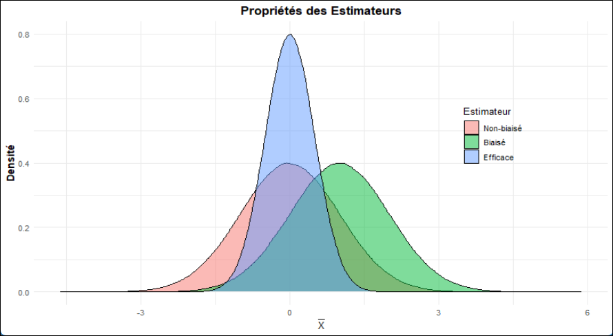
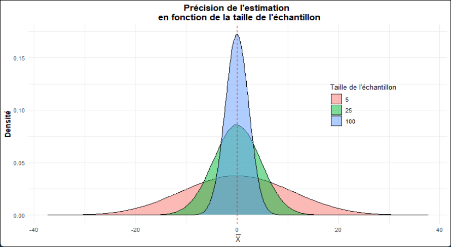
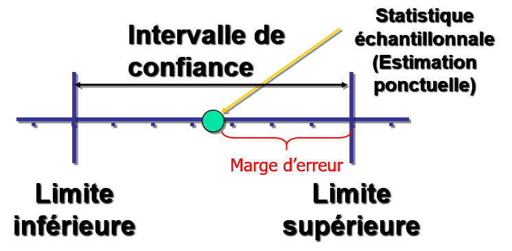
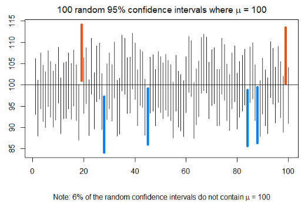
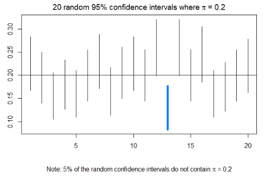
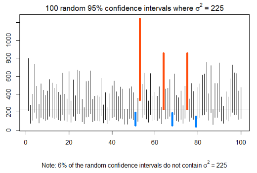

```{r}
#| echo: false
#| message: false

source("global2.R")

if(!exists("HaitiPop")){load("./data/HaitiPop_Env.RData")}

```

# Estimation statistique

::: {.callout-tip style="color: blue;"}
<font size="5"> Que peut-on apprendre au sujet d'une population dont les
paramètres sont inconnus, en tirant un seul échantillon aléatoire de
cette population ? </font>
:::

Obtenir un échantillon aléatoire d'une population est une étape
essentielle lorsqu'on tente de répondre à une question de recherche
concernant cette population. Mais un échantillon à lui seul ne peut pas
nous permettre d'atteindre ce but: il n'est qu'un reflet, souvent biaisé
en raison de procédures d'échantillonnage défaillantes ou d'autres
facteurs, de la population d'où il est tiré. Ce serait une erreur grave
que de considérer cet échantillon comme étant une réplique exacte de la
population, et d'en tirer des conclusions sans autre mesure. Néanmoins,
il est souvent possible d'inférer différents paramètres de la population
en l'examinant de manière appropriée.

Dans le chapitre précédent, nous avons tiré un grand nombre
d'échantillons d'une population dont les paramètres étaient connus. On a
pu ainsi construire et étudier certaines distributions d'échantillonnage
pour différentes statistiques. Dans le présent chapitre, nous étudierons
les statistiques échantillonnales (un échantillon unique) de manière à
nous permettre d'estimer les paramètres correspondants au niveau de la
population, ce paramètre étant inconnu. Ce type d'activité est chose
courante et essentielle dans le contexte d'une recherche scientifique.

Pour les besoins des démonstrations à venir, nous utiliserons la banque
de données générée par la fonction **HaitiPopGen()** (@lst-HaitiPopGen).

## Qualités des estimateurs

Un estimateur est une statistique calculée pour un échantillon aléatoire
pouvant nous informer sur une propriété particulière de la population
d'où provient cet échantillon. Implicitement, on souhaite que cette
quantité nous fournissent des informations permettant une bonne
approximation du paramètre correspondant de la population.
Essentiellement, nous espérons que l'estimateur soit *non-biaisé*,
*efficace* et *cohérent*. Un estimateur possédant ces qualités est
*suffisant*. Pour résumer, nous souhaitons un estimateur:

-   **non-biaisé**: la moyenne de la distribution d'échantillonnage de
    l'estimateur considéré est égale au paramètre de la population;\
-   **efficace**: la variance de la distribution d'échantillonnage de
    l'estimateur est la plus petite possible;
-   **cohérente**: une augmentation de la taille de l'échantillon se
    traduit par une statistique s'approchant davantage du paramètre de
    la population;
-   **suffisance**: la statistique possédant les meilleures propriétés
    (absence de biais, efficacité et cohérence) est la statistique
    suffisante.

Supposons une population normalement distribuée avec une moyenne $\mu=0$
et $\sigma=1$. Du chapitre précédent, on se souviendra que la
distribution d'échantillonnage des moyennes est normale, avec
$\mu_{\bar x}=\mu$ et $\sigma_{\bar x}=\sigma/ \sqrt n$. La figure
@fig-estqual illustre ces différentes qualités d'un estimateur, obtenu
d'un telle population, et calculé pour des échantillons d'une certaine
taille ($n$).

```{r}
#| label: fig-estqualProg
#| fig-cap: "Illustration des différentes propriétés d'un estimateur"
#| fig-width: 8
#| fig-height: 5
#| echo: false
#| message: false
#| warning: false
#| eval: false

x <- data.frame(Unbiased=rnorm(1000000,0,1),
                Biased=rnorm(1000000,1,1),
                Efficient=rnorm(1000000,0,.5))
data<- melt(x)
ggplot(data,aes(x=value, 
                fill=variable)) +
  geom_density(alpha=0.50) +
  ggtitle("Propriétés des Estimateurs") +
  theme_minimal() +
  theme(plot.title = element_text(size = 12, 
                                  face = "bold", 
                                  hjust = 0.5), 
  axis.title = element_text(size = 12, 
                            face = "bold")) +
  xlab(expression(bar(X))) +
  ylab("Densité") +
  theme(plot.title = element_text(size = 14, 
                                  face = "bold"),
        axis.title = element_text(size = 12, 
                                  face = "bold"),
        legend.position = c(.8,.6)) +
  scale_fill_discrete(name = "Estimateur",
                      labels = c("Non-biaisé", "Biaisé", "Efficace"))


```

```{r}
#| label: fig-estqual
#| fig-cap: "Illustration des différentes propriétés d'un estimateur"
#| fig-width: 8
#| fig-height: 5
#| echo: false


```

La courbe rougeâtre est non-biaisée, illustrant une distribution
d'échantillonnage dont la moyenne est égale à la moyenne de la
population. La courbe bleue est également non-biaisée, et elle est plus
efficace que la première, produisant une dispersion moindre. Finalement,
la courbe verte illustre la distribution d'échantillonnage d'un
estimateur biaisé: sa moyenne se démarque de la moyenne de la
population.

La dernière propriété d'un estimateur concerne sa *cohérence*, vérifiée
si une augmentation de la taille de l'échantillon améliore sa précision.
La @fig-coher illustre cette propriété, pour des échantillons de
5, 25, et 100 observations.

```{r}
#| label: fig-coherProg
#| fig-cap: "Illustration de l'augmentation de la précision d'un estimateur en fonction de la taille de l'échantillon"
#| fig-width: 6
#| fig-height: 8
#| echo: false
#| message: false
#| warning: false
#| eval: false

set.seed(3376)
min=-40 
max=40

n=5
xbar1 <- colMeans(matrix(runif(n * 1000000, 
                               min, max), 
                         nrow = n))

n=25
xbar2 <- colMeans(matrix(runif(n * 1000000, 
                               min, max), 
                         nrow = n))

n=100
xbar3 <- colMeans(matrix(runif(n * 1000000, 
                               min, max), 
                         nrow = n))

data <- melt(list(v1=xbar1,v2=xbar2,v3=xbar3))

ggplot(data,
       aes(x=value, fill=L1)) +
geom_density(alpha=.50) +
ggtitle("Précision de l'estimation \n en fonction de la taille de l'échantillon") +
theme_minimal() +
theme(plot.title = element_text(size = 14, 
                                face = "bold", 
                                hjust = 0.5), 
axis.title = element_text(size = 12, 
                          face = "bold"),
legend.position = c(.8,.6)) +
scale_fill_discrete(name = "Taille de l'échantillon",
labels = c("5", "25", "100")) +
xlab(expression(bar(X))) +
ylab("Densité") +
geom_vline(xintercept = 0, 
           linetype = "dashed", 
           color = "red")

```

```{r}
#| label: fig-coher
#| fig-cap: "Précision d'un estimateur en fonction de la taille de l'échantillon"
#| fig-width: 5
#| fig-height: 6
#| echo: false


```

On observe une augmentation de la précision de l'estimateur en fonction
de la taille de l'échantillon: la dispersion de la distribution
d'échantillonnage décroit en fonction de $n$. On dira alors que
l'estimateur est *cohérent*.

## Estimation d'une moyenne

Au chapitre 6, on a pu obtenir la distribution des moyennes calculées
pour un grand nombre d'échantillons d'une certaine taille, tous tirés de
la même population. Il s'agissait de la **distribution d'échantillonnage
des moyennes**.

Dans un contexte de recherche, il n'est pas possible d'obtenir autant
d'échantillons: on doit composer, généralement, avec un très petit
nombre d'échantillons, ou même d'un seul. Dans un tel contexte, comment
peut-on obtenir la distribution d'échantillonnage dont on a besoin pour
calculer les probabilités permettant de répondre à une question de
recherche?

Pour répondre à cette question, considérons la distribution des indices
de condition de vie (**CondxVie**) des Haïtiens vivant dans le
département de l'Ouest (**DEPARTEMENT == 8**). Le code R suivant extrait
de la population (**HaitiPop**), la sous-population que nous voulons
étudier. La distribution au niveau de la population est affichée à la
@fig-popcondx.

```{r}
#| label: fig-popcondx
#| fig-cap: "Distribution de la variable CondxVie pour les résidents du Département de l'Ouest (données fictives, simulées)"

xcv <- subset(HaitiPop, 
              (DEPARTEMENT=="8"), 
              CondxVie )
xcv <- xcv$CondxVie
#
hist(xcv,
     main="Distribution de CondxVie \n dans le Département de l'Ouest",
     breaks="FD",
     xlab="Indice de Condition de Vie",
     xlim=c(0, 25),
     ylab="Fréquence")
m1 <- mean(xcv)
s1 <- sd(xcv)
N <- length(xcv)
text(15, 20000,
     paste("\u3BC","=", round(m1, 3)))
text(15, 17000,
     paste("\u3C3","=", round(s1, 3)))
text(15.5, 14000,
     paste("N =", N))

```

Pour les besoins de la discussion, les paramètres de cette
sous-population ont été calculés et affichés dans la figure
@fig-popcondx). Rappelons que dans le monde réel, ces éléments ne sont
généralement pas connus et doivent être estimés à partir d'observations
effectuées sur un échantillon.

Supposons qu'un chercheur s'intéresse à déterminer le niveau de
condition de vie moyen chez cette population. Pour ce faire, les
contraintes budgétaires limitent à 25 la taille de l'échantillon qu'il
peut former. S'il était en mesure de tirer un très grand nombre
(**Nechant = 10,000**) d'échantillons de taille *n* = 25 de la
population, comme on l'a fait dans le chapitre 6, il obtiendrait la
distribution d'échantillonnage représentée à la @fig-distmean1).

```{r distmean1}
#| label: fig-distmean1
#| fig-cap: "Distribution d'échantillonnage des moyennes obtenue à partir de 10,000 échantillons de taille n = 25 tirés de la population du Département de l'Ouest. La variable étudiée est CondxVie."
# Simulation
Nechant <- 10000 # Nombre d'échantillons à tirer
n <- 25          # Taille de l'échantillon
xb <- replicate(Nechant,
                mean(sample(xcv, n, 
                            replace=FALSE)))
# Affichage de la distribution
hist(xb,main="Distribution d'échantillonnage\n des moyennes",
     breaks="FD",
     xlab="Moyennes",
     freq=FALSE,
     ylab="Densité")
mb <- mean(xb)
sb <- sd(xb)
etd <- range(xb)
text(7.5, 0.5,
     paste("\u3BC","=", round(mb, 3)))
text(7.5, 0.43,
     paste("\u3C3","=", round(sb, 3)))

```

La moyenne de cette distribution est $\mu_{\bar X}=`r round(mb, 3)`$, et
son erreur-standard est $\sigma_{\bar X}=`r round(sb, 3)`$. On constate
que l'étendue des moyennes possibles couvre de `r round(min(xb),3)`
jusqu'à `r round(max(xb),3)`: en tirant un échantillon aléatoire de 25
observations de notre sous-population, on peut obtenir une moyenne qui
prend n'importe quelle valeur se trouvant entre ces extrêmes, sans
exclure des valeurs plus extrêmes encore! Voilà la raison pour laquelle
on ne peut pas tirer de conclusion à partir d'une simple description des
données obtenues d'un échantillon: on ne peut connaitre la position
exacte de la moyenne obtenue pour cet échantillon, dans l'ensemble des
moyennes possibles. D'autre part, les moyennes comprises entre 5 et 7
par exemple sont plus probables que les moyennes s'éloignant dans les
extrémités de la distribution.

Considérons les moyennes qui occupent les 95% centraux de la
distribution, les 5% restants se trouvant dans les extrémités (2.5% de
chaque côté):

```{r}
#| label: fig-distmoy1
#| fig-cap: "Distribution d'échantillonnage des moyennes répartie en une zone de probabilités fortes (95% central) et deux zones de probabilités faibles (5% réparti dans les deux extrémités)"

GraphDist(xb)
text(6,250,"95%", cex=1.5)
text(4,100,"2.5%", cex=1.5)
text(8,100,"2.5%", cex=1.5)
```

Qualifions de **probables** les moyennes situées au centre, et
d'**improbables** les moyennes se trouvant dans les extrémités. Les
percentiles 2.5 et 97.5 sont les frontières entre les moyennes probables
et improbables, si on considère 95% comme étant le critère à utiliser.

On constate donc qu'en tirant un échantillon aléatoire de la population,
un écart plus ou moins grand existera entre la vraie moyenne de la
population ($\mu$) et la moyenne de l'échantillon ($\bar X$). Cet écart
représente l'**erreur d'échantillonnage**: ($\bar{X}-\mu$).

Si une erreur d'échantillonnage ne dépasse pas la distance séparant la
véritable moyenne de la population et la frontière entre les moyennes
probables et improbables, on pourra considérer que la moyenne de
l'échantillon est un reflet relativement fidèle, plausible, de la
moyenne de la population. En d'autres termes, il n'y a pas de surprise à
obtenir une moyenne située dans cette région. Il est toujours possible
d'observer une moyenne située dans les extrémités, mais elle représente
alors un événement rare.

### Distribution d'échantillonnage standardisée

La notion de **score centré et réduit**, ou **score Z**, a été présentée
dans le chapitre portant sur les distributions de probabilité, et
utilisée à quelques reprises dans l'unité précédente. On se rappellera
qu'un score Z est défini par l'@eq-z0:

$$Z = \frac{X - \mu}{\sigma}$$ {#eq-z0}

La conversion de données brutes en scores Z permet d'obtenir une
distribution standardisée dont la moyenne est nulle, et l'écart-type est
unitaire. Effectuer cette conversion dans le cas d'une distribution de
moyennes consiste simplement à calculer les écarts entre les moyennes
échantillonnales et la moyenne de la population, et les diviser ces
écarts par l'écart-type de la distribution d'échantillonnage des
moyennes (erreur-standard), tel qu'exprimé dans l'@eq-z1:

$$Z=\frac{\bar X-\mu}{\sigma_{\bar X}}$$ {#eq-z1}

Le code R suivant effectue la standardisation de la distribution
d'échantillonnage des moyennes de CondxVie:

```{r mean_dist_std}
z <- (xb - (mean(xb)))/sd(xb) # Calcul des scores Z

```

La @fig-dm1 représente la distribution des moyennes après
standardisation.

```{r}
#| label: fig-dm1
#| fig-cap: "Distribution d'échantillonnage des moyennes, standardisée"

GraphDist(z)
text(0,150,"95%", cex=1.5)
text(-3,50,"2.5%", cex=1.5)
text(3,50,"2.5%", cex=1.5)
lim <- quantile(z, c(0.025, 0.975))
```

On note que la forme de la distribution demeure inchangée par cette
standardisation. Par contre, cette distribution est maintenant centrée
sur 0, et son écart-type est égal à 1. On note également que les
frontières séparant le probable de l'improbable se trouvent à environ 2
erreurs-standards de la moyenne (ces limites sont respectivement
`r round(lim[1], 3)` et `r round(lim[2], 3)` pour cette simulation, pour
être plus précis!). Puisque la distribution est standardisée, on
pourrait s'attendre à ce que ces limites puissent s'appliquer dans
plusieurs situations similaires.

La différence entre une moyenne située à la limite du probable et la
vraie moyenne de la population est une quantité importante en
statistiques: il s'agit de la **marge d'erreur**. Cette quantité nous
informe sur la distance entre l'estimation ponctuelle (statistique
échantillonnale) et le paramètre de la population que l'on cherche à
estimer. Par exemple, une **marge d'erreur = 3.4** nous indique que
notre estimation se trouvera à au plus 3.4 unités du vrai paramètre de
la population, dans une direction ou dans l'autre, avec une certaine
probabilité (0.95, par exemple).

> Il faut noter que la marge d'erreur ne concerne que l'écart séparant
> la statistique échantillonnale du paramètre correspondant au niveau de
> la population. Elle ne concerne en rien les erreurs produites par un
> mauvais échantillonnage, ou un instrument de mesure mal calibré ou
> validé, ou par tout autre facteur susceptible de contaminer les
> données.

Quelle est l'étendue des moyennes que l'on pourrait obtenir, en toute
probabilité, en répétant l'échantillonnage? Dans un premier temps,
considérant les moyennes occupant le 95% central de la distribution
d'échantillonnage, on peut déterminer empiriquement la marge d'erreur en
calculant:

$$ME=\left ( \frac{|P_{97.5}|-|P_{2.5}|}{2}\right ) $$

Pour la distribution obtenue ci-dessus, qui est standardisée de sorte
que $\sigma_{\bar X}=1.0$, on trouve:

```{r }
#| code-fold: false

ME <- diff(quantile(z, abs(c(0.025, 0.975)))) / 2
cat("Marge d'erreur = ", ME)
```

En tirant un échantillon de *n* = 25 observations de notre population,
la moyenne de cet échantillon pourrait se trouver jusqu'à
`r round(ME, 3)` unités de la vraie moyenne de la population, 19 fois
sur 20 (ou dans 95% des cas). Toute moyenne se trouvant hors de cette
étendue serait jugée improbable.

Il faut noter que dans cet exemple, on a obtenu la marge d'erreur à
partir de la distribution d'échantillonnage standardisée dont la moyenne
est nulle et l'erreur-standard égale à 1. La marge d'erreur est donc
évaluée en unité d'erreur-standard. Pour l'exprimer en termes
non-standardisés, il suffira de convertir les scores Z en scores à
l'échelle des données originales. Par exemple, pour $\bar X=5.74$, on
écrira:

$$\bar X ~~\pm~~ Marge~~d'erreur $$
$$\bar X ~~\pm~~ `r round(ME, 3)` \sigma_{\bar X} $$
$$5.74~~ \pm ~~1.952(`r round(sb, 3)`)=[`r round(-1.959*sb, 3)`, `r round(1.959*sb, 3)`]$$

### Retour à la réalité!

Rappelons que le chercheur qui tente d'estimer la moyenne de la
population ne dispose que d'un de ces échantillons, que l'on peut
générer à l'aide du code R suivant:

```{r}
#| code-fold: false

x <- sample(xcv, 25, replace = FALSE)
cat("Moyenne échantillonnale = ", mean(x))
cat("Écart-type              = ", sd(x))
```


```{r}
#| label: fig-Ex10
#| fig-cap: "Distribution des données recueillies sur un échantillon de 25 observations"

hist(x, 
     main = "Distribution Échantillonnale", 
     xlab = "CondxVie",
     breaks = "FD")
```

La @fig-Ex10 affiche la distribution des données observées.

Il obtient donc une estimation ponctuelle de la moyenne de la
population: $\bar X =$ `r round(mean(x),3)`, et une estimation
ponctuelle de son écart-type: $s =$ `r round(sd(x),3)`.

La marge d'erreur dans cette situation est ME = `r round(ME, 3)`, tel
que calculé antérieurement.

Le chercheur peut donc conclure que l'intervalle compris entre
$\bar X \pm ME$, soit entre `r round(mean(x)-ME,3)` et
`r round(mean(x)+ME,3)` a de bonnes chances (95%) d'inclure ou de
capturer la moyenne de la population. Il aura ainsi proposé un
**intervalle de confiance**, pour un **niveau de confiance** de 95%. En
répétant l'expérience un nombre infini de fois, il aura raison dans 95%
des cas, et se trompera dans 5% des cas. Formellement, on pourra
exprimer le résultat de cette estimation par:

$C\left [`r round(mean(x)-ME,3)` \le \mu \le `r round(mean(x)+ME,3)` \right ]=95\%$

Au final, nous avons procédé à une estimation statistique de la moyenne
d'une population. On ne connait pas sa valeur exacte, mais on connait un
ensemble de valeurs (un intervalle) parmi lesquelles on pourrait trouver
la vraie moyenne de la population avec un degré de confiance
préspécifié. On a obtenu ce résultat en supposant qu'il est possible de
tirer un grand nombre d'échantillons de la population. En réalité, il y
a peu de chance que cela puisse se réaliser, de sorte que
l'erreur-standard des moyennes n'est toujours pas accessible. Et sans
cette quantité, calculer un intervalle de confiance n'est pas du domaine
du possible. Nous avons besoin d'une méthode alternative pour l'obtenir.

### En résumé

Considérons maintenant comme acquis que:

1.  la moyenne de la distribution des moyennes est égale à la moyenne de
    la population
2.  l'écart-type de cette distribution (erreur-standard) est une
    fonction de la taille de l'échantillon: plus *n* est grand, plus
    l'erreur-standard des moyennes sera petite, tel que mis en évidence
    dans le chapitre précédent...

On peut donc utiliser la moyenne d'un échantillon en tant
qu'**estimateur** de la moyenne de la population. Si l'échantillon est
représentatif de la population, la moyenne de l'échantillon ne devrait
pas être très éloignée de la moyenne de la population: l'erreur
d'échantillonnage ne devrait pas être trop grande. Par contre, rien ne
nous informe quant à la distance qui sépare ces deux moyennes! On a
besoin d'information supplémentaire. La moyenne de l'échantillon ne nous
fournit qu'une **estimation ponctuelle** de la moyenne de la population.
Et ce n'est pas suffisant!... Il nous faut tenir compte de la dispersion
des moyennes pour établir une étendue de valeurs parmi lesquelles
pourrait se trouver la moyenne de la population que l'on tente
d'estimer.

Étant donné un échantillon, l'estimation d'une moyenne consiste à
définir une zone, au centre de la distribution d'échantillonnage des
moyennes, qui a de fortes chances de capturer la moyenne de la
population. La question qu'il nous faut considérer ici est de savoir en
quoi consiste une *forte probabilité*?

-   Par convention, on considère que si notre intervalle capture la
    moyenne de la population 19 fois sur 20
    $\left[(1-\alpha) = 0.95\right ]$, on peut dormir tranquille! On ne
    se trompera, à la limite, qu'une fois sur 20 $(\alpha=0.05)$. Mais
    dans certains cas, on peut accepter de se tromper 2 fois sur 20
    $\left[(1-\alpha)=0.90,\; \alpha=0.10\right ]$ ou seulement 0.5 fois
    sur 20 $\left[(1-\alpha)=0.99,\; \alpha=0.01\right ]$. Le choix
    d'une probabilité revient à l'analyste, en fonction des
    circonstances propres à la recherche effectuée. Cette probabilité
    porte le nom de **niveau de confiance =** $(1-\alpha)$

En bref, le problème à résoudre est d'obtenir un intervalle utile,
susceptible avec une probabilité connue de capturer le paramètre de la
population que l'on veut estimer avec un degré satisfaisant de
confiance.

Étant donné que dans un contexte de recherche nous ne disposons que d'un
échantillon, le problème est de spécifier la distribution
d'échantillonnage des moyennes. Des méthodes analytiques classiques
existent, mais ces méthodes, qui seront discutées plus tard, reposent
sur des postulats et prérequis qui souvent ne sont pas respectés. La
méthode proposée ici n'implique aucun autre prérequis que la
représentativité de l'échantillon.

### Le ré-échantillonnage ('*Bootstrap*') {#sec-bootstrap1}

Supposons que dans une recherche on doive estimer la moyenne d'une
population à l'aide d'un échantillon aléatoire de 25 observations. Cet
échantillon est le seul à notre disposition. Sa moyenne est une
estimation ponctuelle de la moyenne de la population, mais la distance
qui sépare cette estimation de la véritable moyenne de la population
demeure inconnue.

Le ré-échantillonnage nous permet de combler le besoin que nous avons
d'obtenir un grand nombre d'échantillons et de construire la
distribution d'échantillonnage. Essentiellement, la procédure se réalise
en 5 étapes:

1.  On obtient un échantillon de *n* observations de la population
    cible. On suppose que toutes les précautions ont été prises pour
    maximiser la représentativité de cet échantillon par rapport à la
    population visée!
2.  De cet échantillon, on tire un grand nombre d'échantillons de la
    même taille (*n*), **AVEC REMISE**
3.  Pour chaque échantillon, on calcule la moyenne (ou toute autre
    statistique d'intérêt!)
4.  On dresse la distribution de ces moyennes (ou de toute autre
    statistique d'intérêt).
5.  On obtient les percentiles correspondants à $\alpha/2$ et à
    $(1-\alpha/2)$, qui définissent l'intervalle de confiance recherché.

### Exemple 1 {#sec-Ex1}

On tente d'estimer la moyenne de l'indice de Condition de Vie au niveau
de la population Haïtienne. On obtient un échantillon aléatoire composé
de 25 individus adultes (AGE > 18). On sera satisfait si on obtient un
intervalle de confiance susceptible de capturer la moyenne de la
population avec un niveau de confiance de 95%. Le code R suivant génère
d'abord les données échantillonnales, et calcule la moyenne et l'écart-type de l'indice de condition de vie.


```{r}
#| code-fold: false

# Sous-population étudiée
subpop <- subset(HaitiPop, (AGE > 18), CondxVie)

# Échantillon aléatoire de n=25 observations, tiré de la population ciblée
n <- 25      
xcv <- sample(subpop$CondxVie, n, replace = FALSE)
m1 <- mean(xcv)
s1 <- sd(xcv)
```

$$Estimation \; ponctuelle: \bar{X}_{CondxVie}=`r round(m1, 3)` \qquad s_{CondxVie}=`r round(s1, 3)` $$
La procédure de ré-échantillonnage appliquée sur ces observations (100,000 échantillons) permet d'établir la distribution des moyennes, dont les percentiles $P_{2.5}$ et $P_{97.5}$ correspondent aux bornes inférieure et supérieure d'un intervalle à l'intérieur duquel on retrouve 95% des moyennes. 

```{r}
#| code-fold: false

# Ré-échantillonnage
nc <- 0.95   # Niveau de confiance
ns <- 1e+05  # Nombre de ré-échantillonnages
xb <- replicate(ns, 
                mean(sample(xcv, 
                            n, 
                            replace = TRUE)))
# Détermination de l'intervalle de confiance
intc <- quantile(xb, c(0.5 * (1 - nc), nc + 0.5 * (1 - nc)))
```

La moyenne de l'échantillon initial est $\bar X$ = `r round(m1,3)`. En obtenant les percentiles 2.5
et 97.5 de la distribution des moyennes, on trouve que:

$$C\left [ `r round(intc[1],3)` \le \mu \le `r round(intc[2],3)` \right ] = 95\% $$
  
Bref, on a 95% des chances que l'intervalle s'étendant de
`r round(intc[1],3)` à `r round(intc[2],3)` inclut la moyenne de la
population. On a 5% des chances que ce ne soit pas le cas.

La @fig-resample_1 représente la distribution d'échantillonnage résultante et l'intervalle que l'on vient d'obtenir.

```{r}
#| label: fig-resample_1
#| fig-cap: "Distribution de ré-échantillonnage et intervalle de confiance"
#| echo: false

p <- DistHist(xb,
              lb = intc[1],
              ub = intc[2],
              col = "red")
p <- p + geom_segment(aes(x = intc[1], y = 400, xend = intc[2], yend = 400), 
                 arrow = arrow(length = unit(0.3, "cm"), ends = "both"), 
                 color = "darkgreen", 
                 linewidth = 1.2)

plot_data <- ggplot_build(p)$data[[1]]
bin1 <- which(plot_data$xmin <= intc[1] & plot_data$xmax >= intc[1])[1]
bin2 <- which(plot_data$xmin <= intc[2] & plot_data$xmax >= intc[2])[1]
h1 <- plot_data$count[bin1]
h2 <- plot_data$count[bin2]

p + geom_segment(aes(x = intc[1], y = h1, xend = intc[1], yend = 0)) +
    geom_segment(aes(x = intc[2], y = h2, xend = intc[2], yend = 0)) +
  annotate("text", x = mean(xb), y = 1000, label = "95%", color = "darkblue", size = 10)
```


Cet intervalle porte le nom d'**intervalle de confiance** et la
proportion de l'aire que cet intervalle occupe sous la distribution
s'appelle **niveau de confiance**, symbolisé par $(1-\alpha)$.

Pour comparaison, quel intervalle trouverait-on en utilisant la
distribution d'échantillonnage formée d'un grand nombre d'échantillons
(*n*=25) effectivement tirés de la population? La @fig-resample_2
en résume:

```{r}
#| label: fig-resample_2
#| fig-cap: "Distribution d'échantillonnage obtenue en tirant 10,000 échantillons directement d'une population"

set.seed(1234567)
n <- 25      # Taille de l'échantillon
nc <- 0.95   # Niveau de confiance
ns <- 10000  # Nombre d'échantillons à tirer
xdat <- subpop$CondxVie
xb <- replicate(ns, 
                mean(sample(xdat, n, replace = FALSE)))
# GraphDist(xb)
intc <- quantile(xb, c(0.5 * (1 - nc), nc + 0.5 * (1 - nc)))
DistHist(xb,
         lb = intc[1],
         ub = intc[2],
         col = "red")

```
L'intervalle des valeurs probables des moyennes d'échantillons de taille $n=25$, tirés de la population est:  

$$C\left [ `r round(intc[1],3)` \le \mu \le `r round(intc[2],3)` \right ] = 95\% $$

On constate que l'intervalle de confiance obtenu par ré-échantillonnage
n'est pas très différent de celui qu'on obtiendrait dans des conditions
idéales, s'il était possible de tirer un très grand nombre
d'échantillons de la population étudiée. Ce résultat est très
satisfaisant, pour autant que l'échantillon original soit représentatif
de la population.

### Anatomie d'un intervalle de confiance

La @fig-ic1 illustre la nature d'un intervalle de confiance:

```{r}
#| label: fig-ic1
#| fig-cap: "Intervalle de confiance et ses différentes composantes"
#| echo: false


```

La statistique échantillonnale est un estimateur du paramètre
correspondant de la population. Il s'agit d'une estimation ponctuelle de
ce paramètre. On sait que généralement, cet estimateur se trouvera à une
certaine distance, inconnue, du paramètre de la population, ce qui
constitue l'erreur d'échantillonnage:

<center>**Erreur d'échantillonnage** = **statistique** -
**paramètre**</center>

Par exemple, dans le cas de l'estimation d'une moyenne, l'erreur
d'échantillonnage sera $(\overline{X}-\mu)$. En considérant un nombre
infini de moyennes échantillonnales, chacune d'elles présentant une
certaine erreur d'échantillonnage, on peut déterminer les limites à
l'intérieur desquelles on retrouvera une importante proportion de ces
moyennes (95%, par exemple). Et cet intervalle inclura certainement le
paramètre de la population. La distance qui sépare l'estimation
ponctuelle de l'une ou l'autre des limites correspond à la **marge
d'erreur (ME)**. Formellement, la marge d'erreur est définie par
l'@eq-me1:

$$ME=P_{(1-\alpha)}\sigma_{Stat}$$ {#eq-me1}

ou $P_{(1-\alpha)}$ est le percentile de la distribution
d'échantillonnage **standardisée** pour le niveau de confiance désiré,
et $\sigma_{Stat}$ est l'erreur standard de cette statistique
(l'écart-type de la distribution d'échantillonnage).

On peut donc définir l'intervalle de confiance par l'@eq-me2:

$$Stat \pm ME$$ {#eq-me2}

Considérant l'intervalle de confiance obtenu par ré-échantillonnage dans
l'exemple 1 (section @sec-Ex1), on a:

<center>$$C[`r round(intc[1],3)` \le \mu \le `r round(intc[2], 3)` ]=95\%$$</center>

qui correspond approximativement à:

```{r}
#| echo: false
#| code-fold: false

cat(round(m1, 3),"±",round(diff(intc)/2, 3))
```

La marge d'erreur est égale à `r round(diff(intc)/2, 3)`, pour un niveau
de confiance de 95%. On estime que la moyenne de la population d'où est
tiré l'échantillon est égale à `r round(m1, 3)` avec une marge d'erreur
de `r round(diff(intc)/2, 3)`, 19 fois sur 20. En d'autres termes, on a
95% des chances que l'intervalle obtenu capture la moyenne de la
population.

### Simulation I:

La démonstration suivante nécessite un accès à Internet. Elle illustre
l'ensemble de la situation que nous avons exposée dans les paragraphes
précédents:\

[SIMULATION d'Intervalles de Confiance](https://wise1.cgu.edu/vis/ci_creation)

Pour l'utiliser,

```         
a. Choisissez la forme de la distribution de la population  
b. Choisissez le niveau de confiance  
c. Sélectionnez la taille de l'échantillon  
d. Cliquez sur SAMPLE aussi souvent que nécessaire  
```

Explorez les conséquences d'une variation dans la taille de
l'échantillon, d'un changement de niveau de confiance, et/ou de la forme
de la distribution de la population.

### Simulation II:

La fonction **cisim()** de la librairie **PASWR2** permet de simuler des
intervalles de confiance pour moyennes, variances et proportions, et
d'afficher graphiquement les résultats. La @fig-icm1) reproduit
les intervalles de confiance obtenus pour 100 échantillons de taille 20,
et $(1-\alpha)=95\%$.

```{r}
#| label: fig-icm1Prog
#| fig-cap: "Intervalles de confiance pour moyennes (n = 20)"
#| eval: false
#| fig-width: 8
#| fig-height: 6
#| code-fold: false

set.seed(150752)
#Intervalle de confiance pour une moyenne
PASWR2::cisim(samples = 100, 
              n = 20, 
              parameter = 100, 
              sigma = 15, 
              conf.level = 0.95)

```

```{r}
#| label: fig-icm1
#| fig-cap: "Intervalle de confiance pour une moyenne"
#| echo: false


```

### Estimation d'une moyenne: Approche théorique, grand échantillon

Un intervalle de confiance pour une moyenne, en supposant une population
normalement distribuée, se définit par l'@eq-ic6:

$$\bar X-z_{(1-\alpha/2)}\sigma_{\bar X}\le \mu \le \bar X+z_{(1-\alpha/2)}\sigma_{\bar X}$$ {#eq-ic6}

La quantité $z_{(1-{\alpha}/2)}$ dépend du niveau de confiance désiré.
La @tbl-percentCI indique les percentiles, sous une distribution
normale, correspondant aux niveaux de confiance fréquemment rencontrés
en pratique:

```{r}
#| label: tbl-percentCI
#| tbl-cap: Percentiles correspondants aux niveaux de confiance habituels
#| echo: false

tab_01 <- data.frame(
  conflev = c("90%", "95%", "99%"),
  perc = qnorm(c(0.95, 0.975, 0.995)))
tab_01 %>%
  kbl(col.names = c("Niveau de confiance", "Percentile"),
  digits=3) %>%  
  kable_styling(bootstrap_options = c("striped", "hover", "condensed"),
              full_width=FALSE) %>%
column_spec(1, bold=TRUE)

```

On a déjà noté que l'erreur-standard des moyennes se définit, en
théorie, par l'@eq-serr:

$$\sigma_{\bar X}=\frac{\sigma}{\sqrt{n}}$$ {#eq-serr}

Tous les éléments sont donc réunis pour permettre l'estimation d'une
moyenne. Pour illustrer, générons un nouvel échantillon de *n* = 25
observations concernant l'indice de Condition de Vie chez les individus
âgés de 18 ans et plus. Calculons la moyenne et l'écart-type de l'échantillon, en ajoutant l'écart-type de la population:

```{r}
set.seed(1234567)

subpop <- subset(HaitiPop, (AGE > 18), CondxVie)
n <- 25     
xcv <- sample(subpop$CondxVie, n, replace = FALSE)
m1 <- mean(xcv)
s1 <- sd(xcv)
sp <- sd(subpop$CondxVie)
```

$$Estimation \; ponctuelle: \bar{X}_{CondxVie}=`r round(m1, 3)` \qquad s_{CondxVie}=`r round(s1, 3)`  \qquad \sigma_{CondxVie}=`r round(sp, 3)`$$
Dès lors, on calcule l'erreur-standard des moyennes et la marge d'erreur d'estimation. L'intervalle de confiance suit naturellement:

```{r}
#| code-fold: false

# Calcul de l'erreur-standard (connaissant l'écart-type de la population)
se <- sp / sqrt(n)

# Calcul de la marge d'erreur
ME <- qnorm(0.975)*se

# Calcul de l'intervalle de confiance (95%)
liminf <- m1 - ME
limsup <- m1 + ME

```

On trouve donc l'intervalle de confiance (95%):

$$\bar{X} \pm z_{1-\alpha}\sigma_{\bar{}X}$$
$$`r round(m1, 3)`` \pm 1.96 \times`r round(ME, 3)`$$
ou 
  
$$C[`r round(liminf, 3)`\le \mu \le `r round(limsup, 3)`]=95\%$$

À la limite, en tirant un nombre infini d'échantillons, l'intervalle de
confiance observé devrait capturer la véritable moyenne de la population
19 fois sur 20, ou dans 95% des cas.

Ces résultats sont donc parfaitement en accord avec ceux obtenus
empiriquement. Cependant, l'approche théorique suppose que la population
étudiée soit distribuée normalement.

Examinons maintenant les intervalles de confiance que l'on obtiendrait
en variant $(1-\alpha)$, et la taille de l'échantillon. La @tbl-ic7 affiche les intervalles de confiance que l'on obtiendrait pour
différents niveaux de signification et différentes tailles
d'échantillon:

```{r }
#| label: tbl-ic7
#| tbl-cap: Intervalles de confiance pour différents $\alpha$ et différents $n$
#| echo: false

sp <- sd(subpop$CondxVie)                   # Écart-type de la population
se <- sp / sqrt(n <- c(25, 50, 100, 200))   # Erreurs-Standards 
ME <- qnorm(c(0.95, 0.975, 0.995)) %o% se   # Marges d'erreur
tbl <- data.frame(rbind(ME, se))
colnames(tbl) <- c("n = 25", "n = 50", "n = 100", "n = 200")
rownames(tbl) <- c("90%", "95%", "99%", "Err-Std")
tbl %>%
  kbl(digits=4,
      align = c("c", "c", "c", "c")) %>%
  kable_styling(bootstrap_options = c("striped", "hover", "condensed"),
              full_width=FALSE) %>%
column_spec(1, bold=TRUE)

```

On note que l'erreur-standard des moyennes diminue sensiblement lorsque
la taille de l'échantillon augmente. L'impact de ce changement se fait
sentir dans l'importance de la marge d'erreur, qui diminue également en
fonction de la taille de l'échantillon (puisque l'erreur-standard des
moyennes diminue aussi en fonction de $n$). Finalement, on note que plus
le niveau de confiance augmente, plus la marge d'erreur est élevée,
puisque cette fois, la valeur du percentile approprié à $(1-\alpha)$
augmente en fonction de ce percentile.

La @tbl-ic11 présente les intervalles de confiance calculés pour
différents niveaux de confiance et différents $n$, supposant un
échantillon dont la moyenne est $\bar X$ = `r round(m1,3)`. On y note
des variations conséquentes aux observations précédentes.

```{r}
#| label: tbl-ic11
#| tbl-cap: Intervalles de confiance pour différents $(1-\alpha)$ et différents $n_s$
#| echo: false

intc <- array(0,dim=c(3,4,2))
dimnames(intc) <- list(c("90%", "95%", "99%"),  
                       c("n = 25", "n = 50", "n = 100", "n = 200"), 
                       c("Lim Inf", "Lim Sup"))
for(i in 2:4){
  for(j in 1:4){
    intc[i-1, j, 1:2] <- m1 + c(-1,1) * tbl[i-1, j]
  } 
}
intconf <- matrix(NA, 3, 8)
for(i in 1:4){
    intconf <- cbind(intconf, intc[1:3 ,i, 1],intc[1:3 ,i, 2]) 
}
intconf <- intconf[, -1:-8]
intconf %>%
  kbl(digits=3,
  align = c("l", "c", "c", "c", "c", "c", "c", "c", "c")) %>%
  kable_styling(bootstrap_options = c("striped", "hover", "condensed"),
              full_width=TRUE) %>%
  add_header_above(
    header = c("Niv Conf "=1, "Li" = 1, "Ls" = 1, "Li" = 1, "Ls" = 1,"Li" = 1, "Ls" = 1,"Li" = 1, "Ls" = 1)) %>%
  add_header_above(
    header = c(" "=1, "n = 25" = 2, "n = 50" = 2, "n = 100" = 2, "n = 200" = 2))

```

Dans ce tableau, Li = Limite inférieure, et Ls = Limite supérieure de l'intervalle de confiance.  L'estimation ponctuelle, dans tous les cas, est la moyenne de l'échantillon, soit 6.2735.

On note en particulier que pour un niveau de confiance donné, la largeur
de l'intervalle de confiance diminue en fonction de la taille de
l'échantillon. Ceci est lié au fait que l'erreur-standard des moyennes
diminue dans les mêmes conditions.

Finalement, la largeur de l'intervalle de confiance augmente en fonction
du niveau de confiance. Rappelons que sous la distribution normale, le
percentile correspondant au niveau de signification augmente en fonction
de ce dernier. Par conséquent, l'intervalle de confiance en est affecté.

### Estimation d'une moyenne: Approche théorique, petit échantillon

Dans le paragraphe précédent, deux conditions idéales se présentaient:
nous disposions d'échantillons de grande taille, et surtout, nous
connaissions l'écart-type de la population. Ces conditions réunies nous
permettaient d'utiliser la distribution normale comme modèle pour le
calcul des probabilités. En réalité, il est rare que nous connaissions
l'écart-type de la population. En conséquence, nous n'avons d'autre
choix que de considérer l'écart-type de l'échantillon pour l'évaluation
de la dispersion de la population. Or, dans le chapitre précédent, il a
été démontré que l'écart-type d'une population est sous-estimé lorsque
la taille de l'échantillon est inférieure à 25 ou 30. Nous avons
également appris que dans un tel contexte, la distribution de Student
est un modèle plus approprié que la distribution normale pour obtenir
les probabilités dont nous avons besoin dans la solution d'un problème.

L'estimation d'une moyenne d'une population à partir d'un échantillon de
petite taille s'effectue exactement de la même manière que pour les
échantillons de grande taille, sauf que l'on substitue aux percentiles
de la distribution normale délimitant l'intervalle de confiance, les
percentiles correspondants sous la distribution de Student, pour
$dl=n-1$.

La définition de l'intervalle de confiance pour une moyenne devient
alors telle qu'exprimée par l'@eq-ic2:

$$ C[\bar X - t_{(dl, 1-\alpha/2)}s_{\bar X} \le \mu \le \bar X + t_{(dl, 1-\alpha/2)}s_{\bar X}]=100 \times (1-\alpha)\% $$ {#eq-ic2}

où la quantité $t_{(dl, 1-\alpha/2)}$ est le percentile sous la
distribution de Student correspondant au niveau de confiance désiré, et
$s_{\bar X}$ est l'estimation de l'erreur-standard des moyennes, à
partir de l'écart-type de l'échantillon (@eq-set1):

$$ s_{\bar X}=\frac {s_x}{\sqrt{n}} $$ {#eq-set1}

Pour illustrer la procédure, reprenons l'exemple précédent, concernant
l'estimation de la moyenne de l'indice de condition de vie chez les
adultes (âgés de 18+ ans). Dans ce cas, on obtient les percentiles
requis pour la détermination de la marge d'erreur à l'aide de la
fonction **qt()**, analogue à **qnorm()** que nous avons utilisée
antérieurement.

```{r}
set.seed(1234567)
subpop <- subset(HaitiPop, (AGE > 18), CondxVie)
n <- 25      
xcv <- sample(subpop$CondxVie, n, replace = FALSE)

# Calcul de l'erreur-standard (à partir de l'échantillon)
se <- s1 / sqrt(n)
```

$$Estimation \; ponctuelle: \bar{X}_{CondxVie}=`r round(m1, 3)` \qquad s_{CondxVie}=`r round(s1, 3)`  \qquad s_{\bar{X}}=\frac{`r round(s1, 3)`}{\sqrt{25}}=`r round(se, 3)`$$

```{r}
#| label: tbl-tdistr1
#| tbl-cap: "Percentiles de la distribution de Student utilisés pour le calcul de la marge d'erreur"
#| echo: false

show_t_table(DF=n-1, p=0.05, alternative="two.sided")
```

```{r}
# Calcul de la marge d'erreur
ME <- qt(0.975, df = n-1)*se
```


$$ME = t_{0.975, dl=24} \times s_{\bar{X}} = ` 2.064 \times `r round(se, 3)`=`r round(ME, 3)`$$

```{r}
#| code-fold: false

liminf <- m1 - ME
limsup <- m1 + ME
```


L'intervalle de confiance recherché est donc:

$$C[`r round(liminf, 3)` \le \mu \le `r round(limsup, 3)` ]=95\%$$

Tout ce qui a changé dans ce code R se trouve au niveau du calcul de
l'erreur-standard des moyennes, calculée à partir de l'écart-type de
l'échantillon plutôt que de celui de la population, et le calcul de la
marge d'erreur, où le 97.5e percentile provient de la distribution de
Student plutôt que de la distribution normale.

### Fonction **interpret()**, librairie **interpretCI**

Les paragraphes suivants sont adaptés de la fonction **interpret()** de
la librairie **interpretCI**, et présentent un exemple détaillé de la
spécification d'un intervalle de confiance pour une moyenne unique, et
de son interprétation.

```{r}
#| echo: false
#| message: false

set.seed(12345)
dat <- rnorm(25, 47, 8)
x <- meanCI(dat, mu = 45)
xresult <- x$result[1,]

two.sided <- greater <- less <- FALSE
if(x$result$alternative=="two.sided") two.sided=TRUE
if(x$result$alternative=="less") less=TRUE
if(x$result$alternative=="greater") greater=TRUE

twoS <- "L'hypothèse nulle sera rejetée si la moyenne de l'échantillon est très éloignée de la moyenne postulée de la population, dans un sens ou dans l'autre."
lessS <- "L'hypothèse nulle sera rejetée si la moyenne de l'échantillon est très inférieure à la moyenne postulée de la population."
greaterS <- "L'hypothèse nulle sera rejetée si la moyenne de l'échantillon est très supérieure à la moyenne postulée de la population."

```

Ce document est préparé automatiquement à l'aide des commandes R
suivantes:

::: {#interpret .callout-note}
set.seed(12345)\
x \<- rnorm(25, 47, 8)\
xresult \<- meanCI(x, mu = 45)\
interpret(xresult)
:::

Essentiellement, on tire un échantillon aléatoire de 25 observations,
d'une population dont les paramètres supposés sont $\mu = 47$ et
$\sigma = 8$. On calcule ensuite l'intervalle de confiance à partir de
ces données, alors que la véritable moyenne de la population est
$\mu = 45$, ce qui n'est pas connu de l'analyste. L'interprétation des
résultats suit.

#### Problème

```{r echo=FALSE}

string <- glue("Un inventeur a mis au point un nouveau moteur de tondeuse à gazon économe en énergie. Dans son stock de 2000 moteurs, l'inventeur sélectionne un échantillon aléatoire simple de {xresult$n} pour les soumettre au test.  Pour un seul litre d'essence, les moteurs fonctionnent en moyenne  {round(xresult$m,2)} minutes, avec un écart type de {round(xresult$s,2)} minutes. Quel est l'intervalle de confiance à {(1-xresult$alpha)*100}% pour la moyenne des durées (en minutes) de fonctionnement des moteurs? (On suppose que les temps de fonctionnement de la population des moteurs sont normalement distribués)")

textBox(string)
```

#### Intervalle de confiance de la moyenne

L'approche que nous avons utilisée pour résoudre ce problème est valable
lorsque les conditions suivantes sont respectées:

-   La méthode d'échantillonnage doit être un échantillonnage aléatoire
    simple.\
-   La distribution d'échantillonnage doit être normalement distribuée,
    au moins approximativement.

Puisque les conditions ci-dessus sont satisfaites, nous pouvons utiliser
l'approche suivante pour construire un intervalle de confiance de la
moyenne.

#### Données brutes

`r ifelse(is.na(xresult$data[1,1]),"Les données brutes ne sont pas fournies.","Les 10 premières lignes des données fournies sont les suivantes:")`

```{r echo=FALSE}
if(!is.na(x$data[1,1])) {
     head(x$data,10)
}
```

#### Statistiques observées

```{r echo=FALSE}
n <- xresult$n
m <- xresult$m
s <- xresult$s
alpha <- xresult$alpha
```

La taille de l'échantillon est $n= `r n`$; la moyenne observée pour cet
échantillon est $\bar X = `r round(m,2)`$ et l'écart-type est
$\sigma_X = `r round(s,2)`$. Nous utilisons le niveau de confiance
$(1-\alpha)100\% = `r (1-alpha)*100`$ %.

#### Calcul de la marge d'erreur

Puisque nous ne connaissons pas l'écart-type de la population, nous ne
pouvons que calculer l'erreur-standard de la moyenne à partir de
l'écart-type de l'échantillon. Comme la taille de l'échantillon est
beaucoup plus petite que celle de la population, nous pouvons utiliser
la formule "approximative" pour l'erreur standard, comme suit:

$$ SE= \frac{s}{\sqrt{n}}$$\
où **s** est l'écart-type de l'échantillon, et **n** est la taille de
cet échantillon.

$$SE=\frac{`r round(xresult$s,2)`}{\sqrt{`r xresult$n`}}=`r round(xresult$se,2)`$$

#### Calcul de la probabilité critique ($p$):

```{r,echo=FALSE}
if(xresult$alternative=="two.sided"){
    string=glue("$$p=1-\\alpha/2=1-{xresult$alpha}/2={1- xresult$alpha/2}$$")
} else{
     string=glue("$$p=1-\\alpha=1-{xresult$alpha}$$")
}
```

`r string`

Le nombre de **degrés de liberté** ($dl$) est:

$$dl=n-1=`r xresult$n`-1=`r xresult$DF`$$

La **valeur critique** est la statistique $t$ pour `r xresult$DF` degrés
de liberté et une probabilité cumulative égale à
`r ifelse(xresult$alternative=="two.sided",1- xresult$alpha/2,1- xresult$alpha)`.
Du tableau de la distribution de Student, on trouve une valeur critique
égale à `r round(xresult$critical,3)`.

```{r,echo=FALSE}
show_t_table(DF=xresult$DF,p=xresult$alpha,alternative=xresult$alternative)
```

```{r,results='asis',echo=FALSE}
if(xresult$alternative=="two.sided"){
  string=glue("$$qt(p,df)=qt({1- xresult$alpha/2},{xresult$DF})={round(xresult$critical,3)}$$")
} else {
    string=glue("$$qt(p,df)=qt({1- xresult$alpha},{xresult$DF})={round(xresult$critical,3)}$$") 
} 
```

`r string`

Le graphique ci-dessous illustre les zones ce la distribution
correspondant à $\alpha$ et par complémentarité, l'intervalle de
confiance qui se trouve au centre de cette distribution.

```{r,echo=FALSE}
draw_t(DF=xresult$DF,p=xresult$alpha,alternative=xresult$alternative)
```

#### Calcul de la **marge d'erreur** (ME):

$$ME=Valeur\ critique \times SE$$
$$ME=`r round(xresult$critical,3)` \times `r round(xresult$se,3)`=`r round(xresult$ME,3)`$$

#### Spécification de l'intervalle de confiance:

```{r,results='asis',echo=FALSE}
if(two.sided) {
     string="L'étendue de l'intervalle de confiance est défini par $\\bar X \\pm$ME."
} else if(less){
     string="L'étendue de l'intervalle de confiance est défini par -$\\infty$(infini) et $\\bar X$ + ME."
} else{
     string="L'étendue de l'intervalle de confiance est défini par  $\\bar X$ - ME et the $\\infty$(infinite)."
}
```

`r string` Et notre degré d'incertitude correspond au niveau de
confiance.

##### Intervalle de confiance de la moyenne:

```{glue,results='asis',echo=FALSE}
Donc, l'intervalle de confiance à {(1-xresult$alpha)*100}% couvre de  {round(xresult$lower,2)} à {round(xresult$upper,2)}. En d'autres termes, on est confiant à {(1-xresult$alpha)*100}% que la véritable moyenne de la population ($\mu$) se trouve parmi les valeurs comprises entre  {round(xresult$lower,2)} et {round(xresult$upper,2)}.
```

##### Représentation graphique

On peut visualiser la situation:

```{r}
#| echo: false

plot(x)
```

##### Résultats de l'application de la fonction meanCI()

```{r echo=FALSE}
print(x)
```

#### Référence

Le contenu de ce documents est adapté de StatTrek.com. Berman H.B., "AP
Statistics Tutorial", \[online\] Disponible à l'adresse:
[stattrek.com](https://stattrek.com/estimation/confidence-interval-mean.aspx?tutorial=AP)


## Estimation d'une proportion

L'estimation d'une proportion implique les mêmes concepts que ceux que
nous avons discutés dans le cas d'une moyenne. En effet, une proportion
n'est qu'une moyenne calculée pour une variable dichotomique (0/1).
Supposons que l'on tente d'estimer la proportion de la population
favorisant un candidat particulier à la présidence. On tire un
échantillon de 200 sujets de cette population et on comptabilise le
nombre de sujets favorisant ce candidat. Le code R suivant réalise une
telle expérience:

```{r echo=FALSE}

set.seed(150752)
# Formation d'un échantillon unique: n = 200, p = 0.2
x <- sample(c(0, 1), 200, 
            replace = TRUE, 
            prob = c(0.8, 0.2))  
cat("Proportion d'appui observé =", mean(x))

```

On obtient une proportion de 19% d'individus favorisant le candidat à la
présidence. D'une telle expérience, il est possible de calculer la
probabilité qu'un certain nombre d'individus, parmi ceux composant
l'échantillon, favorisent le candidat. Il s'agit simplement d'une
distribution binomiale, illustrée dans la @fig-prop1:

```{r}
#| label: fig-prop1
#| fig-cap: "Distribution binomiale relative au nombre d'individus favorisant un candidat particulier à la présidence"
#| echo: false

x <- 1:200
plot(x,dbinom(x,size=200,prob=.2),
     type='h',
     main="Distribution binomiale: Votes favorables (n=200, p=0.2)",
     ylab='Probabilité',
     xlab ='Nombre de Votes',
     xlim = c(0, 70),
     lwd=3)

```

On s'attend à ce que $np = 200(0.2) = 40$ électeurs favorisent le
candidat. Or, la proportion observée est égale à 0.19, ce qui ne saurait
nous surprendre, puisqu'il s'agit ici d'un échantillon unique qui,
rappelons-le, n'est qu'un reflet, souvent distortionné, de ce qui se
produit réellement au niveau de la population. Il convient donc de
répéter l'expérience un grand nombre de fois pour obtenir autant de
proportions de votes favorables. De ces observations, on pourra établir
la distribution d'échantillonnage d'une proportion, telle qu'illustrée à
la @fig-prop2:

```{r}
#| label: fig-prop2
#| fig-cap: "Distribution d'échantillonnage des proportions"

set.seed(1234567)
p <- 0.2
nc <- 0.95    # Niveau de confiance
ns <- 10000   # Nombre d'échantillons à tirer
n <- 200      # Taille de l'échantillon
xb <- replicate(ns, 
                mean(sample(c(0,1), 
                            n,
                            prob=c(1-p, p), 
                            replace=TRUE)))
intc <- quantile(xb, c(0.5 * (1 - nc), nc + 0.5 * (1 - nc)))
GraphDist(xb,nc,"Proportions")

```

Pour un niveau de confiance fixé à 95%, en tirant un nombre infini
d'échantillons de taille *n*=200 de la population, l'intervalle défini
par:

$$C[`r round(intc[1], 3)` \le \pi \le `r round(intc[2], 3)` ]=95\%$$

capturera la véritable proportion d'individus favorisant le candidat à
la présidence, 19 fois sur 20. La marge d'erreur est égale à:

$$ME=\left ( \frac{|P_{97.5}|-|P_{2.5}|}{2}\right ) = \frac{0.255-0.145}{2}=0.055$$

En tirant un échantillon de 200 sujets de la population, la proportion
de 'succès" observée sera située à au plus 5.5 points de pourcentage de
la proportion réelle au niveau de la population, dans 95% des cas.

#### Estimation d'une proportion: Ré-échantillonnage

On sait déjà que la stratégie utilisée dans les paragraphes précédents
n'est pas applicable en réalité, étant donné qu'on ne peut pas tirer un
nombre infini d'échantillons d'une population donnée, dans un contexte
de recherche spécifique. La solution utilisée pour l'estimation d'une
moyenne s'applique intégralement dans le cas présent. Pour récapituler,
la procédure implique 5 étapes:

1.  On obtient un échantillon de *n* observations de la population
    cible. On suppose que toutes les précautions ont été prises pour
    maximiser la représentativité de cet échantillon par rapport à la
    population visée!
2.  De cet échantillon, on tire un grand nombre d'échantillons de la
    même taille (*n*), **AVEC REMISE**
3.  Pour chaque échantillon, on calcule la proportion (ou toute autre
    statistique d'intérêt!)
4.  On dresse la distribution de ces proportions.
5.  On obtient les percentiles correspondants à $\alpha/2$ et à
    $(1-\alpha/2)$, qui définissent l'intervalle de confiance recherché.

À titre d'exemple, considérons l'appui accordé au Candidat #1, aux
prochaines élections présidentielles. Les données se trouvent dans la
variable **PrefPres** de l'objet **HaitiPop**. Le code R suivant extrait
les données requises, à partir desquelles on tire un échantillon de 200
observations. La proportion des observations favorables au candidat #1
(**mean(xcv==1)**) est ensuite calculée:

```{r}
set.seed(1234567)
# Sous-population étudiée
subpop <- subset(HaitiPop, (AGE > 18), PrefPres)
#
# On obtient un échantillon aléatoire, tiré de la population ciblée
n <- 200      # Taille de l'échantillon
xcv <- sample(subpop$PrefPres, n, replace = FALSE)
cat("Estimation ponctuelle (Proportion) = ", m1 <- mean(xcv==1))
```

Pour l'échantillon obtenu, on observe que `r 100*m1` % des sujets
favorisent le candidat #1. Il s'agit d'une estimation ponctuelle,
sujette aux fluctuations d'échantillonnage. De ces données, on doit
établir un intervalle de confiance susceptible de capturer la véritable
proportion au niveau de la population, avec un niveau de confiance élevé
(95%, par exemple).

Puisqu'il n'est pas possible de tirer un grand nombre d'échantillons de
la population, procédons à la construction de la distribution
d'échantillonnage des proportions par voie de ré-échantillonnage. La
@fig-prop3 en est une illustration.

```{r}
#| label: fig-prop3
#| fig-cap: "Distribution d'échantillonnage des proportions"

# Ré-échantillonnage
nc <- 0.95   # Niveau de confiance
ns <- 1e+05  # Nombre de ré-échantillonnages
xb <- replicate(ns, 
                mean(sample(xcv, n, replace = TRUE)==1))
# Détermination de l'intervalle de confiance
intc <- quantile(xb, 
                 c(0.5 * (1 - nc), 
                   nc + 0.5 * (1 - nc)))
# Production du graphique
GraphDist(xb)

```

Par ré-échantillonnage, on obtient donc l'intervalle de confiance
regroupant les proportions probables, comprises entre
`r round(intc[1],3)` et `r round(intc[2],3)`. En répétant l'expérience
un nombre infini de fois, cet intervalle capturera la proportion de la
population dans 95% des cas.

#### Estimation d'une proportion: approche analytique (théorique)

Si les postulats liés à la distribution binomiale sont respectés et que
la proportion $\pi \approx0.5$ au niveau de la population (tel qu'établi
au chapitre 6), le modèle gaussien s'ajuste bien à la distribution
d'échantillonnage des proportions. Dans ce cas, on peut affirmer que:

1.  La distribution d'échantillonnage des proportions est gaussienne.
2.  Sa moyenne est égale à $\pi$, la proportion de 'succès' au niveau de
    la population
3.  Son erreur standard est définie par l'@eq-prop10:

$$\sigma_p = \sqrt{\frac{p(1-p)}{n}}$$ {#eq-prop10}

si la population est infinie, et par:

$$\sigma_p = \sqrt{\frac{p(1-p)}{n}}\sqrt{1-\frac{n}{N}}$$

si la population est finie.

Reprenant l'exemple précédent concernant la proportion des votes
favorables à un candidat à la présidence, où l'estimation ponctuelle
s'établissait à 0.35 pour un échantillon de 200 observations, on trouve:

$$\sigma_p = \sqrt{\frac{0.35(1-0.35)}{200}}=0.0337 $$

On se souviendra qu'une condition requise pour la validité de la
procédure est une taille d'échantillon suffisante, surtout si la
proportion au niveau de la population s'éloigne vers les extrémités.
Dans le cas présent, on vérifie:

$$\left [ p-3\sigma_p,~~p+3\sigma_p \right ]\subset \left [0,~~1 \right ] $$
$$\left [ 0.35-3(0.0337),~~0.35+3(0.0337) \right ]= \left [0.249,~~0.451 \right ]\subset[0, 1] $$

Le prérequis est donc respecté et on peut poursuivre.

L'intervalle de confiance pour une proportion, en utilisant la
distribution gaussienne comme modèle, se définit par l'équation
@eq-prop11:

$$C[p-z_{(1-\alpha/2)}\sigma_p\le\pi\le p+z_{(1-\alpha/2)}\sigma_p] = 100(1-\alpha)\%$$ {#eq-prop11}

où $z_{(1-\alpha/2)}$ est le percentile de la distribution gaussienne
correspondant au niveau de confiance désiré. La marge d'erreur donnée
par l'@eq-prop12:

$$ME=z\_{(1-\alpha/2)}\sigma_p$$ {#eq-prop12}

Pour l'exemple que nous traitons, pour un niveau de confiance de 95%, on
obtient:

$$C[0.35-1.96(0.0337)\le\pi\le 0.35+1.96(0.0337)] = $$
$$C[0.2839\le\pi\le 0.4161)]= 95\%$$

Sous R, on obtient ce résultat en exécutant les commandes suivantes:

```{r}
p <- 0.35                         # proportion observée
n <- 200                          # taille de l'échantillon
nc <- 0.95                        # niveau de confiance
sep <- sqrt(p * (1-p) / n)        # erreur-standard des proportions
ME <- qnorm(nc+(1-nc)/2) * sep    # marge d'erreur
liminf <- p - ME
limsup <- p + ME
```

$$s_p=`r round(sep, 3)` \qquad ME(95\%)=`r round(ME, 3)`$$

$$C[`r round(liminf, 3)` \le \pi \le `r round(limsup, 3)` ]=95\%$$

En tirant un nombre infini d'échantillons de taille 200 de la
population, cet intervalle capturera la véritable proportion au niveau
de la population dans 95% des cas (19 fois sur 20).

### Simulations d'intervalles de confiance pour proportions

Comme pour l'estimation d'une moyenne, la fonction **cisim()** de la
librairie **PASWR2** permet de simuler des intervalles de confiance pour
proportions:

```{r }
#| label: fig-ICprop1
#| fig-cap: Intervalles de confiance pour proportions
#| eval: false
#| code-fold: false

PASWR2::cisim(20, 200, 0.2, type = "Pi")

```

```{r out.width="50%"}
#| label: fig-prop4
#| fig-cap: "Intervalles de confiance des proportions obtenus pour 20 échantillons de 200 observations, alors que la proportion au niveau de la population est égale à 0.20"
#| echo: false
#| fig-width: 8
#| fig-height: 6


```

## Estimation d'une variance

Tout ce qui a été dit concernant l'intervalle de confiance pour une
moyenne peut être répété pour toute statistique que l'on peut obtenir
d'un échantillon. La variance ne fait pas exception. La procédure
utilisée pour estimer une moyenne ou une proportion et construire un
intervalle de confiance de manière empirique est identique: on tire un
échantillon aléatoire représentatif de la population étudiée, et à
défaut de pouvoir effectuer cette opération un grand nombre de fois, on
utilise le ré-échantillonnage pour obtenir la distribution
d'échantillonnage toujours essentielle au processus d'estimation.

### Estimation d'une variance: ré-échantillonnage

Supposons qu'un chercheur de l'ISTEAH s'intéresse à la variabilité des
conditions de vie chez les adultes, à l'échelle du pays. Son budget de
recherche lui permet un échantillon de 50 sujets âgés de 21 ans et plus.
Le code R suivant définit la sous-population visée et en tire un
échantillon de *n* = 50 individus, prenant note de leur indice de
Condition de Vie (**CondxVie**), dont on obtient une estimation
ponctuelle

```{r}
#| code-fold: false

set.seed(150752)
subpop <- subset(HaitiPop, (AGE > 21), CondxVie)
n <- 50      
xcv <- sample(subpop$CondxVie, n, replace = FALSE)
v1 <- var(xcv)
```

$$Estimation \; ponctuelle \; (Variance) = ",  `r round(v1, 3)`$$

On obtient une estimation ponctuelle indiquant que
$\sigma_{CondxVie}^2 \approx$ `r round(v1, 3)`. Le ré-échantillonnage
nous permettra d'obtenir les outils nécessaires à la construction de
l'intervalle de confiance, illustré dans la @fig-Resample_Var:

```{r}
#| label: fig-Resample_Var
#| fig-cap: "Intervalle de confiance d'une variance"

nc <- 0.95   # Niveau de confiance
ns <- 1e+05  # Nombre de ré-échantillonnages à effectuer
variance <- replicate(ns, 
                      var(sample(xcv, n, replace = TRUE)))
# Détermination de l'intervalle de confiance
intc <- quantile(variance, 
                 c(0.5 * (1 - nc), 
                   nc + 0.5 * (1 - nc)))
# Affichage graphique
GraphDist(variance,nc,"Variances")

```

On trouve donc un intervalle susceptible de capturer la variance de la
population dans 95% des cas, lorsqu'on répète l'expérience un nombre
infini de fois:

$$C[`r round(intc[1], 3)` \le \sigma^2 \le `r round(intc[2], 3)`] = 95\%$$

Par curiosité, est-ce que l'intervalle de confiance que l'on vient
d'obtenir parvient à capturer la variance de la population?

```{r }
#| code-fold: false

varpop <- var(subpop$CondxVie)
cat("Variance de la population = ", varpop)
if((varpop >= intc[1]) & (varpop <= intc[2])){
  "Variance de la population capturée!"}else{
  "Variance de la population non capturée!"}
```

Cet exercice de validation ne peut être réalisé sans que l'on dispose
d'une estimation réaliste de la variance de la population, ce qui est
justement l'objectif visé par la procédure d'estimation présentée dans
les paragraphes précédents. Il illustre néanmoins que l'estimation
statistique demeure faillible! Il ne faut jamais oublié qu'il existe
dans toute estimation de bonnes chances de capturer le paramètre de la
population, mais qu'il existe aussi des chances, plus minces il est
vrai, que cette capture n'ait pas lieu!

### Estimation d'une variance: Approche théorique

Rappelons que la standardisation de la variance par sa transformation en
$\chi^2$ facilite grandement la construction et l'interprétation de la
distribution d'échantillonnage appropriée pour l'estimation de variances
de manière analytique. Reprenons l'exemple précédent dans lequel la
variance dans l'indice de condition de vie pour un échantillon de 50
sujets était $s^2$ = `r round(var(xcv),3)`. Sachant que:

$$\chi^2=\frac{(n-1) s^2}{\sigma^2}$$ {#eq-chi2a}

on peut définir l'intervalle de confiance de la variance suivant
l'@eq-variance2:

$$\frac{(n-1)s^2}{\chi_{dl,1-\alpha/2}^2} \le \sigma^2 \le \frac{(n-1)s^2}{\chi_{dl,\alpha/2}^2}$$ {#eq-variance2}

Dans cette expression, les quantités $\chi_{dl,1-\alpha/2}^2$ et
$\chi_{dl,\alpha/2}^2$ représentent respectivement les percentiles
délimitant l'intervalle de confiance sous la distribution du $\chi^2$.
Ce sont les quantités fournies par la fonction **qchisq()**. Un
échantillon de 50 sujets est utilisé pour estimer la variance dans
l'indice de condition de vie. Le nombre de degrés de liberté est donc
$dl=n-1=49$. Considérons un niveau de confiance de 95%. Sous R, on
obtient les percentiles nécessaires et l'intervalle de confiance
recherché:

```{r}
#| code-fold: false

varx <- var(xcv)    # Variance de l'échantillon
nc <- 0.95          # Niveau de confiance
dl <- n-1           # Degrés de liberté
chi2sup <- qchisq((1-nc)/2, dl)     # Percentile alpha/2  (eg: 2.5)
chi2inf <- qchisq(nc+(1-nc)/2, dl)  # Percentile nc+alpha/2 (eg: 97.5)
intc <- c(dl*varx/chi2inf, dl*varx/chi2sup)
```

$$C[`r round(intc[1], 3)` \le \sigma^2 \le `r round(intc[2], 3)` ]=95\%$$

Est-ce que cet intervalle parvient à capturer la véritable variance de
la population?

```{r }
#| code-fold: false

varpop <- var(subpop$CondxVie)
cat("Variance de la population = ", varpop)
if((varpop >= intc[1]) & (varpop <= intc[2])){
  "Variance de la population capturée!"}else{
    "Variance de la population non capturée!"}
```

Ce résultat, quoiqu'il ne soit pas possible de l'obtenir en pratique
étant donné qu'on ne connait pas la véritable variance de la population,
illustre le fait que différentes procédures statistiques peuvent
produire des résultats contradictoires!

### Estimation d'un écart-type

L'estimation d'un écart-type, on le devine, implique simplement la
racine carrée de chacun des termes de l'@eq-variance2, ce qui
donne l'@eq-ecartt:

$$\sqrt{\frac{(n-1)s^2}{\chi_{dl,1-\alpha/2}^2}} \le \sigma \le \sqrt{\frac{(n-1)s^2}{\chi_{dl,\alpha/2}^2}}$$ {#eq-ecartt}

Pour l'exemple précédent, on obtient l'intervalle de confiance pour un
écart-type tel que:

```{r}
#| code-fold: false

varx <- var(xcv)    # Variance de l'échantillon
nc <- 0.95          # Niveau de confiance
dl <- n-1           # Degrés de liberté
chi2sup <- qchisq((1-nc)/2, dl)     # Percentile alpha/2  (eg: 2.5)
chi2inf <- qchisq(nc+(1-nc)/2, dl)  # Percentile nc+alpha/2 (eg: 97.5)
intc <- sqrt(c(dl*varx/chi2inf, dl*varx/chi2sup))
```

$$C[`r round(intc[1], 3)` \le \sigma \le `r round(intc[2], 3)` ]=95\%$$

### Simulation d'intervalles de confiance pour variances

Le code R suivant produit une simulation d'intervalles de confiance pour
variances. On tire 50 échantillons d'une population normalement
distribuée avec $\mu=50$ et $\sigma=8$. Chacun de ces échantillons est
ensuite soumis au ré-échantillonnage pour obtenir autant d'intervalles
de confiance. Ces intervalles sont finalement affichés dans la 
@fig-icvar1.

```{r}
#| label: fig-icvar1
#| fig-cap: "Simulation d'intervalles de confiance de variances"

# Intervalle de confiance d'une variance
exper <- function(x, 
                  nrep = 5000, 
                  n = 25, 
                  mu = 50, 
                  sig = 8, 
                  nconf = 0.95) {
    variance <- replicate(nrep, 
                          var(sample(x, n, replace = TRUE)))
    varmean <- mean(variance)
    stderr <- sd(variance)
    lims <- quantile(variance, c((1 - nconf)/2, 1 - (1 - nconf)/2))
    out <- c(varmean, stderr, lims[1], lims[2])
    return(out)
}

# set.seed(1234567)
nhit <- 0       # Nombre de capture de mu
nexp <- 50      # Nombre d'échantillons
nrep <- 5000    # Nombre de ré-échantillonnages
n <- 25         # Taille de l'échantillon
mu <- 50        # Moyenne de la population
stdev <- 8      # Écart-type de la population
variance <- stdev^2
nconf <- 0.95   # Niveau de confiance
CIdat <- matrix(NA, nrow = nexp, ncol = 4)
for (i in 1:nexp) {
    x <- rnorm(n, mu, stdev)
    CIdat[i, ] <- exper(x, nrep, n, mu, stdev, nconf)
    nhit <- nhit + ((CIdat[i, 3] <= variance) & (CIdat[i, 4] >=
        variance))
}
cat("Proportion de capture = ", nhit/nexp)
Sample <- 1:nexp
Mean <- CIdat[, 2]
lower <- CIdat[, 3]
upper <- CIdat[, 4]
plot_ci(lower, upper, stdev^2)

```

La fonction **cisim()** de la librairie **PASWR2** permet également
l'examen d'intervalles de confiance pour variances tel qu'illustré à la
@fig-varsim:

```{r}
#| label: fig-varsimProg
#| fig-cap: Intervalles de confiance pour une variance
#| eval: false

set.seed(150752)
#Intervalle de confiance pour une variance
cisim(100, 20, 100, 15, type = "Var")

```

```{r out.width="50%"}
#| label: fig-varsim
#| fig-cap:  "Intervalles de confiance des variances obtenus pour 100 échantillons de 20 observations, alors que la variance au niveau de la population est égale à 225"
#| echo: false


```

## Estimation de la médiane

Comme pour les autres statistiques étudiées jusqu'à maintenant, le
ré-échantillonnage peut s'appliquer pour l'estimation de la médiane. Une
telle estimation pourrait être nécessaire lorsque la distribution de la
population dévie fortement de la normalité, la médiane étant une mesure
plus robuste que la moyenne dans ce cas.

### Estimation de la médiane: approche empirique

Par exemple, estimons la médiane de l'indice de Criminalité pour
l'ensemble de la population Haïtienne, en utilisant un échantillon de
100 sujets adultes (21+ ans):

```{r}
#| code-fold: false

set.seed(150752)
subpop <- subset(HaitiPop, (AGE > 21), CRIMIDX)
n <- 100    
xcv <- sample(subpop$CRIMIDX, n, replace = FALSE)
cat("Estimation ponctuelle (Médiane) = ", Q2s <- median(xcv))
```

La médiane observée pour l'échantillon (estimation ponctuelle) est Q2 =
`r round(Q2s, 3)`, une valeur qui devrait refléter la médiane de la
population, sans que l'on soit informé au sujet de la distance séparant
notre estimation ponctuelle de la véritable médiane de la population. On
sait qu'en principe, il suffirait de tirer un très grand nombre
d'échantillons de taille *n* = 100, et pour chacun d'eux obtenir la
médiane de manière à pouvoir établir sa distribution d'échantillonnage,
mais en pratique, une entreprise d'une telle ampleur ne peut être menée
à terme. Le ré-échantillonnage, que nous avons appliqué avec succès pour
la moyenne, la variance et une proportion, peut servir ici encore. Le
code R suivant permet la construction de la distribution
d'échantillonnage de la médiane en procédant à 100,000
ré-échantillonnages (*n* = 100), et d'afficher cette distribution à la
@fig-mediane1:

```{r}
#| label: fig-mediane1
#| fig-cap: "Distribution d'échantillonnage d'une médiane"
#| code-fold: false

n <- 100
nc <- 0.95   # Niveau de confiance
ns <- 1e+05  # Nombre de ré-échantillonnages à effectuer
Q2 <- replicate(ns, 
                median(sample(xcv, n, replace = TRUE)))
intc <- quantile(Q2, c(0.5 * (1 - nc), nc + 0.5 * (1 - nc)))
GraphDist(Q2, nc,"Medianes")
```

L'intervalle de confiance de la médiane obtenue à partir de notre
échantillon de *n* = 100 observations est:

$$C[`r round(intc[1], 3)` \le Md \le `r round(intc[2], 3)` ]=95\%$$

À la limite, pour un nombre infini d'échantillons de taille *n* = 100,
cet intervalle capturera la véritable médiane de la population dans 95%
des cas.

### Estimation de la médiane: approche théorique

Dans le chapitre précédent, il a été établi que la distribution
d'échantillonnage des médianes était au moins approximativement
gaussienne, avec une erreur-standard approximativement égal à 1.2533
fois l'erreur-standard des moyennes. On peut donc formuler l'intervalle
de confiance d'une médiane suivant l'@eq-medianedist:

$$C[\tilde x - z_{1-\alpha /2}(1.2533)\sigma_{\bar X}\le \tilde \mu \le \tilde x + z_{1-\alpha /2}(1.2533)\sigma_{\bar X} ]=100(1-\alpha)\%$$ {#eq-medianedist}

où $\tilde x$ représente la médiane observée pour un échantillon, et
$\tilde \mu$ représente la médiane de la population. Comme toujours,
$z_{1-\alpha /2}$ représente le percentile correspondant au niveau de
confiance désiré, sous la distribution normale.

Reprenant l'exemple précédent, nous disposons des données suivantes:

1.  Médiane de l'échantillon ($\tilde x$) = `r Q2s`
2.  $z_{1-\alpha /2}$ = 1.96
3.  $\sigma_{\bar X}$ = `r sd(subpop$CRIMIDX)/sqrt(n)`

On peut donc calculer:

```{r}
#| code-fold: false

Md <- median(xcv)
zc <- qnorm(0.975)
sem <- sd(subpop$CRIMIDX) / sqrt(n)
semed <- 1.2533 * sem
ME <- zc * semed
intc <- c(Md-ME, Md+ME)
```

$$C[`r round(intc[1], 3)` \le Md \le `r round(intc[2], 3)` ]=95\%$$

Ce résultat est en accord avec l'intervalle de confiance obtenu de
manière empirique.

## Matériel optionnel

Plusieurs outils sont disponibles dans l'environnement R pour estimer
les paramètres d'une population. Dans les paragraphes précédents, les
approches empirique et analytique(théorique) ont été présentées et leur
efficacité démontrée, et les codes R utilisés permettaient d'en suivre
le déroulement. Par contre, il est souvent plus simple et rapide
d'utiliser les fonctions disponibles dans certaines librairies.

### Fonction **boot.mean()**, **boot.median()**, etc.

La fonction définie ci-dessous pourra servir de modèle pour établir les
distributions d'échantillonnage et les intervalles de confiance
correspondant à une vaste gamme d'application.

```{r}
#| code-fold: false

boot.mean <- function(data, num) {
  resamples <- lapply(1:num, function(i) sample(data, length(data), replace=TRUE))
  r.mean <- sapply(resamples, mean)
  std.err <- sqrt(var(r.mean))
  list(std.err=std.err, resamples=resamples, means=r.mean)   
}
```

Telle que définie, cette fonction requiert deux arguments:

1.  **data**: un vecteur de données observées pour un échantillon\
2.  **num** : le nombre de ré-échantillonnages à produire

À la sortie, on retrouve les éléments suivants:

1.  **std.err**: erreur-standard (écart-type de la distribution
    d'échantillonnage)\
2.  **resamples**: ensemble des données composant chacun des
    échantillons\
3.  **means**: vecteur contenant la statistique (moyenne dans le cas
    présent) pour chaque échantillon

Supposons un échantillon de 50 observations tiré d'une population
normalement distribuée avec $\mu=50$ et $\sigma = 8$:

```{r}
#| code-fold: false

# Exemple d'utilisation de la fonction boot.mean)
x <- rnorm(50, 50, 8)
nrep <- 100000
b.mean <- boot.mean(x, nrep)

cat("Moyenne = ", mean(b.mean$means))
cat("Erreur-Standard = ", b.mean$std.err)
paste("C[", round(quantile(b.mean$means, 0.025),3), 
      " \u2264 \u03BC  \u2264 ", 
      round(quantile(b.mean$means, 0.975),3), "] = 95%")
```

Pour estimer un autre paramètre, tel que la médiane, il suffit de
remplacer la fonction calculant la statistique échantillonnale et le nom
des variables pertinentes pour plus de clarté. Pour la médiane, on
pourrait écrire:

```{r}
#| code-fold: false

boot.median <- function(data, num) {
  resamples <- lapply(1:num, function(i) sample(data, length(data), replace=TRUE))
  r.median <- sapply(resamples, median)
  std.err <- sqrt(var(r.median))
  list(std.err=std.err, resamples=resamples, medians=r.median)   
}
```

### Fonction **boot()** et **boot.ci()**

La librairie **boot** permet d'obtenir des estimations de différents
paramètres d'une population tout en offrant une vaste gamme d'options
pertinentes. Un exemple d'utilisation de ces fonctions est reproduit
ci-dessous. Les arguments de la fonction **boot** sont:

-   **x**: le vecteur contenant les données\
-   **function(x,i) mean(x)\[i\]**: i est généré automatiquement et
    représente l'indice des différentes observations. La fonction
    **mean()** sera utilisée (on pourra la remplacer par **median()**,
    ou **var()**, ou toute autre fonction calculant une statistique
    échantillonnale).\
-   **R**: nombre de ré-échantillonnage à effectuer

La fonction **boot.ci()** reprend la sortie de **boot()** et calcule
différents types d'intervalles de confiance. Les arguments de cette
fonction sont:\
- **Mboot**: la sortie de boot()\
- **conf**: le niveau de confiance\
- **type**: les types d'intervalles désirés:\
a. **Classique**, fondé sur la distribution normale (gaussienne)\
b. **Basic**: Considère la nature aléatoire du paramètre estimé\
c. **perc**: utilise les percentiles de la distribution de
ré-échantillonnage\
d. **BCa**: corrige pour le biais et l'asymétrie d'une distribution\
e. **Stud**: fondé sur la distribution t de Student (nécessite les
estimations des variances)

Un exemple d'application de ces fonctions suit, illustrant l'estimation
d'une moyenne:

```{r message=FALSE}
#| code-fold: false

if(!require(boot)){install.packages("boot")}
x <- rnorm(50, 50, 8)
Mboot = boot::boot(x,function(x,i) mean(x[i]),R=100000)
hist(Mboot$t[ ,1],
     col = "darkgray")
Mboot

```

La moyenne de l'échantillon est égale à `r round(Mboot$t0, 3)`, alors
que celle de la distribution d'échantillonnage des moyennes est égale à
`r round(mean(Mboot$t), 3)`. La différence entre ces deux quantités est
le biais: un écart de `r round(mean(Mboot$t)-mean(x), 3)` existe entre
la moyenne de l'échantillon et la moyenne de la distribution
d'échantillonnage qui, à la limite, est égale à la moyenne de la
population. Finalement, l'erreur-standard de la distribution
d'échantillonnage est égale à `r sd(Mboot$t)`. Nous avons donc tout ce
qui est nécessaire pour procéder à l'estimation, en faisant appel à la
fonction **boot.ci()**:

```{r}
#| code-fold: false

boot::boot.ci(Mboot,
              conf=0.95,
              type=c("norm","basic","perc","bca"))
```

On obtient des intervalles de confiance de différents types. Nous avons
discuté des intervalles de confiance obtenus en calculant les
**percentile**s de la distribution empirique, et des intervalles
construits en considérant la distribution **normal**e comme modèle. On
retrouve ces deux types dans la sortie de la fonction.

### Fonction **groupwiseMean/Median/Percentile**

La librairie **rcompanion** contient plusieurs fonctions susceptibles de
nous intéresser. En particulier, la fonction **groupwiseMean()** et les
fonctions qui y sont apparentées (**groupwiseMedian()**, et
**groupwisePercentile()**) permettent d'obtenir des intervalles de
confiance de différents types pour chacun des groupes représentés dans
les données.

Par exemple, supposons un échantillon de 100 individus adultes (21+ ans)
provenant du Département de l'Ouest. Cet échantillon est composé
d'hommes et de femmes. Considérons l'indice de criminalité (CRIMIDX). Le
code R suivant génère cet échantillon:

```{r message=FALSE}
#| code-fold: false

set.seed(150752)
# Sous-population étudiée
subpop <- subset(HaitiPop, (AGE > 21)&(DEPARTEMENT=="8"), c(CRIMIDX, GENRE))
#
# On obtient un échantillon aléatoire, tiré de la population ciblée
n <- 100       # Taille de l'échantillon
xcv <- subpop[sample(1:nrow(subpop), n, replace = FALSE),1:2]
cat("Nombre d'hommes  = ", sum(xcv$GENRE=="M"))
cat("Nombre de femmes = ", sum(xcv$GENRE=="F"))
```

Estimons la moyenne de chacun des groupes séparément, à l'aide de la
fonction **groupwiseMean()**:

```{r message=FALSE}
#| code-fold: false

rcompanion::groupwiseMean(
                          data=xcv,            # Source des données
                          var="CRIMIDX",       # Variable à analyser  
                          group="GENRE",       # Variable de groupement
                          conf=0.95,           # Niveau de confiance
                          R=100000,            # Nombre de ré-échantillonnage
                          boot=TRUE,           # Appliquer le ré-échantillonnage
                          traditional=FALSE,   # Intervalles de confiance traditionnels
                          normal=TRUE,         # Modèle = distribution normale
                          percentile=TRUE)     # Percentiles de la distribution d'échantillonnage

```

Une procédure similaire permet d'obtenir les intervalles de confiance
pour les médianes:

```{r message=FALSE}
#| code-fold: false

groupwiseMedian(
  data=xcv,                  # Source des données
  var="CRIMIDX",             # Variable à analyser  
  group="GENRE",             # Variable de groupement
  conf=0.95,                 # Niveau de confiance
  R=100000,                  # Nombre de ré-échantillonnage
  boot=TRUE,                 # Appliquer le ré-échantillonnage
  normal=TRUE,               # Modèle = distribution normale
  percentile=TRUE)           # Percentiles de la distribution d'échantillonnage


```

... ou même pour un percentile donné, avec la fonction
**groupwisePercentile()**! Examinons le troisième quartile:

```{r message=FALSE}
#| code-fold: false

groupwisePercentile(
  data=xcv,                  # Source des données
  var="CRIMIDX",             # Variable à analyser  
  group="GENRE",             # Variable de groupement
  conf=0.95,                 # Niveau de confiance
  tau=0.25,                  # Percentile étudié
  R=100000,                  # Nombre de ré-échantillonnage
  boot=TRUE,                 # Appliquer le ré-échantillonnage
  normal=TRUE,               # Modèle = distribution normale
  percentile=TRUE)           # Percentiles de la distribution d'échantillonnage
```

### Fonction **BootCI()**

La fonction **BootCI()**, qui se trouve dans la librairie **DescTools**,
est une autre fonction qui offre une bonne dose de versatilité. Les
arguments de cette fonction sont:

1.  **x**: vecteur de données à analyser (données échantillonnales)
2.  **y**: vecteur contenant les données pour une seconde variable,
    lorsque des données bivariées sont analysées (à conserver en mémoire
    pour un chapitre ultérieur!)
3.  **FUN**: fonction à utiliser (mean, median, var, etc)
4.  bci.method: vecteur alphanumérique contenant les types d'intervalles
    de confiance désirés (c("norm", "basic", "stud", "perc", "bca"))
    (tous par défaut)
5.  **conf.level**: niveau de confiance (0.95 par défaut)
6.  **sides**: directionnalité de l'intervalle: "two.sided" par défaut,
    ou "left" ou "right"
7.  **R**: nombre de ré-échantillonnage à effectuer

Réutilisons les données provenant du Département de l'Ouest, au sujet de
l'indice de criminalité:

```{r message=FALSE}
#| code-fold: false

DescTools::BootCI(xcv$CRIMIDX,
                  FUN="mean",
                  bci.method="norm",
                  conf.level=0.95,
                  sides="two.sided",
                  R=100000)
```

### Librairie **wBoot**

Finalement, la librairie **wBoot** nous sera utile dans les chapitres
suivants, mais peut très bien servir dans les situations que nous avons
rencontrées dans ce chapitre.

Jusqu'à maintenant, nous n'avons étudié qu'un seul échantillon à la
fois. Dans un tel contexte, la fonction **boot.one.per()** trouve son
terrain de jeu! Ses arguments sont:

1.  **x**: vecteur des données à analyser (données échantillonnales)
2.  **parameter**: paramètre à estimer ("mean", "median", etc.)
3.  **conf.level**: niveau de confiance (0.95 par défaut)
4.  **type**: type d'intervalle de confiance ("two-sided" (par défaut),
    "upper-bound" ou "lower-bound")
5.  **R** : nombre de ré-échantillonnage à effectuer (défaut = 9999)

Pour les données utilisées pour les derniers exemples, on trouve:

```{r echo=FALSE}
rm(mean)
```

```{r message=FALSE}
#| code-fold: false

b.mean <- wBoot::boot.one.per(xcv$CRIMIDX, 
                              parameter=mean, 
                              conf.level=0.95,
                              type="two-sided",
                              R=100000)
b.mean

```

La sortie de cette fonction est particulièrement détaillée. On y
retrouve d'abord la moyenne observée au niveau de l'échantillon, dans le
bloc supérieur: Moyenne = `r b.mean$Observed`.

Le bloc intermédiaire contient les paramètres de la distribution
d'échantillonnage obtenue par ré-échantillonnage. On y trouve que la
moyenne de la distribution (à la limite égale à la moyenne de la
population) est $\mu =$ `r b.mean$Mean`, avec une erreur-standard
$\sigma_{\bar X} =$ `r b.mean$SE`.

Le bloc inférieur affiche l'intervalle de confiance pour le niveau de
confiance spécifié.

La distribution d'échantillonnage est représentée par un histogramme sur
lequel les limites de l'intervalle de confiance sont clairement
indiquées, de même que la moyenne observée et la moyenne de la
distribution d'échantillonnage.

En sauvegardant ces résultats dans une variable (**b.mean**), il est
possible d'accéder à chacun des éléments, individuellement:

```{r}
#| code-fold: false

summary(b.mean)
```

Par exemple, pour accéder à l'ensemble des moyennes échantillonnales, on
utilisera la commande:

```{r}
#| code-fold: false

head(b.mean$Boot.values)
```

Il devient alors possible de poursuivre les analyses, ou produire des
graphiques additionnels, en utilisant ces données.

L'ensemble de fonctions contenues dans cette librairie (**wBoot**)
occupera une place importante dans les prochains chapitres.

## Exercices

1.  Examinez l'indice de propension à la criminalité (CRIMIDX) dans le
    département de l'Ouest (DEPARTEMENT==8) en estimant les différents
    paramètres de la population, en utilisant un niveau de confiance de
    90%. Utilisez un échantillon de 50 sujets.

    a.  Estimez la moyenne:

```{r 05-Chap5-14}

# Population ciblée
subpop <- subset(HaitiPop, 
                 (DEPARTEMENT == 8) & (AGE >= 15),
                 select = CRIMIDX)

n <- 50  # Taille de l'échantillon
xcv <- sample(subpop$CRIMIDX, n, replace = FALSE)
# Ré-échantillonnage
nc <- 0.9  # Niveau de confiance
ns <- 1e+05  # Nombre de ré-échantillonnages
xb <- replicate(ns, mean(sample(xcv, n, replace = TRUE)))
#
cat("Moyenne         = ", mean(xb))
cat("Erreur Standard = ", sd(xb))
# Détermination de l'intervalle de confiance
intc <- quantile(xb, c(0.5 * (1 - nc), nc + 0.5 * (1 - nc)))
cat("C[",round(intc[1],3),"< μ < ",round(intc[2],3),"] = ",100*nc,"%")
# Distribution des Moyennes
GraphDist(xb)
```

b.  Estimez la médiane:

```{r 05-Chap5-15}
# Population ciblée 
# subpop <- subset(HaitiPop,
#                 (DEPARTEMENT==8)&(AGE>=15),
#                 select=CRIMIDX)

n <- 50  # Taille de l'échantillon
xcv <- sample(subpop$CRIMIDX, n, replace = FALSE)
# Ré-échantillonnage
nc <- 0.9  # Niveau de confiance
ns <- 1e+05  # Nombre de ré-échantillonnages
xb <- replicate(ns, median(sample(xcv, n, replace = TRUE)))
#
cat("Moyenne         = ", mean(xb))
cat("Erreur Standard = ", sd(xb))
# Détermination de l'intervalle de confiance
intc <- quantile(xb, c(0.5 * (1 - nc), nc + 0.5 * (1 - nc)))  
cat("C[",round(intc[1],3),
    "< Médiane < ",
    round(intc[2],3),"] = ",100*nc,"%")
# Distribution des Médianes
GraphDist(xb,nc,"Médiane")
```

c.  Estimez la proportion des individus dont l'indice de criminalité est
    supérieur à 140.

```{r 05-Chap5-16}

# Population ciblée 
# subpop <- subset(HaitiPop,
#                 (DEPARTEMENT==8)&(AGE>=15),
#                 select=CRIMIDX)

n <- 50  # Taille de l'échantillon
xcv <- sample(subpop$CRIMIDX, n, replace = FALSE)
# Ré-échantillonnage
nc <- 0.9  # Niveau de confiance
ns <- 1e+05  # Nombre de ré-échantillonnages
xb <- replicate(ns, sum(sample(xcv, n, replace = TRUE) > 140)/n)
#
cat("Moyenne         = ", mean(xb))
cat("Erreur Standard = ", sd(xb))
# Détermination de l'intervalle de confiance
intc <- quantile(xb, c(0.5 * (1 - nc), nc + 0.5 * (1 - nc)))
cat("C[", round(intc[1], 3), 
    "< P(CRIMIDX > 140) < ", 
    round(intc[2],3), 
    "] = ", 100 * nc, "%")
# Distribution des Proportions (P(CRIMIDX)>140)
GraphDist(xb,nc,"P(CRIMIDX>140)")
```

d.  Estimez le rapport entre l'écart-type et la moyenne, multiplié par
    100: $CV = \frac{\sigma}{\mu}\times 100$

```{r 05-Chap5-17}
# Population ciblée 
# subpop <- subset(HaitiPop,
#                 (DEPARTEMENT==8)&(AGE>=15),
#                 select=CRIMIDX)

n <- 50  # Taille de l'échantillon
xcv <- sample(subpop$CRIMIDX, n, replace = FALSE)
# Ré-échantillonnage
nc <- 0.9  # Niveau de confiance
ns <- 1e+05  # Nombre de ré-échantillonnage
cv <- vector()

for (i in 1:ns) {
    x <- sample(xcv, n, replace = TRUE)
    cv[i] <- sd(x)/mean(x) * 100
}

#
cat("Moyenne         = ", mean(cv))
cat("Erreur Standard = ", sd(cv))
# Détermination de l'intervalle de confiance
intc <- quantile(cv, c(0.5 * (1 - nc), nc + 0.5 * (1 - nc)))
cat("C[", round(intc[1], 3), 
    "< CV < ", 
    round(intc[2], 3), "] = ",
    100 * nc, "%")
# Distribution des Coefficients de Variation
GraphDist(cv,nc,"Coeff. Variation")
```

e.  Estimez le 75e percentile.

```{r 05-Chap5-18}
# Population ciblée 
# subpop <- subset(HaitiPop,
#                 (DEPARTEMENT==8)&(AGE>=15),
#                 select=CRIMIDX)

n <- 50  # Taille de l'échantillon
xcv <- sample(subpop$CRIMIDX, n, replace = FALSE)
# Ré-échantillonnage
nc <- 0.9  # Niveau de confiance
ns <- 1e+05  # Nombre de ré-échantillonnages
p75 <- replicate(ns, quantile(sample(xcv, n, replace = TRUE), 0.75))

cat("Moyenne         = ", mean(p75))
cat("Erreur Standard = ", sd(p75))
# Détermination de l'intervalle de confiance
intc <- quantile(p75, c(0.5 * (1 - nc), nc + 0.5 * (1 - nc)))
cat("C[", round(intc[1], 3), 
    "< P75 < ", 
    round(intc[2], 3), "] = ",
    100 * nc, "%")
# Distribution des Q3
GraphDist(p75,nc,"Q3")
```

f.  Répétez ces estimations, et utilisant des échantillons de *n* = 500
    observations. Que remarquez-vous?

<!-- -->

```         
a. Estimez la moyenne:
```

```{r 05-Chap5-19}
# Population ciblée 
# subpop <- subset(HaitiPop,
#                 (DEPARTEMENT==8)&(AGE>=15),
#                 select=CRIMIDX)

n <- 500  # Taille de l'échantillon
xcv <- sample(subpop$CRIMIDX, n, replace = FALSE)
# Ré-échantillonnage
nc <- 0.9  # Niveau de confiance
ns <- 1e+05  # Nombre de ré-échantillonnages
xb <- replicate(ns, mean(sample(xcv, n, replace = TRUE)))

cat("Moyenne         = ", mean(xb))
cat("Erreur Standard = ", sd(xb))
# Détermination de l'intervalle de confiance
intc <- quantile(xb, c(0.5 * (1 - nc), nc + 0.5 * (1 - nc)))
cat("C[",round(intc[1],3),
    "< μ < ",
    round(intc[2],3),"] = ",100*nc,"%")
# Distribution des Moyennes
GraphDist(xb)
```

b.  Estimez la médiane:

```{r 05-Chap5-20}
# Population ciblée 
# subpop <- subset(HaitiPop,
#                 (DEPARTEMENT==8)&(AGE>=15),
#                 select=CRIMIDX)

n <- 500  # Taille de l'échantillon
xcv <- sample(subpop$CRIMIDX, n, replace = FALSE)
# Ré-échantillonnage
nc <- 0.9  # Niveau de confiance
ns <- 1e+05  # Nombre de ré-échantillonnages
xb <- replicate(ns, median(sample(xcv, n, replace = TRUE)))
#
cat("Moyenne         = ", mean(xb))
cat("Erreur Standard = ", sd(xb))
# Détermination de l'intervalle de confiance
intc <- quantile(xb, c(0.5 * (1 - nc), nc + 0.5 * (1 - nc)))
cat("C[",round(intc[1],3),
    "< Médiane < ",
    round(intc[2],3),"] = ",100*nc,"%")
# Distribution des Médianes
GraphDist(xb,nc,"Médianes")
```

c.  Estimez la proportion des individus dont l'indice de criminalité est
    supérieur à 140.

```{r 05-Chap5-21}

# Population ciblée 
# subpop <- subset(HaitiPop,
#                 (DEPARTEMENT==8)&(AGE>=15),
#                 select=CRIMIDX)

n <- 500  # Taille de l'échantillon
xcv <- sample(subpop$CRIMIDX, n, replace = FALSE)
# Ré-échantillonnage
nc <- 0.9  # Niveau de confiance
ns <- 1e+05  # Nombre de ré-échantillonnages
# x = sum(sample(xcv,n,replace=TRUE)>140)/n
xb <- replicate(ns, sum(sample(xcv, n, replace = TRUE) > 140)/n)

cat("Moyenne         = ", mean(xb))
cat("Erreur Standard = ", sd(xb))
# Détermination de l'intervalle de confiance
intc <- quantile(xb, c(0.5 * (1 - nc), nc + 0.5 * (1 - nc)))
cat("C[", round(intc[1], 3), 
    "< P(CRIMIDX > 140) < ", 
    round(intc[2],3), "] = ", 100 * nc, "%")
# Distribution des Proportions (P(CRIMIDX)>140)
GraphDist(xb,nc,"P(CRIMIDX>140)")
```

d.  Estimez le rapport entre l'écart-type et la moyenne, multiplié par
    100: $CV = \frac{\sigma}{\mu}\times 100$

```{r 05-Chap5-22}
# Population ciblée 
# subpop <- subset(HaitiPop,
#                 (DEPARTEMENT==8)&(AGE>=15),
#                 select=CRIMIDX)

n <- 500  # Taille de l'échantillon
xcv <- sample(subpop$CRIMIDX, n, replace = FALSE)
# Ré-échantillonnage
nc <- 0.9  # Niveau de confiance
ns <- 1e+05  # Nombre de ré-échantillonnages
cv <- vector()

for (i in 1:ns) {
    x <- sample(xcv, n, replace = TRUE)
    cv[i] <- sd(x)/mean(x) * 100
}

#
cat("Moyenne         = ", mean(cv))
cat("Erreur Standard = ", sd(cv))
# Détermination de l'intervalle de confiance
intc <- quantile(cv, c(0.5 * (1 - nc), nc + 0.5 * (1 - nc)))
cat("C[", round(intc[1], 3),"< CV < ", round(intc[2], 3), "] = ", 100 * nc, "%")
# Distribution des Coefficients de Variation
GraphDist(cv,nc,"Coeff. Variation")
```

e.  Estimez le 75e percentile.

```{r 05-Chap5-23, tidy=FALSE}
# Population ciblée 
# subpop <- subset(HaitiPop,
#                 (DEPARTEMENT==8)&(AGE>=15),
#                 select=CRIMIDX)

n <- 500  # Taille de l'échantillon
xcv <- sample(subpop$CRIMIDX, n, replace = FALSE)
# Ré-échantillonnage
nc <- 0.9  # Niveau de confiance
ns <- 1e+05  # Nombre de ré-échantillonnages
p75 <- replicate(ns, quantile(sample(xcv, n, replace = TRUE), 0.75))

cat("Moyenne         = ", mean(p75))
cat("Erreur Standard = ", sd(p75))
# Détermination de l'intervalle de confiance
intc <- quantile(p75, c(0.5 * (1 - nc), nc + 0.5 * (1 - nc)))
cat("C[", round(intc[1], 3), "< P75 < ",round(intc[2], 3), "] = ", 100 * nc, "%")
# Distribution des Q3
GraphDist(p75,nc,"Q3")
```

f.  Estimez le consensus par rapport au projet d'une nouvelle
    Constitution, au niveau national, avec un niveau de confiance de 95%
    et un échantillon de 300. Rappelons que seuls les individus dont
    l'âge est égal ou supérieur à 18 ans sont sondés!

```{r 05-Chap5-24}
library(data.table)
library(agrmt)
DT <- as.data.table(HaitiPop)  # data.table
subpop <- DT[AGE >= 18]$OpinConst  # Population ciblée

n <- 300  # Taille de l'échantillon
xcv <- sample(subpop, n, replace = FALSE)
# Ré-échantillonnage
nc <- 0.95  # Niveau de confiance
ns <- 1e+05  # Nombre de ré-échantillonnages
xb <- replicate(ns, consensus(table(sample(xcv, n, replace = TRUE))))
#
cat("Moyenne         = ", mean(xb))
cat("Erreur Standard = ", sd(xb))
# Détermination de l'intervalle de confiance
intc <- quantile(xb, c(0.5 * (1 - nc), nc + 0.5 * (1 - nc)))
cat("C[", round(intc[1], 3), "< Consensus < ", 
    round(intc[2], 3), "] = ", 100 * nc, "%")
# Distribution des Consensus
GraphDist(xb,nc,"Consensus")
```
