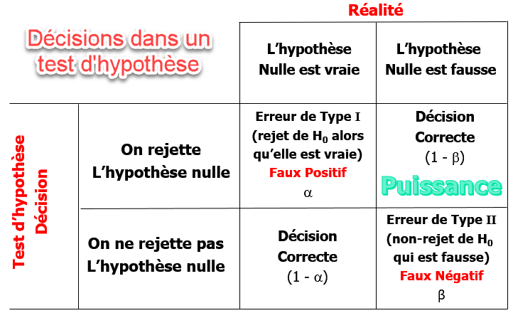
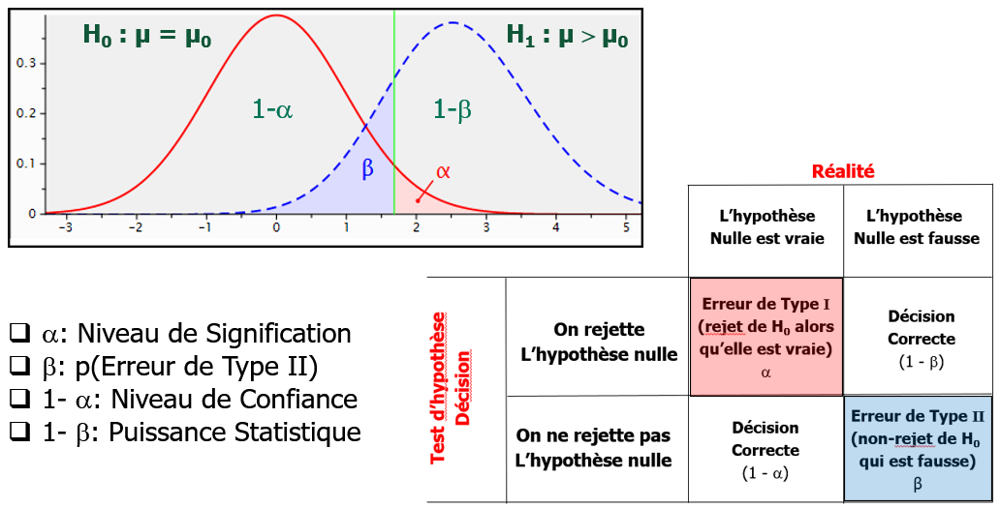
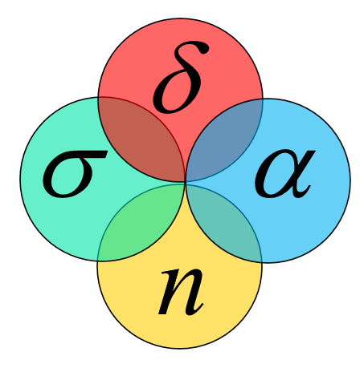
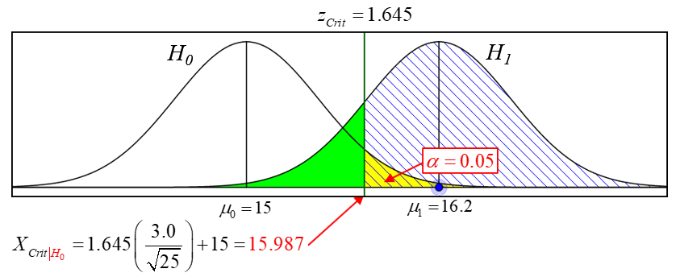
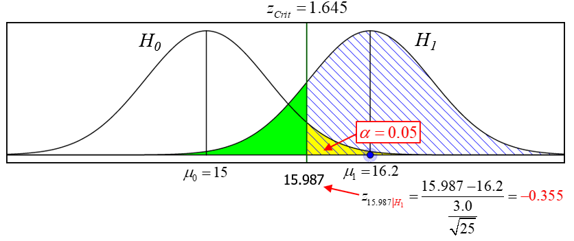

```{r}
#| echo: false
#| message: false

source("global2.R")

```


# Puissance Statistique {#sec-Chap12}

## Introduction
  
Dans le chapitre @sec-Chap11, nous avons pris conscience de la probabilité de commettre une erreur en rejetant une $H_0$ qui en réalité est vraie. Cette probabilité a pris la forme du niveau de signification, $\alpha$. Il s'agit d'une quantité qui est pleinement sous le contrôle de l'analyste, qui choisira sa valeur en fonction du contexte de la recherche dans laquelle s'inscrit un test d'hypothèse. Notons que dans certaines situations, ce type d'erreur, que l'on nomme **erreur de type I**, peut avoir de graves conséquences et on a intérêt à choisir un niveau de signification faible. 

## Probabilités associées à un test d'hypothèse

L'erreur de type I n'est malheureusement pas le seul type d'erreur qui peut survenir dans un test d'hypothèse. Il faut également considérer la possibilité qu'une hypothèse nulle ne soit pas rejetée, alors qu'en réalité elle est fausse. Il s'agira ici d'une **erreur de type II**, associée à une probabilité que l'analyste ne peut contrôler que par des moyens indirects, et qui est symbolisée par **$\beta$**. Contrairement au niveau de signification $\alpha$, $\beta$ ne relève pas d'un choix direct de l'analyste, mais plutôt de quatre facteurs qui en module la valeur:
  
  * la taille de l'échantillon
  * la dispersion des données
  * l'importance de l'effet
  * le niveau de signification
  
Dans le contexte d'un test d'hypothèse, il existe donc deux types d'erreur possible et en contre-partie, deux décisions correctes sont également possibles: 

  * le rejet d'une $H_0$ qui est fausse en réalité
  * le non-rejet d'une $H_0$ qui est vraie en réalité
  
La figure @fig-testhyp1 résume ces possibilités.

```{r out.width="60%"}
#| label: fig-testhyp1
#| fig-cap: "Résultats possibles d'un test d'hypothèse"
#| echo: false


```

En réalité, l'hypothèse nulle est vraie ou fausse. Le problème est que l'on ne connait pas son statut! C'est la raison pour laquelle on effectue un test d'hypothèse dont le résultat conduira au rejet ou au non-rejet de cette hypothèse. Il existe donc quatre résultats possibles:

* On rejette $H_0$ alors qu'en réalité, cette hypothèse est vraie:  
  - c'est l'erreur de type I
  - la probabilité que cette erreur se produise est égale au niveau de signification $\alpha$, choisi par l'analyste
  - en terme 'médical', il s'agit d'un **faux positif**
  - une telle erreur peut avoir des conséquences graves dans certaines situations, comme le fait de condamner un individu pour un crime qu'il n'a pas commis, ou obtenir un test diagnostic négatif pour une maladie grave bien présente!
  
  - Formellement, $\alpha=p(Rejet~~de~~H_0|H_0~~est~~vraie)$
  
* On ne rejette pas une $H_0$ qui en réalité est vraie:
  - il s'agit d'une décision correcte
  - la probabilité que cette décision soit prise est égale à ($1-\alpha$)
  - Formellement, $(1-\alpha)=p(Non-Rejet~~de~~H_0|H_0~~est~~vraie)$
  
* On ne rejette pas une $H_0$ qui en réalité, est fausse:
  - c'est l'erreur de type II
  - la probabilité de commettre une telle erreur est égale à $\beta$, influencée par les conditions de l'analyse
  - en terme 'médical', il s'agit d'un **faux négatif**
  - Formellement, $\beta=p(Non-Rejet~~de~~H_0|H_0~~est~~fausse)$
  
* On rejette $H_0$ alors qu'en réalité, elle est fausse:
  - il s'agit d'une décision correcte
  - la probabilité que cette décision soit prise est égale à ($1-\beta$)
  - les facteurs influençant $\beta$ affectent évidemment cette probabilité
  - ($1-\beta$) porte le nom de **puissance statistique**
  - Formellement, $(1-\beta)=p(Rejet~~de~~H_0|H_0~~est~~fausse)$
  
La figure @fig-pwrpic présente les probabilités associées à ces quatre conclusions possibles dans un test d'hypothèse unilatéral. La distribution de gauche représente la situation où $H_0$ est vraie, alors que la distribution de droite représente la situation où $H_0$ est fausse et par conséquent la distribution réelle se caractérise par une certaine moyenne $\mu_1 > \mu_0$. On suppose ici des variances invariantes.

```{r}
#| label: fig-pwrpic
#| fig-cap: "Probabilités associées à un test d'hypothèse unilatéral"
#| echo: false
#| error: false
#| message: false
#| warning: false

  mu0=0
  mu1=1.9
  sig0=1
  sig1=1
  alpha=0.05
  tail=1

  ggplot(data.frame(x = -4:5), aes(x)) +
    stat_function(fun = dnorm, args = c(mu0, sig0), geom = 'area',
                  xlim = c(qnorm(1-alpha/tail, mu0, sig0), 5), fill = 'red') +
    stat_function(fun = dnorm, args = c(mu0, sig0)) +
    stat_function(fun = dnorm, args = c(mu0, sig0), geom = 'area',
                  xlim = c(-4, qnorm(1-alpha/tail, mu0, sig0)),
                  fill = 'deepskyblue3') +
    stat_function(fun = dnorm, args = c(mu0, sig0)) +
    stat_function(fun = dnorm, args = c(mu1, sig1)) +
    stat_function(fun = dnorm, args = c(mu1, sig1), geom = 'area',
                  xlim = c(qnorm(1-alpha/tail, mu0, sig0), 5),
                  fill = 'cyan4', alpha=0.2) +
    stat_function(fun = dnorm, args = c(mu1, sig1), geom = 'area',
                  xlim = c(-4, qnorm(1-alpha/tail, mu0, sig0)),
                  fill = 'chocolate3', alpha=0.5) +
    geom_text(x=-0.4, y=0.18, label="(1-\u03B1)", size=7, col="white") +
    geom_text(x=2, y=0.025, label="\u03B1", size=7, col="white") +
    geom_text(x=1, y=0.1, label="\u03B2", size=7, col="white") +
    geom_text(x=2.5, y=0.1, label="(1-\u03B2)", size=7, col="black") +
    geom_text(x=-1.7, y=0.35, label=expression(H[0]), size=10, col="black") +
    geom_text(x=3.5, y=0.35, label=expression(H[1]), size=10, col="black") +
    labs(y="Densité", x="Test")
  
```
Les probabilités $\alpha$ et $(1-\alpha)$ sont représentées par des zones appartenant à la distribution proposée sous $H_0$; les probabilités $\beta$ et $(1-\beta)$ sont représentées par des zones appartenant à la distribution décrite par $H_1$. Cette représentation graphique sera utilisée pour illustrer différentes situations dans les sections suivantes.

La figure @fig-fig2 résume la situation pour un test d'hypothèse unilatéral, tout en répétant le tableau @fig-testhyp1, pour référence. Dans le graphique, la courbe de gauche (en rouge) représente la distribution d'échantillonnage en supposant $H_0$ vraie. La moyenne de cette distribution est celle proposée par cette hypothèse ($\mu_0$). Deux zones se distinguent sous cette distribution: 

```{r out.width="80%"}
#| label: fig-fig2
#| fig-cap: Probabilités associées à un test d'hypothèse
#| echo: false


```

La courbe de gauche (rouge) représente la distribution d'échantillonnage des moyennes en supposant $H_0$ vraie: la moyenne de la population ($\mu$) est égale à la valeur proposée ($\mu_0$). On y distingue deux zones dont les surfaces représentent des probabilités spécifiques:  


::: {.callout-tip title="$1-\alpha$:   Décision correcte"}
C'est la zone de non-rejet de $H_0$. Une statistique de vérification se trouvant dans cette zone conduit à la retenu de $H_0$, faute d'évidence permettant son rejet.  
:::

:::  {.callout-important title="$\alpha$:   Erreur: **Niveau de signification**"}
C'est la zone de rejet de $H_0$. Une statistique de vérification se trouvant dans cette zone conduit au rejet de $H_0$, ce qui constitue une erreur si cette hypothèse est vraie. On veut cette probabilité faible.
:::

La courbe de droite (en bleu-pointillé) représente la distribution d'échantillonnage en supposant $H_0$ fausse. Il existe un écart entre sa moyenne  $\mu$ et la moyenne proposée par $H_0$ ($\mu_0$). Ici aussi, on peut distinguer deux zones:  

::: {.callout-important title="$\beta$:   Erreur"}
$H_0$ est fausse, mais la statistique de vérification se trouve dans une zone ne permettant pas son rejet. Il y a erreur.  
:::

::: {.callout-tip title="$1-\beta$:   Décision correcte: **Puissance Statistique**"}
Puisque la statistique de vérification dépasse la valeur critique pour un niveau de signification donné, $H_0$ est rejetée alors qu'effectivement, elle est fausse. On veut cette probabilité élevée.
:::

C'est sur ces deux dernières probabilités que nous portons notre attention dans les parargraphes suivants.


## Simulation: $\beta$ et $(1-\beta)$

Supposons un test de signification unilatéral portant sur une moyenne unique. Un échantillon de 25 observations est tiré d'une population normalement distribuée dont l'écart-type est $\sigma=8$. La moyenne observée pour cet échantillon est $\bar X = 48.5$. Posons $H_0:\mu=45$.  Dans ces conditions, la distribution d'échantillonnage, en supposant que $H_0$ est vraie, aurait pour caractéristiques:
  
* distribution Gaussienne  
* $\mu_{\bar X}=45$  
* $\sigma_{\bar X}=8/\sqrt{25}=1.6$  

La figure @fig-simpow1 en est une illustration, obtenue en tirant 100,000 échantillons et en établissant la distribution d'échantillonnage des moyennes.

```{r}
#| label: fig-simpow1
#| fig-cap: "Distribution des moyennes, supposant $H_0$ vraie"
#| echo: false

library(latex2exp)
xb <- rnorm(100000, 45, 1.6)
xbc <- quantile(xb, 0.95)
h <- hist(xb, 
          breaks="FD",
          plot=FALSE)
cuts <- cut(h$breaks, c(-Inf,xbc,Inf))
plot(h, 
     main=TeX('Distribution: $H_0$ vraie'),
     col = c("cadetblue1", "red")[cuts],
     freq=FALSE,
     xlab="Moyennes",
     ylab="Densité")
abline(v=xbc, lty=2, col="red", lwd=3)
txt1 <- paste("Moyenne   = ", round(mean(xb), 3))
txt2 <- paste("Err.Std.   = ", round(sd(xb), 3))
txt3 <- paste("Critère = ", round(xbc, 3))
legend("topleft", legend = c(txt1, txt2, txt3), lty = 0:0, 
        cex = 0.8, bg = "lightgreen")
text(40, 0.05, TeX('$(1-\\alpha)$'), cex=1.2)
text(50, 0.05, TeX('$\\alpha$'), cex=1.2)
arrows(48.5, 0.05, 48.5, 0, length=0.1, col="darkgreen", lwd=3)
text(48.5, 0.065, TeX('$\\bar{X}$'), cex=1.2)

```
De cette distribution, on peut aisément calculer la probabilité d'obtenir un échantillon dont la moyenne est $\bar X \ge 48.5$. On trouve:

```{r}
#| code-fold: false

p0 <- mean(xb>=48.5)
xbc <- quantile(xb, 0.95)
```
$$p(\bar X \ge 48.5|H_0~~vraie)=`r round(p0,3)` $$

Cette probabilité correspond à la zone se situant à droite de la position de la moyenne de l'échantillon ($\bar{X}$), dans la @fig-simpow1. Elle est inférieure au niveau de signification $\alpha=0.05$. On dispose donc de suffisamment d'évidence pour affirmer que l'échantillon provient d'une population dont la moyenne est différente de $\mu=45$, gardant à l'esprit que dans 5% des cas un tel résultat pourrait s'obtenir même si en réalité, la moyenne de la population est égale à $\mu=45$.

Quelle serait la probabilité de ne pas rejeter $H_0$ si en réalité la population à l'origine de l'échantillon a effectivement une moyenne $\mu \ne 45$, et que la moyenne de l'échantillon $\bar X=48.5$ en est un estimateur? Dans ce cas, on obtiendrait la distribution affichée dans la figure @fig-simpow2. Cette fois, on tire 100,000 échantillons d'une population normalement distribuée dont $\mu=48.5$ et $\sigma_{\bar X}=1.6$

```{r}
#| label: fig-simpow2
#| fig-cap: "Distribution supposant $H_0$ fausse"
#| echo: false

library(latex2exp)
# xb2 <- rnorm(100000, 48.5, 1.6)
xb2 <- xb + 3.5
pbeta <- mean(xb2<=xbc)
h <- hist(xb2, breaks="FD", plot=FALSE)
cuts <- cut(h$breaks, c(-Inf,xbc, Inf))
plot(h, 
     main=TeX('Distribution: $H_0$ fausse'),
     freq=FALSE,
     col = c("cadetblue1", "lightgreen", " ")[cuts],
     xlab="Moyennes",
     ylab="Densité")
txt1 <- paste("Moyenne   = ", round(mean(xb2), 3))
txt2 <- paste("Err.Std.   = ", round(sd(xb2), 3))
txt3 <- paste("Critère = ", round(xbc, 3))
legend("topleft", legend = c(txt1, txt2, txt3), lty = 0:0, 
        cex = 0.8, bg = "lightgreen")
abline(v=xbc, lty=2, col="red", lwd=3)
text(44, 0.1, TeX('$\\beta$'), cex=1.2 )
text(44, 0.05, paste("(", round(pbeta, 3),")"), cex=1.2)
text(53, 0.1, TeX('$(1-\\beta)$'), cex=1.2 )
text(53, 0.05, paste("(", round(1-pbeta, 3), ")"), cex=1.2)

```


L'aire sous la distribution se trouvant sous la valeur critique pour $\alpha=0.05$ (Crit=`r round(xbc, 3)`) correspond à la probabilité d'une erreur de Type II, $\beta$, qui est égale à: 

$$p(\bar X \le `r round(xbc, 3)`|H_1~~vraie)=\beta=`r round(pbeta,3)` $$

En conséquence, la puissance statistique de ce test est $(1-\beta)=1-`r round(pbeta,3)`=`r round(1-pbeta,3)`$. Donc, s'il existe réellement une différence $\mu_0-\mu_1=48.5-45=3.5$, on a $`r round(100*(1-pbeta),3)`$ % des chances de rejeter $H_0$: la puissance statistique est approximativement égale à $(1-\beta)=(1-`r round(pbeta, 3)`) \times 100` \approx 70%$  

## Les déterminants de la puissance statistique

Nous avons déjà mentionné les quatres facteurs déterminant $\beta$ et $1-\beta$, illustrés dans la figure @fig-fig3.

```{r }
#| label: fig-fig3
#| fig-cap: "Déterminants de \u03B2"
#| echo: false


# {#fig:fig3}
```


* $\alpha$: le **niveau de signification**: plus il est grand, plus $\beta$ est faible
* $n$: plus la **taille de l'échantillon** est grande, plus $\beta$ est faible
* $\sigma$: plus l'**écart-type de la population** est petit, plus $\beta$ est faible
* $\delta$: plus l'**importance de l'effet** est grande, plus $\beta$ est faible
 
Examinons les détails de chacun de ces facteurs. 
 
### Le niveau de signification

La puissance statistique $(1-\beta)$ est déterminée par le niveau de signification $\alpha$. En effet, la valeur critique associée à $\alpha$  s'accroit avec ce dernier. Puisque la valeur de $\beta$ correspond à l'aire sous la distribution, à gauche de cette valeur critique, un changement de $\alpha$ se traduira nécessairement par un changement dans la valeur de $\beta$ et de la puissance $(1-\beta)$. Pour s'en convaincre, reprenons l'exemple illustré dans la figure @fig-simpow2, dans lequel $\alpha=0.05$ est utilisé. Au niveau de signification $\alpha=0.01$, la valeur critique est le 99e percentile de la distribution d'échantillonnage:

```{r}
#| code-fold: false

xbc01 <- quantile(xb, 0.99)
cat("P99 = ", round(xbc01, 3))
```
Cette valeur critique est plus grande que celle utilisée lorsque $\alpha=0.05$.

```{r}
#| label: simpow3
#| echo: false
#| fig-cap: "Distribution supposant $H_0$ fausse (\u03B1=0.05$)"

pbeta2 <- mean(xb2<=xbc01)
h <- hist(xb2, breaks="FD", plot=FALSE)
cuts <- cut(h$breaks, c(-Inf,xbc01, Inf))
plot(h, 
     main=TeX('Distribution: $H_0$ fausse, $\\alpha$=0.01'),
     freq=FALSE,
     col = c("cadetblue1", "lightgreen", " ")[cuts],
     xlab="Moyennes")
txt1 <- paste("Moyenne   = ", round(mean(xb2), 3))
txt2 <- paste("Err.Std.   = ", round(sd(xb2), 3))
txt3 <- paste("Critère = ", round(xbc01, 3))
legend("topleft", legend = c(txt1, txt2, txt3), lty = 0:0, 
        cex = 0.8, bg = "lightgreen")
abline(v=xbc01, lty=2, col="red", lwd=3)
text(44, 0.1, TeX('$\\beta$'), cex=1.2 )
text(44, 0.05, paste("(", round(pbeta2, 3),")"), cex=1.2)
text(53, 0.1, TeX('$(1-\\beta)$'), cex=1.2 )
text(53, 0.05, paste("(", round(1-pbeta2, 3), ")"), cex=1.2)

```

La valeur critique s'étant déplacée vers la droite, la valeur de $\beta$ a augmenté, alors que la puissance $(1-\beta)$ a diminué.

La figure @fig-pwrdet1 offre une visualisation de l'impact du niveau de signification sur la puissance statistique. On y constate que pour un effet donné ($d=0.38$), $n=25$ et $\sigma=5$, on obtient une puissance égale à 0.732 lorsque $\alpha=0.1$, alors qu'elle n'est que de 0.335 lorsque $\alpha=0.01$. Il n'est donc pas possible de réduire à la fois les probabilités d'erreur de Type I et de Type II. On doit trouver un compromis convenant à la situation dans laquelle le test d'hypothèse s'applique.

```{r}
#| label: fig-pwrdet1
#| fig-cap: "Impact de \u03B1 sur (1-\u03B2)"
#| echo: false
#| warning: false

g1 <- PwrPlot(nsig=0.1)
g2 <- PwrPlot(nsig=0.01)
grid.arrange(g1, g2, nrow=2, ncol=1)

```

 
Une courbe de puissance en fonction du niveau de signification résume l'ensemble de la situation, tel qu'illustré dans la figure @fig-simpow4, pour $n=25$ et une importance d'effet intermédiaire ($d=0.5$).

```{r }
#| label: fig-simpow4
#| fig-cap: "Courbe de puissance vs Niveau de signification"
#| echo: false

ptab<-cbind(NULL, NULL)       # initalize ptab
for (i in seq(0.005, 0.1, by=0.005)){
  pwrt <- pwr.t.test(n=25, 
                     d=0.5, 
                     power=NULL, 
                     sig.level=i,
                     type="one.sample",
                     alternative="greater")
  ptab <- rbind(ptab, cbind(pwrt$sig.level, pwrt$power))
}
plot(ptab[,1],
     ptab[,2],
     type="b",
     xlab="Niveau de Signification",
     ylab="Puissance Statistique")
abline(h=0.8, lty=2, lwd=2, col="green")
text(0.08, 0.5, 
     paste("n = ", 25), 
     cex=1.2)
text(0.08, 0.45, 
     paste("d = ", 0.5), 
     cex=1.2)
```
  
On note claiement que la puissance augmente en fonction du niveau de signification.

### La taille de l'échantillon ($n$)

Dans un contexte de recherche, la taille de l'échantillon est un facteur qu'il est important de considérer, car elle détermine l'erreur-standard et par conséquent la marge d'erreur, l'intervalle de confiance et les résultats d'un test d'hypothèse. Elle est aussi un déterminant majeur de la puissance statistique, tel qu'on peut le constater dans la figure @fig-pwrdet2, pour $\alpha=0.05$ et $d=0.38$. Pour $n=25$ (panneau supérieur), on trouve $(1-\beta)=0.601$, alors que pour $n=50$ (panneau inférieur), on obtient $(\1-beta=0.851$.


```{r }
#| label: fig-pwrdet2
#| fig-cap: "Impact de la taille de l'échantillon sur (1-\u03B2)"
#| echo: false
#| warning: false

g1 <- PwrPlot(n=25)
g2 <- PwrPlot(n=50)
grid.arrange(g1, g2, nrow=2, ncol=1)
```

La figure @fig-simpow5 présente la courbe de puissance en fonction de $n$, le niveau de signification étant fixé à 0.05 et l'importance de l'effet établi à $d=0.5$. Ce que l'on apprend de cette figure est que des échantillons de très grande taille ne sont pas nécessaires dans un contexte de recherche, et de fait ils peuvent être nuisibles. Il existe une taille d'échantillon optimale au niveau pratique autant que théorique. Le niveau de puissance généralement recherché est $(1-\beta)=0.80$. Une fois ce niveau atteint, il est rarement nécessaire d'ajouter des observations. Une étape importante de la planification d'une recherche sera donc de déterminer la taille d'échantillon requise dans un contexte de recherche particulier. Pour l'instant, prenons note de l'impact de $n$ sur la puissance statistique d'un test.


```{r }
#| label: fig-simpow5
#| fig-cap: "Courbe de puissance vs n"
#| echo: false

ptab<-cbind(NULL, NULL)       # initalize ptab
for (i in seq(5, 100, by=5)){
  pwrt<-pwr.t.test(n=i, d=0.5, power=NULL,
                   sig.level=0.05,
                   type="one.sample",
                   alternative="greater")
  ptab<-rbind(ptab, cbind(pwrt$n, pwrt$power))
}

plot(ptab[,1],ptab[,2],type="b",xlab="Taille de l'échantillon (n)",ylab="Puissance Statistique")
abline(h=0.8, lty=2, lwd=2, col="green")
text(80, 0.5, "d = 0.5", cex=1.2)
text(80, 0.40, expression(paste(alpha, " = ", 0.05)), cex=1.2)
arrows(26, 0.8, 26, 0.22, length=.1, col="red", lwd=2)
```

La puissance augmente rapidement en fonction de la taille de l'échantillon, pour atteindre une valeur asymptotique s'approchant de 1.0. Puisqu'une puissance $(1-\beta)=0.80$ est l'objectif dans un test d'hypothèse, il n'est pas nécessaire d'ajouter des observations à l'échantillon au-delà du $n$ requis pour atteindre ce point. Utiliser des échantillons de plus grandes tailles augmenterait définitivement la probabilité de détecter des effets plus faibles, mais le risque est que ces effets perdent leur importance sur le plan théorique.


### L'importance de l'effet

L'importance de l'effet réfère à la distance séparant le paramètre postulé dans $H_0$ et le paramètre réel, sous $H_1$. Cette distance se mesure en unité d'écart-type de la population, tel qu'exprimé dans l'équation @eq-tf1:

$$
\begin{equation}
d=\frac{\mu_1-\mu_0}{\sigma} 
\end{equation}
$$ {#eq-tf1}

Par convention (Cohen, 1988), on considère les critères suivants:
  
  * Effet faible:           d=0.20  
  * Effet intermédiaire:    d=0.50  
  * Effet important:        d=0.80  
  
Puisque l'écart-type de la population est rarement connu, l'estimation de $d$ se fait à partir de recherches antérieures, ou d'évaluation subjective de la distance jugée importante sur le plan théorique.

La figure @fig-simpow6 illustre l'impact de l'importance de l'effet sur la puissance statistique, pour un échantillon de 25 observations et un niveau de signification $\alpha=0.05$. On note que dans ce contexte on est en mesure de détecter avec une probabilité de $(1-\beta)=0.80$, des effets intermédiaires à forts.  Il serait nécessaire d'augmenter $n$ si des effets plus faibles doivent être détectés adéquatement.

```{r}
#| label: fig-simpow6
#| fig-cap: "Courbe de puissance vs d"
#| echo: false

ptab<-cbind(NULL, NULL)       # initalize ptab
for (i in seq(0, 1, by=0.05)){
  pwrt<-pwr.t.test(n=25, d=i, power=NULL,
                   sig.level=0.05,
                   type="one.sample",
                   alternative="greater")
  ptab<-rbind(ptab, cbind(pwrt$d, pwrt$power))
}
plot(ptab[,1],ptab[,2],type="b",xlab="Importance de l'effet (d)",ylab="Puissance Statistique")
abline(h=0.8, lty=2, lwd=2, col="green")
text(0.8, 0.5, expression(paste(alpha," = 0.05")), cex=1.2)
text(0.8, 0.40, "n = 25", cex=1.2)
arrows(0.52, 0.8, 0.52, 0.03,  length=.1, col="red", lwd=2)
```

La figure @fig-pwrdet3 contraste les puissances observées pour un effet faible versus un effet important.

```{r}
#| label: fig-pwrdet3
#| fig-cap: "Impact de l'importance de l'effet sur (1-\u03B2)"
#| echo: false
#| warning: false
#| error: false
#| message: false

g1 <- PwrPlot(mu0=0, mu1=0.5)
g2 <- PwrPlot(mu0=0, mu1=1.9)
grid.arrange(g1, g2, nrow=2, ncol=1)
```


### L'écart-type de la population

La puissance statistique et la probabilité d'une erreur de Type II est affectée par la dispersion présente au niveau de la population. La figure @fig-simpow7 illustre le lien entre la puissance et l'écart-type de la population.

```{r simpow7, echo=FALSE, fig.cap=}
#| label: fig-simpow7
#| fig-cap: "Courbe de puissance vs Sigma"
#| echo: false

# Courbes de puissance, pour différents Écarts-Types

sigma <- c(5, 9, 15, 25, 40)
pcurv <- data.frame(1:100)
plot(x = 1:100, rep(NA, 100), type = "l",
     xlab = "Taille de l'échantillon (n)",
     ylab = expression(paste("(1-",beta,")  (",H[1]: mu, " = 105)")),
     main=expression(paste("(1-", beta,") vs n et ", sigma, " pour ", H[0]:mu, "=100")),
     col = 3, lwd = 2,
     ylim=c(0,1))

for(i in sigma){
  pcurv[, match(i, sigma)] <- sapply(X = 1:100,
                                    FUN = PwrCalc,
                                    alpha = 0.05, H0 = 100, H1 = 105, sig = i)
  points(x = 1:100, y = pcurv[, match(i, sigma)],
         type = "l", col = match(i, sigma), lwd = 2)
}
grid(col = gray(.3))
legend(x = 80, y = .5,
       legend = c(expression(paste(sigma," = 3")),
                  expression(paste(sigma," = 6")),
                  expression(paste(sigma," = 9")),
                  expression(paste(sigma," = 12")),
                  expression(paste(sigma," = 15"))),
       lwd = 2, col = c(1:5), cex=.8, bg="white")

```

De cette figure, il ressort que pour un $n$ donné, la puissance diminue en fonction de $\sigma$.

La figure @fig-pwrdet4 illustre l'impact de la dispersion de la population sur $(1-\beta)$.

```{r }
#| label: fig-pwrdet4
#| fig-cap: "Impact de \u03C3 sur (1-\u03B2)"
#| echo: false
#| warning: false

g1 <- PwrPlot(sigma=5)
g2 <- PwrPlot(sigma=10)
grid.arrange(g1, g2, nrow=2, ncol=1)
```


### Exemple numérique {#sec-exNum}

Pour illustrer le calcul de la puissance statistique, considérons une recherche visant à évaluer l'effet de la consommation de moringa sur la performance dans un test de mémoire. Par exemple, on présente aux sujets une liste de 50 mots pendant une période de 5 minutes, et on note le nombre de mots rappelés après une pause de 10 minutes. Des études préliminaires ont indiqué que sans aucun traitement, on se rappelle en moyenne 15 mots dans ces conditions ($\mu=15$), avec un écart-type égal à 3 ($\sigma_X=3$).  

On forme un échantillon aléatoire de $n=25$ sujets de la population visée. On demande à ces sujets de consommer 3 tasses de thé de Moringa par jour, pendant une semaine, avant d'être soumis au test de mémoire. Pour cet échantillon, le nombre de mots rappelés moyen est $\bar X=16.2$. Pour cet échantillon, une moyenne de nombre de mots rappelés dans ces conditions est égal à 16.5. Peut-on affirmer que la consommation de Moringa facilite la mémorisation de mots?

Une test d'hypothèse unilatéral portant sur une moyenne unique est indiqué dans cette situation:

* $H_0:\mu=15$    vs    $H_1:\mu>15$  
* $\sigma=3$,  
* $\sigma_{\bar X}=3/\sqrt{25}=0.6$,  
* $\alpha=0.05$  
* $\bar X=16.2$,  $n=25$  

$$z=\frac{16.2-15}{0.6}=2.0,~~~~p<0.05$$
Il semble donc que les résultats fournissent des évidences à l'effet que le moringa facilite la retention de mots. La probabilité que l'on ait rejeté $H_0$ alors que cette dernière est vraie est égale à $\alpha=0.05$.  Quelle serait alors la probabilité de rejeter cette hypothèse, si elle est vraiment fausse?

* Calcul de la puissance, supposant que $\mu=16.2$:    
  - Valeur de X correspondant à $z_{crit}$ (sous $H_0$):  
  
  $$X_{Crit|H_0}=1.645 \left(\frac{3.0}{\sqrt{25}} \right )+15=15.987$$

    - Ce calcul est illustré par la figure suivante.
  

  
    
  + Valeur de $z_{Crit}$ correspondant à $X_{Crit|H_0}$ (sous $H_1$):  
  
  $$z_{15.987|H_1}=\frac{15.987-16.2}{\frac{3.0}{\sqrt{25}}}=-0.355$$


  
    
  + Calcul de $\beta$ et de $(1-\beta)$:
  

  $$\beta=p(-\infty \le z \le -0.355)=0.361 $$
  La probabilité de rejeter $H_0$ alors qu'elle est vraie est égale à 0.361. En conséquence, la puissance de ce test est:
  
  $$(1-\beta)=1-0.361=0.639$$
  
Si le moringa a vraiment un effet sur la retention de mots, et que cet effet est une augmentation de 1.2 mot rappelé, on a 63.9% des chances de le détecter.

À un niveau plus formel, l'ensemble de ces opérations se résument dans l'équation @eq-pwruni1.

$$
\begin{eqnarray}
 1-\beta&=&\Phi \left( \frac{|\mu_1-\mu_0|}{\sigma_{\bar X}}-z_{1-\alpha} \right)\\
& =&\Phi \left( \frac{|16.2-15.0|}{0.6}-1.645 \right)\\
& =&0.639
\end{eqnarray}
$$ {#eq-pwruni1}

Dans cette équation, $\Phi()$ représente le rang centile (probabilité cumulative) d'un score $z$ donné, sous la distribution normale. Sous R, il s'agit de la fonction **pnorm(z)**. Ainsi, étant donné $z=-0.355$, on trouve:

```{r}
#| code-fold: false

p <- pnorm(-0.355)

```

$$\beta = `r round(p, 4)` \qquad (1-\beta) = `r round(1-p, 4)` $$

Sous R, la détermination de la puissance statistique dans le cas d'un test d'hypothèse unilatéral portant sur une moyenne unique pourrait s'effectuer à l'aide du code suivant:

```{r echo=1:8}
#| code-fold: false

mu <- 16.2    # Moyenne sous H1 (moyenne le d'échantillon)
mu0 <- 15     # Moyenne sous H0
sd <- 3       # Écart-type de la population
n <- 25       # Taille de l'échantillon
alpha <- 0.05 # Niveau de signification
z <- (mu-mu0 ) / sd*sqrt(n)
Power <- pnorm(abs(z)-qnorm(1-alpha))

paste("\u03B2 = ", round(1-Power, 4), "    (1-\u03B2) = ", round(Power, 4))

```


#### Détermination de la taille d'un échantillon

Dans les paragraphes précédents, nous avons pu déterminer la puissance statistique d'un test d'hypothèse étant donné un certain niveau de signification, une certaine importance d'effet et/ou une certaine taille d'échantillon. Lors de la planification d'une recherche, il est souvent très utile de pouvoir déterminer la taille d'un échantillon requise pour s'assurer d'une certaine puissance. Par exemple, revenant à l'exemple précédent, quelle valeur de $n$ serait nécessaire pour que la puissance du test soit égale à 0.80, un niveau généralement considéré comme optimal, en supposant que la véritable moyenne de la population est $\mu=16.2$?

Par simples manipulations algébriques, on parvient à l'équation @eq-pwruni2.

$$
\begin{eqnarray}
 n&=& \left( \sigma \frac{z_{1-\alpha}+z_{1-\beta}}{\mu_1-\mu_0} \right)^2\\
& =& \left( 3.0 \frac{1.645+0.842}{16.2-15.0} \right)^2\\
& =&38.657 \approx 39
\end{eqnarray}
$$ {#eq-pwruni2}


Un échantillon de $n=39$ nous assurerait d'une puissance statistique $(1-\beta)=0.80$ lorsqu'une amélioration moyenne de 1.2 mot rappelé est postulée, avec un niveau de signification $\alpha=0.05$.

Le code R suivant permet d'obtenir ces résultats:

```{r}
#| code-fold: false
#| 
mu <- 16.2    # Moyenne sous H1 (moyenne le d'échantillon)
mu0 <- 15     # Moyenne sous H0
sd <- 3       # Écart-type de la population
alpha <- 0.05 # Niveau de signification
Power <- 0.80 # Puissance requise

n <- ceiling((sd*(qnorm(1-alpha)+qnorm(Power))/(mu-mu0))^2)

paste("Pour une Puissance = ", Power, ", n = ", n)
```

Pour un test bilatéral, le processus est identique, sauf que l'on doit tenir compte des deux extrémités de la distribution. Ainsi, en vérifiant l'effet du moringa sur la retention de mots:

$$H_0:\mu=15$$
$$H_0:\mu \ne 15$$
la statistique de vérification ne change pas ($z=2.0$). Mais la valeur critique utilisée au moment de la prise de décision concernant $H_0$ passe de 1.645 (unilatéral) à 1.96 (bilatéral). On obtient donc la valeur de $1-\beta$:

  + Quelles sont les valeurs de X aux $z_{Crit}=\pm 1.96$?
  
  $$X_{Crit|H_0}=\pm1.96\left(\frac{3.0}{\sqrt{25}} \right)+15=[13.824,~16.176] $$

  + Quels sont les valeurs de $z_{Crit}$, sous $H_1$?
  
  $$z_{13.824}=\frac{13.824-16.2}{\frac{3.0}{\sqrt{25}}} =-3.96$$
    $$z_{16,176}=\frac{16.176-16.2}{\frac{3.0}{\sqrt{25}}} =-0.04$$

  + Quelle est la valeur de $\beta$ et de $(1-\beta)$?
  
  $$\beta=p(-3.96 \le z \le -0.04)=p(z \le -0.04)-p(z \le -3.96)=0.484 $$
  et
  
  $$(1-\beta)=1-0.484=0.516 $$
    
Formellement, l'équation @eq-pwruni3 résume ces opérations.

$$  
\begin{eqnarray}
 1-\beta&=&\Phi \left( \frac{|\mu_1-\mu_0|}{\sigma_{\bar X}}-z_{1-\alpha/2} \right)+\Phi \left( -\frac{|\mu_1-\mu_0|}{\sigma_{\bar X}}-z_{1-\alpha/2} \right)\\
& =&\Phi \left( \frac{|16.2-15.0|}{0.6}-1.96 \right)+\Phi \left( \frac{|16.2-15.0|}{0.6}-1.96 \right)\\
& =&0.516
\end{eqnarray}
$$ {#eq-pwruni3}


Utilisant R, on pourra également obtenir ce résultat à l'aide du code suivant:

```{r}
#| code-fold: false

mu <- 16.2    # Moyenne sous H1 (moyenne le d'échantillon)
mu0 <- 15     # Moyenne sous H0
sd <- 3       # Écart-type de la population
n <- 25       # Taille de l'échantillon
alpha <- 0.05 # Niveau de signification

z <- (mu-mu0 ) / sd*sqrt(n)
Power <- pnorm(z-qnorm(1-alpha/2)) + pnorm(-z-qnorm(1-alpha/2))

paste("\u03B2 = ", round(1-Power, 4), "    (1-\u03B2) = ", round(Power, 4))
```

La puissance observée est faible: on a environ une chance sur deux de détecter un effet si cet effet existe, dans les conditions présentes. Quelle taille d'échantillon serait nécessaire pour s'assurer une puissance égale à 0.80, en supposant que la vraie moyenne de la population est $\mu=16.2$?

L'ensemble des opérations requises pour répondre à cette question se résume dans l'équation @eq-pwruni4.

$$  
\begin{eqnarray}
 n&=& \left(\sigma \frac{z_{1-\alpha/2}+z_{1-\beta}}{\mu_1-\mu_0}\right )^2 \\
& =& \left(3.0 \frac{1.96+0.842}{16.2-15}\right )^2 \\
& =&49.06 \approx 50
\end{eqnarray}
$$ {#eq-pwruni4}


Le code R suivant permet d'obtenir ces résultats:

```{r}
#| code-fold: false

mu <- 16.2    # Moyenne sous H1 (moyenne le d'échantillon)
mu0 <- 15     # Moyenne sous H0
sd <- 3       # Écart-type de la population
alpha <- 0.05 # Niveau de signification
Power <- 0.80 # Puissance requise

n <- ceiling((sd*(qnorm(1-alpha/2) + qnorm(Power))/(mu-mu0))^2)

paste("Pour une Puissance = ", Power, ", n = ", n)
```

Donc, accroître $n$ de 25 à 50 suffirait à créer des conditions susceptibles de produire une réponse claire à la question de recherche.

Sous R, la librairie **pwr** offre une vaste gamme de fonctions permettant les calculs relatifs à la puissance et à la taille des échantillons. Pour le cas qui nous occupe, considérons la fonction **pwr.norm.test()**, qui requiert les arguments suivants:
  
  **d**: la différence entre $(\mu_1-\mu_0)/\sigma$  
  **n**: la taille de l'échantillon  
  **sig.level**: le niveau de signification (défaut: 0.05)  
  **power**: puissance statistique  
  **alternative**: type d'hypothèse alternative: "two.sided" (défaut), "less", "greater"
  
```{block, type="alert alert-danger"}
NOTE: Un, et un seul des arguments **d**, **n** et **power** doit être **NULL**: il sera déterminé à partir des trois autres...
```    

Par exemple, la solution aux problèmes étudiés à la section @sec-exNum se trouve à l'aide des commandes suivantes:

```{r}
res <- pwr::pwr.norm.test(d=1.2/3, 
                          n=25, 
                          sig.level=0.05, 
                          power=NULL, 
                          alternative="greater")
res
```

La @fig-pwrfun1 affiche la courbe de puissance en fonction de la taille de l'échantillon, indiquant la position de l'actuel échantillon.

```{r }
#| label: pwrfun1
#| fig-cap: "Courbe de puissance: la ligne verticale pointillée indique la taille actuelle de l'échantillon (test unilatéral)"

plot(res)
```

On obtient évidemment le même résultat que précédemment. Mais la fonction permet l'affichage graphique de la situation. On peut voir l'augmentation de la puissance en fonction de la taille de l'échantillon, que l'on peut également calculer formellement:

```{r}
res <- pwr.norm.test(d=1.2/3, 
                     n=NULL, 
                     sig.level=0.05, 
                     power=0.80, 
                     alternative="greater")
res

```


La @fig-pwrfun1b représente la situation. 

```{r}
#| label: pwrfun1b
#| fig-cap: "Courbe de puissance: la ligne verticale pointillée indique la taille  de l'échantillon nécessaire pour une puissance égale à 0.80 (test unilatéral)"
#| 

plot(res)
```

Pour le test bilatéral, on obtient la puissance pour $n=25$:

```{r}
res <- pwr.norm.test(d=1.2/3, 
                     n=25, 
                     sig.level=0.05, 
                     power=NULL, 
                     alternative="two.sided")
res

```

La figure @fig-pwrBilat représente cette situation.

```{r}
#| label: fig-pwrBilat
#| fig-cap: "Courbe de puissance: la ligne verticale pointillée indique la position de lataille  de l'échantillon actuel"
#| 
plot(res)
```

Dans les mêmes conditions la taille de l'échantillon requise pour une puissance égale à 0.80 dans un test bilatéral est: 

```{r}
res <- pwr.norm.test(d=1.2/3, 
                     n=NULL, 
                     sig.level=0.05, 
                     power=0.80, 
                     alternative="two.sided")
res

```

La @fig-pwrBilat2 affiche la courbe de puissance en fonction de $n$, pour les mêmes conditions:

```{r}
#| label: fig-pwrBilat2
#| fig-cap: "Courbe de puissance: la ligne verticale pointillée indique la taille  de l'échantillon nécessaire pour une puissance égale à 0.80 (test bilatéral)"
#| 
plot(res)
```


La fonction **PwrCalc** (@lst-PwrCalc) permet le calcul de la puissance statistique dans le cas d'un test d'hypothèse concernant une moyenne unique. Par exemple, calculons la puissance d'un tel test, pour $\alpha=0.05$, $n=40$, supposant une hypothèse unilatérale (**lat=1**), $\mu_0=50$ (**H0=50**) et $\mu_1=53$ (**H1=53**), et sachant que $\sigma=8$ (**sig=8**):


```{r}
#| code-fold: false

PwrCalc(n=40, 
        H0=50, 
        H1=53, 
        sig=8, 
        lat=1)
```

Et pour un test bilatéral, on trouve:

```{r}
#| code-fold: false

PwrCalc(n=40, 
        H0=50, 
        H1=53, 
        sig=8, 
        lat=2)
```

On note qu'un test bilatéral sera toujours moins puissant qu'un test unilatéral.

### Courbes de puissance

Comme on a pu le constater dans les paragraphes précédents, l'analyse de la puissance statistique  se traduit souvent par la production de courbes illustrant la variation de $(1-\beta)$ en fonction des différents déterminants discutés dans les paragraphes précédents.

La production de graphiques présentant les courbes de puissance pour différentes valeurs de ses déterminants contribue grandement à la compréhension de ces notions. La figure @fig-pwrcrv1 illustre la variation de la puissance en fonction du niveau de signification et de la taille de l'échantillon.

```{r}
#| label: fig-pwrcrv1
#| fig-cap: "Courbes de puissance: impact de n et alpha"

# Courbes de puissance, pour différents niveaux de signification

nsig <- c(0.1, 0.05, 0.01, 0.005, 0.001)
pcurv <- data.frame(1:200)
plot(x = 1:200, rep(NA, 200), type = "l",
     xlab = "Taille de l'échantillon (n)",
     ylab = expression(paste("Puissance (Ha : ", mu, " = 105)")),
     main=expression(paste("Courbes de Puissance vs n et alpha, pour Ho:", mu, "=100")),
     col = 3, lwd = 2,
     ylim=c(0,1))

for(i in nsig){
  pcurv[, match(i, nsig)] <- sapply(X = 1:200,
                   FUN = PwrCalc,
                   alpha = i, H0 = 100, H1 = 105, sig = 15)
  points(x = 1:200, y = pcurv[, match(i, nsig)],
       type = "l", col = match(i, nsig), lwd = 2)
  }
grid(col = gray(.3))
legend("bottomright",
       legend = c("alpha = .1", "alpha = .05","alpha = .01","alpha = .005","alpha = .001"),
       lwd = 2, col = c(1:5), cex=.8, bg="white")


```

De cette figure, il ressort clairement que pour une importance d'effet donnée ($d$):
  
  * la puissance statistique augmente en fonction de la taille de l'échantillon  
  * la puissance statistique diminue en fonction du niveau de signification  
  
De la même manière, la figure @fig-pwrcrv2 illustre la variation de la puissance en fonction de l'importance de l'effet ($d$) et de la taille de l'échantillon.

```{r }
#| label: fig-pwrcrv2
#| fig-cap: "Courbes de puissance: impact de n et de d"

# Courbes de puissance, pour différents niveaux d'e signification'effets

H1 <- c(0.1, 0.3, 0.5, 0.8, 1.2) * 15 + 100
pcurv <- data.frame(1:200)
plot(x = 1:200, rep(NA, 200), type = "l",
     xlab = "Taille de l'échantillon (n)",
     ylab = expression(paste("Puissance (", alpha, " = 0.05)")),
     main=expression(paste("Courbes de Puissance vs n et d, pour Ho:", mu, "=100")),
     col = 3, lwd = 2,
     ylim=c(0,1))

for(i in H1){
  pcurv[, match(i, H1)] <- sapply(X = 1:200,
                   FUN = PwrCalc,
                   alpha=0.05, H0 = 100, H1 = i, sig = 15)
  points(x = 1:200, y = pcurv[, match(i, H1)],
       type = "l", col = match(i, H1), lwd = 2)
  }
grid(col = gray(.3))
legend("bottomright",
       legend = c("d = 0.1", "d = 0.3","d = 0.5","d = 0.8","d = 1.2"),
       lwd = 2, col = c(1:5), cex=.8, bg="white")


```

On observe que pour un niveau de signification donné ($\alpha=0.05$):  

* la puissance statistique augmente en fonction de la taille de l'échantillon  
* la puissance statistique augmente en fonction de l'importance de l'effet  

### Puissance statistique et conclusion d'un test d'hypothèse

L'analyse de la puissance statistique est une opération essentielle dans un contexte de test d'hypothèse. Ces tests nous permettent de mettre en lumière des évidences d'effets d'une variable indépendante sur une variable dépendante. L'analyse de la puissance ajoute des informations concernant nos chances de trouver un tel effet, s'il existe vraiment. Combinant ces deux composante d'une analyse inférentielle, quatre situations peuvent se présenter, suite à un test d'hypothèse:
  
**On ne rejette pas $H_0$, et la puissance statistique est faible**:  
- Il n'y a aucune évidence nous permettant de rejeter $H_0$, mais au départ, les chances d'obtenir de telles évidences étaient faibles.  
- De fait, on ne peut **rien conclure**: la recherche est non-concluante, et les ressources utilisées pour l'effectuer sont perdues!  
- Ce serait une erreur grave que de conclure que $H_0$ est vraie!  
    
**On rejette $H_0$, et la puissance statistique est faible**:  
- On n'avait que peu de chance de trouver un effet, mais on l'a fait! Par analogie, il n'y avait qu'un seul poisson dans un lac, et on l'a attrapé. Nous avons eu de la chance!  
- Il serait nécessaire de répéter l'expérience pour s'assurer que l'effet existe réellement.  
    
**On rejette $H_0$, et la puissance statistique est forte**:  
- Il y a évidence d'un effet, et on avait toutes les chances de l'observer  
- Cependant, la possibilité existe que l'effet observé n'ait que peu d'importance en pratique ou en théorie: il peut s'agir d'un effet faible. Pour s'en convaincre, calculons la puissance statistique lorsque $d=0.05$ (effet très faible), et que nous disposons d'un échantillon très grand ($n=5,000$):
    
```{r}
#| code-fold: false

pwr <- PwrCalc(n=5000, 
               alpha=0.05,
               H0=100, 
               H1=100.75, 
               sig=15, 
               lat=1)
cat("Puissance statistique = ", pwr)
```

 Malgré le fait que $d=\frac{100.75-100}{15}=0.05$, indiquant un effet très faible, on a 97% des chances de le détecter. La puissance est très élevée, mais l'effet est infime et par conséquent risque de n'avoir aucun intérêt théorique.  
    
**On ne rejette pas $H_0$, et la puissance est forte**:  
- On ne détecte aucun effet  
- La probabilité que $H_0$ soit vraie est élevée, et on peut formuler une conclusion à cet effet. 
    
    
## Conclusion

Toute recherche scientifique impliquant des tests d'hypothèse doit examiner l'importance des effets mis en évidence et les niveaux de puissance atteints. Il s'agit de composantes essentielles à une interprétation adéquate des résultats obtenus. Dans ce chapitre, les fondements de ces concepts ont été présentés, en mettant l'emphase sur:

* l'importance de l'effet et la puissance statistique comme éléments essentiels à l'interprétation d'un test d'hypothèse  
* l'importance de la détermination de la taille d'un échantillon requis pour s'assurer un niveau de puissance donné lors d'un test d'hypothèse. Cette opération devrait toujours s'effectuer en préparation d'une recherche quantitative. On évite ainsi la possibilité que cette recherche soit non-concluante.

Dans les chapitres ultérieures, ces notions seront reprises dans le contexte des différentes méthodes étudiées.

## Exercices

Le site WEB accessible **[ICI](https://rpsychologist.com/d3/nhst/)** présente un simulateur permettant de manipuler les différents déterminants de la puissance, dans une interface conviviale. Prenez le temps de l'examiner en détail et de vérifier votre compréhension des concepts présentés dans ce chapitre.


```{r eval=FALSE, echo=FALSE}
https://cran.r-project.org/web/packages/paramtest/vignettes/Simulating-Power.html
https://nickch-k.github.io/EconometricsSlides/Week_08/Power_Simulations.html

```

## Appendice: Fonctions utiles

```{#lst-PwrPlot .sql lst-cap="PwrPlot()"}

PwrPlot <- function(mu0=0,
                    mu1=1.9,
                    sigma=5,
                    nsig=0.05,
                    n=25,
                    tail=1){
  alph <- nsig
  nalph <- 1 - alph
  bet <- pnorm(qnorm(nalph, mu0, sigma/sqrt(n)), mu1, sigma/sqrt(n))
  power <- 1 - bet
  sig0 <- sigma/sqrt(n)
  liminf <- qnorm(0.001, mu0, sig0)
  limsup <- qnorm(0.999, mu1, sig0)
  ggplot(data.frame(x = seq(liminf, limsup, length.out=100)), aes(x)) +
    stat_function(fun = dnorm, args = c(mu0, sig0), geom = 'area',
                  xlim = c(qnorm(1-alph/tail, mu0, sig0), limsup),
                  aes(fill = 'red')) +
    stat_function(fun = dnorm, args = c(mu0, sig0)) +
    stat_function(fun = dnorm, args = c(mu0, sig0), geom = 'area',
                  xlim = c(liminf, qnorm(1-alpha/tail, mu0, sig0)),
                  aes(fill = 'deepskyblue3')) +
    stat_function(fun = dnorm, args = c(mu0, sig0)) +
    stat_function(fun = dnorm, args = c(mu1, sig0)) +
    stat_function(fun = dnorm, args = c(mu1, sig0), geom = 'area',
                  xlim = c(qnorm(1-alph/tail, mu0, sig0), limsup),
                  aes(fill = 'green'), alpha=0.2) +
    stat_function(fun = dnorm, args = c(mu1, sig0), geom = 'area',
                  xlim = c(liminf, qnorm(1-alph/tail, mu0, sig0)),
                  aes(fill = 'chocolate3'), alpha=0.5) +
    scale_fill_identity(
      labels = c(paste("\u03B2=", round(bet, 3)),
                 paste("(1-\u03B1)=", nalph),
                 paste("(1-\u03B2)=", round(power, 3)),
                 paste("\u03B1=", alph)),
      guide = guide_legend(title="Probabilités", label.hjust = 0)) +
    theme(legend.title=element_text(size=15)) +
    annotate("text",
             size = 5,
             x = c(qnorm(0.05, mu0, sig0), qnorm(0.95, mu1, sig0)),
             y = c(dnorm(qnorm(0.25, mu0, sig0), mu0, sig0), 
                   dnorm(qnorm(0.75, mu1, sig0), mu1, sig0)),
             label = c(expression(H[0], H[1])),
             colour = rep("black", 2)) +
    labs(y="Densité", x="Test") +
    theme(legend.position="right",
          legend.text = element_text(margin = margin(r = 10, unit = "pt")))+
    theme(legend.text = element_text(size = 10))

}
```

```{#lst-PwrCalc .sql lst-cap="PwrCalc()"}

#' Calcul de puissance: Test d'hypothèse sur une moyenne unique
#' Arguments:
#' @param n scalaire: taille de l'échantillon (défaut: 30)
#' @param alpha scalaire: niveau de signification (défaut: 0.05)
#' @param H0 scalaire: valeur postulée sous H0 (défaut:0)
#' @param H1 scalaire: valeur proposée sous H1 (défaut: 2)
#' @param sig scalaire: Écart-Type de la population (défaut: 1)
#' @param lat scalaire [1, 2]: spécification d'un test uni- ou bilatéral
#' Sortie:  puissance
#' @export
PwrCalc <- function(n = 30,
                    alpha = .05,
                    H0 = 0,
                    H1 = 2,
                    sig = 1,
                    lat = 1) {
  if(!lat %in% c(1, 2)){stop: "Argument LAT doit être 1 ou 2 (Uni/Bilatéral"}
  # Déterminer la valeur critique (Z)
  z_alpha <- qnorm(p = alpha/lat,
                   mean = 0,
                   sd = 1,
                   lower.tail = FALSE)
  # Déterminer la moyenne critique
  y_bar_cv1 <- z_alpha*(sig/sqrt(n)) + H0
  if(lat==2){
    y_bar_cv2 <- -z_alpha*(sig/sqrt(n)) + H0}

  # Calcul de la puissance
  power <- pnorm(q = y_bar_cv1,
                 mean = H1,
                 sd = sig/sqrt(n),
                 lower.tail = FALSE)
  if(lat==2){
    power <- power + pnorm(q = y_bar_cv2,
                           mean = H1,
                           sd = sig/sqrt(n),
                           lower.tail = TRUE)
  }
  # Afficher la puissance
  power
}

```
