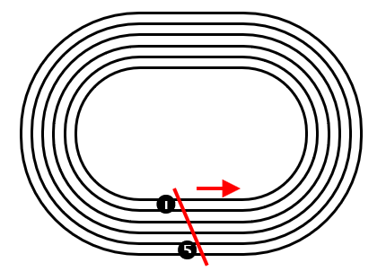
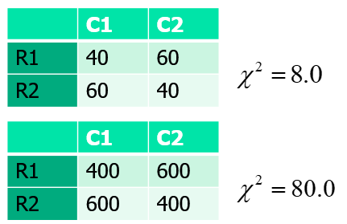
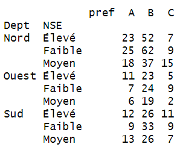
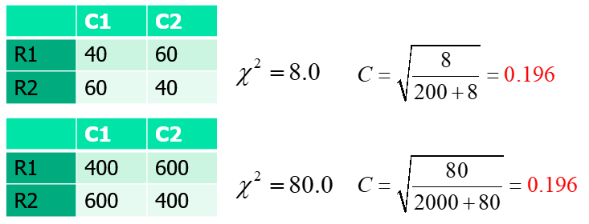
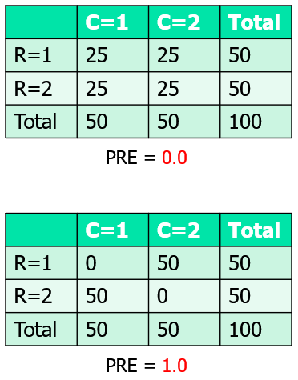

```{r}
#| echo: false
#| message: false
#| warning: false
#| error: false

source("global2.R")
if(!exists("HaitiPop")){load("./data/HaitiPop_Env.RData")}

```

```{css, echo=FALSE}
.basic {
  background-color: lightblue2;
  border: 2px solid blue;
  font-weight: bold;
}
```


# Proportions Multiples et Tableaux de contingence

Dans le chapitre précédent, des stratégies empiriques et analytiques ont été présentées pour l'examen des différences qui pouvaient exister entre deux proportions indépendantes. Un test de permutations, et un test d'hypothèse fondé sur la distribution Gaussienne ont permis d'inférer cette différence au niveau des populations d'où sont tirés les échantillons.  Dans ce chapitre, nous ajoutons un peu de complexité à la situation de deux manière:
  
* en ajoutant des catégories aux deux qui existent déjà: on examinera alors l'ajustement de la répartition observée à une distribution théorique  
* en ajoutant une deuxième variable qualitative: l'objectif sera dans ce cas d'examiner l'association entre deux variables qualitatives.  

## Objectifs d'apprentissage
  
À la fin de la lecture de ce chapitre, on devra être en mesure de:
  
  - effectuer un test d'ajustement entre les proportions observées dans $k$ catégories d'une variable qualitative, et les proportions attendues sur la base d'une distribution théorique;  
  - effectuer un test d'hypothèse concernant l'indépendance entre deux variables qualitatives comportant chacune deux catégories (tableau de contingence 2x2)  
    - à l'aide d'une procédure de simulation informatique,  
    - à l'aide du test du $\chi^2$  
    - à l'aide du test de Fisher  
  - calculer les risques et les rapports de risques pour un tableau de contingence 2x2
  - effectuer un test d'hypothèse concernant l'indépendance entre deux variables qualitatives comportant respectivement $n_R$ rangées et $n_C$ colonnes (tableau de contingence RxC)  
    - à l'aide d'une procédure de simulation informatique,  
    - à l'aide du test du $\chi^2$  
  - quantifier le degré d'association lorsque les deux variables sont nominales  
    - coefficient de contingence
    - coefficient phi
    - coefficient Q de Yule
    - coefficient Y de Yule
    - coefficient V de Cramer 
    - coefficient T de Tschuprow
    - coefficient $\tau$ (Tau) de Goodman & Kruskal
    - coefficient $\lambda$ (Lambda)
  - quantifier le degré d'association lorsque les deux variables sont ordinales  
    - Coefficient $\gamma$ (Gamma)  
    - Coefficient $\tau_b$ (Tau_b) de Kendall
    - Coefficient $\tau_c$ (Tau_c) de Kendall
    - Coefficient $d$ de Somers  

## Introduction  

Une grande portion des statistiques inférentielles concerne l'ajustement d'une variable par rapport à un modèle clairement défini. Est-ce que la distribution d'un ensemble de données empiriques s'ajuste bien au modèle Gaussien?  Est-ce que la relation entre deux variables empiriques est bien représenté par un modèle quadratique ? Les exemples de telles situations ne manquent pas dans la littérature scientifique.  Comme c'est le cas dans les contextes étudiés jusqu'ici, plusieurs méthodes existent et s'appliquent en fonction de la nature des données, et des objectifs visés par l'analyste.  Dans le présent chapitre, il sera question de l'ajustement de variables qualitatives à des modèles de probabilités pertinents, et à l'examen de l'association entre deux de ces variables.

## Qualité d'ajustement (*'Goodness of Fit'*): Mise en situation {#sec-chi2A}

Est-ce que, pour une variable qualitative composée de $k$ catégories, un échantillon est représentatif d'une population spécifique pour laquelle la répartition dans les différentes catégories est connue? 

### Exemple 1
  
Selon le Bureau des Statistiques Sociales d'Haiti, les niveaux d'éducation atteints à l'âge de 25 ans, à l'échelle du pays, regroupent les proportions d'individus suivantes:

```{r ex1tbl, echo=FALSE, }
    Scolar <- c("Aucun", "PréScol", "Fond.1", "Fond.2", "Fond.3", 
                "Second", "Univ.1", "Univ.2", "Univ.3")
    Proportion <- c(0.22, 0.2, 0.17, 0.12, 0.10, 0.09, 0.02, 0.05, 0.03)
    TblTheor <- data.frame(Scolar, Proportion)
    TblTheor %>%
      kbl(caption="Proportions de la population ayant atteint un niveau d'éducation donné, à 25 ans") %>%
  kable_styling(bootstrap_options = c("striped", "hover", "condensed"), full_width=FALSE) %>%
    column_spec(1, bold=TRUE, border_left=TRUE, background="#89CFF0") %>%
    column_spec(2, bold=TRUE, border_right=TRUE) 
         
```

Un chercheur de l'ISTEAH croit qu'en Artibonite, la répartition des niveaux d'éducation se démarque de la répartition nationale en ce que la proportion des individus sans scolarité et possiblement celle que l'on trouve aux niveaux des études supérieures seraient plus élevées. Il recueille donc un échantillon aléatoire de 450 individus âgés de 25 ans et plus, et prend note du niveau d'éducation qu'ils ont atteint à ce moment:

```{r echo=FALSE}
set.seed(520715)
n <- 450
subpop <- subset(HaitiPop, (DEPARTEMENT == "1" & AGE >= 25), EDUC)
xech <- sample(subpop$EDUC, n, replace = FALSE)
TblObs <- data.frame(table(factor(xech,
                                  levels = c("Aucun", "PréScol", "Fond.1", 
                                             "Fond.2", "Fond.3", "Second", 
                                             "Univ.1", "Univ.2", "Univ.3"))))
FO <- TblObs$Freq
TblObs$pct <- FO / n
colnames(TblObs) <- c("Niveau", "Fréq", "Proportion")
TblObs %>%
      kbl(digits = 3,
          caption="Répartition des niveaux d'éducations atteints, en Artibonite (n = 450)") %>%
  kable_styling(bootstrap_options = c("striped", "hover", "condensed"), full_width=FALSE) %>%
  column_spec(1, bold=TRUE, border_left=TRUE, background="#89CFF0") %>%
  column_spec(3, bold=FALSE, border_right=TRUE) 
```
  
### Question de recherche et Hypothèses statistiques
  
À partir des observations faites sur cet échantillon, peut-on affirmer que la répartition observée en Artibonite se démarque significativement de la répartion que l'on retrouve au niveau de la population Haitienne?  En d'autres termes, est-ce que les données obtenues en Artibonite pour un échantillon de 450 sujets s'ajustent bien à la répartition 'théorique' que l'on croit être réelle au niveau de la population?  

Pour répondre à une telle question, on devra formuler des hypothèses statistiques, $H_0$ et $H_1$, et mettre au point une procédure susceptible de vérifier si les résultats observés pour l'échantillon appuient ou non $H_0$.
Il s'agit d'un test d'hypothèse concernant l'ensemble des proportions ($k=9$). Dans ce cas, on peut formuler l'hypothèse nulle de la manière suivante:  
  
$$H_0:\pi_1=\xi_1,~~\pi_2=\xi_2,...,~~\pi_9=\xi_9$$
où $\pi_x$ représente la proportion observée en Artibonite, dans la catégorie d'éducation $x$, et $\xi_x$ représente la proportion postulée au niveau national, pour la même catégorie. En langage clair, $H_0$ propose que les proportions d'individus ayant atteint les différents niveaux d'éducation dans la population d'Artibonite sont conformes à ce que l'on retrouve au niveau national.
  
L'hypothèse alternative, dans ce cas, pourrait s'écrire:
  
$${{H}_{1}}:\exists (i)\in \left\{ 1,...,k \right\}| {{\pi }_{i}}\ne {{\xi }_{i}}  $$
    
En langage clair, $H_1$ propose qu'il existe **au moins** une catégorie ($i$), parmi l'ensemble des catégories existantes, ($\exists (i)\in \left\{ 1,...,k \right\}$), pour laquelle la proportion en Artibonite est différente de la proportion au niveau national.
  
### Fréquences Théoriques (Attendues)
   
Considérons les faits suivants:
  
* L'échantillon formé en Artibonite contient 450 observations  
* Si $H_0$ est vraie, la répartition de ces 450 sujets dans les différentes catégories d'éducation devrait s'ajuster étroitement à celle que l'on croit être vraie au niveau de la population. On connait les proportions ($\pi_i$) au niveau national (tableau @tbl-ex1tbl)). Il suffit donc de multiplier ces dernières par la taille de l'échantillon ($n=450$) pour obtenir le nombre de sujets que l'on s'attend d'obtenir dans chaque catégorie, **si $H_0$ est vraie**.  Sur cette base, on devrait donc trouver la répartition suivante dans l'échantillon:

```{r}
#| label: tbl-ex1tbl
#| echo: false
#| tbl-cap: Fréquences observées et attendues (théoriques) pour un échantillon de n=450 observations"

FT <- Proportion * n
dat2 <- data.frame(Scolar, Proportion, FO, FT)
colnames(dat2) <- c("Scolar", "Prop. Pop.", "Fréq. Obs.", "Fréq.Théor.")
dat2 %>%
  kbl(align=c("l", "c", "c", "c")) %>%
  kable_styling(bootstrap_options = c("striped", "hover", "condensed"), full_width=FALSE) %>%
  column_spec(1, bold=TRUE, border_left=TRUE, background="#89CFF0") %>%
  column_spec(3, bold=FALSE, border_right=FALSE) %>%
  column_spec(4, bold=FALSE, background="lightgreen", border_right=TRUE)

```
On observe évidemment des différences entre les fréquences observées au niveau de l'échantillon et celles qu'on s'attend d'obtenir si $H_0$ est vraie. La question est de savoir si ces différences sont suffisamment importantes et improbables (sous $H_0$) pour considérer qu'en Artibonite, la répartition des niveaux d'éducation atteints diffèrent de manière significative, de la répartition que l'on retrouve au niveau national. 
  
### Statistique échantillonnale

L'étape suivante est de trouver une manière de quantifier et de résumer en un seul indice statistique l'ensemble des différences observées ($Fréq.Obs-Fréq.Théor.$). Formons un indice tel que:

$$Diff =\sum\limits_{i=1}^{k}{\frac{(Fo_i-Ft_i)^2}{Ft_i}}$$ {#eq-chi2a}

où $Fo$ représente les fréquences observées au niveau de l'échantillon, et $Ft$ les fréquences que l'on s'attend d'obtenir si $H_0$ est vraie ($Ft_i=\pi_i \times n$). Si les fréquences observées sont toutes identiques aux fréquences attendues, alors $Diff=0$. Toute différence $Fo-Ft$ augmentera la valeur de cette statistique.  On obtient donc un indice qui possède les propriétés recherchées:
  
* L'absence de différence se traduit par une valeur nulle
* plus sa valeur augmente, plus les différences sont manifestes
* toute l'information disponble dans les données est utilisée: la mesure est efficace

Pour les données recueillies, on obtient:

```{r echo=FALSE}
Contrib <- (FO-FT)^2 / FT
dat2 <- data.frame(Scolar, Proportion, FO, FT, round(Contrib, 3))
colnames(dat2) <- c("Scolar", "Prop. Pop.", "Fréq. Obs.", "Fréq.Théor.", "Contrib.")
dat2 %>%
  kbl(align=c("l", "c", "c", "c", "r"),
      caption="Fréquences observées et attendues (théoriques), et contribution à *Diff* calculée pour chaque catégorie") %>%
    kable_styling(bootstrap_options = c("striped", "hover", "condensed"), full_width=FALSE) %>%
    column_spec(1, bold=TRUE, border_left=TRUE, background="#89CFF0") %>%
    column_spec(5, bold=FALSE, background="#ACE1AF", border_right=FALSE) 

SDcat <- sum(Contrib)

```
Dans ce tableau, $Contrib=\frac{(Fo-Ft)^2}{Ft}$ a été calculé pour chacune des catégories. Il s'agit de la *contribution* de la catégorie correspondante à la valeur de la statistique ($Diff$). L'indice $Diff$ n'est que la somme de ces quantités. On trouve alors:

$$Diff=\sum{Contrib}=0.011+45.511+...+0.019= `r round(SDcat,3)`$$
Notons que la différence la plus importante se trouve dans la catégorie  *Universitaire (premier cycle)*. Advenant le cas où $H_0$ serait rejetée, il serait donc possible de localiser les différences sur cette base. 
  
### Distribution d'échantillonnage
  
L'élément essentiel qui nous manque pour pouvoir compléter un test d'hypothèse impliquant notre statistique $Diff$ est sa distribution d'échantillonnage, que l'on peut construire en tirant un grand nombre d'échantillons de taille $n=450$ de la population d'Artibonite:

```{r echo=c(1:11)}
sf <- vector()
n <- 450
nrep <- 10000
propt <-as.data.frame(table(subpop$EDUC) / length(subpop$EDUC))
propx <- propt$Freq
for(i in 1:nrep){
  xech <- sample(subpop$EDUC, n, replace = FALSE)
  TblObs <- data.frame(table(xech))
  FOx <- TblObs$Freq
  FTx <- propx * n
  sf[i] <- sum((FOx - FTx)^2 / FTx)
}

h <- hist(sf,
     main="Distribution d'échantillonnage de Diff",
     breaks="FD",
     xlab="Diff",
     ylab="Fréquence",
     xlim=c(0, quantile(sf, 0.999)))
x <- seq(0, max(sf), by=.1)
y <- dchisq(x, 8) * sum(h$counts)/sum(h$density) 
lines(x = x, y = y, col ="red", lwd=2) 
      
cat("Moyenne         = ", mean(sf))
cat("Erreur-standard = ", sd(sf))

```

La distribution d'échantillonnage obtenue ressemble étrangement à une distribution de probabilité rencontrée dans les chapitre antérieurs. Ses caractéristiques sont:

```{r echo=FALSE}
m <- round(mean(sf), 3)
s <- round(sd(sf), 3)
k <- length(table(subpop$EDUC))
```

* elle est asymétrique positive  
* sa moyenne est: $\mu_{Diff}= `r m` \approx (k-1)=8$
* son erreur-standard est: $\sigma_{Diff}=  `r s` \approx \sqrt{2(k-1)}=4$

Ces caractéristiques sont celles d'une distribution du $\chi^2$, avec $(k-1)$ degrés de liberté. La courbe théorique superposée à l'histogramme suggère un excellent ajustement. On peut donc renommer la statistique $Diff$: il s'agit simplement d'un $\chi^2$:
  
$$\chi^2=\sum\limits_{i=1}^{k}{\frac{(Fo_i-Ft_i)^2}{Ft_i}} $$ {#eq-chi2b}

Les inférences statistiques concernant l'ajustement d'une distribution pourra donc se faire de manière empirique (simulation) ou théorique, en utilisant la distribution du $\chi^2$, comme on pourra le constater dans les paragraphes suivants.

### Vérification d'hypothèse

À ce stade, nous disposons de tous les éléments nécessaires à la conclusion d'un test d'hypothèse concernant $k$ proportions. Dès lors, on peut répondre à la question:

> Est-ce que la répartition des niveaux de scolarité atteints par les résidents d'Artibonite âgés de 25+ ans se distingue de la répartition que l'on trouve au niveau national?

De manière empirique, la probabilité d'obtenir $\chi^2=`r round(SDcat,3)`$, pour $dl=`r k-1`$, est donnée par:

```{r}
pr <- mean(sf <= SDcat)
paste("P(Diff >= ", round(SDcat,3), ") = ", round(mean(sf >= SDcat), 4))
```
Puisque cette probabilité est inférieure au niveau de signification choisi ($\alpha=0.05$), on considère qu'il y a évidence d'écarts significatifs (statistiquement) entre les proportions d'individus ayant atteint un certain niveau d'études en Artibonite par rapport à celles que l'on trouve au niveau de la population.

De manière analytique, nous savons maintenant que:
  
* $\chi^2=`r round(SDcat,3)`$
* $dl=8$

La probabilité d'obtenir une valeur égale ou supérieure à ce $\chi^2$ est:

```{r}
pr <- pchisq(SDcat, 8, lower.tail=FALSE)
cat("p = ", pr)
```

Au niveau de signification $\alpha=0.05$, ces résultats indiquent que les données observées `r if(pr > 0.05){" ne constituent pas"}else{" constituent "}` un événement rare. On `r if(pr > 0.05){" ne peut donc pas "}else{" peut donc "}` affirmer que la répartition des niveaux d'étude complétés en Artibonite diffère significativement de la répartition au niveau national.
  
Sous R, l'ensemble de la procédure se résume en une fonction simple: **chisq.test()**. Les arguments de cette fonction sont un tableau des fréquences observées dans les différentes catégories, et un vecteur composé des proportions postulées au niveau de la population. Pour les données sous analyse, on obtient:

```{r}

p <- c(0.22, 0.2, 0.17, 0.12, 0.10, 0.09, 0.02, 0.05, 0.03)
xech <- sample(subpop$EDUC, n, replace = FALSE)
TblObs <- data.frame(table(factor(xech,
                                  levels = c("Aucun",  "PréScol", "Fond.1", 
                                             "Fond.2", "Fond.3", "Second", 
                                             "Univ.1", "Univ.2", "Univ.3"))))
chisq.test(TblObs$Freq, p=p)
```
### Valeurs résiduelles

On l'a vu, plus les écarts entre les fréquences observées et celles que l'on s'attend d'obtenir si $H_0$ est vraie sont grands, plus la valeur du $\chi^2$ sera élevée.  Ces écarts portent le nom de **valeurs résiduelles** et à la base, sont définis par:
  
  $$Résidus~~ non-standardisés =R_{i}= Fo_i-Ft_i,~~ \forall~~ i\in [1, ..., k]$$ {#eq-resid1}
  
  $$Résidus~~ standardisés=\frac{R_i}{\sqrt{Ft_i}},~~ \forall~~ i\in [1, ..., k]$$ {#eq-resid2}
  
Plus une valeur résiduelle, standardisée ou non, est grande, plus la catégorie correspondante contribue à la valeur du $\chi^2$.  La version standardisée a l'avantage de rendre les résidus comparables les uns aux autres. Une valeur résiduelle standardisée supérieure à |2| serait considérée comme indicatrice d'une contribution importante de la catégorie correspondante. Une valeur résiduelle positive indique que la fréquence observée est plus élevée qu'elle le devrait si $H_0$ est vraie; une valeur résiduelle négative indique le contraire: la fréquence observée est inférieure à celle qu'on s'attend d'obtenir, toujours si $H_0$ est vraie.

Poursuivant notre exemple, on trouve:

```{r echo=FALSE}
RESID <- FO-FT
RESstd <- RESID / sqrt(FT)
out <- data.frame(Scolar, Proportion, FO, FT, Contrib, RESID, RESstd)
colnames(out) <- c("Scolar", "Prop.Pop.", "Fréq. Obs.", "Freq. Théo.", "Contr.", "Résidus", "Rés. Std.")
out %>%
  kbl(digits=3,
      caption="Fréquences observées, théoriques, et valeurs résiduelles",
      align=c("l", rep("r", 6))) %>%
  kable_styling(bootstrap_options = c("striped", "hover", "condensed"), full_width=FALSE) %>%
  column_spec(1, bold=TRUE, border_left=TRUE, background="#89CFF0") %>%
  column_spec(6, bold=FALSE, background="#FAE7B5ellow", border_right=FALSE) %>%
  column_spec(7, bold=FALSE, background="#FAE7B5ellow", border_right=TRUE)

```
De ce tableau, si des différences existent, elles se situent au niveau des catégories de scolarité: 
  
```{r echo=FALSE}
catd <- Scolar[which(abs(RESstd) >= 2)]
if(length(catd) == 0){"Aucune différence n'existe!"}else{catd}
```
  
### Vérification d'hypothèse concernant *k* proportions indépendantes: distribution uniforme {#sec-chi2B}

L'exemple précédent concernait l'ajustement d'une distribution observée par rapport à une population dont la distribution peut prendre un nombre infini de formes. Pour donner suite au test d'hypothèse concernant deux proportions indépendantes étudié précédemment (chapitre 10), on peut considérer une distribution uniforme ou les proportions attendues dans chacune des catégories sont égales entre elles. 
  
#### Exemple 2

Au stade Sylvio-Cator de Port-au-Prince, on organise des courses de 500 mètres pour les jeunes lycéens de la région. On utilise 5 pistes concentriques, tel qu’affiché dans la figure suivante:



La ligne de départ est indiquée en rouge et est oblique de manière à compenser pour la longueur inégale des pistes. La question est de savoir si cette configuration est équitable: pour des coureurs également rapides, est-ce que les chances de gagner une course sont les mêmes quelle que soit la position de départ (1, ..., 5)?

Pour une saison durant laquelle 100 courses ont eu lieu, on observe les résultats suivants:
  
```{r echo=FALSE}
piste <- 1:5
ng <- c(27, 20, 21, 17, 15)
dat <- rbind(piste,ng)
dat %>%
  kbl(caption="Nombre de courses gagnées (ng) pour chaque position de départ (100 courses)") %>%
  kable_styling(bootstrap_options = c("striped", "hover", "condensed"), full_width=FALSE) 

```

Sur la base de ces données, peut-on affirmer que les positions de départ sont équitables?

Pour que les positions de départ soient équitables, la probabilité de gagner une course doit être la même peu importe la position occupée par un coureur. Puisqu'il y a 5 pistes au Stade Sylvio-Cator, cette probabilité est $p=\frac{1}{5}=0.2$.

Dans un premier temps, posons les hypothèses statistiques:

$$H_0:\pi_1=\pi_2=\pi_3=\pi_4=\pi_5=0.2$$
$${{H}_{1}}:\exists (i,j)\in \left\{ 1,...,k \right\}| {{\pi }_{i}}\ne {{\pi }_{j}}  $$
  
En termes clairs, $H_0$ propose que la probabilité de gagner une course ($\pi=0.2$) est la même quelle que soit la position de départ, alors que $H_1$ propose que les probabilités de gagner pour au moins une paire de positions de départ sont différentes.

Nous connaissons donc les probabilités de gagner pour chaque position de départ ($\pi=0.2$), telles que proposées par $H_0$. Le nombre de courses est $n=100$, et le nombre de positions de départ est $k=5$. En conséquence, si $H_0$ est vraie, on s'attend à observer $n\times \pi= 100 \times 0.2=20$ gagnants pour chaque position de départ. Ainsi, le tableau à analyser est le suivant:

```{r echo=FALSE}
piste <- 1:5
FO <- c(27, 20, 21, 17, 15)
FT <- rep(20, 5)
dat <- rbind(piste,FO, FT)
rownames(dat) <- c("Position", "Fréq. Obs.", "Fréq. Théor.")
dat %>%
  kbl(caption="Fréquences observées et théoriques (100 courses)") %>%
  kable_styling(bootstrap_options = c("striped", "hover", "condensed"), full_width=FALSE) %>%
  column_spec(1, bold=TRUE, border_left=TRUE, background="#89CFF0") %>%
  row_spec(1, bold=TRUE, background="#89CFF0") 

```

La comparaison des fréquences observées et théoriques implique une statistique échantillonnale, poste occupé par le $\chi^2$ et dont la valeur est:

$$\chi^2=\sum\limits_{i=1}^{k}{\frac{(Fo-Ft)^2}{Ft}} =\frac{(27-20^2)}{20}+...+\frac{(15-20^2)}{20}=4.2$$
et le nombre de degrés de liberté est $(k-1)=(5-1)=4$.  La probabilité d'obtenir un tel $\chi^2$, ou une valeur plus extrême, **si $H_0$ est vraie**, est:

```{r}
pr <- pchisq(4.2, 4, lower.tail=FALSE)
cat("p = ", pr)
```
On n'a donc aucune évidence à l'effet que les positions de départ aux courses de 500 mètres au Stade Sylvio-Cator sont inéquitables, ou que la position de départ ait un impact sur les chances de gagner une course.

Sous R, la fonction **chisq.test()** affiche:
  
```{r}
chi2 <- chisq.test(FO, p=rep(0.2, 5))
chi2
```
Suite à l'exécution de cette fonction, on peut visualiser les valeurs résiduelles:

```{r echo=1:3}
Position <- 1:5
Resid <- chi2$residuals
ResStd <- chi2$stdres
out <- data.frame(cbind(Position, Resid, ResStd))
colnames(out) <- c("Position", "Résidus", "Résidus Std.")
out %>%
  kbl(digits=3) %>%
  kable_styling(bootstrap_options = c("striped", "hover", "condensed"), full_width=FALSE) %>%
  column_spec(1, bold=TRUE, border_left=TRUE, background="#89CFF0") %>%
  column_spec(3, bold=FALSE, border_right=TRUE)

```


Puisque le test de signification ne parvient pas à déceler une différence entre les proportions, aucune valeur résiduelle n'est élevée.

### Qualité d'ajustement par rapport à une distribution définie {#sec-chi2C}

Dans les deux paragraphes précédents, il a été question de la vérification de l'ajustement d'une distribution par rapport à une distribution arbitraire (Section @sec-chi2A), et par rapport à une distribution uniforme (Section @sec-chi2B). De fait, il est possible de vérifier l'ajustement d'une distribution par rapport à toute distribution théorique jugée pertinente. Dans ce paragraphe, nous présentons une procédure similaire permettant de vérifier qu'une distribution de fréquences observées est gaussienne.

#### Exemple 3

La procédure décrite dans les paragraphes précédents trouvent une application intéressante lorsqu'on tente de déterminer si une distribution de données est Gaussienne ou non. À titre d'exemple, considérons la distribution de fréquences suivante. Il s'agit d'un ensemble de 200 scores (échelle quantitative) générés alétoirement:

```{r echo=FALSE}

set.seed(1234567)
df <- data.frame(x <- rnorm(200, 10, 2.3) + rchisq(200, 15))
hist(df$x,
     main="Distribution de Fréquences (X)",
     xlab="X",
     ylab="Fréquence",
     breaks="FD")
m <- mean(df$x)
s <- sd(df$x)
minx <- floor(min(df$x)/5) * 5
maxx <- ceiling(max(df$x)/5)*5
breaks <- seq(minx, maxx, by=5)
df$interval <- findInterval(df$x, breaks)
df$start <- breaks[df$interval]
df$end <- breaks[df$interval + 1] - 1
df <- df[order(df$interval), ]
tbl <- as.data.frame(table(df$interval))
tbldf <- data.frame(unique(df$start)-0.5, unique(df$end)+0.5, tbl$Freq)
colnames(tbldf) <- c("LimInf", "LimSup", "Fo")

```
Un certain degré d'asymétrie positive apparaît dans cet histogramme. Est-ce que cet écart par rapport à la normalité est suffisante pour affirmer que la distribution n'est pas Gaussienne? Le tableau de fréquence suivant sera le départ de la stratégie qui conduira à la réponse:

```{r echo=FALSE}
tbldf %>%
  kbl(caption="Distribution de Fréquences (X)") %>%
  kable_styling(bootstrap_options = c("striped", "hover", "condensed"), 
                full_width=FALSE) %>%
  column_spec(1:2, bold=TRUE, 
              border_left=TRUE, background="#89CFF0") %>%
  column_spec(3, bold=FALSE, border_right=TRUE)
```

Notons que les limites des intervalles sont exactes. La moyenne de cette distribution et son écart-type sont:

```{r echo=FALSE}
ms <- data.frame(c("Moyenne = ", "Écart-Type ="), c(m, s))
colnames(ms) <- c("", "")
kable(ms,
      digits=3) %>%
  kable_styling(bootstrap_options = c("striped", "hover", "condensed"), full_width=FALSE)
```
Ces données nous seront utiles dans le processus, qui se déroule en plusieurs étapes:
  
  1. Obtenir la distribution cumulative:
  
```{r echo=FALSE}
tbldf$FreqCum <- cumsum(tbldf$Fo) 
tbldf %>%
  kbl() %>%
  kable_styling(bootstrap_options = c("striped", "hover", "condensed"), full_width=FALSE) %>%
  column_spec(1, bold=TRUE, border_left=TRUE, background="#89CFF0") %>%
  column_spec(2, bold=TRUE, border_left=FALSE, background="#89CFF0") %>%
  column_spec(4, bold=FALSE, background="#FAE7B5ellow", border_right=TRUE)
```
  2. Si $H_0$ est vraie, quelle fréquence cumulative devrait-on observer aux différents intervalles? Par exemple, pour l'intervalle [9.5-14.5]:
  
* déterminons dans une distribution normale avec $\mu= `r round(m, 3)`$ et $\sigma= `r round(s, 3)`$, la proportion des scores sous la limite supérieure exacte de l'intervalle (**14.5**), ou le $RC_{14.5}$. Utilisant la fonction **pnorm()** sous R, on trouve: pnorm(14.5, $`r round(m, 3)`$, $`r round(s, 3)`$) = $`r round(pnorm(14.5, m, s), 3)`$  

* En multipliant cette proportion par *n*= 200, on obtient la fréquence cumulative attendue dans cet intervalle, **si $H_0$ est vraie**. Appliquant cette opération pour chacun des intervalles, on obtient:

    
```{r echo=FALSE}
rc <- pnorm(tbldf$LimSup, m, s)
nc <- 200 * rc
tbldf$PropCum <- rc
tbldf$NCum <- nc
tbldf %>%
  kbl(digits=3,
    caption="Proportions et Fréquences Cumulatives attendues") %>%
    kable_styling(bootstrap_options = c("striped", "hover", "condensed"), full_width=FALSE) %>%
    column_spec(1, bold=TRUE, border_left=TRUE, background="#89CFF0") %>%
    column_spec(2, bold=TRUE, border_left=FALSE, background="#89CFF0") %>%
    column_spec(5, bold=FALSE, background="#FAE7B5ellow", border_right=FALSE) %>%
    column_spec(6, bold=FALSE, background="#FAE7B5ellow", border_right=TRUE) 
```

    
  Dans ce tableau, on a ajouté les proportions attendues dans chaque intervalle, et en multipliant   cette proportion par la taille de l'échantillon, on obtient les fréquences cumulatives attendues.

  3. La dernière opération consiste à revenir à la distribution non-cumulative, pour les fréquences attendues:
  
```{r echo=FALSE}
tbldf$Ft <- c(tbldf$NCum[1], diff(tbldf$NCum))
tbldf %>%
  kbl(digits=3,
      caption="Fréquence Théoriques: Distribution Normale") %>%
      kable_styling(bootstrap_options = c("striped", "hover", "condensed"), full_width=FALSE) %>%
      column_spec(1, bold=TRUE, border_left=TRUE, background="#89CFF0") %>%
      column_spec(2, bold=TRUE, border_left=FALSE, background="#89CFF0") %>%
      column_spec(3, bold=FALSE, background="#ACE1AF", border_right=FALSE) %>%
      column_spec(7, bold=FALSE, background="#ACE1AF", border_right=TRUE) 
```
Cette dernière opération a permis de déterminer les fréquences que l'on s'attend d'obtenir si $H_0$ est vraie. Tous les éléments sont maintenant en place pour effectuer la vérification de l'hypothèse:

$$H_0: X\sim N(`r round(m, 3)`, `r round(s, 3)`)$$
Il suffit de comparer les fréquences observées aux fréquences théoriques, à l'aide du $\chi^2$:

```{r echo=FALSE}
khi <- sum((tbldf$Fo - tbldf$Ft)^2 / tbldf$Ft)
```


$$\chi^2=\sum\limits_{i=1}^{k}{\frac{(Fo-Ft)^2}{Ft}} =\frac{(`r tbldf$Fo[1]`-`r round(tbldf$Ft[1], 3)`)^2}{`r round(tbldf$Ft[1], 3)`}+...+\frac{(`r tbldf$Fo[8]`-`r round(tbldf$Ft[8], 3)`)^2}{`r round(tbldf$Ft[8], 3)`}=`r round(khi, 3)`$$
```{r echo=FALSE}
cat("Chi-Carré = ", khi)
cat("Degrés de liberté = ", dl <- nrow(tbldf)-1)
cat("p = ", pr <- pchisq(khi, dl, lower.tail=FALSE))
```
La probabilité d'obtenir un tel $\chi^2$ ou une valeur qui lui est supérieure, si $H_0$ est vraie, est supérieure au niveau de signification choisi ($\alpha=0.05$). Il semble donc qu'il `r if(pr<0.05){"y a suffisamment "}else{"n'y a pas suffisamment "}` d'évidence pour affirmer que la distribution `r if(pr<0.05){"est "}else{" n'est pas "}` Gaussienne. En conséquence, ces données  `r if(pr>0.05){" pourraient "}else{" ne pourraient pas "}` être analysées à l'aide de techniques requérant la normalité de la distribution.

## Tableaux de contingence 2x2

Est-ce que les hommes et les femmes accèdent aux études supérieures dans les mêmes proportions? En d'autres termes, est-ce qu'il existe une association entre le genre des individus et l'admission ou non aux études supérieures?  Est-ce que l'application d'un traitement (0 = placebo, 1 = traitement) se traduit par l'élimination des symptômes d'une maladie (0 = aucun changement, 1 = symptômes éliminés)?

Ce type de question est fréquent en recherche, et nous connaissons déjà une méthode qui nous permet d'y répondre: le test Z pour deux proportions indépendantes. Examinons le problème sous un autre angle, en passant par un tableau de contingence 2x2, étant formé de deux rangées et de deux colonnes. Chaque cellule du tableau contient les fréquences observées dans la combinaison de catégories correspondantes. Par exemple, considérons un échantillon aléatoire de 136 personnes graduant du Lycée et considérant poursuivre leurs études aux niveaux supérieurs à l'ISTEAH. Les données sont compilées dans le tableau suivant:

```{r echo=1:4}
x <- matrix(c(45, 36, 15, 32), nrow=2)
x <- addmargins(x)
colnames(x) <- c("Admis", "Refus", "TotR")
rownames(x) <- c("Hommes","Femmes", "TotC")
x %>%
  kbl() %>%
  kable_styling(bootstrap_options = c("striped", "hover", "condensed"), full_width=FALSE) %>%
  column_spec(4, bold=FALSE, border_right=TRUE, background="yellow") %>%
  column_spec(1, bold=TRUE, background="#89CFF0", border_left=TRUE) %>%
  row_spec(0, background="#89CFF0") %>%
  row_spec(3, background="yellow") 

```

Dans une telle situation, on peut définir les hypothèses statistiques de la manière suivante:
  
* $H_0:$ Les deux variables sont indépendantes. Il n'y a aucune relation entre elles, de sorte que la connaissance de l'une ne permet aucune prédiction concernant l'autre. Dans le cas présent, le sexe des sujets n'a aucun lien avec le fait qu'il y ait admission ou non aux études supérieures. Ou encore, l'admission aux études supérieures ne dépend pas du sexe des sujets.  
  
* $H_1:$ Les deux variables sont dépendantes. Il y a association entre les deux, de sorte que la connaissance de l'une permettra, dans une certaine mesure, de prédire l'autre. Dans le cas présent, le sexe des sujets est lié avec le fait qu'il y ait admission ou non aux études supérieures. Ou encore, l'admission aux études supérieures dépend du sexe des sujets.  

Nous disposons donc des fréquences observées dans chacune des cellules. La question que l'on doit se poser à ce stade est: '**Si $H_0$ est vraie (au niveau de la population, les deux variables sont indépendantes), quelles fréquences s'attend-on d'obtenir dans chacune des cellules du tableau de contingence? **' 

Pour déterminer les fréquences attendues (**Ft**), procédons comme suit:

* Cellule (1, 1): Fréquence observée = 45  
  - 60 des 128 observations sont des hommes: $p_{11}=\frac{60}{128}=0.469$
  - 81 sujets sont admis, donc on s'attend à ce que $81 \times 0.469 = 37.989$ personnes admises soient des hommes, si $H_0$ est vraie;  
  
* Cellule (1, 2): Fréquence observée = 15  
  - 60 des 128 observations sont des hommes: $p_{12}=\frac{60}{128}=0.469$
  - 47 sujets ne sont pas admis, donc on s'attend à ce que $47 \times 0.469 = 22.044$ personnes non admises soient des hommes, si $H_0$ est vraie;  
  
* Cellule (2, 1): Fréquence observée = 36  
  - 68 des 128 observations sont des femmes: $p_{21}=\frac{68}{128}=0.531$
  - 81 sujets sont admis, donc on s'attend à ce que $81 \times 0.531 = 43.011$ personnes admises soient des femmes, si $H_0$ est vraie;   
  
* Cellule (2, 2): Fréquence observée = 32  
  - 68 des 128 observations sont des femmes: $p_{21}=\frac{68}{128}=0.531$
  - 47 sujets ne sont pas admis, donc on s'attend à ce que $47 \times 0.531 = 24.957$ personnes non admises soient des femmes, si $H_0$ est vraie; 
  
En bref, les fréquences attendues dans un tableau de contingence, supposant $H_0$ vraie, s'obtiennent par:

$$Ft_{ij}=\frac{Tr_i\times Tc_j}{N} $$ {#eq-FreqTh}  

Pour l'ensemble des données, on obtient donc les fréquences attendues:

```{r echo=FALSE}
x <- matrix(c(45, 36, 15, 32), nrow=2)
rs <- rowSums(x[1:2, 1:2])
cs <- colSums(x[1:2, 1:2])
ft <- matrix((rs %x% cs) / sum(rs), nrow=2, byrow=TRUE)

colnames(ft) <- c("Admis", "Refus")
rownames(ft) <- c("Hommes","Femmes")
ft %>%
  kbl(digits = 3) %>%
  kable_styling(bootstrap_options = c("striped", "hover", "condensed"), full_width=FALSE) %>%
  column_spec(3, bold=FALSE, border_right=TRUE) %>%
  column_spec(1, bold=TRUE, background="#89CFF0", border_left=TRUE) %>%
  row_spec(0, background="#89CFF0") 
c2 <- sum((x - ft)^2 / ft)
ftr <- round(ft, 3)

```

Finalement, tous les éléments sont réunis pour obtenir $\chi_{Obs}^2$:
  
$$\chi^2=\sum\limits_{i=1}^{k}{\frac{(Fo-Ft)^2}{Ft}} =\frac{(`r x[1,1]`-`r ftr[1,1]`)^2}{`r ftr[1,1]`}+\frac{(`r x[1,2]`-`r ftr[1,2]`)^2}{`r ftr[1,2]`}+\frac{(`r x[2,1]`-`r ftr[2,1]`)^2}{`r ftr[2,1]`}+\frac{(`r x[2,2]`-`r ftr[2,2]`)^2}{`r ftr[2,2]`}=`r round(c2, 3)`$$

Le nombre de degrés de liberté est:

$$dl=(n_R-1)(n_C-1)=(2-1)(2-1)=1 $$
et finalement, la probabilité d'obtenir un $\chi^2$ égal ou supérieur à $`r round(c2, 3)`$ est:

```{r}
pr <- pchisq(6.675, 1, lower.tail=FALSE)
cat("p = ", pr)
```
Sous R, l'ensemble des opérations se résume à la commande:

```{r}
m <- matrix(c(45,15,36,32),nrow=2, byrow=TRUE)
chisq.test(m, correct=FALSE)
```
On rejette donc $H_0$ et on conclut que l'admission aux études supérieures est associée au sexe des individus. Ce que nous ignorons toujours, c'est la nature de cette association. Plusieurs indices nous permettront de cerner davantage la situation:

* Les contributions à la valeur du $\chi^2$ : Pourcentage du $\chi^2$ attribuable à une cellule donnée:

  $$Contribution_{ij}=\frac{(Fo_{ij}-Ft_{ij})^2}{Ft_{ij}}\times 100 $$ {#eq-contrib}
  
* Pourcentage de déviation: degré auquel la fréquence observée dans une cellule diffère de ce qu'on s'attendrait d'obtenir si $H_0$ est vraie:

$$\%Déviation=\frac{(Fo_{ij}-Ft_{ij})}{Ft_{ij}} \times 100$$ {#eq-PctDev}
  
Par exemple, un pourcentage de déviation égal à +15% dans une cellule donnée indique que la fréquence observée dans cette cellule est 15% plus élevée qu'attendu. Un pourcentage de déviation négatif indique que la fréquence observée est inférieure à celle que l'on s'attend d'obtenir si $H_0$ est vraie.
    
* Valeurs résiduelles non-standardisées: écart brut entre la fréquence observée dans une cellule et la fréquence théorique correspondante: $(Fo_{ij}-Ft_{ij})$  
  
* Valeurs résiduelles standardisées: écarts standardisés entre la fréquence observée dans une cellule et la fréquence théorique correspondante: 

$$R_{STD}=\frac{(Fo_{ij}-Ft_{ij})}{\sqrt{Ft_{ij}}}$$ {#eq-contrib}

* Valeurs résiduelles standardisées ajustées: écarts standardisés, tenant compte des totaux marginaux.

$$AR_{ij}=\frac{Fo_{ij}-Ft_{ij}}{\sqrt{Ft_{ij} \left( 1-\frac{Tr_i}{N} \right)\left( 1-\frac{Tc_j}{N} \right)}} $$ {#eq-ResAdjStd}  

Ces valeurs ont une distribution approximativement normale, ce qui les rend aisément interprétables: ce sont des scores Z!
  
Pour les données sous analyse, l'ensemble de ces indices sont reproduits dans le tableau suivant:
  
```{r echo=FALSE}
rs <- rowSums(x[1:2, 1:2])
cs <- colSums(x[1:2, 1:2])
ft <- matrix((rs %x% cs) / sum(rs), nrow=2, byrow=TRUE)
Contrib <-  c(t((x[1:2, 1:2] - ft)^2 / ft))
DevProp <-  c(t((x[1:2, 1:2] - ft) / ft * 100))
Residu <- c(t((x[1:2, 1:2] - ft)))
ResiduStd <-  c(t((x[1:2, 1:2] - ft) / sqrt(ft)))
ResidAjust <- c(t((x[1:2, 1:2] - ft) / sqrt(ft * (1-rs/sum(rs))*(1-cs/sum(cs)))))
tbl <- data.frame(
  c(1, 1, 2, 2),
  c(1, 2, 1, 2),
  Contrib,
  DevProp,
  Residu,
  ResiduStd,
  ResidAjust
)
colnames(tbl) <- c("Rangée", "Colonne", "Contrib", "%Deviation", "Résidu", "Résidu Std", "Résidu Ajust")

tbl %>%
  kbl(digits = 3) %>%
  kable_styling(bootstrap_options = c("striped", "hover", "condensed"), full_width=FALSE) %>%
  column_spec(7, bold=FALSE, border_right=TRUE) %>%
  column_spec(1:2, bold=TRUE, background="#89CFF0", border_left=TRUE) %>%
  row_spec(0, background="#89CFF0") 
```
  
On note que les cellules [1,1] (Hommes admis), [1, 2] (Hommes refusés) et [2,2] (Femmes refusées) sont associées à des valeurs résiduelles ajustées très élevées. Plus d'hommes sont admis, et plus de femmes ne le sont pas que ce que le modèle d'indépendance propose.  Parallèlement, moins d'hommes sont refusés aux études supérieures, et moins de femmes sont acceptés, toujours par rapport à ce qu'on s'attend d'obtenir sous $H_0$. Toutes ces différences sont statistiquement significatives pour $\alpha=0.05$, la valeur critique sous la courbe normale étant z = ±1.96

### Correction de Yates (Continuité)

Lorsqu’on utilise la distribution du Chi-Carré pour interpréter le Chi-Carré obtenu à partir d’un tableau de contingence, on suppose que la probabilité discrète des fréquences binômiales observées peut être approximée par la distribution continue du chi-carré, ce qui n’est pas exact et introduit une erreur. La correction que l'on applique consiste simplement à soustraire 0.5 de la valeur absolue de l'écart entre $Fo$ et $Ft$, de sorte que:

$$\chi^2=\sum\limits_{i=1}^{k}{\frac{(|Fo-Ft|-0.5)^2}{Ft}}$$ {#eq-Yates}

L'impact de cette erreur se fait sentir principalement dans le cas de tableaux de contingence 2x2, comme celui que nous avons analysé dans le paragraphe précédent. Et dans ce cas particulier, on pourra utiliser une reformulation n'impliquant que les fréquences observées dans les quatre cellules du tableau: A et B pour la première rangée, et C et D pour la seconde. On définit alors:
  
$$\chi^2=\frac{N \left(|AD-BC|-\frac{N}{2} \right )^2}{(A+B)(C+D)(A+C)(B+D)}$$ {#eq-chi2Cor}

Pour les données analysées dans la section précédente, on obtient:

```{r echo=FALSE}
x <- matrix(c(45, 36, 15, 32), nrow=2)
x <- addmargins(x)
colnames(x) <- c("Admis", "Refus", "TotR")
rownames(x) <- c("Hommes","Femmes", "TotC")
x %>%
  kbl() %>%
  kable_styling(bootstrap_options = c("striped", "hover", "condensed"), full_width=FALSE) %>%
  column_spec(4, bold=FALSE, border_right=TRUE, background="yellow") %>%
  column_spec(1, bold=TRUE, background="#89CFF0", border_left=TRUE) %>%
  row_spec(0, background="#89CFF0") %>%
  row_spec(3, background="yellow") 

```
$$\chi^2=\frac{128 \left(|(45)(32)-(15)(36)|-\frac{128}{2} \right )^2}{(45+15)(36+32)(45+36)(15+32)}=5.7594  $$
avec $dl=1$. Par conséquent, la probabilité d'obtenir une telle valeur, ou une valeur plus extrême, si $H_0$ est vraie est:

```{r}
pr <- pchisq(5.7594, 1, lower.tail=FALSE)
cat("p = ", pr)
```
On note une légère réduction dans la valeur observée du $\chi^2$, passant de `r round(c2, 3)` avant la correction, à 5.7594 après son application.

Notons qu'il n'est nullement nécessaire d'appliquer cette correction pour des tableaux de contingence de tailles supérieures à 2x2. Et même dans ce cas, jugeant la procédure trop conservatrice (il est plus difficile de rejeter $H_0$), plusieurs auteurs recommandent de ne pas la prendre en compte.

Notons enfin que la fonction **chisq.test()** applique la correction de Yates par défaut pour les tableaux 2x2:

```{r}
chisq.test(m)
chisq.test(m, correct=FALSE)
```

### Le test de Fisher

Une condition importante pour l'application du test du $\chi^2$ concerne la taille des fréquences attendues:  

* aucune d'entre elles ne doit être nulle  
* au moins 80% des fréquences attendues ont des valeurs attendues supérieures ou égales à 5  

Lorsque ces conditions ne sont pas respectées, le test de Fisher offre une alternative intéressante. Ce test consiste à calculer les probabilités exactes d’un tableau de contingence particulier ou des tableaux plus extrêmes, en utilisant la distribution hypergéométrique. Ainsi:

$$p=\frac{C_{a}^{a+b}C_{c}^{c+d}}{C_{a+c}^{n}}=\frac{C_{b}^{a+b}C_{d}^{c+d}}{C_{b+d}^{n}}=\frac{(a+b)!(c+d)!(a+c)!(b+d)!}{a!b!c!d!N!}$$ {#eq-Fisher}
  
Par exemple, considérons le tableau de contingence suivant:

```{r echo=1:4}
x <- matrix(c(3, 3, 10, 0), nrow=2)
x <- addmargins(x)
colnames(x) <- c("C1", "C2", "TotR")
rownames(x) <- c("R1","R2", "TotC")
x %>%
  kbl() %>%
  kable_styling(bootstrap_options = c("striped", "hover", "condensed"), full_width=FALSE) %>%
  column_spec(4, bold=FALSE, border_right=TRUE, background="yellow") %>%
  column_spec(1, bold=TRUE, background="#89CFF0", border_left=TRUE) %>%
  row_spec(0, background="#89CFF0") %>%
  row_spec(3, background="yellow") 
```

La probabilité exacte d'obtenir un tel tableau est:

$$p=\frac{(a+b)!(c+d)!(a+c)!(b+d)!}{a!b!c!d!N!}=\frac{(6)!(10)!(13)!(3)!}{3!3!10!0!16!}=0.036 $$

Dans le présent cas, il n'existe aucun tableau plus extrême, puisqu'une fréquence observée est nulle.

Considérons maintenant le tableau suivant:

```{r echo=1:4}
x <- matrix(c(3, 3, 10, 1), nrow=2)
x <- addmargins(x)
colnames(x) <- c("C1", "C2", "TotR")
rownames(x) <- c("R1","R2", "TotC")
x %>%
  kbl() %>%
  kable_styling(bootstrap_options = c("striped", "hover", "condensed"), full_width=FALSE) %>%
  column_spec(4, bold=FALSE, border_right=TRUE, background="yellow") %>%
  column_spec(1, bold=TRUE, background="#89CFF0", border_left=TRUE) %>%
  row_spec(0, background="#89CFF0") %>%
  row_spec(3, background="yellow") 
```

La probabilité associée à ce tableau est:

$$\frac{(6)!(11)!(13)!(4)!}{3!3!10!1!17!}=0.0924 $$
Mais il existe un tableau plus extrême, si la cellule R2C2 est réduite d'une unité. En veillant à conserver les mêmes totaux marginaux, on réduit la fréquence observée la plus faible du tableau, (R2C2 = 1), ce qui nous force à modifier les autres fréquences attendues:


```{r echo=1:4}
x <- matrix(c(2, 4, 11, 0), nrow=2)
x <- addmargins(x)
colnames(x) <- c("C1", "C2", "TotR")
rownames(x) <- c("R1","R2", "TotC")
x %>%
  kbl() %>%
  kable_styling(bootstrap_options = c("striped", "hover", "condensed"), full_width=FALSE) %>%
  column_spec(4, bold=FALSE, border_right=TRUE, background="yellow") %>%
  column_spec(1, bold=TRUE, background="#89CFF0", border_left=TRUE) %>%
  row_spec(0, background="#89CFF0") %>%
  row_spec(3, background="yellow") 
```

et la probabilité d'obtenir un tel tableau est:

$$\frac{(6)!(11)!(13)!(4)!}{2!4!11!0!17!}=0.0063 $$

La probabilité d'obtenir le premier tableau ou un tableau plus extrême devient alors:  0.0924 + 0.0063 = 0.0987. Cette probabilité est supérieure au niveau de signification $\alpha=0.05$, ce qui nous permet de conclure qu'on ne dispose pas d'évidence nous permettant de refuter l'hypothèse d'indépendance.

Sous R, la fonction **fisher.test()** calcule cette probabilité, en plus d'établir l'intervalle de confiance pour les rapports de Cotes, comme nous le verrons dans la section suivante:

```{r}
x <- matrix(c(3, 3, 10, 1), nrow=2)
fisher.test(x)
```


### Risques, Rapports de risques, et Rapports de Cotes

Un tableau de contingence, rappelons-le, contient toute l'information permettant le calcul de diverses probabilités: marginales, conjointes, conditionnelles.  L'application de ces probabilités dans le contexte d'un tableau de contingence 2x2 est illustrée ici. 

Dans une recherche, on examine si un emprisonnement pour crime mineur est lié à une récidive au cours des 6 mois suivant la libération. Les données obtenues pour 17 individus, 6 hommes et 11 femmes, sont résumées dans le tableau @tbl-ex2tbl:


```{r}
#| label: tbl-ex2tbl
#| echo: false
#| tbl-cap: "Répartition des récidives en fonction du sexe des sujets, suite à une peine d'emprisonnement"

x <- matrix(c(3, 10, 3, 1), nrow=2)
x <- addmargins(x)
colnames(x) <- c("Récid", "NRécid", "TotR")
rownames(x) <- c("Homme","Femme", "TotC")
x %>%
  kbl() %>%
  kable_styling(bootstrap_options = c("striped", "hover", "condensed"), full_width=FALSE) %>%
  column_spec(4, bold=FALSE, border_right=TRUE, background="yellow") %>%
  column_spec(1, bold=TRUE, background="#89CFF0", border_left=TRUE) %>%
  row_spec(0, background="#89CFF0") %>%
  row_spec(3, background="yellow") 
```

#### Le taux

La première probabilité susceptible de nous intéresser est le *taux* de récidive pour les hommes et pour les femmes, que l'on obtient en calculant la probabilité conditionnelle:

$$Taux_{Homme}=\frac{p(Récid \cap Homme )}{p(Homme)}= \frac{b}{a+b}=\frac{3}{6}=0.5$$  
$$Taux_{Femme}=\frac{p(Récid \cap Femme )}{p(Femme)}= \frac{d}{c+d}=\frac{1}{11}=0.091$$

On peut donc affirmer que **suite à une peine d’emprisonnement, la probabilité qu’un homme récidive est de 50%, alors que pour une femme, cette probabilité est de 9.1%**.


```{r echo=FALSE}
x <- matrix(c(3, 3, 10, 1), nrow=2, byrow=TRUE)
x <- addmargins(x)
x <- cbind(x, c(0.5, 0.091, 5.501))
colnames(x) <- c("Récid", "NRécid", "TotR", "Taux")
rownames(x) <- c("Homme","Femme", "TotC")
x[1:2, 1:4] %>%
  kbl() %>%
  kable_styling(bootstrap_options = c("striped", "hover", "condensed"), full_width=FALSE) %>%
  column_spec(3:4, bold=FALSE, border_right=TRUE, background="yellow") %>%
  column_spec(5, bold=FALSE, border_right=TRUE, background="#ACE1AF") %>%
  column_spec(1, bold=TRUE, background="#89CFF0", border_left=TRUE) %>%
  row_spec(0, background="#89CFF0")
  

```
#### Risque Relatif

En calculant le rapport entre les taux de récidive obtenus, on obtient le **Risque Relatif** ('*Risk Ratio*'):

$$ RR=\frac{p(Récid_{Homme})}{p(Récid_{Femme})}=\frac{0.500}{0.091}=5.501$$


```{r echo=FALSE}
x <- matrix(c(3, 3, 10, 1), nrow=2, byrow=TRUE)
x <- addmargins(x)
x <- cbind(x, c(0.5, 0.091, 5.501))
colnames(x) <- c("Récid", "NRécid", "TotR", "Taux")
rownames(x) <- c("Homme","Femme", "TotC")
x %>%
  kbl() %>%
  kable_styling(bootstrap_options = c("striped", "hover", "condensed"), full_width=FALSE) %>%
  column_spec(3:4, bold=FALSE, border_right=TRUE, background="yellow") %>%
  column_spec(5, bold=FALSE, border_right=TRUE, background="#ACE1AF") %>%
  column_spec(1, bold=TRUE, background="#89CFF0", border_left=TRUE) %>%
  row_spec(0, background="#89CFF0")
  

```

On peut donc affirmer que '**Suite à une peine d’emprisonnement, il y a 5.501 fois plus de risque de récidive chez un homme que chez une femme**'. Formellement, ce rapport de risque est défini par:

$$RR_{Récidive}=\frac{\frac{b}{a+b}}{\frac{d}{c+d}}=\frac{b(c+d)}{d(a+b)}\neq RR_{Non-Récid}=\frac{\frac{a}{a+b}}{\frac{c}{c+d}}=\frac{a(c+d)}{c(a+b)}$$
Cette mesure n'est donc pas symétrique.
  
  
##### Distribution d'échantillonnage des Risques Relatifs et de leurs logarithmes

Pour illustrer la distribution d'échantillonnage du risque relatif, ouvrant la voie aux inférences le concernant, considérons une simulation dans laquelle des échantillons de 200 observations sont tirés pour deux variables dichotomiques, R et C. La fonction **sim2x2()** (@lst-sim2x2) permet de générer aléatoirement des tableaux de contingence 2x2, tel que celui requis pour cet exemple.  Pour la variable R, la probabilité d'un succès est 0.10 (et 1-p = 0.90), alors que pour la variable C, cette probabilité est égale à 0.45 (et 1-p = 0.55). On génère 100,000 échantillons de cette manière et pour chacun d'eux, on forme un tableau de contingence 2x2. Et de ces tableaux, on obtient divers indices dont le risque relatif et son logarithme naturel. 
  
Les caractéristiques des distributions obtenues sont résumées dans le tableau @tbl-rrstats et représentées graphiquement dans les figures @fig-histrr et @fig-histlrr.

```{r}
#| label: tbl-rrstats
#| echo: false
#| message: false
#| tbl-cap: "Caractéristiques des distributions d'échantillonnage de RR et de ln(RR)"

#p1=as.numeric(readline('Proportion de succès pour le Groupe 1    : '))
#p2=as.numeric(readline('Proportion de succès pour le Groupe 2    : '))
#N=as.integer(readline('Nombre de tableaux de contingence à créer : '))

# Génération d'un tableau de contingence aléatoire
p1=.1
p2=.45
N=100000
n=200
data=sim2x2(p1, p2, n, N)
rr <- data$rr
lrr <- data$lrr
selnrr <- data$selnrr
llrr=data$llrr
ulrr=data$ulrr
#cat("\014") ; # Clear Screen
#cat('Simulation de tableaux de contingence 2x2')
#cat('-----------------------------------------')
#
rr[which(rr==Inf)] <- rep(1, length(which(rr==Inf)))
meanrr=mean(rr)
medianrr=median(rr)
sdrr=sd(rr)
# stderrr="NA"
skewrr=skewness(rr)
kurtosrr=kurtosis(rr)
llrr=quantile(rr,0.025)
ulrr=quantile(rr,.975)
#
lrr[which(abs(lrr)==Inf)] <- rep(0, length(which(abs(lrr)==Inf)))
meanlnrr=mean(lrr)
medianlnrr=median(lrr)
sdlnrr=sd(lrr)
# stderlnrr="NA"
skewlnrr=skewness(lrr)
kurtoslnrr=kurtosis(lrr)
lllnrr=quantile(lrr,0.025)
ullnrr=quantile(lrr,.975)
#
col.names=c("Moyenne","Médiane","Écart-Type","Symétrie","Voussure","Limite Inf","Limite Sup")
row.names=c("Risque Relatif","ln(RR)")
output=t(array(as.numeric(c(meanrr,meanlnrr,medianrr,medianlnrr,sdrr,sdlnrr,skewrr,skewlnrr,kurtosrr,kurtoslnrr,llrr,lllnrr,ulrr,ullnrr)),dim=c(2,7),dimnames=list(row.names,col.names)))
		
output %>%
  kbl(digits = 3) %>%
  kable_styling(bootstrap_options = c("striped", "hover", "condensed"), full_width=FALSE)
```


```{r}
#| label: fig-histrr
#| echo: false
#| fig-cap: "Distribution d'échantillonnage des Risques Relatifs"

	hist(rr,breaks=80,
	     freq=FALSE,
	     main="Distribution d'échantillonnage des Risques Relatifs",
	     xlab="Risques Relatifs",
	     ylab="Densité",
	     xlim=c(0,quantile(rr,0.99))
	     )
	abline(v=mean(rr), lty=2, lwd=3, col="red")
	abline(v=quantile(rr,.025),lty=2,lwd=2,col="green")
	abline(v=quantile(rr,.975),lty=2,lwd=2,col="green")	
```

```{r}
#| label: fig-histlrr
#| echo: false
#| fig-cap: "Distribution d'échantillonnage de ln(RR)"

	hist(lrr,
	     breaks=60,
	     freq=FALSE,
	     main="Distribution d'échantillonnage de LN(Risque Relatif)",
	     xlab="Log(Risque Relatif)",
	     ylab="Densité",
	     xlim=c(quantile(lrr,.01),quantile(lrr,.99)))
	abline(v=mean(lrr), lty=2, lwd=3, col="red")
	abline(v=quantile(lrr,.025),lty=2,lwd=2,col="green")
	abline(v=quantile(lrr,.975),lty=2,lwd=2,col="green")	
```


On note que la distribution des Risques Relatifs est asymétrique positive, et qu'elle est centrée sur 1.0. Par contre, la distribution d'échantillonnage des logarithmes de cette quantité s'approche de la normalité, et est centrée sur 0.0. Ces particularités feront de ln(RR) une mesure intéressante dans un contexte inférentiel, pour autant que l'on puisse obtenir son erreur-standard. Or, formellement, l'erreur-standard de ln(RR) est défini par la relation:

$$log[\widehat{RR}] =\sqrt{\frac{b}{a(a+b)}+\frac{d}{c(c+d)}}$$ {#eq-logRR}  

Cette donnée permettra le calcul d'intervalles de confiance et les tests d'hypothèse pertinents, comme nous le verrons dans les paragraphes suivants.


#### Cotes

Considérons maintenant le rapport entre les hommes (ou les femmes) qui récidivent et ceux (ou celles) qui ne récidivent pas: on obtient alors les **Cotes** ('*Odds*'):

$$Cote_{Homme}=\frac{b}{a}= \frac{3}{3}=1.00$$
$$Cote_{Femme}=\frac{d}{c}= \frac{1}{10}=0.10$$

De ces résultats, on trouve que suite à une peine d’emprisonnement, 

* il y a autant d’hommes qui récidivent que d’hommes qui ne récidivent pas  
* il y a 10 fois moins de femmes qui récidivent que de femmes qui ne récidivent pas

```{r echo=FALSE}
x <- matrix(c(3, 3, 10, 1), nrow=2, byrow=TRUE)
x <- addmargins(x)
x <- cbind(x, c(0.5, 0.091, 5.501))
x <- cbind(x, c(1.00, 0.10, 10))
colnames(x) <- c("Récid", "NRécid", "TotR", "Taux", "Cote")
rownames(x) <- c("Homme","Femme", "TotC")
x[1:2, ] %>%
  kbl() %>%
  kable_styling(bootstrap_options = c("striped", "hover", "condensed"), full_width=FALSE) %>%
  column_spec(3:4, bold=FALSE, border_right=TRUE, background="yellow") %>%
  column_spec(5, bold=FALSE, border_right=TRUE) %>%
  column_spec(6, bold=FALSE, border_right=TRUE, background="#ACE1AF") %>%
  column_spec(1, bold=TRUE, background="#89CFF0", border_left=TRUE) %>%
  row_spec(0, background="#89CFF0")
  
```

#### Rapport de Cotes

Et finalement, en calculant le rapport entre ces Cotes, on obtient le **Rapport de Cotes** ('*Odds Ratio*'):

$$Rapport~~de~~Cotes=\frac{Cote_{Homme}}{Cote_{Femme}}=\frac {\frac{b}{a}}{\frac{d}{c}} =\frac{bc}{ad}=\frac{1.00}{0.10}=10.0 $$

```{r echo=FALSE}
x <- matrix(c(3, 3, 10, 1), nrow=2, byrow=TRUE)
x <- addmargins(x)
x <- cbind(x, c(0.5, 0.091, 5.501))
x <- cbind(x, c(1.00, 0.10, 10))
colnames(x) <- c("Récid", "NRécid", "TotR", "Taux", "Cote")
rownames(x) <- c("Homme","Femme", "TotC")
x %>%
  kbl() %>%
  kable_styling(bootstrap_options = c("striped", "hover", "condensed"), full_width=FALSE) %>%
  column_spec(3:4, bold=FALSE, border_right=TRUE, background="yellow") %>%
  column_spec(5, bold=FALSE, border_right=TRUE) %>%
  column_spec(6, bold=FALSE, border_right=TRUE, background="#ACE1AF") %>%
  column_spec(1, bold=TRUE, background="#89CFF0", border_left=TRUE) %>%
  row_spec(0, background="#89CFF0")
  
```
De ce résultat, on trouve que suite à une peine d’emprisonnement, **la proportion des hommes récidivistes est 10 fois supérieure à la proportion des femmes récidivistes**.

On constate aussi que pour $(0 \le RC \le 1)$, le numérateur est plus petit que le dénominateur, alors que pour $(1 < RC < \infty)$, le numérateur est plus grand que le dénominateur.

Le rapport de cotes est un indicateur de l’association entre les deux variables: une valeur forte indique qu’une variable est prédictrice de l’autre. C'est déjà bien, mais on peut faire plus. En effet, le **logarithme naturel du Rapport de Cotes** ($log(RC)$) permet des opérations additionnelles concernant la force de la relation entre les deux variables:
  
* une valeur positive réflète le fait qu’une probabilité augmente (RC > 1),   
* et une valeur négative (RC < 1) le fait qu’elle diminue. 

Par exemple pour RC=10.0, on trouve: log(10.0) = 2.303, et puisque cette valeur est positive, la probabilité de récidive pour un homme est plus élevée que pour une femme. 

##### Distribution d'échantillonnage des Rapports de Cotes et de leurs logarithmes

Comme pour toutes les autres statistiques examinées jusqu'ici, on peut construire la distribution d'échantillonnage des Rapports de Cotes, et de leur logarithmes naturels. En générant 100,000 tableaux de contingence 2x2 dans lesquels la probabilité d'un 'succès' est 0.10 pour la première variable, et 0.45 pour la seconde, on obtient les distributions d'échantillonnage des Rapports de Cotes et de leurs logarithmes naturels dont les caractéristiques sont résumées dans le tableau @tbl-orstats. Les figures @fig-histor et @fig-histlor en donnent une représentation graphique.

```{r orstats, echo=FALSE, message=FALSE}
#| label: tbl-orstats
#| echo: false
#| tbl-cap:  "Caractéristiques des distributions d'échantillonnage de RC et de ln(RC)"

#p1=as.numeric(readline('Proportion de succès pour le Groupe 1    : '))
#p2=as.numeric(readline('Proportion de succès pour le Groupe 2    : '))
#N=as.integer(readline('Nombre de tableaux de contingence à créer : '))
p1=.1
p2=.45
n=200
N=100000
data=sim2x2(p1, p2, n, N)
or=data$or
or[which(or==Inf)] <- rep(1, length(which(or==Inf)))
lnor=data$lnor
lnor[which(abs(lnor)==Inf)] <- rep(0, length(which(abs(lnor)==Inf)))
selnor=data$selnor
llnor=data$ll
ulnor=data$ul
meanor=mean(or)
medianor=median(or)
sdor=sd(or)
stderor="NA"
skewor=skewness(or)
kurtosor=kurtosis(or)
llor=quantile(or,0.025)
ulor=quantile(or,.975)
meanlnor=mean(lnor)
medianlnor=median(lnor)
sdlnor=sd(lnor)
stderlnor="NA"
skewlnor=skewness(lnor)
kurtoslnor=kurtosis(lnor)
lllnor=quantile(lnor,0.025)
ullnor=quantile(lnor,.975)

col.names=c("Moyenne","Médiane","Écart-Type","Symétrie","Voussure","Limite Inf.","Limite Sup.")
row.names=c("Rapport de Cotes","ln(RC)")
output=t(array(as.numeric(c(meanor,meanlnor,medianor,medianlnor,sdor,sdlnor,skewor,skewlnor,kurtosor,kurtoslnor,llor,lllnor,ulor,ullnor)),dim=c(2,7),dimnames=list(row.names,col.names)))
		
output %>%
  kbl(digits = 3) %>%
  kable_styling(bootstrap_options = c("striped", "hover", "condensed"), full_width=FALSE)
```

```{r}
#| label: fig-histor
#| echo: false
#| fig-cap: "Distribution d'échantillonnage des Rapports de Cotes"

	hist(or,
	     breaks = "FD",
	     freq=FALSE,
	     main="Distribution d'échantillonnage des Rapports de Cotes",
	     xlab="Rapport de Cotes",
	     ylab="Densité",
	     xlim=c(0,quantile(or,0.99)))
	abline(v=mean(or), lty=2, lwd=3, col="red")
	abline(v=quantile(or,.025),lty=2,lwd=2,col="green")
	abline(v=quantile(or,.975),lty=2,lwd=2,col="green")	

```
  
```{r}
#| label: fig-histlor
#| echo: false
#| fig-cap: "Distribution d'échantillonnage des ln(RC)"
	hist(lnor,
	     breaks=60,
	     freq=FALSE,
	     main="Distribution d'échantillonnage de LN(RC)",
	     xlab="Log(Rapport de Cotes)",
	     ylab="Densité",
	     xlim=c(quantile(lnor,.01),quantile(lnor,.99)))
	abline(v=mean(lnor), lty=2, lwd=3, col="red")
	abline(v=quantile(lnor,.025),lty=2,lwd=2,col="green")
	abline(v=quantile(lnor,.975),lty=2,lwd=2,col="green")	
```


La distribution des Rapports de cotes est nécessairement asymétrique positive et centrée sur 1.0, comme d'est le cas de la distribution des risques relatifs. Pour sa part, la distribution de $log(RC)$ est normale, avec une moyenne $\mu_{log(RC)}=0$ et une erreur-standard définie par:

$$\sigma_{log(RC)}=\sqrt{\frac{1}{a}+\frac{1}{b}+\frac{1}{c}+\frac{1}{d}}=\sqrt{\frac{1}{3}+\frac{1}{3}+\frac{1}{10}+\frac{1}{1}}=1.329$$  {#eq-SigLogRC}

Ce simple fait est un atout majeur pour les besoins d'inférence qu'on sera amené à faire dans ce contexte. En effet, puisque les Rapports de Cotes sont des indices de la relation existant entre deux variables qualitatives, nous avons une procédure alternative pour en vérifier la signification statistique. Pour évaluer la signification statistique de la relation entre deux variables qualitatives, nous disposons maintenant du test du $\chi^2$, lorsqu'approprié, du test de Fisher (en espérant que les fréquences observées ne sont pas trop grandes!), et du test de Wald, qui prend une forme bien connue, que l'on applique aux données du tableau @tbl-ex2tbl :

$$H_0:ln(o \rho)=0 $$
$$H_1:ln(o \rho) \neq 0$$

$$z=\frac{log(RC)}{\sigma_{log(RC)}}=\frac{2.303}{1.329}=1.733,~~p>0.05$$

On conclut donc que la relation entre le sexe des sujets et le fait de récidiver ou non suite à un emprisonnement n'est pas statistiquement significative: il n'y a pas d'évidence suffisante pour rejeter $H_0$.  Cette conclusion est conforme à celle formulée suite à l'application du test de Fisher sur ces données.

Dans le même contexte, le fait de connaître les paramètres de la distribution d'échantillonnage de $log(RC)$ permet l'estimation statistique de ces quantités:

$$C[ ln (RC)-{{z}_{1-\alpha /2}}{{\sigma }_{ln (RC)}}\le ln (o\rho )\le ln (RC)+{{z}_{1-\alpha /2}}{{\sigma }_{ln (RC)}}]=100(1-\alpha)\% $$ {#eq-ICLogRC}

$$C[2.303-1.96(1.329)\le ln (o\rho )\le 2.303+1.96(1.329)]=100(1-0.05)\%$$  

$$C[-0.302\le ln (o\rho )\le 4.908]=95\%$$  
$$C[{{e}^{-0.302}}\le o\rho \le {{e}^{4.908}}]=95\% $$  

$$C[0.739\le o\rho \le 135.368 ]=95\% $$   

Notons que l’intervalle de confiance de $ln(RC)$ inclut 0, et celui de RC inclut 1:  l’absence d’association est probable...

#### Fonction **contTables()**

La fonction **contTables()** de la librairie **jmv** permet l'ensemble des opérations mentionnées dans les paragraphes précédents. Cependant, le tableau de contingence doit être transformé en distribution simple, ce que permet la fonction **Table2Distr()** (@lst-Table2Distr):


```{r}
# Production d'une distribution de fréquences à partir d'un tableau de contingence
Table2Distr <- function(x) {
  nm <- rownames(x)
  x_tab <- as.table(as.matrix(x))
  rownames(x_tab) <- nm
  x_df <- as.data.frame(x_tab)
}
```

Le résultat de cette transformation devient l'argument principal de la fonction **contTables()**:

```{r message=FALSE}
library(jmv)
x <- matrix(c(3, 3, 10, 1), nrow=2, byrow=TRUE)
tbl <- Table2Distr(x)
contTables(tbl,
           rows=Var1,
           cols=Var2,
           counts=Freq,
           logOdds=TRUE,
           odds=TRUE,
           relRisk=TRUE,
           ci=TRUE,
           compare="rows",
           hypothesis="different",
           barplot=TRUE)
```

### Mesures du degré d'association pour tableaux de contingence 2x2

Le $\chi^2$ permet de déterminer s'il y a une association statistiquement significative entre deux variables qualitatives. Mais il ne permet pas de **quantifier** l'importance de cette association. Pour s'en convaincre, considérons les deux tableaux de contingence suivant: le nombre d'observations qu'ils représentent sont différents, mais les proportions sont identiques:



Le $\chi^2$ du tableau de gauche est 8.0; celui du tableau de droite est 80.0. Pourtant, les proportions sont parfaitement égales dans les deux cas! Les résultats de cette expérience démontrent clairement que la valeur du $\chi^2$ ne peut servir d'indice du degré d'association entre deux variables. Son rôle est uniquement d'évaluer la probabilité qu'un tableau de contingence particulier survienne, en supposant l'indépendance des deux variables étudiées. On a besoin de mesures additionnelles pour quantifier le degré de relation, de manière à ce que la taille de l'échantillon n'ait pas d'impact sur cette quantification. 

Il existe plusieurs indices partageant cet objectif, parmi lesquels on trouve le Rapport de Cotes (RC), tel que mentionné plus haut. Dans les paragraphes qui suivent, nous présentons les indices les plus fréquemment utilisés lors de l'examen de tableaux de contingence 2x2.

##### Le coefficient $\phi$ (Phi)

Le coefficient $\phi$ est un premier indice du degré d'association entre deux variables dichotomiques nominales. Il est défini en fonction du $\chi^2$ observé, par la relation:

$$\phi=\sqrt{\frac{\chi^2}{N}}$$ {#eq-Phi}  

Pour les données étudiées, on trouve:

```{r echo=FALSE}
x <- matrix(c(3, 3, 10, 1), nrow=2, byrow=TRUE)
rownames(x) <- 0:1
colnames(x) <- 0:1
chi <- chi2.stat(x)
p <- sqrt(chi / sum(x))

```
$$\phi=\sqrt{\frac{\chi^2}{N}}=\sqrt{\frac{`r round(chi, 3)`}{17}}=`r round(p, 3)` $$
Ce degré d'association peut être considéré comme important.

Notons que ce coefficient est lié à la corrélation de Bravais-Pearson: il est égal à la corrélation entre deux variables dichotomiques. Ainsi, considérant les paires d'observations originales ayant donné lieu au tableau de contingence à l'étude, on trouve:

```{r echo=FALSE}

xx <- rstatix::counts_to_cases(x)
xx[, 1] <- as.numeric(as.factor(xx[, 1])) - 1
xx[, 2] <- as.numeric(as.factor(xx[, 2])) - 1
xx <- data.frame(1:17, xx)
colnames(xx) <- c("Obs", "Variable A", "Variable B")

xx %>%
  kbl(caption = "Données originales") %>%
  kable_styling(bootstrap_options = c("striped", "hover", "condensed"), full_width=FALSE)
  
```

```{r}
r <- cor(xx[, 2:3])[1, 2]
cat("Corrélation de Bravais-Pearson = ", round(r, 3))
```

Il y a donc identité entre le coefficient $\phi$ et le coefficient de corrélation $r_{AB}$: l'interprétation se fait donc de manière identique.

Une formulation alternative du coefficient $\phi$ ne fait appel qu'aux fréquences observées dans chacune des 4 cellules du tableau, nommées respectivement {a, b, c, d}:


```{r phi1, echo=FALSE}

ft <- matrix(letters[1:4], nrow=2, byrow=TRUE)

colnames(ft) <- c("1", "0")
rownames(ft) <- c("1","0")
ft %>%
  kbl() %>%
  kable_styling(bootstrap_options = c("striped", "hover", "condensed"), full_width=FALSE) %>%
  column_spec(3, bold=FALSE, border_right=TRUE) %>%
  column_spec(1, bold=TRUE, background="#89CFF0", border_left=TRUE) %>%
  row_spec(0, background="#89CFF0") 

```
on peut définir:

$$\phi=\frac{|ad-bc|}{\sqrt{(a+b)(c+d)(a+c)(b+d)}} $$ {#eq-Phi2}
  
Par exemple, reprenant le tableau de contingence à l'étude:

```{r phi2, echo=FALSE}

tbl <- matrix(c(3, 3, 10, 1), nrow=2, byrow=TRUE)
rownames(tbl) <- 0:1
colnames(tbl) <- 0:1

tbl %>%
  kbl() %>%
  kable_styling(bootstrap_options = c("striped", "hover", "condensed"), full_width=FALSE) %>%
  column_spec(1, bold=TRUE, background="#89CFF0", border_left=TRUE) %>%
  row_spec(0, background="#89CFF0") 

```
Les coefficient $\phi$ quantifiant l'association entre ces variables est:

```{r echo=FALSE}

Phi <- abs((tbl[1,1]*tbl[2,2])-(tbl[1,2]*tbl[2,1])) / sqrt((tbl[1,1]+tbl[1,2])*(tbl[2,1]+ tbl[2,2])*(tbl[1,1]+tbl[2,1])*(tbl[1,2]+tbl[2,2]))
```


$$\phi=\frac{|(`r tbl[1,1]`)(`r tbl[2,2]`)-(`r tbl[1,2]`)(`r tbl[2,1]`)|}{\sqrt{(`r tbl[1,1]`+`r tbl[1,2]`)(`r tbl[2,1]`+`r tbl[2,2]`)(`r tbl[1,1]`+`r tbl[2,1]`)(`r tbl[1,2]`+`r tbl[2,2]`)}}=`r round(Phi, 3)`$$


##### Les coefficients Q et Y de Yule
Les mesures d'association Q et Y de Yule sont des alternatives au coefficient $\phi$. Elles sont définies respectivement par:
  
$$Q = \frac{ad-bc}{ad+bc} \qquad \qquad Y = \frac{\sqrt{ad}-\sqrt{bc}}{\sqrt{ad}+\sqrt{bc}}$$ {#eq-QYYule}

Pour bien saisir La nature de ces coefficients, considérons le tableau de contingence 2x2 suivant:


```{r  echo=FALSE}
x <- matrix(letters[1:4], nrow=2, byrow=TRUE)
x <- cbind(x, c("a+b", "c+d"))
x <- rbind(x, c("a+c", "b+d", "N"))
colnames(x) <- c("B = 0", "B = 1", "TotR")
rownames(x) <- c("A = 0","A = 1", "TotC")
x %>%
  kbl(caption = "Tableau de contingence 2x2 formé à partir de variables dichotomiques") %>%
  kable_styling(bootstrap_options = c("striped", "hover", "condensed"), full_width=FALSE) %>%
  column_spec(4, bold=FALSE, border_right=TRUE, background="yellow") %>%
  column_spec(1, bold=TRUE, background="#89CFF0", border_left=TRUE) %>%
  row_spec(0, background="#89CFF0") %>%
  row_spec(3, background="yellow") 
```

On constate que ces deux indices mesurent essentiellement la différence relative entre $ad$, le produit des *accords* (A = 0 et B = 0, ou A = 1 et B = 1), et $bc$, le produit des *désaccords* (A = 0 et B = 1, ou A = 1 et B = 0)). Le coefficient Q de Yule est la proportion des *accords* par rapport au nombre total de paires de données. Le coefficient Y est similaire, mais utilise une pondération différente.

Les deux indices prennent des valeurs comprises entre ±1, comme le coefficient de corrélation de Pearson. Une valeur nulle indique l'absence totale d'association, alors qu'une valeur égale à ±1 se traduit par une association parfaite, positive ou négative.

Notons que ces indices sont liés l'un à l'autre par les relations:

$$Q = \frac{2Y}{1+Y^2} \qquad \qquad Y=\frac{1-\sqrt{1-Q^2}}{Q} $$ {#eq-QYrel}

Il existe une relation entre le coefficient Y et $RC=\frac{ad}{bc}$, le rapport de cotes:

$$Q = \frac{RC-1}{RC+1} \qquad \qquad Y=\frac{\sqrt{RC}-1}{\sqrt{RC}+1} $$ {#eq-GammaRC}

Notons également que ces mesures seront égales à 1.0 si $b=0$ et/ou $c=0$, et à -1.0 si $a=0$ et/ou $d=0$.

La qualification du degré d'association évalué à partir du coefficient Q de Yule se fait généralement à l'aide des critères suivants:

* Q = 0: Il n'y a aucune association entre les variables.
* 0 < Q ≤ |0.29|: L'association est négligeable, ou très faible.
* |0.30| ≤ Q ≤ |0.49|: Une association modérée existe entre les variables.
* |0.50| ≤ Q ≤ |0.69|: Une association substantielle existe entre les variables.
* Q ≥ |0.70|: Une forte association existe entre les variables.

Notons que ces critères ne valent que pour le coefficient Q, le coefficient Y utilisant une pondération différente.

La fonction **Yule()** de la librairie **psych** offre plusieurs options permettant non seulement le calcul de Q et de Y, mais aussi le conversion de Q en $\phi$ ou en corrélation tétrachorique (si l'on peut supposer que les deux variables dichotomiques soustendent des distributions normales continues).

```{r message=FALSE}
library(psych)
x <- matrix(c(3, 3, 10, 1), nrow=2, byrow=TRUE)
YuleBonett(x,c=1,bonett=FALSE,alpha=.05)
YuleBonett(x,c=0.5,bonett=FALSE,alpha=.05)
YuleBonett(x,c=0.75,bonett=FALSE,alpha=.05)
Yule(x,Y=FALSE) 


```
### En bref...

Plusieurs indices visent à quantifier le degré de relation entre deux variables dichotomiques, ce qui amène la question à savoir lequel devrait-on appliquer dans un contexte de recherche donné. Formellement, il faut privilégier les indices dont la valeur est nulle si les deux variables sont indépendantes, égale à ±1 si la dépendance est parfaite (positive ou négative), indépendemment des totaux marginaux. Le coefficient $\phi$ et les coefficients de Yule répondent à ces critères. Par contre, Q et Y ne sont que des transformations des Rapports de Cotes de manière à obtenir un indice analogue à une corrélation.  Étant donné que $\phi$ est de fait un coefficient de corrélation de Bravais-Pearson, son interprétation est limpide, alors que les coefficients de Yule se trouvent sur une échelle non-linéaire qui rend son interprétation moins claire.


## Tableaux de contingence RxC, et test d'indépendance

L'examen d'association entre deux variables qualitatives ne se limite évidemment pas à des tableaux de contingence 2x2. Le nombre de catégories formant chaque variable n'a pas à être égal, et peut être supérieur à 2.  Par exemple, est-ce que le genre d'un individu est lié ou associé au domaine d'étude dans lequel il s'engage? Est-ce que la préférence pour un de 6 candidats (A, B, C, D, E et F) à la présidence du pays est associée au niveau socio-économique (faible, moyen, élevé)?  Comme dans le cas de tableaux 2x2, ce type de questions implique deux variables qualitatives et on cherche à quantifier le degré d'association qui pourrait exister entre elles, et d'en vérifier la signification statistique (test d'hypothèse). Les hypothèses statistiques proposent que:
  
* $H_0:$ Les deux variables sont indépendantes. Il n'y a aucune relation entre elles, de sorte que la connaissance de l'une ne permet aucune prédiction concernant l'autre.
* $H_1:$ Les deux variables sont dépendantes. Il y a association entre les deux, de sorte que la connaissance de l'une permettra, dans une certaine mesure, de prédire l'autre.
  
Les deux variables qualitatives en cause comportent un certain nombre de catégories, ce qui permet de former un tableau de contingence dont le nombre de rangées est égal au nombre de catégories d'une variable, et le nombre de colonnes est égal au nombre de catégories dans l'autre variable. Chaque cellule du tableau contient les fréquences observées dans la combinaison de catégories correspondantes.  

Le tableau de contingence suivant résume les préférences pour un de 6 candidats à la présidence (CANDIDAT) en fonction du niveau socio-économique du citoyen (NSE). Les fréquences attendues, si $H_0$ est vraie, sont également affichées:


```{r echo=FALSE}
set.seed(150752)
tt <- r2dtable(n=1,c=c(32, 56, 47, 42, 63, 38),r=c(83, 72, 123))
ntt <- addmargins(tt[[1]])
rownames(ntt) <- c("NSÉ Faible", "NSÉ Moyen", "NSÉ Élevé", "TotC")
colnames(ntt) <- c(LETTERS[1:6], "TotR")
ntt %>%
  kbl() %>%
  kable_styling(bootstrap_options = c("striped", "hover", "condensed"), full_width=FALSE) %>%
  column_spec(8, bold=TRUE, border_right=TRUE, background="#89CFF0") %>%
  column_spec(1, bold=TRUE, border_left=TRUE) %>%
  row_spec(4, bold=TRUE, background="#89CFF0") %>%
  add_header_above(c(" " = 1, "Candidats à la présidence" = 6, " " = 1)) 
  

```

La question que l'on doit se poser à ce stade est: '**Si $H_0$ est vraie (au niveau de la population, les deux variables sont indépendantes), quelles fréquences s'attend-on d'obtenir dans chacune des cellules du tableau de contingence? **'

* Cellule (1, 1): Fréquence observée = 11  
  - 83 des 278 observations ont un Niveau Socio-Économique faible: $p_{11}=\frac{83}{278}=0.299$
  - 32 sujets favorisent le candidat A, donc on s'attend à ce que $32 \times 0.299 = 9.55$ individus dont le NSÉ est faible favorisent le candidat A, si $H_0$ est vraie;
  
* Cellule (1, 2): Fréquence observée = 16  
  - 83 des 278 observations ont un Niveau Socio-Économique faible: $p_{12}=\frac{83}{278}=0.299$
  - 36 sujets favorisent le candidat B, donc on s'attend à ce que $38 \times 0.299 = 11.362$ individus dont le NSÉ est faible favorisent le candidat B, si $H_0$ est vraie;
  .
  .
  .
* Cellule (3, 6): Fréquence observée = 9  
  - 123 des 278 observations ont un Niveau Socio-Économique faible: $p_{36}=\frac{123}{278}=0.442$
  - 38 sujets favorisent le candidat F, donc on s'attend à ce que $38 \times 0.442 = 16.796$ individus dont le NSÉ est faible favorisent le candidat F, si $H_0$ est vraie.

Le tableau suivant reproduit l'ensemble des éléments permettant d'étudier les données:

* les fréquences observées (Fo) 
* les fréquences théoriques (Ft) 
* les proportions des totaux marginaux des Rangées  
* les proportions des totaux marginaux des Colonnes    
* les proportions du nombre total d'observations  
* les contributions à la valeur du $\chi^2$  
* les valeurs résiduelles non-standardisées  
* les valeurs résiduelles standardisées 
* les valeurs résiduelles ajustées
* la valeur du $\chi^2$ calculé à partir de ces données apparaît en dernière partie. Cette quantité est calculée à l'aide de l'équation @eq-chi2b.

```{r echo=FALSE}

# Convert from data frame of counts to data frame of cases.
# `countcol` is the name of the column containing the counts
# Exemple: 
# x1 <- sample(LETTERS[1:4], 200, replace=TRUE)
# x2 <- sample(letters[1:6], 300, replace=TRUE)
# po <- table(x1, x2)
# tblpo <- Table2Distr(po)
# dat <- countsToCases(tblpo, countcol="Freq")
#
countsToCases <- function(x, countcol = "Freq") {
    # Get the row indices to pull from x
    idx <- rep.int(seq_len(nrow(x)), x[[countcol]])

    # Drop count column
    x[[countcol]] <- NULL

    # Get the rows from x
    x[idx, ]
}

# Conversion d'un tableau en données brutes
xpand_xtab <- function(x) {
  nm <- names(x)
  x_tab <- as.table(as.matrix(x))
  rownames(x_tab) <- nm
  x_df <- as.data.frame(x_tab)
  data.frame(lapply(x_df[seq_len(ncol(x_df) - 1)], function(col) {
    rep(col, x_df$Freq)
  }))
}

```

```{r echo=c(2:13)}
dat <- xpand_xtab(tt[[1]])
gmodels::CrossTable(dat$Var2, dat$Var1, 
                    expected=TRUE,
                    prop.r=TRUE,
                    prop.c=TRUE,
                    prop.t=TRUE,
                    prop.chisq=TRUE,
                    chisq=TRUE,
                    resid=TRUE,
                    sresid=TRUE,
                    asresid=TRUE,
                    format="SPSS",
                    dnn=c("NES", "Candidat"))
```


```{r echo=FALSE, eval=FALSE}

#https://rcompanion.org/rcompanion/b_03.html
# https://r-data.pmagunia.com/dash : R datasets
#chisq.test(freq, p=c(propPop))

programme <- sample(c("Sciences", "Droit", "Éducation", "Mathématiques"), 
                    250, 
                    replace=TRUE, 
                    prob=c(0.2, 0.3, 0.35, 0.15))
genre <- sample(c("Homme", "Femme"), 
                250, 
                replace=TRUE, 
                prob=c(0.6, 0.4))
tbl <- table(genre, programme)
kable(tbl)
```


### G-test

Le $\chi^2$ utilisé jusqu'ici est parfaitement adapté à l'examen de tableaux de contingence bidimensionnels. Mais pour des tableaux tri- ou multi-dimentionnels, on doit le remplacer par une mesure analogue, mais aux propriétés différentes: le $G^2$. Cette statistique est nommée **rapport de vraisemblance**. Sa définition formelle est:

$$G^2=2 \sum\limits_{i=1}^{n_R}\sum\limits_{i=1}^{n_C}{Fo_{ij}log\left (\frac{Fo_{ij}}{Ft_{ij}} \right )}$$ {#eq-Gsq}

Elle s'ajuste à la distribution du $\chi^2$, avec $dl=(n_R-1)(n_C-1)$ dans le cas d'un tableau de contingence bidimensionnel. Le principal avantage de $G^2$ est l'additivité de ses composantes. Par exemple, dans l'analyse d'un tableau de contingence,

$$G^2=G_{Rangées}^2+G_{Colonnes}^2+G_{R\times C}^2$$ {#eq-Gsq2}  

ce qui n'est pas vrai dans le cas du $\chi^2$. Cette additivité permettra l'analyse de tableaux de contingence multi-dimensionnels.  

La fonction **GTest** de la librairie **DescTools** permet les calculs pertinents. Pour les données de l'exemple précédent,

```{r message=FALSE, warning=FALSE}
library(DescTools)
dat <- xpand_xtab(tt[[1]])
GTest(dat$Var1, dat$Var2)
```
Rappelons que pour les mêmes données, on obtient:

```{r}
chisq.test(tt[[1]])
```
Les résultats sont très similaires, et ce sera généralement le cas pour les tableaux de contingence bidimensionnels.


### Cochran-Mantel-Haenszel test

Le test de Cochran-Mantel-Haenszel (**CMH**) est une version du test du $\chi^2$ qui rend possible la relation entre deux variables qualitatives, en contrôlant une troisième variable. Essentiellement, les données se présentent sous la forme d'un tableau de contingence tridimensionnel; la relation entre deux des variables est investiguée, en contrôlant la troisième variable.

Pour illustrer la procédure, considérons l'exemple suivant:

* On examine la relation entre la préférence parmi 3 candidats à la présidence, et le niveau socio-économique des Haitiens en âge de voter.
* On éliminer de cette relation l'influence de la région du domicile des individus:  
  a) départements du Nord,  
  b) départements du Sud,  
  c) département du Centre et de l'Ouest.  
  
```{r echo=FALSE}
pref <- sample(LETTERS[1:3], 500, replace=TRUE, prob=c(0.25, 0.6, 0.15))
NSE <- sample(c("Faible", "Moyen", "Élevé"), 500, replace=TRUE)
Dept <- sample(c("Nord", "Sud", "Ouest"), 500, replace=TRUE, prob=c(0.5, 0.30, 0.20))
dat2 <- data.frame(Dept, NSE, pref)
# flat.dat <- ftable(dat2)
mtx3D <- aperm(array(t(as.matrix(ftable(dat2))),c(3,3,3)),c(2,1,3)) 

```
  

  
La fonction **mantelhaen.test()** permet de réaliser l'analyse de ces données:

```{r}

res <- mantelhaen.test(mtx3D, 
                alternative="two.sided",
                correct=TRUE,
                exact=FALSE,
                conf.level=0.95)
res
```
Puisque la probabilité d'obtenir une statistique CMH égale ou supérieure à `r res$statistic` ou une valeur plus extrême dépasse le niveau de signification $\alpha=0.05$, il n'y a pas d'évidence d'association entre la préférence pour un candidat et le niveau socio-économique des individus, contrôlant pour le département de résidence.

### Mesures d'association


#### Mesures d'association entre deux variables nominales

Lorsque les deux variables mises en rapport sont de nature nominales, il existe plusieurs indices quantifiant le degré, ou l'importance de l'association existant entre elles. Toutes ces mesures contournent le problème de la dépendance de la valeur du $\chi^2$ par rapport à la taille de l'échantillon.

##### Le coefficient de contingence

Le premier de ces indices est le coefficient de contingence, qui est une mesure symétrique, dans le sens où il n'y a pas de variable dépendante ou indépendante, et sa valeur est la même que l'on évalue l'association entre X et Y ou entre Y et X. Il est défini par la relation:

$$C=\sqrt{\frac{\chi^2}{N+\chi^2}} $$ {#eq-CoefCont}

On ne devrait utiliser le coefficient de contingence que lorsque le nombre de rangées est égal au nombre de colonnes (ie tableau de contingence carré). Sa valeur ne peut être que positive, s'étendant de 0 à un maximum *théorique* de 1.0: plus le nombre de rangées ( égal au nombre de colonnes) est élevé, plus le maximum s'approche de 1.0:
  
* Pour un tableau 2x2: $C_{max}=0.707$  
* Pour un tableau 4x4: $C_{max}=0.870$  

Le barème suggéré pour l'interprétation de cet indice est:
  
* Association faible: $C<0.10$
* Association modérée: $0.10<C<0.30$  
* Association forte: $C>0.30$

Contrairement à la valeur du $\chi^2$ qui est dépendante de la taille de l'échantillon, le coefficient de contingence (comme les autres mesures qui seront présentées dans cette section) est invariant quel que soit $N$, comme le démontre l'expérience suivante:



On note ici que malgré le fait que la valeur du $\chi^2$ augmente en fonction de $N$, la valeur du coefficient de contingence $C$ demeure inchangée, démontrant que son utilité en tant que mesure du degré d'association entre deux variables nominales.

##### Coefficient V de Cramer

Le coefficient de contingence ne peut s'utiliser que pour des tableaux de contingence dont le nombre de rangées est égal au nombre de colonnes, alors que le coefficient $\phi$ n'est valide que pour des tableaux 2x2.  Le coefficient V de Cramer a l'avantage de s'appliquer à tout tableau de contingence, peu importe le nombre de rangées, qui peut être différent du nombre de colonnes. Il est défini par la relation:

$$V=\sqrt{\frac{\chi^2}{N[min(n_R,n_C)-1]}} $$ {#eq-Cramer}  

La quantité $min(n_R,n_C)$ est le plus petit du nombre de rangées $(n_R)$ et du nombre de colonnes $(n_R)$. De ce fait, le coefficient V sera égal au coefficient $\phi$ pour tout tableau de contingence ne comportant que 2 rangées, ou deux colonnes.

L'interprétation de ce coefficient est la même que pour les deux précédents indices, utilisant le même barème.

Reprenons le tableau de contingence liant la préférence pour un candidat à la présidence au niveau socio-économique, utilisé au début de ce chapitre:

```{r echo=FALSE}
set.seed(150752)
tt <- r2dtable(n=1,c=c(32, 56, 47, 42, 63, 38),r=c(83, 72, 123))
ntt <- addmargins(tt[[1]])
rownames(ntt) <- c("NSÉ Faible", "NSÉ Moyen", "NSÉ Élevé", "TotC")
colnames(ntt) <- c(LETTERS[1:6], "TotR")
ntt %>%
  kbl() %>%
  kable_styling(bootstrap_options = c("striped", "hover", "condensed"), full_width=FALSE) %>%
  column_spec(8, bold=TRUE, border_right=TRUE, background="#89CFF0") %>%
  column_spec(1, bold=TRUE, border_left=TRUE) %>%
  row_spec(4, bold=TRUE, background="#89CFF0") %>%
  add_header_above(c(" " = 1, "Candidats à la présidence" = 6, " " = 1)) 
  

```
```{r echo=FALSE}
Chi2 <- chisq.test(tt[[1]])
```

Pour ce tableau, on trouve $\chi^2=`r Chi2$statistic `$, avec $dl=`r Chi2$parameter`$, $p>0.05$. L'association entre les deux variables n'est pas statistiquement significative, mais pour les fins de l'exercice, calculons le V de Cramer pour ces données:

* $n_R=3$
* $n_C=6$
* Donc $min(n_R,n_C)=3$

```{r message=FALSE, echo=FALSE}
Num <- Chi2$statistic
dl <- Chi2$parameter
p.val <- Chi2$p.value
V <- as.numeric(sqrt(Num / (sum(tt[[1]]) * 2)))
library(rcompanion)
# V1 <- cramerV(tt[[1]],ci=TRUE,R=10000,histogram=TRUE)
# V2 <- sjstats::cramer(ftable(tt[[1]]))
```


$$V=\sqrt{\frac{\chi^2}{N[min(n_R,n_C)-1]}}= \sqrt{\frac{`r round(Num, 3)`}{`r sum(tt[[1]])`[3-1]}}=`r round(V, 3)`$$  
  
##### Le coefficient $\tau$ (Tau) de Goodman-Kruskal

Les mesures du degré d'associations étudiées dans les paragraphes précédents étaient obtenues à partir de la valeur du $\chi^2$, elle-même dérivée des valeurs résiduelles $(F_o-F_t)$. Condisérons maintenant les faits suivants:  

* Si une variable est associée à une autre, on devrait être en mesure de prédire l'une à partir de l'autre. Nommons la variable à prédire *variable dépendante*, et la variable qui est source d'information pour cette prédiction *variable indépendante*.  
* Si de fait l'association existe, les erreurs de prédiction devraient être moins nombreuses si on tient compte de l'information contenue dans la variable indépendante, et devraient être maximales si on n'en tient pas compte.  
* En évaluant le nombre d'erreurs de prédictions dans les deux cas, on pourra déterminer la proportion de la réduction des erreurs résultant de l'utilisation de l'information fournie par la variable indépendante pour la prédiction de la variable dépendante. Nous obtenons ainsi une mesure de la **Réduction Proportionnelle de l'Erreur** (PRE).  

Plusieurs mesures du degré d'association se fondent sur ces principes, dont le $\tau$ de Goodman-Kruskal.  Cette mesure repose sur deux éléments:  
  
* Valeur de la VD, en **ne tenant pas compte** de l’information contenue dans la VI  
* Valeur de la VD, en **tenant compte** de l’information contenue dans la VI

> **Est-ce que le fait d’utiliser l’information contenue dans la VI permet de diminuer les erreurs de prédiction**?

Le $\tau$ de Goodman-Kruskal indiquera la proportion de la réduction de l’erreur commise dans la prédiction  de la VD, en utilisant l’information contenue dans la VI.

Pour illustrer le concept de PRE, considérons les deux tableaux de contingence suivants:



En ce qui concerne le tableau de gauche, où manifestement aucune association existe entre R (vI) et C (VD), le fait de savoir qu'il y a un nombre égal d'observations dans chacune des catégories de R ne nous aide en rien à prédire C: on a une chance sur deux de formuler une prédiction juste, et de ce fait, PRE=0.0: la VI ne contient aucune information utile, et elle ne permet aucune réduction de l'erreur.

En ce qui concerne le tableau de droite, où manifestement une association parfaite existe entre R (vI) et C (VD), le fait de savoir que toutes les observations se trouvent dans une catégorie particulière de R nous permet de prédire C sans erreur: on a 100% des chances de prédire la catégorie correcte, et de ce fait, PRE=1.0: l'utilisation de l'information contenue dans la VI permet d'éliminer toutes les erreurs de prédiction.

Pour obtenir la valeur du $\tau$ de Goodman-Kruskal, il est donc nécessaire de calculer les nombres d'erreurs de prédiction dans un tableau de contingence donné. Le tableau suivant illustre la procédure:


```{r echo=FALSE}
tt <- matrix(c("f(11)","f(12)", "f(13)","f(14)", "TR1",
               "f(21)","f(22)", "f(23)","f(24)", "TR2",
               "f(31)","f(32)", "f(33)","f(34)", "TR3",
               "TC1","TC2", "TC3","TC4", "N"),nrow=4, byrow=TRUE)
rownames(tt) <- c("R1", "R2", "R3", "TotC")
colnames(tt) <- c("C1", "C2", "C3", "C4", "TotR")
tt %>%
  kbl() %>%
    kable_styling(bootstrap_options = c("striped", "hover", "condensed"), full_width=FALSE) %>%
    column_spec(6, bold=TRUE, border_right=TRUE, background="#ACE1AF") %>%
    column_spec(1, bold=TRUE, border_left=TRUE, background="#89CFF0") %>%
    row_spec(4, bold=TRUE, background="#ACE1AF")
 
  

```
Le nombre d'erreurs de prédiction lorsqu'on ne tient pas compte de la VI s'obtient par les relations:

* si la VD est la variable représentée par les Rangées:    
$$\#E|\oslash=\sum\limits_{i=1}^{n_R}{\frac{N-TR_i}{N}}\times TR_i$$  

* si la VD est la variable représentée par les Colonnes:    
$$\#E|\oslash=\sum\limits_{i=1}^{n_C}{\frac{N-TC_i}{N}}\times TC_i$$  

Le nombre d'erreurs de prédiction lorsqu'on tient compte de la VI s'obtient par les relations:

* si la VD est la variable représentée par les Rangées:    
$$\#E|VI=\sum\limits_{i=1}^{n_R}\sum\limits_{j=1}^{n_C}{\frac{TC_j-f_{ij}}{TC_j}}\times f_{ij}$$  

* si la VD est la variable représentée par les Colonnes:    
$$\#E|VI=\sum\limits_{i=1}^{n_R}\sum\limits_{j=1}^{n_C}{\frac{TR_i-f_{ij}}{TR_i}}\times f_{ij}$$ 

L'exemple numérique suivant illustre la procédure. Pour le tableau de contingence 3x4 suivant, en considérant que la variable dépendante correspond aux colonnes, on trouve:

```{r echo=FALSE}
y <- sample(1:4, 200, replace=TRUE)
x <- sample(1:3, 200, replace=TRUE)
tbl <- addmargins(table(x, y))
rownames(tbl) <- c("R1", "R2", "R3", "TotC")
colnames(tbl) <- c("C1", "C2", "C3", "C4", "TotR")
tbl %>%
  kbl() %>%
    kable_styling(bootstrap_options = c("striped", "hover", "condensed"), full_width=FALSE) %>%
    column_spec(6, bold=TRUE, border_right=TRUE, background="#ACE1AF") %>%
    column_spec(1, bold=TRUE, border_left=TRUE, background="#89CFF0") %>%
    row_spec(4, bold=TRUE, background="#ACE1AF")
```
Le nombre d'erreurs de prédiction lorsqu'on ne tient pas compte de l'information contenue dans la VI, en considérant que la VD est représentée par les colonnes est:

$$\#E|\oslash=\sum\limits_{i=1}^{n_C}{\frac{N-TC_i}{N}}\times TC_i=\left ( {\frac{200-46}{200}}\times 46\right )+\left ( {\frac{200-56}{200}}\times 56\right )$$
$$ + \left ( {\frac{200-57}{200}}\times 57\right )+ \left ( {\frac{200-41}{200}}\times 41\right )=149.09$$

Le nombre d'erreurs de prédiction commises pour chacun des niveaux de la VI sont:

$$\#E|VI(1)=\sum\limits_{j=1}^{n_C}{\frac{TR_1-f_{1j}}{TR_1}}\times f_{1j}=\left ( \frac{(66-16)}{66}\times 16 \right )+\left ( \frac{(66-13)}{66}\times 13 \right )$$ 
$$ +\left ( \frac{(66-22)}{66}\times 22 \right )+\left ( \frac{(66-15)}{66}\times 15 \right )=48.82$$

$$\#E|VI(2)=\sum\limits_{j=1}^{n_C}{\frac{TR_2-f_{2j}}{TR_2}}\times f_{2j}=\left ( \frac{(64-14)}{64}\times 14 \right )+\left ( \frac{(64-19)}{64}\times 19 \right )$$
$$+\left ( \frac{(64-16)}{64}\times 16 \right )+\left ( \frac{(64-15)}{64}\times 15 \right )=47.78$$

$$\#E|VI(3)=\sum\limits_{j=1}^{n_C}{\frac{TR_1-f_{1j}}{TR_1}}\times f_{ij}=\left ( \frac{(70-16)}{70}\times 16 \right )+\left ( \frac{(70-24)}{70}\times 24 \right )$$
$$+\left ( \frac{(70-19)}{70}\times 19 \right )+\left ( \frac{(70-11)}{70}\times 11 \right )=51.29$$
  
Le nombre d'erreurs de prédiction en tenant compte de la VI est donc: (48.82 + 47.78 + 51.29) = 147.89. On obtient alors:

$$\tau= \frac{(\#E|\oslash)-\#E|VI}{(\#E|\oslash)}=\frac{149.09-147.89}{149.09}=0.008$$

L'ensemble des opérations nécessaires pour obtenir ces quantités devient vite laborieux, de sorte que les outils informatiques trouvent leur utilité.  Sous R, la fonction **GKtau()** de la librairie **GoodmanKruskal** effectue ces calculs. On trouvera également dans la librairie **DescTools** une fonction similaire (**GoodmanKruskalTau()**), et y ajoute un intervalle de confiance:

```{r}

GoodmanKruskal::GKtau(x, y)
GoodmanKruskalTau(x, y, direction="row", conf.level=0.95)
GoodmanKruskalTau(x, y, direction="column", conf.level=0.95)
```
Ces résultats indiquent que l'utilisation de l'information contenue dans la VI permet de réduire de 1.2% les erreurs de prédiction de la VD (rangées); si la VD est représentée par les colonnes, cette proportion de réduction des erreurs est 0.8%. 

##### Le coefficient $\lambda$ (Lambda) de Goodman-Kruskal

Une autre mesure du degré d'association entre deux variables nominale, le $\lambda$ de Goodman-Kruskal, se base sur la proportion de la réduction des erreurs de prédiction, mais en n'utilisant que les catégories modales dans le calcul des nombres d'erreurs. Il existe deux saveurs de cet indice: un indice symétrique, sans spécification de variables dépendantes/indépendantes, et un indice directionnel impliquant une VD et une VI.

Reprenant l'exemple précédent:

```{r echo=FALSE}
y <- sample(1:4, 200, replace=TRUE)
x <- sample(1:3, 200, replace=TRUE)
tbl <- addmargins(table(x, y))
rownames(tbl) <- c("R1", "R2", "R3", "TotC")
colnames(tbl) <- c("C1", "C2", "C3", "C4", "TotR")
tbl %>%
  kbl() %>%
    kable_styling(bootstrap_options = c("striped", "hover", "condensed"), full_width=FALSE) %>%
    column_spec(6, bold=TRUE, border_right=TRUE, background="#ACE1AF") %>%
    column_spec(1, bold=TRUE, border_left=TRUE, background="#89CFF0") %>%
    row_spec(4, bold=TRUE, background="#ACE1AF")
```

on procède comme suit, considérant que la VD est représentée par les colonnes:

* Calcul du nombre d'erreurs en ne tenant compte que de la catégorie modale de la VD: 

$$\#E_{Total}=N-TC_{MODAL} =200-57=143$$

* Calcul du nombre d’erreurs en ne considérant que la catégorie modale de la VD, pour chaque catégorie de la VI:

$$\#E|R_1=66-22=44$$ 
$$\#E|R_2=64-19=45$$
$$\#E|R_2=70-24=46$$
$$\#E_{Total}=44+45+46=135$$
Le coefficient Gamma est obtenu par:

$$\lambda =\frac{\left( \#{{E}_{MODE}}\left| \varnothing  \right. \right)-\left( \#{{E}_{MODE}}\left| VI \right. \right)}{\left( \#{{E}_{MODE}}\left| \varnothing  \right. \right)} $$
$$ =\frac{143-135}{143}=0.056  $$

Sous R, la fonction **Lambda()** de la librairie **DescTools** effectue ce travail:

```{r}

"Lambda symétrique:"
Lambda(x, y, 
       direction="symmetric",
       conf.level=0.95)

"Lambda directionnel (VI=Colonnes):"
Lambda(x, y, 
       direction="column",
       conf.level=0.95)
```

### Mesures d'association: Ordinal-Ordinal

Lorsque les deux variables sont formées de catégories ordonnées, on dispose d'informations additionnelles à notre disposition pour évaluer la relation qui existe entre elles. On a déjà discuté de la relation entre deux variables ordinales (chapitre 4). Les indices que nous avons présentés à ce moment étaient fondés sur le nombre de paires concordantes et de paires discordantes. Une observation dans une cellule donnée, $R_iC_j$, est concordante avec une observation se trouvant dans une cellule différente, $R_kC_l$, si ($k>i$ et $l>j$) ou ($k<i$ et $l<j$). Inversement, Une observation dans une cellule donnée, $R_iC_j$, est discordante avec une observation se trouvant dans une cellule différente, $R_kC_l$, si ($k>i$ et $l<j$) ou ($k<i$ et $l>j$). Clarifions le concept à l'aide du tableau suivant, dans lequel la variable indépendante est représentée par les rangées, et la variable dépendante par les colonnes:

```{r}
x <- matrix(c("(A) 12", "(B) 4", "(C) 3", "19", 
              "(D)  5", "(E) 10", "(F) 6", "21",
              "(G)  3", "(H) 5", "(I) 14", "22",
              "20", "19", "23", "62"),
            nrow=4, byrow=TRUE)
colnames(x) <- c("Faible", "Moyen", "Élevé", "TotR")
rownames(x) <- c("Faible", "Moyen", "Élevé", "TotC")

x %>%
  kbl() %>%
    kable_styling(bootstrap_options = c("striped", "hover", "condensed"), full_width=FALSE) %>%
    column_spec(1, bold=TRUE, border_left=TRUE, border_right=TRUE, background="#89CFF0") %>%
    column_spec(5, bold=TRUE, border_left=TRUE, border_right=TRUE, background="yellow") %>%
    row_spec(0, bold=TRUE, background="#89CFF0") %>%
    row_spec(4, bold=TRUE, background="yellow") %>%
    row_spec(3, extra_css = "border-bottom: 1px solid") %>%
    add_header_above(c("VI" = 1, "VD" = 3, ""), border_left=TRUE, border_right=TRUE)
```
Les rangées et les colonnes sont ordonnées, de sorte que les cellules qui se trouvent dans le secteur droit/inférieur d'une celllule donnée représentent des concordances. De même, les cellules qui se trouvent dans le secteur gauche/inférieur d'une cellule donnée représentent des discordances.  

> Calcul des **concordances**  

Considérant la cellule:

* A: 
  - les éléments occupant la même rangée (cellules B et C) et la même colonne (D et G) ont le même rang que A sur la VI et la VD. Ce sont des ‘égalités’.  
  - Les cellules concordantes se trouvent à droite, et sous la cellule étudiée (A): E, F, H et I, qui contiennent  10+6+5+14 = 35 données;  
  - Le nombre de paires concordantes est donc A(E+F+H+I) = 12(35) = 420 
  
* B: 
  - Les cellules concordantes se trouvent à droite, et sous la cellule étudiée (B): F et I, qui contiennent  6+14 = 20 données  
  - Le nombre de paires concordantes est égal à F + I = 4(6+14) = 80
  
* C:  
  - Aucune cellule ne se trouve à droite et sous cette cellule...  
  - On passe à la seconde rangée...
  
* D:  
  - Les cellules concordantes se trouvent à droite, et sous la cellule étudiée (D): H et I
H+I = 5+14 = 19  
  - Le nombre de paires concordantes est D(H+I) = 5(19) = 95  
  
* E:  
  - La cellule I se trouve à droite et sous la Cellule E, et correspond à une concordance  
  - Le nombre de paires concordantes est égal à 10(14) = 140  
  
* F, G, H et I: 
  - Aucune cellule situées à droite, et sous ces cellules... 
  - Le processus s’arrète...
  
> Le nombre total de paires concordantes est $N_C=420+80+95+140 = 735$

> Calcul des **discordances**  

Considérant la cellule:

* C: 
  - les éléments occupant la même rangée (cellules A et B) et la même colonne (F et I) ont le même rang que C sur la VI et la VD. Ce sont des ‘égalités’.  
  - Les cellules discordantes se trouvent à gauche, et sous la cellule étudiée (C): D, E, G et H, qui contiennent  5+10+3+5 = 23 données;
  - Le nombre de paires concordantes est C(D+E+G+H) = 3(23) = 69 

* B: 
  - Les cellules D et G se trouvent à gauche et sous la Cellule B, et correspondent à des discordances: D+G = 5+3 = 8
  - Le nombre de paires discordantes est égal à B(D + G) = 4(8) = 32

* A:  
  - Aucune cellule ne se trouve à gauche et sous cette cellule...  
  - On passe à la seconde rangée...
  
* F:  
  - Les cellules discordantes se trouvent à gauche, et sous la cellule étudiée (F): G et H, qui contiennent 3+5 = 8 données  
  - Le nombre de paires discordantes est F(G+H) = 6(8) = 48 

* E:  
  - La cellule G, contenant 3 données, se trouve à gauche et sous la Cellule E, et ces données correspondent à des discordances;  
  - Le nombre de paires discordantes est égal à 10(3) = 30

  
* D, G, H et I: 
  - Aucune cellule situées à gauche, et sous ces cellules... 
  - Le processus s’arrète...
  
> Le nombre total de paires discordantes est : $N_D=69+32+48+30 = 179$
  
> Égalités:
  
  - Pour la VI:
  
  $$T_X=\sum\limits_{i=1}^{n_R}{\frac{T_{R_i}(T_{R_i}-1)}{2}}= \frac{19(19-1)+21(21-1)+22(22-1)}{2}=612$$

  - Pour la VD:
  
   $$T_X=\sum\limits_{i=1}^{n_C}{\frac{T_{C_i}(T_{C_i}-1)}{2}}= \frac{20(20-1)+19(19-1)+23(23-1)}{2}=614$$ 

La fonction **ConDiscord()** (@lst-ConDiscord) permet d'obtenir les nombres de paires concordantes et discordantes dans un tableau de contingence:


```{r}

x <- matrix(c(12, 4, 3, 5, 10, 6, 3, 5, 14),
            nrow=3, byrow=TRUE)
ConDiscord(x)

```
L'élément **Ntr** donne le nombre d'égalités considérant une variable dépendante occupant les rangées, alors que l'élément **Ntc** fournit ce nombre, considérant que la variable dépendante occupe les colonnes.  **Nc** est le nombre de concordances, et **Nd** le nombre de discordances. De ces quantités, on obtient plusieurs indices de l'importance d'une association entre deux variables ordinales composant un tableau de contingence.

On trouvera [ICI](https://statpages.info/ordinal.html) une application WEB permettant l'ensemble des calculs présentés dans cette section,

De ces quantités, on définit plusieurs indices de l'importance de l'association entre deux variables ordinales...

##### Le coefficient $\gamma$ (Gamma)

Le coefficient $\gamma$ est une mesure de la réduction proportionnelle des erreurs dans la prédiction de la variable dépendante à l'aide de la variable indépendante, tel que défini précédemment. Ce coefficient est défini par la relation:

$$\gamma=\frac{C-D}{C+D}$$ {#eq-gamma}
Pour le tableau suivant:

```{r}
x <- matrix(c("12", "4", "3", "19", 
              " 5", "10", "6", "21",
              " 3", "5", "14", "22",
              "20", "19", "23", "62"),
            nrow=4, byrow=TRUE)
colnames(x) <- c("Faible", "Moyen", "Élevé", "TotR")
rownames(x) <- c("Faible", "Moyen", "Élevé", "TotC")

x %>%
  kbl() %>%
    kable_styling(bootstrap_options = c("striped", "hover", "condensed"), full_width=FALSE) %>%
    column_spec(1, bold=TRUE, border_left=TRUE, border_right=TRUE, background="#89CFF0") %>%
    column_spec(5, bold=TRUE, border_left=TRUE, border_right=TRUE, background="yellow") %>%
    row_spec(0, bold=TRUE, background="#89CFF0") %>%
    row_spec(4, bold=TRUE, background="yellow") %>%
    row_spec(3, extra_css = "border-bottom: 1px solid") %>%
    add_header_above(c("VI" = 1, "VD" = 3, ""), border_left=TRUE, border_right=TRUE)
```
pour lequel $C=735$ et $D=179$, on trouve:

$$\gamma=\frac{735-179}{735+179}=0.608$$
Ce résultat indique qu'on réduit de près de 61% les erreurs de prédiction de la variable dépendante (VD) en prenant en compte la variable indépendante (VI).

Pour obtenir cet indice, la fonction **GoodmanKruskallGamma()** de la librairie **DescTools** est disponible:

```{r}

x <- matrix(c(12, 4, 3, 5, 10, 6, 3, 5, 14), nrow=3, byrow=TRUE)
DescTools::GoodmanKruskalGamma(x, conf.int=0.95)
```


##### Les coefficients $\tau_b$ et $\tau_c$ de Kendall

Ces coefficients ont été définis dans le contexte de l'examen de la relation entre deux variables ordinales, au chapitre 4. Leur définition ne change pas dans le contexte de tableaux de contingence où les catégories sont ordonnées. Le coefficient $\tau_b$ s'applique lorsque le nombre de rangées et le nombre de colonnes du tableau de contingence sont égaux, alors que le coefficient $\tau_c$ est approprié pour des tableaux rectangulaires ($n_R \neq\ N_C$) . Ces indices sont définis par:

$$\tau_b=\frac{C-D}{\sqrt{\left [\frac{N(N-1)}{2}-T_X \right ] \left [\frac{N(N-1)}{2}-T_Y \right ]}} $$ {#eq-tauBC}

où 
$$T_X=\sum\limits_{i=1}^{n_R}{\frac{T_{R_i}(T_{R_i}-1)}{2}}~~~~~~~~~~~~T_Y=\sum\limits_{i=1}^{n_C}{\frac{T_{C_i}(T_{C_i}-1)}{2}}$$ {#eq-tauBC2}

et  

$$\tau_c=\frac{C-D}{0.5N^2 \left [ \frac{min(n_R,n_C)-1}{min(n_R,n_C)} \right ]} $$ {#eq-tauBC3}

Pour le tableau de contingence à l'étude, qui comporte 3 rangées et 3 colonnes, satisfaisant les conditions d'application du $\tau_b$, on trouve:  

  $$T_X= \frac{19(19-1)+21(21-1)+22(22-1)}{2}=612 $$
  $$T_Y= \frac{20(20-1)+19(19-1)+23(23-1)}{2}=614 $$
$$\tau_b=\frac{735-179}{\sqrt{\left [\frac{62(62-1)}{2}-612 \right ] \left [\frac{62(62-1)}{2}-614 \right ]}}=0.4351 $$

La fonction **KendallTauB()** de la librairie **DescTools** peut être utile dans ce cas, avec la possibilité d'obtenir un intervalle de confiance:

```{r}

x <- matrix(c(12, 4, 3, 5, 10, 6, 3, 5, 14), nrow=3, byrow=TRUE)
tau <- KendallTauB(x, conf.int=0.95)
cat("Kendall Tau b = ", tau)
```
La valeur calculée du $\tau_c$ de Kendall, qui s'applique normalement lorsque le nombre de rangées diffère du nombre de colonnes, sera habituellement du même ordre de grandeur que le $\tau_b$:

$$\tau_c=\frac{735-179}{0.5(62)^2 \left [ \frac{3-1}{3} \right ]}=0.4339$$
La fonction **StuartTauC()**, toujours de la librairie **DescTools**, permet le calcul de cet indice:

```{r}

tau <- StuartTauC(x)
cat("Kendall Tau c = ", tau)
```


##### Le d de Somers

La statistique $d$ de Somers est une mesure d'association asymétrique entre deux variables ordinales: une variable est désignée *dépendante*, et l'autre *indépendante*. Ainsi, on pourra obtenir l'un ou l'autre (ou les deux!) des indices $d_{(C|R)}$ et $d_{(R|C)}$.

Le $d_{(C|R)}$ (VD = colonnes) et $d_{(R|C)}$ (VD = rangées) de Somers sont des modifications asymétriques de $\tau_b$ et du $\gamma$ de Goodman-Kruskal. Le $d_{(C|R)}$ mesure l'association entre la variable occupant les rangées qui est considérée comme la variable indépendante, et la variable occupant les colonnes, considérée comme dépendante. De même, $d_{(R|C)}$ mesure l'association entre la variable occupant les colonnes (variable indépendante) et la variable occupant les rangées (variable dépendante). Cette méthode est logiquement très similaire à Gamma, mais diffère en ce qu'elle utilise une correction uniquement pour les paires qui sont à égalité sur la variable dépendante. Comme le Gamma et le Tau, $d$ n'est approprié que lorsque les deux variables sont ordinales.

Ces statistiques sont définies par les relations:

$$d_{R|C}= \frac{2(C-D)}{N^2 - ∑(n_i.^2)} \\
d_{C|R}= \frac{2(C-D)}{N^2 - ∑(n_{.j}^2)}$$ {#eq-somer1}

$$d_{R|C}=\frac{C-D}{\frac{N(N-1)}{2}-\sum\limits_{i=1}^{n_{R}}\frac{Tr_i(Tr_i-1)}{2}}=\frac{2(C-D)}{N^2 - ∑(n_i.^2)} \\
d_{C|R}=\frac{C-D}{\frac{N(N-1)}{2}-\sum\limits_{j=1}^{n_{C}}\frac{Tc_j(Tc_j-1)}{2} }=\frac{2(C-D)}{N^2 - ∑(n_{.j}^2)} $$ {#eq-somer2}


Pour le tableau de contingence à l'étude, on procède comme suit: 

* La fonction **ConDiscord()** (@lst-ConDiscord) fournit les quantités requises, soit le nombre de concordances et le nombre de discordances:


```{r}

res <- ConDiscord(x)
C <- res$Nc
D <- res$Nd
cat("Concordances = ", C)
cat("Discordances = ", D)
```

* ce qui permet d'obtenir, en considérant que la VD occupe les rangées:

$$d_{R|C}=\frac{735-179}{\frac{62(62-1)}{2}-\left [\frac{20(20-1)}{2}+\frac{19(19-1)}{2}+\frac{23(23-1)}{2} \right]}= 0.4354$$
* et en considérant que la VD occupe les colonnes:
  
$$d_{C|R}=\frac{735-179}{\frac{62(62-1)}{2}-\left [\frac{19(19-1)}{2}+\frac{21(21-1)}{2}+\frac{22(22-1)}{2} \right]}= 0.4347 $$


Sous R, la fonction **SomersDelta()** de la librairie **DescTools** effectue ces calculs, en y ajoutant un intervalle de confiance:

```{r}
library(DescTools)
"VD = Rangées:"
SomersDelta(x, direction="row", conf.level=0.95)
"VD = Colonnes:"
SomersDelta(x, direction="column", conf.level=0.95)
```

Et finalement, la fonction **somersD()** (@lst-somersD) fournit les nombres de concordances et de discordances, de même que les $d_{R|C}$, $d_{C|R}$, leurs erreurs-standards, et les intervalles de confiance:


```{r}

somersD(x)
```


## Appendice

```{#lst-ConDiscord .sql lst-cap="ConDiscord()"} 

#' Calcul du nombre de concordances/discordances/égalités
#' dans un tableau de contingence (2 variables ordinales)
#' @param x Tableau de contingence bidimensionnel
#' x est un tableau (matrice, array, table ou data frame) bidimensionnel
#' @examples
#' x <- table(sample(1:3, 50, replace=TRUE), sample(1:5, 50, replace=TRUE) )
#' ConDiscord(x)
#' @export
#'
ConDiscord <- function(x){
  if(!is.array(x) &
     !is.matrix(x) &
     !is.data.frame(x) &
     !is.table(x)){stop:"L'argument présenté n'est pas du type requis!"}
  if(!length(dim(x)==2)){stop:"Tableau de contingence bidimensionnel requis!"}
  r_ndx = row(x)
  c_ndx = col(x)
  Nc <- sum(x * mapply(function(r, c){sum(x[(r_ndx > r) & (c_ndx > c)])}, r = r_ndx, c = c_ndx))
  Nd <- sum(x * mapply(function(r, c){sum(x[(r_ndx > r) & (c_ndx < c)])}, r = r_ndx, c = c_ndx) )
  Ntr <- sum(x * mapply(function(r, c){sum(x[(r_ndx == r)])}, r = r_ndx, c = c_ndx) )
  Ntc <- sum(x * mapply( function(r, c){sum(x[(c_ndx == c)])},r = r_ndx, c = c_ndx) )
  return(list(Nc=Nc, Nd=Nd, Ntr=Ntr, Ntc=Ntc))
}  
  
```


```{#lst-somersD .sql lst-cap="somersD()"} 

#' somersD: Calcul du coefficient D de Somers
#'
#' Arguments:
#' table: Tableau de contingence bidimensionnel
#' conflev: Niveau de confiance, 0.95 par défaut
#' digits: Nombre de décimales, 3 par défaut
#'
#' Sortie: liste comprenant:
#'           - Tableau contenant pour VD=R et VD=C,
#'               - D de Somers
#'               - Erreur Standard de D
#'               - Limite inférieure de l'IC
#'               - Limite supérieure de l'IC
#'           - Nombre de concordances
#'           - Nombre de discordances
#'
#' @examples
#' x <- matrix(c(12, 4, 3, 5, 10, 6, 3, 5, 14),nrow=3, byrow=TRUE)
#' somersD(x)
#' @export
#'

somersD = function(tbl, conflev=0.95, digits=3){
  if(!length(dim(tbl))==2){stop("Tableau de contingence bidimensionnel nécessaire")}
    N <- sum(tbl)
    nr <- nrow(tbl)
    nc <- ncol(tbl)
    r_ndx = row(tbl)
    c_ndx = col(tbl)
    C <- sum(tbl * mapply(function(r, c){sum(tbl[(r_ndx > r) & (c_ndx > c)])},
                   r = r_ndx, c = c_ndx))
    D <- sum(tbl * mapply( function(r, c){sum(tbl[(r_ndx > r) & (c_ndx < c)])},
                    r = r_ndx, c = c_ndx) )

    Dc.r <- 2 * (C - D) / (N^2 - sum(rowSums(tbl)^2))
    Dr.c <- 2 * (C - D) / (N^2 - sum(colSums(tbl)^2))

  # Asymptotic standard error: sqrt(sigma2)
  sigma2r <- (4 * (nr^2-1) * (nc + 1)) / (9 * N * nr^2 * (nc - 1))
  sigma2c <- (4 * (nc^2-1) * (nr + 1)) / (9 * N * nc^2 * (nr - 1))
  SEDc <- sqrt(sigma2c)
  SEDr <- sqrt(sigma2r)

  pr2 <- 1 - (1 - conflev)/2
  CIr <- qnorm(pr2) * SEDr * c(-1, 1) + Dr.c
  CIc <- qnorm(pr2) * SEDc * c(-1, 1) + Dc.r

  ResR <- c(Dr.c, SEDr, CIr)
  ResC <- c(Dc.r, SEDc, CIc)

  res <- data.frame(rbind(ResR, ResC))
  colnames(res) <- c("Somers'D", "StdErr.D", "Lower", "Upper")
  rownames(res) <- c("Rows", "Columns")


  return(list(ResTbl=res, concord=C, discord=D))

}
```


```{#lst-chi2.stat .sql lst-cap="chi2.stat()"} 
#' Chi-squared test statistic for contingency tables
#'
#' Calculates the chi-squared test statistic for a two-way contingency table.
#' @param tab A \code{K x C} matrix (contingency table) of counts. See details.
#' @return The calculated value of the chi-squared statistic.
#' @details Suppose that \code{tab} consists of counts from \eqn{K} populations (rows) in \eqn{C} categories.  The chi-squared test statistic is computed as
#' \deqn{
#'   \sum_{i=1}^K \sum_{j=1}^C (E_{ij} - O_{ij})^2/E_{ij},
#' }{
#'   \sum_ij (E_ij - O_ij)^2/E_ij,
#' }
#' where \eqn{O_{ij}}{O_ij} is the observed number of counts in the \eqn{i}th row and \eqn{j}th column of \code{tab}, and \eqn{E_{ij}}{E_ij} is the expected number of counts under \eqn{H_0} that the populations have indentical proportions in each category:
#' \deqn{
#'   E_{ij} = \frac 1 N \sum_{i=1}^K O_{ij} \times \sum_{j=1}^C O_{ij}.
#' }{
#'   E_ij = \sum_i O_ij * \sum_j O_ij / N,
#' }
#' where \eqn{N} is the total number of counts in \code{tab}.
#' @examples
#' # simple contingency table
#' ctab <- rbind(pop1 = c(5, 3, 0, 3),
#'                 pop2 = c(4, 10, 2, 5))
#' colnames(ctab) <- LETTERS[1:4]
#' ctab
#' chi2.stat(ctab) # chi^2 test statistic
#' @export
chi2.stat <- function(tab) {
  N <- rowSums(tab) # number of fish in each lake
  p0 <- colSums(tab)/sum(N) # MLE of common probability vector
  tabE <- N %o% p0 # expected
  sum(((tab-tabE)^2/tabE)[tabE > 0]) # chi2
}

```

```{#lst-sim2x2 .sql lst-cap="sim2x2()"} 

sim2x2 <- function(p1=.1, p2=.45, n1=200, N=10000){
  set.seed(NULL)
  or=rep(NA,N)
  lnor=rep(NA,N)
  a=rep(NA,N)
  b=rep(NA,N)
  c=rep(NA,N)
  d=rep(NA,N)
  rr=rep(NA,N)
  lrr=rep(NA,N)
  selnor=rep(NA,N)
  llor=rep(NA,N)
  ulor=rep(NA,N)
  selnrr=rep(NA,N)
  llrr=rep(NA,N)
  ulrr=rep(NA,N)
  #
  for(i in 1:N) {
#   n1=as.integer(runif(1,300,600))
    x1 = runif(n1,0,1)<p1
    x2 = runif(n1,0,1)<p2
    a[i]=sum((x1==1)&(x2==1))
    b[i]=sum((x1==0)&(x2==1))
    c[i]=sum((x1==1)&(x2==0))
    d[i]=sum((x1==0)&(x2==0))
# Relative Risk
    rr[i]=(a[i] / (a[i]+b[i])) / (c[i] / (c[i]+d[i]))
    lrr[i]=log(rr[i])
    selnrr[i]=sqrt((b[i]/a[i])/(a[i]+b[i])+(d[i]/c[i])/(c[i]+d[i]))
    llrr[i]=lrr[i]-1.96*selnrr[i]
    ulrr[i]=lrr[i]+1.96*selnrr[i]
# Odds Ratio
    or[i]=(b[i]*c[i])/(a[i]*d[i])
    lnor[i]=log(or[i])
    selnor[i]=sqrt(1/a[i]+1/b[i]+1/c[i]+1/d[i])
    llor[i]=lnor[i]-1.96*selnor[i]
    ulor[i]=lnor[i]+1.96*selnor[i]
  }
  dataout=data.frame(a,b,c,d,rr, lrr, selnrr,llrr, ulrr,or,lnor,selnor,llor,ulor)
}

```


```{#lst-Table2Distr .sql lst-cap="Table2Distr()"} 

# Production d'une distribution de fréquences à partir d'un tableau de contingence
Table2Distr <- function(x) {
  nm <- rownames(x)
  x_tab <- as.table(as.matrix(x))
  rownames(x_tab) <- nm
  x_df <- as.data.frame(x_tab)
}
```
