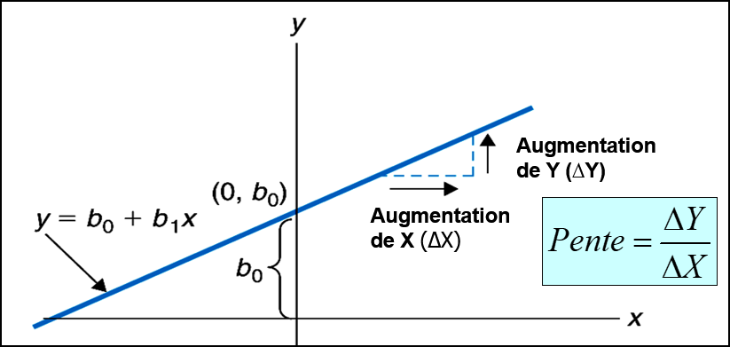
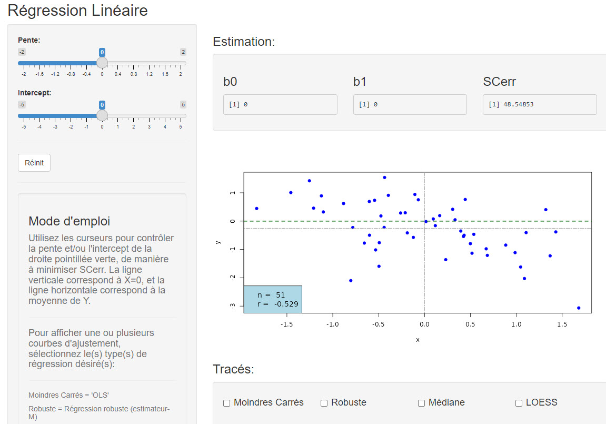
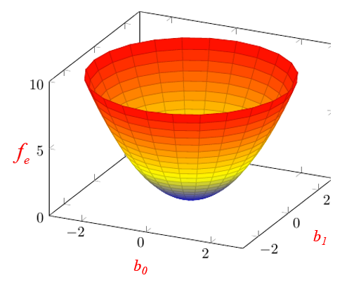
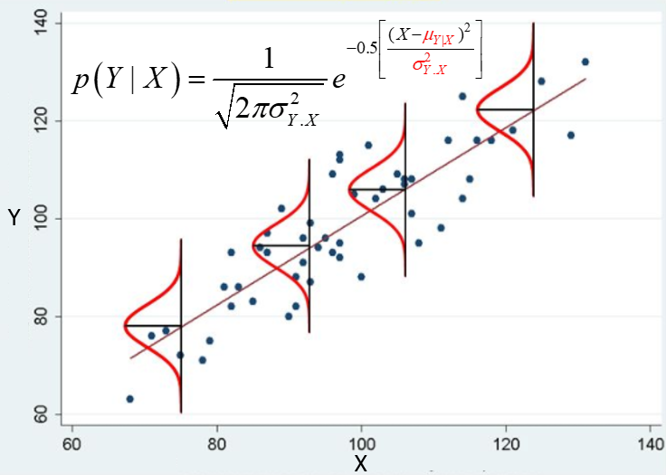
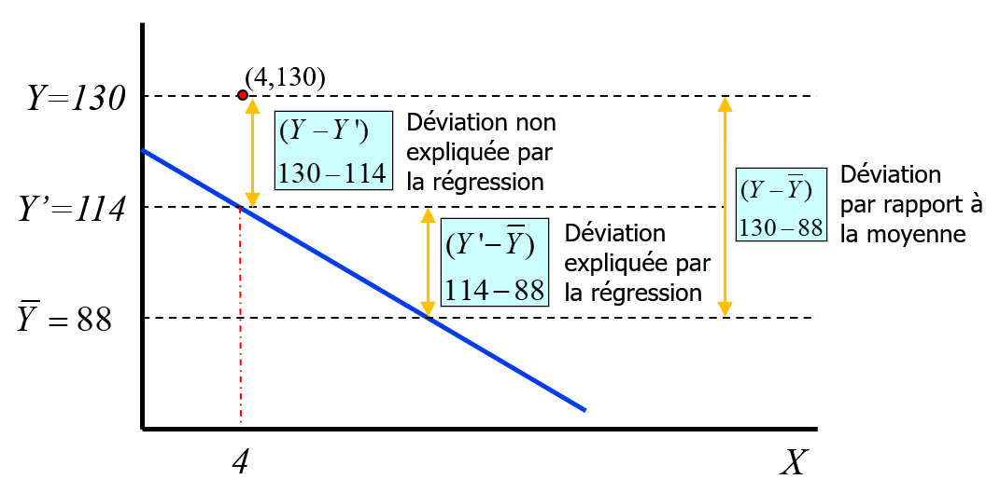
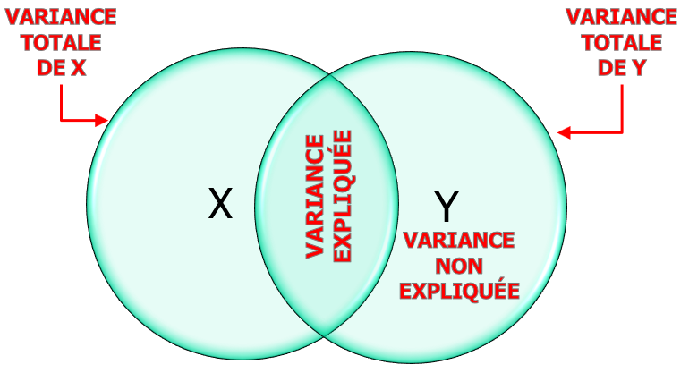
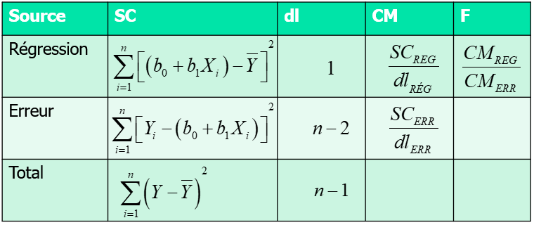
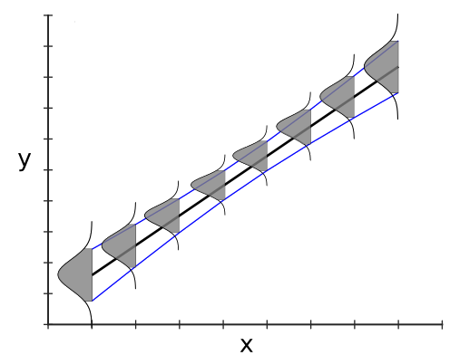

```{r echo=FALSE, warning=FALSE,message=FALSE}

source('global3.R')

```

# Régression linéaire simple: Inférences

Au chapitre 4, plusieurs indices mesurant l'importance d'une relation
entre deux variables ont été présentés. Lorsque cette relation existe,
il devient possible de prédire la valeur de l'une (variable dépendante)
à partir de l'autre (variable indépendante). Dans ce chapitre, nous
examinons les détails des procédures permettant une telle prédiction
lorsque la variable dépendante est quantitative. Il s'agit d'une
première étape vers l'élaboration de modèles plus complexes qui feront
l'objet de chapitres ultérieurs, mais qui partagent les mêmes objectifs:

-   expliquer une variable dépendante, c'est-à-dire en déterminer les
    sources d'influence et en quantifiant leur importance respective;
-   prédire la variable dépendante à partir d'une ou plusieurs variables
    indépendantes.

Mais dans un premier temps, revenons sur la notion de corrélation, et
plus spécifiquement sur les inférences la concernant.

## Inférences sur les corrélations

Plusieurs procédures inférentielles s'appliquent aux corrélations, de
la même manière que pour les autres statistiques. Plusieurs indices quantifiant la relation entre variables existent, et chacun d'eux fait appel à des procédures qui peuvent différer. Cependant, le principe général demeure constant. Nous limiterons donc la discussion au coefficient de corrélation de Bravais-Pearson.

### Approche empirique

La distribution d'échantillonnage d'une corrélation est essentielle pour
toute inférence concernant cet indice. On pourrait obtenir cette distribution en tirant un grand nombre d'échantillons d'une certaine taille, d'une population normale bivariée où la corrélation $r_{xy}$ est connue. Pour chacun des échantillons, on calcule la corrélation entre les deux variables, pour finalement en établir la distribution. 

Le code R suivant applique cette stratégie. Spécifiquement, 100,000 échantillons de taille $n = 50$ sont tirés aléatoirement d'une population normale bivariée où $r_{xy}=0$. La distribution des corrélations observées pour les différents échantillons est affichée à la figure @fig-corr1:  

```{r}
#| label: fig-corr1
#| fig-cap: Distribution d'échantillonnage d'une corrélation ($\rho = 0$).
#| fig-height: 6
#| fig-width: 7

nreps <- 100000
r <- 0.0
n <- 50

SDr <- replicate(nreps,
                 cor(
                 MASS::mvrnorm(n = n,
                     mu = c(0, 0),
                     Sigma = matrix(c(1, r, r, 1),
                                    nrow = 2))
                 )[1, 2])

conf <- 95
low = (1-conf/100)/2
upp = ((1-conf/100)/2)+(conf/100)
LL  = round(quantile(SDr, low), 3)
UL  = round(quantile(SDr, upp), 3)

gr1 <- hist(SDr,
            breaks = "FD",
            plot = FALSE)
cuts <- cut(gr1$breaks, c(-Inf, LL, UL, Inf))
plot(gr1,
     main = "Distribution d'échantillonnage empirique de r",
     col = c("red", "lightblue", "red")[cuts],
     freq=FALSE,
     xlab=paste("P[", LL,"\u2264 r \u2264 ",UL,"] = ",conf, "%"), 
     ylab = "Densité",
     cex=0.4)
abline(v=mean(SDr), lty=2, lwd=2, col="#CC0000")
txt1 <- paste("Moyenne = ", round(mean(SDr), 3))
txt2 <- paste("Err.Std = ", round(sd(SDr), 3))
legend("topleft",
       legend = c(txt1, txt2),
       lty = 0:0,
       cex = 0.8,
       bg = "lightyellow")

```

De cette figure, on note que la moyenne de la distribution des corrélations est égale à $\mu{r_{xy}}=`r round(sd(SDr), 3)`$, une valeur approximativement égale au paramètre de la population, $\rho = 0$. L'écart-type des corrélations, $s_{r_{xy}}=`r round(sd(SDr), 3)`$ indique la dispersion des corrélations obtenues d'échantillons de taille $n=50$. Cette quantité est approximativement égale à:  

$$\sigma_{r_{xy}}=\sqrt{\frac{1-r_{xy}^2}{n-2}}\approx \sqrt{\frac{1-0^2}{50-2}}\approx 0.144$$

La portion centrale de la distribution rassemble les valeurs probables des corrélations observées pour des échantillons. Dans le cas présent, 95% des corrélations se trouvent comprises entre `r round(LL, 3)` et `r round(UL, 3)`, ce qui constitue l'intervalle des valeurs probables, obtenu de manière empirique (par simulation). Ainsi, en tirant un échantillon de $n=50$ observations d'une population normalement distribuée, on peut s'attendre à obtenir des corrélations comprises entre -0.28 et +0.28, la distribution d'échantillonnage étant au moins approximativement normale. La probabilité que ce soit le cas est égale à 0.95.

L'implication de cette observation est que si, dans un test d'hypothèse pour une corrélation, $H_0$ propose une corrélation nulle ($H_0:\rho=0$), il sera possible d'utiliser la distribution normale (grands échantillons) ou la distribution de Student (petits échantillons) pour obtenir les probabilités nécessaires à la conclusion du test.

Malheureusement, la normalité que l'on peut voir dans ce cas précis ne tient plus la route lorsque la corrélation prend des valeurs plus élevées (en valeurs absolues). En effet, la distribution des corrélation est limitée par $r=1.0$ et $r=-1.0$, de sorte que pour des coefficients de corrélation élevés, la distribution est nécessairement asymétrique. Lorsque la corrélation est positive, la distribution d'échantillonnage de $r$ est négativement asymétrique, et lorsque la corrélation est négative, elle est positivement asymétrique. En conséquence, les distributions normale et de Student ne sont plus appropriées. La figure @fig-corr2 illustre ce point, présentant les distributions d'échantillonnage de $r_{xy}$ obtenues à partir de 100,000 échantillons de taille 50, tous tirés d'une population où $\rho = \pm 0.70$.

```{r }
#| label: fig-corr2
#| fig-cap: Distribution Empirique de Rxy ($\rho=\pm 0.7$)
#| fig-height: 6
#| fig-width: 9
#| 
par(mfrow=c(1,2))
R_CI(r=0.70, n=50, nrep=100000, conf=95)
R_CI(r=-0.70, n=50, nrep=100000, conf=95)

```


Pour contourner ce problème, Fisher (1915) a proposé une transformation permettant de rétablir la normalité de la distribution d'échantillonnage, lorsqu'une corrélation existe entre les variables X et Y, au niveau de la population.

### Transformation de Fisher

La transformation de Fisher permet de convertir une corrélation en score
$z$ en utilisant l'équation @eq-fisher1) :

$$z=0.5~ ln\left(\frac{1+r}{1-r} \right)$$ {#eq-fisher1}

... et de renverser cette transformation, utilisant l'équation
@eq-fisher2:

$$r=\frac{e^{2z}-1}{e^{2z}+1}$$ {#eq-fisher2}

Par exemple, pour $r=0.6$, on trouve:

$$z=0.5~ ln\left(\frac{1+0.6}{1-0.6} \right) =0.5~ln(4)=0.693$$

... et pour retrouver $r$:

$$r=\frac{e^{2(0.693)}-1}{e^{2(0.693)}+1}=\frac{4-1}{4+1}=0.6$$

Sous R, les fonctions **r2z()** et **z2r()**, disponibles dans la
librairie **isteahMAT104** permettent la conversion $r \rightarrow z$ et
de $z \rightarrow r$.

Pour $r=0.6$, on obtient:

```{r}

r <- 0.6
z <- r2z(r)
cat("Pour r = ", r, "z = ", z)
r <- z2r(z)
cat("Pour z = ", z, "r = ", r)
```

Contrairement à la distribution de $r$ pour $\rho \ne 0$, la distribution de $z$ est normale, ce qui rendra possible les procédures inférentielles présentées dans les paragraphes suivants. La figure @fig-corr3 nous rassure sur ce point, pour des corrélations $r=\pm0.7$ La simulation est effectuée à l'aide de la fonction **Z_CI()** de la librairie **isteahMAT104**. 

```{r }
#| label: fig-corr3
#| fig-cap: Distribution Empirique de Rxy ($\rho=\pm 0.7$), les corrélations étant soumises à la transformation de Fisher.
#| fig-height: 6
#| fig-width: 9
#| 
par(mfrow=c(1,2))
res1 <- Z_CI(r=0.7, n=50, nrep=10000, conf=95)
res2 <- Z_CI(r=-0.70, n=50, nrep=10000, conf=95)

```

On note que cette fois une distribution symétrique, cette symétrie
persistant peu importe la valeur de $\rho$. Les moyennes de ces distributions sont des valeurs de Z, que l'on peut transformer en $r$:

```{r}

r <- z2r(0.867)
cat("Pour z = 0.867, r = ", r)

r <- z2r(-0.867)
cat("Pour z = -0.867, r = ", r)
```
### Ré-échantillonnage  

Tirer un grand nombre d'échantillons d'une population n'est pas une activité réalisable en réalité. Par contre, le ré-échantillonnage permet d'obtenir la distribution d'échantillonnage d'une corrélation permettant les exercices d'inférence concernant cet indice.

Le processus de ré-échantillonnage se déroule comme suit:  
1. On tire un échantillon de taille $n$ d'une population, et on calcule $r_{xy}$;  
2. Utilisant cet échantillon initial, on forme un nouvel échantillon de même taille, aléatoire et **avec remise**, et on calcule $r_{xy}$  
3. On répète (2) un très grand nombre de fois, pour obtenir un ensemble de $k$ $r_{xy}$  
4. On forme la distribution des $r_{xy}$ observés et on en établit les caractéristiques.  
 
 
Pour illustrer la procédure, considérons les données simulées suivantes, pour un échantillon de $n=50$. Les données générées sont deux variables centrées et réduites (X et Y). Les 6 premières observations sont affichées ci-dessous:

```{r}
r <- 0.6
n <- 50

XY <- MASS::mvrnorm(n = n,
                     mu = c(0, 0),
                     Sigma = matrix(c(1, r, r, 1),
                                    nrow = 2))
colnames(XY) <- c("X", "Y")
head(XY)

```


La corrélation entre ces variables est $r_{XY}=`r round(cor(XY)[1,2], 3)`$.

La figure @fig-boot1 représente la distribution de ré-échantillonnage des corrélations impliquant 100,000 itérations:

```{r}
#| label: fig-boot1
#| fig-cap: Distribution de ré-échantillonnage d'une corrélation ($\rho = 0.6$).
#| fig-height: 6
#| fig-width: 7

b3 <- boot(XY, 
           statistic = function(XY, i) {
             cor(XY[i, "X"], XY[i, "Y"], method='pearson')
  },
  R = 100000
)

b3CI <- boot.ci(b3,
                type = "perc")

LL <- b3CI$percent[4]
UL <- b3CI$percent[5]

gr1 <- hist(b3$t,
              breaks = "FD",
              plot = FALSE)
  cuts <- cut(gr1$breaks, c(-Inf, LL, UL, Inf))
  plot(gr1,
       main = "Distribution de r empirique (Ré-Échantillonnage)",
       col = c("red", "lightblue", "red")[cuts],
       freq = FALSE,
       xlab = paste("C[", round(LL, 3),"\u2264 \u03C1 \u2264 ", round(UL, 3),"] = ",conf, "%"), cex=0.4)
  abline(v=mean(b3$t), lty=2, lwd=2, col="#CC0000")
  txt1 <- paste("Moyenne = ", round(mean(b3$t), 3))
  txt2 <- paste("Err.Std = ", round(sd(b3$t), 3))
  legend("topleft",
         legend = c(txt1, txt2),
         lty = 0:0,
         cex = 0.8,
         bg = "lightyellow")
```

La distribution obtenue diffère de celle représentée à la figure @fig-corr1 en ce qu'elle est formée de corrélations obtenues en ré-échantillonnant l'échantillon initial, plutôt qu'en échantillonnant un grand nombre de fois une population. De ce fait, la moyenne de la distribution correspond à la corrélation observée au niveau de l'**échantillon**, plutôt que la corrélation réelle au niveau de la population. Dans ce cas, il est possible de formuler un intervalle de **confiance**, plutôt qu'un intervalle de **valeurs probables**.  

Si l'hypothèse soumise au test propose une corrélation dont la valeur est l'une comprise dans l'intervalle de confiance, on sera amené à retenir $H_0$. Dans le cas contraire, on pourra rejeter cette hypothèse au niveau de confiance $100(1-\alpha)\%$.

Par exemple, s'il est proposé que $H_0:\rho_{XY}=0.45$, l'analyste sera amené à `r ifelse(0.45 >= LL & 0.45 <= UL, " retenir", " rejeter ")` cette hypothèse, puisque cette corrélation se trouve à l'`r ifelse(0.45 >= LL & 0.45 <= UL, "intérieur", "extérieur")` de l'intervalle $[`r round(LL, 3)`, `r round(UL, 3)`]$. Elle fait partie des valeurs dont la probabilité est `r ifelse(0.45 >= LL & 0.45 <= UL, "forte", "faible")` (zone `r ifelse(0.45 >= LL & 0.45 <= UL, "bleue", "rouge")`rouge dans le diagramme.). 


#### Inférences concernant une corrélation: approche analytique

L'estimation d'une corrélation nécessite l'application de la
transformation de Fisher de manière à s'assurer de la normalité de la
distribution d'échantillonnage des corrélations. À titre d'exemple,
supposons que la corrélation observée pour un échantillon de $n=56$
sujets, entre la performance en Sciences et la performance en
Mathématiques est $r=0.68$. Appliquant la transformation de Fisher sur
cette corrélation, on obtient:

```{r}
z <- r2z(0.68)
cat("z = ", z)
```

et la distribution d'échantillonnage de cette quantité est présentée
dans la figure @fig-corr4.

```{r corr4}
#| label: fig-corr4
#| fig-cap: Distribution d'échantillonnage de Zxy ($\rho=0.68$)
#| fig-height: 6
#| fig-width: 7

zst <- Z_CI(r=0.68, n=56)
```

Cette distribution est normale, avec une moyenne $\mu_z=`r round(zst[1], 4)`$ et
une erreur-standard $\sigma_z=`r round(zst[2], 4)`$. Cette dernière quantité est
approximativement égale à :

$$\sigma_z=\frac{1}{\sqrt{n-3}}=\frac{1}{\sqrt{56-3}}=0.13736 $$ 
À ce stade, nous disponsons de tous les éléments nécessaires à la formulation d'inférences concernant une corrélation.

### Test d'hypothèse concernant une corrélation

Dans un test d'hypothèse portant sur une corrélation, $H_0$ peut proposer une corrélation nulle, ou une corrélation égale à une valeur
donnée:

$$H_0:\rho=0 $$ $$H_0:\rho=0.60 $$ 

#### Inférence, supposant $\rho = 0$:

On sait que si la corrélation au niveau de la population est nulle, la distribution d'échantillonnage de
$r$ sera au moins approximativement normale. Dans ce cas, on pourra utiliser un test *t* défini par l'équation @eq-t1.

$$t=\frac{r \sqrt{n-2}}{\sqrt{1-r^2}},~~~~dl=n-2$$ {#eq-t1}

Par exemple, la corrélation entre les scores obtenus par un échantillon
de 50 étudiants de Lycée dans un examen de Sciences et un examen de
Mathématiques est $r=0.47$. Peut-on affirmer que cette corrélation est
significativement différente de 0, au niveau de la population?

Pour répondre à cette question, posons:

$$H_0:\rho=0 $$ $$H_1:\rho \ne 0 $$
Appliquant l'équation @eq-t1, on calcule:  

$$t=\frac{0.47 \sqrt{50-2}}{\sqrt{1-0.47^2}} =\frac{3.256}{0.883}=3.687,~~~~dl=50-2=48 $$

Si $H_0$ est vraie, la probabilité d'obtenir un tel $t$ ou une valeur plus extrême est donnée par la distribution de Student pour $n-2 = 50-2=48$ degrés de liberté:

```{r}
p <- pt(3.687, 48, lower.tail=FALSE)
cat("p(t > 3.687) = ", round(p, 5))
```

Puisque cette probabilité est inférieure au niveau de signification $\alpha=0.05$, on rejette $H_0$, et on conclut qu'il y a évidence d'une corrélation entre la performance en Mathématiques et la performance en Sciences. Cette corrélation est dite *statistiquement significative*. Notons que cette conclusion ne fournit aucune indication sur la valeur réelle de la corrélation au niveau de la population. Elle nous permet simplement d'affirmer que les données semblent appuyer l'idée qu'une corrélation existe à ce niveau, entre les deux variables. On ne peut certainement pas affirmer que cette corrélation est égale à 0.47, par exemple!. La distribution d'échantillonnage de la corrélation en est une démonstration: $\rho_{XY}$ est l'une d'un nombre infini de valeurs, dont certaines sont plus probables que d'autres. On ne peut savoir avec certitude ce qu'elle est, mais on peut déterminer, sur la base des observations, un intervalle de valeurs susceptibles de la capturer, avec un certain niveau de confiance.


La distribution d'échantillonnage de $z$ étant normale, les percentiles pertinents au niveau de confiance
sélectionné en sont tirés. L'équation @eq-icr définit l'intervalle de confiance de $\zeta$, le paramètre dont $z$ est une estimation:

$$Z_{xy} - s_z z_{(1-\alpha/2)}\le \zeta \le Z_{xy} + s_z z_{(1-\alpha/2)}$$ {#eq-icr}

Appliquant cette définition à la corrélation observée entre les performances en Sciences et en Mathématiques, on trouve:  

```{r echo=FALSE}
z <- r2z(0.47)
sez <- 1/sqrt(47)
li <- z - sez * 1.96
ls <- z + sez * 1.96
rli <- z2r(li)
rls <- z2r(ls)
```

$$`r z` - `r sez` (1.96)\le \zeta \le `r z` + `r sez`(1.96)$$
$$`r li` \le \zeta \le `r ls` $$ 

Finalement, en effectuant la transformation de z en r sur les limites de l'intervalle de confiance de
z, on trouve:

$$`r rli` \le \rho \le `r rls` $$

Une formulation équivalente, exprimée par l'équation @eq-CIcor, conduit au même résultat en combinant l'ensemble des étapes utilisées ci-dessus:  

$$\frac{e^{2L}-1}{e^{2L}+1} \le \rho \le \frac{e^{2U}-1}{e^{2U}+1} $$ {#eq-CIcor}

où 

$$L=z_r-\left (\frac{z_{1-\alpha/2}}{\sqrt{n-3}}\right ) $$
$$U=z_r+\left (\frac{z_{1-\alpha/2}}{\sqrt{n-3}}\right ) $$
et $z_r$ est l'application de la transformation de Fisher sur la corrélation observée pour l'échantillon.

Pour un échantillon de 50 étudiants chez qui on obtient $r_{Sciences, Maths}=0.47$, on calcule (supposant un niveau de confiance de 95%):

1. $z_r=ln \left ( \frac{1+0.47}{1-0.47}\right )=0.51$

2. $L=0.51 - \left (\frac{1.96}{\sqrt{50-3}}\right )= 0.224$

3. $U=0.51 + \left (\frac{1.96}{\sqrt{50-3}}\right )= 0.796$

4. $$C \left[ \frac{e^{2(0.224)}-1}{e^{2(0.224)}+1} \right ] \le \rho \le \left [ \frac{e^{2(0.796)}-1}{e^{2(0.796)}+1} \right ]=95\%$$

$$C[0.220 \le \rho \le 0.662] = 95\%$$
Sous R, ces opérations se résument au code suivant:

```{r}
alph <- 0.05
r <- 0.47
n <- 50

zr <- r2z(0.47)
L <- zr + qnorm(alph/2) / sqrt(n - 3)
U <- zr + qnorm(1 - alph/2) / sqrt(n - 3)
ICr <- (exp(2 * c(L, U)) - 1) / (exp(2 * c(L, U)) + 1)

paste("C[", round(ICr[1], 3), "\u2264 \u03C1 \u2264 ", round(ICr[2], 3), "] = 95%")
```

#### Inférence, supposant $\rho \ne 0$:

Lorsque $H_0$ propose une corrélation non nulle, la distribution d'échantillonnage devient asymétrique, et la transformation de Fisher
devient nécessaire. Dans ce cas, on définit *t* par l'équation @eq-t2):

$$t=(z-\zeta)\sqrt{n-3} $$ {#eq-t2}

où $z$ est le résultat de l'application de la transformation de Fisher sur $r$, et $\zeta$ est le résultat de l'application de cette
transformation sur la valeur postulée de $\rho$, dans $H_0$. Par exemple, peut-on affirmer que la corrélation entre les performances en
Sciences et en Mathématiques est significativement différente de 0.40, au niveau de la population?

Pour répondre à cette question, posons:

$$H_0:\rho=0.40 $$ $$H_1:\rho \ne 0.40 $$ On trouve alors:

$$z=0.5~ ln\left(\frac{1+0.47}{1-0.47} \right) =0.5~ln(2.774)=0.510 $$
$$\zeta=0.5~ ln\left(\frac{1+0.40}{1-0.40} \right) =0.5~ln(2.333)=0.4236 $$
$$t=(z-\zeta)\sqrt{n-3}=(0.510-0.4236)\sqrt{50-3} =0.592 $$ avec
$dl= n-2 = 50-2 = 48$. La probabilité, sous $H_0$, d'obtenir un tel
résultat ou un résultat plus extrême est:

```{r}
p <- pt(0.592, 48, lower.tail=FALSE)
cat("p(t < 0.592) = ", p)
```

Cette fois, on n'a pas suffisamment d'évidence pour pouvoir affirmer que
la corrélation au niveau de la population, est différente de 0.40.

### Comparaison de deux corrélations {#sec-CorrComp}

```{r eval=FALSE, echo=FALSE}
https://f-santos.gitlab.io/2020-04-01-comparing-correlation-coefficients.html
library(psych): r.test()
```

Supposons que l'on s'intéresse à la différence qui pourrait exister dans
la corrélation entre les performances en Sciences et en Mathématiques,
entre les garçons et les filles. Dans un tel cas, on dispose de deux
groupes indépendants et on examine l'importance de la relation pour
chacun d'eux. L'hypothèse nulle devient alors:

$$H_0:\rho_{Garçons}= \rho_{Filles}$$
$$H_1:\rho_{Garçons}\ne \rho_{Filles}$$ Après avoir appliqué la
transformation de Fisher sur les deux corrélations pour obtenir $z_1$ et
$z_2$, on calculera *Z*, suivant l'équation @eq-t4):

$$Z=\frac{z_1-z_2}{\sqrt{\frac{1}{n_1-3}+\frac{1}{n_2-3}}}$$ {#eq-t4}

La probabilité d'observer Z égal ou une valeur plus extrême si $H_0$ est
vraie, est tirée de la distribution normale standardisée.

Pour un échantillon de 35 garçons, pour qui la corrélation entre les
performances en Sciences et en Mathématiques est égale à 0.67, et un
échantillon de 42 filles pour qui cette corrélation est égale à 0.56, on
trouve:

$$z_1=0.5~~ln \left( \frac{1+0.67}{1-0.67} \right)=0.811 $$
$$z_2=0.5~~ln \left( \frac{1+0.56}{1-0.56} \right)=0.633 $$
$$Z=\frac{0.811-0.633}{\sqrt{\frac{1}{35-3}+\frac{1}{42-3}}}=\frac{0.178}{0.0313+0.0256} =0.7463$$
La probabilité d'observer une telle valeur de Z ou une valeur plus
extrême, supposant une $H_0$ vraie, est:

```{r}
p <- 2 * pnorm(0.7463, lower.tail=FALSE) # Test bilatéral
cat("P(z > 0.7463) = ", p)
```

Il n'y a pas d'évidence à l'effet que la corrélation observée chez les
garçons soit différente de celle observée chez les filles.

Sous R, la fonction **cocor.indep.groups()** de la librairie **cocor**
effectue ces calculs. Pour l'exemple présenté ci-dessus, les arguments
essentiels sont les deux corrélations et les tailles des échantillons.
On obtient:

```{r}

cocor::cocor.indep.groups(0.67, 0.56, 35, 42)
```

Les résultats obtenus à l'aide de cette fonction incluent l'intervalle de confiance de la différence entre les corrélations. Cet intervalle inclut une différence nulle, ce qui concorde avec la retenue de $H_0$ suite au test d'hypothèse.

### Comparaison de $k$ corrélations

```{r eval=FALSE, echo=FALSE}
# https://www.r-bloggers.com/2012/02/comparing-correlations-independent-and-dependent-overlapping-or-non-overlapping/
```


La comparaison de corrélations ne se limite pas à deux groupes. Lorsque le nombre de groupes ($k$) est supérieur à 2, on appliquera la
transformation de Fisher sur chacune des corrélations pour calculer, suivant l'équation @eq-t3):

$$\chi_{dl=k-1}^2 =\sum\limits_{i=1}^{k}{(n_i-3)z_i^2}-\frac{\left [\sum\limits_{i=1}^{k}{(n_i-3)z_i} \right ]^2}{\sum\limits_{i=1}^{k}{(n_i-3)} }$$ {#eq-t3}

La fonction **CorTest()** (@lst-CorTest)
met en oeuvre cette approche. Les arguments sont:  

- r: vecteur contenant les coefficients de corrélation  
- n: vecteur contenant les tailles des échantillons  

> Note: r et n doivent être de la même longueur

Si deux corrélations sont comparées, le test Z de Fisher est appliqué.
Sinon, le $\chi^2$ est produit.


Par exemple,

```{r}
r <- c(.67, .56)
n <- c(35, 42)
CorTest(r, n)
#
r <-  c(.67, .56, .28, .70)
n <- c(35, 42, 58, 62)
CorTest(r, n)
```

Finalement, il est parfois intéressant d'obtenir la corrélation combinée de plusieurs groupes. Par exemple, si $H_0:\rho_1=\rho_2=...=\rho_k$ est retenue, suggérant que chacune des corrélations observées $r_{xy}$
pourrait estimer le même coefficient de corrélation $\rho$ au niveau de la population, il devient possible d'obtenir la corrélation commune pour l'ensemble des $k$ groupes, ou d'un sous-ensemble de ces derniers.

Une première étape consiste à obtenir un score Z pondéré en fonction de la taille des échantillons. Cette quantité, que nous nommerons $z_w$, est définie par l'équation @eq-t5):


 $$z_w=\frac{\sum\limits_{i=1}^{k}{(n_i-3)z_i} }{\sum\limits_{i=1}^{k}{(n_i-3)}} $$ {#eq-t5}

La corrélation commune, $\rho$ est donnée par l'équation
@eq-rcomb):


 $$z_w=0.5~~ln \left(\frac{1+\rho}{1-\rho} \right )\Rightarrow\rho=\frac{e^{2z_w}-1}{e^{2z_w}+1} $$ {#eq-rcomb}

La fonction **CorComb()** (@lst-CorComb) permet ce type de calcul.

Par exemple,

```{r}
r <- c(.67, .56)
n <- c(35, 42)
CorComb(r, n)
#
r <-  c(.67, .56, .28, .70)
n <- c(35, 42, 58, 62)
CorComb(r, n)
```

## La notion de **modèle**

Nous savons maintenant de quelle manière on peut quantifier les
relations entre deux variables. Mais une fois démontrée l'existence
d'une relation, relation qui est symétrique ($r_{XY}=r_{YX}$), il est
souvent utile de vérifier des hypothèses selon lesquelles **X a une
influence sur Y**, ou **Y a une influence sur X**, ou même **X et Y ont
une influence réciproque, l'une sur l'autre**. En fait, un modèle, qu'il soit simple ou complexe, se nourrit de relations existant entre différentes variables.

Cette idée n'est pas tout-à-fait nouvelle, car nous l'avons rencontrée
implicitement lors de l'étude de différences entre deux moyennes
indépendantes (chapitre 8). Dans ce cas particulier, trouver qu'il y a
une différence statistiquement significative entre les moyennes de deux
groupes représentant deux niveaux d'une variable indépendante (sexe des
sujets, résidents du Nord ou du Sud, etc) implique une relation entre
cette variable et la variable dépendante.

Dans tous les champs d'investigation scientifique, on est souvent amené
à utiliser la modélisation statistique pour représenter des phénomènes
complexes sous la forme d'équations mathématiques formalisant les
relations entre diverses variables. Lorsque nous tentons de résoudre un
problème d'ordre statistique, par exemple, on formulera un modèle
théorique sur la base d'observations empiriques, tout en délimitant le
contexte et les conditions de son application. Les modèles qui nous
intéressent ici comportent deux aspects:

#### 1. Une portion **déterministe**

La portion **déterministe**, refléte la nature de la relation     sans tenir compte de la variation ou de l'incertitude qui s'y     rattache. L'application du modèle avec les mêmes paramètres aboutira toujours aux mêmes résultats. Les paramètres du modèle sont des
quantités réflétant la nature de la relation entre les variables.
Par exemple, considérons la conversion de degrés Fahrenheit (${^\circ}F$) en degrés Celsius  (${^\circ}C$) :

    ${^\circ}C=0.556~~ {^\circ}F - 17.778$

Il s'agit d'un modèle déterministe, où l'erreur aléatoire est négligeable, voire nulle. Il comporte deux paramètres: le coefficient associé à la variable indépendante (${^\circ}F$), **0.556**, indiquant qu'une variation de $1{^\circ}F$ se traduira par un changement de **0.556**${^\circ}C$;  et une constante, **-17.778**, indiquant que **0${^\circ}F$** correspond à  **-17.778${^\circ}C$**.

Supposons une entreprise offrant des services de réparations de
plomberie. Pour une séquence de 5 travaux, on note la durée et le coût,
affichés dans le tableau @tbl-Cout).

```{r }
#| label: tbl-Cout
#| tbl-cap: Relation entre la durée d'un travail de plomberie et son coût.

duree <- c(5, 7.5, 15, 20, 22.5)
cout <- c(125, 175, 325, 425, 475)
dat <- data.frame(duree, cout)
dat %>%
  kbl(caption="Durée et coût de travaux") %>%
  kable_styling(bootstrap_options = c("striped", "hover", "condensed"), full_width=FALSE)

```

Un diagramme de dispersion illustrant ces données (Figure
@fig-ex1)) montre clairement une relation dans laquelle le coût
d'un travail est déterminé par sa durée: le modèle est déterministe. La
droite reliant les points sans qu'il y ait d'écart ne laisse aucun doute
quant à la linéarité de la relation.

```{r }
#| label: fig-ex1
#| fig-cap: Modèle déterministe de la relation entre la durée d'un travail et son coût.
#| fig-height: 6
#| fig-width: 7
plot(dat,
     main="Relation entre la Durée et le Coût de travaux",
     xlab="Durée des travaux",
     ylab="Coût",col="blue",
     xlim=c(0,26),
     ylim=c(0,500),
     pch=16, cex=2)
abline(lm(cout~duree), col="red", lwd=2)
text(17, 50, "Y' = 25 + 20X", cex=1.5)
arrows(14, 85, 11, 245, length=0.2, lwd=2)
text(16, 250, "Intercept", cex=1.3)
arrows(16, 230, 16.5, 80, length=0.2, lwd=2)
text(22, 250, "Pente", cex=1.3)
arrows(22, 230, 19.5, 80, length=0.2, lwd=2)

```

L'équation traduisant ce modèle est formée de deux paramètres:

-   l'intercept : valeur de la variable dépendante pour une variable
    indépendante nulle. Ici, il s'agirait du coût d'un travail dont la
    durée est nulle. Dans un cas réel, il pourrait s'agir des frais
    administratifs (25 Gourdes) pour l'ouverture d'un dossier-client,
    par exemple. Il s'agit d'une constante. Dans la littérature
    statistique, on symbolise l'intercept d'un échantillon par $b_0$, et
    d'une population par $\beta_0$.
-   la pente : augmentation dans la valeur de la variable dépendante
    pour une augmentation d'une unité de la variable indépendante. Ici,
    la pente indique que pour chaque heure de travail ($\Delta X=1$), 20
    gourdes s'ajoutent à la facture. Dans la littérature statistique, on
    symbolise l'intercept d'un échantillon par $b_1$, et d'une
    population par $\beta_1$.

La figure @fig-eqnlin résume ces deux concepts.

{#fig-eqnlin fig-align="center" }

#### 2. Une portion **probabiliste** ou **stochastique**:  
La portion **probabiliste** du modèle réflète la nature aléatoire des résultats obtenus en appliquant le modèle. On
tient compte et on quantifie la variation dans les résultats de son application: on obtient la **variance d'erreur**, qui est elle-même
un paramètre de ce modèle. Par exemple, considérons un modèle simple liant la performance à un examen (Perf) au nombre d'heures passées à
le préparer (Étude):

$$Perf=2(Étude) + 1.5 + e $$ 

Selon ce modèle, chaque heure d'étude devrait augmenter de 2 unités de performance, **en moyenne**; s'il n'y a
aucune étude préparatoire (Étude=0), on s'attend à un score de performance égal à 1.5. Les paramètres de la portion déterministe du
modèle sont le coefficient lié à la variable indépendante (Étude) et une constante. Cependant, il y a plusieurs facteurs qui ne sont pas pris en considération dans ce modèle et qui sont susceptibles d'influencer la performance d'une manière ou d'une autre. Ces facteurs sont réunis dans un terme d'erreur ($e$) dont la valeur est aléatoire. On ne connait pas sa valeur pour chacun des cas individuels, mais on peut en calculer la variance. Cette variance est aussi un paramètre du modèle, comme le coefficient et la constante. Elle quantifie la portion aléatoire du modèle. La figure @fig-ex2) illustre cette situation.

```{r }
#| label: fig-ex2
#| fig-cap: Contexte d'un modèle de régression linéaire.
#| fig-height: 6
#| fig-width: 7


set.seed(1507522)
x <- runif(50, 0, 4)
df <- data.frame(x=x,
                 y=3 + 10*x + rnorm(50, 0, 10))
ggplot(df, aes(x, y)) +
  geom_point(cex=2) +
  geom_abline(slope=10, intercept=3,
              col="#990000", linewidth=0.3) +
  geom_label(x=3, y=-2.5, parse=TRUE, col="#990000",
             cex=5,
             label="beta[0] + beta[1] * x") +
  geom_segment(x=3, y=0, xend=3.5, yend=37,
               arrow=arrow(length = unit(0.02, "npc")),
               linewidth=0.2, col='#990000') +
  geom_label(x=1.5, y=45, parse=TRUE, col="#000099",
             cex=5,
             label="y[i] == beta[0] + beta[1] * x[i] + epsilon[i]") +
  geom_segment(x=1.5, y=42, xend=df$x[31]+0.03, yend=df$y[31]+1,
               arrow=arrow(length = unit(0.02, "npc")),
               linewidth=0.2, col='#000099') +
  geom_segment(x=df$x[31], y=df$y[31],
               xend=df$x[31], yend=3+10*df$x[31],
               col="#009900", linewidth=0.2,
               arrow=arrow(length=unit(0.02,"npc"), ends="both")) +
  geom_label(x=df$x[31]-0.1, cex=5,
             y=(df$y[31]+ 3+10*df$x[31])/2,
             col="#009900", label="epsilon[i]",
             parse=TRUE) +
  theme_classic()
```

Chaque paire de données (X, Y) est représentée par un point dans le plan
cartésien. La droite correspond aux valeurs de la variable dépendante
prédites (Y') à partir de la variable indépendante (X). Elle représente
la portion **déterministe** du modèle.

La distance séparant un point de la droite est une erreur aléatoire
($\epsilon_i$), variant d'une observation à l'autre. Elle représente la
portion **aléatoire** du modèle.

Les deux exemples présentés ci-dessus sont des modèles linéaires, car
l'expression mathématique qui les définit est l'équation d'une droite:
$y=mX+b$. D'autres modèles impliqueront possiblement des équations plus
complexes, curvilinéaires. Dans ce chapitre, nous limitons la discussion
aux modèles linéaires.

## La régression linéaire simple: variable indépendante dichotomique {#sec-DichVar}

Est-ce que la performance moyenne dans un examen de Sciences diffère
entre les garçons et les filles au Lycée? C'est le type de question que
nous avons abordé dans le contexte des tests d'hypothèse portant sur
deux moyennes indépendantes. Regardons la question sous un angle
légèrement différent: **'peut-on expliquer la variation dans la
performance dans un examen de Sciences par le sexe des sujets?'**, ou
encore **'peut-on prédire la performance dans un examen de Sciences,
connaissant le sexe d'un sujet?'**

Pour répondre à la question, on obtient un échantillon de 500 lycéens et
de 500 lycéennes, et on note la performance de chacune de ces personnes,
dans une examen de Sciences. Les données recueillies sont représentées
dans le diagramme de dispersion reproduit dans la figure @fig-ex3).

```{r warning=FALSE}
#| label: fig-ex3
#| fig-cap: Performance en Sciences, en fonction du sexe des sujets.
#| fig-height: 6
#| fig-width: 7

Perf <- c(rnorm(100, 55, 5), rnorm(100, 68, 5))
Sexe <- as.factor(c(rep(0, 100), rep(1, 100)))
m0 <- mean(Perf[which(Sexe==0)])
m1 <- mean(Perf[which(Sexe==1)])
df <- data.frame(Perf, Sexe)

reg <- lm(Perf ~ Sexe, data=df)
eq <- paste("Perf = ",round(reg$coeff[2],3), " Sexe + ", round(reg$coeff[1], 3))
p <- ggplot(df, aes(Sexe, Perf), show.legend=FALSE) + 
  geom_point(aes(colour=Sexe)) + 
  theme_classic() + 
  aes_string(colour = 'Sexe') +
  geom_hline(yintercept = m0, linetype="dotted", color="blue", linewidth=1.2) +
  geom_hline(yintercept = m1, linetype="dotted", color="blue", linewidth=1.2) +
  geom_hline(yintercept = mean(Perf), linetype="dashed", color="green", linewidth=1.3) +
  geom_abline(intercept = reg$coeff[1]-reg$coeff[2], 
              slope = reg$coeff[2], 
              color="red", 
              linewidth=1.3) +
  geom_point(aes(x=1, y=m0), col="black", linewidth=5) +
  geom_point(aes(x=2, y=m1), col="black", linewidth=5) +
  ggtitle(eq) 

ggMarginal(
  p,
  type = 'histogram',
  margins = 'y',
  linewidth = 5,
  groupColour = TRUE,
  groupFill = TRUE)

```

La variable indépendante est le sexe des sujets, et deux valeurs sont
possibles: 0 et 1. Cette variable est représentée par l'axe horizontal.
La variable dépendante est une variable quantitative: la performance à
l'examen de Sciences. Elle occupe l'axe vertical. La corrélation entre
ces deux variables, le point bisérial, est égale à:

```{r}
r <- cor(Perf, as.numeric(Sexe))
cat("Corrélation Point-Bisérial = ", r)
```

Cette corrélation réflète une forte relation entre les deux variables.

Dans un premier temps, ne tenons pas compte du sexe des sujets et
examinons l'ensemble des données recueillies. Pour l'ensemble des
sujets, garçons et filles ($n=200$), on obtient la distribution affichée
dans la marge droite du graphique. La moyenne de cette distribution est
indiquée par la ligne verte ($\bar Y = `r round(mean(Perf),3)`$). Si
vous ne connaissez pas le sexe d'un individu et qu'on vous demande de
prédire son score à l'examen de Sciences, la meilleure réponse que vous
pourriez donner, celle qui vous amènerait à réduire l'importance de
l'erreur inévitable dans une telle situation, serait: **la moyenne de
l'ensemble**. C'est en effet la meilleure prédiction que l'on puisse
faire, si on ne dispose d'aucune information additionnelle pour guider
notre choix.

En séparant les données des garçons de celles des filles, on obtient
deux distributions. Les données sont représentées par des points pour
chacune des deux valeurs de la variable sexe, et la distribution
résultante pour chaque groupe est projetée sur la marge de droite,
différenciée par la couleur. La moyenne de chaque groupe est indiquée
par les lignes pointillées bleues. On note une différence, la
performance moyenne des garçons étant différente de celle des filles.

Maintenant, si on vous informe qu'un individu est un garçon, quelle
serait votre prédiction quant à sa performance à l'examen de Sciences?
Vous répondriez sûrement que la performance moyenne **des garçons**
serait la prédiction la plus précise que vous pourriez faire, tenant
compte du fait que la performance moyenne des garçons diffère de celle
des filles. Et vous auriez raison. Clairement, il y aura erreur, mais
l'erreur sera plus faible en tenant compte du sexe du sujet, que si vous
n'en teniez pas compte.

La droite joignant les moyennes des deux groupes est celle qui
représente le mieux les données. L'intercept (la constante) est
$b_0=`r round(reg$coeff[1],3)`$. Cette quantité correspond à la moyenne du groupe codé par la valeur '0'. La pente de la droite est $b_1=`r
round(reg$coeff[2],3) `$. Cette quantité correspond au changement dans la
valeur de la variable dépendante (**Perf**) pour un changement d'une
unité dans la variable indépendante (**Sexe**). Il s'agit donc
simplement de la différence entre les deux moyennes:
$(\overline{Perf_0}-\overline{Perf_1})=`r round(reg$coeff[2],3)`$.

En bref, s'il existe une relation entre deux variables, il devient
possible de prédire la valeur de l'une à partir de l'autre. Dans
certains cas, si certaines conditions sont respectées, il sera possible
d'affirmer que la variable indépendante a une influence sur la variable
dépendante, et peut-être même qu'elle en est la 'cause'! Mais la route
est encore longue avant d'en arriver là...

## La régression linéaire simple: variable indépendante quantitative

Dans la section précédente, la relation entre une variable dichotomique
(sexe des sujets) et une variable quantitative (performance à un examen
de Sciences) a été mise à profit pour formuler un modèle explicatif ou
prédictif: le sexe des sujets a un impact sur la performance, ou
connaissant le sexe des sujets, on peut obtenir une meilleure estimation
de la performance d'un individu.

Examinons maintenant la relation entre deux variables quantitatives. Les
concepts demeurent les mêmes; il n'y a simplement un plus grand nombre
de valeurs possibles pour la variable indépendante.

La figure @fig-ex4) illustre la situation. Deux variables y sont
représentées. Considérons la variable occupant l'axe horizontal comme
étant la variable indépendante (X), et celle occupant l'axe vertical
comme étant la variable dépendante (Y).


```{r  warning=FALSE, message=FALSE}
#| label: fig-ex4
#| fig-cap: Relation entre X et Y, deux variables quantitatives.
#| fig-height: 6
#| fig-width: 7

set.seed(150752)
r <- 0.8
x <- rnorm(1000)
y <- x * r + rnorm(1000) * sqrt(1-r^2)
x <- x * 15 + 100
y <- y * 6 + 20
r <- cor(x,y)
df <- data.frame(x, y)
reg <- lm(y~x, data=df)
b0 <- reg$coefficients[1]
b1 <- reg$coefficients[2]
eq = paste0("Satisfaction = ", round(reg$coeff[2],4), " x Revenu ", round(reg$coeff[1],4))

ggstatsplot::ggscatterstats(
  data=df,
  x = x,
  y = y,
  xlab = "Revenu Annuel",
  ylab = "Satisfaction au Travail",
  title = "Relation entre Revenu et Satisfaction",
  subtitle = eq,
  bf.message = FALSE,
  results.subtitle = FALSE,
  smooth.line.args = list(linewidth = 0.8, color = "blue", method = "lm", formula = y ~ x)
) +
  geom_hline(aes(yintercept=mean(y), 
               linetype="dashed", color = "red")) +
  geom_vline(aes(xintercept=mean(x), 
               linetype="dashed", color = "red")) +
  geom_point(aes(x=mean(x), y=mean(y)), colour="yellow", size=3) +
  annotate("richtext", 
           label = paste("r = ", round(cor(x, y), 3)), 
           x = 60, 
           y = 35, 
           color = "red") +
  theme(legend.position="none",
        plot.title = element_text(hjust = 0.5),
        plot.subtitle = element_text(hjust = 0.5,
                                     colour = "blue")) 

```

La distribution de la variable dépendante est reproduite dans la marge
droite, alors que la distribution de la variable indépendante occupe la
marge supérieure. Les lignes rouges pointent vers la moyenne de chacune de ces variables
($\bar X=`r round(mean(x), 3)`, \bar Y = `r round(mean(y), 3)`$), et on
peut noter que le point défini par le couple ($\bar X, \bar Y)$ (point
jaune) se trouve exactement au centre de gravité du nuage de points:
c'est le **centroide**.

La corrélation entre X et Y est $r_{xy}=`r round(r, 3)`$, une relation
forte, compte tenu du nombre d'observations.

Pour donner un contexte à ces données, supposons que Y est un indice de
satisfaction au travail, et que X est le revenu annuel d'un individu. La
question est de savoir: '**Peut-on expliquer la satisfaction au travail
par le revenu que rapporte ce travail?** ', ou '**Est-ce qu'un changement au niveau du revenu se traduirait par un changement du niveau de satisfaction au travail?** '

Dans un premier temps, ne tenons pas compte du revenu annuel et
examinons l'ensemble des données recueillies. Pour l'ensemble des
sujets, on obtient la distribution affichée dans la marge droite du
graphique. La moyenne de cette distribution est indiquée par la ligne horizontale rouge. Si on ne connait pas le revenu annuel d'un
individu et qu'on cherche à déterminer son niveau de satisfaction au
travail, la meilleure estimation que l'on puisse faire de cette quantité
est, comme dans l'exemple précédent, **la moyenne de l'ensemble**. C'est
en effet la meilleure prédiction que l'on puisse faire, si on ne dispose
d'aucune information additionnelle pour guider notre choix.

Considérons maintenant l'information contenue dans la variable
indépendante, le revenu. On note qu'un revenu élevé semble être associé
à une grande satisfaction au travail, alors qu'un revenu faible serait
associé à une faible satisfaction. Donc si on vous présente un individu
dont le revenu est élevé, vous auriez avantage à prendre en compte cette
donnée et plutôt que de prédire une valeur égale à la moyenne de la
variable dépendante, vous devriez examiner les données disponibles pour
l'ensemble des individus ayant le même revenu, et en calculer la
moyenne. Cette moyenne, qui serait de fait une **moyenne conditionnelle** ($\mu_{Y|X}$), serait alors la meilleure prédiction que vous pourriez faire, celle qui produirait l'erreur la plus faible. C'est exactement ce que nous avons fait dans l'exemple de la section précédente, sauf qu'ici, la variable est continue plutôt que
dichotomique.

La droite traversant le nuage de points (trait bleu) est celle qui représente le
mieux les données. L'intercept (la constante) est $b_0=`r round(b0,3)`$
. Cette quantité correspond au niveau de satisfaction au travail pour un
individu dont le revenu annuel est nul. La pente de la droite est
$b_1=`r round(b1,3)`$. Cette quantité correspond au changement dans la
valeur de la variable dépendante (**satisfaction**) pour un changement
d'une unité dans la variable indépendante (**revenu**).

Conceptuellement, le problème à résoudre est simple: quelles sont les
moyennes des observations sur la variable dépendante pour chacune des
valeurs possibles de la variable indépendante? La tâche semble
gigantesque à première vue, mais heureusement, elle se résume à
déterminer l'équation de la droite qui représente le mieux l'ensemble
des données. Rappelons que dans l'exemple présenté dans la section
précédente, la droite reliait la moyenne des deux groupes (garçons et
filles). Le concept est identique ici, sauf qu'on l'étend à un nombre
infini de 'groupes'.


## Simulation de données bivariées {#sim1}

Supposons deux variables($X$ et $Y$) observables pour une population
infinie. Au niveau de cette population, les paramètres relatifs à ces
deux variables sont:

$$\mu_X=20~~~~~\sigma_x=5 $$ $$\mu_Y=40~~~~~\sigma_Y=10 $$
$$\rho_{XY}=0.6$$

On tire un grand nombre d'échantillons aléatoires de taille $n=50$, de
cette population. Pour chaque échantillon, on calcule le coefficient de
corrélation $r_{XY}$, et on estime la pente ($b_1$) et l'intercept
($b_0$) d'une droite représentant bien la relation existant entre les
deux variables. De cette manière, on obtient une distribution
d'échantillonnage des corrélations, des pentes, et des intercepts. La
fonction **RegSim()** (@lst-BivarSim) permet cette
opération. Ses arguments sont:

-   nrep = nombre d'échantillons à tirer (défaut = 10000)
-   n = taille des échantillons (défaut = 50)
-   mux et muy = moyennes des variables X et Y respectivement, au niveau
    de la population (défaut = 20 et 40)
-   sx et sy = écarts-types des variables X et Y respectivement, au
    niveau de la population (défaut = 5 et 10)
-   r = corrélation entre X et Y, au niveau de la population (défaut =
    0.6)

Cette fonction retourne une structure formée de trois vecteurs contenant respectivement les
corrélations (*NomStruc*\$rxy), les intercepts (*NomStruc*\$b0) et les pentes (*NomStruc*\$b1).


Examinons donc les distributions d'échantillonnage de ces trois
quantités, portant une attention particulière à la forme de la
distribution, sa moyenne et sa dispersion:

```{r }
#| label: fig-ex5
#| fig-cap: Distribution d'échantillonnage des corrélations.
#| fig-height: 6
#| fig-width: 7

res <- RegSim()
GraphDist(res$rxy, parm="Corrélations")
```

On note que la distribution d'échantillonnage des corrélations (Figure
@fig-ex5) est légèrement asymétrique négative, et que sa moyenne
est approximativement égale à la corrélation au niveau de la population.
L'écart-type de cette distribution est l'erreur-standard des
corrélations ($s_{r_{xy}}$). On note également l'intervalle de confiance
(95%) pour la corrélation: nous sommes confiants à 95% que $\rho_{XY}$
fait partie des valeurs comprises dans cet intervalle.

La distribution d'échantillonnage des intercepts (Figure @fig-ex6)
semble Gaussienne, avec une moyenne s'approchant de l'intercept que l'on
obtiendrait si l'ensemble de la population était utilisée, et un
erreur-standard qui permettra d'évaluer la marge d'erreur, dans un
contexte d'estimation statistique.

```{r}
#| label: fig-ex6
#| fig-cap: Distribution d'échantillonnage des intercepts.
#| fig-height: 6
#| fig-width: 7

GraphDist(res$b0, parm="Intercepts")
```

Finalement, la distribution d'échantillonnage de la pente ($b_1$)
devrait fournir des informations analogues, tel qu'illustré dans la
figure @fig-ex7).

```{r }
#| label: fig-ex7
#| fig-cap: Distribution d'échantillonnage des pentes.
#| fig-height: 6
#| fig-width: 7

GraphDist(res$b1, parm="Pentes")
```

On obtient une distribution en apparence Gaussienne, avec une moyenne
que se rapproche de la pente que l'on retrouverait au niveau de la
population. Cette distribution, comme dans les autres cas étudiés
jusqu'ici, permettra les inférences statistiques concernant la relation
entre les variables.

## Ajustement visuel d'une droite de régression  

La figure @fig-RegAjust2 reproduit une portion de l'interface de l'application [RegAjust](https://daniel-coulombe.shinyapps.io/RegAjust/), qui permet visualiser l'ajustement d'une droite de régression à un ensemble de données bivariées généré aléatoirement. Le degré de relation entre les variables est également choisi de manière aléatoire.  En manipulant les curseurs représentant la pente et l'intercept, il est possible de déplacer une droite dans un plan cartésien, de manière à obtenir le meilleur ajustement possible, indiqué par un indice libellé **SCerr**, que l'on cherche à minimiser.

[{#fig-RegAjust2 width=5in height=4in}](https://daniel-coulombe.shinyapps.io/RegAjust/)

## Régression: Approche analytique

En supposant que la relation entre deux variables est linéaire, le problème que nous devons résoudre à ce stade concerne le choix de la droite qui représente, ou s'ajuste le mieux aux données. Comment pouvons-nous déterminer les paramètres de cette droite, soient l'intercept et la pente, de manière à minimiser les erreurs de
prédiction? L'exemple suivant, illustré dans la figure @fig-ex8), permettra de mieux cerner le problème.

Considérons les données à la source de la figure @fig-ex8):

```{r }
#| label: fig-ex8
#| fig-cap: Ajustement d'une droite à un ensemble de points.
#| fig-height: 6
#| fig-width: 7

x <- c(1, 1, 2, 4)
y <- c(1, 2, 2, 6)
plot(x,y, pch=19, cex=1.5)
abline(a=0.5, b=1.25, col="green", lwd=2)
abline(a=-0.25, b=1.505, col="red", lwd=2)
legend("topleft",
       inset=0.05,
       legend=c("Y =  0.50 + 1.25X", "Y = -0.25 + 1.50X"), 
       col=c("green", "red"),
       cex=1.2,
       lty=1)
```

Les deux droites semblent s'ajuster assez bien aux données, et on
pourrait en ajouter plusieurs autres! Chacune de ces droites est
déterminée par un intercept et une pente spécifiques. Mais parmi ces droites, laquelle
choisir?

La solution se trouve dans l'examen des erreurs, c'est-à-dire la
distance qui sépare un point donnée de la droite considérée. Dans les
tableaux @tbl-t1), on retrouve:

-   les données originales, X et Y
-   la valeur prédite de Y que l'on obtient en introduisant une valeur
    de X dans l'équation définissant la droite\
-   l'erreur, $e_i = Y_i-\hat Y$\
-   le carré de l'erreur, $e_i^2$

```{r t1, echo=FALSE}
#| label: tbl-t1
#| tbl-cap: Détermination de la qualité de l'ajustement.


x <- c(1, 1, 2, 4)
y <- c(1, 2, 2, 6)
yp <- c(1.75, 1.75, 3.00, 5.50)
e <- c(-0.75, 0.25, -1.00, 0.50)
e2 <- c(0.5625, 0.0625, 1.0000, 0.2500)
tbl1 <- data.frame(x, y, yp, e, e2)
tbl1 <- rbind(tbl1, c(" ", " ", "TOTAL ", "-1.00", 1.8750))
#
yp <- c(1.25, 1.25, 2.75, 5.75)
e <- c(-0.25, 0.75, -0.75, 0.25)
e2 <- c(0.0625, 0.5625, 0.5625, 0.0625)
tbl2 <- data.frame(x, y, yp, e, e2)
tbl2 <- rbind(tbl2, c(" ", " ", "TOTAL", "0.00", 1.2500))
tbl <- cbind(tbl1, tbl2)
tbl %>%
  kbl() %>%
  kable_styling(bootstrap_options = c("striped", "hover", "condensed"), 
                full_width=FALSE) %>%
  column_spec(1, bold=FALSE, border_left=TRUE) %>%
  column_spec(5, bold=TRUE, border_right=TRUE) %>%
  column_spec(10, bold=TRUE, border_right=TRUE) %>%
  row_spec(5, bold=TRUE) %>%
  add_header_above(c("Y=0.5+1.25X"=5, "Y=-0.25+1.5X" = 5))  
```

On note que la somme des erreurs ($\sum e_i$) n'est pas nulle dans le
cas de l'équation de gauche (**Y = 0.5+1.25X** ), mais elle l'est dans
le cas de l'équation de droite (**Y = -0.25+1.5X** ). Rappelons que pour
un ensemble de scores donné, la somme des écarts par rapport à la
moyenne \[$\sum (X- \bar X)$\] est toujours égale à 0. Toute autre
valeur remplaçant la moyenne produira une somme différente de 0.
Intuitivement, on peut donc concevoir la droite comme une structure
apparentée à la *moyenne*.

On note également que la somme des carrés des erreurs ($\sum e^2$) est
plus petite pour l'équation de droite que pour celle de gauche. Plus
cette quantité est faible, plus la qualité de l'ajustement de la droite
par rapport aux données est grande. On peut donc affirmer que la droite
représentant le mieux un ensemble de données est celle qui **minimise**
la somme des carrés des erreurs. Formellement, cet énoncé se traduit par
l'équation @eq-lsq).

$$f_e=\sum(Y-Y')^2= \sum(Y-[b_0+b_1X])^2\Longrightarrow minimum$$ {#eq-lsq}

En d'autres termes, les paramètres de la droite ($b_0$ et $b_1$) sont
ceux qui minimisent la somme des carrés des erreurs: c'est le **critère
des moindres carrés**. Graphiquement, on peut représenter ce concept par
la figure @fig-fnerr).

{#fig-fnerr}

L'axe vertical correspond à $f_e=\sum(Y-Y')^2$, alors que les deux
autres axes représente les valeurs possibles de $b_0$ et de $b_1$,
respectivement. Il n'existe qu'une seule paire ($b_0, b_1$) produisant
le minimum de cette fonction. Ce sont donc les paramètres recherchés.

La solution de ce problème est donc simple: il suffit de calculer les
dérivées partielles de la fonction d'erreur (une simple fonction du
second degré) par rapport à $b_0$ et à $b_1$, les rendre égales à 0,
pour ensuite solutionner le système d'équations résultant de cette
opération. Mais il y a plus simple encore! Examinons les définitions
formelles de l'**équation de régression**, l'équation de la droite
susceptible de bien s'ajuster aux données et de permettre les
prédictions les plus précises possible.

#### La droite de régression: Simulation {#sec-reg_sim2}

Pour illustrer la recherche du point minimum de la fonction d'erreur,
considérons deux variables, X et Y, mesurées sur un échantillon de
$n=50$ sujets. La corrélation entre ces deux variables au niveau de la
population est $\rho_{XY}=0.85$. Suivant l'équation @eq-corsim), il
suffit de générer deux variables gaussiennes ($X_{rnd}$ et $Z_{rnd}$),
toutes deux centrées et réduites ($\mu=0$ et $\sigma=1$), pour obtenir
deux variables (X et y) corrélées. La corrélation entre ces deux
variables devrait avoisiner le $\rho$ spécifié. La première opération
($\rho \times X$) prend en charge la portion déterministe du modèle,
alors que la seconde ($\sqrt{1-\rho^2}\times Z$) introduit la portion
aléatoire.

$$X=X_{rnd}$$ $$Z=Z_{rnd}$$ $$y=[\rho \times X]+\left [\sqrt{1-\rho^2}\times Z \right ]$$ {#eq-corsim}

Par la suite, on pourra modifier l'échelle de mesure de la manière
habituelle (équation @eq-conv)):

$$X^T=X \times \sigma + \mu$$ {#eq-conv}

Mettant à l'épreuve ces différentes fonctions, on repositionne X sur une
échelle dont $\mu_X=50$ et $\sigma_X=8$, et Y sur une échelle dont
$\mu_Y=100$ et $\sigma_Y=12$. Les données ainsi générées sont
représentées dans la figure @fig-regsim1).

```{r }
#| label: fig-regsim1
#| fig-cap: Relation entre deux variables, X et Y.
#| fig-height: 6
#| fig-width: 7

r <- 0.85
x  <-  rnorm(50)
y  <-  r * x + sqrt(1-r^2)*rnorm(50)
r <- cor(x, y)
x <- 8 * x + 50
y <- 12 * y + 100
plot(x,y, 
     main="Diagramme de dispersion, X vs Y",
     pch=16, col="blue", cex=1.3)
text(min(x)+5, 
     max(y)-5, 
     paste("Rxy = ", round(cor(x,y),3)))
```

De cette figure on note une relation positive avoisinant
$r_{XY}= `r round(r, 3)`$, une forte relation qui pourrait justifier une
approche prédictive. Dans ce cas, l'objectif est de déterminer
l'équation d'une droite traversant ce nuage de points, $Y'=b_0+b_1X$ en
choisissant $b_0$ et $b_1$ de telle sorte que le critère des moindres
carrés soit respecté. En d'autres termes, il faut trouver les valeurs de
$b_0$ et de $b_1$ qui produisent la plus petite valeur de la fonction
d'erreur, $f_e=\sum(Y-Y')^2$. Une stratégie qui pourrait nous aider dans ce contexte consiste à former une grille à
partir d'un ensemble de valeurs possibles de $b_0$ et de $b_1$. Par exemple, considérons $b_0 \in \{20,...,40\}$ par étapes de 0.05, et $b_1 \in \{0.5,...,2\}$ par étapes de 0.01: 

-   Pour chaque paire de valeurs de ces paramètres, on calcule les
    valeurs prédites ($Y'$) de la variable dépendante (Y)...\
-   Ce qui nous permet d'obtenir les erreurs ($Y-Y'$)...\
-   ... que l'on élève au carré et que l'on somme pour obtenir la somme
    des carrés des erreurs $SC_{erreur}=\sum(Y-Y')^2$\
-   On recherche ensuite la paire produisant la plus petite
    $SC_{erreur}$.
    
```{r}
# Initialisation des variables et création de la grille b0 x b1
b0 <- seq(20, 40, 0.05)
b1 <- seq(0.5, 2, 0.01)
ix <- 0
res <- rep(NA, 3)
# Calcul de SCe pour chaque paire (b0, b1)
for(i in 1:length(b0)){
  for(j in 1:length(b1)){
    yp <- b0[i]+b1[j] * x
    se2 <-  sum((y-yp)^2) 
    res <- rbind(res, c(b0[i],b1[j],se2))
  }
}
# Préparation des résultats
colnames(res) <- c("b0", "b1", "SCe")
shr <- data.frame(res[(which.min(res[-1, 3])-10):(which.min(res[-1, 3])+10), ])
rownames(shr) <- NULL
minshr <- which.min(shr[, 3])
RowMin <- shr[minshr, ]
```


Le tableau @tbl-CoefSearch) reproduit la portion de la grille
$b_0\times b_1$ bordant le minimum de la fonction d'erreur (indiqué en
rouge). Ce minimum survient lorsque $b_0=`r RowMin[1]`$ et
$b_1=`r RowMin[2]`$. À ce point, la somme des carrés des erreurs est
$SC_{erreur}=`r round(RowMin[3], 4)`$. Parmi le nombre infini de droites que l'on
pourrait tracer dans le nuage de points, celle qui respecte le critère
des moindres carrés est:

$$Y'= `r RowMin[1]`+ `r RowMin[2]`X$$ 

```{r }
#| label: tbl-CoefSearch
#| tbl-cap: Recherche de la valeur minimum de SCe, obtenue pour une paire spécifique de $b_0$ et de $b_1$.

# Affichage du tableau
shr %>%
  kbl(caption="Minimisation de SCe", digits=3) %>%
  kable_styling(bootstrap_options = c("striped", "hover", "condensed"), full_width=FALSE) %>%
  column_spec(3, bold=TRUE, border_right=TRUE) %>%
  column_spec(1, bold=FALSE, border_left=TRUE) %>%
  row_spec(minshr, bold=TRUE, color="red")

```

La figure @fig-regsim3 en fournit une illustration.

```{r}
#| label: fig-regsim3
#| fig-cap: Ajustement de la droite aux données, utilisant les paramètres fournissant la plus faible somme des carrés des erreurs (SCe).
#| fig-height: 6
#| fig-width: 7

plot(x, y,
     main="Diagramme de dispersion, X vs Y", pch=19, col="red")
abline(as.numeric(RowMin[1]), 
       as.numeric(RowMin[2]), 
       col="green", lwd=2)
abline(h=mean(y), 
       lty=2, col="blue")
abline(v=mean(x), 
       lty=2, col="blue")
text(min(x)+5, max(y)-5, 
     paste("Y'=", 
           round(RowMin[1],2),"+ ", 
           round(RowMin[2],3), "X"))
text(min(x)+5, max(y)-12, 
     paste("SCe = ", round(RowMin[3],3)))
```


Le processus de recherche des paramètres de la droite a nécessité, dans le cas présent, 60,000 itérations qui ont résulté en autant de valeurs de $SC_{erreur}$. On comprendra qu'il devrait exister une approche moins
lourde sur le plan computationnel pour obtenir le résultat recherché! La simulation a été utilisée afin d'illustrer ce que représente la droite de régression. Dans le paragraphe suivant, nous abordons la détermination de cette droite de manière analytique.

### La droite de régression: Scores Z

Il devrait y avoir une étroite relation entre le coefficient de
corrélation et le coefficient de régression. En effet, lorsque
$r_{XY} = \pm1$, tous les points représentant les données s'alignent le
long de la droite, et l'équation de régression devient: $Y'=b_0+b_1 X$,
sans qu'il y ait d'erreur. Ce lien est mis en évidence formellement dans l'expression la plus simple de
l'équation de régression, impliquant les scores standardisés sur les deux
variables (équation @eq-regz).

$$Z_{y}'=r_{xy}Z_x$$ {#eq-regz}

Pour les données générées au début de la section @sec-reg_sim2, on
obtient la figure @fig-regsim3b:

```{r }
#| label: fig-regsim3b
#| fig-cap: Diagramme de dispersion, Zx vs Zy.
#| fig-height: 6
#| fig-width: 7
#| 
zx <- (x - mean(x)) / sd(x)
zy <- (y - mean(y)) / sd(y)
rxy <- cor(x,y)
plot(zx, zy, 
     main="Diagramme de dispersion, Zx vs Zy", 
     pch=19, col="red")
abline(0, rxy, col="green", lwd=2)
abline(h=0, lty=2, col="blue")
abline(v=0, lty=2, col="blue")
text(min(x)+0.5, max(y)-0.75, 
     paste("Zy'= ", round(rxy,3), "Zx"))

```

Le diagramme de dispersion (Figure @fig-regsim3)) obtenu après
standardisation des deux variables est identique au précédent (figure @fig-regsim1), produit à
partir des données originales. L'intercept est nul, la droite passant
par l'origine (0, 0). On peut donc affirmer que le coefficient de
régression est égal au coefficient de corrélation, lorsque les deux
variables sont standardisées. On note aussi que si $r_{XY}=0$, la valeur
prédite de $Z_Y$ sera 0 quelle que soit la valeur de $Z_X$, 0 étant la
moyenne de tout ensemble de scores standardisés: la meilleure prédiction
que l'on puisse faire sur la variable dépendante est la moyenne de cette
variable, lorsque l'information contenue dans la variable indépendante
n'est pas prise en compte, ou qu'il n'y a pas de relation entre la VI et
la VD.

### La droite de régression: Statistiques descriptives

Par simple manipulation algébrique, on obtient une expression (équation
@eq-regstat) de la droite de régression à partir de la corrélation
$r_{XY}$, et des moyennes et écarts-types des deux variables:

$$Y'=\left[r_{xy}\left(\frac{s_y}{s_x} \right) \right ]X -\left[r_{xy}\left(\frac{s_y}{s_x} \right) \right ]\bar X+\bar Y$$ {#eq-regstat}

De cette équation, on constate la relation existant entre le coefficient
de corrélation et le coefficient de régression non-standardisé: la pente est complètement déterminée par la corrélation et la variation observée dans les deux variables (@eq-regslp):


$$b_1= \left[r_{xy}\left(\frac{s_y}{s_x} \right) \right ]$$ {#eq-regslp}

Pour sa part, l'intercept est déterminé par la pente et les deux moyennes (@eq-regint):

$$b_0=-b_1 \bar X + \bar Y$$ {#eq-regint}

Pour les données générées au début de la section @sec-reg_sim2, on obtient
les indices descriptifs reproduits dans le tableau @tbl-exreg1).


```{r exreg1, echo=FALSE, results="asis"}
#| label: tbl-exreg1
#| tbl-cap: Statistiques Descriptives pour X et Y.

options(knitr.kable.NA = '')
xb <- mean(x)
yb <- mean(y)
sdx <- sd(x)
sdy <- sd(y)
res <- data.frame(c(xb, sdx, NA), c(yb, sdy, rxy))
colnames(res) <- c("X", "Y")
rownames(res) <- c("Moyenne", "Écart-Type", "Corrélation")
res %>%
  kbl(caption="", digits=3) %>%
  kable_styling(bootstrap_options = c("striped", "hover", "condensed"), 
                full_width=FALSE) %>%
  column_spec(3, bold=FALSE, border_right=TRUE) %>%
  column_spec(1, bold=TRUE, border_left=TRUE, border_right=TRUE) %>%
  row_spec(3, align="l")


```

```{r echo=FALSE}
b1 <- rxy*(sdy / sdx)
b0 <- -b1 * xb + yb
```
La droite de régression se définit donc par l'équation @eq-RegEq1

$$\hat Y=\left[`r round(rxy,3)` \left(\frac{`r round(sdy,3)`}{`r round(sdx,3)`} \right) \right ]X -\left[`r round(rxy,3)` \left(\frac{`r round(sdy,3)`}{`r round(sdx,3)`} \right) \right ]`r round(xb,3)` + `r round(yb,3)`$$ {#eq-RegEq1}  

d'où :

$$ \hat Y= `r round(b1, 3)` X + `r round(-b1 * xb + yb, 3)` $$


### L'erreur-standard d'estimation

```{r echo=FALSE}
reg <- lm(y ~ x)
b0 <- reg$coefficients[1]
b1 <- reg$coefficients[2]
yp <- b0 + b1 * 1.5
rxy <- cor(x, y)
```

À ce stade, nous disposons d'un modèle simple, prendant la forme d'une
droite, défini par deux paramètres que l'on peut aisément obtenir à
l'aide des procédures décrites dans le paragraphe précédent. La droite
de régression est une forme de *tendance centrale bivariée*: elle
rassemble les valeurs prédites de Y pour chaque valeur de la variable
indépendante, ces valeurs sont des moyennes conditionnelles, ou $\mu_{y|x}$. Dans l'exemple précédent, pour $x=1.5$, on trouve

$$y'=`r round(b0, 3)`+ `r round(b0, 3)`\times 1.5=`r round(yp, 3)`$$ 

Ce résultat indique qu'un individu obtenant $x=1.5$ sur la variable
indépendante obtiendra **en moyenne** un score $y=`r round(yp, 3)`$ sur la variable
dépendante. Formellement, 

$$\mu_{y|x=1.5}=`r round(yp, 3)`$$.  

Plus la relation entre les deux variables
sera forte, plus cette prédiction sera précise. Dans le cas d'une
relation parfaite, la prédiction sera exacte.

Il semble évident que l'on doive introduire la notion de **dispersion**
des points autour de la droite de régression. On possède déjà une bonne
indication de la **tendance centrale** (la droite de régression), il
nous reste à quantifier le degré de dispersion autour de cette droite.
Dans un contexte univarié, la dispersion des données autour de la
moyenne est quantifiée par la variance et par l'écart-type, définis par
les relations:

$$s_x^2=\sum\limits_{i=1}^{n}{\frac{(X-\bar X)^2}{n-1}}$$  $$s_x=\sqrt{\sum\limits_{i=1}^{n}{\frac{(X-\bar X)^2}{n-1}}}$$ {#eq-stderrest}

Dans le contexte bivarié, la droite de régression, $Y'$ ou $\hat Y$
tient lieu de *moyenne conditionnelle* (la moyenne dépend de la valeur
de X), et les erreurs ($e_i$) sont les écarts par rapport à cette
quantité ($Y-Y'$). Par simple subsitution, on peut écrire:

$$s_{y.x}^2=\sum\limits_{i=1}^{n}{\frac{(Y-Y')^2}{n-2}}$$  $$s_{y.x}=\sqrt{\sum\limits_{i=1}^{n}{\frac{(Y-Y')^2}{n-2}}}$$ {#eq-stderrest2}

On obtient une mesure de la **variance des erreurs**, et
l'**erreur-standard d'estimation**, qui n'est rien de plus ou de moins
qu'une forme d'écart-type. Notons ici que le dénominateur tient compte
du fait que deux variables sont impliquées, d'où ($n-2$). Mais la
parenté des deux mesures (écart-type et erreur-standard d'estimation)
demeure évidente.

L'erreur-standard d'estimation définie par la précédente équation a
l'avantage de rendre manifeste sa fonction: quantifier la dispersion des
données autour de la droite de régression. Cependant, une formulation
alternative (et parfaitement équivalente) permet de faire ressortir
quelques propriétés particulières:

$$s_{y.x}= \sqrt{\frac{\left[(n-1)s_y^2 \right](1-r_{xy}^2)}{n-2}}=\sqrt{\frac{\left[\sum\limits_{i=1}^{n}{(Y-\bar Y)^2} \right](1-r_{xy}^2)}{n-2}}$$ {#eq-stderrest3}

De cette définition, on peut dériver les limites de l'erreur standard.
En effet, la valeur de cet indice est largement déterminé par la
corrélation existant entre les deux variables. Si $r_{xy}=0$,
$s_{yx}=s_y$; et si $r_{xy}=1$, $s_{yx}=0$. Ainsi, l'erreur-standard
d'estimation prendra une valeur comprise entre 0, lorsque la corrélation
est parfaite (tous les points s'alignant sur la droite), et l'écart-type
de la variable dépendante, $s_y$, lorsque la corrélation est nulle (auquel cas la variable indépendante ne contient aucune information nous permettant de prédire autre chose que la moyenne de la variable dépendante).

Pour les données générées à la section @sec-reg_sim2, $n=50$, $s_y^2=`r round(var(y), 3)`$, et $r_{xy}=`r round(rxy, 3)`$, de sorte que:

```{r echo=FALSE}
seyx <- sqrt((49*var(y))*(1-rxy^2)/48)
```

$$s_{y.x}= \sqrt{\frac{\left[(50-1)`r round(var(y),3)` \right](1-`r round(rxy,3)`^2)}{50-2}}=`r round(seyx,3)`$$
L'erreur-standard d'estimation, $s_{y.x}=`r round(seyx,3)`$ est nettement inférieur à l'écart-type de la variable dépendante, $s_y=`r round(sd(y), 3)`$, reflétant l'importance de la relation entre les deux variables impliquées dans le modèle. 

### Distribution conditionnelle

À ce stade, nous disposons d'une droite dont les paramètres sont connus,
agissant en tant que *tendance centrale*: elle rassemble les **moyennes
conditionnelles**, ($\mu_{y|x}$), fonction de la variable indépendante. Nous disposons
également d'une mesure de dispersion des points autour de cette droite:
**l'erreur-standard d'estimation**, $\sigma_{y.x}$. Pour chaque valeur de la variable
indépendante, on peut définir une distribution **conditionnelle**,
c'est-à-dire la distribution de Y pour X égal à une valeur donnée. On
peut supposer que cette distribution est gaussienne dont les paramètres sont $\mu_{Y|X}$ et $\sigma_{yx}$. La figure @fig-DistCond) illustre ce concept.

{#fig-DistCond}

Pour une distribution conditionnelle donnée (ie pour une valeur donnée
de X), tous les calculs de probabilités dérivées de la distribution
normale sont permis, et aucune notion additionnelle n'est nécessaire
pour mener une telle activité à terme. Certaines conditions doivent être
respectées pour en assurer la validité, par contre:

-   La droite est un modèle approprié pour représenter l'ensemble des
    données
-   La dispersion des valeurs résiduelles est constante sur toute l'étendue de la variable
    indépendante (X)
-   Les erreurs sont indépendantes les unes des autres
-   Pour chaque valeur de la variable indépendante, la distribution
    conditionnelle de la variable dépendante (Y) est Gaussienne, avec
    une moyenne $\mu_{Y|X}$ et un écart-type $\sigma_{y.x}$

#### Exemple numérique

Pour illustrer la nature d'une distribution conditionnelle, considérons
un exemple simple. On s'intéresse au prix d'une automobile en fonction
de son âge. On dispose des données présentées dans le tableau @tbl-autodat
où sont également affichées les valeurs prédites et résiduelles. La variable **prix** est en unités de \$100.

```{r }
#| label: tbl-autodat
#| tbl-cap: Valeur d'un véhicule en fonction de son âge.

prix <- c(85, 103, 70, 82, 89, 98, 66, 95, 169, 70, 48)
age <- c(5, 4, 6, 5, 5, 5, 6, 6, 2, 7, 7)
model <- lm(prix~age)
res <- moderndive::get_regression_points(model)
colnames(res) <- c("ID", "Prix", "Âge", "Prédit", "Erreur")
res %>%
  kable(
    digits = 3,
    caption = "Données originales, valeurs prédites et résiduelles",
    booktabs = TRUE,
    linesep = ""
  ) %>%
  kable_styling(bootstrap_options = c("striped", "hover", "condensed"), 
                full_width=FALSE)
```

Le tableau @tbl-regstat1 présente les paramètres du modèle et les tests d'hypothèse les concernant.


```{r}
#| label: tbl-regstat1
#| tbl-cap: Résultats de l'analyse de régression.

moderndive::get_regression_table(model) %>%
  kable(
    digits = 3,
    caption = "Régression Linéaire Simple",
    booktabs = TRUE,
    linesep = ""
  ) %>%
  kable_styling(bootstrap_options = c("striped", "hover", "condensed"), 
                full_width=FALSE)
```

De ce tableau, on apprend que le prix moyen d'un véhicule neuf (âge = 0) est de \$19,546.80, une valeur qui est évidemment significativement différente de 0: la droite de régression ne passe pas par l'origine.  De manière plus intéressante, on apprend aussi que pour chaque année s'ajoutant à l'âge d'un véhicule, son prix diminue en moyenne de \$2,026.10, une réduction significativement différente de 0.  

L'équation de régression s'énonce donc de la manière suivante, les erreurs-standards des coefficients étant affichés entre parenthèses, sous le coefficient correspondant:
 
```{r}
equatiomatic::extract_eq(model,
                         use_coefs = TRUE,
                         se_subscripts = TRUE)
```

Le tableau @tbl-qualreg présente différents indices relatifs à la qualité de l'ajustement. Ces indices seront discutés ultérieurement, mais néanmoins on peut y lire que :  

- l'âge d'un véhicule permet d'expliquer $r^2=85.3\%$ de la variabilité de son prix.
- l'erreur-standard d'estimation est égal à $s_{y.x}= 12.577$  

```{r}
#| label: tbl-qualreg
#| tbl-cap: Indices de la qualité de la régression.

get_regression_summaries(model) %>%
  kable(
    digits = 3,
    caption = "Indices de la qualité de l'ajustement",
    booktabs = TRUE,
    linesep = ""
  ) %>%
  kable_styling(bootstrap_options = c("striped", "hover", "condensed"), 
                full_width=FALSE)
```

Finalement, le diagramme de dispersion affiché à la figure @fig-regsol1 illustre le résultat de cette analyse:

```{r}
#| label: fig-regsol1
#| fig-cap: "Diagramme de dispersion: Prix d'un véhicule enfonction de son âge."
#| 
b0 <- summary(model)$coefficients[1] 
b1 <- summary(model)$coefficients[2]
plot(age, prix)
abline(model,
       col = "red",
       lwd = 2)
text(6, 160, paste("Prix' = ", round(b0, 2),  round(b1,2), "Age"))
```

À ce stade, il devient possible de répondre à des questions concernant la probabilité de certains événements particuliers. Par exemple:  

> **Quelle est la probabilité qu'une automobile âgée de 4 ans soit associée à un prix de 130 unités monétaires?**

Dans le tableau @tbl-autodat, on retrouve les données observées pour $n=11$ automobiles. De ces données, on trouve
l'équation de régression @eq-regmod3:

$$\widehat{Prix}=`r round(b0, 3)` - `r round(abs(b1), 3)` Age $$ {#eq-regmod3}


Ainsi, tel que mentionné plus haut, pour chaque année d'usage, le prix de l'automobile diminue **en moyenne** de 20.26 unités monétaires (\$2026), et une automobile neuve (âge = 0) coûterait **en moyenne** 195.47 unités (\$19,547). Pour chaque véhicule, le tableau reproduit les prix prédits (**Prédit**) et la valeur résiduelle **Y-Y'** (**Erreur**).
L'erreur-standard d'estimation (**sigma**) est affichée dans le tableau @tbl-qualreg (**Qualité de l'ajustement**): $s_{yx}=12.577$

Ces résultats nous permettent d'obtenir le prix moyen d'une automobile âgée de 4 ans:

$$\mu_{(Prix|Age=4)}=195.47-20.26(4)=114.43 $$

et la distribution conditionnelle correspondante est reproduite dans la
figure @fig-exdistcond).

```{r }
#| label: fig-exdistcond
#| fig-cap: Distribution conditionnelle du prix d'un véhicule âgé de 4 ans. Le prix prédit est de 114.43 unités monétaires.
normal_area(114.43, 12.577, lb=130, acolor="#7FFFD0")
abline(v=114.43, lty=2, lwd=2, col="blue")
text(105, 0.01, TeX(r'($\mu_{Prix|Age=4}$)'), cex=1.3)
arrows(105, 0.008, 114.43, 0, length=0.1, col="red", lwd=2)
text(140, 0.024, TeX(r'($P(Y>130|X=4)=0.108$)'), cex=0.8)
arrows(140, 0.022, 135, 0.005, length=0.1, col="red", lwd=2)
```

La probabilité recherchée correspond à l'aire à droite de X (Prix) = 130. La valeur standardisée de cette quantité est:  

$$z_{y}=\frac{y-\mu_{y|x}}{\sigma_{y.x}} \implies  z_{130}=\frac{130-114.43}{12.577}= 1.238$$
d'où  

$$p(z \ge 1.238)= 0.108$$

Utilisant la fonction R **pnorm()**, on obtient:
```{r}
z <- (130 - 114.43) / 12.577    # Calcul de Z pour X = 130
p <- pnorm(z, lower.tail=FALSE) # Calcul de P(Z > 130)
cat("P(Prix>130|Age=4) = ", p)
```

### Composantes de la variabilité de la variable dépendante (Y)

La variabilité de la variable dépendante est quantifiée par la variance.
Expliquer un phénomène (variable dépendante) revient à déterminer les
sources de cette variabilité, à trouver les facteurs qui en sont
responsables. Reprenant l'exemple précédent concernant le prix des
automobiles, on a trouvé que ce prix dépendait de l'âge du véhicule;
connaissant l'âge de ce dernier, on peut établir un prix moyen. Donc
l'âge d'un véhicule permet d'expliquer au moins une partie des variations de son prix.
D'autres facteurs permettront peut-être d'en expliquer une autre
portion (finition intérieure, système de son, nombre de portes, nombre de cylindres, etc).

La figure @fig-VarDec) illustre la **décomposition de la variance**
d'une variable dépendante. Dans ce graphique, un point unique a été
extrait de l'ensemble des données concernant le prix des véhicules: (4,
130) correspondant au prix d'un véhicule âgé de 4 ans, établi à 130
unités monétaires. Une droite de régression a été tracée, faisant
ressortir:

-   $Y$: la valeur d'une donnée observée (Y = 130)\
-   $\overline Y$: la moyenne de l'ensemble des données observées pour
    la variable Y ($\overline Y=88$)
-   $Y'$: la valeur prédite de Y, pour une valeur donnée de X (Y' =
    114), utilisant l'équation de régression

{#fig-VarDec}

Trois mesures de distance sont construites à partir de ces données:

-   $(Y-\overline Y)$: On reconnait cet écart pour sa présence dans la
    détermination de la variance d'un ensemble de données. Il est à la
    base de la variance totale de la variable dépendante. En l'élevant
    au carré et en sommant pour l'ensemble des données, on obtient la
    **somme des carrés totale**. En divisant cette quantité par $(n-1)$,
    on obtient la variance de la variable dépendante.

$$SC_{Totale}=\sum\limits_{i=1}^{n}{{(Y-\overline Y)^2}} $$ {#eq-sctot}

-   $(Y-Y')$: la distance entre la valeur observée de Y, et la valeur
    prédite. On reconnait simplement l'erreur $e_i$, ou valeur
    résiduelle. On a déjà noté que cet écart est aléatoire, formant la
    composante stochastique du modèle. En conséquence, rien dans ce
    modèle ne permet de l'expliquer. La régression ne nous permet pas de
    le faire. La somme des carrés de cette distance correspond à la
    **somme des carrés résiduelle**, ou **somme des carrés de
    l'erreur**:

$$SC_{Résidu}=\sum\limits_{i=1}^{n}{{(Y-Y')^2}} $$ {#eq-scres}

-   $(Y'-\overline Y)$: La troisième et dernière déviation que l'on peut
    former est celle entre la valeur prédite de la variable dépendante
    et la moyenne de cette variable. Elle change avec tout déplacement
    sur l'axe occupé par la variable indépendante. Connaissant la valeur
    de X, on peut en déterminer la valeur. Il s'agit d'un écart que l'on
    peut expliquer par la variable indépendante, ou par la régression.
    La somme des carrés de cet écart donne la **somme des carrés due à
    la régression**:

$$SC_{Régression}=\sum\limits_{i=1}^{n}{{(Y'-\overline Y)^2}} $$ {#eq-screg}

Les figures @fig-SCdec1), @fig-SCdec2), et @fig-SCdec3),
illustrent la nature de ces trois sommes de carrés.

```{r}
#| label: fig-SCdec1
#| fig-cap: Sommes des Carrés Totale.
#| fig-height: 6
#| fig-width: 7

x <- seq(20, 40, 2)
y <- c(13, 19, 15, 25, 26, 19, 20, 27, 24, 30, 28)
my <- mean(y)
plot(x,y, pch=19, col="darkblue", cex=1.5,
     main="Somme des Carrés Totale")
abline(model <- lm(y~x), lwd=2, col="red")
abline(h=mean(y), lty=3, col="green", lwd=2)
text(20, 23.2, TeX(r'($\mu_Y$)'), cex=1.5)
text(30,14, TeX(r'($SC_{Totale}=\Sigma{(Y-\mu_Y)^2$})'), cex=1.2)
for(i in 1:11){
  segments(x[i], y[i], x[i], my)
}
```

```{r }
#| label: fig-SCdec2
#| fig-cap: Somme des Carrés due à la régression.
#| fig-height: 6
#| fig-width: 7

x <- seq(20, 40, 2)
y <- c(13, 19, 15, 25, 26, 19, 20, 27, 24, 30, 28)
my <- mean(y)
plot(x,y, pch=19, col="darkblue", cex=1.5,
     main="Somme des Carrés due à la Régression")
abline(model <- lm(y~x), lwd=2, col="red")
yp <- model$fitted.values
abline(h=mean(y), lty=3, col="green", lwd=2)
text(20, 23.2, TeX(r'($\mu_Y$)'), cex=1.5)
text(30,14, TeX(r'($SC_{Expliquée}=\Sigma(Y\'-\mu_Y)^2$)'), cex=1.2)
for(i in 1:11){
  segments(x[i], yp[i], x[i], my)
}
```

```{r }
#| label: fig-SCdec3
#| fig-cap: Somme des Carrés résiduelle.
#| fig-height: 6
#| fig-width: 7
x <- seq(20, 40, 2)
y <- c(13, 19, 15, 25, 26, 19, 20, 27, 24, 30, 28)
my <- mean(y)
plot(x,y, pch=19, col="darkblue", cex=1.5,
     main="Somme des Carrés Résiduelle")
abline(model <- lm(y~x), lwd=2, col="red")
yp <- model$fitted.values
abline(h=mean(y), lty=3, col="green", lwd=2)
text(20, 23.2, TeX(r'($\mu_Y$)'), cex=1.5)
text(30, 14, TeX(r'($SC_{Inexpliquée}=\Sigma(Y-Y\')^2$)'), cex=1.2)
for(i in 1:11){
  segments(x[i], y[i], x[i], yp[i])
}
```

Il est important de noter la nature additive de ces sommes de carrés, telle qu'exprimée par l'équation @eq-SCdec2:

$$SC_{Totale}=SC_{Régression}+SC_{Résidu} $$ {#eq-SCdec2}

En termes clairs, la variabilité totale de la variable dépendante
comprend deux portions: une portion qui est expliquée par la régression,
et une portion qui ne l'est pas. Et il est possible de quantifier
chacune d'elles. Cette opération de décomposition de la variance est
centrale en analyse quantitative.

#### Exemple numérique {#sec-Exemple1}

Considérons les données générées par le code R suivant, et les calculs
intermédiaires reproduits dans le tableau @tbl-RegEx5). Les données ont été générées aléatoirement. 

```{r }
#| label: tbl-RegEx5
#| tbl-cap: Relation entre deux variables, X et Y. Dans ce tableau, mY est la moyenne de la variable dépendante. La dernière ligne affiche les moyennes de X et de Y, SCtot, SCrésidu et SCrég.
#| tbl-colwidths: [20,20,20,20,20,20]
#| tbl-cap-location: "bottom"
#| 
set.seed(150752)
  rho <- 0.5
  n <- 30
  X  <-  rnorm(n)
  Y  <-  rho * X + sqrt(1-rho^2)*rnorm(n)
  X <- as.vector(scale(X) * 8 + 50)
  Y <- as.vector(scale(Y) * 10 + 100)
  r <- cor(X, Y)
  reg <- lm(Y ~ X)
  dd <- data.frame(X , Y, Y-mean(Y), reg$fitted.values, reg$residuals, reg$fitted.values-mean(Y))
  colnames(dd) <- c("X", "Y", "(Y-mY)", "Y'", "(Y-Y')", "(Y'-mY)")
  dd <- rbind(dd, c(mean(X), mean(Y), sum((Y-mean(Y))^2), NA, sum(reg$residuals^2), sum((reg$fitted.values-mean(Y))^2)))
  dd %>%
    kbl(digits=3,
        caption="Données fictives, valeurs prédites et résiduelles", booktabs=TRUE) %>%
    kable_styling(bootstrap_options = c("striped", "hover", "condensed"), full_width=FALSE) %>%
    column_spec(2, bold=FALSE, border_right=TRUE) %>%
    column_spec(1, bold=TRUE, border_left=TRUE, border_right=TRUE) %>%
    row_spec(31, bold=TRUE, background = "yellow") 
```

La figure @fig-RegEx5b affiche le diagramme de dispersion correspondant aux données du tableau @tbl-RegEx5:

```{r }
#| label: fig-RegEx5b
#| fig-cap: Diagramme de dispersion des données du tableau @tbl-RegEx5.
#| fig-height: 6
#| fig-width: 7
#| 
plot(X, Y, main="Diagramme de dispersion, X vs Y", pch=19)
  text(min(X)+5, max(Y)-5, 
       paste("Rxy = ", round(r ,3)),
       col = "red")
  abline(reg, col="red", lwd=2)
  aov <- anova(reg)
  SCtot <- (length(Y)-1) * var(Y)
  SCreg <- aov$`Sum Sq`[1]
  SCres <- aov$`Sum Sq`[2]
  
```

L'analyse de la régression de X sur Y produit les résultats suivants: 

```{r}
summary(reg)
anova(reg)


```
L'équation de régression liant Y à X est donc:

```{r}
equatiomatic::extract_eq(reg, 
                         use_coefs = TRUE,
                          se_subscripts = TRUE)
```


La variance de la variable dépendante (Y) est égale à:

```{r}
cat("Var(Y) = ", VarY <- var(Y))
```

de sorte que la somme des carrés totale est $SC_{Totale}=(n-1)s_Y^2=`r (n-1)`\times `r round(VarY, 3) `=`r round((n-1)*VarY, 3) `$, tel
qu'affiché à la dernière ligne, troisième colonne du tableau @tbl-RegEx5). Il s'agit d'une mesure de la variabilité totale de la variable dépendante, celle-là même que l'on tente d'expliquer. Cette quantité se décompose en deux parties:

-   $SC_{Résiduelle}=`r round(sum(reg$residuals^2), 3)`$: Cette
    quantité correspond à la portion de la somme des carrés totale que
    l'on ne peut pas expliquer en terme de la variable indépendante.
    C'est une composante aléatoire qui, éventuellement, pourrait être
    décomposée en termes de facteurs autres que la variable indépendante
    (par l'ajout d'autres variables dans le modèle, comme on le verra
    dans un chapitre ultérieur).

-   $SC_{Régression}=`r round(sum((reg$fitted.values-mean(Y))^2),
    3)`$: Cette quantité correspond à la portion de $SC_{Totale}$ que
    l'on peut expliquer en terme de la variable indépendante. Sa valeur
    augmente en fonction de l'importance de la relation entre les deux
    variables.

Sous R, on obtient des quantités aisément en utilisant les fonctions **residuals()** et **predict()**, appliquées sur le résultat d'une régression (**lm()**):

```{r}
reg <- lm(Y ~ X)
SCres <- sum(residuals(reg)^2)
SCreg <- sum((predict(reg) - mean(Y))^2)

cat("SCreg = ", round(SCreg, 3))
cat("SCres = ", round(SCres, 3))
cat("SCtot = ", round(SCreg + SCres, 3))
```
  
   
Puisque les composantes de la variation totale sont additives, on peut exprimer $SC_{Régression}$ et $SC_{Résidu}$ en termes de proportions de la variation totale. Graphiquement, la figure @fig-VarDec2 résume la situation:  
  
{#fig-VarDec2 fig-align="center" width=5in height=3in}
  
Dans cette figure, la variance de chacune des variables est représente par un cercle. Plus la relation entre X et Y est forte, plus l'intersection prend de l'importance. Cette intersection représente la portion de la variance de Y qui peut s'expliquer par X. La portion de Y que X ne recouvre pas correspond à la variance qui demeure inexpliquée par le modèle. En bref,  la régression permet d'expliquer une portion, grande ou petite selon le degré de relation entre les variables, de la variance de la variable dépendante. La portion qui demeure inexpliquée regroupe les influences d'autres facteurs ne faisant pas partie du modèle.

### Le coefficient de détermination

Puisque les composantes de la variation totale sont additives, on peut
les exprimer en termes de proportions. Formellement, le rapport entre
$SC_{Régression}$ et $SC_{Totale}$ représentera la proportion de la
variation totale expliquée par la variable indépendante. Ce rapport est
le **coefficient de détermination**, un indice statistique omniprésent
en méthodologie quantitative. Il prend évidemment une valeur comprise
entre 0 (absence de relation) et 1 (relation parfaite). Fait à noter, sa
valeur est simplement le carré du coefficient de corrélation.
Formellement, il est défini par l'équation @eq-Rsq1:

$$r^2=\frac{SC_{Régression}}{SC_{Totale}}= \frac{SC_{Totale}-SC_{Résidu}}{SC_{Totale}}$$ {#eq-Rsq1}

Pour l'exemple précédent, on trouve:

$$r^2=\frac{`r round(SCreg, 3)`}{`r round(SCtot, 3) `}=\frac{`r round(SCtot, 3)`-`r round(SCres, 3) `}{`r round(SCtot, 3) `} =`r round(r^2, 4) ` $$
On peut donc affirmer que `r round(r^2, 4)*100`% de la variabilité de Y
est imputable à la variable indépendante. Il reste
`r round(1-r^2, 4)*100`% de cette variabilité à expliquer.

L'équation @eq-Rsq2 présente une formulation alternative du coefficient de détermination faisant
appel aux variances plutôt qu'aux sommes de carrés:

$$r^2=1-\frac{CM_{Résidu}}{s_Y^2}$$ {#eq-Rsq2}

Tous les outils informatiques rapportent cette quantité dès qu'il s'agit
d'un modèle de régression linéaire. Il est facile de se laisser prendre
au jeu et de donner trop d'importance au $r^2$, en lui attribuant un rôle
qu'il n'a pas dans l'évaluation de la qualité de l'ajustement. En effet, peu importe
sa valeur (sauf $r^2=1$, dénotant une relation parfaite), $r^2$ ne nous permet pas de juger de l'ajustement d'un
modèle. Il nous indique jusqu'à quel point le modèle permet
d'expliquer les données. Mais dans beaucoup de situation, on a besoin
d'en savoir plus sur la capacité du modèle à prédire les données
futures. Le $r^2$ est utile dans un contexte d'**explication**, mais
n'est pas très éloquent dans un contexte de **prédiction**.

L'ensemble de données de Anscombe \[Anscombe, F. J. (1973), *Graphs in
Statistical Analysis*, American Statistician, 27 (1): 17--21\] démontre
ce simple fait de manière éloquente. Considérons le **Quartet de
Anscombe**, formé des données reproduites dans le tableau
@tbl-Anscombe). Pour chacun des Quartets, le tableau
@tbl-Anscombe2) présente les statistiques descriptives habituelles:
on note la quasi-égalité de tous les indices rapportés.

```{r }
#| label: tbl-Anscombe
#| tbl-cap: Quartets de Anscombe, illustrant l'incapacité du coefficient de détermination à rendre compte de l'ajustement d'un modèle.
#| tbl-colwidths: [10,10,10,10,10,10,10,10]
#| tbl-cap-location: "top"
#| 
Anscombe <- matrix(c(10.0,	8.04,	10.0,	9.14,	10.0,	7.46,	8.0,	6.58,
8.0,	6.95,	8.0,	8.14,	8.0,	6.77,	8.0,	5.76,
13.0,	7.58,	13.0,	8.74,	13.0,	12.74,	8.0,	7.71,
9.0,	8.81,	9.0,	8.77,	9.0,	7.11,	8.0,	8.84,
11.0,	8.33,	11.0,	9.26,	11.0,	7.81,	8.0,	8.47,
14.0,	9.96,	14.0,	8.10,	14.0,	8.84,	8.0,	7.04,
6.0,	7.24,	6.0,	6.13,	6.0,	6.08,	8.0,	5.25,
4.0,	4.26,	4.0, 3.10,	4.0,	5.39,	19.0,	12.50,
12.0,	10.84,	12.0,	9.13,	12.0,	8.15,	8.0,	5.56,
7.0,	4.82,	7.0,	7.26,	7.0,	6.42,	8.0,	7.91,
5.0,	5.68,	5.0,	4.74,	5.0,	5.73,	8.0,	6.89), nrow=11, byrow=TRUE)
colnames(Anscombe) <- c("x1", "y1", "x2", "y2", "x3", "y3", "x4", "y4")
Anscombe %>%
    kbl(digits=3, booktabs=TRUE) %>%
    kable_styling(bootstrap_options = c("striped", "hover", "condensed"), full_width=FALSE) %>%
    column_spec(1, bold=FALSE, border_left=TRUE) %>%
    column_spec(2, bold=FALSE, border_right=TRUE) %>%
    column_spec(4, bold=FALSE, border_right=TRUE) %>%
    column_spec(6, bold=FALSE, border_right=TRUE) %>%
    column_spec(8, bold=FALSE, border_right=TRUE) %>%
    row_spec(0, bold=TRUE, background = "#7FFFD0") %>%
    add_header_above(c("Quartet I"=2, "Quartet II"=2, "Quartet III"=2, "Quartet IV"=2)) 
```

Ces 4 ensembles de données sont très différents, mais leurs statistiques sont essentiellement les mêmes, tel qu'illustré dans le tableau @tbl-Anscombe2

```{r }
#| label: tbl-Anscombe2
#| tbl-cap: Statistiques descriptives pour les quartets de Anscombe.
#| tbl-colwidths: [12,10,10,10,10,10,10,10,10]
#| tbl-cap-location: "top"
#| 
meanAns <- colMeans(Anscombe)
varAns <- Rfast::colVars(Anscombe)
corAns <- c(cor(Anscombe[,1], Anscombe[,2]), 
          cor(Anscombe[,3], Anscombe[,4]),
          cor(Anscombe[,5], Anscombe[,6]),
          cor(Anscombe[,7], Anscombe[,8]))
regAns <- c(lm(Anscombe[,2]~Anscombe[,1])$coefficients, 
            lm(Anscombe[,4]~Anscombe[,3])$coefficients, 
            lm(Anscombe[,6]~Anscombe[,5])$coefficients, 
            lm(Anscombe[,8]~Anscombe[,7])$coefficients)
res <- data.frame(meanAns[c(1,3,5,7)], meanAns[c(2,4,6,8)],
                  varAns[c(1,3,5,7)], varAns[c(2,4,6,8)],
                  corAns,
                  corAns^2,
                  regAns[c(1,3,5,7)],
                  regAns[c(2,4,6,8)])
rownames(res) <- c("Quartet I", "Quartet II", "Quartet III", "Quartet IV")
colnames(res) <- c("Moyenne X", "Moyenne Y", "Var(X)", "Var(Y)", "Corr", "R2", "b0", "b1" )

res %>%
    kbl(digits=3, booktabs=TRUE) %>%
    kable_styling(bootstrap_options = c("striped", "hover", "condensed"), full_width=FALSE) %>%
    column_spec(1, bold=FALSE, border_left=TRUE) %>%
    column_spec(2, bold=FALSE, border_right=FALSE) %>%
    column_spec(4, bold=FALSE, border_right=FALSE) %>%
    column_spec(6, bold=FALSE, border_right=FALSE) %>%
    column_spec(9, bold=FALSE, border_right=TRUE) %>%
    row_spec(0, bold=TRUE, background = "#7FFFD0")
```

Les figures @fig-plotans1,  @fig-plotans2, @fig-plotans3 et @fig-plotans4 illustrent la défaillance du coefficient de détermination dans un rôle d'évaluation de la qualité de l'ajustement.

```{r }
#| label: fig-plotans1
#| fig-cap: Quartet I.
#| fig-height: 6
#| fig-width: 7
#| 
plot(Anscombe[,1], Anscombe[,2],
     pch=19,
     xlab="X1",
     ylab="Y1",
     main="Quartet I")
abline(lm(Anscombe[,2]~Anscombe[,1]),
       col="red", lwd=2)
text(12, 5, paste("R2 = ", round(corAns[1]^2, 3)))
```

```{r }
#| label: fig-plotans2
#| fig-cap: Quartet II.
#| fig-height: 6
#| fig-width: 7
#| 
plot(Anscombe[,3], Anscombe[,4],
     pch=19,
     xlab="X2",
     ylab="Y2",
     main="Quartet II")
abline(lm(Anscombe[,4]~Anscombe[,3]),
       col="red", lwd=2)
text(12, 3.8, paste("R2 = ", round(corAns[2]^2, 3)))
```

```{r }
#| label: fig-plotans3
#| fig-cap: Quartet III.
#| fig-height: 6
#| fig-width: 7
#| 
plot(Anscombe[,5], Anscombe[,6],
     pch=19,
     xlab="X3",
     ylab="Y3",
     main="Quartet III")
abline(lm(Anscombe[,6]~Anscombe[,5]),
       col="red", lwd=2)
text(12, 6.2, paste("R2 = ", round(corAns[3]^2, 3)))
```

```{r }
#| label: fig-plotans4
#| fig-cap: Quartet IV.
#| fig-height: 6
#| fig-width: 7
#| 
plot(Anscombe[,7], Anscombe[,8],
     pch=19,
     xlab="X4",
     ylab="Y4",
     main="Quartet IV")
abline(lm(Anscombe[,8]~Anscombe[,7]),
       col="red", lwd=2)
text(16.8, 6, paste("R2 = ", round(corAns[4]^2, 3)))
```

Cette expérience démontre sans équivoque que le coefficient de
détermination n'est en rien un indicateur de la qualité de l'ajustement.
Si c'était le cas, sa valeur serait élevée pour le Quartet I (Figure
@fig-plotans1)), et plus faible pour le Quartet II (Figure
@fig-plotans2)). Pour le Quartet III (Figure @fig-plotans3)),
l'imperfection de la relation n'est due qu'à un seul point, tous les
autres s'alignant sur une droite. Finalement, toute la valeur du $r^2$ pour le Quartet IV (@fig-plotans4) n'est due qu'à un seul point, la relation n'existant pas autrement.  
  
Si le coefficient de détermination était un indice de la qualité de l'ajustement, il devrait avoir une
valeur plus élevée pour le Quartet I que pour les trois autres. Or, ce n'est pas le cas: peu importe la configuration des points dans les quatre diagrammes, on obtient $r^2 = 0.667$. En conséquence, on aura éventuellement besoin de mesures plus fiables pour évaluer la qualité de l'ajustement. Le coefficient de détermination ne peut remplir ce rôle.

D'autres formes de coefficients de détermination trouvent des applications dans un contexte de régression multiple, lorsque plusieurs variables indépendantes sont intégrées dans un modèle. Nous y reviendrons donc dans le chapitre suivant.

### Test de signification global de la régression {#sec-tstGlob}

À ce stade, nous sommes en mesure d'établir l'équation de la droite de
régression et de quantifier certains de ses caractéristiques
fondamentales. Ces opérations nous ont permis de **décrire** la relation
entre X et Y. Il nous reste à examiner les stratégies inférentielles qui
nous permettront d'estimer les paramètres ou d'effectuer des tests
d'hypothèse les concernant.

Dans un contexte de régression linéaire simple, il sera approprié d'estimer
$\beta_0$, $\beta_1$, et  $\rho_{xy}$, entre autres. On pourra également considérer des vérifications d'hypothèses telles que:

-   $H_0:\beta_{0}=0$  
-   $H_0:\beta_{1}=0$  
-   $H_0:\rho_{xy}=0$  

Notons que les hypothèses concernant $\beta_1$ et $\rho_{xy}$ sont équivalentes, en régression linéaire
simple. Si la corrélation est statistiquement significative, le coefficient de régression le sera aussi.

L'ensemble des résultats obtenus jusqu'ici peuvent se résumer dans un tableau que l'on rencontre fréquemment dans les rapports de recherche:  le tableau de l'**analyse de la variance**. La figure @fig-anovatbl représente une forme très fréquemment rencontrée dans la littérature scientifique:

{#fig-anovatbl}

Dans la première colonne, on retrouve les **Sources de variation** que
l'on connait déjà: régression, erreur et total. La deuxième colonne
contient les **Sommes des Carrés** pour chacune des sources de
variation. Rappelons que $SC_{Total} = SC_{Régression}+SC_{Erreur}$.  
  
La troisième colonne contient le nombre de degrés de liberté associè à chacune des sources. $SC_{Régression}$ est associé à un nombre de degrés de liberté égal au nombre de variables indépendantes (un, dans
le cas de la régression linéaire simple). $SC_{Résidu}$ est associé à la
taille de l'échantillon, moins le nombre de variables, incluant la
variable dépendante: $n-2$ dans le cas présent. Et pour $SC_{Total}$,
qui n'est que le numérateur de la variance, le nombre de degrés de
liberté est $n-1$. Notons que $dl_{Régression}+dl_{Résidu}=dl_{Total}$.

La quatrième colonne du tableau correspond aux variances associées à
chacune des sources de variation. Ces variances sont appelées **Carrés
Moyens** dans le présent contexte. Ils sont obtenus simplement en
divisant la somme des carrés par le nombre de degrés de liberté
correspondant. Le carré moyen pour la régression est une estimation de
la variance des écarts entre les valeurs prédites et la moyenne de la
variable dépendante. Le carré moyen résiduel est une estimation de la
variance de Y, en contrôlant l'impact de X sur cette variable.

Bref, on obtient deux estimations de variances: la première réflétant
l'impact de la variable indépendante sur la variable dépendante, et la
seconde reflétant la variation aléatoire, indépendante de la VI. La
question que l'on est amené à investiguer à ce point est: '**Est-ce que l'utilisation de 
l'information contenue dans la variable indépendante nous permet
d'expliquer la variable dépendante mieux que si on négligeait cette information?**' Pour répondre
à cette question, un rapport entre les deux carrés moyens est tout
indiqué: si la VI ne nous apprend rien, sa contribution sera équivalente
au hasard et $CM_{Régression} = CM_{Résidu}$, ce qui se traduira par un
rapport $F=1$. Plus la contribution de la VI à l'explication de la VD
sera importante, plus $F$ s'éloignera de 1.0. Ceci rappellera le rapport
F défini et utilisé dans un test d'hypothèse portant sur deux
échantillons indépendants.

La distribution F, avec 1 et $n-2$ degrés de liberté nous permettra
d'obtenir la probabilité d'obtenir une valeur égale ou supérieure au F
observé, en supposant que $H_0$ est vraie.

Sous R, les commandes suivantes produisent l'analyse de la régression et
le tableau de l'analyse de la variance qui, pour l'exemple précédent
(section @sec-Exemple1), est reproduit dans le tableau
@tbl-aov1).


```{r }
#| label: tbl-aov1
#| tbl-cap: Tableau de l'Analyse de la Variance, suite à une régression linéaire simple.
#| tbl-colwidths: [12,10,10,10,10]
#| tbl-cap-location: "top"
#| 
reg <- lm(Y ~ X)
aov <- anova(reg)
aovtbl <- data.frame(c("Régression", "Erreur", "Total"),
                     c(aov$`Sum Sq`, sum(aov$`Sum Sq`)), 
                     c(aov$Df, sum(aov$Df)), 
                     c(aov$`Mean Sq`, NA), 
                     c(aov$`F value`, NA), 
                     c(aov$`Pr(>F)`, NA))
colnames(aovtbl) <- c("Source", "SC", "dl", "CM", "F", "p")
options(knitr.kable.NA = '')
  aovtbl %>%
    kbl(digits=3, booktabs=TRUE) %>%
    kable_styling(bootstrap_options = c("striped", "hover", "condensed"), 
                  full_width=FALSE) %>%
    column_spec(1, bold=TRUE, border_left=TRUE, border_right=TRUE)
```

```{r echo=FALSE}
F <- aov$`F value`
p_val <- aov$`Pr(>F)`
```

La probabilité qu'un rapport F observé égal ou supérieur à
`r round(F[1], 3)` est `r ifelse(p_val[1] < 0.05,"faible", "forte")` (p =
`r round(p_val[1], 3)`), en supposant que $H_0$ soit vraie. Ce résultat
suggère que:

-   La corrélation entre X et Y ($\rho_{XY}$)
    `r ifelse(p_val[1]<0.05,"est ", "n'est pas ")` significativement
    différente de 0 au niveau de la population;
-   Le coefficient de régression ($\beta_1$)
    `r ifelse(p_val[1]<0.05,"est ", "n'est pas ")` significativement
    différente de 0 au niveau de la population;
-   La variable indépendante
    `r ifelse(p_val[1]<0.05,"permet ", "ne permet pas ")` d'expliquer
    une portion significative de la variabilité de la variable
    dépendante.

### Test de signification des coefficients {#sec-tstCoef}

Chacun des paramètres d'un modèle de régression peut être soumis à un
test d'hypothèse. Ces tests seront davantage importants pour l'examen de
modèles plus complexes, mais il convient d'en élaborer dès maintenant
les procédures pour les coefficients $b_1$ et $b_0$.

Nous avons présenté les distributions d'échantillonnage de ces deux
coefficients au début de ce chapitre, constatant qu'elles sont
Gaussiennes, avec une moyenne égale aux paramètres correspondants au
niveau de la population, et une certaine dispersion quantifiée par
l'erreur-standard de $b_0$ et de $b_1$. Formellement, ces
erreurs-standards sont définis par les équations @eq-Sb1 et @eq-Sb0:

$$s_{b_1}=\frac{s_{yx}}{\sqrt{\sum(X-\bar X)^2}}$$ {#eq-Sb1}

$$s_{b_0}=s_{yx}\sqrt{\frac{\sum X^2}{\sqrt{n\sum(X-\bar X)^2}}}$$ {#eq-Sb0}

De ces équations, il ressort que les erreurs-standards dépendent
fortement de la dispersion de la variable indépendante: plus
$\sum(X-\bar X)^2$ est grande, plus les erreurs-standards sont petites.

Connaissant les erreurs-standards des coefficients, on peut estimer les
paramètres correspondants au niveau de la population (équations @eq-CIb0 et @eq-CIb1), ou effectuer une
vérification d'hypothèse (équations @eq-THb0 et @eq-THb1):

#### Estimation (Intervalle de confiance)

Estimation de $\beta_0$:
$$b_0\pm t_{dl;\alpha/2}s_{b_0}$$ {#eq-CIb0}
Estimation de $\beta_1$:
$$b_1\pm t_{dl;\alpha/2}s_{b_1}$$ {#eq-CIb1}
  
#### Vérification d'hypothèse (test de signification)

Vérification d'hypothèse concernant $\beta_0$:
$$t_{b_0}=\frac{b_0}{s_{b_0}}$$ {#eq-THb0}
Vérification d'hypothèse concernant $\beta_1$:
$$t_{b_1}=\frac{b_1}{s_{b_1}}$$ {#eq-THb1}  

#### Exemple

Pour les données du tableau @tbl-RegEx5, analysées dans les paragraphes précédents, on obtient le tableau @tbl-RegEx5Res:

```{r}
#| label: tbl-RegEx5Res
#| tbl-cap: Résultats d'une analyse de régression..
get_regression_table(reg) %>%
  kable(
    digits = 3,
    caption = "Inférences concernant les coefficients",
    booktabs = TRUE,
    linesep = ""
  ) %>%
  kable_styling(
    font_size = ifelse(is_latex_output(), 10, 16),
    latex_options = c("hold_position"),
    full_width=FALSE)

```

Les paramètres de l'équation de régression sont répétés dans la seconde
colonne (**estimate**). Les erreurs-standards de ces coefficients sont
affichées dans la troisième colonne (**std_error**). La colonne libellée
**statistic** reproduit les $t$ observés pour chaque coefficient, et
sous **p_value** on retrouve les probabilités d'observer une valeur
égale ou plus extrême, si $H_0:\beta=0$ est vraie. Finalement, les
intervalles de confiance des coefficients sont affichés (**lower_ci** et
**uper_ci**).

Notons que la valeur du $t$ observé pour le coefficient $b_1$ est égale
à la racine carrée du rapport F obtenu et affiché dans le tableau de
l'analyse de la variance (@tbl-aov1):

```{r echo=FALSE}
F <- aov$`F value`[1]
```

$$t=`r round(sqrt(F), 3)` = \sqrt{`r round(F, 3)`}$$

Cette identité est vraie dans le cas d'une régression linéaire simple
uniquement.

### La qualité de l'ajustement

Mention a été faite du fait que le coefficient de détermination ne suffit pas à évaluer pleinement la qualité de l'ajustement. Son rôle principal réside dans la révélation de la part de variabilité de la variable dépendante qui peut être expliquée par la variable indépendante. Cependant, pour une évaluation plus approfondie de cette dimension d'un modèle, il existe d'autres mesures plus pertinentes. Cette section propose quelques-unes de ces mesures, toutes ancrées dans les valeurs résiduelles $(Y-Y')$, qui signalent  directement la cohérence entre les données et le modèle.

#### MAE: Erreur Absolue Moyenne ('*Mean Absolute Error*') 

Cette mesure représente la moyenne des valeurs résiduelles absolues:

$$MAE=\sum \frac{|y_i-\hat y_i|}{n}$$ {#eq-mae}

Cet indice représente la valeur *typique* d'une erreur: il donne une
indication quant à l'importance des erreurs de prédiction que l'on peut
s'attendre d'obtenir dans un contexte de prédiction. Des valeurs faibles
de cet indice indiquent que les valeurs observées suivent de près les
valeurs prédites, donc que l'ajustement est bon. Plus MAE s'approche de
0, plus on peut dire que le modèle performe bien lors d'une prédiction.
Lorsque MAE=0, les prédictions sont *parfaites*. Des valeurs élevées
suggèrent que le modèle pourrait produire des prédictions trompeuses. Il
faut noter que le MAE utilise la même échelle que les données à partir
desquelles il est calculé. De ce fait, on ne peut le comparer aux MAEs
obtenus pour d'autres variables utilisant des échelles différentes. Par contre, la comparaison de sa valeur avec l'échelle de mesure représente un outil essentiel à son interprétation. Par exemple, si vous travaillez avec une mesure telle que la distance en mètres, une MAE de 2 mètres peut être considérée comme excellente, mais la même MAE peut être moins impressionnante si vous travaillez avec une variable mesurée en millimètres.

#### MAPE: Proportion de l'erreur moyenne absolue ('*Mean Absolute Percentage Error*')

Cette mesure est analogue au MAE, sauf qu'elle comporte des ajustements qui permettent de
produire un pourcentage (ou une proportion):

Avec le MAE, l'importance **relative** de l'erreur n'est pas toujours
évidente: qu'est-ce qui nous permet de qualifier une erreur de grande ou
petite? À partir de quelle valeur de MAE peut-on dire que l'ajustement
d'un modèle est mauvais? Une façon de corriger cette lacune est
d'exprimer cette quantité en terme de pourcentage, ce que fait le MAPE:

$$MAPE=\frac{100}{n}\sum \left |\frac{Y_i-Y_i'}{Y_i} \right| $$ {#eq-mape}

Cet indice permet les comparaisons de prédictions pour des ensembles de
données impliquant des échelles différentes. Plus sa valeur est faible,
plus le modèle permet des prédictions justes. Mais plusieurs problèmes
sont liés au MAPE:

-   Si une valeur $Y_i=0$, MAPE n'est pas défini: on doit transformer
    les données de manière à ce qu'aucune donnée soit nulle.\

-   Si une valeur $Y_i$ est très petite ($Y_i=0.00000001$, par exemple),
    la valeur de MAPE sera *démesurée*!

-   La direction d'une différence entre $Y$ et $Y'$ a un impact sur la
    valeur de MAPE: une valeur résiduelle positive aura un impact plus
    faible sur la valeur du MAPE qu'une valeur résiduelle négative. Par
    exemple, pour un échantillon de $n=1$,

    -   pour $Y=10$ et $Y'=5$, $MAPE=100(|10-5|)/10=50\%$;\
    -   pour $Y=5$ et $Y'=10$, $MAPE=100(|5-10|)/5=100\%$.

Compte tenu des réserves concernant le MAPE, l'interprétation de sa
valeur se fait en terme de pourcentage: il indique qu'en moyenne, les
prédictions faites à l'aide d'un modèle donné s'écartent des valeurs réelles par une certaine proportion.


#### MSE: Carré Moyen de l'Erreur ('*Mean Square Error*')

Le carré moyen de l'erreur (aussi appelé *Erreur Quadratique Moyenne*) est simplement la moyenne des carrés des
valeurs résiduelles (erreurs):

$$MSE={\sum \frac{(y_i-\hat y_i)^2}{n}}$$ {#eq-mse}

Il n'est donc pas comparable avec le MAE, même si ces deux mesures
partagent le même objectif: évaluer la qualité de l'ajustement. Là où
MSE se distingue du MAE, c'est dans le traitement des valeurs
résiduelles extrêmes:

-   Dans le cas du MAE, les valeurs résiduelles contribuent de manière
    **proportionnelle** à l'erreur totale;\
-   Dans le cas du MSE, les valeurs résiduelles sont élevées au carré et
    contribuent de manière **quadratique** à l'erreur totale. En
    conséquence, la contribution des valeurs résiduelles extrêmes sera
    amplifiée.

Contrairement au MAE, le MSE n'utilise pas la métrique de la variable
traitée, et sa valeur ne peut que permettre des comparaisons entre
différents modèles impliquant des variables identiques (même échelle).

#### RMSE: Racine carrée du MSE ('*Root Mean Squared Error*')

La RMSE est la racine carrée de la variance des résidus (le MSE):

$$RMSE=\sqrt{\sum \frac{(y_i-\hat y_i)^2}{n}}$$ {#eq-rmse}

On a noté que le MSE ne posséde pas d'échelle de mesure (comme la
variance!). Le RMSE corrige cette lacune et ramène la métrique de la
variable traitée au niveau de cet indice, ce qui rend son interprétation
beaucoup plus facile (comme le fait l'écart-type!). C'est une mesure de
la dispersion des valeurs résiduelles qui, comme le MSE, est fortement
affectée par les valeurs résiduelles extrêmes. Elle nous informe sur la
distance moyenne qui sépare les valeurs prédites selon le modèle et les
valeurs observées.

Cette mesure quantifie l'ajustement **absolu** du modèle aux données,
c'est-à-dire la proximité entre les données observés et les valeurs
prédites par le modèle. Par opposition, le coefficient de détermination
est une mesure **relative** de l'ajustement. Des valeurs plus faibles de RMSE
indiquent un meilleur ajustement. C'est donc un bon instrument pour
évaluer la précision avec laquelle le modèle prédit la variable
dépendante, ce qui en fait le critère d'ajustement le plus important
lorsque l'objectif principal du modèle est la prédiction.

#### MPE: Pourcentage moyen de l'erreur ('*Mean Percentage Error*')

Le MPE évite les problèmes associés au MAPE en tenant compte du signe
des valeurs résiduelles:

$$MPE=\frac{100}{n}\sum \left (\frac{Y_i-Y_i'}{Y_i} \right) $$ {#eq-mpe}

Cette mesure ne peut nous informer sur la performance globale du modèle
dans un contexte de prédiction, parce que les valeurs positives et
négatives des résidus s'annuleront mutuellement. Par contre, il peut
prendre une valeur négative ou positive, indiquant la possibilité que
les prédictions faites à partir d'un modèle sous-estiment (MPE négatif)
ou sur-estiment (MPE positif) les valeurs réelles.

#### PRESS: Somme des Carrés des Erreurs de Prédiction ('*Predicted Residual Sum of Squares*')  

La statistique PRESS est une mesure de l'ajustement du modèle en excluant un point de données à la fois et en utilisant les autres points pour prédire la valeur exclue. Pour chaque observation, on calcule la différence entre la valeur observée et la valeur prédite en utilisant le modèle ajusté sans cette observation. Ensuite, ces différences sont au carré et sommées pour obtenir la statistique PRESS.

L'équation @eq-press formalise la définition de cet indice:

$$\text{PRESS} = \sum_{i=1}^{n} (y_i - \hat{y}_{(i)})^2$$ {#eq-press}
  
où  
  
$n$ est le nombre total d'observations.  
$y_i$ est la valeur observée de la variable dépendante pour l'observation $i$.  
$\widehat{y}_{(i)}$ est la valeur prédite pour l'observation $i$, en utilisant le modèle ajusté sans cette observation.  


Des valeurs faibles de PRESS suggèrent une bonne capacité du modèle à généraliser et à prédire des nouvelles données. En d'autres termes, une faible valeur de PRESS indique que le modèle est capable de capturer les tendances sous-jacentes des données et de prédire de manière précise les nouvelles observations.

#### R2PRED: $R^2$ Prédictif  

Le R²Pred est une mesure qui évalue la proportion de la variance de la variable dépendante qui est expliquée par le modèle, lorsque de nouvelles données sont considérées. Contrairement au R² classique, qui mesure la capacité du modèle à expliquer la variance d'une ensemble de données existant, le R²Pred se concentre sur la capacité de prédiction du modèle pour de nouvelles données.

L'équation @eq-r2pred définit cet indice:

$$R^2_{\text{Pred}} = 1 - \frac{\text{PRESS}}{\text{SST}} $$ {#eq-r2pred}  
  
où :
  
PRESS est la Somme des Carrés des Erreurs de Prédiction.  
SST est la somme des carrés totale: $\text{SST} = \sum_{i=1}^{n} (y_i - \bar{y})^2$ 

L'interprétation du R²Pred est similaire à celle du R² traditionnel : une valeur de R²Pred plus proche de 1 indique une meilleure performance prédictive du modèle, tandis qu'une valeur plus proche de 0 indique une moins bonne performance. Cependant, il est important de noter que le R²Pred est souvent inférieur au R² traditionnel, car il évalue la capacité du modèle à généraliser à de nouvelles données plutôt qu'à ajuster des données spécifiques.

> NOTE: La librairie **MLmetrics** contient une ensemble de fonctions
> couvrant les indices présentés dans les paragraphes précédents, en
> plus de nombreux autres, fondés sur la médiane des valeurs
> résiduelles.


#### Exemple numérique

Pour les données de l'exemple précédent (@tbl-RegEx5), dont les résultats d'un test de signification global de la régression sont résumés dans le tableau @tbl-aov1, on trouve les indices de qualité d'ajustement présentés dans le tableau @tbl-qualadj. Les calculs font appel à la fonction **AdjMeasures()**  @lst-AdjMeasures

```{r reganov1, echo=FALSE}
res <- AdjustMeas(Y, X)
aov <- anova(res[[1]])
aovtbl <- data.frame(c("Régression", "Erreur", "Total"),
                     c(aov$`Sum Sq`, sum(aov$`Sum Sq`)), 
                     c(aov$Df, sum(aov$Df)), 
                     c(aov$`Mean Sq`, NA), 
                     c(aov$`F value`, NA), 
                     c(aov$`Pr(>F)`, NA))
colnames(aovtbl) <- c("Source", "SC", "dl", "CM", "F", "p")
options(knitr.kable.NA = '')

aovtbl %>%
  kbl(digits=3,
      caption="Tableau d'analyse de la variance", booktabs=TRUE) %>%
  kable_styling(bootstrap_options = c("striped", "hover", "condensed"), 
                full_width=FALSE) %>%
  column_spec(1, bold=TRUE, border_left=TRUE, border_right=TRUE)
```

```{r }
#| label: tbl-qualadj
#| tbl-cap: Indices de Qualité de l'ajustement.
#| tbl-colwidths: [15, 15]
#| tbl-cap-location: "top"

res <- AdjustMeas(Y, X)

QualMeas <- data.frame(c("R2", "R2adj", "PRESS", "R2pred", "MAE", 
                         "MSE", "RMSE", "MAPE", "MPE"),
                       c(res[[2]], res[[3]], res[[4]], res[[5]], 
                         res[[6]], res[[7]], res[[8]], res[[9]], res[[10]]))
colnames(QualMeas) <- c("Indice", "Valeur")
QualMeas %>%
  kbl(digits=3,
        caption="Indices de Qualité de l'ajustement", booktabs=TRUE) %>%
  kable_styling(bootstrap_options = c("striped", "hover", "condensed"), 
                  full_width=FALSE) 

```

Ces résultats indiquent que:  

1. **R2** (Coefficient de détermination) : 32.6% de la variabilité de Y peut s'expliquer par la variable X.  

2. **MAE** (Mean Absolute Error) : les prédictions faites à partir du modèle diffèrent en moyenne de 6.387 unités par rapport aux valeurs réelles.Notons que les données de la variable dépendante occupent l'étendue $[`r round(min(Y), 3)`, `r round(max(Y), 3)`]$, avec une moyenne $\overline{Y}=`r round(mean(Y), 3)`$. On peut donc affirmer que les prédictions sont relativement précises. 

3.** MAPE** (Mean Absolute Percentage Error) : Un MAPE de 6.496% indique que les prédictions du modèle diffèrent en moyenne de 6.496% par rapport aux valeurs réelles. Il s'agit d'une valeur relativement faible, ce qui suggère que les prédictions du modèle sont en général assez rapprochés des valeurs réelles.  

4. **RMSE** (Root Mean Squared Error) : Le RMSE de 8.074 indique que l'écart moyen entre les prédictions et les valeurs réelles est d'environ 8.074 unités. Comme pour le MAE, un RMSE plus faible est souhaitable car il indique une meilleure adéquation du modèle.

5. **MPE** (Mean Percentage Error) : Un MPE de -0.661% suggère un léger biais de sous-estimation dans les prédictions du modèle. Cependant, le biais est très faible, ce qui nous permet de considérer le modèle comme ayant de bonnes qualités prédictives.

En résumé, la valeur prédictive du modèle est élevée. L'ajustement des données au modèle est relativement bon. 
  
## Comparaison de droites de régression

```{r echo=FALSE, eval=FALSE}
# https://stats.stackexchange.com/questions/33013/what-test-can-i-use-to-compare-slopes-from-two-or-more-regression-models}
# https://www.theanalysisfactor.com/compare-regression-coefficients/
# https://stats.stackexchange.com/questions/483488/comparing-simple-slopes-with-one-another-in-r
```


Dans plusieurs situations, un échantillon se compose de différents sous-groupes. Par exemple, un chercheur s'intéresse à la relation liant la performance au travail et le revenu annuel des employés du gouvernement, comptant évidemment des hommes et des femmes. Une régression linéaire simple effectuée sur l'ensemble des employés, sans égard au sexe des sujets, pourrait nous empêcher de voir des différences entre les deux groupes. Il est possible que la droite de régression obtenue chez les hommes diffère de celle obtenue pour les femmes. Dans un chapitre ultérieur, on pourra développer un modèle prenant en charge une telle situation, mais pour l'instant, considérons quelques stratégies pour comparer directement les modèles de régression. Une telle comparaison se résume à vérifier la signification statistique des différences inter-groupes des coefficients $b_0$ et $b_1$.

Sous R, la comparaison de deux modèles de régression obtenus de deux
échantillons différents peut se faire de plusieurs manières. La plus
intuitive consiste à créer une variable dichotomique (0/1, ou "G1/G2",
par exemple), et de produire deux analyses. La première vérifie
l'égalité des intercepts, et la seconde l'égalité du coefficient de
régression. 

Le code R suivant permet de générer des données aléatoires
pour deux groupes, et de produire un diagramme de dispersion illustrant
la situation (figure @fig-compreg). Les résultats de l'analyse
initiale, pour l'ensemble des données, sont reproduits au tableau @tbl-compregtbl.

```{r}
#| label: fig-compreg
#| fig-cap: Diagramme de dispersion résumant la relation entre deux variables, pour deux groupes de sujets identifiés par des points de différentes couleurs.
#| fig-height: 6
#| fig-width: 7

set.seed(150752)
# Génération des données pour le Groupe 1
x1 <- rnorm(50)
y1 <- 5 - 1.2 * x1 + rnorm(50, 0, 5)
dat1 <- data.frame(X = x1, Y = y1, Grp = rep(0, length(x1)))

# Génération des données pour le Groupe 2
x2 <- rnorm(40)
y2 <- 8 - 3.1 * x2 + rnorm(40, 0, 5)
dat2 <- data.frame(X = x2, Y = y2, Grp = rep(1, length(x2)))

dat <- rbind(dat1, dat2)

reg1 <- lm(Y ~ X, data = dat)
res1 <- summary(reg1)

ggplot(data = dat, aes(x = X, y = Y, color = factor(Grp))) +
  geom_point(size = 2) +
  geom_smooth(method = "lm", 
              formula = y ~ x, 
              color = "blue", 
              se = TRUE) +
  scale_color_discrete(name = "Group") +
  labs(x = "X", 
       y = "Y", 
       title = "Diagramme de dispersion et Droite de régression pour l'ensemble des données") +
  theme_minimal()

```

```{r}
#| label: tbl-compregtbl
#| tbl-cap: Paramètres de régression pour deux groupes combinés

bsdf <- as.data.frame(coefficients(res1))
bsdf <- rbind(bsdf, r2 = c(res1$r.squared, NA, NA, NA),
              Err.Std = c(res1$sigma, NA, NA, NA))

bsdf %>%
  kbl(digits = 3, booktabs=TRUE) %>%
  kable_styling(bootstrap_options = c("striped", "hover", "condensed"), 
                full_width=FALSE) %>%
  column_spec(1, bold=TRUE, background = "#7FFFD0", border_right=TRUE) %>%
  row_spec(0, bold=TRUE, background = "#7FFFD0") %>%
      row_spec(3:4, bold=TRUE, background = "yellow")
             

```


Les résultats obtenus indiquent une relation significative entre la variable
indépendate (X) et la variable dépendante (Y), X permettant d'expliquer
`r paste(round(summary(reg1)$r.squared * 100, 2), "% ")` de la
variabilité de Y.  

La question qui se pose maintenant est de savoir si ce
modèle pourrait varier en fonction du groupe d'appartenance des sujets. On peut adopter différentes stratégies pour examiner cette question.  


#### Analyses de régression séparées, par groupe  

Pour obtenir les premiers éléments de réponse, il suffit d'effectuer une analyse
distincte pour chacun des deux groupes. Le code R suivant met en oeuvre
cette étape, utilisant la fonction **lmList()** de la librairie
**lme4**. La figure @fig-regsep) présente un diagramme de
dispersion dans lequel les deux groupes sont représentés par des points
de différentes couleurs, et le tableau @tbl-regsep) reproduit les
estimations des paramètres et les statistiques pertinentes relatives aux deux régressions:


```{r}
#| label: fig-regsep
#| fig-cap: Relation entre X et Y, pour deux échantillonss.
#| fig-height: 6
#| fig-width: 7
#| 
ggplot(data = dat, aes(x = X, y = Y, color = factor(Grp))) +
  geom_point(size = 2) +
  geom_smooth(method = "lm", formula = y ~ x, se = TRUE, aes(group = Grp)) +
  scale_color_discrete(name = "Group") +
  labs(x = "X", y = "Y", title = "Diagramme de dispersion: Deux groupes séparés") +
  theme_minimal()
```


De ce diagramme, on note la possibilité que la relation entre X et Y diffère d'un groupe à l'autre. En effet, l'intercept du groupe 1 pourrait être inférieur à celui du groupe 2. Il est très probable, également, que la pente de la droite de régression soit plus élevée pour le groupe 2 que pour le groupe 1. Des tests inférentiels seront nécessaires pour vérifier la signification statistique, et surtout l'importance de ces différences.

```{r}
#| label: tbl-regsep
#| tbl-cap: Paramètres de régression obtenus pour les groupes, séparément. Les groupes sont notés 0 et 1, et occupent chacun une rangée du tableau

reg2 <- by(dat, dat$Grp, function(z) lm(Y ~ X, data = z))

res21 <- summary(reg2[[1]])
res22 <- summary(reg2[[2]])

tbl <- rbind(c(res21$coefficients[1, 1], res22$coefficients[1, 1]),
             c(res21$coefficients[1, 2], res22$coefficients[1, 2]),
             c(res21$coefficients[1, 3], res22$coefficients[1, 3]),
             c(res21$coefficients[1, 4], res22$coefficients[1, 4]),
             c(res21$coefficients[2, 1], res22$coefficients[2, 1]),
             c(res21$coefficients[2, 2], res22$coefficients[2, 2]),
             c(res21$coefficients[2, 3], res22$coefficients[2, 3]),
             c(res21$coefficients[2, 4], res22$coefficients[2, 4]),
             c(res21$r.squared, res22$r.squared),
             c(res21$sigma, res22$sigma))
rownames(tbl) <- c("Intercept", "Err.Std (b0)", "t (b0)", "p(>|t|)",
                   "X", "Err.Std (b1)", "t (b1)", "p(>|t|)",
                   "R2", "Err.Std.Est")
colnames(tbl) <-  c("Groupe 1", "Groupe 2")
tbl %>%
  kbl(digits = 3, booktabs=TRUE) %>%
  kable_styling(bootstrap_options = c("striped", "hover", "condensed"), 
                full_width=FALSE) %>%
  column_spec(1, bold=TRUE, background = "#7FFFD0", border_right=TRUE) %>%
  row_spec(0, bold=TRUE, background = "#7FFFD0") %>%
  row_spec(1:4, bold=TRUE, background = "yellow") %>%
  row_spec(5:8, bold=TRUE, background = "skyblue") %>%
  row_spec(9:10, bold=TRUE, background = "lightgreen")
  

```

```{r echo=FALSE}
b11 <- round(res21$coefficients[2, 3], 3)
b12 <- round(res22$coefficients[2, 3], 3)
```

Les différences entre les intercepts et les coefficients de régression ressortent clairement dans ce tableau, mais aucune donnée ne nous permet de déclarer l'une ou l'autre de ces différences comme étant statistiquement significative. Cependant, on note que pour le groupe 1, la variable X n'explique que 3.9% de la variabilité de Y, alors que pour le groupe 2, cette proportion atteint 31.6%. Le coefficient de régression n'est pas significativement différent de 0 pour le premier groupe [$p(t_{48}= `r b11`)>0.05$], alors que la signification de ce coefficient est confirmée pour le groupe 2 [$p(t_{38}= `r b12`)<0.001$].  Dès lors, on peut douter de l'équivalence inter-groupe du modèle.

#### Comparaison des corrélations

À la section @sec-CorrComp, nous avons décrit un test de signification d'une différence de corrélations. Étant donné la relation directe entre une corrélation et un coefficient de régression, on peut appliquer ce test et vérifier la signification statistique de la différence observée entre les coefficients de régression ($b_1$) des deux groupes. Utilisant la fonction **cocor::cocor.indep.groups()**, on trouve:  

```{r}

cocor::cocor.indep.groups(cor(subset(dat, Grp == 0)[, 1:2])[1, 2],
                          cor(subset(dat, Grp == 1)[, 1:2])[1, 2],
                          sum(dat$Grp == 0),
                          sum(dat$Grp == 1))
```
Sans surprise, on confirme la signification statistique de la différence entre les corrélations, et par conséquent, des coefficients de régressions observés. La variable X n'affecte pas la variable Y de la même manière, d'un groupe à l'autre.  


#### Le test de Chow

De la figure @fig-regsep, on note des droites de régression qui ne
sont pas parallèles, indiquant une possibilité de coefficients de
régression distincts pour les deux groupes. Il semble également que les
intercepts soient différents.

Afin de vérifier la signification statistique des différences observées,
définissons les hypothèses suivantes:

-   Étant donné deux équations de régression, $\hat y=b_{01}+b_{11}X$, et $\hat y=b_{02}+b_{12}X$,  
    $$H_0:\beta_{01}=\beta_{02}~~et~~\beta_{11}=\beta_{12}$$
    $$H_1:\beta_{01} \ne \beta_{02}~~et/ou~~\beta_{11} \ne\beta_{12}$$

Le test de Chow permet d'effectuer ce test de signification de la
manière suivante, suivant l'équation @eq-chow):

$$
\begin{align}
F_{Chow} & =\frac{\frac{1}{p} \left [{SC_{res.tot}-\left( SC_{res.1}+SC_{res.2} \right)}\right ]}{\frac{1}{n_1+n_2-2p}(SC_{res.1}+SC_{res.2})} \\
dl_1 & =p  \\
dl_2 &= n_1+n_2-2p
\end{align}$$ {#eq-chow}

où  
  
$$SC_{res.tot}=\sum\limits_{i=1}^{n_1+n_2}{(y_i-\hat y_i)^2}$$
$$SC_{res.1},~~SC_{res.2} =\sum\limits_{i=1}^{n_1,n_2}{(y_i-\hat y_i)^2}$$
$n_1,~~n_2$: nombre d'observations dans chacun des groupes   
$p$: nombre de paramètres, soit 2 dans le cas d'une régression simple.

Un rejet de $H_0$ suggère que l'un ou l'autre des paramètres, ou les
deux, sont significativement différents d'un groupe à l'autre.

La fonction **chow.test()**, de la librairie **gap** permet de test,
sous R. Les arguments de cette fonction sont les variables Y et X de
chacun des groupes:

```{r}

 gap::chow.test(dat1$Y, dat1$X, dat2$Y, dat2$X)
```

Pour les données analysées, on obtient un rapport F dont la probabilité
d'occurrence, supposant $H_0$ vraie, est inférieur au seuil de
signification $\alpha=0.05$. Les droites de régression pour les deux
groupes sont donc en toute probabilité, distinctes. Ce test est
cependant global, et ne nous permet pas de savoir lequel des paramètres
diffère.

#### Terme multiplicatif  

La stratégie présentée dans cette section fait appel à des notions qui seront présentées ultérieurement, mais on pourra en saisir l'essentiel dès maintenant.  S'il existe une différence entre les groupes, on pourra en tirer profit en incluant la variable Grp (groupe) au modèle de régression, ce qui équivaut à l'utilisation d'une variable dichotomique comme ce fut le cas à la section @sec-DichVar.  De plus, on ajoutera une troisième variable formé par le produit de la variable indépendante (X) et la variable de groupement (Grp).  Cette dernière variable sera codifiée de manière à ce que '0' corresponde au groupe 1, et '1' corresponde au groupe 2. Le résultat permettra de combler le vide laissé par le test de Chow en indiquant les différences tant au niveau de l'intercept qu'au niveau du coefficient de régression.

Le modèle proposé devient alors: 

$$\widehat{Y}=\beta_0+\beta_1 X + \beta_2 Grp + \beta_3 X.Grp + \epsilon $$
Ce type de modèle sera discuté dans les chapitres ultérieurs. Mais pour les besoin de la discussion, notons que pour les observations du groupe 1, notées '0', le terme impliquant $\beta_2$ devient nul. Pour les observations du groupe 2, $\beta_2$ augmente la valeur de $\beta_0$, et celle de $\beta_1$. $\beta_2$ devient donc une différence d'intercept et de pente: si sa valeur est nulle, les deux groupes partagent la même équation de régression.

Sous R, on procédera de la manière suivante:
```{r}

reg6 <- lm(Y ~ X + X*Grp, data = dat)
res6 <- summary(reg6)

coefficients(res6) %>%
  kbl(digits = 3, booktabs=TRUE) %>%
  kable_styling(bootstrap_options = c("striped", "hover", "condensed"), 
                full_width=FALSE) %>%
  column_spec(1, bold=TRUE, background = "#7FFFD0", border_right=TRUE) %>%
  row_spec(0, bold=TRUE, background = "#7FFFD0") %>%
  row_spec(4, bold=TRUE, background = "yellow") 
```

Les résultats de cette analyse reproduisent ceux observés précédemment pour les intercepts et les coefficients de X. On ajoute deux éléments essentiels:  un coefficient de régression lié à la variable Grp, réflétant la différence entre les moyennes de Y entre les groupes, maintenant X constant. Cette différence s'avère significativement différente de 0.  D'autre part, on obtient un coefficient lié au produit de X et de Grp, dont la valeur est également différente de 0. Cette quantité n'est autre que la différence des coefficients de régression liés à X obtenus lors d'analyses séparées des deux groupes.  En conséquence, le test de signification de ce coefficient est aussi un test de signification de la différence entre les deux pentes. 

De manière alternative, on pourra utiliser la fonction **anova()** pour obtenir les mêmes résultats:


```{r}

reg6b <- lm(Y ~ X*Grp, data=dat)
summary(reg6b)

# Test H_0: b2=0   différence d'intercept
# Test H_0: X:D2=0 différence de coefficient de régression.

anova(lm(Y ~ X,
         data=dat),
      lm(Y ~ X*Grp, 
         data=dat))

```

## Intervalles de confiance pour la régression

```{r echo=FALSE, eval=FALSE}
# https://dataanalysistools.de/2020/08/17/confidence-and-prediction-bands-in-regression-analysis/
```

L'analyse de régression nous a permis d'obtenir les paramètres d'un
modèle linéaire susceptible de représenter adéquatement l'ensemble des
données. Pour chacun de ces paramètres, les inférences sont permises: on
peut en établir l'intervalle de confiance, et/ou le soumettre à un test
d'hypothèse (voir les sections @sec-tstGlob et @sec-tstCoef).

À ces procédures, on peut ajouter la définition de **bandes de
confiance** pour l'ensemble des valeurs prédites (Y') formant la droite
de régression, et pour l'ensemble des observations. Ces bandes ont déjà été ajoutées à différents diagrammes de dispersion dans les sections précédentes (Figures @fig-compreg et @fig-regsep). La figure @fig-Bconf illustre le concept:

{#fig-Bconf}

À chacune des valeurs possibles de la variable indépendante, la
distribution conditionnelle de Y est supposée normale avec une certaine
dispersion (l'erreur-standard d'estimation, $\sigma_{y.x}$), et une moyenne, $\mu_{Y|X}$, égale à Y'.
La bande de confiance pour les valeurs prédites rassemble tous les
intervalles de confiance sur l'étendue de la variable indépendante.

La bande de confiance pour les valeurs prédites est définie par l'équation @eq-BandeConf:

$$\hat Y \pm t_{\alpha/2;n-2}\sqrt {CM_{Résidu} \left[\frac{1}{n}+\frac{(X-\bar X)^2}{\sum\limits_{i=1}^{n}{(X-\bar X)^2} } \right ]}$$ {#eq-BandeConf}

Et la bande de prédiction pour les observations par l'équation @eq-BandePred:

$$\hat Y_i \pm t_{\alpha/2;n-2}\sqrt {CM_{Résidu} \left[1+\frac{1}{n}+\frac{(X-\bar X)^2}{\sum\limits_{i=1}^{n}{(X-\bar X)^2} } \right ]}$$ {#eq-BandePred}

Cet intervalle capturera les observations futures avec une probabilité de $(1-\alpha)$.

#### Exemple numérique

> Considérant les données du tableau @tbl-RegEx5, à l'intérieur de quel intervalle devrait-on trouver Y' pour X=55, avec un niveau de confiance de 95% (1-$\alpha=0.95$)?

Pour répondre à cette question et à la suivante, on fera appel à la fonction **ConfBand()** (@lst-BandConf).

```{r}
xp <- 55
res <- ConfBand(X, Y, 55)
cat("C[", res[[1]][1], "< Y'|X=", xp, " < ", res[[1]][2], "] = 95%")

```

> Pour X = 55, à l'intérieur de quel intervalle a-t'on 95% des chances de trouver les observations futures (Y), pour (1-$\alpha)=0.95$?

```{r}
cat("C[", res[[2]][1], "< Yi|X=", xp, " < ", res[[2]][2], "] = 95%")

```


La figure @fig-BandConf illustre la bande de confiance à 95% pour
les valeurs prédites dans le cas des données sous analyse. Sa réalisation implique la fonction **RegBandPlot()** (@lst-BandConf2):


```{r }
#| label: fig-BandConf
#| fig-cap: Bande de Confiance (95%).

RegBandPlot(X, Y, type = "confidence")

```

De la même manière, la figure @fig-BandPred reproduit l'intervalle de prédiction, pour les mêmes données:

```{r }
#| label: fig-BandPred
#| fig-cap: Bande de Prédiction (95%).
#| 
RegBandPlot(X, Y, type = "prediction")

```

Il est souvent préférable de combiner ces deux graphiques, tel que dans la figure @fig-ConfPred:

```{r}
#| label: fig-ConfPred
#| fig-cap: Bande de Prédiction et de Confiance (95%).
#| 
RegBandPlot(X, Y, type = "both")

```

Finalement, il est souvent intéressant d'obtenir un tableau des limites inférieures et supérieures des valeurs prédites et des prédictions, avec leur représentation graphique. La fonction **RegInterval()** (@lst-BandCon3) pourrait être utile dans ce cas (figure @fig-ConfPred2):


```{r }
#| label: fig-ConfPred2
#| fig-cap: Bande de Prédiction et de Confiance (95%).
resIntConf <- RegInterval(X, Y)[[1]]

```

Cette fonction permet également l'affichage des valeurs prédites et des intervalles de confiance et de prédiction correspondants (tableau @tbl-ConfBandTbl)

```{r}
#| label: tbl-ConfBandTbl
#| tbl-cap: Tableau des intervalles de confiance et de prédiction (95%).

 resIntConf %>%
    kbl(caption = "Bande de Confiance et Intervalle de Prédiction", digits = 3) %>%
    kable_styling(bootstrap_options = c("striped", "hover", "condensed"), 
                  full_width = FALSE) %>%
    column_spec(5, bold = FALSE, border_right = TRUE) %>%
    column_spec(3, bold = FALSE, border_right = TRUE) %>%
    column_spec(1, bold = TRUE, border_left = TRUE, border_right = TRUE)   #%>%
    add_header_above(c(" " = 3, "Int. Pred." = 2, "Conf. Band." = 2))
```


## Régression Linéaire Simple: Test de Permutations

Comme pour la comparaison de deux statistiques, il est possible
d'obtenir une analyse de régression à l'aide de tests de permutations.
Sous R, la librairie **lmPerm** permet cette approche dans diverses
situations. En particulier, la fonction **lmp()** est une modification
de la fonction **lm()** de manière à utiliser les tests de permutations
plutôt que la théorie normale en régression. Par exemple,

```{r, message=FALSE, warning=FALSE}
  x  <-  rnorm(50)
  y  <-  0.85 * x + sqrt(1-0.85^2)*rnorm(50)
  
  res <- lmPerm::lmp(y~x)
  summary(res)
  
```

En comparaison, la fonction **lm()** produit des résultats presque
identiques:

```{r}
res <- lm(y~x)
summary(res)
```


## Le Paradoxe de Simpson


Le paradoxe de Simpson décrit une situation dans laquelle la relation
observée entre deux variables varie selon la prise en compte ou non
d'une autre variable, dite **confondante** (ou **facteur de
confusion**). Ainsi, une relation entre X et Y peut être nulle si on ne
tient pas compte d'un certain facteur, mais être forte si on contrôle ce
dernier. La figure @fig-Simpson1 représente un exemple d'une telle
situation: X et Y sont *globalement* corrélés positivement, tel que
représenté par la droite de régression (en rouge), mais en considérant
les 5 niveaux d'une variable confondante (sous-groupes, par exemple), la
relation est inversée! La fonction **simulate_simpson()** (@lst-Simpson) permet d'effectuer une telle simulation.

```{r warning=FALSE, message=FALSE }
#| label: fig-Simpson1
#| fig-cap: Exemple de Paradoxe de Simpson.
#| 
data <- simulate_simpson(n = 100, groups = 5, r = -0.5)
ggplot(data, aes(x = V1, y = V2)) +
  geom_point(aes(color = Group)) +
  geom_smooth(aes(color = Group), method = "lm") +
  geom_smooth(method = "lm", se=TRUE, col="red") +
  labs(x = "X",
        y = "Y",
        title = "Diagramme de dispersion par niveau du facteur de confusion",
        subtitle = "(Données fictives)") +
  theme_classic()
```

Lorsqu'on connait la nature de la variable confondante, il est simple
d'interpréter les résultats adéquatement. Malheureusement, il est
fréquent que l'on n'en ait aucune intuition. Une connaissance
approfondie du phénomène étudié est essentielle pour y parvenir.

Considérons un exemple plus concret. Dans le cadre d'une recherche en
Criminologie, on forme un échantillon aléatoire de 500 adultes provenant
de l'ensemble du territoire Haitien. La question de recherche concerne
la relation pouvant exister entre le niveau socio-économique (VI) et un
indice de propension à la criminalité (VD). Pour l'ensemble de
l'échantillon, on observe le diagramme de dispersion présenté dans la
figure @fig-Simpson2), les données étant générées à l'aide de la fonction **simlate_simpson2()** (@lst-Simpson2):

```{r message=FALSE, warning=FALSE}
#| label: fig-Simpson2
#| fig-cap: Relation positive entre les deux variables, sans tenir compte du département.
#| 

data <- simulate_simpson2(n = 200, groups = 10, difference=1)
colnames(data) <- c("X", "Y", "DEPT")

ggplot(data, aes(x = X, y = Y)) +
  geom_point(color="blue") +
  geom_smooth(method = "lm", se=TRUE, col="red") +
  annotate("text", x=7, y=-1, 
           label= paste("r = ", round(cor(data$X, data$Y), 3)), 
           cex=5, col="red") +
  labs(x = "Niveau Socio-économique",
        y = "Propension à la criminalité",
        title = "Diagramme de dispersion pour l'ensemble des données",
        subtitle = "(Données fictives)") +
  theme_classic()

```

Il semble que l'indice de propension à la criminalité (IPC) soit
positivement lié au niveau socio-économique (NSE) (r =
`r round(cor(data$X, data$Y), 3)`). Ces données suggèrent que
$r^2 = `r round(100*cor(data$X, data$Y)^2, 3)` \%$ de la variabilité
dans le IPC s'explique par le NSE. Si l'examen des données s'arrêtait à
ce point, on risquerait des conclusions erronées. En effet, imaginons
que l'administration de chacun des départements utilise des moyens qui
leur sont propres pour contrer la criminalité et améliorer la situation
économique des résidents. Certaines mesures pourraient être plus
efficaces que d'autres, ce qui fait que le département de résidence
pourrait avoir un impact sur les deux variables considérées: il pourrait
s'agir d'un **facteur confondant**. Reprenons l'analyse, en prenant soin
d'examiner la relation entre IPC et NSE pour chacun des départements,
séparément. On obtient alors la figure @fig-Simpson3:


```{r message=FALSE, warning=FALSE}
#| label: fig-Simpson3
#| fig-cap: Relation variable selon le département.
ggplot(data, aes(x = X, y = Y)) +
  geom_point(aes(color = DEPT)) +
  geom_smooth(aes(color = DEPT), method = "lm") +
  geom_smooth(method = "lm", se=TRUE, col="red") +
    labs(x = "Niveau Socio-économique",
        y = "Propension à la criminalité",
        title = "Diagramme de dispersion par département",
        subtitle = "(Données fictives)") +
  theme_classic()

```

En calculant la corrélation entre IPC et NSE pour chaque département, on obtient le tableau @tbl-CorDept:  

```{r}
#| label: tbl-CorDept
#| tbl-cap: Corrélations entre IPC et NSE, par département.
data  %>% 
  group_by(DEPT) %>%
  dplyr::summarize(correlation = round(cor(X, Y),4), by = "DEPT") %>%
  kbl(digits = 3) %>%
    kable_styling(bootstrap_options = c("striped", "hover", "condensed"), 
                  full_width = FALSE)
```

La variation de la corrélation en fonction du département de résidence
est notable: pour certains départements, la corrélation est positive,
pour d'autres elle est négative, et certaines sont nulles.

Dans le monde réel, toute variable susceptible d'influencer à la fois la
VI et la VD, qu'elle soit quantitative ou qualitative, peut être une
source du paradoxe de Simpson. Pour être en mesure de détecter le
problème, une connaissance approfondie du phénomène étudié est
nécessaire.

Lorsque plusieurs variables sont disponibles dans la base de données,
une analyse de regroupement ('*Cluster Analysis*') pourrait mettre en
évidence l'existence de plusieurs sous-groupes. On peut vérifier si la
relation observée pour l'ensemble tient pour chacun de ces derniers.

## Diagnostic de la régression

Une portion importante d'une analyse de régression consiste à vérifier
la validité de ses résultats, ce qui passe nécessairement par la
vérification du respect des prérequis à son utilisation. Ces prérequis,
ou postulats, sont:

-   $\epsilon$ est une variable aléatoire avec $\mu_e=0$, et
    $\sigma_{\epsilon}=\sigma_{y.x}$
-   La distribution de $\epsilon$ est Gaussienne
-   $\sigma_{\epsilon}^2$ est la même sur toute l'étendue de la variable
    indépendante\
-   les valeurs de $\epsilon$ sont indépendantes les unes des autres

L'ingrédient essentiel de cette vérification est l'ensemble des valeurs
résiduelles, qui peuvent prendre diverses formes. Pour illustrer les
diverses procédures présentées dans cette section, nous utiliserons les
données générées aléatoirement à l'aide du code R suivant:

```{r eval=FALSE, echo=FALSE}
x <-c(0.10, 0.45, 1.10, 1.28, 2.21, 2.50, 3.04, 3.24, 
      4.45, 4.17, 5.28, 5.59, 5.92, 6.66, 6.80, 7.98, 
      8.42, 8.72, 8.70, 9.16, 4)
y <- c(0.07,  4.17,  6.57, 13.81, 11.45, 12.96, 20.16, 
       17.56, 26.03, 22.76, 26.30, 30.69, 33.94, 30.92, 
       34.11, 44.45, 46.50, 50.06, 46.55, 45.77, 40)

```

```{r}
set.seed(150752)
x <- rnorm(50, 5, 3)
y <- 2.5 * x^2 - 5 * x - 14 + rnorm(50, 0, 24)
df <- data.frame(x, y)

```


La figure @fig-RegEx6 présente le diagramme de dispersion construit à partir de ces données, tout en afficant l'équation de régression linéaire et le coefficient de corrélation entre X et Y.


```{r }
#| label: fig-RegEx6
#| fig-cap: Diagramme de dispersion, y vs x.
#| 
reg7 <- lm(y ~ x)
plot(x, y, 
     main="Diagramme de dispersion, Y vs X",
     pch=19, col="blue")
abline(reg7, col="red", lwd=2)
text(min(x), max(y)-range(y)[2]/8,
     paste("Y' = ",round(reg$coefficients[1],3),
           "+",round(reg$coefficients[2],3),"X"), 
     cex=1.2, pos=4)
text(min(x), max(y)-range(y)[2]/4, paste("R  = ", round(cor(x, y), 3)), 
     cex=1.2, pos=4)

```

La relation entre X et Y est très forte, avec une corrélation
s'approchant $r_{xy}=$ `r round(cor(x,y), 3). La droite de régression semble adéquate pour
représenter cette relation, sauf en ce qui concerne une légère courbure que l'on peut percevoir.  L'équation de régression linéaire est définie par:  

```{r}

equatiomatic::extract_eq(reg7, 
                         use_coefs = TRUE,
                         se_subscripts = TRUE)
```


Les statistiques inférentielles relatives à ces observations sont résumées dans les tableaux @tbl-reg7tbl1 et @tbl-reg7tbl2:  

```{r}
#| label: tbl-reg7tbl1
#| tbl-cap: "Régression de X sur Y: coefficients et tests de signification ."
#| 
res7 <- summary(reg7)
r2 <- res7$r.squared

moderndive::get_regression_table(reg7) %>%
  kable(
    digits = 3,
    caption = "Régression Linéaire",
    booktabs = TRUE,
    linesep = ""
  ) %>%
  kable_styling(bootstrap_options = c("striped", "hover", "condensed"), 
                full_width=FALSE)

```

```{r}
#| label: tbl-reg7tbl2
#| tbl-cap: "Régression de X sur Y: Qualité d'ajustement ."
moderndive::get_regression_summaries(reg7) %>%
  kable(
    digits = 3,
    caption = "Qualité de l'ajustement",
    booktabs = TRUE,
    linesep = ""
  ) %>%
  kable_styling(bootstrap_options = c("striped", "hover", "condensed"), 
                full_width=FALSE)

```

Cette analyse indique que $r^2=`r round(r2, 3)`$: `r 100*r2`% de la variabilité de $y$ s'explique par la variable $x$.  Le test de signification global indique que la probabilité d'obtenir un rapport F égal ou supérieur à $F=$ `r round(res7$fstatistic, 3)` est très faible ($p<0.0001$).  

En bref, la relation entre les variables X et Y semble importante et le coefficient de régression a été jugé significativement différent de 0. Donc, à première vue, on sera tenté de conclure l'analyse en affirmant l'existence d'une forte relation linéaire entre X et Y.  Ces résultats ne peuvent être présentés à ce stade, cependant. Il est nécessaire de s'assurer que les différents postulats à l'utilisation d'une régression linéaire dans ce cas précis sont respectés. L'analyse des valeurs résiduelles entre en jeu.


```{r eval=FALSE, echo=FALSE}
# https://online.stat.psu.edu/stat501/lesson/11/11.3
```


### Valeurs résiduelles

Il existe plusieurs formes de valeurs résiduelles. Puisque ces quantités
sont essentielles pour le diagnostic de la régression, il convient de
sélectionner la forme la plus apte à détecter les problèmes susceptibles
de se présenter lors d'une analyse.

-   Valeurs résiduelles non-standardisées (Équation @eq-resid1):

$$e_i = Y_i-Y_i' $$ {#eq-resid1}

Nous connaissons déjà cette version. Le critère des moindres carrés
concerne la minimisation de la somme des carrés de ces quantités. Par contre, dans
un contexte de diagnostic, elles servent peu puisque leur taille dépend
de l'échelle de mesure de la variable dépendante.

-   Valeurs résiduelles standardisées (Équation @eq-resid2):

$$e_{z;i} =\frac{e_i}{s_{y.x}}$$ {#eq-resid2}

Ces valeurs expriment la distance séparant une donnée de la droite de
régression en unité d'erreur-standard d'estimation. Elles sont analogues
aux scores Z et s'interprètent comme tel. Le problème qui se pose ici,
c'est que le numérateur et le dénominateur ne sont pas indépendants: ils
concernent les mêmes quantités $(Y-Y')$ (Équation @eq-resid3):

$$e_{z;i} =\frac{Y-Y'}{\sqrt{\frac{\sum (Y-Y')^2}{n-2}}}$$ {#eq-resid3}

Ce fait devra être corrigé éventuellement, mais pour l'instant, nous
disposons de tout ce qui est nécessaire pour évaluer certaines
caractéristiques importantes de la régression:

-   la linéarité de la relation
-   la normalité de la distribution des résidus
-   l'homocédasticité
-   la présence de scores extrêmes
-   l'effet de levier

#### Diagramme de dispersion: Valeurs résiduelles vs Valeurs prédites

L'examen de diagrammes de dispersion représentant la relation entre $e_i$
(standardisé) et $Y_i$ permet de déceler plusieurs situations susceptibles de
miner les résultats d'une analyse de régression. Il joue un rôle essentiel dans le diagnostic qui devrait suivre toute analyse de régression. Chacun des postulats de l'analyse y trouve son compte.

#### La linéarité de la relation

Mention a déjà été faite que le coefficient de corrélation de Pearson est un indice de la relation **linéaire** existant entre deux variables. Puisque l'ensemble de la procédure de régression présentée ici repose sur ce coefficient, il est évident que les résultats de cette analyse ne sont valides que si la relation est effectivement linéaire. Il est donc important d'en faire la vérification.    

Une première approche à l'examen de la linéarité est purement graphique. La production d'un diagramme de dispersion liant les valeurs résiduelles (erreurs) et la variable indépendante (ou les valeurs prédites $y'$, qu'elle détermine spécifiquement) est appropriée dans ce cas.

Pour les données du tableau analysées, on obtient la figure @fig-VerifLin :

```{r resid1, echo=FALSE, fig.cap=""}
#| label: fig-VerifLin
#| fig-cap: Diagramme de dispersion, Résidus vs valeurs prédites. Une courbe *loess* s'y superpose afin de mettre en évidence une éventuelle curvilinéarité.
#| 
res.std <- reg7$residuals / summary(reg7)$sigma
plot(reg7$fitted.values, res.std, 
     main="Diagramme de dispersion: Résidus vs Y'",
     xlab="Valeurs prédites (Y')",
     ylab="Résidus Standardisés",
     pch=19, col="blue")
abline(h=0, lty=2, lwd=2, col="green")

floess <- loess( res.std ~ x)
predy <- predict(reg7)
j <- order(predy)
lines(predy[j], floess$fitted[j], col = "red", lty = 2, lwd = 2)
```

Dans cette figure, il faut noter que les valeurs résiduelles semblent être majoritairement positives dans les deux extrémités des valeurs prédites $y'$, qui sont définies en fonction de $x$, la variable dépendante. Il semble également que dans la région centrale, une majorité de points représentent des valeurs résiduelles négatives. La ligne courbe en rouge représente la forme générale (courbe *loess*) de la relation entre les valeurs résiduelles standardisées et les valeurs de $y'$. Une courbure devient nettement apparente, indiquant que la relation pourrait dévier de la linéarité. De ce fait, cette relation est sous-estimée.

La courbure apparaissant dans la figure @fig-VerifLin peut aisément être associée à une fonction du second degré (parabole). Une simple modification du modèle proposé permettrait de tenir compte de cette composante: il suffirait d'ajouter un terme quadratique au modèle, élevant au carré les valeurs de $x$, tel qu'exprimé dans l'équation @eq-TermQuad :  

$$\widehat{y}=\beta_0 + \beta_1 x + \beta_2 x^2 + \epsilon$$ {#eq-TermQuad}

Ce modèle prend la forme d'une fonction polynomiale du second degré. Son analyse produit les résultats suivants:

```{r}
xq <- x^2
regq <- lm(y ~ x + xq)
resq <- summary(regq)

moderndive::get_regression_table(regq) %>%
  kable(
    digits = 3,
    caption = "Régression Linéaire incluant un terme quadratique",
    booktabs = TRUE,
    linesep = ""
  ) %>%
  kable_styling(bootstrap_options = c("striped", "hover", "condensed"), 
                full_width=FALSE)

```

```{r echo=FALSE}
t <- resq$coefficients[3, 3]
```

Ces résultats indiquent un impact significatif du terme quadratique ($xq = x^2$): $t_{47}=`r round(t, 3)`, p<0.001$. La relation entre x et y n'est donc pas linéaire, mais l'ajout de $x^2$ au modèle permet de tenir compte de la composante curvilinéaire et de corriger cette situation.  De plus, on trouve que maintenant, $R^2 = `r round(resq$r.squared, 3)`$, que l'on peut comparer à celui obtenu avant l'ajout du terme quadratique ($r^2 = `r round(res7$r.squared, 3)`$).  Cette observation illustre le fait que toute curvilinéarité dans la relation entre deux variables produira une **sous-estimation** de cette dernière, lorsqu'analysée en supposant la linéarité.


#### La normalité de la distribution des erreurs

La normalité de la distribution des erreurs peut se vérifier à l'aide de simples représentations graphiques, les comparant leurs formes avec celles attendues si la distribution est gaussienne, ou en ayant recours à des tests inférentiels de normalité.

##### Examen graphique de la normalité

Les valeurs résiduelles forment une variable aléatoire qui en principe
est distribuée normalement avec une moyenne nulle et un écart-type égal
à l'erreur-standard d'estimation. On peut utiliser toute procédure
permettant de valider cet énoncé (voir chapitre 5) dans ce cas.
Rappelons que plusieurs représentations graphiques s'appliquent ici:
histogramme, diagramme en boîte, diagramme de probabilités normales.
Pour les données curvilinéaires générées pour l'exemple précédent, la figure @fig-resnorm1 reproduit l'histogramme, la figure @fig-resnorm2 le diagramme en boîte et la figure @fig-resnorm3 le diagramme de probabilités normales.  Ces trois figures suggèrent que la distribution des valeurs résiduelle est asymétrique positive: ces valeurs ne sont pas distribuées normalement. 


```{r}
#| label: fig-resnorm1
#| fig-cap: Histogramme représentant la distribution des valeurs résiduelles.

hist(res.std,
     main="Distribution des Résidus Standardisés",
     xlab="Résidus standardisés",
     prob=TRUE)
xt <- seq(min(res.std), max(res.std), length=100)
ft <- dnorm(xt, mean(res.std), sd(res.std))
lines(xt, ft, col = 2, lwd = 2)
```

```{r}
#| label: fig-resnorm2
#| fig-cap: Diagramme en boîte représentant la distribution des valeurs résiduelles.

boxplot(res.std)

```

```{r}
#| label: fig-resnorm3
#| fig-cap: Diagramme de probabilités normales, indiquant une asymétrie positive de la distribution des erreurs.

qqnorm(res.std)
qqline(res.std, col="red", lwd=2, lty=2)

```


##### Tests inférentiels de normalité 

Plusieurs tests de normalité existent et sont offerts par la plupart des
logiciels d'analyses statistiques. Pour chacun d'eux, l'hypothèse nulle propose que
la distribution étudiée (celle des erreurs en ce qui nous concerne) est normale.

Sous R, le test de Shapiro-Wilk produit le résultat suivant:

```{r}
res <- shapiro.test(res.std)
res
```

La probabilité d'obtenir W = `r round(res$statistic, 3)` est 
supérieure au niveau de signification $\alpha=0.05$, ce qui nous amène à
retenir $H_0$ et à conclure que la distribution des valeurs résiduelles
ne se démarque pas significativement d'une distribution Gaussienne.

Notons que le test de Shapiro-Wilk est influencé par la taille de
l'échantillon:

-   pour de grands échantillons, de légers écarts de normalité suffisent
    pour que l'on rejette $H_0$

-   pour de petits échantillons, le test n'est pas suffisamment sensible
    à la non-normalité: il est plus difficile de rejeter $H_0$.
    
Dans le cas présent, l'échantillon est de faible taille ($n=50$), ce qui pourrait illustrer ce point.

La librairie **nortest** offre 5 tests de normalité de ce type:

-   Test de Anderson-Darling\
-   Test de Cramer-von Moses\
-   Test de Kolmogorov-Smirnov\
-   Test du Chi-Carré de Pearson\
-   Test de Shapiro-Wilk

```{r}

nortest::ad.test(res.std)     # Anderson-Darling
nortest::cvm.test(res.std)    # Cramer-von Moses
nortest::lillie.test(res.std) # Lilliefors (Kolmogorov-Smirnov)
nortest::pearson.test(res.std)# Chi-Carré de Pearson
nortest::sf.test(res.std)     # Shapiro-Wilk

```

Pour les données analysées, les résultats de ces tests sont conflictuels, mais tous rejettent ou maintiennent de peu $H_0$.  
En effet, la probabilité (*p-value*) associée à chacun de ces tests (en
supposant $H_0$ vraie) est soit légèrement inférieure ou supérieure au niveau de
signification $\alpha=0.05$. Il faudra garder à l'esprit la possibilité que le postulat de normalité des erreurs pourrait avoir un impact (possiblement négligeable) sur les conclusions de l'analyse.

#### Homoscédasticité

##### Examen graphique

Un postulat essentiel de la régression linéaire est que la variabilité
des erreurs est la même sur toute l'étendue de la variable indépendante.
Une relation 'hétéroscédastique' se traduirait par une variation dans la
précision des prédictions de Y à partir de X. Formellement,
l'hétéroscédasticité est une condition dans laquelle la variabilité des
erreurs est une fonction de la variable indépendante:
$\sigma_{Résidus}^2=\gamma_0+\gamma_1 X$.

Le diagramme de dispersion des résidus vs les valeurs prédites (ou simplement $x$) permet de
déceler ce type de situation. Par exemple, considérons les données
suivantes:

```{r homosced, echo=FALSE, fig.cap="Hétéroscédasticité"}
#| label: fig-homosced
#| fig-cap: "Relation présentant une forme d'hétéroscédasticité: Les erreurs dépendent de la variable indépendante, dans une certaine mesure."
#| 
set.seed(150752)
xh      = rep(1:100,2)
a      = 0
b      = 1
sigma2 = xh^1.8
eps    = rnorm(xh,mean=0,sd=sqrt(sigma2))
yh      = a+b*xh + eps
reg8    = lm(yh ~ xh)
res8    = summary(reg8)
#

plot(xh, yh, 
     main="Diagramme de dispersion, Y vs X",
     pch=19, col="blue",xlab="X", ylab="Y")
abline(reg8, col="red", lwd=2)
text(0,200,paste("Y' = ",round(res8$coefficients[1],3),
                 "+",round(res8$coefficients[2],3),"X"), 
     cex=1.2, pos=4)
text(0, 250, paste("R  = ", round(cor(xh, yh), 3)), 
     cex=1.2, pos=4)
```


```{r}
#| label: tbl-reg8tbl1
#| tbl-cap: "Régression de X sur Y: La variabilité des erreurs dépend de la valeur de la variable indépendante ."
#| 
moderndive::get_regression_table(reg8) %>%
  kable(
    digits = 3,
    caption = "Illustration d'erreurs fonction de la variable indépendante: Hétéroscédasticité",
    booktabs = TRUE,
    linesep = ""
  ) %>%
  kable_styling(bootstrap_options = c("striped", "hover", "condensed"), 
                full_width=FALSE)

```

```{r}
#| label: tbl-reg8tbl2
#| tbl-cap: "Régression de X sur Y: Qualité d'ajustement ."
#| 
moderndive::get_regression_summaries(reg8) %>%
  kable(
    digits = 3,
    caption = "Qualité de l'ajustement",
    booktabs = TRUE,
    linesep = ""
  ) %>%
  kable_styling(bootstrap_options = c("striped", "hover", "condensed"), 
                full_width=FALSE)
```


```{r}

res.stdh <- reg8$residuals / summary(reg8)$sigma


plot(reg8$fitted.values, res.stdh, 
     main="Diagramme de dispersion: Résidus vs Y'",
     xlab="Valeurs prédites (Y')",
     ylab="Résidus Standardisés",
     pch=19, col="blue")
abline(h=0, lty=2, lwd=2, col="green")

```

L'examen graphique indique clairement qu'il y a hétéroscédasticité: une
augmentation de X se traduit non seulement par une augmentation de Y,
mais aussi de la variabilité de cette variable.


##### Tests inférentiels

Le test de Breush_Pagan et le test NCV (*Non-Constant Variance*)
permettent la vérification de l'homoscédasticité pour un ensemble de
données. $H_0$ propose que la variabilité des résidus est la même sur
toute l'étendue de la variable indépendante.

Sous R, la fonction **bptest()** de la librairie **lmtest**, et la
fonction **ncvTest()** de la librairie **car** effectuent les calculs
nécessaires:

```{r, message=FALSE, warning=FALSE}

lmtest::bptest(reg8)
car::ncvTest(reg8)
```

Les deux fonctions indiquent clairement la présence
d'hétéroscédasticité: les probabilités d'observer leurs statistiques respectives, en supposant une relation homoscédastique, sont très faibles, ce qui conduit au rejet de l'hypothèse d'homoscédasticité.

Le test de Breush-Pagan suppose que s'il y a hétéroscédasticité, la
relation entre $\sigma_{Résidus}^2$ et $X$ est linéaire. Le test de
White ouvre la porte à la possibilité d'une relation curvilinéaire. La
fonction **white()** de la librairie **skedastic** effectue ce test:

```{r}
skedastic::white(reg8)
```

#### Scores extrêmes {#Extreme}

En régression, une valeur extrême se traduit
par une valeur résiduelle très élevée. Dans un diagramme de dispersion,
une telle donnée est représentée par un point éloigné de la droite de
régression. Les données reproduites dans le tableau @tbl-infl1)
permettront d'illustrer les différents concepts présentés dans cette
section. La  @fig-infl1 reproduit le diagramme de dispersion pour ces données.

```{r }
#| label: tbl-infl1
#| tbl-cap: Données fictives illustrant l'influence d'un score sur la régression
x <-c(0.10, 0.45, 0.87, 1.10, 1.28, 2.21, 2.50, 3.04, 3.24, 
      4.45, 4.17, 5.28, 5.59, 5.92, 6.66, 6.80, 7.98, 3.27,
      2.58, 4.38, 8.70, 9.16, 4.26)
y <- c(0.07,  4.17,  25.95, 6.57, 13.81, 11.45, 12.96, 20.16, 
       17.56, 26.03, 22.76, 26.30, 30.69, 33.94, 30.92, 34.11, 
       23.36, 22.33, 18.72, 20.78, 46.55, 45.77, 40.78)
ID <- 1:23
dat <- data.frame(ID, x, y)
dat %>%
  kbl(caption="Données fictives")%>%
  kable_styling(bootstrap_options = c("striped", "hover", "condensed"),
                full_width = FALSE)

```


```{r}
#| label: fig-infl1
#| fig-cap: Diagramme de dispersion pour les données du tableau @tbl-infl1


reg0 <- lm(y~x, data=dat)
plot(x, y, 
     main="Diagramme de dispersion, Y vs X",
     pch= 19)
abline(reg0, col="red", lwd=2)

text(5,5,paste("Y' = ",round(reg0$coefficients[1],3),
               "+",round(reg0$coefficients[2],3),"X"), 
     cex=1.2, pos=4)
text(5, 10, paste("R  = ", round(cor(x, y), 3)), 
     cex=1.2, pos=4)

```

On note une relation positive forte entre X et Y. Les résultats de
l'analyse de régression effectuée sur ces données sont résumés dans le
tableau @tbl-reg0Res).

```{r}
#| label: tbl-reg0Res
#| tbl-cap: "Statistiques de Régression: Modèle initial"
#| 
res <- c(reg0$coefficients, 
         summary(reg0)$r.squared, 
         summary(reg0)$sigma, 
         summary(reg0)$fstatistic)
res <- as.data.frame(res)
colnames(res) <- "Résultat"
rownames(res) <- c("b0", "b1", "R2", "Err.Std.", "F", "dl1", "dl2")
res %>%
  kbl(caption="Statistiques de régression: Ensemble des données", digits=3) %>%
  kable_styling(bootstrap_options = c("striped", "hover", "condensed"), 
                full_width=FALSE)

```

Le coefficient de régression $b_1=3.94$ est significativement différent
de zéro, ce qui indique que la variable indépendante contient des
informations permettant la prédiction de la variable dépendante. De
fait, la variable X permet d'expliquer environ 70% ($R^2=0.70$) de la
variabilité de la variable Y.

Du diagramme de dispersion, on peut cependant noter que les points
représentant les observations ID={3, 17, 21, 22 et 23} se démarquent des
autres. Considérons d'abord le point $ID_{17}:(4.26, 40.78)$, identifié
en rouge dans le diagramme @fig-extrgrf1).

```{r }
#| label: fig-extrgrf1
#| fig-cap: Valeur résiduelle élevée, autour de la moyenne de X

plot(x, y, 
     main="Diagramme de dispersion, Y vs X",
     pch= 19, col=ifelse(x==4.26, "red","blue"), cex=ifelse(x==4.26, 1.2, 1))
abline(reg0, col="red", lwd=2)
xt <- predict(reg0, data.frame(x=c(4.26)))
segments(4.26, 40.78, 4.26, xt, lty=2, lwd=2)
text(4, 32, paste("e=", round(residuals(reg0)[which(x==4.26)],2)), cex=1, srt=90)

```
`
```{r echo=FALSE}
e <- residuals(reg0)[which(x==4.26)]
estd <- e / summary(reg0)$sigma
```


Ce point est éloigné de la droite de régression de manière importante,
en apparence. La valeur résiduelle non-standardisée correspondant à
cette donnée est $e = `r round(e , 2)`$, ce qui correspond à une valeur résiduelle standardisée $e_{std}= `round(estd, 2)`$. Une valeur standardisée aussi élevée sous la distribution conditionnelle
nous permet certainement de la considérer comme étant **extrême**, sur
l'axe de la variable dépendante. La probabilité d'observer une telle valeur résiduelle ou une valeur qui lui est supérieure est $p(z > `r round(pnorm(estd, lower.tail = FALSE), 3)`$.

La question qui nous vient à l'esprit à ce stade est: **est-ce que ce
point affecte les résultats de l'analyse?** On sait en effet qu'une
donnée extrême risque d'avoir un impact important sur la moyenne d'un
ensemble de données. Puisque la droite de régression est l'équivalent
bivarié de la moyenne, on pourrait imaginer une réponse positive à la
question posée. Examinons les résultats que l'on obtient en ré-analysant
les données en omettant la donnée extrême identifiée, résumés dans le
tableau @tbl-extrcomp). Les résultats de l'analyse effectuée sur
l'ensemble des données apparaissent sous *Inclus*, et ceux obtenus en
omettant le point extrême sous *Exclus*. La figure @fig-extrcomp représente cette situation graphiquement.

> Note: Pour les besoins de la démonstration, les points $ID_3$ et
> $ID_{21}$ ont été retirés de l'analyse.

```{r }
#| label: tbl-extrcomp
#| tbl-cap: Régression avec/sans ID17
#| 
dat1 <- dat[-c(3, 21), ]
dat2 <- dat[-c(3, 21, 23), ]

reg1 <- lm(y~x, data=dat1)
reg2 <- lm(y~x, data=dat2)
res <- data.frame(c(reg1$coefficients, 
                    summary(reg1)$r.squared, 
                    summary(reg1)$sigma, 
                    summary(reg1)$fstatistic), 
                  c(reg2$coefficients, 
                    summary(reg2)$r.squared, 
                    summary(reg2)$sigma, 
                    summary(reg2)$fstatistic))
colnames(res) <- c("Inclus", "Exclus")
rownames(res) <- c("b0", "b1", "R2", "Err.Std.", "F", "dl1", "dl2")
res %>%
  kbl(caption="Impact d'une valeur résiduelle extrême", digits=3) %>%
  kable_styling(bootstrap_options = c("striped", "hover", "condensed"), 
                full_width=FALSE) %>%
  row_spec(2, bold=TRUE, background="#7FFFD0") %>%
  add_header_above(c(" "=1, "Résidu Extrême"=2))
```

```{r}
#| label: fig-extrcomp
#| fig-cap: Impact d'une valeur résiduelle élevée, autour de la moyenne de X
plot(dat$x, dat$y, 
     pch=ifelse(dat$ID==23, 13, 19), 
     col=ifelse(dat$ID==23, "red", "blue"),
     cex=1.2)
title("Diagramme de dispersion, Y vs X", line=1.5)
abline(reg2, col="green", lwd=2)
abline(reg1, col="red", lwd=2)
text(0.5,35,paste("Y' = ",round(reg1$coefficients[1],3),
                "+",round(reg1$coefficients[2],3),"X"), 
     cex=1.2, pos=4, col="red")
text(4,10,paste("Y' = ",round(reg2$coefficients[1],3),
               "+",round(reg2$coefficients[2],3),"X"), 
     cex=1.2, pos=4, col="green")
```

L'omission de la donnée extrême n'a eu que très peu d'effet sur la
régression. L'intercept et son erreur-standard ont légèrement diminué
suite au retrait de la donnée extrême, mais le coefficient de régression
est demeuré pratiquement inchangé. Et comme on pouvait s'y attendre, le
coefficient de détermination augmente, l'erreur-standard diminue, et le
rapport F augmente, puisqu'une valeur résiduelle extrême a été
soustraite de l'ensemble. Il semble donc qu'une donnée située près de la
moyenne de la variable indépendante et associée à une valeur résiduelle
importante a peu d'impact sur le coefficient de régression, qui est
l'élément central du modèle.

Une valeur extrême peut également se présenter au niveau de la variable
indépendante. Ce pourrait être le cas des points $ID_{21}:(8.70, 46.55)$
et $ID_{22}:(9.16, 45.77)$, identifiés en rouge dans le diagramme
@fig-extrres2.

```{r}
#| label: fig-extrres2
#| fig-cap: Données extrêmes sur la VI"

plot(x, y, 
     main="Diagramme de dispersion, Y vs X",
     pch= 19, 
     col=ifelse(x>=8.70, "red","blue"), 
     cex=ifelse(x>=8.70, 1.5, 1))
abline(reg, col="red", lwd=2)
arrows(8.70, 46.55, 8.70, 0, lwd=2, col="green", length=0.2)
arrows(9.16, 45.77, 9.16, 0, lwd=2, col="green", length=0.2)

```

Ces points sont éloignés de la moyenne de la variable indépendante (X),
mais les valeurs résiduelles correspondantes sont faibles. En omettant
ces deux points de l'analyse, on obtient les résultats présentés dans le
tableau @tbl-extrcomp2, et représentés à la figure @fig-extrgrf2.

> NOTE: Pour examiner l'impact que ces données sur la régression, les
> trois points présentant les plus grandes valeurs résiduelles
> $ID_{3}:(0.87, 25.95)$, $ID_{17}: (4.14, 22.76)$ et
> $ID_{23}:(7.98, 23.36)$ sont retirés de l'analyse.

```{r }
#| label: tbl-extrcomp2
#| tbl-cap: "Régression de X sur Y, omettant deux valeurs extrêmes sur X"
#| 
dat1 <- dat[-c(3,17,23), ]
reg1 <- lm(y~x, data=dat1)
dat2 <- dat1[-which(dat2$x>=8.70), ]
reg2 <- lm(y~x, data=dat2)

res <- data.frame(c(reg1$coefficients, 
                    summary(reg1)$r.squared, 
                    summary(reg1)$sigma, 
                    summary(reg1)$fstatistic), 
                  c(reg2$coefficients, 
                    summary(reg2)$r.squared, 
                    summary(reg2)$sigma, 
                    summary(reg2)$fstatistic))
colnames(res) <- c("Inclus", "Exclus")
rownames(res) <- c("b0", "b1", "R2", "Err.Std.", "F", "dl1", "dl2")
res %>%
  kbl(caption="Impact d'une valeur résiduelle extrême", digits=3) %>%
  kable_styling(bootstrap_options = c("striped", "hover", "condensed"), 
                full_width=FALSE) %>%
  row_spec(2, bold=TRUE, background="#7FFFD0") %>%
  add_header_above(c(" "=1, "Résidu Extrême"=2))
```


```{r}
#| label: fig-extrgrf2
#| fig-cap: Valeur résiduelle élevée, autour de la moyenne de X
plot(dat1$x, dat1$y, 
     pch=ifelse(dat1$ID==23, 13, 19), 
     col=ifelse(dat1$ID==23, "red", "blue"),
     cex=1.2)
title("Diagramme de dispersion, Y vs X", line=1.5)
abline(reg2, col="green", lwd=2)
abline(reg1, col="red", lwd=2)
text(0.5,35,paste("Y' = ",round(reg1$coefficients[1],3),
                "+",round(reg1$coefficients[2],3),"X"), 
     cex=1.2, pos=4, col="red")
text(4,10,paste("Y' = ",round(reg2$coefficients[1],3),
               "+",round(reg2$coefficients[2],3),"X"), 
     cex=1.2, pos=4, col="green")

```

On note que l'omission des deux données extrêmes sur la variable
indépendante n'affecte que très peu les résultats de l'analyse. Le
coefficient de détermination et le rapport F ont légèrement diminué, du
fait que des données renforçant la relation ont été omises. Mais dans
l'ensemble, aucun changement significatif n'est apparent.
Conceptuellement, cela fait du sens puisque les valeurs résiduelles
correspondant aux données omises étaient faibles; il pourrait en être
autrement, si ces valeurs étaient élevées. En effet, un point occupant
une position *extrême* sur l'axe horizontal confère à ce point un
pouvoir important: il peut exercer un effet de levier que l'on pourra
quantifier. Pour illustrer cet effet, considérons l'impact qu'une valeur
résiduelle importante associée à un point localisé à l'une ou l'autre
des extrémités de la variable indépendante peut avoir sur le coefficient
de régression.

#### Effet de levier {#Leverage1}

Dans le paragraphe précédent, on aura compris que la position d'un point
sur l'axe de la variable indépendante est déterminante sur l'impact
qu'une valeur résiduelle extrême peut avoir sur le coefficient de
régression. Pour visualiser cet impact, examinons les variations dans le
coefficient de régression, suite à l'omission des observations $ID_3$ et
$ID_{17}$ de l'analyse, tel qu'illustré par la figure @fig-leverage1 :

> NOTE: Pour examiner l'impact que ces données sur la régression,
> $ID_{23}:(7.98, 23.36)$ est retiré de l'analyse.

```{r leverage1, echo=FALSE, fig.cap="Effet de levier: on obtient la droite verte en omettant les deux scores extrêmes (points rouges). La droite rouge illustre l'impact de ces deux points, lorsqu'introduits dans l'analyse."}
#| label: fig-leverage1
#| fig-cap: Effet de levier nul
#| 
dat1 <- dat[-23, ]
reg1 <- lm(y~x, data=dat1)
dat2 <- dat[-c(3, 17, 23), ]
reg2 <- lm(y~x, data=dat2)
plot(dat1$x, dat1$y, 
     main="Diagramme de dispersion, Y vs X",
     pch= 19, 
     col=ifelse(dat1$ID %in% c(3,17), "red","blue"), 
     cex=ifelse(dat1$ID %in% c(3,17), 1.5, 1))
abline(reg1, col="red", lwd=2)
abline(reg2, col="green", lwd=2)
text(0.5,35,paste("Y' = ",round(reg1$coefficients[1],3),
                "+",round(reg1$coefficients[2],3),"X"), 
     cex=1.2, pos=4, col="green")
text(4,10,paste("Y' = ",round(reg2$coefficients[1],3),
               "+",round(reg2$coefficients[2],3),"X"), 
     cex=1.2, pos=4, col="red")

```

La droite de régression en rouge a été calculée en considérant toutes
les données, incluant celles qui sont associées à des valeurs
résiduelles extrêmes. Le droite verte a été obtenue suite à
l'élimination de ces données. On note une différence notable au niveau
de la pente. Les statistiques de régression sont présentées dans le
tableau suivant:

À un niveau plus formel, examinons les différences pour les statistiques
relatives aux deux régressions. Le tableau @tbl-leverage2) résume
ces résultats:

```{r}
#| label: tbl-leverage2
#| tbl-cap: "Effet de levier élevé"
#| 
res <- data.frame(c(reg1$coefficients, 
                    summary(reg1)$r.squared, 
                    summary(reg1)$sigma, 
                    summary(reg1)$fstatistic), 
                  c(reg2$coefficients, 
                    summary(reg2)$r.squared, 
                    summary(reg2)$sigma, 
                    summary(reg2)$fstatistic))
colnames(res) <- c("Inclus", "Exclus")
rownames(res) <- c("b0", "b1", "R2", "Err.Std.", "F", "dl1", "dl2")
res %>%
  kbl(caption="Impact d'une valeur résiduelle extrême", digits=3) %>%
  kable_styling(bootstrap_options = c("striped", "hover", "condensed"), 
                full_width=FALSE) %>%
  row_spec(2, bold=TRUE, background="#7FFFD0") %>%
  add_header_above(c(" "=1, "Résidu Extrême"=2))

```

De ce tableau, on note que suite au retrait des deux données extrêmes:

-   la valeur de l'intercept a diminué: les données extrêmes attiraient
    la droite de régression vers elles. On se souviendra que c'est
    exactement ce que fait un score extrême dans une distribution
    univariée: il attire vers lui la moyenne.\
-   la pente a aussi augmenté.\
-   le coefficient de détermination augmenté de manière importante, ce
    qui est prévisible: plus la $SC_{Résidu}$ diminue, plus
    $SC_{Régression}$ augmente, et par conséquent $R^2$ augmente.
-   le rapport F augmente de manière importante, en raison de la
    diminution de la variance d'erreur produite par l'élimination des
    scores extrêmes.

En bref, tous les indices sont affectés, y compris le coefficient de
régression, l'élément essentiel de l'exercice! Les points étudiés
semblent avoir une **effet de levier** important, effet qu'ils doivent
uniquement à l'écart $(X-\bar X)$ et que l'équation @eq-leverage définit:

$$h_{ii}=\frac{1}{n}+\frac{(X-\bar X)^2}{\sum\limits_{i=1}^{n}{(X-\bar X)^2} }$$ {#eq-leverage}

On note en effet que $h_{ii}$ n'implique que la variable indépendante:
plus l'écart par rapport à la moyenne est grand, plus l'effet de levier
est important. Cette quantité ne nous est pas entièrement inconnue: on
l'a rencontrée dans la définition de la bande de confiance d'une droite
de régression (équation @eq-BandeConf)) , et plus spécifiquement de
l'erreur-standard d'une valeur prédite de Y:

$$\sigma_{\hat Y}=\sqrt {CM_{Résidu} \left[\frac{1}{n}+\frac{(X-\bar X)^2}{\sum\limits_{i=1}^{n}{(X-\bar X)^2} } \right ]}$$ {#eq-errstdb}

La somme de l'ensemble des effets de levier est égale au nombre de
paramètre dans le modèle de régression, soit 2 dans le cas de la
régression linéaire simple. La moyenne du coefficient de levier est donc défini par l'équation @eq-h:

$$\bar h=\sum{\frac{h_{ii}}{n}}=\frac{p}{n} $$ {#eq-h}

Le critère permettant de distinguer un effet de levier important d'un
effet faible est $3p/n$. Pour illustrer, reprenons l'exemple précédent:

```{r }
#| label: tbl-leverage4
#| tbl-cap: "Effets  levier et valeurs résiduelles standardisées calculés pour les données du tableau @tbl-infl1. "

reg4 <- lm(y~x, data=dat)
h4 <- hatvalues(reg4)
hat <- data.frame(dat, reg4$residuals / summary(reg4)$sigma, h4)
colnames(hat) <- c("ID", "X", "Y", "Rés.Std.", "Levier")
hat <- hat[order(x), ]
crith <- 3 * length(reg4$coefficients) / length(dat$x)
hat %>%
  kbl(caption="Effets de levier", digits=3) %>%
  kable_styling(bootstrap_options = c("striped", "hover", "condensed"), 
                full_width=FALSE) %>%
#  row_spec(21, bold=TRUE, background="#7FFFD0") %>%
  add_footnote(paste("h-Crit = ", round(crith, 3)))

```

Sur le plan diagnostic, il est souvent utile d'illustrer l'effet de levier en fonction de la variable indépendante, tel que dans la figure @fig-leverage5:

```{r}
#| label: fig-leverage5
#| fig-cap: "Effets  levier vs X,  pour les données du tableau @tbl-infl1. "

plot(hat$X, 
     hat$Levier, 
     type = 'h', 
     main="Effets de levier",
     xlab="X", 
     ylab="Effet de levier (h)")
abline(h=crith, lty=2, col="red", lwd=2)
abline(v=mean(hat$X), lty=2, lwd=2, col="red")
text(10, crith+0.02, paste("h-Crit = ", round(crith, 3)))
```

On note, de ces résultats, que les effets de levier pour chaque
observation sont relativement faibles, et aucun n'atteint le seuil
critique $3p/n=3(2)/23=0.26$. Cependant on voit clairement que l'effet
de levier augmente en fonction de l'écart par rapport à la moyenne de la
variable indépendante. Les données se trouvant dans les extrémités de la
distribution de cette variable ont le **potentiel** d'influencer la
régression. Cette influence se manifestera si la valeur résiduelle est
également importante. Le graphique illustre la variation dans la valeur
de $h_{ii}$ lorsque X s'éloigne de $\bar X$, dans une direction ou
l'autre. Toute valeur de $h_{ii}$ dépassant le critère ($3p/n$) est
susceptible d'influencer substanciellement la régression et devra être examinée de plus
près.

À ce stade, nous disposons de deux mesures importantes: la valeur
résiduelle, standardisée ou non, et $h_{ii}$, l'effet de levier. Nous
avons vu qu'une valeur résiduelle importante n'affecte pas
nécessairement la régression, et qu'un effet de levier important ne
s'exerce pas nécessairement non plus. C'est la combinaison de ces deux
conditions qui risque de causer des problèmes: une donnée présentant une
grande valeur résiduelle **et** un effet de levier important risque
d'avoir une grande **influence** sur la régression. Et on peut
quantifier cette influence, mais avant de le faire, revenons sur la
notion de valeur résiduelle pour en introduire une nouvelle variété: le
**résidu Studentisé interne** (*'Studentized Residual'*)

#### Résidu Studentisé interne

Les valeurs résiduelles standardisées, utilisées jusqu'à maintenant, ont
l'avantage de la simplicité, mais le défaut d'un lien entre le résidu et
l'erreur-standard d'estimation (numérateur et dénominateur,
respectivement). Pour contourner ce problème, il conviendra de remplacer
l'erreur-standard d'estimation (dénominateur commun à tous les résidus
standardisés) par l'erreur-standard du résidu lui-même, défini par l'équation @eq-resstud:

$$e_{Std}=\frac{e_i}{s_{(e_i)}}=\frac{e_i}{\sqrt{CM_{Résidu}(1-h_{ii})}}$$ {#eq-resstud} 

L'erreur-standard d'un résidu est pondérée en fonction de l'effet de
levier de ce dernier, ce qui le rend unique et spécifique: la dépendance
entre le numérateur et le dénominateur est éliminée.

Sous R, la fonction **ResStud()** (@lst-resstud) effectue le travail nécessaire. Pour les données du tableau @tbl-infl1, on obtient le tableau @tbl-restbl:

```{r}
#| label: tbl-restbl
#| tbl-cap: Ensemble des données et des valeurs résiduelles (non standardisées, standardisées et studentisées), et de l'effet de levier pour les données du tableau @tbl-infl1.

reg1 <- lm(y~x, data=dat)
resstudent <- ResStud(reg1)
h4 <- hatvalues(reg1)
res <- data.frame(dat, 
                  reg1$residuals, 
                  reg1$residuals / summary(reg1)$sigma, 
                  resstudent, 
                  h4)
colnames(res) <- c("ID","X", "Y", "Res.NonStd", 
                   "Res.Std.", "Res.Stud.", "Levier")
res %>%
  kbl(caption="Valeurs résiduelles", digits=3) %>%
  kable_styling(bootstrap_options = c("striped", "hover", "condensed"), 
                full_width=FALSE) %>%
  row_spec(21, bold=TRUE, background="#7FFFD0") 
```

Les valeurs résiduelles studentisées sont évidemment plus élevées que
les résidus standardisés, plus particulièrement pour les observations
pour lesquelles l'effet de levier est important. La détection des cas
susceptibles d'avoir une influence indue sur la régression en est donc
facilitée.

#### Mesure de l'influence

L'influence qu'une donnée peut avoir sur l'ensemble des résultats d'une
régression peut s'évaluer de différentes manières. Dans le cas de la
régression linéaire simple, nous nous limiterons à l'une d'elles: la
**distance de Cook**. Cet indice est défini par l'équation @eq-cookd:

$$D_i=\left[\frac{e_i^2}{p CM_{Résidu}} \right ]\left[\frac{h_{ii}}{(1-h_{ii})^2} \right ]$$ {#eq-cookd}

Cette définition est claire quant à la nature de cet indice: c'est le
produit d'une quantité fondée sur la valeur résiduelle et une quantité
fondée sur l'effet de levier. Pour une valeur résiduelle ou un effet de
levier nul, le coefficient d'influence (distance de Cook) est également
nul. Pour qu'une donnée soit influente, ces deux portions doivent être
élevées. Spécifiquement, $D_i$ évalue le changement moyen dans une
valeur prédite $Y'$ si l'observation correspondante était omise de
l'analyse. Un changement important serait indicateur d'une grande
influence.

Il existe plusieurs opinions concernant l'interprétation de $D_i$, et il
n'existe aucun consensus sur la valeur critique de cet indice permettant
de distinguer les valeurs influentes de celles qui ne le sont pas.
Cependant, un critère qui revient un peu plus souvent que d'autres
propose qu'une donnée est influente si la distance de Cook
correspondante est supérieure à $4/n$.

Plusieurs auteurs suggèrent que l'examen graphique est l'outil de choix
dans ce cas: toute donnée dont la valeur de $D_i$ se démarque des autres
devrait attirer l'attention et être examinée plus en détail. On pourra
reprendre l'analyse en omettant la donnée suspecte, et évaluer son
impact réel sur les différentes statistiques de régression.

La fonction **cooks.distance()** calcule $D_i$. Utilisant cette fonction sur les données du tableau @tbl-infl1, on l'ajoute au tableau @tbl-restbl, pour obtenir le tableau @tbl-restbl2.  En déployant les résultats dans un diagramme par points, on obtient la figure @fig-cookd1.

```{r}
#| label: tbl-restbl2
#| tbl-cap: Ajout de la Distance de Cook aux mesures d'influence.
cd <- cooks.distance(reg4)
res$CookD <- cd
res %>%
  kbl(caption="Valeurs résiduelles", digits=3) %>%
  kable_styling(bootstrap_options = c("striped", "hover", "condensed"), 
                full_width=FALSE) %>%
  row_spec(3, bold=TRUE, background="#7FFFD0") %>%
  row_spec(17, bold=TRUE, background="#7FFFD0")
```

Les distances de Cook observées pour les observations 3 et 17 semblent suspectes.
 
```{r}
#| label: fig-cookd1
#| fig-cap: "Effets  levier vs X,  pour les données du tableau @tbl-infl1. L'axe horizontal est l'indice des données, de 1 à $n$, et l'axe vertical représente la distance de Cook. La ligne horizontale représente le critère (4/n)"

cd <- cooks.distance(reg4)
n <- nrow(res)
plot(cd, 
     main = "Distances de Cook",
     ylab = "D de Cook")
abline(h = 4/n, lty = 2, lwd=2, col = "steelblue")

```

Considérant le critère proposé, 4/n = 4/23 = 0.174, il semble que les
observations ID#3 et ID#17 pourraient avoir une influence indue sur la
régression.

#### Valeur résiduelle avec omission ('*Deleted Residual*')

L'influence d'une donnée peut se vérifier si la valeur résiduelle
(non-standardisée) $e_i$ change selon que l'observation $Y_i$ est
incluse ou non dans l'analyse de régression. La logique derrière cette
opération se résume ainsi:

-   Si une observation a une grande influence, elle va attirer vers elle
    la droite de régression (comme la moyenne qui se déplace en
    direction d'une donnée extrême): la valeur résiduelle s'en trouve
    réduite.\
-   Si on enlève cette observation des données analysées, la droite de
    régression revient à une position où l'influence n'existe plus.\
-   Finalement, en prédisant Y à partir de l'équation de régression
    exempte d'influence, on obtient la valeur résiduelle avec omission:
    plus sa valeur est élevée, plus il y a indication que l'observation
    est influente.

Pour les données du tableau @tbl-infl1, on obtient la figure @fig-studdel1, dont les données sont reproduites au tableau @tbl-studdel1.

```{r }
#| label: fig-studdel1
#| fig-cap: Valeurs résiduelles avec Omission

reg4 <- lm(y~x, data=dat)
res0 <- reg4$residuals
plot(dat$x, dat$y)
abline(reg4, col="red", lwd=2)
```

```{r}
#| label: tbl-studdel1
#| tbl-cap: Valeurs résiduelles avec Omission

ryp <- vector()
for(i in 1:length(dat$x)){
  dd <- dat[-i, ]
  reg <- lm(y~x, data=dd)
  yp <- predict(reg, newdata=data.frame(dat[i,]))
  ryp[i] <- dat$y[i]-yp
}
res <- data.frame(dat, res0, ryp)
colnames(res) <- c("ID","X", "Y", "Res.Nstd.", "Res.Omis.")
res %>%
  kbl(caption="Valeurs résiduelles avec Omission", digits=3) %>%
  kable_styling(bootstrap_options = c("striped", "hover", "condensed"), 
                full_width=FALSE)
```

De cet exercice, on trouve que les observations ID#3, ID#17 etID#23
pourraient avoir une influence sur la régression. En effet, le simple
fait de les retirer produit un changement important (au moins en
apparence!) dans les valeurs résiduelles. Par contre, ces valeurs ne
sont pas standardisées, ce qui ne nous permet pas de spécifier des
critères fermes permettant de distinguer les valeurs influentes de
celles qui ne le sont pas.

#### Valeur résiduelle studentisée externe (*Studentized deleted residuals*)

Les valeurs résiduelles avec omission ont l'avantage de la simplicité,
mais on leur préférera généralement une saveur standardisée qui offre
plus d'avantage sur le plan de l'interprétation: les **valeurs
résiduelles studentisées avec omission** (ou externe). On définit cette
quantité par l'équation @eq-studresdel:

$$e_{Std.D}=\frac{e_i}{s_{(e_{(i)})}}=\frac{e_i}{\sqrt{CM_{Résidu_{(i)}}(1-h_{ii})}}$$ {#eq-studresdel}

La différence entre cette version et les résidus studentisés présentés
dans les paragraphes précédents est que $CM_{Résidu}$ est calculé après
avoir omis l'observation $i$ de l'analyse. Une formulation alternative,
mais équivalente, défini ces valeurs résiduelles à partir des résidus
studentisés (équation @eq-studresdel2):

$$e_{Std.D}=e_{Std}\left ( \frac{n-p-1}{n-p-e_{Std}^2} \right )$$ {#eq-studresdel2}

La fonction **studres()** de la librairie **MASS** permet le calcul de
ces valeurs résiduelles, affichées dans la sixième colonne du tableau
@tbl-studdelres).

```{r }
#| label: tbl-studdelres
#| tbl-cap: Valeurs résiduelles studentisées, avec Omission
#| 
res.stud.del <- MASS::studres(reg4) # Studentized Deleted Residuals
resstudent <- ResStud(reg4)
h4 <- hatvalues(reg4)
cd <- cooks.distance(reg4)
res <- data.frame(dat, 
                  reg4$residuals, 
                  reg4$residuals / summary(reg4)$sigma, 
                  resstudent, 
                  res.stud.del, 
                  h4,
                  cd)
colnames(res) <- c("ID","X", "Y", "Res.NonStd", "Res.Std.", 
                   "Res.Stud.", "Res.Stud.Del", "Levier", "D.Cook")
res %>%
  kbl(caption="Valeurs résiduelles", digits=3) %>%
  kable_styling(bootstrap_options = c("striped", "hover", "condensed"), 
                full_width=FALSE) %>%
  row_spec(3, bold=TRUE, background="#7FFFD0") %>%
  row_spec(17, bold=TRUE, background="#7FFFD0") 
```

De ce tableau, on constate que toutes les mesures et saveurs de valeurs résiduelles portent à croire que les observations ID#3 et ID#17 exercent une influence importante sur les paramètres de la régression. On
peut noter également que les observations ID #21 et ID#22 ont des effets
de levier importants, sans que leur influence soit manifeste.

La librairie **olsrr** offre une gamme de fonctions permettant la
visualisation des différents indices d'influence présentés dans les
paragraphes précédents. Par exemple, le diagramme en barres représentant
les distances de Cook est produit à l'aide de la fonction
**ols_plot_cooksd_bar()** (figure @fig-cooksGraph):

```{r}
#| label: fig-cooksGraph
#| fig-cap: "Diagramme en barres: Distances de Cook"
#| 
olsrr::ols_plot_cooksd_bar(reg4)
```

L'influence des observations ID#3 et ID#17 est immédiatement apparente dans de diagramme..

De la même manière, la fonction **ols_plot_resid_stud()** représente
graphiquement les résidus studentisés externes (figure @fig-StudExtPlot):

```{r }
#| label: fig-StudExtPlot
#| fig-cap: Diagramme des valeurs résiduelles Studentisées Externes


ols_plot_resid_stud(reg4)
```

La fonction **ols_plot_resid_stand()** effectue le même travail pour les
valeurs résiduelles studentisées internes (@fig-StudIntPlot):

```{r }
#| label: fig-StudIntPlot
#| fig-cap: Diagramme des valeurs résiduelles Studentisées Internes
#| 
ols_plot_resid_stand(reg4)
```

La fonction **ols_plot_resid_lev()** permet de visualiser les valeurs
résiduelles et les effets de levier simultanément (@fig-ResH):

```{r }
#| label: fig-ResH
#| fig-cap: Diagramme des valeurs résiduelles vs Effets de levier
#| 
ols_plot_resid_lev(reg4)
```

Finalement, la fonction **ols_plot_resid_stud_fit()** produit un
diagramme de dispersion illustrant la relation entre les valeurs
résiduelles studentisées externes et les valeurs prédites (figure @fig-ResPredPlot):

```{r }
#| label: fig-ResPredPlot
#| fig-cap: Diagramme des valeurs résiduelles vs valeurs prédites
#| 
ols_plot_resid_stud_fit(reg4)
```


### Examen du respect des postulats: performance::check_model()

La librairie **performance** permet l'examen graphique des principaux postulats. De cette librairie, il faut mentionner la fonction **check_model()**. Pour les données analysées plus haut, on obtient l'ensemble de figures @fig-resan3:

```{r}
#| label: fig-resan3
#| fig-cap: Analyse graphique des résidus à l'aide de la fonction **check_model()** de la librairie **performance**.
#| fig-width: 8
#| fig-height: 12
performance::check_model(reg,
                         panel=TRUE,
                         alpha=0.05,
                         verbose=TRUE)
```


## Conclusion

Dans ce chapitre, nous avons introduit les fondements de la modélisation
statistique en décrivant le modèle le plus simple que l'on puisse
proposer: le modèle de régression linéaire. Quoique simple, n'impliquant
qu'une seule relation entre deux variables, il faut noter les embûches
qui peuvent se présenter lors de son application. La validité du modèle
repose sur plusieurs postulats dont le non-respect risque d'invalider
toute conclusion que l'on pourrait en tirer. Une analyse de régression
ne peut jamais se terminer par la détermination de la droite de
régression et les tests de signification qui la concerne. Un examen
approfondi de l'ajustement des données par l'analyse des résidus est une
composante essentielle et incontournable de toute analyse de régression.

```{r eval=FALSE, echo=FALSE}
#### Outils informatiques
# https://sphweb.bumc.bu.edu/otlt/MPH-Modules/BS/R/R5_Correlation-Regression/R5_Correlation-Regression7.html#:~:text=Regression%20diagnostics%20are%20used%20to%20evaluate%20the%20model,X%20and%20the%20mean%20of%20Y%20is%20linear.

Pour les Rmd contenant HTML,   rmdshot(“file.Rmd”, “file.pdf”)

```

## Appendices: Fonctions R

### RegSim

```{#lst-BivarSim .sql lst-cap="Simulation de données bivariées"}
#' Simulation de données bivariées

RegSim <- function(nrep=10000, n=50, xb=20, sx=5, yb=40, sy=10, r=0.6){
  
  b0 <- vector()
  b1 <- vector()
  rxy <- vector()
  
  for(i in 1:nrep) {
    x1 = rnorm(n)
    y1 = r * x1 + sqrt(1-r^2)*rnorm(n)
    x <- x1*sx + xb
    y <- y1*sy + yb
    reg <- lm(y~x)
    rxy[i] <- cor(x,y)
    b0[i] <- reg$coefficients[1]
    b1[i] <- reg$coefficients[2]
  }
  return(list(rxy=rxy, b0=b0, b1=b1))
}
```

### Cortest

```{#lst-CorTest .sql lst-cap="Vérification d'hypothèses concernant les corrélations" }
#' Vérification d'hypothèses concernant les corrélations

CorTest <- function(r, n){
  if(length(r)!=length(n)){
    stop:"Les arguments doivent être de même longueur!"}
  if(length(r)==1){
    stop:"Les arguments doivent être des vecteurs de longueur supérieure à 1!"}
  z <- r2z(r)
  if(length(r)==2){
      Z <- (z[1]-z[2]) / sqrt(sum(1/(n-3)))
      p <- 2* (1 - pnorm(Z)) # Test bilatéral
  }else{
      chi2 <- sum((n-3) * z^2) - (sum((n-3) * z)^2 / sum(n-3))
      dl <- length(r) - 1      
      p <- pchisq(chi2, dl, lower.tail=FALSE)
  }
  if(length(r)==2){
    cat("Z = ", Z, "   p = ", p)
  }else{
    cat("Chi2 = ", chi2, "   p = ", p)
  }
}
```

### R_CI

```{#lst-RC_I .sql lst-cap="Intervalle de confiance d'une corrélation: Simulation"}
#' Intervalle de confiance d'une corrélation: Simulation

#' Intervalle de confiance d'une corrélation - Simulation
#' Échantillons tirés d'une distribution normale
#' @param r = Corrélation au niveau de la population
#' @param n = Taille de l'échantillon
#' @param nrep = Nombre de ré-échantillonnages
#' @param nconf = Niveau de confiance
#' @export

R_CI <- function(r=0.36, n=50, nrep=100000, conf=95){

z   = .5*log((1+r)/(1-r))
se  = 1/sqrt(n-3)
zvec= rnorm(nrep)*se+z
ivec= (exp(2*zvec)-1)/(exp(2*zvec)+1)
low = (1-conf/100)/2
upp = ((1-conf/100)/2)+(conf/100)
LL  = quantile(ivec,low)
UL  = quantile(ivec,upp)
LL4 = format(LL,digits=3)
UL4 = format(UL,digits=3)

gr1 <- hist(ivec,
            breaks = "FD",
            plot = FALSE)
cuts <- cut(gr1$breaks, c(-Inf, LL, UL, Inf))
plot(gr1,
     main = "Distribution Empirique de r",
     col = c("red", "lightblue", "red")[cuts],
     freq=FALSE,
     xlab=paste("P[", LL4,"\u2264 r \u2264 ",UL4,"] = ",conf, "%"), 
     ylab = "Densité",
     cex=0.4)

abline(v=mean(ivec), lty=2, lwd=2, col="#CC0000")
txt1 <- paste("Moyenne = ", round(mean(ivec), 3))
txt2 <- paste("Err.Std = ", round(sd(ivec), 3))
legend(ifelse(mean(ivec)>=0, "topleft", "topright"),
       legend = c(txt1, txt2),
       lty = 0:0,
       cex = 0.8,
       bg = "lightyellow")
}
```

### r2z

```{#lst-FisherR2Z .sql lst-cap="Transformation de Fisher: R -> Z"}
#' Transformation de Fisher: R -> Z

#' Fisher Transformation: r to z
#' Argument: Correlation
#' Output: Fisher's z
#' @param r = correlation
#' @export
r2z <- function(r){
  if((sum(r<(-1) | r>1))!=0) stop("Corrélation invalide!")
  z <- 0.5 * log((1 + r)/(1 - r))
  return(z)
}
```


### z2r

```{#lst-FisherZ2R .sql lst-cap="Transformation de Fisher: Z -> R"}
#' Transformation de Fisher: Z -> R

#' Fisher Transformation: z to r
#' Argument: z (can be a vector)
#' Output: r
#' @param z = Fisher's z
#' @export
z2r <- function(z){
  if((sum(z<(-10) | z>10))!=0) stop("Z invalide!")
  r <- (exp(2 * z) - 1)/(1 + exp(2 * z))
  return(r)
}
```


### Z_CI

```{#lst-IC_R_Sim .sql lst-cap="Simulation d'un intervalle de confiance pour Z (R transformé)"}

#' Simulation d'un intervalle de confiance pour Z (R transformé)

#' Intervalle de confiance: corrélation transformée en Z (Fisher) - Simulation
#' Échantillons tirés d'une distribution normale
#' @param r = Corrélation au niveau de la population
#' @param n = Taille de l'échantillon
#' @param nrep = Nombre de réplications
#' @param nconf = Niveau de confiance
#' @export

Z_CI <- function(r=0.36, n=50, nrep=100000, conf=95){

  z=.5*log((1+r)/(1-r))
  se=1/sqrt(n-3)
  zvec=rnorm(nrep)*se+z
  low=(1-conf/100)/2
  upp=((1-conf/100)/2)+(conf/100)
  LL=quantile(zvec,low)
  UL=quantile(zvec,upp)
  LL4=format(LL,digits=4)
  UL4=format(UL,digits=4)

  gr1 <- hist(zvec,
              breaks = "FD",
              plot = FALSE)
  cuts <- cut(gr1$breaks, c(-Inf, LL, UL, Inf))
  plot(gr1,
       main = "Distribution Empirique de Zxy",
       col = c("red", "lightblue", "red")[cuts],
       freq=FALSE,
       xlab=paste("P[", LL4,"\u2264 \u005A \u2264 ",UL4,"] = ",conf, "%"), cex=0.4)
  abline(v=mean(zvec), lty=2, lwd=2, col="#CC0000")
  txt1 <- paste("Moyenne = ", round(mean(zvec), 3))
  txt2 <- paste("Err.Std = ", round(sd(zvec), 3))
  legend("topleft",
         legend = c(txt1, txt2),
         lty = 0:0,
         cex = 0.8,
         bg = "lightyellow")
  return(zst <- c(mean(zvec), sd(zvec)))
}
```


### PlotScat

```{#lst-ScatterMarg .sql lst-cap="Diagramme de dispersion et distributions marginales"}
#' Diagramme de dispersion et distributions marginales

# Plot scattergram with marginals
#
# x <- rnorm(1000)
# y <- x*0.80+rnorm(1000)*sqrt(1-0.8**2)
# x <- x * 15 + 100
# y <- y * 6 + 20
# r <- cor(x,y)

PlotScat <- function(x, y){
  require(ggplot2)
  require(ggExtra)
  
df <- data.frame(x, y)
reg <- lm(y~x, data=df)
b0 <- reg$coefficients[1]
b1 <- reg$coefficients[2]
eq = paste0("Y' = ", round(reg$coeff[2],4), " x X ", round(reg$coeff[1],4))
p <- ggplot(df, aes(x, y)) + 
  geom_point() + 
  theme_classic() + 
  labs(x="X") +
  labs(y="Y") +
  geom_abline(intercept = reg$coeff[1], slope = reg$coeff[2], color="red", linewidth=1.3) + 
  ggtitle(eq) +
  geom_hline(yintercept = mean(y), linetype="dashed", color="blue", linewidth=1.2) +
  geom_vline(xintercept = mean(x), linetype="dashed", color="blue", linewidth=1.2) +
  geom_point(aes(x=mean(x), y=mean(y)), colour="yellow", size=5) +
  geom_text(x=2.6, y=-0.3, label="Moyenne Y") +
  geom_text(x=0, y=3.2, label="Moyenne X") +
  geom_text(x=-2, y=3, label=paste("R = ", round(r,3)), size=6)
ggExtra::ggMarginal(p, type = "densigram", col="black", fill="#7FFFD0")
}

```


### GraphDist

```{#lst-GraphDist .sql lst-cap="Distribution d'échantillonnage de diverses statistiques"}
#' Distribution d'échantillonnage de diverses statistiques

#'Graph Sampling Distribution
#'
#'@param xb vector of sampling statistics
#'@param nc scalar value: Confidence level (default = 0.95)
#'@param parm character value: name of the estimated parameter (default = 'Mean')
#'@examples
#'xb <- rnorm(1000,100,2)
#'GraphDist(xb,nc=0.99,parm='Medians')
#'@export

GraphDist <- function(xb, nc = 0.95, parm = "Moyennes") {
    intc <- quantile(xb,
                     c(0.5 * (1 - nc), nc + 0.5 * (1 - nc)))  # Calcul des percentiles
    gr1 <- hist(xb, breaks = "FD", plot = FALSE)
    cuts <- cut(gr1$breaks, c(-Inf, intc[1], intc[2], Inf))
    maintit <- paste("Distribution des", parm)
    plot(gr1,
         main = maintit,
         xlab = parm,
         col = c("red", "cadetblue1", "red")[cuts])
    txt1 <- paste("Moyenne    = ", round(mean(xb), 3))
    txt2 <- paste("Err.Std.   = ", round(sd(xb), 3))
    legend("topleft",
           legend = c(txt1, txt2),
           lty = 0:0,
           cex = 0.8,
           bg = "lightgreen")
    txt3 <- paste("IC(", nc * 100, "%) = [", round(intc[1], 3), ",", round(intc[2], 3), "]")
    legend("topright",
           legend = c(txt3),
           lty = 0:0, cex =
             0.8,
           bg = "cadetblue1")
}


```


### PRESS

```{#lst-PRESS .sql lst-cap="Calcul de la statistique PRESS ('Predictive Residual Sum of Squares"}

#' @title PRESS
#' @author Thomas Hopper
#' @description Returns the PRESS statistic (predictive residual sum of squares).
#'              Useful for evaluating predictive power of regression models.
#' @param linear.model A linear regression model (class 'lm'). Required.
#' 
PRESS <- function(linear.model) {
  pr <- residuals(linear.model)/(1-lm.influence(linear.model)$hat)
  PRESS <- sum(pr^2)
  return(PRESS)
}
```


### pred_r2

```{#lst-PredR2 .sql lst-cap="Calcul du R2 prédictif"}

#' @title Predictive R-squared
#' @author Thomas Hopper
#' @description returns the predictive r-squared. Requires the function PRESS()
#' @param linear.model A linear regression model (class 'lm'). Required.
#'
pred_r2 <- function(linear.model) {
  lm.anova <- anova(linear.model)
  tss <- sum(lm.anova$'Sum Sq')
  r2pr <- 1-PRESS(linear.model)/(tss)
  return(r2pr)
}

```


### AdjustMeas

```{#lst-AdjMeasures .sql lst-cap="Calcul des différentes mesures de qualité d'ajustement"}

AdjustMeas <- function(VD, VI){
  if(!(length(VD)==length(VI))){stop:"Les vecteurs doivent être de mêmes longueurs!"}
  model <- lm(VD~VI)
  n <- length(VD)
  k <- 1
  res <-  model$residuals
  r2 <- cor(VD, VI)^2
  r2adj <- 1 - ((1-r2) * (n-1)) / (n - k - 1)
  press <- PRESS(model)
  r2pred <- pred_r2(model)
  mae <-  mean(abs(res))
  mse <-  mean((res)^2)
  rmse <- sqrt(mse)
  mape <- 100 * sum(abs(res / VD)) / n
  mpe <-  100 * sum(res / VD) / n
  out <- list(model, r2, r2adj, press, r2pred, mae, mse, rmse, mape, mpe)
  return(out)
}
```


### ConfBand

```{#lst-BandConf .sql lst-cap="Bande de confiance pour la régression linéaire"}

ConfBand <- function(x, y, test=0, conf.lev=0.95){
  new <- data.frame(x=c(test))
  n <- length(x)
  cl <- (1-conf.lev)/2 + conf.lev
  reg <- lm(y ~ x)
  yp <- reg$fitted.values
  aov <- anova(reg)
  CMe <- aov$`Mean Sq`[2]
  IntBand <- predict(reg, newdata=new) + 
    c(-1, 1) * rep(qt(cl, n-2)) * 
    sqrt(CMe * (1/n + ((test-mean(x))^2)/ ((n-1)*var(x))))
  IntPred <- predict(reg, newdata=new) + 
    c(-1, 1) * rep(qt(cl, n-2)) * 
    sqrt(CMe * (1 + 1/n + ((test-mean(x))^2)/ ((n-1)*var(x))))
  return(list(IntBand, IntPred))
}
```

### RegBandPlot

```{#lst-BandConf2 .sql lst-cap="Bande de confiance pour la régression linéaire"}

RegBandPlot <- function(x, y, type = c("confidence", "prediction", "both"), conflev = 0.95){
  options(warn=-1)
  if(length(x) != length(y)) {stop("X et Y sont de longueurs différentes!")
                              return(NULL)}
  if(type == "confidence"){txt <- " de confiance"
    } else if (type == "prediction"){txt <- " de prédiction"
    } else {txt <- " de confiance et de prédiction"}
  
  df <- data.frame(x, y)
  model <- lm(y ~ x, data = df)
  
  predictions <- predict(model, interval = "prediction", level = conflev)
  confIntervl <- predict(model, interval = "confidence", level = conflev)
  
  df <- data.frame(cbind(df, predictions, confIntervl[, 2:3]))
  colnames(df) <- c("x", "y", "fit", "lwrPred", "uprPred", "lwrConf", "uprConf")
  
  gg <- ggplot(df, aes(x = x, y = y)) +
        geom_point(color = "blue") +
        geom_line(aes(y = predict(model, newdata = df)), 
                  color = "red", 
                  linetype = "dashed") +
        labs(x = "X", 
             y = "Y", 
             title = paste("Droite de régression avec bandes \n", txt)) +
        theme_classic()
  
  if(type == "confidence" | type == "both"){
    gg <- gg + geom_ribbon(data = df, 
                           aes(x = x, ymin = lwrConf, ymax = uprConf), 
                           fill = "blue", 
                           alpha = 0.2) }
    
  if(type == "prediction" | type == "both"){
    gg <- gg + geom_ribbon(data = df, 
                           aes(x = x, ymin = lwrPred, ymax = uprPred), 
                           fill = "green", 
                           alpha = 0.2) }

    print(gg)
    out <- list(data = df, grf = gg)
  return(out)
}

```


### RegInterval

```{#lst-BandCon3 .sql lst-cap="Bande de confiance pour la régression linéaire, incluant le tableau"}

RegInterval <- function(X, Y){
  data <- data.frame(X = X, Y = Y)

  reg <- lm(Y ~ X, data = data)
  
  confid <- predict(reg, interval = "confidence")
  predictions <- suppressWarnings(predict(reg, interval = "predict"))
  
  ConfTbl <- cbind(data, as.data.frame(predictions), confid[, 2:3])
  colnames(ConfTbl) <- c("X", "Y", "Y_Pred", "Pred_Inf", "Pred_Sup", "Conf_Inf", "Conf_Sup")
  
  p <- ggplot(ConfTbl, aes(x = X, y = Y)) + 
    geom_point() + 
    stat_smooth(method = lm) + 
    geom_line(aes(y = Pred_Inf), col = "coral2", linetype = "dashed") + 
    geom_line(aes(y = Pred_Sup), col = "coral2", linetype = "dashed") +
    ggtitle("Bande de Confiance (95%) et Intervalle de Prédiction")
  
  out =  list(grf = p, table = ConfTbl)
  return(out)
}
```


### simulate_simpson

```{#lst-Simpson .sql lst-cap="Simulation du Paradoxe de Simpson"}
#' Simpson's paradox dataset simulation
#'
#' @inheritParams bayestestR::simulate_correlation
#' @param n The number of observations for each group to be generated.
#' @param groups Number of groups.
#' @param difference Difference between groups.
#'
#' @return A dataset.
#'
#' @examples
#' data <- simulate_simpson(n = 100, groups = 5, r = 0.5)
#'
#' ggplot(data, aes(x = V1, y = V2)) +
#'   geom_point(aes(color = Group)) +
#'   geom_smooth(aes(color = Group), method = "lm") +
#'   geom_smooth(method = "lm")
#' @export
simulate_simpson <- function(n = 100, r = 0.5, groups = 5, difference = 1) {
  data <- data.frame()
  for (i in 1:groups) {
    dat <- bayestestR::simulate_correlation(n = n, r = r)
    dat$V1 <- dat$V1 + difference * i # (i * -sign(r))
    dat$V2 <- dat$V2 + difference * (i * -sign(r))
    dat$Group <- LETTERS[i]
    data <- rbind(data, dat)
  }
  return(data)
}

```

### simulate_simpson2

```{#lst-Simpson2 .sql lst-cap="Simulation du Paradoxe de Simpson"}

simulate_simpson2 <- function(n = 100, r = -0.5, groups = 5, difference = 1) {
  data <- data.frame()
  for (i in 1:groups) {
    dat <- bayestestR::simulate_correlation(n = n, r = runif(1, -0.7, 0.7))
    dat$V1 <- dat$V1 + difference * i # (i * -sign(r))
    dat$V2 <- dat$V2 + difference * (i * -sign(r))
    dat$Group <- LETTERS[i]
    data <- rbind(data, dat)
  }
  return(data)
}
```


### Résidus Studentisés Internes

```{#lst-resstud .sql lst-cap="Calcul des Résidus Internes de Student"}

# Calcul des valeurs résiduelles 'studentisées' interne
ResStud <- function(model){
  if(!is(model, "lm")){stop: "Classe incorrecte: utilisez lm() au préalable."}
  res <- model$residuals
  CMerr <- anova(model)$`Mean Sq`
  res_stud <- res / (sqrt(CMerr[2] * (1 - hatvalues(model))))
  return(res_stud)
}

```


### CorComb

```{#lst-CorComb .sql lst-cap="Calcul d'une corrélation commune (groupes multiples)"}
CorComb <- function(r, n){
  if(length(r)!=length(n)){
    stop:"Les arguments doivent être de même longueur!"}
  if(length(r)==1){
    stop:"Les arguments doivent être des vecteurs de longueur supérieure à 1!"}
  zw <- sum(r2z(r) * (n - 3)) / sum(n - 3)
  rho = (exp(2 * zw)-1) / (exp(2 * zw)+1)
  cat("Rho = ", rho)
}
```