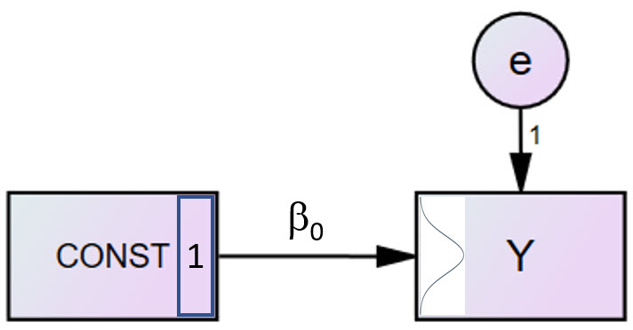
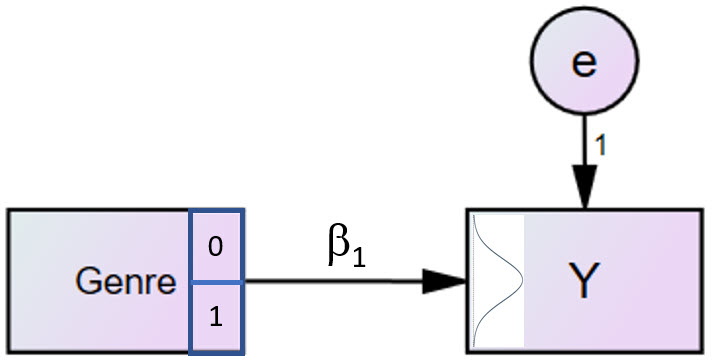
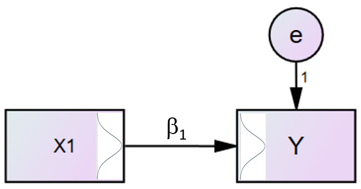
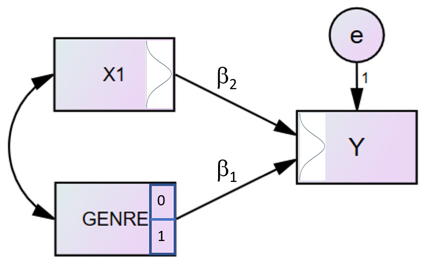
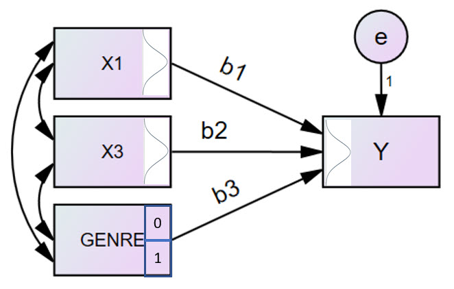
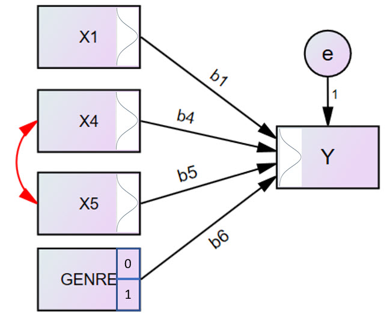
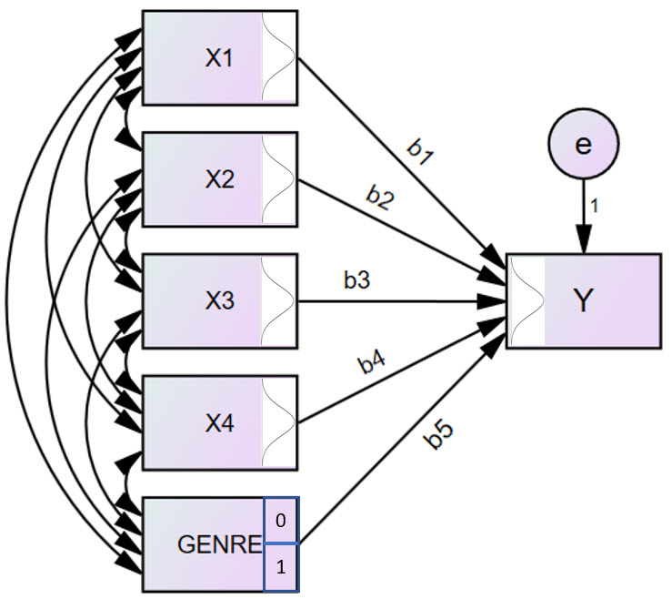
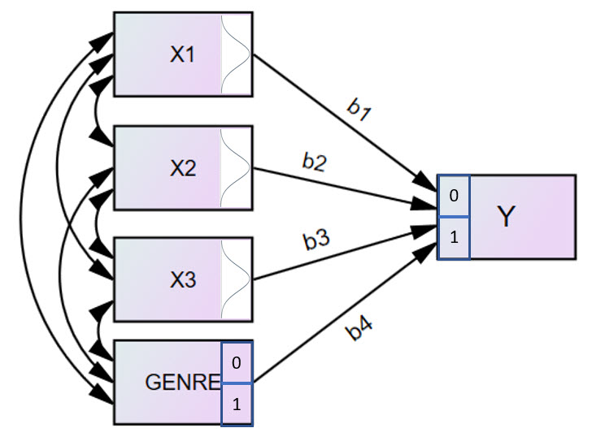
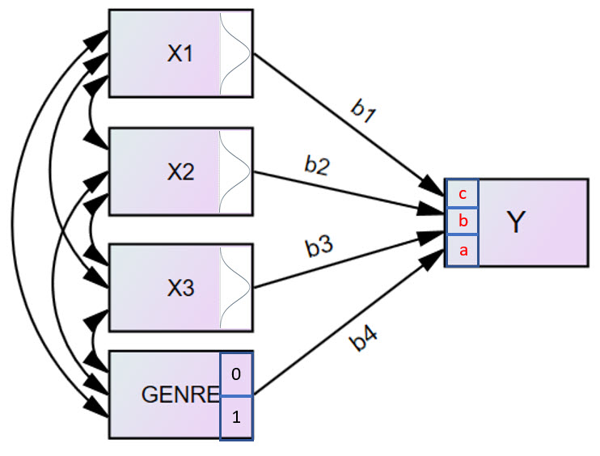
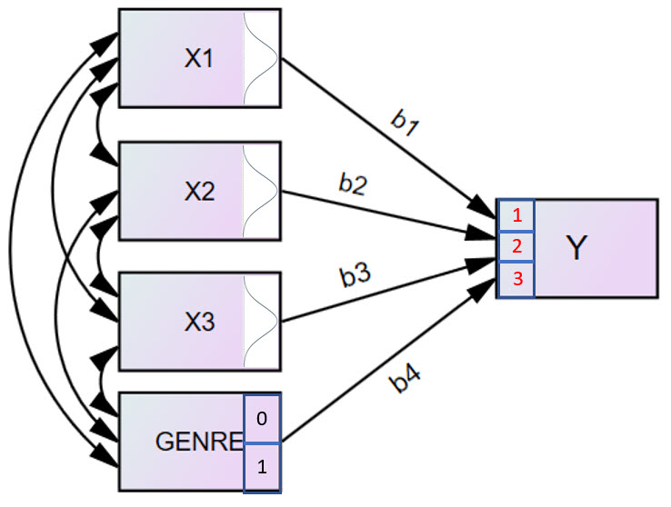

<!--

quarto_render("chap1.qmd", output_format = "epub")
quarto_render("chap1.qmd", output_format = "docx")
-->


```{r echo=FALSE, warning=FALSE,message=FALSE}

source('global3.R')

```

# Survol conceptuel: La quantification de l'impact d'une variable sur une autre

Le présent chapitre est une introduction conceptuelle à la modélisation univariée. On y présente une variable dépendante unique, qui pourra être de nature qualitative (nominale ou ordinale) ou quantitative, que l'on relie à une ou plusieurs variables indépendantes qualitatives ou quantitatives.

Il s'agit d'un survol, sans discussion des fondements formels sous-jacents aux analyses. De ce faut, les formulations mathématiques sont réduites au strict minimum.

On utilise le logiciel R pour tous les calculs effectués sur les données simulées, et les codes utilisés sont disponibles. Cependant, il n'est nullement nécessaire de les considérer et de fait, ils sont cachés par défaut.

Pour les besoins du présent document et des concepts et procédures qui y sont présentés, la simulation de données sera omniprésente. Le code R utilisé pour générer les données s'affiche en cliquant sur la flèche, ci-dessous. Dès lors, on pourra aisément modifier le modèle initial, en spécifier un nouveau, et générer de nouvelles données, supposant R disponible.

```{r}
# Génération de données à partir d'un modèle linéaire

set.seed(9382757)
n <- 300              # Nombre d'observations

# Génération de données aléatoires
x1 <- rnorm(n, 20, 5)
x2 <- rnorm(n, 20, 5)
x3 <- rnorm(n, 20, 5) 
x4 <- rnorm(n, 20, 5)
x5 <- (0.7 * scale(x4) + sqrt(1 - 0.7^2) * rnorm(n)) * 5 + 20 

Genre <- sample(0:1, n, 
                replace = TRUE, 
                prob = c(0.4, 0.6))
d1 <- data.frame(x1, x2, x3, x4, x5, Genre)

d2 <- simstudy::genCorData(n, 
                           mu = c(20, 20, 20),
                           sigma = c(5, 5, 5),
                           rho = 0.9, 
                           corstr = "cs", 
                           cnames = c("x6", "x7", "x8"))

# Modèle au niveau de la population
y <- 2.3 * d1$x1 + 0.001 * d1$x2 + 0.001 * d1$x3 + 2.5 * d1$x4 + 3 * d1$x5 + 20 * d1$Genre - 0.6 * d2$x6 - 0.5 * d2$x7 - 0.6 * d2$x8 + 6 * rnorm(n, 0, 8) + 100

my <- mean(y)
vy <- var(y)
dat <- cbind(y, d1, d2[, 2:4])

# Sauvegarde des données
misty::write.sav(dat, 
                 file = "./data/dataset.sav", 
                 digits = 5,
                 write.csv = TRUE,
                 sep = ",",
                 write.sps = TRUE)
xlsx::write.xlsx(dat, 
                 "./data/dataset.xlsx", 
                 sheetName = "Données", 
                 row.names = FALSE)
foreign::write.dta(dat, 
                   "./data/dataset.dta")
```

Les données générées sont affichées dans le tableau suivant, présentant les premières et dernières observations pour l'ensemble des variables qui seront sélectivement utilisées dans la définition des différents modèles présentés dans ce document. On pourra télécharger un fichier CSV contenant les données générées en cliquant sur le bouton, ci-dessous.  

```{r}

dat %>%
  download_this(
    path = "./data/dataset.csv",
    output_name = "dataset",
    button_label = "Télécharger les données (.csv)",
    button_type = "success",
    has_icon = TRUE,
    icon = "fa fa-save"
  )
```
  
  
Finalement, les corrélations entre chaque paire de variables, prenant la forme d'une matrice, sont affichées dans la figure @fig-cormat2:

```{r }
#| label: fig-cormat2
#| fig-cap: "Matrice des corrélations (portion triangulaire supérieure) et des diagrammes de dispersion (portion triangulaire inférieure). La distribution des variables est illustrée dans la diagonale principale. La signification statistique des corrélations est indiquée par des astérisques: () p > 0.05, (*) p < 0.05, et (**) p < 0.01."
#| fig-width: 7
#| fig-height: 6
#| fig-align: center

psych::pairs.panels(dat,
                    method = "pearson", 
                    hist.col = "#00AFBB",
                    density = TRUE,  
                    ellipses = TRUE, 
                    smooth = FALSE,
                    digits = 3,
                    lm = TRUE,
                    cex=0.8,
                    stars=TRUE,
                    ci = TRUE)
```

```{r echo=FALSE}
cormat <- cor(dat)
```

Cette matrice est de fait l'ingrédient de base de plusieurs procédures d'analyse quantitative.


## Introduction: la Variance

Imaginons une mesure quantitative de la performance dans une tâche donnée. Nommons cette variable $y$, et supposons que cette mesure est valide et fiable. On évalue $y$ auprès de $n=`r n`$ individus, et on obtient un ensemble de scores, dont les 10 premiers sont reproduits ci-dessous:

```{r}

round(head(y, 10), 2)
```

On note que la performance varie d'un individu à l'autre. Cette variation est davantage manifeste lorsque ces données sont représentées dans un histogramme (@fig-BaseDistr):

```{r}
#| label: fig-BaseDistr
#| fig-cap: "Distribution de la variable y (Performance)"

res <- hist(y,
            breaks = "FD",
            plot = FALSE)
fm <- max(res$counts)

hist_boxplot2(y)
#             freq = TRUE,
#             main = 'Distribution de la Performance',
#             xlab = 'Performance',
#             ylab = 'Fréquence',
#             col = 'lightblue',
#             breaks = 'FD')
segments(x0 = mean(y), 
         y0 = 0, 
         x1 = mean(y), 
         y1 = fm, 
         lty = 2, 
         lwd = 2, 
         col = "red")

```

Le centre de cette distribution est $\overline{y}=$ `r round(my, 3)`, valeur indiquée par la ligne verticale rouge dans l'histogramme. Cette moyenne représente la valeur de performance attendue d'un individu sélectionné au hasard. On peut aisément concevoir que toute déviation par rapport à cette valeur représente une *erreur*, ou une *valeur résiduelle*, ou tout simplement un *résidu*. Ces termes sont synonymes.\
Formellement, une valeur résiduelle observée pour l'individu *i* se définit par l'écart séparant $y_i$ de $\overline{y}$ (équation @eq-dev):

$$e_i=y_i-\overline{y}$$ {#eq-dev}

De façon générale, plus une erreur a une valeur élevée, plus la probabilité de l'observer est faible. Inversement, plus une erreur est rapprochée de la moyenne, plus elle est probable.

Afin de quantifier la variabilité ou le degré de dispersion d'une variable, les valeurs résiduelles sont considérées dans leur ensemble. Spécifiquement, on définira la variance d'une population comme étant la moyenne des carrés de ces valeurs (@eq-var):

$$\sigma^2=\frac{\sum\limits_{i=1}^N\epsilon_i^2}{N}=\frac{\sum\limits_{i=1}^n(y_i-\mu_y)^2}{N} $$ {#eq-var} Pour un échantillon, une estimation non-biaisée de cette quantité s'obtient par l'équation @eq-var2:

$$s^2=\frac{\sum\limits_{i=1}^ne_i^2}{n-1}=\frac{\sum\limits_{i=1}^n(y_i-\overline{y})^2}{n-1} $$ {#eq-var2}

Dans cette équation, le numérateur correspond à $SC_y=$ Somme des Carrés, et le dénominateur au nombre de **degrés de liberté**, des termes qui sont omniprésents dans le contexte des analyses quantitatives.

On note que la contribution d'une observation à la variance est fonction de la distance qui la sépare de la moyenne. Des observations qui se concentrent près de la moyenne présenteront une contribution plus faible que des observations qui s'en éloignent. À la limite, la contribution d'une observation égale à la moyenne est nulle. La figure @fig-devsq illustre clairement ce point.

```{r}
#| label: fig-devsq
#| fig-cap: Les lignes verticales vertes sont les carrés des déviations par rapport à la moyenne (expression(y-bar("Y))^2). La moyenne est représentée par la ligne verticale rouge. La moyenne de ces quantités correspond à la variance. On note que plus l'écart entre une donnée et la moyenne est grande, plus sa contribution à la valeur de la variance est importante. Les données situées près de la moyenne ne contribuent que peu à cette valeur.  
#| 
data <- y
mean_value <- mean(data)
squared_distances <- (data - mean_value)^2
variance <- sum(squared_distances) / (length(data) - 1)

plot(1, 
     type = "n", 
     xlim = c(min(data) - 2, 
              max(data) + 2), 
     ylim = c(-0.5, max(squared_distances) + 5),
     xlab = "Observations", 
     ylab = "Carrés des déviations", 
     main = "Variance en tant que somme de carrés de distances")

points(data, 
       rep(0, length(data)), 
       pch = 16, 
       col = "blue")

abline(v = mean_value, 
       col = "red", 
       lty = 2)

for (i in seq_along(data)) {
  segments(data[i], 0, data[i], squared_distances[i], col = "green")
}

legend("top", 
       legend = c("y", expression(bar("y")), expression((y-bar("y"))^2)),
       col = c("blue", "red", "green"), 
       pch = c(16, NA, NA), 
       lty = c(NA, 2, 1))

```

La nature de la variance, illustrée par la figure @fig-devsq, implique l'absence d'une unité de mesure pour cet indice de variabilité, En conséquence, elle ne se prête pas à une interprétation précise. Cependant, ceci ne réduit en rien son importance dans le contexte de recherches quantitatives.

On peut aisément imaginer que cette quantité résulte d'un nombre indéterminé de facteurs susceptibles d'influencer la performance. On pourrait sans doute mentionner la motivation de l'individu à exécuter la tâche requise, ses habiletés intellectuelles, certaines habiletés développées antérieurement, son niveau d'expérience, et une foule d'autres variables qu'on pourrait éventuellement évaluer. L'objectif général d'une recherche quantitative est de développer un modèle explicatif permettant d'attribuer à différents facteurs ou diverses variables une part de responsabilité dans la variation observée dans une variable dépendante. 


## Modèle nul

Le modèle le plus simple que l'on puisse proposer pour rendre compte de la variabilité de la variable dépendante prend la forme  de l'équation @eq-model1:

$$y_i=\mu_y+\epsilon_i$$ {#eq-model1}

Ce modèle propose que la valeur de la performance d'un individu ($y_i$) réflète la performance moyenne au niveau de la population ($\mu_y$), à laquelle s'ajoute une variation aléatoire résultant d'influences non spécifiées ($\epsilon_i$). Dans les faits, ce modèle ne réflète que la prédiction de $y$ (variable dépendante) à partir d'une constante (par exemple, '1'). Il s'agit d'un modèle qualifié de *nul*, puisqu'il n'implique aucune information autre que les données elles-mêmes. La figure @fig-modnul en est une représentation:

{#fig-modnul fig-align="center"}

Formellement, définissons ce modèle de la manière suivante:  

$$\hat{y}=1\beta_0 + \epsilon $$
Spécifiquement, la valeur prédite de $y$ (notée $\hat{y}$), est égale à une constante ($\beta_0$), plus une erreur aléatoire.

Les paramètres de ce modèle sont:

1.  $\beta_0$, estimé par $b_0$
2.  La variance des erreurs ($\sigma_{\epsilon}^2$), estimé par $s_e^2$

Pour les données actuelles, on peut estimer ces paramètres à l'aide de la fonction lm():

```{r}


reg0 <- lm(y ~ 1)    # Régression d'une constante sur y
res_reg0 <- summary(reg0)

res_reg0


```

Le premier bloc de ces résultats fournit une description de la distribution des valeurs résiduelles, incluant les valeurs minimum et maximum, de même que les trois quartiles. Cette distribution semble symétrique autour de la médiane, qui environne 0. La moyenne des valeurs résiduelles sera toujours exactement nulle. La forme de cette distribution semble gaussienne, ce qui est un postulat important pour une analyse de ce type. La figure suivante en fournit une illustration:

```{r fig.height=6}
#| label: fig-BaseDistr2
#| fig-cap: "Distribution des valeurs résiduelles (simples écarts par rapport à la moyenne)"

resid0 <- residuals(res_reg0)

hist_boxplot2(resid0,
              main = "Distribution des valeurs résiduelles",
              ylab = "Fréquence",
              xlab = "Valeurs résiduelles",
              freq = TRUE,
              col = 'lightblue',
              breaks = 'FD')
```

Le second bloc de résultats est plus pertinent pour la présente discussion. Le coefficient obtenu (libellé *Intercept*) correspond à la valeur de $y$ en l'absence de toute information provenant d'autres variables. En d'autres termes, il s'agit de la valeur de la performance que l'on pourrait observer chez un individu choisi aléatoirement, si aucune information n'est prise en compte (le modèle ne fait appel à aucune variable indépendante). Sans surprise, cette valeur est égale à $\overline{y}$=`r round(my, 3)`. Sur la même ligne, on peut lire que l'erreur-standard de cet intercept est `r round(res_reg0$coefficients[, 2], 3)`, et le rapport entre l'estimé de l'intercept et son erreur-standard produit la statistique *t* permettant le test de signification approprié. Ici, l'hypothèse soumise au test propose que:

$$H_0:\beta_0=0  \quad \Leftrightarrow \quad H_0:\mu_y=0 $$ 

Dans le cas présent, on trouve que la performance moyenne est significativement différente de 0, ce qui n'est en rien une surprise: $H_0$ n'est pas retenue. La figure suivante illustre la situation. Les observations sont représentées par le 'tapis' longeant l'axe horizontal. On peut apercevoir une forte concentration de cas autour de la moyenne (ligne verticale verte), et des densités décroissantes à l'approche des extrémités. En conséquence, en sélectionnant un individu au hasard, on peut s'attendre à ce que sa performance se trouve dans une zone avoisinant la moyenne.

```{r}
#| label: fig-BaseDistr3
#| fig-cap: "Répartition des observations et tracé de densité. La ligne verticale verte indique la position de la moyenne."

densdat <- density(y)
plot(densdat,
     main = 'Distribution de la Performance',
     xlab = 'Performance',
     ylab = 'Densité')
rug(y,
    col = 2,
    lwd = 0.5)
segments(x0 = my, y0 = 0, x1 = my, y1 = max(densdat$y),
         lty = 2,
         col = 'darkgreen',
         lwd = 2)
```

Le second paramètre du modèle est la variance des erreurs. Cette variance est le carré de la quantité libelée *Residual standard error*:

$s_{\epsilon}^2=$ `r round(res_reg0$sigma, 3)` $^2=$ `r round(res_reg0$sigma^2, 3)`

En effet, en calculant directement la variance des valeurs résiduelles (obtenues à l'aide de la fonction **residuals()**, sous R), on trouve:

```{r}
resid <- residuals(res_reg0)
cat('Variance des erreurs = ', round(var(resid), 3))

```

Puisqu'aucune variable indépendant n'est prise en compte, cette variance est de fait égale à la variance de la variable $y$:

```{r}
cat('Variance de Y = ', round(var(y), 3))
```

On se retrouve donc dans une position où le modèle ne peut qu'estimer la moyenne de la variable étudié, et reproduire sa variance. Or, ce que l'on tente d'expliquer, c'est spécifiquement les sources de cette variation. Quels sont les facteurs présents chez un individu, faisant en sorte que sa performance soit plus faible ou plus élevée que la moyenne? Pour répondre à cette question, il faudra approfondir nos connaissances théoriques concernant le phénomène étudié, et déterminer certaines variables ou certains facteurs susceptibles d'être candidats aux postes de *prédicteurs* de la variable dépendante $y$.

Les prédicteurs susceptibles d'expliquer une certaine portion de la variance d'une variable dépendante quantitative peuvent être de nature qualitative (nominale ou ordinale) ou quantitative (d'intervalle ou de rapport). Les données recueillies pour les fins de l'exercice incluent une variable dichotomique, $Genre$, correspondant au sexe des individus composant l'échantillon (0 = homme, 1 = femme). Dans la section suivante, nous examinons l'impact de l'ajout de cette variable au modèle (@eq-model2):

$$y_i=\mu_y + Genre_i + \epsilon_i$$ {#eq-model2}

## Un prédicteur dichotomique {#sec-Dichot}

L'ensemble des données se compose de `r n-sum(Genre)` hommes (Genre = 0) et de `r sum(Genre)` femmes. Est-ce que le genre des individus pourrait expliquer une portion de la variance de $y$?

Le tableau suivant résume les données obtenues des deux groupes.

```{r }

ds <- doBy::summaryBy(y ~ Genre,
                      data = dat,
                      FUN = c(mean,
                              var,
                              sd))
ds[, 1] <- c('Hommes', 'Femmes')
colnames(ds) <- c('Genre', 'Moyenne', 'Variance', 'Écart-type')
rownames(ds) <- NULL
ds
```

S'il existe une relation entre le genre et la performance, on s'attend à ce que les moyennes diffèrent entre les groupes, et que cette différence se situe au-delà de ce à quoi on peut s'attendre en raison des fluctuations d'échantillonnage. Si cela s'avère, alors l'ajout de la variable *genre* au modèle devrait se traduire par une diminution de la variance résiduelle par rapport à la variance résiduelle obtenue avant l'ajout de cette variable.

La figure @fig-model1 représente le modèle proposé, incluant la variable Genre en tant que variable indépendante:  

{#fig-model1 fig-align="center"}

Les figures suivantes illustrent la présente situation. Des histogrammes produits pour chacun des groupes séparément montre un degré de recouvrement important, mais laisse entrevoir une légère différence quant au centre des distributions. Les diagrammes en boîte qui suivent présentent une image plus claire, semblant indiquer une performance légèrement supérieure chez les femmes (histogramme bleu) que chez les hommes (histogramme rouge).

```{r message = FALSE}
#| label: fig-GrpDistr1
#| fig-cap: "Distribution de la performance observée chez les hommes et les femmes. Les zones ombragées sont les portions où il y a recouvrement des deux distributions."

TmpDdat <- data.frame(Genre = factor(Genre), y = y)
ggplot(TmpDdat, aes(x = y, fill = Genre, colour = Genre)) + 
  geom_histogram(colour = "black",
                 alpha = 0.5,
                 lwd = 0.5,
                 linetype = 1,
                 position = "identity") +
  theme_classic() 
```

```{r }
#| label: fig-GrpDistr2
#| fig-cap: Diagrammes en boîte résumant la distribution de la performance observée chez les hommes (Groupe = 0) et les femmes (Groupe = 1)."

boxplot(y ~ Genre,
        main = "Comparaison de la distribution des groupes",
        col = c("#FFE0B2", "#FFA726"),
        xlab = "Groupe",
        range = 1.5,
        notch = TRUE,
        boxwex = 0.3,
        horizontal = FALSE,
        at = c(0, 0.4))
```

Finalement, le diagramme de dispersion affiché à la figure @fig-regdic suivant présente les observations obtenues des deux groupes, un point rouge indiquant leur moyenne respective. La droite liant ces points réflète le modèle proposé, soit une droite définie par l'équation @eq-model3:

$$\hat{y} =\beta_0 + \beta_1 Genre + \epsilon$$ {#eq-model3}

Les paramètres de ce modèle sont:

1.  $\beta_0$, l'intercept, estimé par $b_0$\
2.  $\beta_1$, la pente ou coefficient de régression, estimé par $b_1$\
3.  $\sigma_{\epsilon}^2$, la variance des erreurs, estimé par $s_e^2$

```{r message = FALSE, warning=FALSE}
#| label: fig-regdic
#| fig-cap: Diagramme de dispersion illustrant la relation entre la variable dichotomique Genre et la variable dépendante y. La droite reliant les moyennes des deux groupes (points rouges) possède une pente égale à la différence entre les deux moyennes. La ligne pointillée horizontale verte marque la position de la moyenne de y.

p <- ggplot(dat, 
            aes(x=Genre, y=y)) +
  geom_point(color = "blue") + 
  geom_point(aes(x=0, y=mean(y[Genre == 0. ])), size = 3, colour="red") +
  geom_point(aes(x=1, y=mean(y[Genre == 1. ])), size = 3, colour="red") +
  theme(legend.position="none") +
  geom_smooth(method = lm,
              color = "red") +
  geom_hline(yintercept = mean(y, ),
             linetype = 'dashed',
             color = 'darkgreen',
             size = 0.5) +
  theme_classic() +
  annotate("text", 
           0.5,
           max(y) - 5,
           label = paste0("r = ", round(cor(Genre, y), 3)),
           col = "red",
           size = 5)

p + geom_ysidehistogram(
  mapping = NULL,
  data = dat,
  color = "darkblue",
  fill = "cadetblue",
  stat = "bin",
  position = "stack",
  binwidth = NULL,
  bins = NULL,
  na.rm = FALSE,
  orientation = "y",
  show.legend = NA,
  inherit.aes = TRUE
)
```

Modèle 1: Ajout de Genre

```{r echo = FALSE}
reg1 <- lm(y ~ Genre, data = dat)
equatiomatic::extract_eq(reg1, 
                         intercept = "beta",
                         greek_colors = "blue",
                         subscript_colors = "blue",
                         use_coefs = FALSE)

```

L'analyse de ce modèle produit les résultats suivants:

```{r echo=FALSE}

equatiomatic::extract_eq(reg1, 
                         se_subscripts = TRUE,
                         coef_digits = 3,
                         use_coefs = TRUE)
```


```{r eval=FALSE, echo=FALSE}
#| label: tbl-RegRes
#| tbl-cap: Régression de x1 sur y

# Modèle de présentation des résultats d'une régression

lm(y ~ Genre, data = dat) %>%
  tidy() %>%
  mutate(p.value = ifelse(p.value < 0.0001, "<0.0001", round(p.value, 4))) %>%
  kbl(linesep = "", booktabs = TRUE, 
      caption = "Estimation de l'intercept et de la pente, en régressant Genre sur y.",
      digits = 2, align = "lrrrr") %>%
  kable_styling(bootstrap_options = c("striped", "condensed"), 
                latex_options = c("striped", "hold_position")) %>%
  column_spec(1, width = "10em", monospace = TRUE) %>%
  column_spec(2:5, width = "5em")

```


```{r}

reg1 <- lm(y ~ Genre, data = dat)
res1 <- summary(reg1)
resid1 <- residuals(reg1) # Calcul des erreurs

reg1 %>%
  tbl_regression(intercept = TRUE) %>%
  add_significance_stars(hide_ci = FALSE,
                         hide_p = FALSE) %>%
  bold_p() %>%
  add_glance_table(
    include = c("r.squared", "adj.r.squared",
                "df.residual", "sigma", "nobs"))


```

De ces résultats, on note que l'intercept est égal à `r round(res1$coefficients[1, 1], 3)`, indiquant la performance moyenne des hommes (Genre = 0). En effet, l'intercept est la moyenne de la variable dépendante lorsque la valeur de la variable indépendante est nulle. Cette moyenne est significativement différente de 0, tel qu'indiqué par le test de signification correspondant à ce paramètre.

D'autre part, le coefficient liant Genre à la performance, $b_{Genre}$ = `r round(res1$coefficients[2, 1], 3)`, indique que pour une augmentation d'une unité dans la variable Genre, soit le passage de Genre = 0 (homme) à Genre = 1 (femme), la performance moyenne augmente de `r round(res1$coefficients[2, 1], 3)` unités. Ce coefficient correspond donc à la différence de la performance moyenne entre les hommes et les femmes, différence qui s'avère statistiquement significative.

Le fait que la variable Genre ait un impact sur la performance implique que la variance des erreurs est inférieure à la variance de la variable dépendante: elle permet d'en expliquer une certaine proportion.

La variance résiduelle est égale à `r round(var(resid1), 3)`$^2$ = `r round(res1$sigma^2, 3)`, une valeur inférieure à la variance d'erreur du modèle nul ou la variance de la variable $y$ ($s_y^2=$ `r round(var(y), 3)`). De cette différence, on peut calculer la proportion de la variance de $y$ expliquée par Genre:

%Variance expliquée = $1-\frac{s_{y.Genre}^2}{s_y^2}=1-\frac{`r round(var(resid1), 4)`}{`r round(var(y), 4)`}=$ `r 1-round(var(resid1)/var(y), 4)`

Il semble donc que le groupe d'appartenance des sujets permet d'expliquer une portion de la variabilité totale. Cette variable représente un facteur susceptible de déterminer la performance.

Ce résultat indique que la variable *Genre* explique `r round(100 * (1-var(resid1)/var(y)), 2)`% de la variabilité de $y$. On retrouve cette quantité dans la tableau inférieur des résultats de l'analyse effectuée sur ces données, sous le terme *Multiple R-squared*. Il s'agit du **coefficient de détermination**, ou $R^2$. Cet indice est omniprésent dans le contexte d'analyses quantitatives et fera l'objet d'une discussion ultérieure.

Comparons les deux modèles étudiés jusqu'ici:

```{r}
#| label: tbl-ModelComp
#| tbl-cap: Paramètres et statistiques pertinentes obtenus pour le modèle nul (Constante) et pour le modèle impliquant la variable Genre."

models <- list(
  "Constante" = lm(y ~ 
                     1, data = dat),
  "Constante + Genre" = lm(y ~ Genre, data = dat))
modelsummary(models,
             title = "Paramètres des modèles étudiés",
             statistic = c("std.error"),
             stars = TRUE,
             coef_rename = TRUE)
```

Il est important de noter que les résultats obtenus se fondent sur les observations faites auprès d'un échantillon. Un échantillon différent fournirait des résultats plus ou moins différents. Ce fait se démontre aisément à l'aide d'une simulation. En ré-échantillonnant 10,000 fois les observations initiales, on obtient les distributions d'échantillonnage de l'intercept et du coefficient liant *Genre* à $y$:

```{r}
# Bootstrap 95% IC pour les paramètres de la régression

# Fonction permettant d'obtenir les coefficients
bs <- function(formula, data, indices) {
  d <- data[indices,] 
  fit <- lm(formula, data=d)
  return(coef(fit))
}

# Ré-échantillonnage (10000 replications)
results <- boot(data=dat, 
                statistic=bs,
                R=10000, 
                formula=y ~ Genre)
results

```

Dans de tableau, t1\* représente l'intercept, et t2\* le coefficient liant Genre à $y$. On constate que les paramètres obtenus sont les mêmes que ceux obtenus à l'aide de la fonction **lm()**. Ce résultat est attendu, étant donné que ce sont les mêmes observations qui sont ré-échantillonnées un grand nombre de fois. Les erreurs-standards de ces quantités sont également similaires dans le présent cas, mais pourraient différer en fonction des caractéristiques des données (forme de la distribution, degré d'asymétrie, etc). Les figures @fig-BS1 et @fig-BS2 reproduisent les distributions de ré-échantillonnage correspondantes, ainsi que les diagrammes de probabilités normales, témoignant de la normalité de ces distributions.

```{r}
#| label: fig-BS1
#| fig-cap: Distribution de ré-échantillonnage de l'Intercept, obtenue à partir de 10,000 itérations, , et diagramme de probabilité normale confirmant la normalité de cette distribution.

plot(results, index=1) # intercept

```

Notons qu'un intercept nul n'est pas du tout probable, dans le cas présent. Les valeurs possibles de ce paramètre semblent comprises dans l'intervalle \[20, 23.5\].

```{r}
#| label: fig-BS2
#| fig-cap: Distribution de ré-échantillonnage du coefficient de régression (Genre), obtenue à partir de 10,000 itérations, et diagramme de probabilité normale confirmant la normalité de cette distribution.

plot(results, index=2) # Genre
```

Notons qu'un coefficient de régression nul est peu probable, dans le cas présent. La presque totalité de la distribution s'étend au-delà de 0, ce qui laisse croire qu'il existe réellement un lien entre le sexe des sujets et leur performance.

Finalement, on peut obtenir les intervalles de confiance fondés sur les distributions de ré-échantillonnage afin de déterminer l'étendue de valeurs susceptible de capturer le véritable paramètre au niveau de la population, avec un degré de confiance de 95%:

```{r}

# Intervalles de confiance (95%) 
boot.ci(results, type="bca", index=1) # intercept
boot.ci(results, type="bca", index=2) # Genre
```

Ni pour l'intercept, ni pour le coefficient de régression, une valeur nulle n'est incluse dans l'intervalle, confirmant la faible probabilité que l'un ou l'autre des paramètres soit égal à 0.

En conclusion, les résultats des analyses effectuées sur les données nous porte à croire que le sexe des individus a un impact sur la performance (variable $y$), En effet, ce facteur permet de rendre compte de `r 100 * round(res1$r.squared, 3)`% de la variabilité de la performance.  De plus, puisque la variable indépendante est dichotomique, le coefficient de régression représente la différence entre les moyennes des deux groupes, de sorte que le test de signification appliqué sur ce coefficient est de fait un test de signification de cette différence.

## Un prédicteur quantitatif {#sec-Quant}

Tel que mentionné précédemment, une variable indépendante (prédicteur) peut être de nature qualitative ou quantitative. Dans la section précédente, le modèle proposé pour expliquer une portion de la variabilité de la performance incluait une variable dichotomique, qualitative. Dans la présente section, le travail sera répété mais en introduisant la variable **x1**, un prédicteur quantitatif. Dans ce cas, le modèle prend la forme de l'équation @eq-model3:

$$\hat{y}=\beta_0 + \beta_1 x1 + \epsilon$$

Comme dans le cas précédent, le modèle ne fait appel qu'à une seule variable indépendante et ses paramètres demeurent inchangés:

1.  $\beta_0$, l'intercept, estimé par $b_0$\
2.  $\beta_1$, la pente ou coefficient de régression, estimé par $b_1$\
3.  $\sigma_{\epsilon}^2$, la variance des erreurs, estimé par $s_e^2$

La figure @fig-mod1b représente ce modèle:

{#fig-mod1b fig-align="center"}

S'il existe une relation entre $y$ et $x1$, on devrait pouvoir observer une réduction de la variance des erreurs en incluant $x1$ dans le modèle, comme ce fut le cas suite à l'introduction de la variable Genre, dans la section précédente. La figure @fig-DiagDisp1 illustre cette relation:

```{r warning=FALSE, message=FALSE}
#| label: fig-DiagDisp1
#| fig-cap: Représentation de la relation entre la variable dépendante y et la variable indépendante x1. La ligne pointillée rouge horizontale indique la position de la moyenne de y, alors que la ligne verticale indique la position de la moyenne de x1. Le centre de gravité du nuage de points se trouve à l'intersection de ces deux droites. Les distributions de fréquences des variables sont affichées au-dessus (variable x1) et à droite (variable y) du diagramme de dispersion.

p <- ggplot(dat, aes(x1, y)) + 
  geom_point() + 
  geom_smooth(method='lm') + 
  theme_classic() +
  geom_vline(xintercept = mean(x1, ),
             linetype = 'dashed',
             color = 'red',
             size = 1) +
    geom_hline(yintercept = mean(y, ),
             linetype = 'dashed',
             color = 'red',
             size = 1) +
    annotate("text", 
           min(x1) + 3,
           max(y) - 3,
           label = paste0("r = ", round(cor(x1, y), 3)),
           col = "red",
           size = 5)
ggExtra::ggMarginal(p, type = "histogram",
                    size = 4,
                    color="darkblue", fill="lightblue")
```

Ce diagramme indique une relation positive entre les deux variables. Supposant une relation linéaire, le coefficient de corrélation est égal à `r round(cor(y, x1), 3)`. Cette corrélation est une estimation de la corrélation réelle entre $y$ et x1, au niveau de la population. Elle est assujettie aux fluctuations d'échantillonnage. Cependant, on peut obtenir sa distribution d'échantillonnage à l'aide d'une procédure de ré-échantillonnage, donnant les résultats suivants, suite à 100,000 réplications:

```{r}
b3 <- boot(dat, 
           statistic = function(data, i) {
             cor(data[i, "x1"], data[i, "y"], method='pearson')
             },
           R = 100000
           )
b3
```

```{r echo = FALSE}
BSb1 <- b3$t0
SEr <- sd(b3$t)
tr <- b3$t0 / SEr
```

Sans surprise, la moyenne de la distribution d'échantillonnage, $\mu_r$, est égale à `r round(b3$t0, 3)`. Elle correspond à la corrélation observée entre $y$ et x1, pour l'échantillon étudié. L'erreur-standard de cette distribution est égale à $\sigma_{r}=$ `r round(SEr, 3)`. Puisque $r=0$ se trouve à plus de $\frac{ `r round(BSb1 , 3)` }{ `r round(SEr, 3)`} = `r round(tr, 3)`\sigma_r$ de la valeur estimée, une hypothèse proposant une corrélation nulle entre $x1$ et y, au niveau de la population, ne semble pas appuyée par les données analysées, étant hautement improbable. Les figures @fig-BScorr1 et @fig-BScorr2 en sont des illustrations:

```{r}
#| label: fig-BScorr1
#| fig-cap: Courbe de densité de la distribution de ré-échantillonnage des corrélations. La ligne verticale rouge indique r = 0, la valeur proposée dans un test d'hypothèse. Se trouvant très loin dans l'extrémité inférieure, cette valeur est hautement improbable.
plot(density(b3$t),
     main = "Courbe de densité de la distribution de ré-échantillonnage \n des corrélations",
     ylab = "Densité",
     xlab = "Corrélation")
abline(v = 0, 
       lty = "dashed", 
       col = "red")
abline(v = cor(x1, y), 
       lty = "dashed", 
       col = "darkgreen")
```

```{r}
#| label: fig-BScorr2
#| fig-cap: "Distribution d'échantillonnage des corrélations, obtenue par ré-échantillonnage. La valeur r=0 se situe à l'extrémité inférieure de la distribution. De ce fait, elle a peu de chance de correspondre à la corrélation entre x1 et y, au niveau de la population. La ligne verticale verte indique la corrélation observée, qui est nécessairement la moyenne de la distribution. Le diagramme de probabilité normale, à droite, pourrait suggèrer une très légère asymétrie positive de la distribution d'échantillonnage."

plot(b3, index=1) 
```

### Note concernant la variance des erreurs

La figure @fig-devsq a permis une visualisation de la contribution d'une donnée à la variance d'un ensemble de score, contribution qui est une fonction de la distance qui la sépare de la moyenne de cet ensemble. Dans le contexte d'une relation linéaire entre deux variables, on peut produire une visualisation similaire lorsque deux variables sont impliquées. Dans ce cas, une erreur se défini par l'équation @eq-err2:

$$e_i= y_i-\hat{y}$$ {#eq-err2}

où $\hat{y}$ est la valeur prédite de $y$ en tenant compte de la variable indépendante. La détermination des paramètres d'un modèle de régression implique un processus visant à minimiser la somme des $e_i^2$. Dans ce cas, la variance des erreurs se définit par l'équation @eq-varerr :

$$s_e^2=\frac{\sum\limits_{i=1}^ne_i^2}{n-1}=\frac{\sum\limits_{i=1}^n(y_i-\hat{y})^2}{n-1} $$ {#eq-varerr}

La figure @fig-varerrRep illustre la nature de la contribution de chaque observation à cette variance: 

{width="7in" height="7in" fig-align="center" #fig-varerrRep}

Dans cette figure, les erreurs sont les distances verticales entre les points et la droite de régression. La mise au carré de ces erreurs équivaut à la formation de carrés, dont la surface représente la contribution d'une observation à la variance, qui n'est que la somme des surfaces, divisée par le nombre de points moins 1. Plus un point est éloigné de la droite, plus sa contribution est importante.

### Estimation des paramètres 

Démonstration faite qu'une relation pourrait exister entre les variables $x1$ et $y$, il convient d'examiner dans quelle mesure $x1$ pourrait permettre d'expliquer une portion de la variabilité de $y$.

Modèle 2: Ajout de x1

```{r echo = FALSE}
reg2 <- lm(y ~ x1, data = dat)
equatiomatic::extract_eq(reg2, 
                         intercept = "beta",
                         greek_colors = "blue",
                         subscript_colors = "blue",
                         use_coefs = FALSE)

```

Un examen détaillé de ces données à l'aide de la fonction **lm()** fournit les résultats suivants:

```{r echo=FALSE}
equatiomatic::extract_eq(reg2, 
                         se_subscripts = TRUE,
                         coef_digits = 3,
                         use_coefs = TRUE)
```


```{r}
reg2 <- lm(y ~ x1, data = dat)
res2 <- summary(reg2)
resid2 <- residuals(reg2) # Calcul des valeurs résiduelles

res2 %>%
  tbl_regression(intercept = TRUE) %>%
  add_significance_stars(hide_ci = FALSE,
                         hide_p = FALSE) %>%
  bold_p() %>%
  add_glance_table(
    include = c("r.squared", "adj.r.squared", "df.residual", "sigma", "nobs"))

```

```{r echo=FALSE}
reg2b1 <- res2$coefficients[2, 1]
t1 <- sqrt(res2$fstatistic[1])
icept2 <- res2$coefficients[1, 1]
```

Le coefficient de régression liant $x1$ à $y$ est égal à $b_{x1}=`r round(reg2b1, 3)`$, une valeur jugée statistiquement significative ($t_{298}=`r round(t1, 3)`$, $p<0.001$). Ce coefficient implique qu'une augmentation d'une unité de la variable $x$ se traduirait par une augmentation de `r round(res2$coefficients[2, 1], 3)` unité dans la variable $y$. Pour sa part, l'intercept, $b_0=$ `r round(res2$coefficients[1, 1], 3)`, correspond à la performance moyenne ($y$) chez un individu pour qui $x1=0$. Notons que cette interprétation de l'intercept n'est valide que si:

1.  $x1=0$ est une valeur possible pour cette variable. Dans le cas présent, cette condition pourrait ne pas être respectée. En effet, la valeur minimale de $x1$ est `r round(min(x1), 3)`, et il est possible que $x1=0$ n'existe pas.\
2.  Les données incluent des observations autour de cette valeur.

Si ces conditions ne sont pas respectées, on ne peut fournir une interprétation de l'intercept. Il s'agit simplement d'une valeur nécessaire pour obtenir des prédictions valides.

Une stratégie souvent utilisée pour s'assurer de l'interprétabilité de l'intercept est de transformer la variable indépendante en la centrant sur sa moyenne. La transformation requise dans ce cas est définie par l'équation @eq-ctrScore:

$$xc_i=x_i-\overline{x}$$ {#eq-ctrScore}

La moyenne d'un ensemble de déviation par rapport à la moyenne étant nécessairement 0, l'interprétation de l'intercept devient alors la moyenne conditionnelle de la variable dépendante lorsque $x=\overline{x}$. Pour fin d'exemple, on applique cette opération sur $x1$ et on relance l'analyse:

```{r}
xc <- x1 - mean(x1)
reg2b <- lm(y ~ xc)
res2b <- summary(reg2b)

reg2b %>%
  tbl_regression(intercept = TRUE) %>%
  add_significance_stars(hide_ci = FALSE,
                         hide_p = FALSE) %>%
  bold_p() %>%
  add_glance_table(
    include = c("r.squared", "adj.r.squared", "df.residual", "sigma", "nobs"))
  
```

```{r echo=FALSE}
icept2b <- res2b$coefficients[1, 1]
```

On note immédiatement que le coefficient de régression demeure inchangé, et son interprétation demeure la même. Par contre, la valeur de l'intercept a changé, passant de `r round(icept2, 3)` à `r round(icept2b, 3)` après l'application de la transformation. Dans ce cas on pourra affirmer que la valeur moyenne de $y$, pour un individu obtenant la valeur moyenne sur $x1$ est égale à `r round(icept2b, 3)`.

Que l'on utilise une variable centrée ou non, la variable $x1$ permet donc d'expliquer une certaine proportion de la variance de $y$, tel que quantifié par le coefficient de détermination, $r^2=$ `r round(res2$r.squared, 3)`. Ce résultat indique que `r round(100 * res2$r.squared, 3)`% de la variance de $y$ peut s'expliquer par la variable indépendante $x1$.

La distribution des valeurs résiduelles obtenues dans ce cas ne semble pas dévier de la normalité de manière importante, tel que suggéré par la figure @fig-DistrRes2:

```{r}
#| label: fig-DistrRes2
#| fig-cap: Distribution des valeurs résiduelles suite à l'ajout de x1 au modèle. 

Ve <- round(var(resid2), 3)
txt1 <- paste("Var(e) = ", Ve)
rcompanion::plotNormalHistogram(
  resid2,
  prob = TRUE,
  col = "cadetblue",
  linecol = "red",
  lwd = 2,
  length = 1000,
  breaks = "FD",
  main = "Distribution des Erreurs",
  xlab = "Valeurs Résiduelles",
  ylab = "Densité")
text(-3, 0.3, labels =txt1)

```

### Comparaison des modèles

Le tableau @tbl-ModelComp2 résume les résultats obtenus pour les trois modèles proposés jusqu'à maintenant:

```{r}
#| label: tbl-ModelComp2
#| tbl-cap: Paramètres et statistiques pertinentes obtenus pour les 3 modèles étudiés

models <- list(
  "Constante" = lm(y ~ 
                     1, data = dat),
  "Constante + Genre" = lm(y ~ Genre, data = dat),
  "Constante + x1" = lm(y ~ x1, data = dat))
modelsummary(models,
             title = "Paramètres des modèles étudiés",
             statistic = c("std.error"),
             stars = TRUE,
             coef_rename = TRUE)
```

Une part importante d'une analyse quantitative consiste à comparer différents modèles dans le but de mettre en évidence celui qui s'ajuste le mieux aux données, qui possède le meilleur potentiel de prédiction, tout en demeurant le plus parcimonieux possible. Une foule d'indices numériques peuvent entrer en jeu à ce stade. Certains sont présentés dans la portion inférieure de ce tableau, et d'autres suivront dans les sections ultérieures.  

Le modèle nul, qui n'inclut aucun prédicteur, sert de modèle de comparaison. On recherche des modèles offrant des caractéristiques substantiellement supérieures à celles que l'on obtient de ce modèle. En particulier, on recherche un modèle pour lequel:  
  
  1. **R2**, le coefficient de détermination: un modèle permettant d'expliquer une plus grande proportion de la variance de la variable dépendante sera généralement plus intéressant qu'un autre, sans que cet indice réflète la qualité de l'ajustement du modèle. À ce chapitre le modèle impliquant la variable Genre sort gagnante, permettant d'expliquer 6.5% de la variance de $y$, contre 4.4% pour la variable $x1$. 
  
  2. **AIC** ('AKaike Information Critérion') et **BIC** ('Bayes Information Criterion'): On utilise généralement ces indices de manière à déterminer le modèle le plus parcimonieux, celui qui performe le mieux tout en étant le moins complexe possible. On recherche un modèle produisant la plus petite valeur de ces indices. Dans le cas présent, le modèle impliquant la variable Genre est favori.  
  
  3. **RMSE** ('Root Mean Squares of Error'): Cet indice est essentiellement l'écart type des valeurs résiduelles. Plus la qualité d'ajustement un modèle est importante, plus sa valeur est faible. Là aussi, le modèle impliquant Genre est jugé le meilleur.

Notons que la comparaison directe des modèles résumés dans ce tableau n'est pas réellement appropriée du fait que les deux variables indépendantes sont examinées séparément. On ne tient pas compte des liens qu'elles pourraient entretenir. Ces comparaisons n'ont été faites que dans le but de présenter les indices numériques appropriés pour l'examen de la qualité d'ajustement d'un modèle.  

### Variabilité des estimations

Comme toute statistique obtenue d'un échantillon, qu'il s'agisse de la moyenne, d'un écart-type, ou de toute autre mesure descriptive, les paramètres d'une régression ($b_0$, $b_1$ et $s_{erreur}^2$) varient d'un échantillon à l'autre. La figure @fig-resampReg illustre ce fait:


```{r, message=FALSE, warning=FALSE}
#| label: fig-resampReg
#| fig-cap: Droites de régression obtenues en ré-échantillonnant 100 fois l'échantillon initial. La droite de régression calculée sur les données originales est affichée en rouge.
#| 
 rsamp <- dat[, 1:2] %>%
  infer::rep_sample_n(size = n, replace = TRUE, reps = 100)

ggplot() +
  geom_smooth(
    data = rsamp, aes(x = x1, y = y, group = replicate),
    method = "lm", se = FALSE, fullrange = TRUE, 
    color = "grey", size = 0.5
  ) +
  geom_smooth(
    data = dat[ , 1:2], aes(x = x1, y = y), method = "lm", se = FALSE,
    fullrange = TRUE, color = "red"
  ) +
  theme_classic() +
  labs(
    title = "Régression de X1 sur Y",
    subtitle = "(100 ré-échantillons)"
  )
```

Il conviendra donc de quantifier cette variation de manière à permettre un examen plus approfondi de la relation entre les variables.

### Visualisation de l'ajustement d'un modèle de régression 

Le terme **ajustement** d'un modèle par rapport aux données réfère à la différence qui pourrait exister entre la distribution des valeurs prédites et celle des valeurs observées de la variable dépendante. Plusieurs indices permettent de quantifier cette différence, mais il est instructif d'en obtenir une visualisation.  Le code R produit une simulation dans laquelle la qualité de l'ajustement du modèle aux données est représenté par deux courbes de densité  représentant respectivement la distribution de $Y'$ et de $Y$. Dans le premier cas, l'ajustement est mauvais, et dans le second, il est bon:  

```{r}
xt <- rnorm(500)
yt <- 10 + 2 * xt + rnorm(500)/0.25

model <- lm(yt ~ xt)
summary(model)
anova(model)

data_df <- data.frame(
  Y = yt,
  Predicted_Y = predict(model)
)

# Create a density plot with two lines
ggplot() +
  geom_density(data = data_df, aes(x = Y, color = "Observed Y"), alpha = 0.5) +
  geom_density(data = data_df, aes(x = Predicted_Y, color = "Predicted Y"), alpha = 0.5) +
  labs(title = "Density Plot of Y vs. Predicted Y", x = "Value of Y") +
  scale_color_manual(values = c("Observed Y" = "blue", "Predicted Y" = "red")) +
  theme_minimal()

```

On note une grande différence entre les deux distributions: l'ajustement est relativement mauvais.  Le carré moyen apparaissant dans le tableau de l'analyse de la variance est élevé. Notons que le coefficient de régression est significativement différent de 0, malgré une faible qualité d'ajustement.  

Considérons maintenant un bon ajustement: 

```{r}
xt <- rnorm(500)
yt <- 10 + 2 * xt + rnorm(500)

model <- lm(yt ~ xt)
summary(model)
anova(model)

data_df <- data.frame(
  Y = yt,
  Predicted_Y = predict(model)
)

# Create a density plot with two lines
ggplot() +
  geom_density(data = data_df, aes(x = Y, color = "Observed Y"), alpha = 0.5) +
  geom_density(data = data_df, aes(x = Predicted_Y, color = "Predicted Y"), alpha = 0.5) +
  labs(title = "Density Plot of Y vs. Predicted Y", x = "Value of Y") +
  scale_color_manual(values = c("Observed Y" = "blue", "Predicted Y" = "red")) +
  theme_minimal()
```

Ici, les deux courbes sont très similaires: l'ajustement du modèle aux données est très bon, ce que confirme la faible valeur du carré moyen résiduel, affiché dans le tableau de l'analyse de la variance.  


## Deux prédicteurs: Genre et x1

Dans les sections précédentes, deux variables indépendantes ont été introduites dans des modèles distincts. Chacune d'elles semblent avoir un impact positif sur la variable dépendante (performance). Cependant, il est possible que les deux variables soient corrélées. Or, des analyses séparées ne tiennent pas compte de cette relation: un modèle impliquant ces variables devient essentielle dans ce contexte.  


```{r eval=FALSE, echo=FALSE}

Dans un premier temps, rappelons les valeurs des corrélations entre les variables $y$, $x1$ et $Genre$, reproduites dans le tableau @tbl-cormat3 :


#| label: tbl-cormat3
#| tbl-cap: Matrice des corrélations entre les variables y, x1 et Genre. 
#| 
r <- Hmisc::rcorr(as.matrix(dat[, c("y", "x1", "Genre")]))$r  #[, c("y", "x1", "Genre")]
r %>%
  kbl(digits = 3) %>%
  kable_styling(bootstrap_options = c("striped", "hover", "condensed"), 
                full_width=FALSE) %>%
  column_spec(1, bold=TRUE, background="#89CFF0") %>%
  row_spec(0, bold=TRUE, background="#89CFF0") 

```

Les corrélations entre $y$ et chacune des variables indépendantes $x1$ et $Genre$ ont déjà été mises à profit dans des analyses séparées (sections @sec-Dichot et @sec-Quant). Ces analyses ont indiqué que ces deux variables permettent d'expliquer respectivement `r round(res1$r.squared * 100, 2)`%  et `r round(res2$r.squared * 100, 2)`% de la variance de $y$. Doit-on s'attendre à ce que ces proportions soient simplement additionnées dans une analyse impliquant simultanément ces deux variables indépendantes? 

Dans les analyses impliquant séparément $Genre$ et $x1$, la corrélation entre $x1$ et $Genre$, égale à $r_{x1, Genre}=$ `r round(cormat[2, 6], 3)`,  n'a pas été prise en compte. Certes cette corrélation n'est pas statistiquement différente de 0, mais quel est son impact sur les résultats d'une analyse de régression? Pour répondre à cette question, il suffira de développer un modèle de régression multiple, impliquant ces deux variables.

Le modèle proposé prend la forme générale de l'équation @eq-mreg1 :

$$y_i = \mu_y + Genre_i + x1_i + \epsilon_i$$ {#eq-mreg1}

Il propose que la performance d'un individu réflète la performance moyenne au niveau de la population, à laquelle s'ajoute les impacts du Genre et de $x1$, plus une erreur aléatoire.  Formellement, le modèle est défini par l'équation @eq-mreg2:

$$\hat{y}=\beta_0 + \beta_1 Genre + \beta_2 x_1 + \epsilon $$ {#eq-mreg2}

Les paramètres de ce modèle sont:

1.  $\beta_0$, l'intercept, estimé par $b_0$\
2.  $\beta_1$, la pente ou coefficient de régression associé à la variable Genre, estimé par $b_1$\
3.  $\beta_2$, la pente ou coefficient de régression associé à la variable x1, estimé par $b_2$\
4.  $\sigma_{\epsilon}^2$, la variance des erreurs, estimé par $s_e^2$  

La figure @fig-modX1Genre représente ce modèle:

{#fig-modX1Genre fig-align="center"}

Modèle 3: Ajout de Genre et de x1

```{r echo = FALSE}
reg3 <- lm(y ~ Genre + x1, data = dat)
equatiomatic::extract_eq(reg3, 
                         intercept = "beta",
                         greek_colors = "blue",
                         subscript_colors = "blue",
                         use_coefs = FALSE)

```

L'analyse de ce modèle fournit les résultats suivants:

```{r echo=FALSE}
equatiomatic::extract_eq(reg3, 
                         se_subscripts = TRUE,
                         coef_digits = 3,
                         use_coefs = TRUE)
```


```{r}
reg3 <- lm(y ~ Genre + x1, data = dat)
res3 <- summary(reg3)

reg3 %>%
  tbl_regression(intercept = TRUE) %>%
  add_significance_stars(hide_ci = FALSE,
                         hide_p = FALSE) %>%
  bold_p() %>%
  add_glance_table(
    include = c("r.squared", "adj.r.squared", "df.residual",
               "sigma", "AIC", "BIC", "nobs"))
  
```

```{r echo=FALSE}
df <- res3$df[2]
b <- res3$coefficients
r2 <- res3$r.squared

```

Ces résultats indiquent que:  

1. La performance moyenne chez les hommes (Genre = 0) dont le score sur la variable x1 est nul est égale à $b_0 = `r round(b[1, 1], 3)`$   

2. La différence entre les performances moyennes des hommes et des femmes est égale à $b_{Genre} = `r round(b[2, 1], 3)`$, contrôlant ou maintenant constante la variable x1. La différence observée est jugée statistiquement significative ($t_{ `r df` } = `r round(b[2, 3], 3)`$), $p<0.05$).  

3. Maintenant la variable Genre constante, ou contrôlant cette variable, une augmentation d'une unité dans la variable x1 se traduirait en moyenne par une augmentation de $b_{x1} = `r round(b[3, 1], 3)`$ unité dans la variable dépendante $y$, un impact statistiquement significative ($t_{ `r df` } = `r round(b[3, 3], 3)`$), $p<0.01$).  

4. La combinaison linéaire des deux variables indépendantes (Genre et x1) permet d'expliquer $R^2= `r 100 * round(r2, 3)`$% de la variance de $y$. On note que cette proportion est très rapprochée de la somme des proportions obtenues pour chacune des variables individuelles.

On note que les coefficients obtenus de cette analyse sont similaires à ceux obtenus des analyses de modèles n'impliquant que l'une des variables indépendantes à la fois. Cette observation nous permet de croire que dans un contexte de régression multiple: **la contribution de variables indépendantes individuelles sont additives, si ces variables sont orthogonales (non corrélées)**. Dans le cas présent, la corrélation entre Genre et x1 est faible ($r_{x1, Genre}=`r round(cormat[2, 6], 3)`$), ce qui permet l'application de cette interprétation.  

### Comparaison des modèles

Le tableau @tbl-ModelComp3 résume les résultats obtenus pour les trois modèles proposés jusqu'à maintenant:

```{r}
#| label: tbl-ModelComp3
#| tbl-cap: Paramètres et statistiques pertinentes obtenus pour les 3 modèles étudiés

models <- list(
  "Constante + Genre" = lm(y ~ Genre, data = dat),
  "Constante + x1" = lm(y ~ x1, data = dat),
  "Constante + x1 + Genre" = lm(y ~ x1 + Genre, data = dat))
modelsummary(models,
             title = "Paramètres des modèles étudiés",
             statistic = NULL,
             coef_rename = TRUE)
```

On note que l'ajout de la variable x1 au modèle comprenant déjà la variable Genre, ou de la variable Genre au modèle comprenant déjà la variable x1,  ne se traduit pas par un changement important dans la valeur des coefficients de régression. Cette 'invariance' est due à la relative orthogonalité des variables indépendantes.  De ce fait, la contribution de chaque variable à l'explication de la variance de $y$ s'additionne lorsqu'on les introduit simultanément dans un modèle.  

Les indices de qualité de l'ajustement (AIC, BIC, Log.Lik. et RMSE) indiquent que le modèle impliquant à la fois Genre et x1 est le plus performant, et correspond à celui qui devrait être retenu.   


. 
```{r eval=FALSE, echo=FALSE}
# https://www.r-bloggers.com/2021/10/multiple-linear-regression-made-simple/ 

```

## Trois  prédicteurs: Genre, x1 et x4

La matrice des corrélations affichées à la figure @fig-cormat2 indique une relation significative entre $y$ et $x4$ ($r_{y, x4}=`r round(cormat[1, 5], 3)`$) laisse présager une contribution significative à la régression: x4 pourrait expliquer une portion additionnelle de la variance de $y$. Le modèle dès lors proposé prend la forme de l'équation @eq-model5:

$$\hat{y}=\beta_0 + \beta_1 x_1 + \beta_2 x4 + \beta_3 Genre + \epsilon$$ {#eq-model5}

Les paramètres de ce modèle sont:

1.  $\beta_0$, l'intercept, estimé par $b_0$\
2.  $\beta_1$, la pente ou coefficient de régression associé à la variable x1, estimé par $b_1$\
3.  $\beta_2$, la pente ou coefficient de régression associé à la variable x4, estimé par $b_2$\
3.  $\beta_3$, la pente ou coefficient de régression associé à la variable Genre, estimé par $b_3$\
4.  $\sigma_{\epsilon}^2$, la variance des erreurs, estimé par $s_e^2$  

La figure @fig-mod14Genre représente ce modèle:

{#fig-mod14Genre fig-align="center"}

Modèle 4: Ajout de x1, x4 et Genre

```{r echo = FALSE}
reg4 <- lm(y ~ Genre + x1 + x4, data = dat)
equatiomatic::extract_eq(reg4, 
                         intercept = "beta",
                         greek_colors = "blue",
                         subscript_colors = "blue",
                         use_coefs = FALSE)

```

L'analyse de ce modèle fournit les résultats suivants:

```{r echo = FALSE}
equatiomatic::extract_eq(reg4, 
                         se_subscripts = TRUE,
                         coef_digits = 3,
                         use_coefs = TRUE)

```

  
```{r}
reg4 = lm(y ~ x1 + x4 + Genre, data = dat)
res4 = summary(reg4)

reg4 %>%
  tbl_regression(intercept = TRUE) %>%
  add_significance_stars(hide_ci = FALSE,
                         hide_p = FALSE) %>%
  bold_p() %>%
  add_glance_table(
    include = c("r.squared", "adj.r.squared", "df.residual",
                "sigma", "AIC", "BIC", "nobs"))
  
```

```{r echo=FALSE}
df <- res4$df[2]
b <- res4$coefficients
r2 <- res4$r.squared

```
Ces résultats indiquent que:  

1. La performance moyenne chez les hommes (Genre = 0) dont les scores sur les variables x1 et x4 sont nuls est égale à $b_0 = `r round(b[1, 1], 3)`$   

2. La différence entre les performances moyennes des hommes et des femmes est égale à $b_{Genre} = `r round(b[4, 1], 3)`$, contrôlant ou maintenant constante les variables x1 et x4. La différence observée est jugée statistiquement significative ($t_{ `r df` } = `r round(b[4, 3], 3)`$), $p<0.01$).  

3. Contrôlant les variables Genre et x4, une augmentation d'une unité dans la variable x1 se traduirait en moyenne par une augmentation de $b_{x1} = `r round(b[2, 1], 3)`$ unité dans la variable dépendante $y$, un impact statistiquement significative ($t_{ `r df` } = `r round(b[2, 3], 3)`$), $p<0.001$).  

4. Contrôlant les variables Genre et x1, une augmentation d'une unité dans la variable x4 se traduirait en moyenne par une augmentation de $b_{x4} = `r round(b[3, 1], 3)`$ unité dans la variable dépendante $y$, un impact statistiquement significative ($t_{ `r df` } = `r round(b[3, 3], 3)`$), $p<0.001$). 

5. La combinaison linéaire des trois variables indépendantes (Genre, x1 et x4) permet d'expliquer $R^2= `r 100 * round(r2, 3)`$% de la variance de $y$. Les corrélations entre ces trois variables indépendantes étant faibles (voir la figure @fig-cormat2), on peut croire qu'il s'agit là de la somme des contributions individuelles.


### Comparaison des modèles

Le tableau @tbl-ModelComp4 résume les résultats obtenus pour les quatre modèles proposés jusqu'à maintenant:

```{r}
#| label: tbl-ModelComp4
#| tbl-cap: Paramètres et statistiques pertinentes obtenus pour les 4 modèles étudiés

models <- list(
  "Modèle 1" = lm(y ~ Genre, data = dat),
  "Modèle 2" = lm(y ~ x1, data = dat),
  "Modèle 3" = lm(y ~ x1 + Genre, data = dat),
  "Modèle 4" = lm(y ~ x1 + x4 + Genre, data = dat))
modelsummary(models,
             title = "Paramètres des modèles étudiés",
             statistic = NULL,
             coef_rename = TRUE)
```

On note que l'ajout de variables n'affecte que peu la valeur des coefficients déjà inscrits au modèle analysé. Tel qu'indiqué dans la section précédente, cette 'invariance' est due à la relative orthogonalité des variables indépendantes.  De ce fait, la contribution de chaque variable à l'explication de la variance de $y$ s'additionne lorsqu'on les introduit simultanément dans un modèle.  

Les indices de qualité de l'ajustement (AIC, BIC, Log.Lik. et RMSE) indiquent que le modèle impliquant à la fois les trois variables indépendantes (Modèle 4) est le plus performant, et correspond à celui qui devrait être retenu. 

## Quatre prédicteurs: Corrélation entre x4 et x5 {#sec-Mod4Pred}

Jusqu'à maintenant, les variables indépendantes introduites dans le modèle de régression ne présentaient que de faibles corrélations entre elles. Constat fut fait que les contributions de chacunes d'elles étaient presque parfaitement additives, comme en témoigne le tableau @tbl-cum1:

```{r}
#| label: tbl-cum1
#| tbl-cap: Comparaison entre les $R^2$ obtenus lors de régressions linéaires simples (**R2.Simple**), les $R^2$ que l'on obtiendrait lors de régressions multiples, si les variables indépendantes sont orthogonales (**R2.Cumulatif**), et les $R^2$ observés. tenant compte des corrélations existant entre les variables indépendantes (**R2.Cum.Obs**).

r1 <- lm(y ~ Genre, data = dat)
r2 <- lm(y ~ Genre + x1, data = dat)
r3 <- lm(y ~ Genre + x1 + x4, data = dat)

models <- list(
  "Modèle 1" = lm(y ~ Genre, data = dat),
  "Modèle 2" = lm(y ~ x1, data = dat),
  "Modèle 3" = lm(y ~ x1 + Genre, data = dat),
  "Modèle 4" = lm(y ~ x1 + x4 + Genre, data = dat))
cmpmod <- data.frame("Modèle" = c("Genre", "Genre + X1", "Genre + X1 + X4"),
                     "R2 Simple" = cormat[1, c(7, 2, 5)]^2,
                     "R2 Cumulatif" = cumsum(cormat[1, c(7, 2, 5)]^2),
                     "R2 Cum Obs" = c(summary(r1)$r.squared,
                                      summary(r2)$r.squared,
                                      summary(r3)$r.squared)
                     )
rownames(cmpmod) <- NULL
cmpmod %>%
  kbl(digits = 3) %>%
  kable_styling(bootstrap_options = c("striped", "hover", "condensed"), 
                full_width=FALSE) %>%
  column_spec(1, bold=TRUE, background="#89CFF0") %>%
  row_spec(0, bold=TRUE, background="#89CFF0") 

```

En effet, lorsque les variables indépendantes sont orthogonales entre elles, la contribution de chacune d'elles au coefficient de détermination multiple ($R^2$) est simplement la somme des coefficients de détermination obtenus en effectuant des régressions individuelles de chaque variable indépendante sur la variable dépendante. Les légères différences que l'on peut observer dans ce tableau résultent de faibles corrélations entre Genre, x1 et x4. 

La matrice des corrélations affichées à la figure @fig-cormat2 indique une relation significative entre $x5$ et $y$ ($r_{y, x5}=`r round(cormat[1, 6], 3)`$), ce qui permet de croire à une contribution de $x5$ à la régression. Cependant, on note aussi une corrélation significative entre  $x4$ et $x5$ ($r_{x4, x5}=`r round(cormat[5, 6], 3)`$). Cette corrélation rend difficile la détermination de la contribution unique de chaque variable indépendante à la variation de la variable dépendante. En d'autres termes, les effets individuels des variables indépendantes se confondent en raison de leur interdépendance.  L'ajout de x5 au modèle de régression permettra de concrétiser cet effet.

Le modèle proposé prend la forme de l'équation @eq-model6:

$$\hat{y}=\beta_0 + \beta_1 x_1 + \beta_2 x4 + \beta_3 x5 + \beta_4 Genre + \epsilon$$ {#eq-model6}

Les paramètres de ce modèle sont:

1.  $\beta_0$, l'intercept, estimé par $b_0$\
2.  $\beta_1$, la pente ou coefficient de régression associé à la variable x1, estimé par $b_1$\
3.  $\beta_2$, la pente ou coefficient de régression associé à la variable x4, estimé par $b_2$\
4.  $\beta_3$, la pente ou coefficient de régression associé à la variable x5, estimé par $b_3$\
5.  $\beta_4$, la pente ou coefficient de régression associé à la variable Genre, estimé par $b_4$\
4.  $\sigma_{\epsilon}^2$, la variance des erreurs, estimé par $s_e^2$  

La figure @fig-mod145Genre représente ce modèle:

{#fig-mod145Genre fig-align="center"}

Modèle 5: Ajout de x1, x4, x5 et Genre

```{r echo = FALSE}
reg5 <- lm(y ~ Genre + x1 + x4 + x5, data = dat)
equatiomatic::extract_eq(reg5, 
                         intercept = "beta",
                         greek_colors = "blue",
                         subscript_colors = "blue",
                         use_coefs = FALSE)

```

L'analyse de ce modèle fournit les résultats suivants:

```{r echo = FALSE}
equatiomatic::extract_eq(reg5, 
                         se_subscripts = TRUE,
                         coef_digits = 3,
                         use_coefs = TRUE)

```

  
```{r}
reg5 = lm(y ~ x1 + x4 + x5 + Genre, data = dat)
res5 = summary(reg5)

reg5 %>%
  tbl_regression(intercept = TRUE) %>%
  add_significance_stars(hide_ci = FALSE,
                         hide_p = FALSE) %>%
  bold_p() %>%
  add_glance_table(
    include = c("r.squared", "adj.r.squared", "df.residual",
                "sigma", "AIC", "BIC", "nobs"))
  
```

```{r echo=FALSE}
df <- res5$df[2]
b <- res5$coefficients
r2 <- res5$r.squared

```
Ces résultats indiquent que:  

1. La performance moyenne chez les hommes (Genre = 0) dont les scores sur les variables x1, x4 et x5 sont nuls est égale à $b_0 = `r round(b[1, 1], 3)`$   

2. La différence entre les performances moyennes des hommes et des femmes est égale à $b_{Genre} = `r round(b[5, 1], 3)`$, contrôlant ou maintenant constante les variables x1 et x4. La différence observée est jugée statistiquement significative ($t_{ `r df` } = `r round(b[5, 3], 3)`$), $p<0.01$).  

3. Contrôlant les variables Genre, x4 et x5, une augmentation d'une unité dans la variable x1 se traduirait en moyenne par une augmentation de $b_{x1} = `r round(b[2, 1], 3)`$ unité dans la variable dépendante $y$, un impact statistiquement significative ($t_{ `r df` } = `r round(b[2, 3], 3)`$), $p<0.001$).  

4. Contrôlant les variables Genre, x1 et x5, une augmentation d'une unité dans la variable x4 se traduirait en moyenne par une augmentation de $b_{x4} = `r round(b[3, 1], 3)`$ unité dans la variable dépendante $y$, un impact statistiquement significative ($t_{ `r df` } = `r round(b[3, 3], 3)`$), $p<0.001$). 

5. Contrôlant les variables Genre, x1 et x4, une augmentation d'une unité dans la variable x5 se traduirait en moyenne par une augmentation de $b_{x4} = `r round(b[4, 1], 3)`$ unité dans la variable dépendante $y$, un impact statistiquement significative ($t_{ `r df` } = `r round(b[4, 3], 3)`$), $p<0.05$). 

6. La combinaison linéaire des trois variables indépendantes (Genre, x1, x4 et x5) permet d'expliquer $R^2= `r 100 * round(r2, 3)`$% de la variance de $y$.

Ajoutant ce modèle au tableau @tbl-cum2, on trouve:  

```{r}
#| label: tbl-cum2
#| tbl-cap: Comparaison entre les $R^2$ obtenus lors de régressions linéaires simples (**R2.Simple**), les $R^2$ que l'on obtiendrait lors de régressions multiples, si les variables indépendantes sont orthogonales (**R2.Cumulatif**), et les $R^2$ observés. tenant compte des corrélations existant entre les variables indépendantes (**R2.Cum.Obs**).
#| 
r1 <- lm(y ~ Genre, data = dat)
r2 <- lm(y ~ Genre + x1, data = dat)
r3 <- lm(y ~ Genre + x1 + x4, data = dat)
r4 <- lm(y ~ Genre + x1 + x4 + x5, data = dat)
cmpmod <- data.frame("Modèle" = c("Genre", "Genre + X1", "Genre + X1 + X4", "Genre + x1 + x4 + x5"),
                     "R2 Simple" = cormat[1, c(7, 2, 5, 6)]^2,
                     "R2 Cumulatif" = cumsum(cormat[1, c(7, 2, 5, 6)]^2),
                     "R2 Cum Obs" = c(summary(r1)$r.squared,
                                      summary(r2)$r.squared,
                                      summary(r3)$r.squared,
                                      summary(r4)$r.squared)
                     )
rownames(cmpmod) <- NULL
cmpmod %>%
  kbl(digits = 3) %>%
  kable_styling(bootstrap_options = c("striped", "hover", "condensed"), 
                full_width=FALSE) %>%
  column_spec(1, bold=TRUE, background="#89CFF0") %>%
  row_spec(0, bold=TRUE, background="#89CFF0") 

```

De ce tableau, il est clair que la corrélation entre x4 et x5 met à mal l'additivité des contributions individuelles: le coefficient de détermination multiple observé diffère largement de la valeur que l'on obtiendrait si les variables indépendantes étaient orthogonales.


### Comparaison des modèles


Le tableau @tbl-ModelComp5 résume les résultats obtenus pour les quatre modèles proposés jusqu'à maintenant:

```{r}
#| label: tbl-ModelComp5
#| tbl-cap: Paramètres et statistiques pertinentes obtenus pour les 4 modèles étudiés

models <- list(
  "Modèle 1" = lm(y ~ Genre, data = dat),
  "Modèle 2" = lm(y ~ x1, data = dat),
  "Modèle 3" = lm(y ~ x1 + Genre, data = dat),
  "Modèle 4" = lm(y ~ x1 + x4 + Genre, data = dat),
  "Modèle 5" = lm(y ~ x1 + x4 + x5 + Genre, data = dat))
modelsummary(models,
             title = "Paramètres des modèles étudiés",
             statistic = NULL,
             coef_rename = TRUE)
```

On note que l'ajout de la variable x5 n'affecte que peu la valeur des coefficients liant $y$ à Genre ou x1. Cependant, le coefficient de x4 est lourdement affecté par cet ajout. Ce résultat indique que la valeur des coefficients de régressions varient en fonction du patron de corrélations entre les variables indépendantes. Plus les corrélations sont fortes, plus cet effet se fait sentir.  

Les indices de qualité de l'ajustement (AIC, BIC, Log.Lik. et RMSE) indiquent que le modèle impliquant à la fois les quatre variables indépendantes (Modèle 5) est le plus performant, et correspond à celui qui devrait être retenu. 

## Prédicteurs à contributions faibles  

Les variables Genre et x1 se sont avérées utiles pour expliquer une portion intéressante de la variance de $y$. Mais quel serait l'impact de l'ajout de variables faiblement corrélées avec la variable dépendante? Pour répondre à cette question, considérons les variables x2 et x3, présentes dans la matrice de données. De la matrice de corrélations affichée à la figure @fig-cormat2, on note que $r_{y, x2}=`r round(cormat[1, 3], 3)`$ et que $r_{y, x3}=`r round(cormat[1, 4], 3)`$, ces deux corrélations n'étant pas significativement différentes de 0. On ne s'attend donc pas à ce que les variables x2 et x3 aient une contribution significative à la régression. Notons également, que ces variables ne sont que faiblement corrélées avec les autres variables indépendantes.  Cependant, quelles observations peut-on faire suire à leur inclusion dans le modèle, représenté graphiquement dans la figure @fig-mod5 :

{#fig-mod5 fig-align="center"}

Modèle 5: Ajout de variables de faible contribution

```{r echo = FALSE}
reg5 <- lm(y ~ Genre + x1 + x2 + x3 + x4, data = dat)
equatiomatic::extract_eq(reg5, 
                         intercept = "beta",
                         greek_colors = "blue",
                         subscript_colors = "blue",
                         use_coefs = FALSE)

```

L'analyse de ce modèle fournit les résultats suivants:  

```{r echo = FALSE}
equatiomatic::extract_eq(reg5, 
                         se_subscripts = TRUE,
                         coef_digits = 3,
                         use_coefs = TRUE)
```


```{r}
reg5 <- lm(y ~ Genre + x1 + x2 + x3 + x4, data = dat)
res5 <- summary(reg5)

reg5 %>%
  tbl_regression(intercept = TRUE) %>%
  add_significance_stars(hide_ci = FALSE,
                         hide_p = FALSE) %>%
  bold_p() %>%
  add_glance_table(
    include = c("r.squared", "adj.r.squared", "df.residual",
                "sigma", "AIC", "BIC", "nobs"))
  
      
  

```
Tel qu'attendu, les coefficients $b_{x2}$ et $b_{x3}$ ne sont pas significativement différents de 0, et puisque les corrélations entre ces variables et les autres variables indépendantes sont faibles, on ne note qu'un très léger changement au niveau de $b_{x1}$ , $b_{x4}$ et $b_{Genre}$. La valeur du $R^2$ demeure presqu'identique à celui observé pour le modèle précédent.  

Le tableau @tbl-ModelComp6 résume les résultats obtenus pour les trois modèles proposés jusqu'à maintenant:

```{r}
#| label: tbl-ModelComp6
#| tbl-cap: Paramètres et statistiques pertinentes obtenus pour les 4 modèles étudiés

models <- list(
  "Modèle 1" = lm(y ~ Genre, data = dat),
  "Modèle 2" = lm(y ~ x1, data = dat),
  "Modèle 3" = lm(y ~ x1 + Genre, data = dat),
  "Modèle 4" = lm(y ~ x1 + x4 + Genre, data = dat),
  "Modèle 5" = lm(y ~ x1 + x2 + x3 + x4 + Genre, data = dat))
modelsummary(models,
             title = "Paramètres des modèles étudiés",
             statistic = NULL,
             coef_rename = TRUE)
```

De ce tableau, on tire les observations suivantes:  

1. Le coefficient de détermination multiple ($R^2$) a très légèrement augmenté par rapport au modèle précédent

2. La différence entre le $R^2$ et le $R_{ajusté}^2$, corrigeant en fonction de la complexité du modèle, est beaucoup plus importante que celle observée pour les autres modèles. En effet, des variables n'apportant rien d'important à la qualité de l'ajustement ont été introduites dans le modèle, le rendant inutilement plus complexe. De ce fait, il est pénalisé pour son manque de parcimonie.  

3. Les indices AIC et BIC identifient également le problème relatif à la parcimonie du modèle, leurs valeurs étant supérieures à celles observées pour le modèle 4, qui est clairement préféré.

## Variable indépendante corrélée avec l'erreur 

Dans plusieurs circonstances, une variable indépendante X est corrélée avec une variable Z qui n'est pas représentée dans le modèle. La portion de la variance de Y qui pourrait s'expliquer par Z se trouve donc composante de la variance d'erreur et en conséquence, X est corrélée avec le terme d'erreur: elle est dite **endogène**.

Pour illustrer, considérons le code R suivant. On génère aléatoirement 1000 observations pour deux variables indépendantes (X1 et X2) et un terme d'erreur (e). Or, e est un déterminant de X2 (au moins une de ses composantes est corrélée avec X2).  X1 et X2 sont ensuite régressées sur Y, la variable dépendante.

```{r}
e <- rnorm(1000)                  # Erreur aléatoire, N(0, 1)
X1 <- rnorm(1000)                 # X1, N(0, 1)
X2 <- rnorm(1000) + 1 * e         # X2 corrélé avec e 

Y <- 1 + 1 * X1 - 1 * X2 + 2 * e  # Modèle au niveau de la population

reg <- lm(Y ~ X1 + X2)            # Régression de X1 et X2 sur Y
summary(reg)$coefficients         # Affichage des résultats
```

On note que l'intercept et le coefficient de X1 sont três près des véritables paramètres de la population qui leur correspondent. Cependant, le coefficient de X2, égal à -1.0 au niveau de la population s'en éloigne grandement.  On trouve donc que la corrélation entre une variable indépendante et le terme d'erreur a pour effet d'introduire un biais dans la valeur du coefficient de régression associé à cette variable.


## Variables indépendantes corrélées

Dans les modèles développés dans les sections précédentes, les corrélations entre les variables indépendantes n'étaient que faiblement corrélées entre elles. On a pu observer que dans un tel cas, la proportion de la variance de la variable dépendante expliquée par la combinaison linéaire des variables indépendantes ($R^2$: *coefficient de détermination multiple*) est approximativement égale à la somme des coefficients de détermination ($r^2$) que l'on obtiendrait de régressions n'impliquant qu'une variable indépendante à la fois. L'égalité serait parfaite si les variables indépendantes étaient orthogonales l'une par rapport à l'autre.  

Dans la section @sec-Mod4Pred, on a pu constater qu'une corrélation entre variables indépendantes suffit à rompre cette additivité et à modifier la valeur des coefficients de régression liés à ces variables. On peut aisément concevoir que l'ajout de variables indépendantes corrélées dans un modèle de régression est susceptible d'introduire une certaine confusion, du fait que ces variables partagent elles-mêmes des portions de leurs propres variances. C'est généralement le cas que les variables indépendantes sont plus ou moins corrélées l'une avec les autres. Dans certains cas, il s'agit de corrélations simples, alors que dans plusieurs situations, il s'agit de corrélations entre une variable indépendante et une combinaison linéaire impliquant d'autres variables indépendantes. Ces corrélations n'empêchent en rien une analyse de régression et n'en affectent aucunement la validité. Cependant, des corrélations très fortes ont des conséquences importantes, et des corrélations parfaites rendent impossible l'estimation des paramètres.  Pour concrétiser cette situation, considérons l'ajout de la variable x6 au modèle 4, impliquant Genre, x1 et x4:  
  
  Modèle 6: Ajout de Genre, x1, x4 et x6

```{r echo = FALSE}
reg6 <- lm(y ~ Genre + x1 + x4 + x6, 
           data = dat)
equatiomatic::extract_eq(reg6, 
                         intercept = "beta",
                         greek_colors = "blue",
                         subscript_colors = "blue",
                         use_coefs = FALSE)

```

L'analyse de ce modèle fournit les résultats suivants:

```{r echo = FALSE}
reg6 <- lm(y ~ Genre + x1 + x4 + x6, 
           data = dat)
equatiomatic::extract_eq(reg6, 
                         intercept = "beta",
                         greek_colors = "blue",
                         subscript_colors = "blue",
                         use_coefs = TRUE)

```

```{r}
reg6 <- lm(y ~ Genre + x1 + x4 + x6, 
           data = dat)
res6 <- summary(reg6)

reg6 %>%
  tbl_regression(intercept = TRUE) %>%
  add_significance_stars(hide_ci = FALSE,
                         hide_p = FALSE) %>%
  bold_p() %>%
  add_glance_table(
    include = c("r.squared", "adj.r.squared", "df.residual",
                "sigma", "AIC", "BIC", "nobs")) %>% 
  add_vif()

```

Une colonne affichant un nouvel indice, **VIF** (*Variance Inflation Factor*)) s'ajoute à ce tableau. Il s'agit d'une mesure de l'impact de la collinéarité (corrélations entre variables indépendantes) sur la dispersion de la distributon d'échantillonnage des coefficients de régression. En effet, les corrélations entre variables indépendantes ont un impact direct sur ces erreurs-standards. Pour le présent modèle, tous les **VIFs** sont égaux à 1.0, ce qui est désirable: les variables sont approximativement orthogonales.

Maintenant, ajoutons les variables x7 et x8, deux variables qui sont fortement reliées à x6:
  
  Modèle 7: Ajout de Genre, x1, x4, x6, x7 et x8

```{r echo = FALSE}
reg7 <- lm(y ~ Genre + x1 + x4 + x6 + x7 + x8, 
           data = dat)
equatiomatic::extract_eq(reg7, 
                         intercept = "beta",
                         greek_colors = "blue",
                         subscript_colors = "blue",
                         use_coefs = FALSE)

```

$$
\operatorname{y} = {\color{blue}{\beta_{0}}} + {\color{blue}{\beta}}_{{\color{blue}{1}}}(\operatorname{Genre}) + {\color{blue}{\beta}}_{{\color{blue}{2}}}(\operatorname{x1}) + {\color{blue}{\beta}}_{{\color{blue}{3}}}(\operatorname{x4}) + {\color{blue}{\beta}}_{{\color{blue}{4}}}(\operatorname{x6}) + {\color{blue}{\beta}}_{{\color{blue}{5}}}(\operatorname{x7}) + {\color{blue}{\beta}}_{{\color{blue}{6}}}(\operatorname{x8}) + {\color{blue}{\epsilon}}
$$
L'analyse de ce modèle produit les résultats suivants:

```{r echo = FALSE}
equatiomatic::extract_eq(reg7, 
                         se_subscripts = TRUE,
                         coef_digits = 3,
                         use_coefs = TRUE)
```


```{r}
reg7 <- lm(y ~ Genre + x1 + x4  + x6 + x7 + x8, 
           data = dat)
res7 <- summary(reg7)

reg7 %>%
  tbl_regression(intercept = TRUE) %>%
  add_significance_stars(hide_ci = FALSE,
                         hide_p = FALSE) %>%
  bold_p() %>%
  add_glance_table(
    include = c("r.squared", "adj.r.squared", "df.residual",
                "sigma", "AIC", "BIC", "nobs")) %>% 
  add_vif()

```

Cette fois, les facteurs d'inflation de la variance ont pris des valeurs élevées pour les variables x6, x7 et x8, mettant en évidence les relations qu'elles entretiennent. Notons également les valeurs des erreurs-standards des coefficients liés à ces variables: elles peuvent sembler trop élevées, se rapprochant de la valeur du coefficient correspondant, qu'elles pourraient même dépasser.

Comparons ces résultats:
  
  
```{r}
#| label: tbl-ModelComp7
#| tbl-cap: Paramètres et statistiques pertinentes obtenus pour les 4 modèles étudiés

models <- list(
  "Modèle 5" = lm(y ~ Genre + x1 + x4, data = dat),
  "Modèle 6a" = lm(y ~ Genre + x1 + x4 + x6, data = dat),
  "Modèle 6b" = lm(y ~ Genre + x1 + x4 + x7, data = dat),
  "Modèle 6c" = lm(y ~ Genre + x1 + x4 + x8, data = dat),
  "Modèle 7" = lm(y ~ Genre + x1 + x4 + x6 + x7 + x8, data = dat))
modelsummary(models,
             title = "Paramètres des modèles étudiés",
             statistic = NULL,
             coef_rename = TRUE)
```

De ce tableau, on note que les coefficients liant y à x7 et x8 varient dans le modèle 7, par rapport à ceux obtenus en l'absence de collinéarité. Il s'agit d'un fait avéré que la multicollinéarité se traduit par des variations importantes au niveau des coefficients liés aux variables colinéaires.

```{r eval=FALSE, echo=FALSE}
library(olsrr)
ols_vif_tol(reg7)
ols_eigen_cindex(reg7)
```


## Importance relative des prédicteurs 

Lorsque plusieurs variables indépendantes sont introduites dans un modèle de régression, il est généralement intéressant de déterminer l'importance de la contribution de chacune d'elles à la régression. Plusieurs indices existent dans ce contexte. Les coefficients de régression standardisés en font partie. Essentiellement, il s'agit des coefficients obtenus à partir des données centrées et réduites (scores Z) pour l'ensemble des variables. Pour le model 7, analysé à la section précédente, on trouve:  

```{r}
reg7b <- lm.beta(reg7)
reg7b


```
Ces coefficients étant standardisés, ils sont directement comparables l'un à l'autre. On considère donc x4 comme étant la variable contribuant le plus à la régression, suivie de x1. Cette indication est précieuse, mais ne nous informe pas sur la contribution de la variable au $R^2$.  
  
[Ulrike Groemping & Lehrkamp (2006)](https://www.jstatsoft.org/article/view/v017i01) ont produit une librairie R permettant d'obtenir différents indices de l'importance de la contribution des variables indépendantes dans un modèle de régression linéaire. [Ulrike Groemping (2015)](https://wires.onlinelibrary.wiley.com/doi/epdf/10.1002/wics.1346) présente les détails de ces procédures et en fournit des exemples.  Appliquant ces procédures au modèle 7, on obtient le tableau suivant:


```{r}
#| eval: false

calc.relimp(reg7,
            type = c("lmg", "betasq", "last", "first", "pratt"),
            rela = FALSE)
```

Le premier tableau présente 6 mesures distinctes de l'importance de la contribution des variables au $R^2$:  
  
  1. **lmg**: Cette mesure décompose le $R^2$ en contributions non-négatives, dont la somme est nécessairement égale au $R^2$. Il est donc possible d'exprimer l'importance de la contribution d'une variable en terme de proportion ou de pourcentage. Cependant, il s'agit d'un indice lourd sur le plan computationnel, puisqu'on doit tenir compte de l'ordre d'entrée des variables dans le modèle.
  
  2. **PMVD**:  Comme LMG, cette mesure décompose le $R^2$ en contributions non-négatives, dont la somme est nécessairement égale au $R^2$. Il est donc possible d'exprimer l'importance de la contribution d'une variable en terme de proportion ou de pourcentage.Comme LMG, il s'agit d'un indice lourd sur le plan computationnel, puisqu'on doit tenir compte de l'ordre d'entrée des variables dans le modèle. La différence principale réside dans le fait qu'un coefficient nul ne peut se traduire par une contribution positive, comme c'est le cas pour LMG.
    
  3. **last**: Mesure de la contribution d'une variable, une fois que toutes les autres variables sont incluses dans le modèle. Si les variables indépendantes sont corrélées, la somme de ces indices est largement inférieure au $R^2$, ce qui élimine toute possibilité d'interprétation en terme de proportion.
  
  4. **first**:  $r^2$ simple entre $y$ et la variable indépendante correspondante. La variable x1 semble être la plus importante, si on considère cet indice. Si les variables indépendantes sont corrélées, la somme de ces indices est largement supérieure au $R^2$, ce qui élimine toute possibilité d'interprétation en terme de proportion.  
  
  5. **betasq**:  Le carré des coefficients de régression standardisés est indicateur controversé de l'importance de la contribution d'une variable. La somme de cet indice ne correspond en rien au $R^2$
  
  6. **pratt**:  Cette mesure est le produit du coefficient de régression standardisé par la corrélation entre $y$ et la variable correspondante. La somme de cet indice est égale au $R^2$, de sorte qu'elle fournit une décomposition naturelle du $R^2$. Cependant, il s'agit d'une mesure controversée, puisqu'elle ne fonctionne pas sous certaines conditions: des contributions négatives peuvent ressortir, ce qui est contre-intuitif!

La somme des indices LMG, comme celle des indices PMVD est égale au $R^2$ multiple. Il s'agit donc de la décomposition de cette valeur en fonction de l'importance des variables correspondantes. Ces deux mesures sont par conséquent celles qui sont privilégiées.  

Dans le cas présent, il s'avère que la variable x1 est la plus importante, suivie de la variable x4. En termes de pourcentages, on obtient:

```{r}
#| eval: false
calc.relimp(reg7,
            type = c("lmg"),
            rela = TRUE)
```
Le tableau inférieur présente la moyenne des coefficients pour les différents nombres de prédicteurs inclus dans le modèle. On note que les coefficients de Genre, x1 et x4 ne varient que peu avec la complexification du modèle. par contre, les coefficients de x6, x7 et x8 varient énormément, changeant même de signe, avec l'ajout de variables indépendantes. Et pour cause, ces variables sont fortement corrélées entre elles.

## Régression logistique

La figure @fig-logistic représente un modèle de régression logistique, la variable dépendante $y$ étant de nature dichotomique (0/1, échec/succès, ...). Les variable indépendantes peuvent être de toute nature.

{#fig-logistic fig-align="center"}

## Régression multinomiale

La figure @fig-multinom représente un modèle de régression multinomiale, la variable dépendante $y$ étant de nature polytomique (catégories 'a', 'b', 'c', ...). Les variable indépendantes peuvent être de toute nature.

{#fig-multinom fig-align="center"}

## Régression ordinale

La figure @fig-ordinal représente un modèle de régression ordinale, la variable dépendante $y$ étant composées de $k$ catégories ordonnées (catégories '1', '2', '3', ...). Les variable indépendantes peuvent être de toute nature.

{#fig-ordinal fig-align="center"}

