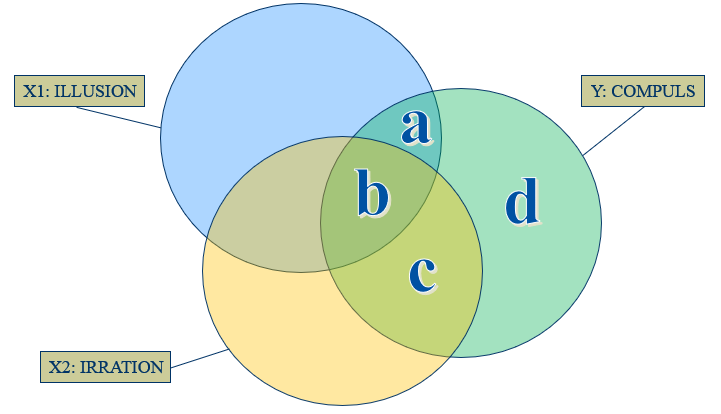
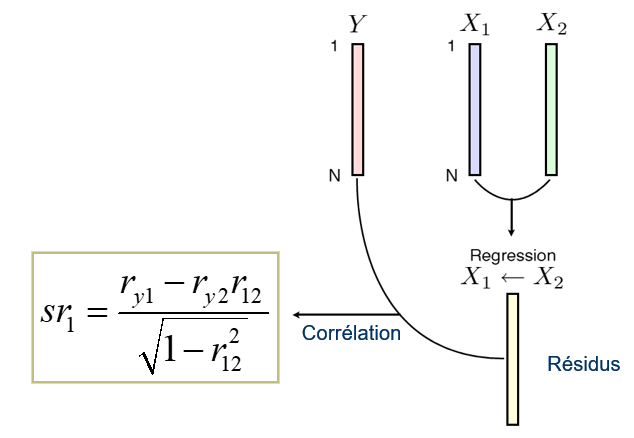
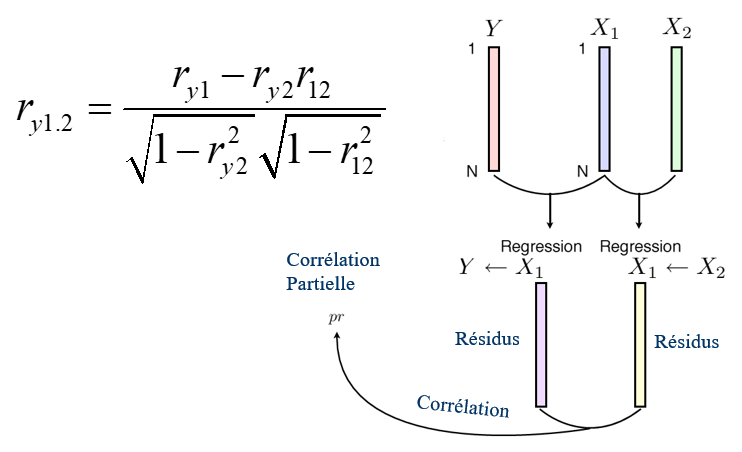

```{R}
#| echo: false
#| message: false
#| warning: false

source("global3.R")

```


```{css, echo=FALSE}
.basic {
  background-color: lightblue2;
  border: 2px solid blue;
  font-weight: bold;
}
```

# Introduction à la Régression Multiple

Dans le chapitre précédent, nous avons introduit le modèle le plus simple que l'on puisse définir pour lier une variable à une autre dans le contexte d'une recherche scientifique. Les procédures permettant de définir les paramètres d'un tel modèle et d'en évaluer les caractéristiques essentielles ont été présentées.

Ainsi, nous avons traité d’une méthode de régression permettant une analyse de la relation linéaire liant deux variables continues ($X$ et $Y$). Dans ce contexte, la variable $Y$ était dite dépendante et la variable $X$ était dite indépendante. Il s'agissait alors d'établir l'équation d'une droite de régression décrivant la relation entre ces variables et permettant la prédiction de $Y$ par $X$. Dans la présente unité, des notions similaires seront appliquées à la relation entre une variable dépendante ($Y$) et une combinaison linéaire de plusieurs variables indépendantes ($X_i$). On parlera alors de régression linéaire multiple. Il s’agit d’une méthode d’analyse qui peut paraître un peu plus complexe que la précédente, mais qui n’est de fait qu’une simple extension de cette dernière. Tous les concepts introduits dans les chapitres précédents s’appliquent également ici. C’est pourquoi, avant d’entreprendre la lecture de cette unité, une révision des concepts associés à la corrélation simple (Chapitre 4) peut s’avérer utile. 

## Objectifs:

À la fin de cette unité, l ‘étudiant devrait avoir atteint les objectifs suivants :  
  
  1.	Établir l’équation de régression multiple d’une variable dépendante en fonction de plusieurs variables indépendantes.  
  2.	Calculer les principaux indicateurs de corrélation impliquant plusieurs variable indépendantes : corrélation multiple, corrélation partielle et corrélation semi partielle.  
  3.	Interpréter adéquatement une équation de régression multiple.  
  4.	Effectuer un test de signification sur la corrélation multiple et les coefficients de régression.  

## Introduction
  
Pour débuter, nous vous proposons quelques exemples concrets d’application de la régression multiple à différentes disciplines du savoir : éducation, sociologie et psychologie.

### Exemple en éducation

Dans une commission scolaire, on désire définir un modèle liant le rendement à un examen de français du Ministère de l’Education (variable dépendante) au financement externe de l’institution ($X_1$), au degré d’enrichissement du programme ($X_2$) et au rapport entre le nombre d’élèves inscrit(e)s et le nombre de professeur(e)s dans les salles de classes ($X_3$). Pour permettre de spécifier un tel modèle, on pourra avoir recours à la régression multiple. S’il est démontré qu’une relation existe entre l’une ou l’autre des variables indépendantes (ou une combinaison de ces dernières) et la variable dépendante, alors il sera possible de prédire cette dernière en utilisant le modèle de prédiction obtenu.
 
### Exemple en sociologie

Un sociologue tente d’étudier les facteurs déterminants de la pauvreté en milieu urbain. Pour ce faire, il utilise un modèle impliquant le taux de taxation foncière ($X_1$), le montant des subventions gouvernementales au fonctionnement municipal ($X_2$) et l’âge moyen de la population ($X_3$). En étudiant les résultats d’une analyse de la régression multiple, on pourra déterminer lesquelles parmi les variables incluses dans le modèle contribuent significativement à la pauvreté. De tels résultats pourraient faciliter le développement de politiques ou d’actions susceptibles de contrer ce fléau.

### Exemple en psychologie

Supposons une situation dans laquelle un chercheur s’intéresse à la relation existant entre le degré de compulsivité d’un joueur (variable dépendante), et les trois variables indépendantes suivantes: 
  
  * le score obtenu à un test évaluant la présence de pensées irrationnelles ($X_1$)  
  * l’illusion de contrôle dans les jeux de hasard ($X_2$)  
  * le degré de scolarité du sujet ($X_3$)

C'est sur ce sujet que portera un premier exemple numérique, présenté dans le paragraphe suivant.

## Exemple numérique: les déterminants de la compulsivité dans les jeux de hasard  

Dans cette section, nous illustrons une analyse de régression multiple, prenant comme exemple une recherche visant à examiner l'impact de différentes variables quantitatives sur le degré de compulsion présent chez des individus s'adonnant à des jeux de hasard. Les données recueillies auprès d'un échantillon aléatoire composé de 40 individus fréquentant les casinos sur une base régulière sont reproduites dans le tableau @tbl-compuls.  
  
```{r}
#| label: tbl-compuls
#| echo: false

Compuls <-as.data.frame(matrix(c(
  13.00,	27.70,	13.80,	 8.00,
  14.50,	29.80,	13.20,	12.00,
  14.10,	19.40,	13.10,	 9.00,
  11.70,	25.70,	12.50,   7.00,
   9.80,	20.00,	11.60,	18.00,
   8.10,	15.40,   9.50,	11.00,
  15.10,	31.40,	13.60,	 8.00,
  15.00,	30.50,	11.40,	12.00,
  12.30,	23.20,	12.40,	10.00,
  13.90,	18.80,	16.50,	 8.00,
  15.10,	32.30,	12.10,	10.00,
  10.00,	28.10,	13.00,	 6.00,
  14.60,	21.50,	11.20,	17.00,
   7.70,	27.20,	 8.20,	17.00,
  14.00,	19.30,	11.30,	19.00,
  10.60,	21.20,	 8.40,	13.00,
  13.80,	28.00,	15.90,	11.00,
  13.90,	24.30,	10.50,	11.00,
  13.30,	31.20,	14.10,	15.00,
  14.60,	32.00,	10.50,	12.00,
  11.80,	24.90,	16.20,	 8.00,
   9.90,	19.90,	 8.60,	17.00,
  11.20,	19.30,	14.60,	 7.00,
  11.10,	28.80,	 8.30,	10.00,
  15.10,	23.20,	12.60,	10.00,
   9.40,	15.10,	12.30,	 7.00,
  14.20,	17.20,	10.80,	11.00,
  13.00,	18.70,	10.20,	19.00,
   9.40,	29.70,	10.80,	15.00,
  15.10,	19.80,	17.20,   8.00,
  14.80,	31.50,	12.20,   8.00,
   9.60,	19.80,	 9.30,	18.00,
  13.30,	18.80,	13.10,	10.00,
  11.50,	16.80,	14.70,	15.00,
   7.90,	14.40,	10.00,	 8.00,
   7.60,	18.70,	10.70,	11.00,
   9.50,	29.10,	13.70,	14.00,
  15.10,	17.70,	11.60,	16.00,
   7.60,	18.90,	 8.90,	15.00,
   9.90,	18.80,	10.20,	12.00),
  nrow=40, byrow=TRUE))
colnames(Compuls) <- c("COMPULS", "ILLUSION", "IRRATION", "SCOLAR")

Compuls %>%
  kbl(caption="Données relatives aux déterminants de la compulsivité dans les jeux de hasard") %>%
  kable_styling(bootstrap_options = c("striped", "hover", "condensed"), 
                full_width=FALSE) %>%
  row_spec(0, bold=TRUE, background="#89CFF0")  

```

  
### Description des données
  
Les statistiques descriptives pour chacune des variables sont résumées dans le tableau @tbl-compulsdesc. De l'ensemble des indices descriptifs observés, rien de très suspect n'est apparent. La faible taille de l'échantillon ne permet évidemment pas d'obtenir une perception claire de la distribution des quatre variables, mais les coefficients de variation (**CV**) sont inférieurs à 0.30 sauf dans le cas du niveau de scolarisation que dépasse légèrement ce critère d'acceptabilité. Les degrés d'asymétrie ne sont pas très élevés, et les moyennes sont voisines des médianes. Considérons donc cet ensemble de données comme approprié pour l'analyse projetée.

```{r}
#| label: tbl-compulsdesc
#| tbl-cap: "Statistiques descriptives pour les différentes variables étudiées"
#| echo: false

summarytools::st_options(descr.silent = TRUE, 
           lang="fr",
           round.digits=3,
           freq.report.nas=FALSE,
           freq.silent=TRUE,
           dfSummary.valid.col=FALSE,
           dfSummary.na.col=FALSE,
           dfSummary.graph.magnif=0.75,
           tmp.img.dir= "/tmp",
           plain.ascii= FALSE, 
           style= "rmarkdown",
           dfSummary.silent=TRUE)

tbl <- summarytools::descr(Compuls)
tbl %>%
  kbl(digits=3, caption="Statistiques descriptives") %>%
  kable_styling(bootstrap_options = c("striped", "hover", "condensed"), 
                full_width=FALSE) %>%
  column_spec(1, bold=TRUE) %>%
  row_spec(0, bold=TRUE, background="#89CFF0") 

```

### La matrice des corrélations {#sec-cormat}
  
Les corrélations observées entre chaque paire de variables sont résumées et représentées graphiquement dans la @fig-compulscor. Elles représentent le point de départ de plusieurs méthodes d'analyse impliquant plusieurs variables, dont la régression multiple.

Deux portions de cette matrice doivent être prises en considération. D'abord, pour que l'on puisse mettre en lumière l'impact d'une variable sur une autre, il est nécessaire qu'une corrélation existe entre elles. Dans le cas présent, les corrélations entre la variable dépendante (**COMPULS**) et chacune des trois variables indépendantes (**ILLUSION**, **IRRATION** et **SCOLAR**) sont aux premières loges. Ces corrélations se trouvent dans la première rangée de la matrice de corrélations, et elles sont illustrées dans la première colonne de la @fig-compulscor. On note que la corrélation entre COMPULS et ILLUSION est statistiquement significative ($r_{YX_1}=0.342, p<0.05$), de même que celle entre COMPULS et IRRATION ($r_{YX_2}=0.459, p<0.01$). Par contre, il n'y a pas évidence de relation entre COMPULS et SCOLAR ($r_{YX_3}=-0.148, p>0.05$). Il y a donc lieu de suspecter un impact de l'illusion de contrôle et de l'irrationalité sur le degré de compulsion manifesté par un joueur. Le niveau de scolarité du sujet pourrait ne pas avoir d'influence sur cette variable.

```{r}
#| label: fig-compulscor
#| echo: false
#| fig-cap: "Matrice des corrélations (portion triangulaire supérieure) et des diagrammes de dispersion (portion triangulaire inférieure). La distribution des variables est illustrée dans la diagonale principale. La signification statistique des corrélations est indiquée par des astérisques: () p > 0.05, (*) p < 0.05, et (**) p < 0.01."


pairs.panels(Compuls,
             method = "pearson", # correlation method
             hist.col = "#00AFBB",
             density = TRUE,  # show density plots
             ellipses = TRUE, # show correlation ellipses
             smooth = FALSE,
             digits = 3,
             lm = TRUE,
             cex=0.8,
             stars=TRUE,
             ci = TRUE
             )
```

La seconde portion de la matrice des corrélations qu'il convient d'examiner concerne les relations entre chaque paire de variables **indépendantes**. Ces corrélations se trouvent dans les trois rangées inférieures et les trois colonnes de droite, dans la @fig-compulscor. On note une relation très faible entre les variables ILLUSION et IRRATION, de même qu'entre ILLUSION et SCOLAR. Par contre, une relation statistiquement significative semble exister entre les variables IRRATION et SCOLAR ($r_{YX_2}=-0.465, p<0.01$). Si toutes ces corrélations étaient nulles, l'interprétation des résultats d'une analyse de régression serait grandement simplifiée. Malheureusement, une telle situation ne se présente jamais, à toute fin pratique. Il existe presque toujours un certain degré de relation entre les variables indépendantes, sans que cela ne cause vraiment de problème. Dans certains cas, par contre, des problèmes sérieux peuvent survenir lorsque de telles relations sont fortes. Ce sujet sera discuté dans le prochain chapitre.

Les informations contenues dans la matrice des corrélations ne nous fournissent pas les règles permettant de prédire la compulsivité d’un joueur à partir des prédicteurs proposés. Nous aurions pu être tentés d’effectuer trois régressions linéaires simples sur ces données : une première mettant en relief la relation entre la variable COMPULS et la variable IRRATION; une seconde mettant en relief la relation entre COMPULS et la variable ILLUSION; et finalement une dernière analyse de régression impliquant l'impact de SCOLAR sur COMPULS. Cependant, une telle procédure ne tiendrait compte que des données résumées dans la première ligne de la matrice des corrélations (COMPULS vs ILLUSION, IRRATION et SCOLAR), et négligerait l’ensemble des relations pouvant exister entre les variables indépendantes (IRRATION, ILLUSION et SCOLAR). De manière artificielle, on agirait comme s'il n'existait aucune relation entre ces dernières variables, simplifiant à outrance la situation, en rejetant des informations qui pourraient être importantes. C’est ici qu’intervient la régression multiple: elle permettra d’examiner la contribution respective de chacune des variables indépendantes et de déterminer l’équation de régression, une combinaison linéaire de l’ensemble des variables indépendantes permettant les meilleures prédictions de la variable dépendante. Elle permettra en outre de quantifier le lien entre cette combinaison linéaire et la variable dépendante, d’en vérifier la signification et de qualifier le modèle de prédiction en tenant compte de l'ensemble des informations disponibles dans la matrice des corrélations.

### Régression multiple: Géométrie

La @fig-scatterpl3D illustre la dispersion des données dans un espace tri-dimensionnel, l'ordonnée correspondant à la variable COMPULS. Dans le cas d'une régression linéaire simple, la structure géométrique que l'on ajuste aux données est une droite. Lorsqu'une seconde variable indépendante est ajoutée au modèle, la structure appropriée est un plan bi-dimensionnel, tel qu'illustré dans la @fig-scatterpl3D. L'ajout de variables indépendantes additionnelles se traduira par une structure géométrique dont le nombre de dimension est égal au nombre de variables indépendantes.


```{r}
#| label: fig-scatterpl3D
#| echo: false
#| fig-height: 20
#| fig-width: 20
#| message: false
#| warning: false
#| fig-cap: "Diagramme de dispersion illustrant la relation entre COMPULS, IRRATION et ILLUSION. L'objectif de la régression multiple est de spécifier les paramètres d'un plan résumant cette relation de manière optimale."

x = Compuls$IRRATION
y = Compuls$ILLUSION
z = Compuls$COMPULS

fit <- lm(z ~ x + y)

grid.lines = 15
x.pred     = seq(min(x), max(x), length.out = grid.lines)
y.pred     = seq(min(y), max(y), length.out = grid.lines)
xy         = expand.grid(x = x.pred, y = y.pred)

z.pred = matrix(predict(fit, newdata = xy), 
                nrow = grid.lines, ncol = grid.lines)

fitpoints = predict(fit)

scatter3D(x, y, z, pch = 19, cex = 2, col = NULL, lighting = TRUE,
          theta = 55, phi = 35, ticktype = "detailed",
          xlab = "IRRATION", ylab = "ILLUSION", zlab = "COMPULS", 
          zlim = c(5, 16), clim = c(0, 30),
          surf = list(x = x.pred, y = y.pred, z = z.pred,
                      facets = NA, fit = fitpoints), 
          main = "Diagramme de dispersion")

```  

L'objectif de l'analyse de ces données est d'ajuster la structure géométrique appropriée à l'ensemble des données, quelle que soit la dimensionalité de cette structure.

## L'équation de régression multiple
  
Dans chacune des situations décrites ci-dessus, on désire examiner l’influence d’un certain nombre de variables (indépendantes) sur une autre variable (dépendante) quantitative. Pour parvenir à cette fin, il suffit d’introduire chacune des variables dans une équation définie par un ensemble de paramètres sélectionnés de manière à respecter le critère des moindres carrés, tel que défini au Chapitre 12. Cette équation prend une forme linéaire dans laquelle la contribution de chaque variable indépendante est représentée par un coefficient de régression ($b_0$, ..., $b_k$). Ainsi, pour une population donnée, on considérera un modèle défini par une combinaison linéaire des variables indépendantes (équation @eq-regequ1.

$$
\hat Y=\beta_0 + \beta_1 X_1 + \beta_2 X_2 + ... + \beta_k X_k + \epsilon
$$ {#eq-regequ1}

Pour un échantillon tiré de cette population, on obtiendra une estimation ponctuelle de ce modèle, prenant la forme de l'équation @eq-regequ2.

$$
Y'=b_0 + b_1 X_1 + b_2 X_2 + ... + b_k X_k + e
$$ {#eq-regequ2}
  
Dans cette dernière équation,
  
  * $b_0$ représente l'intercept, c'est-à-dire la valeur de $Y'$ lorsque les valeurs de tous les X sont nulles.  
  * $b_1, ..., b_k$ représentent les pondérations accordées à chacune des k variables. Ce sont les coefficients de régression. Ces coefficients sont dits non standardisés, puisqu’ils sont déterminés à partir des scores bruts.  
  * $X_1, ..., X_k$ représentent les variables indépendantes.  
  * $Y'$ représente la valeur prédite de la variable dépendante.  
  
Le problème de la régression linéaire multiple est donc similaire à celui de la régression linéaire simple et consiste à déterminer les valeurs des coefficients $b_j$ permettant de prédire avec une précision maximale (erreur minimum) les valeurs de la variable dépendante. En d'autres termes, les coefficients $b_1, ..., b_k$ sont choisis de telle sorte que l'équation @eq-cmc soit respectée, ou encore que la corrélation entre $Y$ et $Y'$ soit maximum.  

$$\sum(Y-Y')^2=minimum$$ {#eq-cmc}


### Fondements Mathématiques de l'équation de régression multiple (**Optionnel**)
  
Le problème à résoudre est donc de déterminer la valeur des coefficients $b_0$, $b_1$, ..., et $b_k$ produisant une somme des carrés des erreurs $\left [\sum (Y-Y')^2 \right ]$ minimale. Supposons, pour fins d'illustration, que deux variables indépendantes ($X_1$ et $X_2$) composent une combinaison linéaire liée à une variable dépendante ($Y$). L'équation de régression prend alors la forme:

$$
Y'=b_0 + b_1 X_1 + b_2 X_2
$$

En accord avec le critère des moindres carrés défini par l'équation @eq-cmc, on peut re-formuler la fonction d'erreur par l'équation @eq-cmc2:

$$
\begin{align}
f(b_0,b_1,b_2) & =\sum_{i = 1}^{n} [Y_i - (b_0 + b_1 X_{i1} + b_2 X_{i2})]^2 \\
& = \sum_{i = 1}^{n}(b_0 Y_i - b_1 Y_i X_{i1} + b_2 Y_i X_{i2}))^2
\end{align}
$$ {#eq-cmc2}

Il s'agit d'une fonction du second degré qui possèdera nécessairement une valeur minimum, pour des valeurs spécifiques de $b_0$, $b_1$ et $b_2$. Pour déterminer ces valeurs, nous feront appel au calcul différentiel de manière à obtenir les dérivées partielles de $f$ par rapport à chacun des coefficients. Ces dérivées sont formulées dans l'équation @eq-deriv1:

$$
\begin{align}
\frac{\delta}{\delta b_0}f(b_0, b_1, b_2) & =2nb_0 - 2 \sum Y + 2 b_1 \sum X_1 + 2 b_2 \sum X^{2}_{2} \\
\frac{\delta}{\delta b_1}f(b_0, b_1, b_2) & =2b_1 \sum X^{2}_{1}- 2 \sum X_1 Y + 2 b_0 \sum X_1 + 2 b_2 \sum X_1 X_2 \\
\frac{\delta}{\delta b_2}f(b_0, b_1, b_2) & =2b_2 \sum X^{2}_{2}- 2 \sum X_2 Y + 2 b_0 \sum X_2 + 2 b_1 \sum X_1 X_2 
\end{align}
$$ {#eq-deriv1}

Le minimum de la fonction d'erreur $f$ s'obtient en rendant chacune de ces dérivées partielles égales à zéro et en déterminant la solution simultanée du système d'équations qui en résulte. Après reformulation, on obtient les équations suivantes @eq-eqnorm:

$$
\begin{align}
 n b_0  \quad +  (\sum X_1) b_1 \quad +  (\sum X_2) b_2 & = \sum Y   \\
 (\sum X_1)b_0 \quad + (\sum X^{2}_{1}) b_1 \quad + (\sum X_1 X_2) b_2 & = \sum X_1 Y \\ 
 (\sum X_2)b_0 \quad + (\sum X_1 X_2) b_1 \quad + (\sum X^{2}_{2}) b_2 & = \sum X_2 Y
\end{align}
$$ {#eq-eqnorm}

Ces équations sont appelées *équations normales*.  La solution simultanée de ce système permet alors de déterminer les coefficients $b_0$, $b_1$ et $b_2$ de façon à minimiser l'erreur. 

Il s’agit d’un problème simple lorsque le nombre de variables indépendantes est limité, mais qui devient vite complexe lorsque ce nombre augmente.  Le langage matriciel permet de simplifier grandement la solution de ce problème.

### Expression matricielle de la régression multiple

Formellement, les observations composant la variable dépendante sont définie par une combinaison linéaire des variables indépendantes. Ainsi,

$$
y_1  =\beta_0+\beta_1x_1+\epsilon_1 \\ 
y_2  =\beta_0+\beta_1x_2+\epsilon_2 \\ 
\vdots \\ 
y_n  = \beta_0+\beta_1x_n+\epsilon_n 
$$

ou, de manière plus concise,

$$
y_i=\beta_0+\beta_1x_i+\epsilon_i  \;\;\;\;\;\;\; \text {pour } i=1, ... , n \;\;\; \textrm{et } \epsilon_{i}\sim \textrm{N}(0,\sigma^2)
$$ {#eq-regmat}

L'algèbre matricielle facilite grandement l'application des analyses portant sur plusieurs variables, incluant la régression multiple. En effet, il est possible de trouver une solution au système d’équations normales en définissant quelques matrices contenant les ingrédients essentiels, et en appliquant quelques opérations élémentaires sur ces matrices.  Dans ce contexte, l'équation de régression prend la forme:

$$\boldsymbol{\hat y}=\boldsymbol{Xb}+\boldsymbol{\epsilon}$$ {#eq-regmat2}

où 

* $\boldsymbol{\hat y}$ est un vecteur-colonne contenant les valeurs prédites de $Y$ 

$$
\boldsymbol{y}=\left[\begin{matrix} y_1 \\ \vdots \\ y_n \end{matrix} \right] 
$$

* $\boldsymbol{b}$ est un vecteur-colonne contenant l'intercept et les coefficients de régression  

$$
\boldsymbol{b}=\left[\begin{matrix} b_0 \\ b_1 \\\vdots \\ b_p \end{matrix} \right] 
$$

* $\boldsymbol{X}$ est la matrice représentant les scores obtenus par chacun des sujets (lignes) sur chacune des variables (colonnes). De plus, **X** est augmentée d'un vecteur-colonne unité représentant l'intercept.  La matrice **X** est donc de dimension $n \times (1+p)$, où $p$ est le nombre de variables indépendantes et $n$ est le nombre de sujets ou d'observations.   

$$ 
\boldsymbol{X}= \begin{bmatrix}
1      & X_{11}    & X_{12}    & \cdots & X_{1p} \\
1      & X_{21}    & X_{22}    & \cdots & X_{2p} \\
\vdots & \vdots    & \vdots    &  & \vdots \\
1      & X_{n1}    & X_{n2}    & \cdots & X_{np} \\
\end{bmatrix}
$$

* $\boldsymbol{\epsilon}$ est un vecteur-colonne contenant les erreurs aléatoires $\left [\boldsymbol{\epsilon} \sim \textrm{N}(0,\sigma^2) \right ]$

$$
\boldsymbol{\epsilon}=\left[\begin{matrix} \epsilon_1 \\ \vdots \\ \epsilon_n \end{matrix} \right] 
$$

Rassemblant ces différents éléments, on obtient une expression matricielle de l'équation de régression:

$$
\begin{bmatrix}
y_1   \\
y_2   \\
\vdots\\
y_n   \\
\end{bmatrix}
=
\begin{bmatrix}
1      & X_{11}    & X_{12}    & \cdots & X_{1p} \\
1      & X_{21}    & X_{22}    & \cdots & X_{2p} \\
\vdots & \vdots    & \vdots    &  & \vdots \\
1      & X_{n1}    & X_{n2}    & \cdots & X_{np} \\
\end{bmatrix}
\begin{bmatrix}
b_0 \\
b_1 \\
b_2 \\
\vdots \\
b_{p} \\
\end{bmatrix}
+
\begin{bmatrix}
\epsilon_1   \\
\epsilon_2   \\
\vdots\\
\epsilon_n   \\
\end{bmatrix}
$$

$$
\boldsymbol{\hat y}=\boldsymbol{Xb}+\boldsymbol{\epsilon}
$$

Le vecteur **b** est choisi de façon à ce que la somme des carrés des résidus $[\sum (Y-Y')^2]$ soit minimum.  La fonction d'erreur ($f$) que l'on doit minimiser est donc, exprimée en termes matriciels :

$$
\begin{align}
f & =\boldsymbol{(y-\hat y)'(y-\hat y)} \\
& = \boldsymbol{(y-Xb)'(y-Xb)} \\
& = \boldsymbol{y'y-2b'X'y+b'X'Xb}
\end{align}
$$ {#eq-regequmat}

La dérivée partielle de l'équation @eq-regequmat par rapport à **b**, que l'on rend égale à 0, est:

$$
f_b'=-2(\boldsymbol{X'y})+2(\boldsymbol{X'X})\boldsymbol{b}=0
$$

d'où on trouve l'expression matricielle des équations normales:

$$(\boldsymbol{X'X})\boldsymbol{b}=\boldsymbol{X'y}$$ {#eq-eqnormmat}

Finalement, le vecteur des coefficients de régression (**b**) est donné par:

$$\boldsymbol{b}=(\boldsymbol{X'X})^{-1}(\boldsymbol{X'y})$$ {#eq-coefmat}

Ainsi, pour exprimer tout problème de régression linéaire, quel que soit le nombre de variables indépendantes, il suffira de définir trois matrices. Dans le cas où deux prédicteurs sont inclus :

$$
y = \begin{bmatrix} y_1 \\ y_2 \\ \vdots\\ y_n \end{bmatrix}, \quad
X = \begin{bmatrix}
1      & X_{11}    & X_{12}    & \cdots & X_{1P} \\
1      & X_{21}    & x_{22}    & \cdots & X_{2P} \\
\vdots & \vdots    & \vdots    &  & \vdots \\
1      & X_{n1}    & x_{n2}    & \cdots & X_{nP} \\
\end{bmatrix}, \quad
b = \begin{bmatrix}
b_0 \\
b_1 \\
b_2 \\
\vdots \\
b_{p} \\
\end{bmatrix}
$$

En pré-multipliant **X** par sa transposée **X'**, on obtient:
  
$$
\boldsymbol{X'X}=\begin{bmatrix}
1    & \dots    & 1  \\
X_{11} &  \cdots & X_{n1} \\
X_{12} &  \cdots & X_{n2} \\
\end{bmatrix}
\begin{bmatrix}
1      & X_{11}    & X_{12} \\
1      & X_{21}    & x_{22} \\
\vdots & \vdots    & \vdots \\
1      & X_{n1}    & x_{n2} \\
\end{bmatrix}
=\left[ \begin{matrix} n & \sum X_1 & \sum X_2 \\ \sum X_1 & \sum X_1^2 & \sum X_1 X_2 \\ \sum X_2 & \sum X_1 X_2 & \sum X_2^2 \end{matrix} \right] 
$$

On reconnaîtra ici les coefficients des membres de gauche des équations normales. En prémultipliant y par X’, on obtient :

$$
\boldsymbol{X'y}=\begin{bmatrix}
1    & \dots    & 1  \\
X_{11} &  \cdots & X_{n1} \\
X_{12} &  \cdots & X_{n2} \\
\end{bmatrix}
\begin{bmatrix}
y_1 \\
\vdots \\
y_n \\
\end{bmatrix}
=\left[ \begin{matrix} \sum y \\ \sum X_1 y \\ \sum X_2 y \end{matrix} \right] 
$$

On reconnaîtra ici les membres de droite des équations normales. Finalement, le vecteur des coefficients de régression peut être déterminé en appliquant l'équation @eq-coefmat.

Pour illustrer la procédure, considérons les données du tableau @tbl-compuls. Sous R, les commandes suivantes permettront de déterminer les coefficients de régression, en suivant la procédure décrite dans les paragraphes précédents.


```{r }
y <- Compuls$COMPULS                 # vecteur des valeurs observées pour la VD
X <- cbind(rep(1, nrow(Compuls)),    # vecteur constant (1), première colonne de X
           as.matrix(Compuls[, -1])) # Variables indépendantes (3 dernières colonnes)

XTX <- t(X) %*% X               # X'X
XTy <- t(X) %*% y               # X'y
b <- solve(XTX) %*% XTy         # b = (X'X)^{-1}(X'y)

```


En termes clairs, ces opérations se traduisent par:

$$`r write_matex2(round(XTX, 4))` \times `r write_matex2(round(XTy, 4))` = `r write_matex2(round(b, 4))`$$

L'équation de régression multiple recherchée est donc:

```{r echo=FALSE}

reg <- lm(COMPULS~ IRRATION + ILLUSION + SCOLAR, data = Compuls)
equatiomatic::extract_eq(reg,
                         intercept="beta",
                         use_coefs=TRUE,
                         coef_digits=3)
```

### Coefficients de régression standardisés

Supposons que les variables à l'étude sont centrées et réduites (scores Z). Sous R, la fonction **scale()** permet d'effectuer la conversion de données brutes en données standardisées. Appliquée aux données relatives à la compulsivité dans les jeux de hasard (tableau @tbl-compuls), on obtient:

```{r message=FALSE, warning=FALSE}
zdata <- scale(Compuls)
head(round(zdata, 4), 10)

```

Dans ce cas, le modèle de régression prend la forme:

$$
\boldsymbol{z_{\hat y}=z_x \beta}
$$ {#eq-regequz}

où 

* $\boldsymbol{z_{\hat y}}$ est un vecteur-colonne contenant les valeurs prédites, centrées et réduites  
* $\boldsymbol{z_x}$ représente la matrices des variables indépendantes, également centrées et réduites  
* $\boldsymbol{\beta}$ est un vecteur-colonne contenant les coefficients de régression standardisés  

La fonction matricielle que l'on doit minimiser devient alors:

$$
\begin{align}
f & =\boldsymbol{(z_y-z_{\hat y})'(z_y-z_{\hat y})} \\
& = \boldsymbol{(z_y-z_X\beta)'(z_y-z_X\beta)} \\
& = \boldsymbol{z_y'z_y-2\beta'z_x'z_y+\beta'z_x'z_x\beta}
\end{align}
$$ {#eq-regequmatz}

La dérivée partielle de cette fonction (équation @eq-regequmatz) par rapport à $\boldsymbol{\beta}$, que l'on rend égale à 0, est:

$$
f_{\beta}'=-2(\boldsymbol{z_x'z_y})+2(\boldsymbol{z_x'z_x})\boldsymbol{\beta}=0
$$

d'où on trouve l'expression matricielle des équations normales standardisées:

$$
(\boldsymbol{z_x'z_x})\boldsymbol{\beta}=\boldsymbol{z_x'z_y}
$$ {#eq-eqnormmatz}

Finalement, le vecteur des coefficients de régression ($\boldsymbol{\beta}$) est donné par:

$$
\boldsymbol{\beta}=(\boldsymbol{z_x'z_x})^{-1}(\boldsymbol{z_x'z_y})
$$ {#eq-coefmatz}

Or, on se souviendra que la moyenne des produits croisés de scores standardisés est le coefficient de corrélation:

$$
r_{xy}=\frac{\sum z_x z_y}{n}
$$

Les produits matriciels $\boldsymbol{z_x'z_x}$ et $\boldsymbol{z_x'z_y}$ sont donc proportionnels à la matrice des corrélations entre les variables indépendantes, et au vecteur des corrélations entre la variable dépendante et chacune des variables indépendantes, respectivement. On peut donc définir les coefficients de régression standardisés par l'équation @eq-eqnstd:

$$\boldsymbol{\beta=R^{-1}c}$$ {#eq-eqnstd}

où $\boldsymbol{\beta=R^{-1}}$ représente l'inverse de la matrice des corrélations entre les variables indépendantes et **c** représente le vecteur des corrélations entre la variable dépendante et chacune des variables indépendantes.

Le code R suivant met en application les équations @eq-coefmatz et @eq-eqnstd afin de montrer leur équivalence pour le traitement des données standardisées.


```{r }
y <- zdata[, 1]                    # vecteur des valeurs observées pour la VD
X <- cbind(rep(1, nrow(zdata)),    # vecteur constant (1), première colonne de X
           as.matrix(zdata[, -1])) # Variables indépendantes (3 dernières colonnes)

XTX <- t(X) %*% X               # X'X
XTy <- t(X) %*% y               # X'y
b <- solve(XTX) %*% XTy         # b = (X'X)^{-1}(X'y)

rinv <- as.matrix(solve(cor(X[, -1]))) # Inverse de Rxx
c <- cor(y,X[, -1])                    # Ryx
beta <- rinv %*% t(c)                  # Coefficients standardisés

```

Suivant l'équation @eq-coefmatz, on trouve:
  
$$`r write_matex2(round(XTX, 4))` \times `r write_matex2(round(XTy, 4))` = `r write_matex2(round(b, 4))`$$

et utilisant l'équation @eq-eqnstd, on obtient:

$$`r write_matex2(round(rinv, 4))` \times `r write_matex2(round(t(c), 4))` = `r write_matex2(round(beta, 4))`$$

L'équation de régression multiple standardisée que l'on recherche est donc:

```{r echo=FALSE}

colnames(zdata) <- c("Zcompuls", "Zirration", "Zillusion", "Zscolar")
reg <- lm(Zcompuls ~ Zirration + Zillusion + Zscolar, data = as.data.frame(zdata))
equatiomatic::extract_eq(reg,
                         intercept="beta",
                         use_coefs=TRUE,
                         coef_digits=3)
```
On note immédiatement que l'intercept ($b_0$) est nul. En effet, lorsque les scores sont standardisés, le plan de régression passe nécessairement par l'origine. 

Les équations @eq-coefmat, appliquée sur les scores bruts, non standardisés, et l'équation @eq-coefmatz, appliquée sur les scores standardisés, nous permettent d’obtenir deux équations de régression distinctes. Dans le premier cas (équation @eq-coefmat), on fait appel aux scores bruts observés pour chacune des variables. De ce fait, la valeur des coefficients variera en fonction de l’unité de mesure utilisée et par conséquent, ne sont pas directement comparables les uns par rapport aux autres.  Le fait de passer d’une mesure de longueur métrique à une mesure impériale changera la valeur des coefficients obtenus, par exemple. En conséquence, dans une équation de régression, un coefficient égal à 100.27 pourrait ne pas être significatif, alors qu’un coefficient égal à 0.005 pourrait l’être. Tout dépend de l’unité de mesure utilisée pour la variable correspondante.   Dans le second cas (équation @eq-coefmatz), on fait appel aux scores centrés et réduits (scores z) pour chacune des variables. Les coefficients $\beta$ obtenus indiquent la variation au niveau de la variable dépendante (exprimée en unités d’écart-type) pour chaque variation d’un écart-type produit au niveau de la variable indépendante correspondante, alors que les effets de toutes les autres variables indépendantes sont maintenues constantes. Puisque l’unité de mesure utilisée pour chaque variable est la même, on obtient des coefficients qui sont directement comparables les uns par rapport aux autres. Dans ce cas, un coefficient de régression égal à 0.8 est plus important (ou indique une contribution plus forte) qu’un autre égal à 0.2. La standardisation des coefficients est un outil important pour l’interprétation des résultats d’une régression multiple.


### Fonction **lm()**

Le premier objectif d'une régression multiple est donc l'estimation des paramètres du modèle linéaire proposé, défini par une équation telle que:

```{r echo=FALSE}
library(equatiomatic)
reg <- lm(COMPULS ~ IRRATION + ILLUSION + SCOLAR, data = Compuls)
extract_eq(reg,
           intercept="beta",
           use_coefs=FALSE)
```
Ces paramètres sont l'intercept ($\beta_0$), les coefficients associés à chacune des variables indépendantes ($\beta_1, \beta_2, ..., \beta_p$), et la variance d'erreur ($\sigma_{\epsilon}$).  Sous R, la commande **lm()** permet d'obtenir ces quantités, de même que les statistiques pertinentes. Les arguments de cette fonction sont:  
  
* Le modèle proposé: le nom de la variable dépendante, le symbole '**~**', suivi des noms des variables indépendantes séparées par le symbole '**+**'  
* La source des données: le nom de la structure contenant les différentes variables analysées  (data.frame, matrice), s'il y a lieu.  

Pour les données du tableau @tbl-compuls, on obtient l'équation de régression:

```{r}

reg <- lm(COMPULS ~ IRRATION + ILLUSION + SCOLAR, data = Compuls)
reg

```
Tel qu'obtenu précédemment, 

```{r echo=FALSE}

library(equatiomatic)

extract_eq(reg,
           intercept="beta",
           use_coefs=TRUE,
           coef_digits=3)
```


Pour obtenir l'équation de régression standardisée, il suffit d'appliquer la procédure sur les scores standardisés:


```{r message=FALSE, warning=FALSE, echo=2:4}
library(jtools)
zdata <- as.data.frame(scale(Compuls))
reg <- lm(COMPULS ~ IRRATION + ILLUSION + SCOLAR, data = zdata)
reg


```

### Interprétation des coefficients de régression

L'équation de régression multiple peut servir à la prédiction de Y à partir d'un ensemble de variables indépendantes, à l'intérieur des limites fixées par l'étendue de chacune des variables indépendantes. Les coefficients $b_1 ... b_p$ sont des coefficients nets, dans le sens où ils mesurent l'effet d'une variable indépendante sur la variable dépendante, **en contrôlant** les effets des autres variables indépendantes. 

Un exemple, tiré de Younger (1979), suffira à illustrer ce point.  Supposons qu'une analyse de régression multiple ait été menée de façon à spécifier la fonction liant le prix d'une maison (Y) à la dimension de la maison en 1000 pieds carrés (X1) et à l'âge de la maison (X2).  L'équation obtenue est :

				$$Y' = 10.05 + 12.83 X_1 + .06 X_2$$

L'intercept du plan bidimensionnel de régression (10.05) est la valeur de Y lorsque la valeur de chacune des variables indépendantes est nulle.  Dans le cas présent, il représente le coût de base d'une maison lorsque son âge et sa dimension sont nulles. Il s’agirait par exemple, des frais juridiques liés à l’achat d’une maison, les taxes de mutation, les frais de crédit, les frais d’arpentage, ou tout autre facteur non spécifié mais indépendant de la grandeur ou de l'âge de la maison.

Le coefficient de X1 (12.83) indique que pour des maisons du même âge (i.e. X2 constant), il en coûtera en moyenne \$12,830.00 par unité de grandeur (1000 pi2).  Finalement, le coefficient de X2 ( .06) indique que pour deux maisons de même grandeur, si l'une est d'un an plus vieille que l'autre, elle coûtera en moyenne $60.00 de moins. 

De la même façon, on peut interpréter l’équation de régression obtenue dans l’exemple ayant servi à l’introduction de ce chapitre.  Cette équation était:

$$Y’ = 0.6885 + 0.1367 X_1 + 0.5940 X_2 + 0.0903 X_3$$

Dans ce cas, l’intercept représente le degré de compulsivité d’un individu ayant obtenu un résultat de zéro aux tests évaluant «l’illusion de contrôle» et les «pensées irrationnelles» et qui n’aurait jamais fréquenté l’école. Il s’agit évidemment d’un cas peu probable et qui ne doit pas être pris au sens propre. En effet, les variables sont au mieux mesurées sur une échelle d’intervalle et ne présentent qu’une valeur nulle arbitraire. En conséquence, l'intercept ne représente qu'une valeur nécessaire pour minimiser la fonction d'erreur. 

D’autre part, le coefficient correspondant à l’illusion de contrôle (X1) indique que chez les individus partageant le même niveau de scolarité et le même niveau de pensée irrationnelle, la compulsivité augmentera de 0.137 unité pour chaque augmentation d’une unité d’illusion de contrôle.  De même, pour les individus partageant le même score concernant l’illusion de contrôle et le même niveau de scolarité une augmentation d’une unité au niveau des pensées irrationnelles se traduira en moyenne par une augmentation de 0.594 unité dans le score de compulsivité.

Par rapport à la situation initiale où nous ne disposions que d’une matrice de corrélations, cette équation de régression nous permet de quantifier l’influence que chacune des variables indépendantes a sur la variable dépendante. De plus, cette équation permet de prédire le degré de compulsivité d’un joueur à partir d’une combinaison linéaire des variables indépendantes.

### Le coefficient de corrélation multiple
  
Le calcul de l’équation de régression ne nous renseigne pas sur la qualité de l’ajustement des données à notre modèle.  Pour ce faire, nous pourra considérer la proportion de la variance totale de la variable dépendante que l'on peut expliqué à l'aide de l’équation de régression.  Cette équation constitue le meilleur modèle mathématique, celui qui réduit au minimum les erreurs de prédiction. Mais obtenir le minimum d'une fonction d'erreur ne signifie en rien que l'ajustement est bon. Et effectivement, cet ajustement est rarement parfait, et lorsqu'il l'est, c'est que la relation mise en évidence est généralement triviale. 

Un premier indice de la qualité de l'ajustement, supposant la linéarité de la relation entre la variable dépendante ($Y$) et la combinaison linéaire des variables indépendantes ($Y'$), est la corrélation entre ces deux éléments:le coefficient de corrélation multiple, $R_{y.1...p}$. Pour obtenir cet indice, on pourra déterminer l'équation de régression, et utiliser cette dernière pour calculer les scores prédits pour chaque observation. La corrélation de Bravais-Pearson (voir Chapitre 4) entre $Y$ et $Y'$, dont la valeur sera toujours comprise entre 0 et 1, est la corrélation multiple recherchée.

Tel qu'indiqué dans le paragraphe @sec-cormat, la première étape dans l'étude des relations existant entre plusieurs variables consiste à former une matrice de corrélations. Cette matrice, généralement notée **R**, est nécessairement symétrique et contient les corrélations entre chaque paire de variables. Pour les données du tableau @tbl-compuls, on obtient :

$$  
\textbf{R}=\left [ \begin{matrix} 1.000 & 0.342 & 0.459 & -.148 \\ 0.342 & 1.000 & 0.132 & -.132 \\ 0.459 & 0.132 & 1.000 & -.465 \\ -.148 & -.132 & -.465 & 1.000 \end{matrix}  \right ] 
$$
  
Les valeurs contenues dans cette matrice indiquent la force de la relation liant chaque paire de variables. On y apprend, par exemple, que la corrélation entre $X_1$ et $X_2$ est égale à 0.132, et que celle entre $Y$ et $X_1$ est égale à 0.348. Par contre, cette matrice n'indique rien quant à la relation pouvant exister entre la variable dépendante ($Y$) et la combinaison linéaire des variables indépendantes définie par l’équation de régression. La mesure qui permet de quantifier cette dernière relation est le coefficient de corrélation multiple, noté $R_{y.12...p}$. On pourrait obtenir cette valeur en déterminant la valeur prédite de $Y$ ($Y'$) pour chacun des sujets à l'aide de l'équation de régression et en calculant ensuite le coefficient de corrélation de Bravais Pearson entre $Y$ et $Y'$. Dans ce cas, $R_{y.12...p}$ est donné par l'équation @eq-cormult:


$$
R_{y.12...k}=\frac{\sum\limits_{i=1}^{n}{(Y-\overline Y)(Y'-\overline Y)} }{\sqrt{\sum\limits_{i=1}^{n}{(Y-\overline Y)^2\sum\limits_{i=1}^{n}{(Y'-\overline Y)^2} } }}
$$ {#eq-cormult}

On reconnaît dans cette équation le coefficient de corrélation de Bravais-Pearson, tel que défini au Chapitre 4, appliqué sur la variable dépendante ($Y$) et les valeurs prédites à partir de la combinaison linéaire des variables indépendantes ($Y'$).

Le code R suivant procède suivant cette approche pour obtenir la corrélation multiple liant COMPULS à une combinaison linéaire formée à partir de ILLUSION, IRRATION et SCOLAR.

```{r}
R <- cor(Compuls$COMPULS, reg$fitted.values)
cat("Corrélation Multiple = ", R)
```

Une formulation alternative et parfaitement équivalente, qui a l'avantage d'être plus explicite quant à la signification de $R_{y.12...k}$, prend la forme de l'équation @eq-cormult2:
  
$$
\begin{align}
R_{y.12\ldots k}^{2} & = \frac{\sum\limits_{i=1}^{n}(Y_i-\overline{Y})^{2} - \sum\limits_{i=1}^{n} (Y_i-{Y_i}')^{2}}{\sum\limits_{i=1}^{n} (Y_i-\overline{Y_i})^{2}}  \\ 
 & = \frac{(SC_{total}-SC_{r\acute{e}sidu})}{SC_{total}}  \\ 
 & = \frac{SC_{r\acute{e}gression}}{SC_{total}}  
\end{align}
$$ {#eq-cormult2}

Cette dernière valeur est le **coefficient de détermination multiple**, exprimant le pourcentage 
de la variabilité totale de $Y$ que l'on peut expliquer à l'aide de la combinaison linéaire des variables indépendantes, $Y'$. La racine carrée de cette valeur est le coefficient de corrélation multiple. 

```{r}
reg <- lm(COMPULS ~ IRRATION + ILLUSION + SCOLAR, data = Compuls)
moyy <- mean(Compuls$COMPULS)
SCreg <- sum((reg$fitted.values - moyy)^2)
SCtot <- (nrow(Compuls)-1) * var(Compuls$COMPULS)
R2 <- SCreg / SCtot
cat("Coefficient de détermination multiple = ", R2)
cat("Coefficient de corrélation multiple   = ", sqrt(R2))
```

Utilisant la notation matricielle, le coefficient de détermination multiple est défini par l'équation @eq-r2mat:

$$
R_{y.12...p}^{2}=\boldsymbol{c'R^{-1}c}
$$ {#eq-r2mat}

```{r echo=FALSE}
rinv <- solve(cor(X[, -1]))
r2 <- summary(reg)$r.squared
```


Pour les données sous examen, on obtient:
$$`r write_matex2(round(c, 4))` \times `r write_matex2(round(rinv, 4))` \times `r write_matex2(round(t(c), 4))`= `r round(r2, 4)`$$
Finalement, étant donné l'équation @eq-eqnstd, il est possible de définir $R_{y.12...k}$ à partir du vecteur $\boldsymbol{\beta}$ regroupant les coefficients de régression standardisés:

$$
R_{y.12...k}=\boldsymbol{c'\beta}=\boldsymbol{\beta'c}
{#eq-r2beta)
$$

Ainsi,

$$R_{y.12...k}=`r write_matex2(round(c, 4))` \times `r write_matex2(round(beta, 4))` = `r write_matex2(round(t(beta), 4))`\times `r write_matex2(round(t(c), 4))`= `r round(r2, 4)`$$

La @fig-cormult illustre cette corrélation.


```{r}
#| label: fig-cormult
#| echo: false
#| message: false
#| warning: false
#| fig-cap: "Diagramme de dispersion illustrant la corrélation multiple entre COMPULS et une combinaison linéaire formée à partir de IRRATION, ILLUSION et SCOLAR"
#| fig-width: 8
#| fig-height: 5

df2 <- data.frame(Compuls$COMPULS, reg$fitted.values)
ggplot(data=df2, aes(x=Compuls$COMPULS, y=reg$fitted.values)) +
        geom_smooth(method="lm") +
        geom_point(col="black", cex=2) +
        stat_cor(aes(label=..rr.label..), label.x=8, label.y=14, cex=6, col="red") +
        xlab("COMPULS (Y observés)") + ylab("COMPULS' (Y prédits)")
```

Une première propriété de $R_{y.12...k}$ est qu'étant donné sa nature (corrélation entre $Y$ et $Y'$), sa valeur est toujours comprise entre 0 et 1. En d'autres termes, le coefficient de corrélation multiple est toujours positif. 

Une seconde propriété de $R_{y.12...k}$ est que sa valeur est toujours au moins aussi grande que la plus grande corrélation simple entre $Y$ et les variables indépendantes. Ainsi, le fait d'ajouter des variables indépendantes au modèle de régression améliore toujours la valeur de $R_{y.12...k}$. Cependant, cette amélioration n'est pas nécessairement significative.


### Le coefficient de détermination: ses limites

À tort ou à raison, le coefficient de détermination est un indice fréquemment utilisé sous une forme ou une autre, dès que l'on met en rapport une variable dépendante à une ou plusieurs variables indépendantes. Cependant, il faut demeurer prudent dans son interprétation lorsque le modèle inclut plusieurs variables indépendantes (**le problème ne se pose pas dans le cas de la régression linéaire simple**). En effet:

* Le coefficient de détermination augmente chaque fois qu'une variable indépendante s'ajoute au modèle, peu importe la source de la relation existant entre elle et la variable dépendante (fortuite, causale, forte ou faible). La seule manière de le diminuer est d'en retirer une. Ainsi, l'ajustement d'un modèle peut sembler excellent simplement parce qu'il contient un grand nombre de paramètres, même si certains d'entre eux ne sont pas statistiquement significatifs. Le modèle résultant n'adhère pas au principe de parcimonie, ce qui n'est pas une bonne chose! 

* Lorsqu'un modèle contient un grand nombre de variables indépendantes, il risque fort de réfléter les caractéristiques de l'échantillon plutôt que des relations réelles entre les VIs et la VD. Le coefficient de détermination peut être très élevé pour cause de **sur-ajustement**, alors que les prédictions deviennent de plus en plus aléatoires.

#### Le coefficient de détermination ajusté

Pour contrer l'impact du nombre de variables indépendantes sur la valeur du coefficient de détermination, on corrige $r^2$ en le pénalisant pour la complexité du modèle. Cette correction implique le nombre de degrés de liberté, tel que manifeste dans l'équation @eq-r2adj:

$$
\begin{align}
r_{ajusté}^2 & = 1-\left [\frac{(1-R_{y.12...p})(n-1)}{n-p-1} \right ] ~~~~~~p=nombre~~de~~VIs \\
& = 1-\left[\frac{SC_{Résidu}/dl_{Résidu}}{SC_{Total}/dl_{Total}} \right] \\
& = 1-\frac{CM_{Résidu}}{s_y^2}
\end{align} 
$$ {#eq-r2adj}

$r_{Ajusté}^2$ impose une pénalité pour un modèle linéaire inutilement complexe. Il sera toujours plus petit que $r^2$, sauf si le $p=1$ (régression linéaire simple). La réduction observée sera fonction du nombre de paramètres non-significatifs inclus dans le modèle.

Notons que les réserves évoquées concernant le coefficient de détermination non-ajusté restent d'actualité pour la version ajustée.

#### Le coefficient de détermination de prédiction

```{r eval=FALSE, echo=FALSE}
https://statisticaloddsandends.wordpress.com/2018/07/30/the-press-statistic-for-linear-regression/
  https://statisticaloddsandends.wordpress.com
```


Une autre version du coefficient de détermination existe, avec une pertinence particulière pour les cas où l'objectif de la régression est la prédiction. Le coefficient de détermination de prédiction permet d'évaluer dans quelle mesure un modèle est apte à fournir des prédictions justes. La procédure de calcul de ce coefficient permettra de saisir sa nature:

* Chaque observation est retirée de l'ensemble des données, une à la fois  
* On obtient l'équation de régression en utilisant les données qui restent  
* À l'aide de ce modèle, on prédit la donnée qui a été éliminée  
* On prend note de la différence entre la valeur prédite et la valeur actuelle.
* La somme des carrés résiduelle prédite (PRESS: *Predicted REsidual Sum of Squares*) est obtenue à partir de ces différences:

$$PRESS=\sum\limits_{i=1}^{n}{(y_i-y_{i,-i}')^2} $$

La statistique PRESS nous informe sur le potentiel de généralisation d'un modèle de régression: une valeur élevée indique que les prédictions sont dépendantes des caractéristiques de l'échantillon, ce qui réduit les possibilités de généraliser le modèle à des données autres que celles composant l'échantillon. Cette mesure peut aussi être utilisée pour la sélection d'un parmi plusieurs modèles de régression: le modèle produisant la plus petite valeur de PRESS devrait être préféré. Les valeurs faibles de $PRESS$ indiquent que le modèle n'est pas sérieusement affecté par une observation particulière. 

Finalement, le $R_{Pred}^2$ est définie par l'équation @eq-press:

$$
R_{Pred}^2=1-\left( \frac{PRESS}{SC_{Total}} \right)
$$ {#eq-press}

La différence entre $R_{Ajusté}^2$ et $R_{Pred}^2$ ne devrait pas dépasser 0.2 pour qu'on puisse les considérer *concordants*. Dans le cas contraire, la qualité prédictive du modèle est douteuse. 

Par exemple, supposons un modèle produisant $R^2=0.76$ et un $R_{pred}^2=0.56$. La différence entre ces deux quantités, $R^2-R_{pred}^2=0.20$ indique que 20% de la variabilité de la variable dépendante est expliqué par trop de facteurs et de corrélations aléatoires, que l'on aurait attribué à notre modèle si on ne se fiait qu'au $R^2$! Lorsque le modèle est parcimonieux, cette différence est faible...

Les fonctions **Press()** (@lst-Press) et **pred_r_squared()** (@lst-pred_r_squared) permettent le calcul de ces deux statistiques, sous R. Pour les données à l'étude, on obtient:

```{r }
reg <- lm(COMPULS ~ IRRATION + ILLUSION + SCOLAR, data=Compuls)
pr2 <- pred_r_squared(reg)
r2 <- summary(reg)$r.squared
cat("R2 Prédit = ", pr2)
cat("R2        =" , r2)
cat("Différence = ", r2 - pr2)

```

Ainsi, environ 15% de la variabilité de COMPULS pourrait s'expliquer par trop de facteurs ou des corrélations aléatoires. Des analyses antérieures, on sait que la variable SCOLAR contribue peu à la régression. Après son retrait du modèle, on obtient:

```{r}
reg <- lm(COMPULS ~ IRRATION + ILLUSION, data=Compuls)
pr2 <- pred_r_squared(reg)
r2 <- summary(reg)$r.squared
cat("R2 Prédit = ", pr2)
cat("R2        =" , r2)
cat("Différence = ", r2 - pr2)
```

Cette fois, la différence $R^2-R_{pred}^2=0.1035$, réflétant maintenant un modèle plus parcimonieux et possédant de meilleurs qualités prédictives.

La fonction $PRESS()$ de la librairie **qpcR** permet également le calcul de ces quantités:

```{r eval=FALSE}
library(qpcR)

reg <- lm(COMPULS ~ IRRATION + ILLUSION + SCOLAR, data=Compuls)
res <- PRESS(reg)
cat("PRESS = ", res$stat)
# cat("Valeurs résiduelles (PRESS): \n", reg$residuals)
cat("R2(Pred) = ", res$P.square)

```


```{r eval=FALSE, echo=FALSE}

http://faculty.cas.usf.edu/mbrannick/regression/Part3/Partials.html 
http://faculty.cas.usf.edu/mbrannick/regression/Partial.html

https://www.google.com/url?sa=t&rct=j&q=&esrc=s&source=web&cd=&cad=rja&uact=8&ved=2ahUKEwjFl8z6zqn1AhX_HDQIHbUjAu8QwqsBegQIAhAB&url=https%3A%2F%2Fwww.youtube.com%2Fwatch%3Fv%3DOpAf4N582bA&usg=AOvVaw1-6ZaZW9WSAM3WlQDfLGFD
https://www.google.com/url?sa=t&rct=j&q=&esrc=s&source=web&cd=&cad=rja&uact=8&ved=2ahUKEwjFl8z6zqn1AhX_HDQIHbUjAu8QwqsBegQIDhAB&url=https%3A%2F%2Fwww.youtube.com%2Fwatch%3Fv%3DTKRdp4qiCPs&usg=AOvVaw2xAOMB-WZb1EEEZaDMATmx

https://rpubs.com/KwonPublishing/249631

https://github.com/easystats/correlation/tree/73471db03fe91accf9f32c102dfa5041c26564dc 

https://github.com/easystats
# LIVRE INTÉRESSANT!
http://web.vu.lt/mif/a.buteikis/wp-content/uploads/PE_Book/
```


### Dispersion des données autour du plan de régression

À ce stade, nous disposons des outils qui nous permettent d'obtenir les coefficients composant l'équation de régression. On se souviendra que cette équation fournit les valeurs **attendues** de la variable dépendante pour différentes valeurs des variables indépendantes.  La dispersion des données dans l'espace multi-dimensionnel, de part et d'autre du plan de régression, est quantifiée par l'erreur-standard d'estimation. Il s'agit essentiellement de l'écart-type des valeurs résiduelles.  

Les valeurs résiduelles sont les écarts ou distances séparant une valeur de la variable dépendante et le plan de régression défini par l'équation de régression, tel qu'illustré dans la @fig-scatterpl3D. Ainsi,

```{r echo=FALSE}
reg <- lm(COMPULS ~ IRRATION + ILLUSION + SCOLAR, data = Compuls)
b <- reg$coefficients
```
$$
\boldsymbol{\beta} = \begin{bmatrix}
`r b[1]`    \\
`r b[2]`    \\
`r b[3]`    \\
`r b[4]`    \\
\end{bmatrix}
$$

Le modèle de régression permettant de déterminer les valeurs attendues ou prédites de COMPULS étant:

$$
\boldsymbol{\hat{y}} = \boldsymbol{X\beta}
$$

on obtient le vecteur de ces valeurs:

$$
\hat{y} = \begin{bmatrix} \hat{y}_1 \\ \hat{y}_2 \\ \vdots\\ \hat{y}_n \end{bmatrix}
$$

et finalement, on calcule:

$$
\boldsymbol{e} 
= \begin{bmatrix} y_1 \\ y_2 \\ \vdots\\ y_n \end{bmatrix} - \begin{bmatrix} \hat{y}_1 \\ \hat{y}_2 \\ \vdots\\ \hat{y}_n \end{bmatrix}
= \begin{bmatrix} e_1 \\ e_2 \\ \vdots\\ e_n \end{bmatrix} 
$$
  
La variance des valeurs résiduelles est donnée par l'équation suivante:
  
$$s_e^2 = \frac{\sum\limits_{i=1}^{n} (y_i - \hat{y}_i)^2}{n - p - 1} = \frac{\boldsymbol{e'e}}{n-p-1} $$

Notons que la seule différence par rapport à la définition que nous avons données dans le contexte d'une régression linéaire simple se trouve au dénominateur. Ici, $p$ représente le nombre de variables indépendantes, chacune étant associée à un coefficient, et on y ajoute le vecteur constant représentant l'intercept. En régression linéaire simple, on considère 2 paramètres et le dénominateur est **(n-2)**, alors que dans une régression multiple, on trouve $p + 1$ paramètres et le dénominateur et **(n-p-1)**. Pour l'exemple traité dans ce chapitre, il sera **(n - p - 1) = (40 - 3 - 1)= 36**. 

La racine carré de $s_e^2$ est l'erreur-standard d'estimation, qui prend une valeur comprise entre 0, lorsque la corrélation multiple est égale à 1.0, et la variance de la variable dépendante ($s_y^2$), lorsque cette corrélation est nulle.

Pour les données du tableau @tbl-compuls, on obtient:

```{r echo=43:46}
Compulsion <- Compuls$COMPULS
CompulsPred <- reg$fitted.values
Resid <- Compulsion - CompulsPred
tbl <- cbind(Compulsion, CompulsPred, Resid )

tbl %>%
  kbl(caption="Valeurs observées, valeurs prédites, et valeurs résiduelles",
      digits=3) %>%
  kable_styling(bootstrap_options = c("striped", "hover", "condensed"), 
                full_width=FALSE) %>%
  row_spec(0, bold=TRUE, background="#89CFF0")  
```
L'erreur-standard d'estimation est donc:

```{r}
ese <- sqrt(sum(Resid^2) / (40 - 3 - 1))
cat("Erreur-Standard d'Estimation = ", ese)
```
Sous R, on obtient cette quantité en examinant les résultats de l'application de la fonction **lm()**:

```{r}

reg <- lm(COMPULS ~ IRRATION + ILLUSION + SCOLAR, data = Compuls)
ese <- summary(reg)$sigma
cat("Erreur-Standard d'Estimation = ", ese)
```

À ce stade, nous disposons d'une description complète de la relation entre une variable dépendante et une combinaison linéaire de variables indépendantes. Nous connaissons  la *tendance centrale*, l'équation de régression, la *dispersion*, quantifiée par $s_{y.12...p}$, et avons une idée de la forme de la relation en examinant le diagramme de dispersion Y vs Y'.  Mais le travail n'est pas terminé: nous n'avons obtenu que des statistiques échantillonnales. Ces statistiques sont autant d'estimateurs des paramètres correspondants au niveau de la population, éléments centraux auxquels l'analyse statistique des données s'intéressent.

### Corrélation partielle et semi-partielle

La corrélation multiple nous informe sur la relation existant entre la variable dépendante ($Y$) et la combinaison linéaire des variables indépendantes ($\boldsymbol{X}$). Il s'agit d'un indice important dans un contexte de régression multiple, mais il est souvent nécessaire d'examiner la relation entre la variable dépendante et une variable indépendante particulière, en contrôlant l'influence qu'une ou plusieurs autres variables pourrait avoir soit sur X, soit sur X et sur Y. Les corrélations *partielles* et *semi-partielles* remplissent ce rôle.

Pour les fins de la discussion, considérons la @fig-VarDecomp2.

```{r}
#| label: fig-VarDecomp2
#| fig-cap: "Portions distinctes de la variabilité de Y expliquées par différentes composantes"
#| echo: false


```

Dans cette figure, chaque cercle représente la variabilité d'une variable particulière. Dans le cas de la variable dépendante (COMPULS), on distingue différentes portions de sa variabilité, chacune pouvant s'expliquer par l'une ou l'autre, ou une combinaison, des variables indépendantes (IRRATION et ILLUSION):
  
* **a**: portion de la variabilité de COMPULS que l'on peut expliquer de manière **unique** par la variable ILLUSION  
* **b**: Portion de la variabilité de COMPULS que l'on peut expliquer par ILLUSION **et** par IRRATION  
* **c**: portion de la variabilité de COMPULS que l'on peut expliquer de manière **unique** par la variable IRRATION  
* **d**: portion de la variabilité de COMPULS qui demeure inexpliquée. Elle correspond à $1-R_{y.12}$, la négative du coefficient de détermination multiple.  
* **a+b+c**: L'ensemble de ces trois zones correspond au coefficient de détermination multiple  
* **a+b**: portion de la variabilité de COMPULS que l'on peut expliquer par ILLUSION, seule ou en partenariat avec IRRATION. Cette zone correspond au coefficient de détermination que l'on obtiendrait dans une régression linéaire simple COMPULS ~ ILLUSION  
* **b+c**: portion de la variabilité de COMPULS que l'on peut expliquer par IRRATION, seule ou en partenariat avec ILLUSION. Cette zone correspond au coefficient de détermination que l'on obtiendrait dans une régression linéaire simple COMPULS ~ IRRATION    
* **a / d**: portion de la variabilité de COMPULS que l'on peut expliquer par IRRATION, lorsque l'effet de ILLUSION à la fois sur COMPULS et sur IRRATION est contrôlé  
* **b / d**: portion de la variabilité de COMPULS que l'on peut expliquer par ILLUSION, lorsque l'effet de IRRATION à la fois sur COMPULS et sur ILLUSION est contrôlé 

Ces différentes composantes sont à la base de la définition des corrélations partielles et semi-partielles.

#### Corrélation semi-partielle

La corrélation semi-partielle, notée $R_{y(1.2)}$, indique la corrélation entre $Y$ et $X_1$, en contrôlant l'influence que pourrait avoir $X_2$ (ou toute autre variable, ou plusieurs d'entre elles!) sur $X_1$ seulement. L’importance d’une variable au sein d'un modèle est proportionnelle à la valeur de cette corrélation, et le carré de cet indice indique la proportion de la variance totale de $Y$ qui est expliquée d’une manière UNIQUE par un prédicteur donné, donc nous informe sur l'utilité de ce prédicteur dans le modèle proposé.

Dans la @fig-VarDecomp2, le carré de la corrélation semi-partielle correspond aux zones **a** et **c**, respectivement pour la relation entre COMPULS et ILLUSION (contrôlant IRRATION) et entre COMPULS et IRRATION (contrôlant ILLUSION).

L'équation @eq-rspart définit formellement le coefficient de corrélation semi-partielle, dans une situation où $Y$ est lié à deux variables indépendantes ($X_1$ et $X_2$).

$$
R_{y(1.2)}=\frac{r_{y1}-r_{y2}r_{12}}{\sqrt{1-r_{12}^2}}
$$ {#eq-rspart}

Ce coefficient correspond essentiellement à la corrélation entre $Y$ et les valeurs résiduelles obtenues en régressant $X_1$ sur $X_2$, comme le montre la @fig-spr.


```{r}
#| label: fig-spr
#| fig-cap: "Illustration de la corrélation semi-partielle"
#| fig-width: 6
#| fig-height: 8
#| echo: false


```


Pour illustrer, le code R suivant produit le coefficient de corrélation semi-partielle liant la COMPULS à IRRATION ($X_2$), contrôlant pour ILLUSION $X_1$:

```{r}
# Régression de IRRATION sur ILLUSION
reg <- lm(ILLUSION ~ IRRATION, data=Compuls)
# Extraction des valeurs résiduelles
res <- reg$residuals
# Calcul de la corrélation semi-partielle
rsp <- cor(Compuls$COMPULS, res)
cat("Corrélation semi-partielle = ", round(rsp, 4))

```
Les valeurs résiduelles obtenues à la première étape représentent l'annulation de l'influence de ILLUSION sur la variable IRRATION. Ainsi, la corrélation entre COMPULS et ces valeurs résiduelles fournit une indication de la relation entre COMPULS et IRRATION, libre de toute influence de la variable ILLUSION.

La librairie **ppcor** offre la fonction **spcor()** permettant le calcul de la corrélation semi-partielle impliquant un nombre illimité de variables et des tests de signification correspondants. Pour les données du tableau @tbl-compuls, si limitant aux variables COMPULS, IRRATION et ILLUSION, on obtient:

```{r messate=FALSE, warning=FALSE}
library(ppcor)
spr <- spcor(Compuls[, 1:3])

spr$estimate
spr$p.value

```
On peut y lire que la corrélation semi-partielle entre COMPULS et IRRATION (première ligne, troisième colonne de la première portion), contrôlant pour l'influence de ILLUSION sur IRRATION est égale à 0.4169, tel que calculé précédemment. La seconde partie de l'affichage indique les probabilités d'obtenir une telle valeur, en supposant qu'au niveau de la population, elle est nulle. On trouve donc que la corrélation semi-partielle observée est statistiquement significative, pour $\alpha = 0.05$ ($p=0.0083$).

Considérons la corrélation semi-partielle entre COMPULS et ILLUSION, qui est égale à 0.2842. Le carré de cette quantité, 0.081 indique que seulement 8.1% de la variabilité totale de COMPULS est expliqué de manière unique par la variable ILLUSION. En comparaison, la variable IRRATION explique 17.4% de cette variabilité. On peut donc conclure que la contribution de la variable IRRATION à l'explication de COMPULS est plus importante que celle de la variable ILLUSION. 

#### Corrélation partielle

Le coefficient de corrélation partielle mesure aussi le degré de relation entre deux variables lorsque les effets d’autres variables sont contrôlés. Par contre, il s'agit cette fois de la corrélation entre $Y$ et une variable indépendante donnée ($X_j$), en éliminant l'influence que les autres variables indépendantes pourraient avoir sur $X_j$ **et** sur $Y$. 

On peut illustrer la nature de cette mesure en rappelant un diagramme présenté à la fin du chapitre 4, répété ici:

```{r echo=FALSE, fig.cap="Corrélation due à une cause commune: la relation existant entre X et Y est le résultat de l'effet conjoint de Z sur X et Y. Si on contrôle Z en fixant sa valeur, la relation entre X et Y devient nulle.", message=FALSE, warning=FALSE, fig.height=7, fig.width=10}
library(diagram)
plot(NA, NA,
     xlim=c(0,1),
     ylim=c(0,1),
     xaxt="n",
     yaxt="n",
     frame.plot=FALSE,
     xlab="",
     ylab="")

text(0.5, 0.75, "Z", cex=2)
text(0.25, 0.21, "X", cex=2)
text(0.75, 0.21, "Y", cex=2)
arrows(0.5, 0.67, 0.28, .3, lwd=2, length=0.1)
arrows(0.5, 0.67, 0.72, .3, lwd=2, length=0.1)
curvedarrow(c(0.25, 0.16), c(0.75, 0.16),
            lwd=2,
            lty=2,
            lcol="red",
            curve=0.25,
            arr.pos=1)

text(0.5, .1, "Corrélation", cex=1.2)
```
Ce diagramme indique qu'il existe une corrélation entre les variables $X$ et $Y$. Cependant, cette relation est due au fait qu'une troisième variable, $Z$, exerce une influence à la fois sur $X$ et sur $Y$. En contrôlant l'influence de $Z$ sur ces variables, on rend nulle la corrélation.  C'est spécifiquement ce que fait le coefficient de corrélation partielle.

Dans la @fig-VarDecomp2, la corrélation partielle correspond aux rapports entre les zones **c** et **d** lorsqu'on contrôle IRRATION, et **a** et **d** lorsqu'on contrôle ILLUSION.

Formellement, cet indice est défini par l'équation @eq-cpart, considérant trois variables ($Y$, $X_1$ et $X_2$:

$$
R_{y1.2}=\frac{r_{y1}-r_{y2}r_{12}}{\sqrt{(1-r_{y2}^2)(1-r_{12}^2)}}
$$ {#eq-cpart}

Essentiellement, cet indice représente la corrélation entre les valeurs résiduelles résultant des modèles $Y'= b_0+b_1X_1$ et $X_1'= b_0+b_1X_2$, tel qu'illustré dans la @fig-cpartielle.

```{r}
#| label: fig-cpartielle
#| fig-cap: "Illustration de la corrélation partielle"
#| echo: false


```

  
Pour illustrer, le code R suivant produit le coefficient de corrélation partielle liant la COMPULS à IRRATION ($X_2$), contrôlant pour ILLUSION $X_1$:

```{r}
# Régressions
reg1 <- lm(ILLUSION ~ IRRATION, data=Compuls)
reg2 <- lm(COMPULS ~ IRRATION, data=Compuls)

# Extraction des valeurs résiduelles
res1 <- resid(reg1)
res2 <- resid(reg2)
# Calcul de la corrélation partielle
rp <- cor(res1, res2)
cat("Corrélation partielle = ", round(rp, 4))

```
Si une corrélation partielle (par exemple $r_{y1.2}$) est inférieure à la corrélation simple $r_{y1}$, on peut conclure que la variable $X_2$ explique au moins en partie la corrélation $r_{y1}$. On qualifiera souvent $X_2$ de *confondante*.

La librairie **ppcor** offre la fonction **pcor()** permettant le calcul de la corrélation partielle impliquant un nombre illimité de variables et des tests de signification correspondants. Pour les données du tableau @tbl-compuls, si limitant aux variables COMPULS, IRRATION et ILLUSION, on obtient:

```{r message=FALSE, warning=FALSE}
library(ppcor)
rp <- pcor(Compuls[, 1:3])

rp$estimate
rp$p.value

```
On retrouve la corrélation partielle obtenue dans le paragraphe précédent (première ligne, troisième colonne de la première portion). Cette corrélation est statistiquement significative pour $\alpha=0.05$ ($p=0.0047$).

La corrélation entre COMPULS et IRRATION est $r_{COMPULS, IRRATION} =`r round(cor(Compuls[, 1], Compuls[, 3]), 4)`$. La différence entre la corrélation partielle et la corrélation simple étant très faible, on conclut que la variable ILLUSION n'est pas la source de la relation existant entre COMPULS et IRRATION.

#### Poids Relatif

À ce stade, nous disposons de trois indices nous permettant, dans une certaine mesure, d'évaluer l'importance des différents prédicteurs dans une équation de régression:

$$
\begin{align}
\beta_j & =\frac{r_{y1}-r_{y2}r_{12}}{1-r_{12}^2} \\
sr_{y1.2} & =\frac{r_{y1}-r_{y2}r_{12}}{\sqrt{(1-r_{12}^2)}} \\
r_{y1.2} & =\frac{r_{y1}-r_{y2}r_{12}}{\sqrt{(1-r_{y2}^2)(1-r_{12}^2)}} \\
\end{align}
{#eq-idximp)
$$

* Les coefficients de régression standardisés ($\beta_j$) nous permettent une première évaluation de la contribution des variables indépendantes, tous se trouvant sur une même échelle et par conséquent, comparables l'un à l'autre;  
* Le carré des coefficients de corrélation semi-partielle ($sr_{yj.x}^2$) nous informe de la contribution unique, en terme de proportion de la variance totale de la variable dépendante, de chacune des variables indépendantes;  
* Le carré des coefficients de corrélation partielle ($r_{y1.2}$)nous informe de la possibilité que la relation entre la variable dépendante et chacune des variables indépendantes soit influencée par une ou plusieurs autres variables.  

Ajoutons à cette liste un autre indice important: le poids relatif d'une variable indépendante, défini par l'équation @eq-rw:

$$
rw_j=\frac{\beta_j r_{yj}}{R_{y.12...p}}
$$ {#eq-rw}

Cet indice nous informe de la proportion de la variance totale de la variable dépendante qui est expliquée demanière unique par le prédicteur correspondant. 

Pour les données du tableau @tbl-compuls, on obtient:

```{r}
zCompuls <- as.data.frame(scale(Compuls))
fit <- lm(COMPULS ~ IRRATION + ILLUSION + SCOLAR, data=zCompuls)
coefs <- fit$coefficients[2:4]
r2 <- summary(fit)$r.squared
r <- cor(zCompuls)[1, (2:4)]
RW <- (coefs * r) / r2
```

Sous R, la fonction **rwa()** de la librairie **rwa** effectue le calcul de l'importance relative des prédicteurs d'une manière plus détaillée, reproduisant l'ensemble de la régression. Pour les mêmes données, on obtient:

```{r message=FALSE, warning=FALSE}
library(rwa)
res <- Compuls %>%
    rwa(outcome="COMPULS",
    predictors=c("IRRATION", "ILLUSION", "SCOLAR"),
    applysigns=FALSE)
```
On obtient des évidences à l'effet que la variable IRRATION contribue à la hauteur de 62.8% de la variabilité expliquée de la variable dépendante. Le tiers de cette variabilité est attribuable à la variable ILLUSION, alors que la variable SCOLAR contribue très faiblement, et de manière négative, à la régression. 

Les détails concernant cette librairie se trouvent à l'adresse [martinctc/rwa](https://github.com/martinctc/rwa).


```{r eval=FALSE, echo=FALSE}


http://faculty.cas.usf.edu/mbrannick/regression/Part3/Partials.html 
http://faculty.cas.usf.edu/mbrannick/regression/Partial.html

https://rpubs.com/KwonPublishing/249631

https://github.com/easystats/correlation/tree/73471db03fe91accf9f32c102dfa5041c26564dc 

https://github.com/easystats

```

## Régression multiple: Inférences

Toute recherche scientifique impliquant des données quantitatives a pour but d'inférer des caractéristiques au niveau d'une ou de plusieurs populations, à partir d'un ou de plusieurs échantillons représentatifs de ces populations. Dans les sections précédentes, nous avons établi les procédures nous permettant de faire ressortir le lien qui pourrait exister entre une variable dépendante et une combinaison linéaire de variables indépendantes. Dans ce contexte, plusieurs quantités ont été définies, les coefficients de régression en tête de liste. Qu'adviendrait-il de ces quantités si l'expérience était répétée un nombre infini de fois? Quelle serait, à la limite, la distribution d'échantillonnage de ces coefficients, ou du coefficient de détermination?

Pour répondre à ces questions, on peut adopter une approche empirique, par simulation informatique, ou une approche théorique, analytique, si certains postulats sont respectés. 

### Simulation d'une régression multiple et ré-échantillonnage {#sec-simreg}

Dans un premier temps, examinons différentes stratégies d'analyse impliquant le ré-échantillonnage (*Bootstrap*). Pour ce faire, on définira plusieurs fonctions de manière à soit:
  
* ré-échantillonner les observations, comme cela a été fait dans les chapitres portant sur les fondements de l'inférence statistique  (non-paramétrique)  
* Ré-échantillonner les valeurs résiduelles (non-paramétrique)  
* Procéder à une simulation Monte-Carlo à partir du modèle initial (paramétrique)  


#### Ré-échantillonnage des observations {#BootX}

Cette procédure, comme les suivantes, seront appliquées sur les données du tableau @tbl-compuls.

On se souviendra que le ré-échantillonnage consiste à former un échantillon à partir d'un échantillon original, préservant sa taille et procédant **avec remise**. Dans le contexte d'une régression multiple, on peut appliquer la même stratégie:

* Obtenir un échantillon initial, d'une taille $n$ définie, et tiré aléatoirement d'une population  
* De cet échantillon, sélectionner au hasard $n$ observations pour former un nouvel échantillon, avec remise  
* Calculer la statistique d'intérêt  
* Répéter un grand nombre de fois...  
* Former la distribution des statistiques obtenues à chaque itération: on obtient la **distribution d'échantillonnage** de cette statistique. La moyenne de cette distribution est l'estimation du paramètre de la population, et son écart-type est l'erreur-standard de la statistique.

Le code R suivant permet de mettre en oeuvre cette stratégie.


```{r echo=FALSE}

#' Modes d'une fonction de densité
modes <- function(d){
    i <- which(diff(sign(diff(d$y))) < 0) + 1
    data.frame(x = d$x[i], y = d$y[i])
}

#' Multiple Histograms function
MultipleHistograms <- function(X=res.boot){
  for(i in 1:ncol(X)){
    ci <- quantile(X[ ,i], c(0.025, 0.975))
    dens <- modes(density(X[ ,i]))
    hist(X[ ,i], freq=FALSE,
         breaks="FD",
         main=colnames(X)[i],
         xlab=colnames(X)[i])
    lines(density(X[ ,i]),
          lwd = 1.5,
          col = "darkgreen")
    segments(ci[1], 0, ci[1], dens$y/2, col="red", lwd=2)
    segments(ci[2], 0, ci[2], dens$y/2, col="red", lwd=2)
    
  } 
}
```

Dans un premier temps, obtenons l'équation de régression et le coefficient de détermination pour les données du tableau @tbl-compuls, comme il a été fait dans la section précédente. Les résultats seront rapportés dans le tableau @tbl-bootreg.
  
```{r}
#| label: tbl-bootreg
#| message: false
#| warning: false

model <- "COMPULS ~ IRRATION + ILLUSION + SCOLAR" # Définition du modèle
reg.init <- lm(model, data=Compuls)                  # Coefficients de régression initiaux
reg.out <- summary(reg.init)
SEE.init <- reg.out$sigma               #Erreur-Standard d'estimation
r2.init <- reg.out$r.squared            # Coefficient de détermination
coef.init <- c(coef(reg.init), r2.init, SEE.init)
names(coef.init)[length(coef.init)-1] <- "R2"
names(coef.init)[length(coef.init)] <- "S.E.E"
round(coef.init, 4)
```

Tel que mentionné précédemment, ces statistiques sont des estimateurs des paramètres correspondants au niveau de la population. Elles forment autant de variables aléatoires dont on veut caractériser la distribution. Le code R suivant procède par ré-échantillonnage des observations pour obtenir ce résultat. Essentiellement, on définit une fonction (**BootRndX()**) qui procédera à l'analyse d'un échantillon formé à partir de l'échantillon original, et fournira l'ensemble des coefficients de régression, le coefficient de détermination et l'erreur-standard d'estimation obtenus au cours d'une itération. Ces résultats seront sauvegardés dans une matrice (*res.boot*). Par la suite, on obtient la moyenne et l'écart-type de la distribution des chacun des coefficients (ie chaque colonne de res.boot), leurs intervalles de confiance obtenus en déterminant les percentiles 2.5 et 97.5 de chacune des distributions (**IC Perc (95%)**), de même que leurs intervalles de confiance calculés en supposant que les distributions sont normales (**IC Normal (95%)**). Pour les données du tableau @tbl-compuls, on obtient les résultats présentés dans le tableau @tbl-bootreg. Les deux dernières lignes de ce tableau contiennent les résultats relatifs au coefficient de détermination (**R2**) et l'erreur-standard d'estimation (**S.E.E.**). Pour ces deux quantités, il n'existe pas de procédures analytiques pour en déterminer les intervalles de confiance.

```{r}
# Fonction de ré-échantillonnage Non-paramétrique
BootRndX <- function(data, model){
  mod.formula <- formula(model)
  dat.boot <- data[sample(x=nrow(data), 
                         size=nrow(data), 
                         replace=TRUE), ]   # Ré-échantillonnage
  boot.lm <- lm(mod.formula, data=dat.boot) # Régression sur le nouvel échantillon
  reg.out <- summary(boot.lm)
  SEE <- reg.out$sigma                      # Erreur-Standard d'estimation
  r2 <- reg.out$r.squared                   # Coefficient de détermination multiple
  res <- c(coef(boot.lm), r2, SEE)
  names(res)[length(res)-1] <- "R2"
  names(res)[length(res)] <- "S.E.E."
  return(res)                               # Sortie pour l'échantillon courant...
}

nrep <- 10000         # de ré-échantillonnages
obs.boot <- t(replicate(nrep, BootRndX(Compuls, model)))  # Ré-échantillonnage
coefs <- apply(obs.boot, MARGIN=2,  mean)              # Coefficients de régression
stder <- apply(obs.boot, MARGIN=2,  sd)                # Erreurs-standards d'estimation
ICperc <- t(apply(obs.boot, MARGIN=2, 
                  quantile, probs=c(0.025, 0.975)))       # Interv. de conf. (percentiles)
ICnorm <- rbind(confint(reg.init), c(NA, NA), c(NA, NA))  # Interv. de conf. (distr. Normale)

df <- data.frame(coefs, stder, ICperc, ICnorm)
colnames(df) <- c("Coefs", "Err.Std.", "Lim.Inf. (Perc)", "Lim.Sup. (Perc)", "Lim.Inf. (Norm)", "Lim.Sup. (Norm")
df %>%
  kbl(digits=4, 
      caption="Coefficients de régression, leurs erreurs-standards, et Intervalles de confiance",
      align="c") %>%
  kable_styling(bootstrap_options = c("striped", "hover", "condensed"), 
                full_width=FALSE) %>%
  column_spec(1, bold=TRUE, background="#89CFF0") %>%
  row_spec(0, bold=TRUE, background="#89CFF0") %>%
  row_spec(nrow(df)-1, bold=TRUE, background="yellow") %>%
  row_spec(nrow(df), bold=TRUE, background="yellow") %>%
  add_header_above(c(" " = 1, " " = 1, " " = 1, "IC Perc (95%)" = 2, "IC Normal (95%)" = 2)) 
```

```{r bootreg2, echo=FALSE, message=FALSE, warning=FALSE, fig.cap="Distributions d'échantillonnage des coefficients de régression et du coefficient de détermination. Les intervalles de confiance sont délimités par des lignes verticales rouges.", fig.height=10, fig.width=10}

par(mfrow=c(ceiling(ncol(obs.boot)/2), 2))
MultipleHistograms(obs.boot)
```

Finalement, étant donné que l'on dispose d'un grand nombre d'ensembles de coefficients, il est possible de calculer les covariances et les corrélations pouvant exister entre les paramètres. Le tableau @tbl-bootreg3 reproduit la matrice des covariances, et le tableau @tbl-bootreg4 la matrice des corrélations entre ces paramètres. La @fig-bootreg5 en fournit des illustrations.

```{r}
#| label: tbl-bootreg3
#| message: false
#| warning: false
#| echo: false
#| fig-width: 25
#| fig-height: 15
#| fig-cap: "Corrélations entre les coefficients de régression"

# Corrélations entre les paramètres
r <- cov(obs.boot[, 1:(ncol(obs.boot)-2)])
r %>%
  kbl(digits=4, caption="Matrice des Covariances entre les coefficients de régression") %>%
  kable_styling(bootstrap_options = c("striped", "hover", "condensed"), 
                full_width=FALSE) %>%
  column_spec(1, bold=TRUE, background="#89CFF0") %>%
  row_spec(0, bold=TRUE, background="#89CFF0")

```

```{r}
#| label: tbl-bootreg4
#| message: false
#| warning: false
#| echo: false

# Corrélations entre les paramètres
r <- cor(obs.boot[, 1:(ncol(obs.boot)-2)])
r %>%
  kbl(digits=4, caption="Matrice des corrélations entre les coefficients de régression") %>%
  kable_styling(bootstrap_options = c("striped", "hover", "condensed"), 
                full_width=FALSE) %>%
  column_spec(1, bold=TRUE, background="#89CFF0") %>%
  row_spec(0, bold=TRUE, background="#89CFF0")

```

```{r}
#| label: fig-bootreg5
#| message: false
#| warning: false
#| fig-width: 25
#| fig-height: 15
#| fig-cap: "Covariances entre les coefficients de régression"

pairs(obs.boot[, 1:(ncol(obs.boot)-2)], cex=0.6)
```

C'est à partir de ces covariances que l'on obtient les erreurs-standards des coefficients. Ces erreurs-standards sont simplement les racines carrées des éléments de la diagonale principale de la matrice des covariances. 

Une corrélation positive élevée entre $b_1$ et le coefficient $b_2$, par exemple, indique que si $b_1$ est élevé pour un échantillon, on s'attend à ce que $b_2$ le soit aussi. Le coefficient $b_1$ contient des informations concernant $b_2$. Dès lors, on serait amené à reconsidérer l'inclusion de l'une ou de l'autre des variables $X_1$ et $X_2$ dans le modèle proposé.


#### Ré-échantillonnage des valeurs résiduelles

Une seconde stratégie pour obtenir les distributions d'échantillonage des paramètres de régression par ré-échantillonnage consiste à agir non pas sur les observations elles-mêmes, mais sur les valeurs résiduelles. La procédure se résume en 6 étapes:

* Obtenir l'équation de régression initiale et les statistiques s'y rattachant  ($R^2$, $\sigma_{y.12...p}$)
* Obtenir les valeurs résiduelles ($Y-\hat Y$)
* Ré-échantillonner les valeurs résiduelles ($res^*$)  
* Ré-introduire ($res^*$) dans la portion déterministe du modèle et calculer $Y^*$  
* Utilisant $Y^*$, obtenir une nouvelle équation de régression et en extraire les coefficients  
* Répéter *nrep* fois...

Le code R suivant met en oeuvre cette stratégie, utilisant les données du tableau @tbl-compuls.

```{r }
model <- "COMPULS ~ IRRATION + ILLUSION + SCOLAR" # Définition du modèle
reg.init <- lm(model, data=Compuls)                    # Coefficients de régression initiaux
reg.out <- summary(reg.init)
SEE.init <- reg.out$sigma               #Erreur-Standard d'estimation
r2.init <- reg.out$r.squared            # Coefficient de détermination
coef.init <- c(coef(reg.init), r2.init, SEE.init)
names(coef.init)[length(coef.init)-1] <- "R2"
names(coef.init)[length(coef.init)] <- "S.E.E"
round(coef.init, 4)

# Fonction de ré-échantillonnage de valeurs résiduelles
BootFromRes <- function(mod.reg, dat=Compuls){
  resids <- mod.reg$resid            # Extraction des valeurs résiduelles
  fittedValues <- mod.reg$fitted     # Extraction des valeurs prédites
  matr <- model.matrix(mod.reg)      # Sauvegarde des variables indépendantes
  
  # Calcul de Y en fonction des résidus, 
  # conservant les variables indépendantes intactes
  Y <- fittedValues + sample(resids, length(resids), replace=TRUE) 
  
  model.boot <- lm(Y ~ 0 + matr, data=dat) # Nouveau modèle (Y recalculé)
  
  reg.out <- summary(model.boot)
  SEE <- reg.out$sigma                    # Erreur-Standard d'estimation
  r2 <- reg.out$r.squared                 # Coefficient de détermination multiple
  res <- c(coef(model.boot), r2, SEE)
  names(res)[length(res)-1] <- "R2"
  names(res)[length(res)] <- "S.E.E."
  return(res)                             # Sortie pour l'échantillon courant...
}

nrep <- 10000 
res.boot <- t(replicate(nrep, BootFromRes(reg.init, Compuls)))

coefs <- apply(res.boot, MARGIN=2,  mean)              # Coefficients de régression
stder <- apply(res.boot, MARGIN=2,  sd)                # Erreurs-standards d'estimation
ICperc <- t(apply(res.boot, MARGIN=2, 
                  quantile, probs=c(0.025, 0.975)))       # Interv. de conf. (percentiles)
ICnorm <- rbind(confint(reg.init), c(NA, NA), c(NA, NA))  # Interv. de conf. (distr. Normale)

dfout <- data.frame(coefs, stder, ICperc, ICnorm)
colnames(dfout) <- c("Coefs", "Err.Std.", "Lim.Inf. (Perc)", "Lim.Sup. (Perc)", "Lim.Inf. (Norm)", "Lim.Sup. (Norm)")
dfout %>%
  kbl(digits=4, 
      caption="Coefficients de régression, leurs erreurs-standards, et Intervalles de confiance",
      align="c") %>%
  kable_styling(bootstrap_options = c("striped", "hover", "condensed"), 
                full_width=FALSE) %>%
  column_spec(1, bold=TRUE, background="#89CFF0") %>%
  row_spec(0, bold=TRUE, background="#89CFF0") %>%
  row_spec(nrow(df)-1, bold=TRUE, background="yellow") %>%
  row_spec(nrow(df), bold=TRUE, background="yellow") %>%
  add_header_above(c(" " = 1, " " = 1, " " = 1, "IC Perc (95%)" = 2, "IC Normal (95%)" = 2)) 
# plot
par(mfrow=c(2,2))

```


```{r bootres2, echo=FALSE, message=FALSE, warning=FALSE, fig.cap="Distributions d'échantillonnage des coefficients de régression et du coefficient de détermination. Les intervalles de confiance sont délimités par des lignes verticales rouges.", fig.height=10, fig.width=10}

par(mfrow=c(ceiling(ncol(res.boot)/2), 2))
MultipleHistograms(res.boot)
```

Comme dans la procédure décrite dans la section \@ref(BootX), il est possible d'afficher les matrices de covariances et de corrélations entre les coefficients de régression.


```{r eval=FALSE, echo=FALSE}
# Les détails relatifs à ce résultat s'obtiennent à l'aide de la commande:
library(car)
summary(reg)
confint(reg)
Confint(reg) # same as confint() but with estimates
cov2cor(vcov(reg))
vif(reg) # library(car)
confidenceEllipse(reg) # library(car)
```
#### Simulation Monte-Carlo

Une troisième approche permettant d'obtenir la distribution d'échantillonnage de chacun des paramètres de régression consiste à dériver des données en supposant le modèle initial vrai. Il s'agit d'une méthode *paramétrique*, par opposition aux deux méthodes précédentes, qui sont de nature *non-paramétriques*.

La procédure implique 4 étapes:

* Obtenir l'équation de régression initiale  
* 

Le code R suivant exécute ces différentes étapes, dans l'ordre:

```{r}

model <- "COMPULS ~ IRRATION + ILLUSION + SCOLAR"
reg.init <- lm(model, Compuls)             # Modèle initial

# Fonction de simulation Monte-Carlo
SimModel <- function(model=reg.init){
  matr <- model.matrix(model)           # Matrice X, augmentée
  rse <- summary(model)$sigma           # Extraction de Err.Std.Est.
  dl=model$df                           # Extraction de dl
  rse.sim <- rse * sqrt(dl / rchisq(1, df=dl)) # Variabilité ajoutée à Err.Std.Est.
  
  y.sim <- rnorm(n=nrow(matr), 
                 mean=matr%*%coef(model), 
                 sd=rse.sim)        # Simulation de Y, conditionnelle à Err.Std.Est. simulé
  lm.sim <- lm(y.sim ~ 0 + matr)    # Ajustement du modèle avec Y simulé
  
  reg.out <- summary(lm.sim)
  SEE <- reg.out$sigma                      # Erreur-Standard d'estimation
  r2 <- reg.out$r.squared                   # Coefficient de détermination multiple
  res <- c(coef(lm.sim), r2, SEE)
  names(res)[length(res)-1] <- "R2"
  names(res)[length(res)] <- "S.E.E."
  return(res)                               # Sortie pour l'échantillon courant...
}

nrep <- 10000
mc.boot <- t(replicate(nrep, SimModel(reg.init))) # Itérations

coefs <- apply(mc.boot, MARGIN=2,  mean)              # Coefficients de régression
stder <- apply(mc.boot, MARGIN=2,  sd)                # Erreurs-standards d'estimation
ICperc <- t(apply(mc.boot, MARGIN=2, 
                  quantile, probs=c(0.025, 0.975)))       # Interv. de conf. (percentiles)
ICnorm <- rbind(confint(reg.init), c(NA, NA), c(NA, NA))  # Interv. de conf. (distr. Normale)

dfout <- data.frame(coefs, stder, ICperc, ICnorm)
colnames(dfout) <- c("Coefs", "Err.Std.", "Lim.Inf. (Perc)", "Lim.Sup. (Perc)", "Lim.Inf. (Norm)", "Lim.Sup. (Norm)")
dfout %>%
  kbl(digits=4, 
      caption="Coefficients de régression, leurs erreurs-standards, et Intervalles de confiance",
      align="c") %>%
  kable_styling(bootstrap_options = c("striped", "hover", "condensed"), 
                full_width=FALSE) %>%
  column_spec(1, bold=TRUE, background="#89CFF0") %>%
  row_spec(0, bold=TRUE, background="#89CFF0") %>%
  row_spec(nrow(df)-1, bold=TRUE, background="yellow") %>%
  row_spec(nrow(df), bold=TRUE, background="yellow") %>%
  add_header_above(c(" " = 1, " " = 1, " " = 1, "IC Perc (95%)" = 2, "IC Normal (95%)" = 2)) 
# plot
par(mfrow=c(2,2))

```
Les résultats obtenus sont similaires à ceux produits en ré-échantillonnant les observations.

```{r bootsim2, echo=FALSE, message=FALSE, warning=FALSE, fig.cap="Distributions d'échantillonnage des coefficients de régression et du coefficient de détermination. Les intervalles de confiance sont délimités par des lignes verticales rouges.", fig.height=10, fig.width=10}

par(mfrow=c(ceiling(ncol(mc.boot)/2), 2))
MultipleHistograms(mc.boot)
```

Ici aussi, il est possible d'obtenir les matrices de covariances et de corrélations entre les coefficients de régression, suivant la procédure présentée à la section \@ref(BootX).


```{r eval=FALSE, echo=FALSE}

# REF:  https://www.youtube.com/watch?v=ydtOTctg5So
# Initial, standard analysis
# observ.lm <- lm(model, df) 
#summary(observ.lm)
#Confint(observ.lm)
#cov2cor(vcov(observ.lm))
#vif(observ.lm)
#par(mfrow=c(4,4))
#confidenceEllipse(observ.lm)

# Jacknife
jackie <- function(dat=dll.data, mod.formula=formula(SCT~genotype )){
  n <- nrow(dat)
  t <- rep(NA, length=n)
  for (i in 1:n){
    model.1 <- lm(mod.formula, data=dat[-i,])
    t[i] <- coef(model.1)[2]
  }
  t.mean <- mean(t)
  bias <- mean(t)-t
  a <- sum(bias^3) / (6*(sum(bias^2))^1.5)
  return(a)
}
# a1 <- jackie()
# z1 <- z()
```

#### Comparaisons des procédures

À ce stade, nous disposons de trois approches distinctes pour obtenir les distributions d'échantillonnage des paramètres de régression. Mais laquelle de ces approches est susceptible de fournir les meilleures approximations des distributions réelles? Pour répondre à cette question, la @fig-ComProc1 présente les courbes de densité obtenues avec chacune des procédures, pour chaque paramètre de régression. Dans chaque cas, les courbes sont similaires, malgré de légères différences pouvant apparaître pour certains coefficients. Mais dans l'ensemble, il semble que l'on risque peu d'errer en choisissant une méthode plutôt qu'une autre: elles fournissent des résultats approximativement concordants.

```{r}
#| label: fig-ComProc1
#| echo: false
#| fig-cap: "Comparaison des résultats obtenus avec les différentes procédures de simulation/ré-échantillonnage: Intercept"
#| fig-weight: 10
#| fig-height: 10

par(mfrow=c(2,2))
plot(density(res.boot[, 1], bw=0.5), 
     main="Comparaison des intercepts obtenus", 
     lwd=1, lty=2) # Ré-échantillonnage des valeurs résiduelles
lines(density(obs.boot[,1], bw=0.5), 
      col="red", lwd=1, lty=2) # Ré-échantillonnage des observations
lines(density(mc.boot[,1], bw=0.5), 
      col="green", lwd=1, lty=1) # Simulation Monte-Carlo
legend(x=-11.5, y=0.125, legend=c("Résidus", "Observations", "Monte-Carlo"), col=c("black", "red", "green"), lty=c(2,2,1), lwd=1)

plot(density(res.boot[, 2], bw=0.1), 
     main="Comparaison des b1 obtenus", 
     lwd=2, lty=2) # Ré-échantillonnage des valeurs résiduelles
lines(density(obs.boot[, 2], bw=0.1), 
      col="red", lwd=2, lty=2) # Ré-échantillonnage des observations
lines(density(mc.boot[, 2], bw=0.1), 
      col="green", lwd=2, lty=1) # Simulation Monte-Carlo
legend(x=-0.5, y=2, legend=c("Résidus", "Observations", "Monte-Carlo"), col=c("black", "red", "green"), lty=c(2,2,1), lwd=2)

plot(density(res.boot[, 3], bw=0.1), 
     main="Comparaison des b2 obtenus", 
     lwd=2, lty=2) # Ré-échantillonnage des valeurs résiduelles
lines(density(obs.boot[,3], bw=0.1), 
      col="red", lwd=2, lty=2) # Ré-échantillonnage des observations
lines(density(mc.boot[,3], bw=0.1), 
      col="green", lwd=2, lty=1) # Simulation Monte-Carlo
legend(x=-0.42, y=3.3, legend=c("Résidus", "Observations", "Monte-Carlo"), col=c("black", "red", "green"), lty=c(2,2,1), lwd=2)

plot(density(res.boot[, 4], bw=0.1), 
     main="Comparaison des b3 obtenus", 
     lwd=2, lty=2) # Ré-échantillonnage des valeurs résiduelles
lines(density(obs.boot[,4], bw=0.1), 
      col="red", lwd=2, lty=2) # Ré-échantillonnage des observations
lines(density(mc.boot[,4], bw=0.1), 
      col="green", lwd=2, lty=1) # Simulation Monte-Carlo
legend(x=-0.62, y=2.7, legend=c("Résidus", "Observations", "Monte-Carlo"), col=c("black", "red", "green"), lty=c(2,2,1), lwd=2)
```

```{r echo=FALSE, eval=FALSE}
library(jtools) 
set_summ_defaults(digits = 3, 
                  pvals = TRUE, 
                  confint=FALSE, 
                  model.info=TRUE, 
                  model.fit=FALSE)
summ(reg)
```

#### Fonction **Boot()** 

Sous R, la librairie **car** propose la fonction **Boot()** pour effectuer le ré-échantillonnage des observations et/ou des valeurs résiduelles. Les principaux arguments de cette fonction sont les suivants:

* objet résultant de l'application de la fonction **lm()**  
* f = coef (par défaut): fonction produisant les quantités d'intérêt
* R = Nombre de ré-échantillonnage  
* method = "case" ou "residual"  

Pour les données du tableau @tbl-compuls, on obtient des résultats analogues à ceux des procédures utilisées dans les paragraphes précédents:

```{r message=FALSE, warning=FALSE, eval=FALSE}
library(car)

fit <- lm(COMPULS ~ IRRATION + ILLUSION + SCOLAR, data=Compuls)

# Ré-échantillonnage des observations
res.boot <- car::Boot(fit, f=coef, method="case", R=1000)
summary(res.boot)  # résultats
confint(res.boot)  # Intervales de confiance
hist(res.boot)     # représentation graphique (distr. d'échantillonnage)

# Ré-échantillonnage des valeurs résiduelles
res.boot <- car::Boot(fit, f=coef, method="residual", R=1000)
summary(res.boot)
confint(res.boot)
hist(res.boot)

# Ré-échantillonnage pour l'erreur-standard d'estimation
s.err.boot <- car::Boot(fit, R=1000, f=sigmaHat, labels="E.S.E.")
summary(s.err.boot)
confint(s.err.boot)
hist(s.err.boot)
```

## Inférences: Approche analytique

La signification statistique des divers estimateurs produits par une analyse de régression peut s'évaluer en utilisant une approche analytique, pour autant que certains postulats sont respectés. Cette évaluation se fait généralement en considérant d'abord le modèle général, puis chacun des coefficients de régression et optionnellement les différents indices liés à la qualité du modèle proposé.

### Test de signification globale

```{r eval=FALSE, echo=FALSE}
https://rstudio-pubs-static.s3.amazonaws.com/200255_ad666952d1344fd1868679a32d3e9c19.html
```

Dans le chapitre 12, la vérification globale du modèle de régression s'est réalisée grâce au rapport entre la variation dans la variable dépendante expliquée par la régression et la variation résiduelle, donnant lieu à un rapport F dont la probabilité d'occurrence conditionnelle à $H_0:\beta_1=0$. Les résultats de cette procédure se résument dans un tableau d'analyse de la variance. 

L'ajout de variables indépendantes au modèle proposé ne change en rien cette approche. L'hypothèse nulle soumise au test peu prendre l'une ou l'autre des formes suivantes, toutes équivalentes:

$$
H_0:\rho_{y.12...p}=0
H_0:\beta_1=\beta_2=...=\beta_p=0
$$

L'hypothèse alternative, pour sa part, pourra se définir par:

$$
H_1:\rho_{y.12...p} \ne 0
H_1:\exists \beta_i \ne \beta_j ~~|~~\forall i\ne j
$$

Tel que discuté au chapitre 12, la vérification de $H_0$ se termine par la production d'un tableau d'analyse de la variance présentant la décomposition de la variation totale de la variable dépendante en deux portions: 

* la variation attribuable aux variables indépendantes, mesurée par $SC_{Régression}$. Cette quantité est définie par l'équation @eq-SCreg, se rappelant que $\hat{y} = \boldsymbol{Xb}$:

$$
SC_{Régression} =\sum\limits_{i=1}^{n}{\left(\boldsymbol{Xb}-\overline{y}\right)^2 } 
$$ {#eq-SCreg}

* et la variation résiduelle due aux fluctuations d'échantillonnage, mesurée par $SC_{Résiduelle}$, définie par l'équation @eq-SCres:

$$
SC_{Résiduelle} =\sum\limits_{i=1}^{n}{\left(\boldsymbol{y}-\boldsymbol{Xb}\right)^2 } 
$$ {#eq-SCres}

En divisant chacune de ces sommes de carrés par leur nombre de degrés de liberté respectifs, on obtient les carrés moyens ($CM_{Régression}$ et$CM_{Résiduel}$), composant le rapport $F$ requis pour l'évaluation du modèle. En effet, la probabilité d'occurrence de ce rapport, supposant $H_0$ vraie, permet une prise de décision concernant le rejet ou non de $H_0$. Si $H_0$ est rejetée, on conclut que la corrélation multiple $\rho_{y.12...p}$ est statistiquement différente de 0, et qu'il existe au moins une des variables indépendantes ayant un impact sur la variable dépendante au niveau de la population. 

Pour les données du tableau @tbl-compuls, sous R, on obtient:

```{r}
fit <- lm(COMPULS ~ IRRATION + ILLUSION + SCOLAR, data=Compuls)

n <-nrow(Compuls)     # Taille de l'échantillon
p <- ncol(Compuls)    # Nombre de paramètres (p)
SCreg <- sum((fit$fitted.values - mean(Compuls$COMPULS))^2) # SCrégression
SCres <- sum((Compuls$COMPULS - fit$fitted.values)^2)       # SCrésiduelle
SCtot <- (n-1) * var(Compuls$COMPULS)                       # SCtotale
dlreg <- p - 1        # 
dlres <- n - p        # Degrés de liberté
dltot <- n - 1        #
CMreg <- SCreg / dlreg    # CMrégression
CMres <- SCres / dlres    # CMrésiduel
F <- CMreg / CMres        # Rapport F
pf <- pf(F, dlreg, dlres, lower.tail=FALSE) # p(F), supposant Ho vraie

aovtbl <- data.frame(c("Régression", "Erreur", "Total"),
                     c(SCreg, SCres, SCtot), 
                     c(dlreg, dlres, dltot), 
                     c(CMreg, CMres, NA), 
                     c(F, NA, NA), 
                     c(pf, NA, NA))
colnames(aovtbl) <- c("Source", "SC", "dl", "CM", "F", "p")

options(knitr.kable.NA = '')
  aovtbl %>%
    kbl(digits=3,
        caption="Tableau d'analyse de la variance", booktabs=TRUE) %>%
    kable_styling(bootstrap_options = c("striped", "hover", "condensed"), 
                  full_width=FALSE) %>%
    column_spec(1, bold=TRUE, border_left=TRUE, border_right=TRUE)

```
Une portion de ces résultats est également produite par la fonction **lm()**:

```{r}
summary(fit)
```
L'erreur-standard d'estimation ('*Residual standard error*') est la racine carrée de $CM_{Résiduel}$, avec 36 degrés de liberté, et le rapport F est reproduit intégralement à la dernière ligne.

Le rapport F observé, dont la probabilité d'occurrence supposant $H_0$ vraie est très faible ($p < 0.005$), conduit au rejet de $H_0$. En conséquence, on peut croire qu'au moins un des coefficients de régression est différent de 0. Il ne reste qu'à déterminer le, ou lesquels, contribue(nt) au modèle.

### Intervalle de Prédiction et Intervalle de confiance

Disposant d'une équation de régression possédant de bonnes caractéristiques prédictives, on pourra l'utiliser dans un contexte de prédiction: pour des valeurs spécifiques attribuées à chacune des variables indépendantes, 

* quelle est l'étendue des **valeurs observées** probables (intervalle de prédiction) que l'on peut s'attendre à obtenir dans 95% des cas?
* quelle est l'étendue des **valeurs prédites** probables (intervalle de confiance) que l'on peut s'attendre à obtenir dans 95% des cas?  

#### Intervalle de prédiction

Lorsque le modèle de régression implique plusieurs variables indépendantes, l'intervalle de prédiction pour les **observations** ($\hat Y$) est défini par par l'équation @eq-IP2. Il s'agit simplement d'une expression matricielle de l'équation 12.34 (Chapitre 12).

$$
\hat Y \pm t_{\alpha/2; n-p}s_{y.12...p}\sqrt{\boldsymbol{ 1+x_{t}'}(X'X)^{-1}x_{t}}
$$ {#eq-IP2}

Dans cette équation,  $\boldsymbol{x_t}$ représente le vecteur des observations sur chacune des variables indépendantes à partir desquelles on veut obtenir un intervalle contenant les valeurs probables d'une observation,avec une certaine probabilité (95%, par exemple).

Par exemple, quel est l'intervalle de prédiction (95%) pour un sujet obtenant ILLUSION = 15, IRRATION = 29, et SCOLAR = 20?

Pour répondre à une telle question sous R, trois étapes sont requises:  

* Obtenir l'équation de régression 

```{r}
fit <- lm(COMPULS ~ ILLUSION + IRRATION + SCOLAR, data=Compuls)
```

* Créer un data.frame contenant les données soumise à la prédiction. On peut y inscrire plusieurs observations.

```{r}
TestComp <- data.frame(ILLUSION = 15, IRRATION = 29, SCOLAR = 20)
```

* Utiliser la fonction **predict()** pour obtenir l'intervalle de prédiction:

```{r}
pred <- predict(fit, TestComp, se.fit=TRUE, interval="prediction")

cat("Intervalle de prédiction: \n")
pred$fit
cat("Erreur-standard de la prédiction = ", pred$se.fit)
```
La valeur prédite de COMPULS est 20.28, et il y a 95% des chances que l'intervalle [11.89 - 28.67] capture une observation donnée.

#### Intervalle de confiance

Il est également possible de définir un intervalle de confiance pour les **valeurs prédites** $\hat y$, donné par l'équation @eq-IP1. 

$$
\hat y \pm t_{\alpha/2; n-p}s_{y.12...p}\sqrt{\boldsymbol{ x_{t}'}(X'X)^{-1}x_{t}}
$$ {#eq-IP1}

Par exemple, quel est l'intervalle de confiance (95%) pour la valeur prédite  ($\hat Y$), pour un sujet obtenant ILLUSION = 15, IRRATION = 29, et SCOLAR = 20?

En utilisant la fonction **predict()** tel que dans le paragraphe précédent, on obtient:

```{r}
pred <- predict(fit, TestComp, se.fit=TRUE, interval="confidence")

cat("Intervalle de confiance: \n")
pf <- pred$fit
cat("Erreur-standard de la valeur prédite = ", round(pf, 3))
```
On trouve que pour l'ensemble des valeurs observées sur les variables indépendantes que l'on soumet au test, on s'attend à ce que l'intervalle [$`r round(pf[2:3], 3)`$] capture $\hat y$ dans 95% des cas. Cet intervalle de confiance est analogue à l'intervalle de confiance d'une moyenne unique, puisque $\hat y$ est de fait une moyenne *conditionnelle*.

#### Représentation graphique

On obtiendra les intervalles de prédiction et de confiance pour l'ensemble des valeurs possibles de $\boldsymbol{X}$ de manière à obtenir une bande de prédiction et une bande de confiance, que l'on pourra représenter graphiquement. La @fig-BiBand2 illustre le résultat pour les données du tableau @tbl-compuls, et les 10 premières observations et les intervalles correspondants sont affichées dans le tableau @tbl-BiBand2. 

```{r}
#| label: fig-BiBand2
#| message: false
#| echo: false
#| error: false
#| warning: false
#| fig-cap: "Affichage des bandes de confiance et de prédiction"

reg <- lm(COMPULS ~ ILLUSION + IRRATION + SCOLAR, data=Compuls)
X <- reg$fitted.values
Y <- Compuls$COMPULS
dat <- data.frame(X, Y)

confid <- predict(reg, interval = "confidence")
predictions <- suppressWarnings(predict(reg, interval = "predict"))
ConfTbl <- as.data.frame(cbind(Y, predictions, confid[, -1]))
colnames(ConfTbl) <- c("COMPULS","Ypred", "P.Inf", "P.Sup", "C.Inf", "C.Sup")

ggplot(ConfTbl, aes(x = X,  y = Y)) + 
  geom_point() + 
  stat_smooth(method = lm) + 
  geom_line(aes(y = P.Inf), col = "coral2", linetype = "dashed") + 
  geom_line(aes(y = P.Sup), col = "coral2", linetype = "dashed") +
  ggtitle("Bande de Confiance (95%) et Intervalle de Prédiction")

```

```{R}
#| label: tbl-BiBand2
#| echo: false

ConfTbl[1:10, ] %>%
  kbl(caption="Bande de Confiance et Intervalle de Prédiction", digits=3) %>%
  kable_styling(bootstrap_options = c("striped", "hover", "condensed"), 
                full_width=FALSE) %>%
  column_spec(6, bold=FALSE, border_right=TRUE) %>%
  column_spec(4, bold=FALSE, border_right=TRUE) %>%
  column_spec(2, bold=FALSE, border_right=TRUE) %>%
  add_header_above(c(" "=2, "Int. Pred."=2, "Bande Conf."=2))

```

### Modèles emboîtés {#sec-nesting}

Il est souvent utile, ou même nécessaire, de comparer deux modèles dont l'un est emboîté dans l'autre, c'est-à-dire qu'un des modèles contient un sous-ensemble des prédicteurs utilisés dans l'autre, plus complexe.  Cette comparaison fournira des informations sur l'impact de l'inclusion de différentes variables dans le modèle.  En général, on peut 

Considérons le modèle suivant:

$$
Y_i = \beta_0 + \beta_1 x_{i1} + \beta_2 x_{i2} + \cdots + \beta_{(p-1)} x_{i(p-1)} + \epsilon_i
$$

Ce modèle est défini par $p - 1$ prédicteurs, pour un total de $p$ paramètres $\beta$. Les valeurs prédites à partir de ce modèle sont  $\hat{y}_{1i}$.

Un modèle plus simple, emboîté dans le précédent, pourrait être:

$$
Y_i = \beta_0 + \beta_1 x_{i1} + \beta_2 x_{i2} + \cdots + \beta_{(q-1)} x_{i(q-1)} + \epsilon_i
$$

où $q < p$. Dans ce cas, le modèle est défini par $q - 1$ prédicteurs, pour un total de $q$ paramètres $\beta$. Les valeurs prédites à partir de ce modèle sont $\hat{y}_{0i}$.

La comparaison de ces deux modèles impliquera une hypothèse nulle telle que:

$$
H_0: \beta_q = \beta_{q+1} = \cdots = \beta_{p - 1} = 0.
$$

Plus spécifiquement, les paramètres $\beta$ du modèle le plus complexe qui ne sont pas inclus dans le modèle plus simple sont nuls. 

La vérification de cette hypothèse se fait grâce à un rapport F résultant d'un tableau de l'analyse de la variance tel que le suivant:

| Source | Somme des Carrés | Degrés de Liberté | Carrés Moyens | $F$ |
|--------|-----------------|------------|-----------|-----------|
| Diff   | $\sum_{i=1}^{n}(\hat{y}_{1i} - \hat{y}_{0i})^2$ | $p - q$ | $SC_{Diff} / (p - q)$ | $CM_{Diff} / CM_{résid}$ |
| Full   | $\sum_{i=1}^{n}(y_i - \hat{y}_{1i})^2$          | $n - p$ | $SC_{résid} / (n - p)$ |             |
| Null   | $\sum_{i=1}^{n}(y_i - \hat{y}_{0i})^2$          | $n - q$ |                   |             |

$$
F = \frac{\sum_{i=1}^{n}(\hat{y}_{1i} - \hat{y}_{0i})^2 / (p - q)}{\sum_{i=1}^{n}(y_i - \hat{y}_{1i})^2 / (n - p)}.
$$

Notons que la ligne libellée "Diff" dans le tableau compare la somme des carrés des différences des valeurs prédites par les deux modèles. Le nombre de degrés de libeté est simplement la différence entre les nombres de paramètres estimés par les deux modèles.

Par exemple, comparons les deux modèles suivant, relatifs aux données du tableau @tbl-compuls:

- Full: `COMPULS ~ ILLUSION + IRRATION + SCOLAR`
- Null: `COMPULS ~ ILLUSION + IRRATION`

Ces deux modèles sont effectivement emboîtés, puisque le modèle 'Null' ne contient qu'un sous-ensemble des prédicteurs utilisés dans le modèle 'Full', sans ajout de variables additionnelles.  L'hypothèse que l'on peut soumettre au test, et l'hypothèse alternative, pour la comparaison de ces deux modèles sont donc:

$$
H_0: \beta_{\texttt{SCOLAR}} = 0 \qquad H_1: \beta_{\texttt{SCOLAR}} \ne 0
$$

Pour compléter ce test de signification sour R, il suffit de définir les deux modéles et de lancer la commande **anova()**, tel qu'indiqué dans le code R suivant:

```{r}
model_f = lm(COMPULS ~ ILLUSION + IRRATION + SCOLAR, data=Compuls)
model_r = lm(COMPULS ~ ILLUSION + IRRATION, data=Compuls)
ft <- anova(model_r, model_f)
ft
```
```{r echo=FALSE}
pr <- ft$`Pr(>F)`
```

Le premier résultat à considérer dans ce tableau est la statistique $F$, dont la valeur est `r round(ft$F[2], 3)`, auquel est associée une probabilité `r cat("p(>F) = ", round(pr, 3))`, que l'on peut considérer très grande ($p > 0.05$). On peut donc conclure qu'une fois les variables ILLUSION et IRRATION incluses dans le modèle, la variable SCOLAR n'ajoute rien de nouveau pouvant améliorer notre pouvoir de prédiction ou d'explication de la variable COMPULS.  Si le modèle vérifié comprend plusieurs variables, et que l'on est amené à ne pas rejeter $H_0$, alors on pourra conclure qu'aucun des coefficients de ces variables n'est différent de zéro.

On vérifie aussi les sommes de Carrés et les degrés de liberté en utilisant les commandes suivantes, démontrant la nature exacte de ces quantités: 

```{R}
SSDiff <- sum((fitted(model_f) - fitted(model_r)) ^ 2)
SSE2 <- sum(resid(model_f) ^ 2)
SSE1 <- sum(resid(model_r) ^ 2)
DF1 <- length(coef(model_f)) - length(coef(model_r))
diffR2 <- summary(model_f)$r.squared - summary(model_r)$r.squared

```

  
* Somme des Carrés différentielle (SSDiff): $\qquad `r SSDiff`$  
* Somme des carrés résiduelle (modèle 1): $\qquad `r SSE1`$  
* Somme des carrés résiduelle (modèle 2): $\qquad `r SSE2`$  
* Degrés de liberté pour la différence: $\qquad `r DF1`$  


La différence entre les coefficients de détermination obtenus avec les deux modèles indique la contribution des variables excluses du modèle testé (modèle 2). Dans le cas présent,
  
* Différence de $R^2: \qquad `r summary(model_f)$r.squared - summary(model_r)$r.squared`$

La contribution de la variable SCOLAR est donc négligeable.

### Test de signification et intervalle de confiance des coefficients

Lorsque le test de signification global  mène au rejet de $H_0$, on devrait pouvoir trouver au moins un coefficient de régression statistiquement différent de zéro. Dès lors, il devient intéressant de déterminer, parmi les $p$ coefficients, ceux qui possèdent cette propriété. Pour ce faire, il est nécessaire de spécifier les distributions d'échantillonnage appropriés.

Les simulations effectuées à la section @sec-simreg portent à croire que la distribution d'échantillonnage des coefficients de régression est normale, avec une moyenne égale à $\beta_j$. L'erreur-standard d'un coefficient particulier est donnée par les équations @eq-esb1a ou @eq-esb1b:

$$s_{b_j} =\sqrt{\frac{s_{y.12...p}^2}{SC_{x_i}\left(1-R_{x_{i.1...p}^2} \right)}} $$ {#eq-esb1a}

ou, utilisant l'algèbre matricielle:  

$$s_{\boldsymbol{b}}^2 = diag \left[ s_{y.12...p}^2 (\boldsymbol{X'X})^{-1}\right ] $$ {#eq-esb1b}

Dans cette équation, la quantité $R_{x_{i.1...p}}^2=1-\frac{1}{r^{ii}}$ correspond au coefficient de détermination multiple entre la variable $X_j$ et une combinaison linéaire de toutes les autres variables indépendantes. Les quantités $r^{ii}$ sont les éléments de la diagonale principale de $\boldsymbol{R^{-1}}$ , l'inverse de la matrice des corrélations entre les variables indépendantes.

Pour les données du tableau @tbl-compuls, on trouve les erreurs-standards des coefficients de régressions suivants:

```{r}
fit <- lm(COMPULS ~ ILLUSION + IRRATION + SCOLAR, data=Compuls)
X <- as.matrix(cbind(rep(1, nrow(Compuls)), 
                     Compuls[, 2:4]))             # Matrice X
colnames(X)[1] <- "(Intercept)"

std.err <- summary(fit)$sigma                     # Erreur-Standard
sb <- sqrt(diag(std.err^2 * solve(t(X) %*% X)))   # Err.Std. Coefficients  
# Alternatives...
# sb <- sqrt(diag(vcov(fit)))
# sb <- summary(fit)$coefficients[, 2]
sb
```

Connaissant les erreurs-standards des coefficients, il devient possible d'effectuer un test d'hypothèse sur chacun de ces derniers, et d'en établir l'intervalle de confiance en appliquant les équations @eq-testhyp et @eq-CIcoef, respectivement.

$$
H_0:\beta_j=0~~vs~~H_1:\beta_j \ne 0 \\
t_j=\frac{b_j-\beta_j}{s_{b_j}},~~~~dl=dl_{Résidu}
$$ {#eq-testhyp}


$$
C[b_j-t_{\alpha/2;n-p-1}s_{b_j} \le \beta_j \le b_j-t_{\alpha/2;n-p-1}s_{b_j} ]=(1-\alpha)100\%
$$ {#eq-CIcoef}

Ainsi, exécutant les instructions R appropriées, on obtient:

```{r}
b <- fit$coefficients
t <- b / sb
dl <- nrow(Compuls) - ncol(Compuls) 
```

et

```{r echo = c(1:3)}

linf <- b - qt(0.975, dl) * sb
lsup <- b + qt(0.975, dl) * sb

tbl <- data.frame(b , sb, t, 1-pt(abs(t), dl), linf, lsup)
colnames(tbl)[4] <- "p"
tbl %>%
  kbl(digits=4,
      caption="Inférences concernant les coefficients de régression") %>%
  kable_styling(bootstrap_options = c("striped", "hover", "condensed"), 
                full_width=FALSE) %>%
  column_spec(1, bold=FALSE, border_left=TRUE) %>%
  column_spec(5, bold=TRUE, border_right=TRUE) %>%
  row_spec(0, bold=TRUE, background="lightblue") %>%
  column_spec(1, bold=TRUE, border_right=TRUE) %>%
  add_header_above(c(" "=1, "Tests de Signif."=4, "IC (95%)" = 2), align="c", background="yellow") 
```


La fonction **anova()**, appliquée sur les paramètres du modèle, fournit une alternative en produisant un test $F$ plutôt qu'un test $t$, appliqué sur chaque coefficient. Rappelons que pour $dl_{num}=1$, un rapport $F$ est le carré d'un $t$.

```{r}
aovtbl <- anova(fit)
aovtbl

```
Le tableau de l'analyse de la variance présente une décomposition de $SC_{Régression}$ en portions attribuables à chacune des variables indépendantes. On note que les variables IRRATION et ILLUSION apportent une contribution statistiquement significative, alors que l'impact de SCOLAR est à toute fin pratique nul.

```{r eval=FALSE, echo=FALSE}

library(sjPlot)

fit <- lm(COMPULS ~ ILLUSION + IRRATION + SCOLAR, data=Compuls)
tab_model(fit,
          show.se=TRUE,
          show.stat=TRUE,
          show.fstat=TRUE,
          show.aic=TRUE,
          show.aicc=TRUE)
tab_corr(Compuls,
         title="Matrice des corrélations",
         show.p=TRUE,
         fade.ns=TRUE,
         digits=3,
         triangle="lower")
```
### Qualité de l'ajustement global

```{r eval=FALSE, echo=FALSE}
https://scikit-learn.org/stable/modules/classes.html#regression-metrics
https://scikit-learn.org/stable/modules/model_evaluation.html#regression-metrics
https://www.relataly.com/measuring-prediction-errors-in-time-series-forecasting/809/

```

Au chapitre 12, plusieurs indices permettant de qualifier la qualité de l'ajustement du modèle de régression aux données ont été présentés. Tous ces indices trouvent application dans le contexte d'une régression multiple. Il suffira donc de les rappeler brièvement.

##### MAE: Erreur Absolue Moyenne ('*Mean Absolute Error*')

Cette mesure représente la moyenne des valeurs résiduelles absolues: 
  
$$
MAE=\sum \frac{|y_i-\hat y_i|}{n} 
$$ {#eq-mae}
  
Cet indice représente la valeur *typique* d'une erreur: il donne une indication quant à l'importance des erreurs de prédiction que l'on peut s'attendre d'obtenir dans un contexte de prédiction. Des valeurs faibles de cet indice indiquent que les valeurs observées suivent de près les valeurs prédites, donc que l'ajustement est bon. Plus MAE s'approche de 0, plus on peut dire que le modèle performe bien lors d'une prédiction. Lorsque MAE=0, les prédictions sont *parfaites*. Des valeurs élevées suggèrent que le modèle pourrait produire des prédictions trompeuses. Il faut noter que le MAE utilise la même échelle que les données à partir desquelles il est calculé. De ce fait, on ne peut le comparer aux MAEs obtenus pour d'autres variables utilisant des échelles différentes.

##### MedAE: Erreur Absolue Médiane

Cette mesure représente la médiane des valeurs résiduelles absolues:

$$
\text{MedAE}(y, \hat{y}) = \text{median}(\mid y_1 - \hat{y}_1 \mid, \ldots, \mid y_n - \hat{y}_n \mid)
$$ {#eq-MedAE}

Il s'agit donc d'une mesure insensible aux valeurs résiduelles extrêmes. Elle est donc d'intérêt dans le cas d'une régression robuste.

*MdAE* utilise la même unité métrique que les valeurs résiduelles. Ainsi, $MedAE=10$ indique que 50% des valeurs résiduelles sont inférieures à 10, et 50% lui sont supérieures.

Il est souvent utile de comparer MAE avec MdAE. En effet, une grande différence entre ces valeurs suggère que parmi les valeurs résiduelles se trouvent des cas extrêmes.

##### MSE: Carré Moyen de l'Erreur ('*Mean Square Error*')

Le carré moyen de l'erreur est simplement la moyenne des carrés des valeurs résiduelles (erreurs):
  
$$
MSE={\sum \frac{(y_i-\hat y_i)^2}{n}}
$$ {#eq-mse}
  
Il n'est donc pas comparable avec le MAE, même si ces deux mesures partagent le même objectif: évaluer la qualité de l'ajustement. Là où MSE se distingue du MAE, c'est dans le traitement des valeurs résiduelles extrêmes:

* Dans le cas du MAE, les valeurs résiduelles contribuent de manière **proportionnelle** à l'erreur totale;  
* Dans le cas du MSE, les valeurs résiduelles sont élevées au carré et contribuent de manière **quadratique** à l'erreur totale. En conséquence, la contribution des valeurs résiduelles extrêmes sera amplifiée.

Contrairement au MAE, le MSE n'utilise pas la métrique de la variable traitée, et sa valeur ne peut que permettre des comparaisons entre différents modèles impliquant des variables identiques (même échelle).

##### RMSE: Racine carrée du MSE ('*Root Mean Squared Error*')

La RMSE est la racine carrée de la variance des résidus (le MSE):
  
$$
RMSE=\sqrt{\sum \frac{(y_i-\hat y_i)^2}{n}}
$$ {#eq-rmse}
  

On a noté que le MSE ne posséde pas d'échelle de mesure (comme la variance!). Le RMSE corrige cette lacune et ramène la métrique de la variable traitée au niveau de cet indice, ce qui rend son interprétation beaucoup plus facile (comme le fait l'écart-type!). C'est une mesure de la dispersion des valeurs résiduelles qui, comme le MSE, est fortement affectée par les valeurs résiduelles extrêmes. Elle nous informe sur la distance moyenne qui sépare les valeurs prédites selon le modèle et les valeurs observées.

Cette mesure quantifie l'ajustement **absolu** du modèle aux données, c'est-à-dire la proximité entre les données observés et les valeurs prédites par le modèle. Par opposition, le coefficient de détermination est une mesure **relative** de l'ajustement. Puisque de fait le RMSE est la racine carrée d'une variance, on peut l'interpréter comme l'écart type de la variance inexpliquée. Des valeurs plus faibles de RMSE indiquent un meilleur ajustement. C'est donc un bon instrument pour évaluer la précision avec laquelle le modèle prédit la variable dépendante, ce qui en fait le critère d'ajustement le plus important lorsque l'objectif principal du modèle est la prédiction.

##### RMSPE: Racine carrée du MSE relatif ('*Root Mean Squared Percentage Error*')

Comme le RMSE, cet indice mesure la distance entre les valeurs prédites par un modèle et les valeurs réelles de l'ensemble de données (c'est-à-dire le "résidu" ou l'erreur de prédiction), indiquant ainsi le degré de concentration des données réelles autour du plan de régression. Plus sa valeur est faible, meilleure est la performance prédictive du modèle. L'équation @eq-RMSPE définit cette quantité.

$$RMSPE=\sqrt{\frac{1}{n}\sum_{i=1}^n \left (\frac{\hat{y}_i-y_i}{y_i} \right )^2} $$ {#eq-RMSPE}


```{r echo=FALSE, eval=FALSE}
rmspe <- function(DF){
  y <- DF[["Sales"]]
  y_obs <- y[DF[["Type"]] == "obser"]
  y_est <- y[DF[["Type"]] == "Forecast"]
  sqrt(mean(((y_obs - y_est)/y_obs)^2))
}
```

La fonction **rmspe()** (@lst-RMSPE) permet le calcul de cet indice.  
  
##### RMSLE: RMS du logarithme de l'erreur

```{r eval=FALSE, echo=FALSE}
https://www.quora.com/What-is-the-difference-between-an-RMSE-and-RMSLE-logarithmic-error-and-does-a-high-RMSE-imply-low-RMSLE

https://hrngok.github.io/posts/metrics/

```
Une variante de RMSE implique le logarithme naturel des valeurs observées ($y_i$) et prédites ($\hat y_i$) pour l'évaluation de la qualité de l'ajustement Cet indice est défini par la relation @eq-rmsle.

$$ RMSLE=\sqrt{ \frac{\left [log(\hat y+1)-log(y+1)\right]^2}{n}} $$ {#eq-rmsle}


Cette mesure, on ajoute 1 aux valeurs de $\hat y$ et de $y$ de manière à éviter une opération indéfinie ($log(0)$). En conséquence, les ($y_i-\hat y_i=0$) ne cause pas de problème. Par contre, on ne pourrait pas l'obtenir si l'une ou l'autre de $y_i$ et $\hat y_i$ est négative, comme cela se produit nécessairement lorsque les données sont centrées.

La transformation logarithmique permet de faciliter l'interprétation en éliminant l'impact de l'échelle de mesure. Par exemple, considérons la situation suivante, n'impliquant qu'une seule observation:

1. pour $y=100$ et $\hat y = 60$, $RMSE=\sqrt{\frac{(100-60)^2}{1}}=40$  
2. ...  $RMSLE=\sqrt{ \frac{\left [log(\hat 60+1)-log(100+1)\right]^2}{1}}=0.5108$
3. pour $y=1000$ et $\hat y = 600$, $RMSE=\sqrt{\frac{(1000-600)^2}{1}}=400$  
4. ... mais $RMSLE=\sqrt{ \frac{\left [log(\hat 600+1)-log(1000+1)\right]^2}{1}}=0.5108$

RMSE est clairement dépendant de l'échelle de mesure, alors que RMSLE produit des valeurs constantes pour des rapports constants: RMSLE ne considère que le rapport entre entre les valeurs prédites et observées, plutôt que leurs différences absolues. 


##### MAPE: Proportion de l'erreur moyenne absolue ('*Mean Absolute Percentage Error*')

Cette mesure est analogue au MAE, sauf des ajustements qui permettent de produire un pourcentage (ou une proportion):

Avec le MAE, l'importance **relative** de l'erreur n'est pas toujours évidente: qu'est-ce qui nous permet de qualifier une erreur de grande ou petite? À partir de quelle valeur de MAE peut-on dire que l'ajustement d'un modèle est mauvais? Une façon de corriger cette lacune est d'exprimer cette quantité en terme de pourcentage, ce que fait le MAPE:
  
$$
MAPE=\frac{100}{n}\sum \left |\frac{Y_i-Y_i'}{Y_i} \right| 
$$ {#eq-mape}
  
  
Cet indice permet les comparaisons de prédictions pour des ensembles de données impliquant des échelles différentes. Plus sa valeur est faible, plus le modèle permet des prédictions justes. Mais plusieurs problèmes sont liés au MAPE:

* Si une valeur $Y_i=0$, MAPE n'est pas défini: on doit transformer les données de manière à ce qu'aucune donnée soit nulle.  
* Si une valeur $Y_i$ est très petite ($Y_i=0.00000001$, par exemple), la valeur de MAPE sera *démesurée*!
* La direction d'une différence entre $Y$ et $Y'$ a un impact sur la valeur de MAPE: une valeur résiduelle positive aura un impact plus faible sur la valeur du MAPE qu'une valeur résiduelle négative. Par exemple, pour un échantillon de $n=1$, 

  - pour $Y=10$ et $Y'=5$, $MAPE=100(|10-5|)/10=50\%$;  
  - pour $Y=5$ et $Y'=10$, $MAPE=100(|5-10|)/5=100\%$.

Compte tenu des réserves concernant le MAPE, l'interprétation de sa valeur se fait en terme de pourcentage: il indique qu'en moyenne, les prédictions faites à l'aide d'un modèle donné se trouvent à  un pourcentage donné de la valeur actuelle.

##### MdAPE: Pourcentage médian d'erreur absolue

Cette mesure, définie par la relation @eq-mdape:

$$
MdAPE=100 \times Md \left (\frac{Y_i-Y_i'}{Y_i} \right) 
$$  {#eq-mdape}

est analogue à MAPE, mais elle est insensible aux valeurs résiduelles extrêmes. Notons qu'elle ne peut s'appliquer lorsqu'une observation $y_i=0$. Elle sera utilisée principalement suite à une estimation robuste des paramètres de la régression. Sa valeur des dépendante de l'échelle de mesure des différentes variables.

##### MPE: Pourcentage moyen de l'erreur ('*Mean Percentage Error*')

Le MPE évite les problèmes associés au MAPE en tenant compte du signe des valeurs résiduelles:
  
$$
MPE=\frac{100}{n}\sum \left (\frac{Y_i-Y_i'}{Y_i} \right) 
$$ {#eq-mpe}
  
Cette mesure ne peut nous informer sur la performance globale du modèle dans un contexte de prédiction, parce que les valeurs positives et négatives des résidus s'annuleront mutuellement. Par contre, il peut prendre une valeur négative ou positive, indiquant la possibilité que les prédictions faites à partir d'un modèle sous-estiment (MPE négatif) ou sur-estiment (MPE positif) les valeurs réelles.


> NOTE: La librairie **MLmetrics** contient une ensemble de fonctions couvrant les indices présentés dans les paragraphes précédents, en plus de nombreux autres, fondés sur la médiane des valeurs résiduelles.

Pour les données du tableau @tbl-compuls, on obtient:

```{r qualadj, echo=FALSE, eval=FALSE}
library(MLmetrics)

YP <- fit$fitted.values
Y <- Compuls$COMPULS

r2 <- R2_Score(YP, Y)
mape <- MAPE(YP, Y)
mae <- MAE(YP, Y)
mdae <- MedianAE(YP, Y)
mdape <- MedianAPE(YP, Y)
mse <- MSE(YP, Y)
rmse <- RMSE(YP, Y)
rmsle <- RMSLE(YP, Y)
rmspe <- RMSPE(YP, Y)
rrse <- RRSE(YP, Y)

QualMeas <- data.frame(c("R2", "MAPE", "MAE", "MdAE", "MdAPE", 
                         "MSE", "RMSE", "RMSLE", "RMSPE", "RRSE"),
                       c(r2, mape, mae, mdae, mdape, mse, rmse, rmsle, rmspe, rrse))
colnames(QualMeas) <- c("Indice", "Valeur")
QualMeas %>%
  kbl(digits=3,
        caption="Indices de Qualité de l'ajustement", booktabs=TRUE) %>%
  kable_styling(bootstrap_options = c("striped", "hover", "condensed"), 
                  full_width=FALSE) 


```

### Modèles hiérarchiques {#sec-reghier}

Les coefficients standardisés issus d'une analyse de régression multiple, avec les prédicteurs intégrés de manière contrainte dans le modèle, révèlent l'effet direct d'une variable indépendante spécifique sur la variable dépendante. Cette approche ne prend pas en considération la possibilité d'un impact entre les variables indépendantes ou d'un effet indirect entre une variable indépendante et la variable dépendante.

La régression hiérarchique implique plusieurs modèles emboîtés (voir section @sec-nesting) dans lesquels les variables indépendantes sont introduites séquentiellement, une à une, ou en blocs. La comparaison des résultats obtenus pour ces modèles permet de déterminer l'importance relative des variables (voir section @sec-import), en plus de fournir une indication de l'effet total d'une variable indépendante sur la variable dépendante.  Cette méthode nécessite un ordre d'entrée des variables déterminé sur la base d'une théorie solide, puisque les résultats en dépendent largement.

Pour illustrer la procédure, considérons les données relatives à la prédiction de la performance de gestionnaires d'entreprises de haute technologie. Les données pertinentes se trouvent dans le fichier **./data/Hierarch.dat**. La variable dépendante est une mesure de performance, **achieve**. Les variables indépendantes sont les suivantes:  
 
* **anxiety**: Niveau d'anxiété ressenti dans l'exécution d'une tâche complexe  
* **mastery**: Niveau de maîtrise des méthodes applicables pour l'exécution de la tâche  
* **interest**: Niveau d'intérêt pour le travail à effectuer  
* **engage**: Niveau d'engagement au sein de l'entreprise  
* **income**: Revenu annuel (en unités de $1000)    

La théorie doit guider l'ordre d'entrée des variables. Par exemple, lorsqu'une variable est antécédente à une autre, il conviendra de l'introduire en premier lieu.  Une variable que l'on croit être dépendante d'une autre devra être introduite après cette autre. 

Dans le présent cas, la maîtrise des méthodes et l'intérêt que porte un individu au travail de gestionnaire pourraient avoir une influence sur son revenu, qui pourrait influencer son engagement envers l'entreprise. Le niveau d'anxiété ressenti est ponctuel et se présente au moment d'effectuer la tâche. Donc, si ces énoncés sont fondés théoriquement, l'ordre d'entrée des variables devrait être le suivant:  
  
* maîtrise et intérêt  
* revenu  
* engagement  
* anxiété  

Dans ce cas, la régression hiérarchique implique quatre modèles:  

```
mod1 = 'achieve ~ mastery + interest'  
mod2 = 'achieve ~ mastery + interest + income'  
mod3 = 'achieve ~ mastery + interest + income + engage' 
mod4 = 'achieve ~ mastery + interest + income + engage + anxiety' 
```

La fonction **hierarchical_lm()**, de la librairie **lmhelprs**, permet de comparer les $R^2$ obtenus pour chaque modèle, et de vérifier la signification statistique de chacun des changements survenant suite à l'ajout d'une variable:

```{R asis=TRUE}
data <- read.table("./data/Hierarch.dat")

mod0 = lm(achieve ~ mastery , data = data) 
mod1 = lm(achieve ~ mastery + interest, data = data) 
mod2 = lm(achieve ~ mastery + interest + income, data = data)   
mod3 = lm(achieve ~ mastery + interest + income + engage, data = data)  
mod4 = lm(achieve ~ mastery + interest + income + engage + anxiety, data = data)  

lmhelprs::hierarchical_lm(mod0, mod1, mod2, mod3, mod4)


```

Ce tableau présente, pour chaque modèle, le coefficient de détermination multiple, l'augmentation de sa valeur attribuable à la variable ajoutée, et le test de signification de ce changement.  

Le rapport $F$ permettant le test de signification de $\Delta R^2$ est défini par l'équation @eq-DeltaF. Par exemple, pour la comparaison des modèles 3 et 4:

$$F_{3-4}=\frac{(R_{1234}^2-R_{123}^2)/(k_{1234}-k_{123})}{(1-R_{1234}^2)/(n-k_{1234}-1)}$$ {#eq-DeltaF}

$$F_{3-4}=\frac{(0.2645-0.2402)/(4-3)}{(1-0.2645)/(425-4-1)}=13.83$$

On note que chaque variable ajoutée au modèle contribue à accroître significativement la proportion de la variance de la variable **achieve** expliquée.  

La fonction **many_lm()** reproduit les coefficients obtenus pour chaque modèle:

```{R}
mods = 'achieve ~ mastery + interest
        achieve ~ mastery + interest + income
        achieve ~ mastery + interest + income + engage
        achieve ~ mastery + interest + income + engage + anxiety' 

out <- lmhelprs::many_lm(mods, data = data)
summary(out)
```

Le tableau @tbl-hierar présente les coefficients obtenus pour chacun des modèles, pour fins de comparaison.

```{R}
#| label: tbl-hierar

sjPlot::tab_model(mod1, mod2, mod3, mod4,
                  show.est = FALSE,
                  show.ci = FALSE,
                  show.std = TRUE,
                  title = "Coefficients de régression obtenus pour chaque modèle")
```

De ce tableau, on note que l'impact de la variable **interest**, significatif dans les modèles 1 et 2, disparaît avec l'ajout des variables **income** et **engage**.  

La racine carré de $\Delta R^2$ correspond au coefficient de corrélation semi-partielle (corrélation entre **achieve** et **anxiéty** lorsque les effets des autres variables indépendantes sont éliminés de **achieve**, mais pas de **amxoety**, par exemple).


```{R}
BetterReg::parts(mod4, pred = 5)

ppcor::spcor(data) # Corrélations semi-partielles
```


Les coefficients obtenus pour le modèle 4, incluant toutes les variables indépendantes, sont des effets directs de ces variables sur la variable dépendante. Par contre, Le coefficient standardisé correspondant à la variable entrée à une étape mesure l’effet TOTAL de cette variable sur la variable dépendante. Ainsi, l'effet total de la variable **income** sur **achieve** est égal à 0.20, alors que pour la variable **engage**, cet effet est égal à 0.31.

### Critères d'Information

L'évaluation de la parcimonie des modèles de régression est essentielle pour sélectionner le modèle le plus parcimonieux. Plusieurs indices, ou critères d'information, sont utilisés à cet effet. L'objectif de ces mesures est d'aider à la sélection des modèles les plus adéquats (ou parcimonieux), parmi un ensemble fini de modèles. Les plus utilisés sont présentés dans le présent paragraphe.

#### Critère d'information Bayésien (**BIC**) {#sec-BIC}

Le critère d’information bayésien (BIC), également appelé critère de Schwarz, est défini par l'équation @eq-BIC: 

$$BIC=-2 \; ln(L)+p \;\;ln(n) = n\;\; ln \left(\frac{SC_{Résidu}}{n}\right)+p \;\;ln(n)$$ {#eq-BIC}

Dans cette définition,  

* $L$ représente la valeur maximisée de la fonction de vraisemblance du modèle, et la quantité $-2\;\;ln(L)$ (ou simplement $-2LL$) est la *déviance*, analogue à la somme des carrés résiduelle en régression;  
* $n$ est la taille de l'échantillon;  
* $p$ est le nombre de paramètres estimés pour ce modèle.  

Le premier terme fournit une indication de la qualité de l'ajustement du modèle: une valeur nulle indique un ajustement parfait. Le second terme réflète la parcimonie de ce modèle, fonction directe du nombre de paramètres estimés.

On peut visualiser la correspondance entre la déviance et $SC_{Résidu}$ en examinant les résultats d'une régression impliquant le critère des moindres-carrés (fonction **lm()**), et une régression utilisant le modèle linéaire généralisé (fonction **glm()**):

```{R}
ResLM <- lm(formula = COMPULS ~ IRRATION + ILLUSION + SCOLAR, data = Compuls)
anova(ResLM)

```

De ce tableau, on note que $SC_{Résidu}=174.874$, et la somme des sommes des carrés attribuables à chaque variable et à l'erreur est $SC_{Total}= 249.94$.  

En appliquant  le modèle linéaire généralisé sur les mêmes données et le même modèle, on obtient:

```{R}
ResGLM <- glm(formula = COMPULS ~ IRRATION + ILLUSION + SCOLAR, data = Compuls, family = gaussian)
summary(ResGLM)
```

De ces résultats, on note que la *déviance nulle* que l'on obtient lorsque le modèle n'implique aucune variable indépendante, est égale à $SC_{Total}$, et que la déviance résiduelle ($-2LL$) est égale à $SC_{Résidu}$.

La valeur de $p \;\; ln(n)$ implique le nombre de paramètres estimés et par conséquent, elle est indicatrice de la complexité du modèle, qui pourrait s'en trouver pénalisé. En bref, le BIC tente de résoudre le problème de surajustement en introduisant un terme de pénalité pour le nombre de paramètres du modèle. 

Le BIC favorise les modèles qui ajustent bien les données tout en évitant la complexité excessive due à un grand nombre de paramètres. Les modèles ayant un BIC faible sont préférés. 

Pour illustrer, reprenons l'exemple présenté à la section @sec-nesting. Les modèles hiérarchisés sont les suivants:  

:::
model 1: COMPULS ~ ILLUSION
model 2: COMPULS ~ ILLUSION + IRRATION
model 3: COMPULS ~ ILLUSION + IRRATION + SCOLAR
:::

```{r}
model1 = lm(COMPULS ~ ILLUSION, data=Compuls)
model2 = lm(COMPULS ~ ILLUSION + IRRATION, data=Compuls)
model3 = lm(COMPULS ~ ILLUSION + IRRATION + SCOLAR, data=Compuls)

```

Utilisant la fonction **BIC()** de la librairie **lme4**, on trouve:  


```{R}
#| message: false 
#| warning: false

library(lme4)
BIC(model1, model2, model3)
```

La valeur la plus faible de BIC correspond au modèle 2, qui est le plus parcimonieux parmi les trois modèles proposés.

#### Critère d'information de Akaike: (**AIC** et **CAIC**)

Comme le BIC, le critère d'information AIC ('*Akaike Information Criterion*') et CAIC ('*Consistent Akaike Information Criterion*') sont des mesures largement utilisées pour comparer la qualité des modèles de régression. L'AIC évalue la qualité d'ajustement d'un modèle en prenant en compte à la fois la fonction de vraisemblance et une pénalité proportionnelle au nombre de paramètres estimés. Il favorise ainsi les modèles offrant un bon équilibre entre ajustement et parcimonie, décourageant le surajustement. Le CAIC, quant à lui, est une version ajustée de l'AIC qui est plus appropriée pour les échantillons de petite taille.

Étroitement lié au $BIC$, le AIC se définit en n'utilisant que la déviance et le nombre de paramètres estimés ($p$).  La taille de l'échantillon n'est pas prise en compte.

$$AIC=-2\;\; ln(L) + 2p $$ {#eq-AIC}

Pour sa part, le CAIC ajoute à l'AIC une quantité proportionnelle au nombre de paramètres estimés ($p$):

$$CAIC= AIC + \frac{2p^2 + 2p} {n-p-1} $$ {#eq-CAIC}

Pour de petits échantillons, le CAIC peut être plus précis que le AIC, mais cet avantage est très souvent négligeable.

Parmi les modèles proposés pour un ensemble de données, celui ayant la plus faible valeur AIC ou de CAIC est donc privilégié. 

Pour les données utilisées pour illustrer le BIC (section @sec-BIC), et utilisant les fonctions **AIC()** de la librairie **lme4** et la fonction **CAIC()** de la librairie **ResourceSelection**, on trouve:  

```{R echo = 1:6}
#| tbl-cap: !expr "AIC et cAIC observés pour les données du tableau @tbl-compuls"
#| message: false 
#| warning: false

library(lme4)
library(ResourceSelection)

res1 <- AIC(model1, model2, model3)
res2 <- CAIC(model1, model2, model3)

tbl <- cbind(res1, "CAIC" = res2$CAIC)
tbl %>%
  kbl(digits=3,
        caption="AIC et CAIC observés pour les données du tableau @tbl-compuls", booktabs=TRUE) %>%
  kable_styling(bootstrap_options = c("striped", "hover", "condensed"), 
                  full_width=FALSE) 
```

Pour ces deux indices, on parvient aux mêmes conclusions que le BIC: le modèle 2 est le plus parcimonieux parmi les trois modèles proposés.

#### Le $Cp$ de Mallows

La statistique $Cp$ de Mallows compare compare la performance d'un modèle par rapport à un modèle idéal qui contiendrait toutes les variables pertinentes.  Il mesure la différence entre  la somme des carrés résiduelle du modèle évalué et la somme des carrés du modèle idéal, en prenant également en compte le nombre de paramètres estimés et la taille de l'échantillon. Un Cp de Mallows proche du nombre de paramètres indique un modèle bien ajusté, tandis qu'un Cp supérieur au nombre de paramètres suggère un modèle surestimé. 

En bref, la statistique $Cp$ de Mallows estime l'importance du biais qui s'introduit dans une prédiction, lorsque le modèle est sous-spécifié ou omet des variables importantes.

Le $Cp$ de Mallows est défini par l'équation @eq-mallows :

$$Cp=\frac {SC_{Résidu}}{s_y^2}-n + 2(p+1) $$ {#eq-mallows}

Si tous les modèles proposés produisent des valeurs élevées de $Cp$, il est probable que certains prédicteurs importants ont été omis du modèle. Au modèle préféré correspondra la plus petite valeur de $Cp$.  

Pour les données et modèles présentés à la section @sec-BIC, et utilisant la fonction **ols_mallows_cp()** de la librairie **olsrr**, on obtient:  

```{R}
#| message: false 
#| warning: false

library(olsrr)

mod1 <- "COMPULS ~ ILLUSION"
mod2 <- "COMPULS ~ ILLUSION + IRRATION"
mod3 <- "COMPULS ~ ILLUSION + IRRATION + SCOLAR"

ols_mallows_cp(model1, model3)
ols_mallows_cp(model2, model3)

```

Par rapport au modèle 3, le modèle 1 produit $Cp = 9.423$, une valeur éloignée de $p+1=2$.
Par rapport au modèle 3, le modèle 2 produit $Cp = 2.479$, une valeur rapprochée de $p+1=3$.

Le modèle 2 est donc favori, en accord avec $BIC$, $AIC$ et $CAIC$.

La fonction **leaps()** de la librairie homonyme offre également la possibilité d'obtenir $Cp$ pour tous les modèles qu'il est possible de construire à partir de $p$ variables. Pour les données à l'étude, la variable dépendante (**COMPULS**) est la première colonne de l'objet **Compuls**; on spécifiera l'argument **y=Compuls[, 1]**. De même, les variables indépendantes **ILLUSION**, **IRRATION** et **SCOLAR** correspondent aux colonnes 2, 3 et 4, respectivement, de l'objet **Compuls**; on spécifiera l'argument **x=Compuls[, 2:4]**. En option, on pourra spécifier l'argument  **names=names(Compuls[2:4])**, ce qui facilite la lecture des résultats en affichant le nom des variables indépendantes. Finalement, pour obtenir les $Cp$, on ajoutera l'argument **method="Cp"**:

```{R}
#| message: false 
#| warning: false 

library(leaps)

res <- leaps(x = Compuls[,2:4], 
             y = Compuls[,1], 
             names = names(Compuls[2:4]),
             method="Cp")
res
```

La première partie des résultats fournit une liste de tous les modèles qu'il est possible de former à partir des trois variables indépendantes spécifiées. La première colonne de ce tableau indique le nombre de variables indépendantes pour chaque modèle ($p$). Les autres colonnes indiquent la ou les variables impliquées: **TRUE** indique que la variable correspondante fait partie du modèle, et **FALSE** indique que ce n'est pas le cas. 

La dernière section, libellée **Cp**, dresse la liste des statistiques $Cp$ de Mallows, dans le même ordre que les modèles spécifiés dans la première partie.  Pour simplifier la présentation, considérons le tableau suivant: 

```{R}
#| labellabel: tbl-mallows
#| tbltbl-cap: "$Cp$ de Mallows, pour chaque modèle possible"
#| echo: false

tbl <- cbind(1:nrow(res$which), rownames(res$which), res$which, round(res$Cp, 3))
colnames(tbl) <- c("Modèle", "p", names(Compuls[2:4]), "$Cp$ de Mallows")
rownames(tbl) <- NULL
tbl %>%
  kbl() %>%
  kable_styling(bootstrap_options = c("striped", "hover", "condensed"), 
                full_width=FALSE)  %>%
  column_spec(c(1,6), bold=TRUE, background="#89CFF0") %>%
  row_spec(4, bold = TRUE, background = "lightgreen")
```

De ce tableau, on apprend que la valeur de $Cp$ observée pour le modèle 4, qui implique les variables **ILLUSION** et **IRRATION**, est faible et rapproché de la valeur de $p+1=3$. On peut donc le considérer comme le modèle le plus parcimonieux.

Pour les données présentées à la section @sec-reghier, limitant le nombre de modèles à examiner à 5 pour chaque valeur de $p$, on obtient:

```{R asis=TRUE, echo = 1:7}
data <- read.table("./data/Hierarch.dat")

res <- leaps(x = data[, 1:5], 
             y = data[, 6], 
             names = names(data[1:5]),
             nbest = 5,
             method="Cp")

tbl <- cbind(1:nrow(res$which), rownames(res$which), res$which, round(res$Cp, 3))
colnames(tbl) <- c("Modèle", "p", names(data[1:5]), "$Cp$ de Mallows")
rownames(tbl) <- NULL
tbl %>%
  kbl() %>%
  kable_styling(bootstrap_options = c("striped", "hover", "condensed"), 
                full_width=FALSE)  %>%
  column_spec(c(1,8), bold=TRUE, background="#89CFF0") %>%
  row_spec(16, bold = TRUE, background = "lightgreen")

```

#### Critère de Prédiction de Amemiya (**APC**)

Enfin, l'APC est un critère qui ajuste les performances de prédiction du modèle en tenant compte de la complexité. Il cherche à minimiser l'erreur de prédiction tout en pénalisant la complexité du modèle. Il est défini par l'équation @eq-apc:

$$APC=\frac{n+p+1}{n(n-p-1)}SC_{Résidu} = \frac{n+p+1}{n-p+1} \left(1-R^2 \right )$$ {#eq-apc}

La fonction **ols_apc()** de la librairie **olsrr** effectue ce calcul. Pour les données du tableau @tbl-compuls, et des modèles introduits à la section @sec-BIC, on trouve:

```{R}
#| message: false 
#| warning: false

library(olsrr)
ols_apc(model1)
ols_apc(model2)
ols_apc(model3)
```

Ces valeurs correspondent aux valeurs APC observées pour les modèles 1, 2 et 3, respectivement. Encore une fois, le modèle 2 est désigné comme étant le plus parcimonieux.

#### SBIC: 'Sawa's Bayesian Information Criterion'

Le SBIC est une autre mesure dérivée du BIC et de l'AIC. Ce critère est défini par l'équation @eq-sbic:

$$SBIC = n \; ln \left (\frac{SC_{Résidu}}{n} \right ) +2(p+2) \left [ \frac{ns_{y.x}^2}{SC_{Résidu}}  \right ]-2\left [ \frac{ns_{y.x}^2}{SC_{Résidu}}  \right ]^2$$
Dans cette équation, $p$ représente le nombre de paramètres du modèle, incluant l'intercept, et $s_{y.x}^2$ est l'erreur-standard d'estimation obtenue pour le modèle impliquant toutes les variables indépendantes.

Ce critère permet de comparer la parcimonie de plusieurs modèles, une faible valeur indiquant un bon ajustement, tenant compte de la complexité d'un modèle.

La fonction **ols_sbic()** de la librairie **olsrr** effectue le calcul nécessaire pour cet indice. Les arguments de cette fonction sont le modèle à examiner (model1), et le modèle le plus complexe (modèle3):

```{R}
library(olsrr)

ols_sbic(model1, model3)
ols_sbic(model2, model3)
```


### Fonction **olsrr::ols_step_best_subset()**

La fonction **ols_step_best_subset()** de la librairie **olsrr** produit, pour tous les sous-ensembles de variables indépendantes possibles, un tableau présentant ces critères d'information, parmi d'autres. L'argument est soit l'ajustement d'un modèle incluant toutes les variables indépendantes (**fit = lm()**), ou une liste de ce type d'objets, obtenus de différents modèles. Il est également possible d'afficher une représentation graphique des différents indices, par modèle (fonction **plot()**).

```{R}
#| message: false
#| warning: false

library(olsrr)

res <- ols_step_best_subset(model3)
res
plot(res)
```


```{R}
res <- ols_step_best_subset(model3)
res
plot(res)
```

Ces graphiques affichent le modèle sur l'axe horizontal, et la valeur de $Cp$ sur l'axe vertical.


```{R}
#| eval: false
#| echo: false

# https://online.stat.psu.edu/stat462/node/197/
# https://online.stat.psu.edu/stat462/node/199/


```


```{R asis=TRUE}
data <- read.table("./data/Hierarch.dat")

leaps(x = data[,1:5], 
      y = data[,6], 
      names = names(data[2:4]),
      method="Cp")

```


### Importance relative des prédicteurs {#sec-import}

```{r eval=FALSE, echo=FALSE}
https://towardsdatascience.com/relative-importance-analysis-a-better-way-to-communicate-multiple-regression-results-d70a6fbbaf9c
```

Il est souvent intéressant d'examiner l'importance relative des différents prédicteurs d'une variable dépendante donnée. Il existe plusieurs méthodes permettant cet examen, dont plusieurs sont mises en oeuvre par différentes fonctions de la librairie **relaimpo**. Parmi celles-ci, mentionnon l'indice **lmg**, proposé par Lindemann, Merenda & Gold (1980). Cet indice évalue la contribution relative de chaque prédicteur au coefficient de détermination ($R^2$) en prenant en compte de la séquence des variables indépendantes formant le modèle.  

Lorsque les prédicteurs sont orthogonaux l'un par rapport à l'autre, l'ordre d'entrée de l'un d'eux dans le modèle n'importe pas: la contribution relative de ce prédicteur sera simplement la différence dans la valeur du $R^2$ obtenu pour les modèles l'incluant et l'excluant. Mais lorsque les prédicteurs sont corrélés, la contribution relative est affectée par l'ordre d'entrée des variables dans le modèle.  

L'indice **lmg** implique la contribution relative (en termes de différences de $R^2$) de chaque prédicteur obtenue pour toutes les séquences d'entrée qu'il est possible de former à partir des prédicteurs disponibles. La contribution relative d'une variable particulière est alors la moyenne de ses contributions sur l'ensemble des séquences examinées.

```{R}
#| message: false 
#| warning: false 

library(relaimpo)

model_f = lm(COMPULS ~ ILLUSION + IRRATION + SCOLAR, data=Compuls)
calc.relimp(model_f,
            type = "lmg",
            rela = TRUE)

```

Ces résultats indiquent une contribution très importante de la variable IRRATION à la valeur du $R^2$. La variable SCOLAR ne contribue que peu à cette valeur.  La fonction affiche également les paramètres moyens de chacun des coefficients, pour les modèles impliquant différents nombres de prédicteurs (1-3, dans le présent cas).

## Conclusion

Dans ce chapitre, nous avons pu effectuer les inférences statistiques nécessaires, une fois les statistiques échantillonnales obtenues. Ces statistiques sont la corrélation multiple ($R_{y.12...p}$) et les coefficients définissant une combinaision linéaire des variables indépendantes ($b_0$, $b_1$, ..., $b_p$). La variance d'erreur ($CM_{erreur}$) a également été estimée. 

Le travail ne peut s'arrêter à ce point, par contre. Plusieurs questions demeurent en suspend:

* Est-ce que les postulats ou prérequis à une telle analyse sont respectés?  
* La sélection des variables composant le modèle est-elle optimale?  
* Quel(s) modèle(s) alternatif(s) pourrait-on proposer pour obtenir un meilleur potentiel explicatif ou prédictif?

Ces questions seront à l'étude au chapitre suivant.


## Appendice

```{#lst-write_matex2 .sql lst-cap="write_matex2()"} 

#' Display matrix from R variable
#' Ref: https://stackoverflow.com/questions/45591286/for-r-markdown-how-do-i-display-a-matrix-from-r-variable

write_matex2 <- function(x) {
  begin <- "\\begin{bmatrix}"
  end <- "\\end{bmatrix}"
  X <-
    apply(x, 1, function(x) {
      paste(
        paste(x, collapse = "&"),
        "\\\\"
      )
    })
  paste(c(begin, X, end), collapse = "")
}
```

```{#lst-Press .sql lst-cap="Press()"} 

#PRESS - predicted residual sums of squares

Press <- function(linear.model) {
  #' Calcul de valeurs résiduelles prédictives
  pr <- residuals(linear.model)/(1-lm.influence(linear.model)$hat)
  Press <- sum(pr^2)
  return(Press)
}
```

```{#lst-pred_r_squared .sql lst-cap="pred_r_squared()"} 

pred_r_squared <- function(linear.model) {
  #' Calcul des sommes de carrés
  lm.anova <- anova(linear.model)
  #' Somme des carrés totale
  tss <- sum(lm.anova$'Sum Sq')
  # Calcul du R2 prédit
  pred.r.squared <- 1-Press(linear.model)/(tss)
  return(pred.r.squared)
}
```

```{#lst-RMSPE .sql lst-cap="rmspe()"} 
rmspe <- function(DF){
  y <- DF[["Sales"]]
  y_obs <- y[DF[["Type"]] == "obser"]
  y_est <- y[DF[["Type"]] == "Forecast"]
  sqrt(mean(((y_obs - y_est)/y_obs)^2))
}

```


### Analyse de puissance (A venir...)

Considérez la note suivante:

[Is it possible to calculate the power for a specific beta coefficient in a multiple linear regression?](https://stats.stackexchange.com/questions/643560/is-it-possible-to-calculate-the-power-for-a-specific-beta-coefficient-in-a-multi)

```{R}
#| eval: false
#| echo: false

# pwr2ppl (library)
# pwrss (library)
# webpower (library)

```

$$\gamma=1-\Phi\left[z_{1-\alpha / 2}-\left|\beta_j^a\right| \sigma_{x_j} \sqrt{n\left(1-\rho_j^2\right)} / \sigma_{y \mid \mathbf{x}}\right] $$
